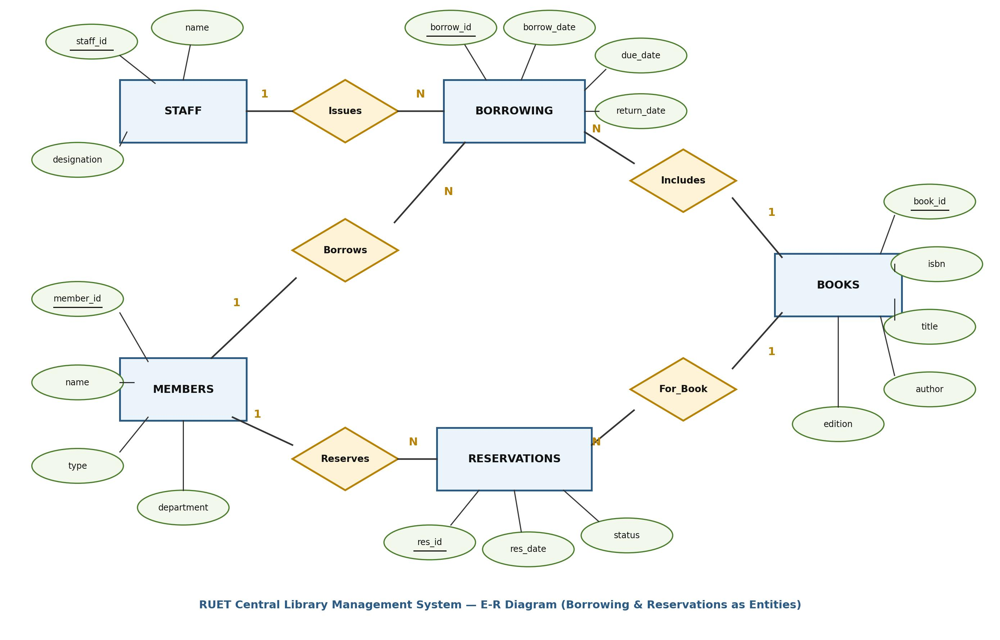

[← Prev: T01 · DB Concepts and Architecture](T01_DB_Concepts_and_Architecture.md) | [Exam-style layer](../Topicwise_answers_exam_style/T02_ER_and_EER_Modeling.md) | [Next: T03 · Relational Model, Keys & Integrity →](T03_Relational_Model_Keys_and_Integrity.md)

---

# T02 · E-R and EER Modeling

> [!info] Topic card
> **Syllabus:** Unit 2 · **Weight:** 67 final marks (10.5%) in 7/7 papers + 10 CT marks
> **Sources:** Deck 05 · Textbook Ch. 6
> **Blocks in this file:** 18 final + 1 CT questions (15 blocks)

## Subtopics in this file

| ID | Subtopic | Marks (Finals + CT) | Questions | Jump |
| :-- | :-- | :--: | :-- | :-- |
| T02.1 | Entity sets, relationship sets, types of relationships | 4 + 0 | 2021 Q.5(a) | [[#T02.1 · Entity sets, relationship sets, types of relationships\|Go]] |
| T02.2 | Attribute types | 8 + 0 | 2020 Q.5(a), 2021 Q.3(b) | [[#T02.2 · Attribute types\|Go]] |
| T02.3 | Mapping cardinality and participation constraints | 8 + 0 | 2018 Q.3(c), 2020 Q.1(c) | [[#T02.3 · Mapping cardinality and participation constraints\|Go]] |
| T02.4 | Weak vs strong entity sets | 11 + 0 | 2018 Q.1(b), 2019 Q.1(b), 2020 Q.2(c), 2021 Q.8(c) | [[#T02.4 · Weak vs strong entity sets\|Go]] |
| T02.5 | Design a full E-R diagram for a scenario | 24 + 10 | 2017 Q.1(b), 2018 Q.1(c), 2019 Q.1(c), 2023 Q.1(a), 2024 Q.1(b), CT-02 Q.02 | [[#T02.5 · Design a full E-R diagram for a scenario\|Go]] |
| T02.6 | Reduction of E-R to relational tables | 5 + 0 | 2018 Q.2(c) | [[#T02.6 · Reduction of E-R to relational tables\|Go]] |
| T02.7 | EER: specialization / generalization | 2 + 0 | 2017 Q.6(a) | [[#T02.7 · EER: specialization / generalization\|Go]] |
| T02.8 | EER: aggregation | 5 + 0 | 2018 Q.2(b), 2020 Q.3(a) | [[#T02.8 · EER: aggregation\|Go]] |

---

## T02.1 · Entity sets, relationship sets, types of relationships

### 2021 Q.5(a) · 04 Marks

*Section B · CLO1 · Asked in: 2021 · L1 (asked once)*

**Question.** What is ER diagram? Illustrate different types of relationship that can be represented in ER diagram.

**Answer.**

**What the examiner wants.**  
A concise definition of an Entity-Relationship (E-R) diagram (1 mark). An explanation and illustration of relationship types classified by their degree: unary (recursive), binary, and ternary (3 marks).

**Key idea.**  
An E-R diagram models a business enterprise visually. It maps entities as rectangles, attributes as ellipses, and relationships as diamonds. The degree tells you how many entity sets take part in a relationship. Binary is by far the most common, but unary and ternary also exist.

**Step-by-step solution.**  
An **Entity-Relationship (E-R) diagram** is a graphical tool used in database design. It represents the conceptual schema of an enterprise by depicting entities, their attributes, and the relationships among them.

The **degree** of a relationship set is the number of participating entity sets. Different types of relationships based on degree include:

1. **Unary (Recursive) Relationship (Degree 1):**
   - The same entity set participates more than once in different roles.
   - *Example:* A `course` entity related to another `course` entity via a `prereq` relationship (roles: `course_id` and `prereq_id`).

2. **Binary Relationship (Degree 2):**
   - Involves two distinct entity sets. This is the most common relationship type.
   - *Example:* `instructor` and `student` linked by the `advisor` relationship.

3. **Ternary Relationship (Degree 3):**
   - Involves three distinct entity sets simultaneously.
   - *Example:* `proj_guide` linking `instructor`, `student`, and `project`.

| Relationship Type | Degree | Description | Example |
| :--- | :---: | :--- | :--- |
| **Unary (Recursive)** | 1 | Association among entities of the same entity set | Course $\xrightarrow{\text{prereq}}$ Course |
| **Binary** | 2 | Association between two distinct entity sets | Instructor $\xrightarrow{\text{advisor}}$ Student |
| **Ternary** | 3 | Association among three distinct entity sets | Instructor, Student, Project $\xrightarrow{\text{proj\_guide}}$ |
| **$n$-ary** | $n$ | Association among $n$ entity sets | Rare; usually decomposed into binary |

**Check.**  
*Quick self-test:*
- Q: What is the degree of a recursive relationship?  
  A: It is 1 (unary), because only one entity set participates, even though entities take on distinct roles.
- Q: Can an $n$-ary relationship always be converted to binary relationships?  
  A: Yes. An artificial entity set can replace the $n$-ary diamond by connecting to each entity set via binary relationships.

> [!warning] Common mistakes
> - Confusing relationship types based on degree (unary, binary, ternary) with mapping cardinalities (1:1, 1:N, M:N). If asked for relationship types, degree is the primary classification.
> - Forgetting role indicators in unary relationships. A recursive relationship requires distinct role labels like `prereq_id` and `course_id`.

**Exam tip.**  
Define the E-R diagram in two sentences. Then present the three degree types using a clear summary table with real examples from the lecture slides.

**Sources.**  
- [Deck 05 · Slides 5, 8–16](../LectureSlides/05_ER_Model.md)  
- [Textbook Ch. 6 §6.2](../Textbook/Chapter_06_ER_Model/Chapter%2006%20-%20Database%20Design%20Using%20the%20E-R%20Model.md)

---

## T02.2 · Attribute types

### 2020 Q.5(a) · 04 Marks

*Section B · Asked in: 2020 · L1 (asked once)*

**Question.** Differentiate between-  
(i) Simple and composite attribute  
(ii) Single-valued and multi-valued attribute

**Answer.**

**What the examiner wants.**  
Clear pairwise distinctions: 2 marks for simple vs composite, and 2 marks for single-valued vs multi-valued. The examiner looks for definitions, divisibility, storage impact, and concrete examples.

**Key idea.**  
Attributes describe entities. Some attributes are indivisible (simple), while others contain smaller subparts (composite). Similarly, some attributes hold only one value per record (single-valued), while others can hold a set of values (multi-valued).

**Step-by-step solution.**  
**(i) Simple vs Composite Attribute:**

| Feature | Simple (Atomic) Attribute | Composite Attribute |
| :--- | :--- | :--- |
| **Definition** | Cannot be divided into smaller subparts. | Can be divided into smaller subparts that form independent attributes. |
| **Structure** | Holds a single atomic value from its domain. | Forms a hierarchy of component attributes. |
| **E-R Notation** | Single ellipse connected to the entity rectangle. | An ellipse connected to component ellipses. |
| **Storage / Schema** | Maps to a single column in a relational table. | Flattened into separate columns for each subpart. |
| **Example** | `salary`, `student_id`, `credits` | `name` (`first_name`, `last_name`), `address` (`street`, `city`, `zip_code`) |

**(ii) Single-Valued vs Multi-Valued Attribute:**

| Feature | Single-Valued Attribute | Multi-Valued Attribute |
| :--- | :--- | :--- |
| **Definition** | Holds at most one value for a specific entity instance. | Can hold a set of values for a single entity instance. |
| **Values per Entity** | Exactly one value per record. | Zero, one, or multiple values per record. |
| **E-R Notation** | Single ellipse. | Double ellipse (concentric ellipses). |
| **Table Conversion** | Stored directly in the main entity table. | Converted into a separate table with the entity primary key. |
| **Example** | `date_of_birth`, `roll_no`, `nid` | `phone_numbers`, `degrees`, `email_addresses` |

**Check.**  
*Quick self-test:*
- Q: How does first normal form (1NF) treat multi-valued attributes?  
  A: Relational tables require atomic values. So multi-valued attributes must move to a separate table.
- Q: Is a person's age a simple or composite attribute?  
  A: It is simple. But it is also a derived attribute computed from `date_of_birth`.

> [!warning] Common mistakes
> - Giving definitions without examples. Examiners deduct half marks if examples are missing.
> - Confusing composite with multi-valued. A composite attribute has multiple subparts of different meanings (like street, city). A multi-valued attribute has multiple values of the exact same kind (like two phone numbers).

**Exam tip.**  
Use two separate comparison tables. This shows structure immediately and guarantees all 4 marks.

**Sources.**  
- [Deck 05 · Slides 17–19](../LectureSlides/05_ER_Model.md)  
- [Textbook Ch. 6 §6.2](../Textbook/Chapter_06_ER_Model/Chapter%2006%20-%20Database%20Design%20Using%20the%20E-R%20Model.md)

---

### 2021 Q.3(b) · 04 Marks

*Section A · CLO4 · Asked in: 2021 · L1 (asked once)*

**Question.** Define entity and attribute. Explain the following attributes-  
(i) Multi-valued  
(ii) Derived  
(iii) Composite

**Answer.**

**What the examiner wants.**  
Definitions of entity and attribute (1 mark total). Explanations of multi-valued, derived, and composite attributes with visual notations and examples (1 mark each, 3 marks total).

**Key idea.**  
An entity is an object that exists in the real world. Attributes are the characteristics that describe it. The E-R model provides special graphical notation for attributes that hold sets of values, values computed on the fly, or values composed of parts.

**Step-by-step solution.**  
- **Entity:** A "thing" or "object" in the real world that exists and is distinguishable from other objects (e.g., a specific instructor `ID = 22222`, or a student).
- **Attribute:** A descriptive property possessed by all members of an entity set (e.g., `name`, `salary`).

**Explanation of Attribute Types:**

1. **Multi-valued Attribute:**
   - Holds a set of multiple values for a single entity instance.
   - Depicted by a **double ellipse** in Chen notation.
   - *Example:* An instructor may have multiple phone numbers (`phone_numbers` = `{0171..., 0181...}`).

2. **Derived Attribute:**
   - The value is not stored directly. It is computed from stored attributes or system values.
   - Depicted by a **dashed ellipse** in Chen notation.
   - *Example:* `age` derived from current date minus `date_of_birth`.

3. **Composite Attribute:**
   - Can be divided into smaller component attributes with independent meanings.
   - Depicted by an ellipse with attached branches leading to sub-ellipses.
   - *Example:* `name` divided into `first_name`, `middle_initial`, and `last_name`.


*Figure: Complex Attributes in ER Diagram Notation (Deck 05, Slide 19)*

**Check.**  
*Quick self-test:*
- Q: Why should `age` not be stored directly as a base attribute?  
  A: Because age changes constantly. Storing it leads to stale data unless updated daily. Deriving it from `date_of_birth` is always accurate.
- Q: What symbol marks a derived attribute in Chen notation?  
  A: A dashed ellipse.

> [!warning] Common mistakes
> - Writing that derived attributes are stored in the database. They are typically computed at query time or represented by views.
> - Drawing single ellipses for multivalued attributes instead of double concentric ellipses.

**Exam tip.**  
Mention both the definition and the specific Chen diagram symbol (double ellipse, dashed ellipse, branched ellipse) for each attribute type.

**Sources.**  
- [Deck 05 · Slides 7, 17–19](../LectureSlides/05_ER_Model.md)  
- [Textbook Ch. 6 §6.2](../Textbook/Chapter_06_ER_Model/Chapter%2006%20-%20Database%20Design%20Using%20the%20E-R%20Model.md)

---

## T02.3 · Mapping cardinality and participation constraints

### 2018 Q.3(c) · 04 Marks

*Section A · Asked in: 2018 · L1 (asked once)*

**Question.** What is mapping cardinality? How a many to many relationship can be converted into table. Explain with example.

**Answer.**

**What the examiner wants.**  
Definition of mapping cardinality (1 mark). Clear explanation of how an M:N relationship becomes a table (1.5 marks). A concrete worked example showing schemas, primary keys, and foreign keys (1.5 marks).

**Key idea.**  
When entities have an M:N relationship, we cannot place the foreign key in either entity table without causing repeating groups or nulls. So we create a separate junction table. Its primary key combines the primary keys of both participating entities.

**Step-by-step solution.**  
**Mapping Cardinality:**  
Mapping cardinality (or cardinality ratio) expresses the number of entities to which another entity can be associated via a relationship set. For binary relationships, it must be 1:1, 1:N, N:1, or M:N.

**Conversion of a Many-to-Many (M:N) Relationship into a Table:**
1. Create a dedicated relation schema for the relationship set.
2. Include the primary key of each participating entity set as foreign keys in this new table.
3. Include any descriptive attributes associated with the relationship set.
4. The composite primary key of the new table is formed by the union of the primary keys of both participating entity sets.


*Figure: Many-to-Many Relationship Model and Reduction to Relational Table*

**Example:**
- Entity `STUDENT` with attributes `student_id` (PK), `name`.
- Entity `COURSE` with attributes `course_id` (PK), `title`.
- Relationship `Takes` (M:N) with descriptive attribute `grade`.

**Relational Schemas:**

**student**(**student_id**, name)  
`PK: student_id`

**course**(**course_id**, title)  
`PK: course_id`

**takes**(**student_id**, **course_id**, grade)  
`PK: (student_id, course_id)`  
`FK: student_id references student(student_id), course_id references course(course_id)`

**Check.**  
*Trace check:*
- Suppose student `S1` takes courses `C1` and `C2`.
- Student `S2` also takes course `C1`.
- Table `takes` stores:
  - `(S1, C1, 'A')`
  - `(S1, C2, 'B')`
  - `(S2, C1, 'A')`
- Every row is distinct. The composite key `(student_id, course_id)` uniquely identifies each enrollment.

> [!warning] Common mistakes
> - Choosing only one column as the primary key of the junction table. Both foreign keys together are needed to form the minimal superkey.
> - Forgetting descriptive attributes of the relationship (like `grade`) when creating the junction table.

**Exam tip.**  
State the general rule first (`PK = PK(E1) ∪ PK(E2)`). Then write out the exact schema with `PK:` and `FK:` lines.

**Sources.**  
- [Deck 05 · Slides 20, 45](../LectureSlides/05_ER_Model.md)  
- [Textbook Ch. 6 §6.4, §6.6](../Textbook/Chapter_06_ER_Model/Chapter%2006%20-%20Database%20Design%20Using%20the%20E-R%20Model.md)

---

### 2020 Q.1(c) · 04 Marks

*Section A · Asked in: 2020 · L1 (asked once)*

**Question.** What is mapping cardinalities? Define different types of cardinalities.

**Answer.**

**What the examiner wants.**  
Definition of mapping cardinalities (1 mark). Formal definitions and examples for each of the four binary cardinality ratios: 1:1, 1:N, N:1, and M:N (3 marks).

**Key idea.**  
Mapping cardinalities place limits on the number of relationship instances an entity can join. In a binary relationship between sets $A$ and $B$, arrows in the E-R diagram denote "one" and undirected lines denote "many".

**Step-by-step solution.**  
**Mapping Cardinality:**  
Mapping cardinality specifies how many entities from one entity set can be associated with entities from another entity set through a binary relationship set.

**Types of Mapping Cardinalities:**

1. **One-to-One (1:1):**
   - An entity in $A$ is associated with at most one entity in $B$, and an entity in $B$ is associated with at most one entity in $A$.
   - *Example:* A department has at most one head (`dept_head`).

2. **One-to-Many (1:N):**
   - An entity in $A$ is associated with any number (0 or more) of entities in $B$. An entity in $B$ is associated with at most one entity in $A$.
   - *Example:* An instructor advises many students, but each student has at most one advisor.

3. **Many-to-One (N:1):**
   - An entity in $A$ is associated with at most one entity in $B$. An entity in $B$ is associated with any number of entities in $A$.
   - *Example:* Many students belong to one department.

4. **Many-to-Many (M:N):**
   - An entity in $A$ is associated with any number of entities in $B$, and an entity in $B$ is associated with any number of entities in $A$.
   - *Example:* A student can register for multiple courses, and a course can contain multiple students.

*See also:* [[#2018 Q.1(c) · 05 Marks]] (tests participation constraints) and [[#CT-02 Q.02 · 10 Marks]] (identifies entities, keys, relationships, and cardinalities).

**Check.**  
*Quick self-test:*
- Q: How does Chen notation represent cardinality on relationship lines?  
  A: Either by writing "1", "N", "M" near the entity sets, or by drawing a directed arrow ($\rightarrow$) for "one" and an undirected line for "many".
- Q: If a student can have multiple advisors, does the relationship remain 1:N?  
  A: No, it becomes Many-to-Many (M:N).

> [!warning] Common mistakes
> - Writing vague descriptions like "one thing links to many things" without mentioning "at most one" and "zero or more".
> - Confusing Many-to-One with One-to-Many. They are simply directional mirrors of each other.

**Exam tip.**  
Use bullet points with the format: name, formal rule, and everyday university schema example.

**Sources.**  
- [Deck 05 · Slides 20–26](../LectureSlides/05_ER_Model.md)  
- [Textbook Ch. 6 §6.4](../Textbook/Chapter_06_ER_Model/Chapter%2006%20-%20Database%20Design%20Using%20the%20E-R%20Model.md)

---

## T02.4 · Weak vs strong entity sets

### 2018 Q.1(b) · 04 Marks

*Section A · Asked in: 2018, 2020, 2021 (CLO1) · L2 merge*

**Question (2018 Q.1(b)).** Define entity set. Explain the following with suitable example: (i) strong entity set and (ii) weak entity set.

**Question (2020 Q.2(c)).** Explain the difference between a weak and a strong entity set with appropriate example.

**Question (2021 Q.8(c)).** Explain weak and strong entity set with appropriate example.

**Answer.**

**What the examiner wants.**  
Definition of an entity set (1 mark). Comprehensive comparison and explanation of strong vs weak entity sets (2 marks). Concrete examples showing the identifying relationship, discriminator, and composite primary key (1 mark).

**Key idea.**  
A strong entity set has enough attributes to tell every record apart. A weak entity set does not. A weak entity depends on an owner entity for its existence and identity. Its key is formed by taking the owner's primary key and attaching its own partial key (discriminator).

**Step-by-step solution.**  
**Entity Set:**  
An entity set is a collection of entities of the same type that share the same properties or attributes (e.g., the set of all students in a university).

| Feature | Strong Entity Set | Weak Entity Set |
| :--- | :--- | :--- |
| **Primary Key** | Has sufficient attributes to form its own primary key. | Lacks a primary key of its own. Uses a partial key (discriminator). |
| **Existence Dependency** | Independent. Does not depend on another entity set. | Existence-dependent on an identifying (strong) entity set. |
| **E-R Notation** | Single rectangle. | Double rectangle. |
| **Relationship Set** | Connected via regular relationship (single diamond). | Connected via identifying relationship (double diamond). |
| **Discriminator Key** | None (uses full primary key underlined with solid line). | Has a discriminator underlined with a dashed line. |
| **Composite PK** | Its own primary key. | Formed by (Owner Primary Key + Discriminator). |
| **Example** | `course` with primary key `course_id`. | `section` with discriminator `sec_id`, `semester`, `year`. |


*Figure: Expressing Weak Entity Sets in ER Diagram (Deck 05, Slide 37)*

- **Strong Entity Set Example:** `course` has attributes `course_id` (PK), `title`, `credits`. It exists independently.
- **Weak Entity Set Example:** `section` has attributes `sec_id`, `semester`, `year`. A section number like `Sec 1` is meaningless without knowing the course. Its full primary key is `(course_id, sec_id, semester, year)`.

*Short version for 2020 Q.2(c) and 2021 Q.8(c) (2 marks):*  
State the comparison table rows (Primary Key, Dependency, Notation, Example) and omit the separate entity set definition.

**Check.**  
*Quick self-test:*
- Q: What happens to a section tuple if the corresponding course tuple is deleted?  
  A: Because the section is existence-dependent, the section tuple must also be deleted (cascading delete).
- Q: How is a discriminator underlined in an E-R diagram?  
  A: With a dashed line.

> [!warning] Common mistakes
> - Thinking a weak entity set has no key attributes at all. It does have a discriminator (partial key).
> - Forgetting the double diamond for the identifying relationship. Drawing a single diamond loses marks.

**Exam tip.**  
Always mention the standard textbook example (`course` and `section`). Show the exact composite primary key formula.

**Sources.**  
- [Deck 05 · Slides 34–37](../LectureSlides/05_ER_Model.md)  
- [Textbook Ch. 6 §6.5](../Textbook/Chapter_06_ER_Model/Chapter%2006%20-%20Database%20Design%20Using%20the%20E-R%20Model.md)

---

### 2019 Q.1(b) · 03 Marks

*Section A · Asked in: 2019 · L1 (asked once)*

**Question.** What are entity and entity set? How is a weak entity set handled in DBMS? Explain.

**Answer.**

**What the examiner wants.**  
Definitions of entity and entity set (1 mark). Clear explanation of the technical steps a DBMS uses to implement a weak entity set in relational tables (2 marks).

**Key idea.**  
Relational databases do not have a native "weak table" type. Instead, a DBMS handles weak entities by importing the owner table's primary key as a foreign key, combining it with the discriminator to create the primary key, and enforcing cascade deletion.

**Step-by-step solution.**  
- **Entity:** An object that exists in the real world and is distinguishable from other objects.
- **Entity Set:** A collection of entities of the same type sharing the same attributes.

**Handling a Weak Entity Set in DBMS:**
1. **Primary Key Formation:** The DBMS cannot identify weak entity tuples by local attributes alone. It combines the primary key of the identifying strong entity with the weak entity's discriminator (partial key).
   $$\text{PK}(\text{Weak}) = \text{PK}(\text{Identifying Entity}) \cup \text{Discriminator}$$
2. **Table Schema Reduction:** A dedicated table is created for the weak entity. It includes the identifying entity's primary key as a foreign key along with all weak entity attributes. The identifying relationship does not need a separate table.
3. **Foreign Key Integrity with Cascade:** The identifying foreign key is declared with `ON DELETE CASCADE`. If the owner entity tuple is deleted, all dependent weak entity tuples are automatically removed.

**Check.**  
*SQL Schema Implementation Check:*
```sql
CREATE TABLE section (
    course_id   VARCHAR(8),
    sec_id      VARCHAR(8),
    semester    VARCHAR(6),
    year        NUMERIC(4,0),
    PRIMARY KEY (course_id, sec_id, semester, year),
    FOREIGN KEY (course_id) REFERENCES course(course_id) ON DELETE CASCADE
);
```
The table schema directly demonstrates how the identifying foreign key combines with the discriminator to form the primary key.

> [!warning] Common mistakes
> - Creating an extra table for the identifying relationship. In relational reduction, the identifying relationship is redundant because the foreign key is already inside the weak entity table.
> - Omitting `ON DELETE CASCADE`, which is essential to enforce existence dependency.

**Exam tip.**  
List the three clear database steps: primary key construction, table creation without relationship table, and cascading deletion.

**Sources.**  
- [Deck 05 · Slides 34–36, 42, 48](../LectureSlides/05_ER_Model.md)  
- [Textbook Ch. 6 §6.5, §6.6.2](../Textbook/Chapter_06_ER_Model/Chapter%2006%20-%20Database%20Design%20Using%20the%20E-R%20Model.md)

---

## T02.5 · Design a full E-R diagram for a scenario

### 2017 Q.1(b) · 06 Marks

*Section A · Asked in: 2017, 2024 (CO3) · L2 merge*

**Question (2017 Q.1(b)).** Draw an E-R diagram for RUET student database which can be used to store student's basic information, course advisor's information, subject registration, result information.

**Question (2024 Q.1(b)).** Draw an E-R diagram for RUET student database which can be used to store student’s basic information, course advisor’s information, subject registration, result information.

**Answer.**

**What the examiner wants.**  
A complete E-R diagram in Chen notation covering all 4 specified functional areas: student basic info, course advisor, subject registration, and examination results. The diagram must show entities, primary keys underlined, relationships, descriptive attributes, and cardinalities.

**Key idea.**  
Map each requirement to an entity set or relationship. `STUDENT` connects to `ADVISOR` through a 1:N relationship, to `COURSE` through an M:N registration relationship, and to `RESULT` through a 1:N result relationship.

**Step-by-step solution.**  
**Design Specifications:**
1. **STUDENT:** Basic information entity with primary key `roll_no`. Attributes: `name`, `dept_name`, `series`.
2. **ADVISOR:** Faculty advisor entity with primary key `advisor_id`. Attributes: `name`, `designation`, `department`.
3. **COURSE (SUBJECT):** Academic course entity with primary key `course_code`. Attributes: `course_title`, `credits`.
4. **RESULT:** Semester examination outcome entity with primary key `result_id`. Attributes: `semester`, `gpa`, `cgpa`.

**Relationships:**
- `Advises` (1:N): An advisor guides multiple students. Each student has one advisor (total participation of student).
- `Registers` (M:N): Students register for multiple courses, and courses have many students. Descriptive attributes: `session`, `semester`.
- `Obtains` (1:N): Each student obtains multiple semester results (total participation of result).


*Figure: RUET Student Database Conceptual E-R Diagram*

*Short version for 2024 Q.1(b) (2 marks):*  
Draw the 4 entity rectangles (`STUDENT`, `ADVISOR`, `COURSE`, `RESULT`) and 3 relationship diamonds (`Advises`, `Registers`, `Obtains`) with primary keys underlined (`roll_no`, `advisor_id`, `course_code`, `result_id`) and cardinality labels (1:N, M:N, 1:N). Omit secondary descriptive attributes to complete within 2 marks.

**Check.**  
*Coverage check against requirements:*
- Student basic info: `STUDENT` entity with `roll_no`, `name`, `dept_name`, `series`.
- Course advisor info: `ADVISOR` entity and `Advises` relationship.
- Subject registration: `COURSE` entity and `Registers` M:N relationship with `semester` and `session`.
- Result info: `RESULT` entity and `Obtains` 1:N relationship.

> [!warning] Common mistakes
> - Putting `advisor_id` directly as an attribute inside `STUDENT`. In E-R modeling, relationships must be represented by diamonds, not redundant foreign key attributes.
> - Forgetting descriptive attributes on the `Registers` relationship (like `session` or `semester`).

**Exam tip.**  
Start by drawing the 4 main entity rectangles in a clean layout. Add the relationship diamonds, then attach the attribute ellipses with keys underlined.

**Sources.**  
- [Deck 05 · Slides 7–39](../LectureSlides/05_ER_Model.md)  
- [Textbook Ch. 6 §6.2–§6.4](../Textbook/Chapter_06_ER_Model/Chapter%2006%20-%20Database%20Design%20Using%20the%20E-R%20Model.md)

---

### 2018 Q.1(c) · 05 Marks

*Section A · Asked in: 2018 · L1 (asked once)*

**Question.** What is E-R model? Draw an E-R diagram that includes teacher, student and course entities with following constraints: (i) Each teacher must take at least one course; (ii) A student can register one or more courses; (iii) A course may have teacher or not.

**Answer.**

**What the examiner wants.**  
Definition of the E-R model (1 mark). An accurate Chen-notation E-R diagram enforcing three exact participation and cardinality constraints (4 marks): double line on teacher, double line on student, and single line on course.

**Key idea.**  
"Must take at least one" or "can register one or more" means minimum participation is 1, which requires a double line (total participation). "May have teacher or not" means minimum participation is 0, which requires a single line (partial participation).

**Step-by-step solution.**  
**E-R Model:**  
The Entity-Relationship (E-R) model is a high-level conceptual data model. It views the real-world enterprise as a collection of basic objects called entities and relationships among these objects.

**Constraints Mapping in E-R Diagram:**
- *(i) Each teacher must take at least one course:*  
  **Total participation** of `TEACHER` in relationship `Teaches`, represented by a **double line** from `TEACHER` to `Teaches` (cardinality $1..\text{*}$).
- *(ii) A student can register one or more courses:*  
  **Total participation** of `STUDENT` in relationship `Registers`, represented by a **double line** from `STUDENT` to `Registers` (cardinality $1..\text{*}$, M:N relationship).
- *(iii) A course may have teacher or not:*  
  **Partial participation** of `COURSE` in relationship `Teaches`, represented by a **single line** from `COURSE` to `Teaches` (cardinality $0..1$ or $0..\text{*}$).


*Figure: E-R Diagram with Total and Partial Participation Constraints*

**Check.**  
*Constraint verification:*
- Teacher participation: Double line present $\checkmark$ (enforces $\ge 1$ course per teacher).
- Student participation: Double line present $\checkmark$ (enforces $\ge 1$ course per student).
- Course participation in `Teaches`: Single line present $\checkmark$ (allows 0 teachers for a course).

> [!warning] Common mistakes
> - Drawing single lines for Teacher and Student. The question explicitly says "at least one" and "one or more", which tests total participation (double lines).
> - Reversing the double line to the Course side.

**Exam tip.**  
Highlight the double lines clearly on your answer sheet and add a short two-line note listing the constraints. Examiners check the line style first.

**Sources.**  
- [Deck 05 · Slides 27–28](../LectureSlides/05_ER_Model.md)  
- [Textbook Ch. 6 §6.4.2](../Textbook/Chapter_06_ER_Model/Chapter%2006%20-%20Database%20Design%20Using%20the%20E-R%20Model.md)

---

### 2019 Q.1(c) · 06 Marks

*Section A · Asked in: 2019 · L1 (asked once)*

**Question.** Suppose you are recruited as a database specialist by the Rajshahi High-Tech authority to help them design a database for train e-ticketing system efficiently. Now think the regular features and draw an E-R diagram accordingly.

**Answer.**

**What the examiner wants.**  
A realistic, domain-specific E-R diagram for an online railway ticketing system (6 marks). The diagram needs primary entities (Passenger, Ticket, Train, Station), realistic attributes, primary keys underlined, and proper relationship cardinalities.

**Key idea.**  
A train ticketing system manages passengers buying tickets for specific trains traveling along routes made of stations. Tickets are the central transaction records linking passengers to trains.

**Step-by-step solution.**  
**System Requirements & Entities:**
1. **PASSENGER:** Stores account details. Attributes: `user_id` (PK), `name`, `nid`, `phone`.
2. **TICKET:** Represents booked travel tickets. Attributes: `ticket_no` (PK), `journey_date`, `seat_no`, `fare`, `class`.
3. **TRAIN:** Represents trains. Attributes: `train_no` (PK), `train_name`, `total_seats`.
4. **STATION:** Represents railway stops. Attributes: `station_code` (PK), `station_name`, `city`.

**Relationships:**
- `Books` (1:N): A passenger books one or more tickets. Each ticket is booked by one passenger (descriptive attribute: `booking_date`).
- `For_Train` (N:1): Many tickets belong to a specific train. Each ticket is assigned to exactly one train.
- `Stops_At` (M:N): Trains stop at multiple stations, and stations service multiple trains. Descriptive attributes: `arrival_time`, `dep_time`.


*Figure: Train E-Ticketing System E-R Diagram*

**Check.**  
*Workflow validation:*
- Passenger logs in and selects a train route (`Stops_At` schedule).
- Passenger books a seat (`Books` relationship produces a `TICKET`).
- The ticket links directly to the specific train (`For_Train` relationship).

> [!warning] Common mistakes
> - Making an M:N direct relationship between Passenger and Train without a Ticket entity. A physical ticket has seat number, coach, journey date, and fare that need their own entity.
> - Forgetting schedule attributes (`arrival_time`, `dep_time`) on the `Stops_At` relationship.

**Exam tip.**  
Write out the 4 entities and their keys in bullet points before drawing. This keeps the diagram structured and easy to read.

**Sources.**  
- [Deck 05 · Slides 7–39](../LectureSlides/05_ER_Model.md)  
- [Textbook Ch. 6 §6.2–§6.4](../Textbook/Chapter_06_ER_Model/Chapter%2006%20-%20Database%20Design%20Using%20the%20E-R%20Model.md)

---

### 2023 Q.1(a) · 05 Marks

*Section A · CLO4 · Asked in: 2023 · L1 (asked once)*

**Question.** Draw an ER diagram for RUET Central Library Management System. You have to consider the entities mentioned below:  
(i) Books (ii) Members (iii) Staff (iv) Borrowing (v) Reservations

**Answer.**

**What the examiner wants.**  
An E-R diagram featuring the exact 5 entity sets specified in the question: Books, Members, Staff, Borrowing, and Reservations (5 marks). All entities must have attributes and primary keys, connected with meaningful relationships and cardinalities.

**Key idea.**  
Borrowing and Reservations are often modeled as relationships in simpler designs. But the prompt explicitly requires them as entities. So we model both as independent entity sets with their own unique IDs and transaction dates.

**Step-by-step solution.**  
*Design Note: Borrowing and Reservations are explicitly specified as entity sets in the prompt; each is modeled with its own unique identifier and transaction attributes.*

**Entity Sets & Attributes:**
1. **BOOKS:** `book_id` (PK), `isbn`, `title`, `author`, `edition`.
2. **MEMBERS:** `member_id` (PK), `name`, `type`, `department`.
3. **STAFF:** `staff_id` (PK), `name`, `designation`.
4. **BORROWING:** `borrow_id` (PK), `borrow_date`, `due_date`, `return_date`.
5. **RESERVATIONS:** `res_id` (PK), `res_date`, `status`.

**Relationships:**
- `Issues` (1:N): A staff member processes multiple borrowings.
- `Borrows` (1:N): A member initiates multiple borrowings.
- `Includes` (N:1): A borrowing record links to the specific book borrowed.
- `Reserves` (1:N): A member makes multiple book reservations.
- `For_Book` (N:1): A reservation is placed for a specific book.


*Figure: RUET Central Library Management System E-R Diagram*

**Check.**  
*Entity checklist:*
- (i) Books: Present as entity set `BOOKS` with PK `book_id` $\checkmark$
- (ii) Members: Present as entity set `MEMBERS` with PK `member_id` $\checkmark$
- (iii) Staff: Present as entity set `STAFF` with PK `staff_id` $\checkmark$
- (iv) Borrowing: Present as entity set `BORROWING` with PK `borrow_id` $\checkmark$
- (v) Reservations: Present as entity set `RESERVATIONS` with PK `res_id` $\checkmark$

> [!warning] Common mistakes
> - Drawing Borrowing or Reservations as relationship diamonds instead of entity rectangles. The question explicitly demands all 5 as entities.
> - Forgetting to connect `STAFF` to `BORROWING`. In a university library, staff members issue books.

**Exam tip.**  
Start your answer with the design note stating that Borrowing and Reservations are modeled as entity sets. Then draw all 5 as rectangles.

**Sources.**  
- [Deck 05 · Slides 7, 65](../LectureSlides/05_ER_Model.md)  
- [Textbook Ch. 6 §6.2, §6.7.3](../Textbook/Chapter_06_ER_Model/Chapter%2006%20-%20Database%20Design%20Using%20the%20E-R%20Model.md)

---

### CT-02 Q.02 · 10 Marks

*CO3 · Asked in: CT-02 · L1 (asked once)*

**Question.** A university maintains information about Students, Courses, and Teachers. A student can enroll in several courses and each course can have many students. Each course is taught by one teacher, though a teacher may teach several courses.  
**(a)** Identify the entities, attributes, primary keys, relationships, and cardinalities. `[04 Marks]`  
**(b)** Draw the complete ER diagram. `[06 Marks]`

**Answer.**

**What the examiner wants.**  
Part (a): Explicit identification and listing of all database design elements: entity sets, attributes, primary keys, relationship sets, and mapping cardinalities (4 marks).  
Part (b): A complete, well-proportioned Chen-notation E-R diagram reflecting all identified elements (6 marks).

**Key idea.**  
Extract business rules directly from the problem description:
- "Student enrolls in several courses and course can have many students" $\rightarrow$ Many-to-Many (`Enrolls`, M:N).
- "Course taught by one teacher, teacher teaches several courses" $\rightarrow$ One-to-Many (`Teaches`, 1:N from Teacher to Course).

**Step-by-step solution.**  
**(a) Identification of Components:**

| Component | Type | Details | Primary Key |
| :--- | :--- | :--- | :--- |
| **STUDENT** | Entity Set | Attributes: `student_id`, `name`, `email`, `dept_name` | `student_id` |
| **COURSE** | Entity Set | Attributes: `course_id`, `title`, `credits` | `course_id` |
| **TEACHER** | Entity Set | Attributes: `teacher_id`, `name`, `dept_name`, `phone` | `teacher_id` |
| **Enrolls** | Relationship Set | Connects `STUDENT` and `COURSE` | `(student_id, course_id)` |
| **Teaches** | Relationship Set | Connects `TEACHER` and `COURSE` | `course_id` |

**Cardinalities:**
- **Student to Course (`Enrolls`):** Many-to-Many (**M:N**). A student enrolls in several courses; each course has many students.
- **Teacher to Course (`Teaches`):** One-to-Many (**1:N**). A teacher teaches several courses; each course is taught by exactly one teacher.

**(b) Complete E-R Diagram:**


*Figure: University Enterprise Complete E-R Diagram*

**Check.**  
*Cardinality and rule verification:*
- Teacher has degree 1:N to Course: An arrow or "N" on the Course side and "1" on the Teacher side $\checkmark$
- Student has degree M:N to Course: Both sides have "M" and "N" labels $\checkmark$
- Primary keys are underlined in both the table and the diagram $\checkmark$

> [!warning] Common mistakes
> - Drawing a direct relationship between Student and Teacher. The prompt describes students enrolling in courses and teachers teaching courses. The link is through Course.
> - Skipping Part (a) and jumping straight to the diagram. That throws away 4 easy marks.

**Exam tip.**  
Fill out the structured table in Part (a) first. Then draw the diagram in Part (b). This shows the examiner that your diagram matches your formal analysis.

**Sources.**  
- [Deck 05 · Slides 7–39](../LectureSlides/05_ER_Model.md)  
- [Textbook Ch. 6 §6.2–§6.4](../Textbook/Chapter_06_ER_Model/Chapter%2006%20-%20Database%20Design%20Using%20the%20E-R%20Model.md)

---

## T02.6 · Reduction of E-R to relational tables

### 2018 Q.2(c) · 05 Marks

*Section A · Asked in: 2018 · L1 (asked once)*

**Question.** Consider a database used to record the marks that students get in different examinations of different course offerings. (i) Construct an E-R diagram that models examinations as entities, and uses a ternary relationship for the above database; (ii) Draw a relational data model for the above corresponding E-R diagram.

**Answer.**

**What the examiner wants.**  
Part (i): A Chen-notation E-R diagram showing a ternary relationship connecting Student, Course Offering, and Exam, with `marks` as a relationship attribute (2.5 marks).  
Part (ii): The relational schemas derived from the diagram, with primary keys and foreign keys clearly designated (2.5 marks).

**Key idea.**  
A ternary relationship associates three entities at once. When reduced to a relational schema, the ternary relationship becomes a table whose primary key is the composite union of the primary keys of all three participating entity sets.

**Step-by-step solution.**  
**(i) E-R Diagram with Ternary Relationship:**
- Participating Entity Sets: `STUDENT`, `COURSE_OFFERING`, `EXAM`.
- Ternary Relationship: `Scores` connecting all three entity sets.
- Relationship Attribute: `marks` (descriptive attribute placed on `Scores`).


*Figure: Ternary Relationship Model for Student Exam Marks*

**(ii) Relational Data Model (Relational Schemas):**

**student**(**student_id**, name, dept_name)  
`PK: student_id`

**course_offering**(**offering_id**, semester, year)  
`PK: offering_id`

**exam**(**exam_id**, exam_type, max_marks)  
`PK: exam_id`

**scores**(**student_id**, **offering_id**, **exam_id**, marks)  
`PK: (student_id, offering_id, exam_id)`  
`FK: student_id references student(student_id), offering_id references course_offering(offering_id), exam_id references exam(exam_id)`

*See also:* [[#2018 Q.3(c) · 04 Marks]] (conversion of M:N relationships into relational tables).

**Check.**  
*Primary key verification:*
- Can a student have different marks in different exams of the same course offering? Yes, `exam_id` varies.
- Can different students take the same exam in the same course offering? Yes, `student_id` varies.
- Therefore, all three keys `(student_id, offering_id, exam_id)` are required to uniquely determine `marks`.

> [!warning] Common mistakes
> - Putting `marks` inside the `EXAM` entity instead of on the relationship diamond. An exam has a maximum mark, but the actual marks obtained depend on the student, offering, and exam combined.
> - Breaking the ternary relationship into three separate binary relationships when the question explicitly asks for a ternary relationship.

**Exam tip.**  
For Part (ii), format the relations clearly. Put primary key columns in bold and write a dedicated `PK:` and `FK:` line under each relation.

**Sources.**  
- [Deck 05 · Slides 15–16, 41, 45](../LectureSlides/05_ER_Model.md)  
- [Textbook Ch. 6 §6.2.5, §6.6](../Textbook/Chapter_06_ER_Model/Chapter%2006%20-%20Database%20Design%20Using%20the%20E-R%20Model.md)

---

## T02.7 · EER: specialization / generalization

### 2017 Q.6(a) · 02 Marks

*Section B · Asked in: 2017 · L1 (asked once)*

**Question.** Write short note on specialization and generalization in DBMS.

**Answer.**

**What the examiner wants.**  
A concise conceptual note defining specialization (top-down) and generalization (bottom-up), noting attribute inheritance, and giving a quick example (2 marks).

**Key idea.**  
Specialization breaks a high-level entity into specialized sub-groups. Generalization combines multiple lower-level entities sharing traits into a broader category. Both use the **ISA** triangle in E-R diagrams.

**Step-by-step solution.**  
- **Specialization (Top-down):**  
  A top-down design process. A higher-level entity set is divided into lower-level entity sets that have distinctive attributes or participate in specific relationships.
  - *Example:* `person` specialized into `employee` and `student`.

- **Generalization (Bottom-up):**  
  A bottom-up design process. Multiple lower-level entity sets sharing common properties are synthesized into a single higher-level entity set.
  - *Example:* Combining `instructor` and `secretary` into `employee`.

- **Key Properties:**
  1. **Attribute Inheritance:** Lower-level entity sets automatically inherit all attributes and relationship participations of the higher-level entity.
  2. **Representation:** Depicted in E-R diagrams by a triangle labeled **ISA** ("is a").


*Figure: Specialization Hierarchy Example (Deck 05, Slide 51)*

**Check.**  
*Quick self-test:*
- Q: What are the two completeness constraints on generalization?  
  A: Total (every high-level entity must belong to a sub-entity) and Partial (an entity does not need to belong to any sub-entity).
- Q: What are disjointness constraints?  
  A: Disjoint (entity belongs to at most one sub-entity) and Overlapping (entity can belong to multiple sub-entities).

> [!warning] Common mistakes
> - Confusing top-down (specialization) with bottom-up (generalization).
> - Forgetting attribute inheritance, which is the core benefit of the EER model.

**Exam tip.**  
State "Top-down" for specialization and "Bottom-up" for generalization in your very first sentence.

**Sources.**  
- [Deck 05 · Slides 49–56](../LectureSlides/05_ER_Model.md)  
- [Textbook Ch. 6 §6.8](../Textbook/Chapter_06_ER_Model/Chapter%2006%20-%20Database%20Design%20Using%20the%20E-R%20Model.md)

---

## T02.8 · EER: aggregation

### 2018 Q.2(b) · 03 Marks

*Section A · Asked in: 2018, 2020 · L2 merge*

**Question (2018 Q.2(b)).** Define the concept of aggregation. Give two examples of where this concept is useful.

**Question (2020 Q.3(a)).** What is aggregation in ER-model design?

**Answer.**

**What the examiner wants.**  
Definition of aggregation (1 mark). Two concrete real-world examples explaining why aggregation is useful to avoid redundancy (2 marks).

**Key idea.**  
In standard E-R modeling, relationships cannot connect to other relationships. Aggregation solves this limitation. It wraps a relationship and its entities into a single abstract entity box, allowing other relationships to link to it directly.

**Step-by-step solution.**  
**Definition:**  
Aggregation is an abstraction in E-R modeling through which a relationship set is treated as a higher-level abstract entity set. This allows the relationship itself to participate in further relationships with other entity sets without duplicating attributes.


*Figure: Aggregation Representation in E-R Diagram (Deck 05, Slide 59)*

**Two Examples Where Aggregation is Useful:**

1. **Student Project Evaluation:**  
   The ternary relationship `proj_guide` associates `student`, `instructor`, and `project`. To record an `evaluation` for that specific guidance assignment, treating `proj_guide` as an aggregate entity avoids creating an overlapping ternary relationship. `evaluation` links directly to the aggregate `proj_guide` through the relationship `eval_for`.

2. **Employee Project Monitoring:**  
   Employees work on projects via the relationship `Works_On`. A manager needs to monitor that specific work assignment. By aggregating `Works_On` into an entity, the `manager` can participate in a relationship `Monitors` directly with the aggregate entity `(Employee, Project)`.

*Short version for 2020 Q.3(a) (2 marks):*  
Give the definition of aggregation and describe Example 1 (`proj_guide` with `eval_for`) in 2 lines.

**Check.**  
*Relational schema check for aggregation:*
- Aggregated relationship `proj_guide`: attributes `(s_id, project_id, i_id)`.
- Connecting relationship `eval_for`:
  $$\text{eval\_for}(\underline{\text{s\_id}}, \underline{\text{project\_id}}, \underline{\text{i\_id}}, \underline{\text{evaluation\_id}})$$
- This avoids duplicating the `proj_guide` relationship table.

> [!warning] Common mistakes
> - Confusing aggregation in E-R modeling with SQL aggregate functions (`COUNT`, `SUM`, `AVG`). In E-R modeling, aggregation means treating a relationship as an entity.
> - Drawing a relationship directly connected to another relationship diamond without enclosing it in an aggregate entity rectangle.

**Exam tip.**  
Define the concept clearly, mention the dashed/bounding rectangle around the relationship, and use the project guidance evaluation example from Deck 05 Slide 59.

**Sources.**  
- [Deck 05 · Slides 57–60](../LectureSlides/05_ER_Model.md)  
- [Textbook Ch. 6 §6.8.5](../Textbook/Chapter_06_ER_Model/Chapter%2006%20-%20Database%20Design%20Using%20the%20E-R%20Model.md)

---

[← Prev: T01 · DB Concepts and Architecture](T01_DB_Concepts_and_Architecture.md) | [Exam-style layer](../Topicwise_answers_exam_style/T02_ER_and_EER_Modeling.md) | [Next: T03 · Relational Model, Keys & Integrity →](T03_Relational_Model_Keys_and_Integrity.md)
