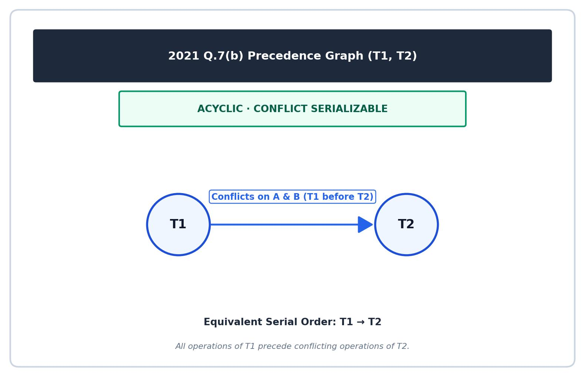
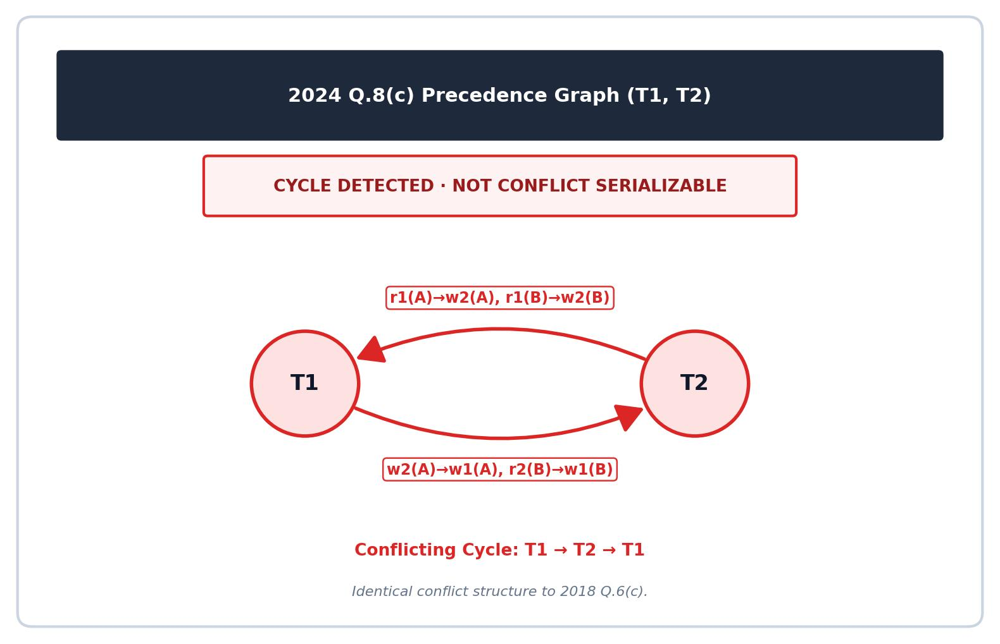
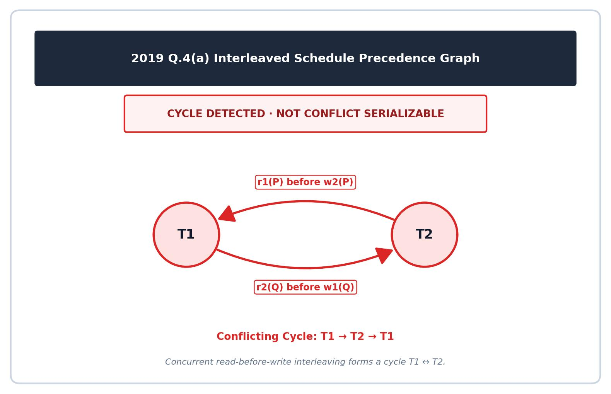
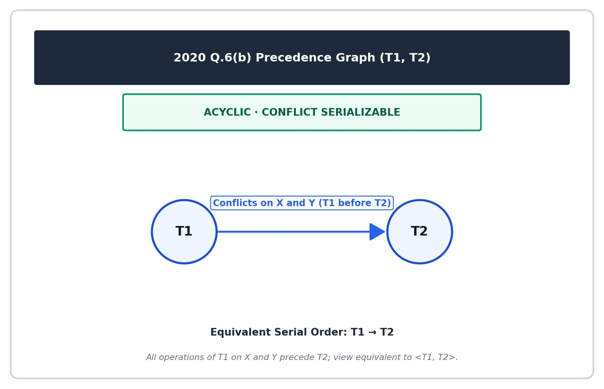

[← Prev: T09 · Transactions, ACID and Anomalies](T09_Transactions_ACID_and_Anomalies.md) | [Exam-style layer](../Topicwise_answers_exam_style/T10_Serializability.md) | [Next: T11 · Concurrency Control Protocols →](T11_Concurrency_Control_Protocols.md)

---

# T10 · Serializability

> [!info] Topic card
> **Syllabus:** Unit 6 · **Weight:** 51 final marks (8.0%) in 7/7 papers + 6 CT marks
> **Sources:** Deck 07 · Deck 08 · Textbook Ch. 17 §17.6–17.7 · Textbook Ch. 18 §18.5
> **Blocks in this file:** 11 final + 1 CT question blocks

## Subtopics in this file

| ID | Subtopic | Marks (Finals + CT) | Questions | Jump |
| :-- | :-- | :--: | :-- | :-- |
| T10.1 | Define conflicting instructions & conflict serializability | 2 + 0 | 2017 Q.5(b) | [[#T10.1 · Define conflicting instructions & conflict serializability\|Go]] |
| T10.2 | Conflict equivalence by swapping (proof) | 4 + 0 | 2020 Q.5(c) | [[#T10.2 · Conflict equivalence by swapping (proof)\|Go]] |
| T10.3 | Precedence-graph test → cycle → serial order(s) | 26 + 6 | 2018 Q.6(c), 2020 Q.6(a), 2021 Q.7(b), 2021 Q.7(c), 2023 Q.8(b), 2024 Q.8(c), CT-04 Q.04 | [[#T10.3 · Precedence-graph test → cycle → serial order(s)\|Go]] |
| T10.4 | Build serializable/non-serializable schedules ($T_1,T_2$ with "if A = 0 then B := B+1") | 13 + 0 | 2017 Q.5(c), 2019 Q.4(a) | [[#T10.4 · Build serializable/non-serializable schedules ($T_1,T_2$ with "if A = 0 then B := B+1")\|Go]] |
| T10.5 | View serializability (3 conditions, blind writes) | 6 + 0 | 2020 Q.6(b) | [[#T10.5 · View serializability (3 conditions, blind writes)\|Go]] |
| T10.6 | Recoverable / cascadeless / strict schedules | 0 + 0 | No questions | [[#T10.6 · Recoverable / cascadeless / strict schedules\|Go]] |

---

## T10.1 · Define conflicting instructions & conflict serializability

### 2017 Q.5(b) · 02 Marks

*Section B · Asked in: 2017 · L1 (asked once)*

**Question.** What do you know about conflict serializability?

**Answer.**

**What the examiner wants.** A crisp definition of conflict serializability (1 mark) and the rule identifying conflicting operations or graph testing (1 mark).

**Key idea.** A serial schedule executes transactions one after another with no overlap. It is inherently safe. A concurrent schedule interleaves operations from different transactions. If we can rearrange that concurrent schedule into a serial schedule by only swapping adjacent instructions that do not interfere with each other, the concurrent schedule is just as safe as the serial schedule. We call such a schedule conflict serializable.

**Step-by-step solution.**

1. **Definition of conflict equivalence:** Two schedules $S$ and $S'$ are **conflict equivalent** if schedule $S$ can be transformed into schedule $S'$ by a sequence of swaps of non-conflicting adjacent instructions.
2. **Definition of conflict serializability:** A schedule $S$ is **conflict serializable** if it is conflict equivalent to some serial schedule.
3. **When do instructions conflict?** Two instructions $I_i$ and $I_j$ belonging to different transactions $T_i$ and $T_j$ conflict if and only if both access the same data item $Q$, and at least one of them performs a write operation:
   - $\text{read}(Q)$ and $\text{read}(Q)$: No conflict (both only read).
   - $\text{read}(Q)$ and $\text{write}(Q)$: **Conflict** (changing order changes what is read).
   - $\text{write}(Q)$ and $\text{read}(Q)$: **Conflict** (changing order exposes an uncommitted write or old value).
   - $\text{write}(Q)$ and $\text{write}(Q)$: **Conflict** (changing order overwrites a different final value).
4. **Testing conflict serializability:** We build a directed graph called a **precedence graph** (or serialization graph). The transactions are vertices. We draw a directed edge $T_i \to T_j$ if an instruction of $T_i$ executes before a conflicting instruction of $T_j$.
5. **Serializability theorem:** A schedule is conflict serializable if and only if its precedence graph is **acyclic**. When acyclic, a topological sort gives the equivalent serial schedule order.

**Check.**
- *Quick check:* Can two operations on different data items ($A$ and $B$) conflict? No. Swapping them never changes any value.
- *Quick check:* Does an acyclic precedence graph guarantee serializability? Yes. Topological sorting produces a valid serial order without any conflicting dependency violations.

> [!warning] Common mistakes
> - Stating that two $\text{read}(Q)$ instructions conflict. Two reads on the same item do not conflict because reading never modifies data.
> - Confusing conflict serializability with view serializability. Conflict serializability requires non-conflicting adjacent instruction swaps. View serializability only requires matching read-from and final write states.
> - Forgetting that conflicting instructions must belong to different transactions.

**Exam tip.** For a 2-mark question, write the definition of conflict serializability and list the 4 read/write cases in 3 to 4 lines.

**Sources.**
- [Deck 07 · Slides 16–19](../LectureSlides/07_Transactions.md)
- [Textbook Ch. 17 §17.6](../Textbook/Chapter_17_Transactions/Chapter%2017%20-%20Transactions.md)

---

## T10.2 · Conflict equivalence by swapping (proof)

### 2020 Q.5(c) · 04 Marks

*Section B · Asked in: 2020 · L1 (asked once)*

**Question.** Draw a concurrent schedule equivalent to serial schedule. Prove its step by step swapping process.

**Answer.**

**What the examiner wants.** A drawn concurrent schedule table (1.5 marks), a clear statement of the swapping rule (0.5 marks), and the numbered step-by-step swap sequence that yields a serial schedule (2 marks).

**Key idea.** In an interleaved schedule, operations on different data items do not interfere. If transaction $T_2$ operates on item $A$ while transaction $T_1$ operates on item $B$, they do not conflict. We can safely push $T_1$'s operations to the left (earlier) and $T_2$'s operations to the right (later) by swapping adjacent pairs until all $T_1$ operations precede all $T_2$ operations.

**Step-by-step solution.**

#### 1. Define the Transactions and Draw the Concurrent Schedule

Let $T_1$ and $T_2$ be two transactions operating on items $A$ and $B$:
- $T_1$: $\text{read}(A) \to \text{write}(A) \to \text{read}(B) \to \text{write}(B)$
- $T_2$: $\text{read}(A) \to \text{write}(A) \to \text{read}(B) \to \text{write}(B)$

We draw the concurrent schedule $S$, where $T_2$'s operations on $A$ are interleaved before $T_1$'s operations on $B$:

| Step | $T_1$ | $T_2$ |
| :--: | :-- | :-- |
| 1 | $\text{read}(A)$ | |
| 2 | $\text{write}(A)$ | |
| 3 | | $\text{read}(A)$ |
| 4 | | $\text{write}(A)$ |
| 5 | $\text{read}(B)$ | |
| 6 | $\text{write}(B)$ | |
| 7 | | $\text{read}(B)$ |
| 8 | | $\text{write}(B)$ |

#### 2. Swapping Rule

Two adjacent instructions $I_i$ and $I_j$ can be swapped if and only if they do not conflict. Since $I_i$ accesses item $A$ and $I_j$ accesses item $B$, they access distinct data items ($A \neq B$). Therefore, they never conflict and can be swapped without changing the result of the schedule.

#### 3. Step-by-Step Swapping Proof

We move $T_1$'s instructions on $B$ ahead of $T_2$'s instructions on $A$:

- **Initial Instruction List:**
  1. $T_1: \text{read}(A)$
  2. $T_1: \text{write}(A)$
  3. $T_2: \text{read}(A)$
  4. $T_2: \text{write}(A)$
  5. $T_1: \text{read}(B)$
  6. $T_1: \text{write}(B)$
  7. $T_2: \text{read}(B)$
  8. $T_2: \text{write}(B)$

- **Swap 1:** Swap adjacent instructions at positions 4 and 5 ($T_2: \text{write}(A)$ and $T_1: \text{read}(B)$).
  - *Reason:* They access different items ($A \neq B$), so they do not conflict.
  - *New order:* $T_1:\text{r}(A), T_1:\text{w}(A), T_2:\text{r}(A), T_1:\text{r}(B), T_2:\text{w}(A), T_1:\text{w}(B), T_2:\text{r}(B), T_2:\text{w}(B)$.

- **Swap 2:** Swap adjacent instructions at positions 3 and 4 ($T_2: \text{read}(A)$ and $T_1: \text{read}(B)$).
  - *Reason:* Different items ($A \neq B$), no conflict.
  - *New order:* $T_1:\text{r}(A), T_1:\text{w}(A), T_1:\text{r}(B), T_2:\text{r}(A), T_2:\text{w}(A), T_1:\text{w}(B), T_2:\text{r}(B), T_2:\text{w}(B)$.

- **Swap 3:** Swap adjacent instructions at positions 5 and 6 ($T_2: \text{write}(A)$ and $T_1: \text{write}(B)$).
  - *Reason:* Different items ($A \neq B$), no conflict.
  - *New order:* $T_1:\text{r}(A), T_1:\text{w}(A), T_1:\text{r}(B), T_2:\text{r}(A), T_1:\text{w}(B), T_2:\text{w}(A), T_2:\text{r}(B), T_2:\text{w}(B)$.

- **Swap 4:** Swap adjacent instructions at positions 4 and 5 ($T_2: \text{read}(A)$ and $T_1: \text{write}(B)$).
  - *Reason:* Different items ($A \neq B$), no conflict.
  - *New order:* $T_1:\text{r}(A), T_1:\text{w}(A), T_1:\text{r}(B), T_1:\text{w}(B), T_2:\text{r}(A), T_2:\text{w}(A), T_2:\text{r}(B), T_2:\text{w}(B)$.

#### 4. Resulting Serial Schedule

The instructions now form a serial schedule $S'$ where $T_1$ executes completely, followed by $T_2$:

| Step | $T_1$ | $T_2$ |
| :--: | :-- | :-- |
| 1 | $\text{read}(A)$ | |
| 2 | $\text{write}(A)$ | |
| 3 | $\text{read}(B)$ | |
| 4 | $\text{write}(B)$ | |
| 5 | | $\text{read}(A)$ |
| 6 | | $\text{write}(A)$ |
| 7 | | $\text{read}(B)$ |
| 8 | | $\text{write}(B)$ |

This is the serial schedule $\langle T_1, T_2 \rangle$.

**Result:** Since schedule $S$ was transformed into serial schedule $\langle T_1, T_2 \rangle$ through 4 valid swaps of non-conflicting adjacent instructions, $S$ is **conflict equivalent** to $\langle T_1, T_2 \rangle$ and is **conflict serializable**.

**Check.**
- Check that each swapped pair involved one operation on $A$ and one on $B$. All 4 swaps involved distinct items, so none violated conflict rules.
- Check that the final order has all 4 operations of $T_1$ followed by all 4 operations of $T_2$. This matches the serial schedule $\langle T_1, T_2 \rangle$.

> [!warning] Common mistakes
> - Attempting to swap two instructions that both access item $A$ (such as $T_1:\text{write}(A)$ and $T_2:\text{read}(A)$). That would change the data read by $T_2$, violating conflict equivalence.
> - Swapping instructions non-adjacently in one jump without explaining intermediate adjacent swaps.
> - Forgetting to specify the transactions and operations clearly before beginning the proof.

**Exam tip.** Always draw the initial interleaved schedule in table form first. Then number each swap explicitly and state: "Different items, so non-conflicting."

**Sources.**
- [Deck 07 · Slides 19–20](../LectureSlides/07_Transactions.md)
- [Textbook Ch. 17 §17.6](../Textbook/Chapter_17_Transactions/Chapter%2017%20-%20Transactions.md)

---

## T10.3 · Precedence-graph test → cycle → serial order(s)

### 2018 Q.6(c) · 04 Marks

*Section B · Asked in: 2018 · L3 (repeated schedule in 2024)*

**Question.** Consider the following schedule.

<table border="1" cellpadding="4" style="border-collapse: collapse; margin-top: 6px; margin-bottom: 6px;"><thead><tr><th style="padding: 4px 20px; text-align: center;">T1</th><th style="padding: 4px 20px; text-align: center;">T2</th></tr></thead><tbody><tr><td style="padding: 3px 12px;">read(A);</td><td></td></tr><tr><td style="padding: 3px 12px;">A:=A+10;</td><td></td></tr><tr><td></td><td style="padding: 3px 12px;">read(A);</td></tr><tr><td></td><td style="padding: 3px 12px;">A:=A-100;</td></tr><tr><td></td><td style="padding: 3px 12px;">write(A);</td></tr><tr><td></td><td style="padding: 3px 12px;">read(B);</td></tr><tr><td style="padding: 3px 12px;">write(A);</td><td></td></tr><tr><td style="padding: 3px 12px;">read(B);</td><td></td></tr><tr><td style="padding: 3px 12px;">B:=B-10;</td><td></td></tr><tr><td style="padding: 3px 12px;">write(B)</td><td></td></tr><tr><td></td><td style="padding: 3px 12px;">B:=B+100;</td></tr><tr><td></td><td style="padding: 3px 12px;">write(B);</td></tr></tbody></table>  
Determine whether the schedule is conflict serializable or not?

**Answer.**

**What the examiner wants.** Chronological extraction of conflicting read/write instructions (1 mark), edge listing for the precedence graph (1.5 marks), graph diagram and cycle detection (1 mark), and the final verdict (0.5 marks).

**Key idea.** A schedule of transactions is conflict serializable if and only if its precedence graph is acyclic. We build the graph by checking pairs of conflicting instructions on the same data item. If $T_1$ accesses an item before $T_2$ performs a conflicting operation, we draw an edge $T_1 \to T_2$. If another pair requires $T_2 \to T_1$, a cycle forms, proving the schedule cannot be serialized.

**Step-by-step solution.**

#### 1. Extract Significant Database Operations

We ignore local arithmetic (`A:=A+10`, etc.) and focus on the database read and write instructions in order:
1. $T_1: \text{read}(A)$
2. $T_2: \text{read}(A)$
3. $T_2: \text{write}(A)$
4. $T_2: \text{read}(B)$
5. $T_1: \text{write}(A)$
6. $T_1: \text{read}(B)$
7. $T_1: \text{write}(B)$
8. $T_2: \text{write}(B)$

#### 2. Find All Conflicting Pairs

We compare instructions between different transactions on the same data item where at least one is a write:
- **Item $A$:**
  - $T_1: \text{read}(A)$ (step 1) occurs before $T_2: \text{write}(A)$ (step 3) $\implies$ directed edge $T_1 \to T_2$.
  - $T_2: \text{read}(A)$ (step 2) occurs before $T_1: \text{write}(A)$ (step 5) $\implies$ directed edge $T_2 \to T_1$.
  - $T_2: \text{write}(A)$ (step 3) occurs before $T_1: \text{write}(A)$ (step 5) $\implies$ directed edge $T_2 \to T_1$.
- **Item $B$:**
  - $T_2: \text{read}(B)$ (step 4) occurs before $T_1: \text{write}(B)$ (step 7) $\implies$ directed edge $T_2 \to T_1$.
  - $T_1: \text{read}(B)$ (step 6) occurs before $T_2: \text{write}(B)$ (step 8) $\implies$ directed edge $T_1 \to T_2$.
  - $T_1: \text{write}(B)$ (step 7) occurs before $T_2: \text{write}(B)$ (step 8) $\implies$ directed edge $T_1 \to T_2$.

#### 3. Draw Precedence Graph

The precedence graph consists of vertices $\{T_1, T_2\}$ and directed edges:
- $T_1 \to T_2$ (due to $r_1(A) \to w_2(A)$ and $r_1(B) \to w_2(B)$)
- $T_2 \to T_1$ (due to $w_2(A) \to w_1(A)$ and $r_2(B) \to w_1(B)$)

This produces a directed cycle:
$$
T_1 \longleftrightarrow T_2
$$

**Result:** The precedence graph contains a cycle. Therefore, the schedule is **NOT conflict serializable**.

**Check.**
- Look at item $A$: $T_2$ writes $A$ while $T_1$ has already read $A$ but has not yet written $A$. Then $T_1$ writes $A$. This is a write-write conflict with $T_2$ preceding $T_1$, but $T_1$ read $A$ before $T_2$ wrote $A$. This creates an immediate cycle on $A$ alone.
- Look at item $B$: $T_2$ reads $B$ before $T_1$ writes $B$, but $T_1$ reads and writes $B$ before $T_2$ writes $B$. This also creates an immediate cycle on $B$.

> [!warning] Common mistakes
> - Drawing graph edges based on local calculations rather than database reads and writes.
> - Finding only one conflicting pair and missing the reverse conflict that forms the cycle.
> - Concluding a schedule is serializable just because the calculations seem to balance. Serializability depends strictly on the instruction execution order.

**Exam tip.** Always check both data items ($A$ and $B$). Even if you spot the cycle on item $A$, listing the conflicts on item $B$ guarantees full marks.

**Sources.**
- [Deck 07 · Slides 25–26](../LectureSlides/07_Transactions.md)
- [Textbook Ch. 17 §17.6](../Textbook/Chapter_17_Transactions/Chapter%2017%20-%20Transactions.md)

---

### 2020 Q.6(a) · 06 Marks

*Section B · Asked in: 2020 · L1 (asked once)*

**Question.** Which of the following schedule is (conflict) serializable? For each serializable schedule, determine the equivalent serial schedules.  
(i) $r_1(X);\, r_3(X);\, w_1(X);\, r_2(X);\, w_3(X)$  
(ii) $r_1(X);\, r_3(X);\, w_3(X);\, w_1(X);\, r_2(X)$

**Answer.**

**What the examiner wants.** Independent analysis of schedule (i) (3 marks) and schedule (ii) (3 marks). For each schedule, list all conflicting pairs, construct the precedence graph, test for cycles, and give equivalent serial schedules if serializable.

**Key idea.** Both schedules operate on a single item $X$ across three transactions $T_1, T_2, T_3$. Any two operations from different transactions conflict if at least one is a write. We check each pair chronologically to build the precedence graph for each schedule.

**Step-by-step solution.**

#### 1. Analysis of Schedule (i): $r_1(X);\, r_3(X);\, w_1(X);\, r_2(X);\, w_3(X)$

Step-by-step conflict analysis on item $X$:
1. $r_1(X)$ precedes $w_3(X)$: $T_1$ read before $T_3$ write $\implies$ edge $T_1 \to T_3$.
2. $r_3(X)$ precedes $w_1(X)$: $T_3$ read before $T_1$ write $\implies$ edge $T_3 \to T_1$.
3. $w_1(X)$ precedes $r_2(X)$: $T_1$ write before $T_2$ read $\implies$ edge $T_1 \to T_2$.
4. $w_1(X)$ precedes $w_3(X)$: $T_1$ write before $T_3$ write $\implies$ edge $T_1 \to T_3$.
5. $r_2(X)$ precedes $w_3(X)$: $T_2$ read before $T_3$ write $\implies$ edge $T_2 \to T_3$.

Summary of directed edges:
$$
T_1 \longrightarrow T_3, \quad T_3 \longrightarrow T_1, \quad T_1 \longrightarrow T_2, \quad T_2 \longrightarrow T_3
$$

Cycle detection:
- Edges $T_1 \to T_3$ and $T_3 \to T_1$ form a direct 2-cycle: $T_1 \leftrightarrow T_3$.
- Edges $T_1 \to T_2 \to T_3 \to T_1$ form a 3-cycle.

**Verdict for (i):** The precedence graph contains cycles. Schedule (i) is **NOT conflict serializable**. There is no equivalent serial schedule.

---

#### 2. Analysis of Schedule (ii): $r_1(X);\, r_3(X);\, w_3(X);\, w_1(X);\, r_2(X)$

Step-by-step conflict analysis on item $X$:
1. $r_1(X)$ precedes $w_3(X)$: $T_1$ read before $T_3$ write $\implies$ edge $T_1 \to T_3$.
2. $r_3(X)$ precedes $w_1(X)$: $T_3$ read before $T_1$ write $\implies$ edge $T_3 \to T_1$.
3. $w_3(X)$ precedes $w_1(X)$: $T_3$ write before $T_1$ write $\implies$ edge $T_3 \to T_1$.
4. $w_3(X)$ precedes $r_2(X)$: $T_3$ write before $T_2$ read $\implies$ edge $T_3 \to T_2$.
5. $w_1(X)$ precedes $r_2(X)$: $T_1$ write before $T_2$ read $\implies$ edge $T_1 \to T_2$.

Summary of directed edges:
$$
T_1 \longrightarrow T_3, \quad T_3 \longrightarrow T_1, \quad T_3 \longrightarrow T_2, \quad T_1 \longrightarrow T_2
$$

Cycle detection:
- Edges $T_1 \to T_3$ and $T_3 \to T_1$ form a direct 2-cycle: $T_1 \leftrightarrow T_3$.

**Verdict for (ii):** The precedence graph contains a cycle. Schedule (ii) is **NOT conflict serializable**. There is no equivalent serial schedule.

---

**Conclusion:** Neither schedule (i) nor schedule (ii) is conflict serializable.

**Check.**
- Notice that in both schedules, $T_1$ reads $X$ before $T_3$ writes $X$ ($T_1 \to T_3$), while $T_3$ reads $X$ before $T_1$ writes $X$ ($T_3 \to T_1$). This mutual read-before-write dependency on the same item immediately creates the cycle $T_1 \leftrightarrow T_3$ in both schedules.

> [!warning] Common mistakes
> - Assuming that at least one schedule must be serializable simply because the question asks "Which of the following schedule is (conflict) serializable?". Always trust the math: both schedules are non-serializable.
> - Overlooking the edge between $T_2$ and $T_3$ in schedule (i).
> - Forgetting to compare read operations against write operations across all pairs.

**Exam tip.** Label each edge with the operation pair that creates it (for example, $r_1(X) \to w_3(X)$). This leaves no room for marks deduction.

**Sources.**
- [Deck 07 · Slides 25–26](../LectureSlides/07_Transactions.md)
- [Textbook Ch. 17 §17.6](../Textbook/Chapter_17_Transactions/Chapter%2017%20-%20Transactions.md)

---

### 2021 Q.7(b) · 04 Marks

*Section B · CLO3 · Asked in: 2021 · L1 (asked once)*

**Question.** Define conflict serializability. Check whether the following schedule is a conflict serializable or not.

<table border="1" style="border-collapse: collapse; text-align: center;"><thead><tr><th style="padding: 4px 20px;">$T_1$</th><th style="padding: 4px 20px;">$T_2$</th></tr></thead><tbody><tr><td style="padding: 4px 20px;">read(A)</td><td style="padding: 4px 20px;"></td></tr><tr><td style="padding: 4px 20px;">write(A)</td><td style="padding: 4px 20px;"></td></tr><tr><td style="padding: 4px 20px;"></td><td style="padding: 4px 20px;">read(A)</td></tr><tr><td style="padding: 4px 20px;"></td><td style="padding: 4px 20px;">write(A)</td></tr><tr><td style="padding: 4px 20px;">read(B)</td><td style="padding: 4px 20px;"></td></tr><tr><td style="padding: 4px 20px;">write(B)</td><td style="padding: 4px 20px;"></td></tr><tr><td style="padding: 4px 20px;"></td><td style="padding: 4px 20px;">read(B)</td></tr><tr><td style="padding: 4px 20px;"></td><td style="padding: 4px 20px;">write(B)</td></tr></tbody></table>

**Answer.**

**What the examiner wants.** Formal definition of conflict serializability (1 mark), conflict pair analysis (1.5 marks), precedence graph and serializability test (1 mark), and the equivalent serial order (0.5 marks).

**Key idea.** In this schedule, $T_1$ finishes all operations on $A$ before $T_2$ touches $A$. Then $T_1$ finishes all operations on $B$ before $T_2$ touches $B$. Because $T_1$ precedes $T_2$ on both items and $T_2$ never executes anything before $T_1$, all directed edges flow strictly from $T_1$ to $T_2$. There can be no cycles.

**Step-by-step solution.**

#### 1. Definition

A schedule $S$ is **conflict serializable** if it is conflict equivalent to some serial schedule. Two schedules are conflict equivalent if one can be transformed into the other by a sequence of non-conflicting adjacent instruction swaps.

#### 2. Detailed Conflict Trace

We examine the 8 operations in order:
- Operations on $A$:
  1. $T_1: \text{read}(A)$
  2. $T_1: \text{write}(A)$
  3. $T_2: \text{read}(A)$
  4. $T_2: \text{write}(A)$
- Operations on $B$:
  5. $T_1: \text{read}(B)$
  6. $T_1: \text{write}(B)$
  7. $T_2: \text{read}(B)$
  8. $T_2: \text{write}(B)$

Conflicting pairs:
- **On item $A$:**
  - $T_1: \text{read}(A)$ before $T_2: \text{write}(A) \implies T_1 \to T_2$
  - $T_1: \text{write}(A)$ before $T_2: \text{read}(A) \implies T_1 \to T_2$
  - $T_1: \text{write}(A)$ before $T_2: \text{write}(A) \implies T_1 \to T_2$
- **On item $B$:**
  - $T_1: \text{read}(B)$ before $T_2: \text{write}(B) \implies T_1 \to T_2$
  - $T_1: \text{write}(B)$ before $T_2: \text{read}(B) \implies T_1 \to T_2$
  - $T_1: \text{write}(B)$ before $T_2: \text{write}(B) \implies T_1 \to T_2$

Every single conflict edge goes from $T_1$ to $T_2$. No operation in $T_2$ precedes any conflicting operation in $T_1$.

#### 3. Precedence Graph

The graph contains two vertices $\{T_1, T_2\}$ and a single directed edge:
$$
T_1 \longrightarrow T_2
$$

The graph is **acyclic**.

**Result:** The schedule is **conflict serializable**. The unique equivalent serial schedule is:
$$
\boxed{\langle T_1, T_2 \rangle}
$$

**Check.**
- Notice that in this schedule, all $T_1$ operations on $A$ occur first, then $T_2$ on $A$, then $T_1$ on $B$, then $T_2$ on $B$.
- By swapping $T_2$'s operations on $A$ with $T_1$'s operations on $B$ (which do not conflict because $A \neq B$), the schedule becomes strictly $\langle T_1, T_2 \rangle$. This confirms conflict serializability.

> [!warning] Common mistakes
> - Missing the definition part of the question. The question explicitly starts with "Define conflict serializability."
> - Thinking this is already a serial schedule. It is interleaved: $T_2$ operates on $A$ before $T_1$ operates on $B$. It is a concurrent schedule that is serializable.

**Exam tip.** Always explicitly state the equivalent serial order $\langle T_1, T_2 \rangle$ whenever you conclude that a schedule is serializable.

**Sources.**
- [Deck 07 · Slides 18–21, 25–26](../LectureSlides/07_Transactions.md)
- [Textbook Ch. 17 §17.6](../Textbook/Chapter_17_Transactions/Chapter%2017%20-%20Transactions.md)

---

### 2021 Q.7(c) · 04 Marks

*Section B · CLO3 · Asked in: 2021 · L1 (asked once)*

**Question.** Consider the following schedule:

<table border="1" style="border-collapse: collapse; text-align: center;"><thead><tr><th style="padding: 4px 20px;">$T_1$</th><th style="padding: 4px 20px;">$T_2$</th></tr></thead><tbody><tr><td style="padding: 4px 20px;">r(A)</td><td style="padding: 4px 20px;"></td></tr><tr><td style="padding: 4px 20px;">w(A)</td><td style="padding: 4px 20px;"></td></tr><tr><td style="padding: 4px 20px;"></td><td style="padding: 4px 20px;">r(B)</td></tr><tr><td style="padding: 4px 20px;"></td><td style="padding: 4px 20px;">w(B)</td></tr><tr><td style="padding: 4px 20px;">r(B)</td><td style="padding: 4px 20px;"></td></tr><tr><td style="padding: 4px 20px;">w(B)</td><td style="padding: 4px 20px;"></td></tr><tr><td style="padding: 4px 20px;"></td><td style="padding: 4px 20px;">r(A)</td></tr><tr><td style="padding: 4px 20px;"></td><td style="padding: 4px 20px;">w(A)</td></tr></tbody></table>  
Using precedence graph find whether the schedule is serializable or not. If serializable, then find the order of execution.

**Answer.**

**What the examiner wants.** Extraction of conflicts for $A$ and $B$ (1.5 marks), drawing the precedence graph (1.5 marks), cycle detection and answering the serial order question (1 mark).

**Key idea.** $T_1$ acts first on item $A$, while $T_2$ acts first on item $B$. This symmetry creates a forward edge $T_1 \to T_2$ on item $A$ and a backward edge $T_2 \to T_1$ on item $B$. This results in a cycle.

**Step-by-step solution.**

#### 1. Identify Operations in Chronological Order

- Step 1: $T_1: r(A)$
- Step 2: $T_1: w(A)$
- Step 3: $T_2: r(B)$
- Step 4: $T_2: w(B)$
- Step 5: $T_1: r(B)$
- Step 6: $T_1: w(B)$
- Step 7: $T_2: r(A)$
- Step 8: $T_2: w(A)$

#### 2. Conflicts on Data Item $A$

- Step 1 ($T_1: r(A)$) precedes Step 8 ($T_2: w(A)$) $\implies T_1 \to T_2$
- Step 2 ($T_1: w(A)$) precedes Step 7 ($T_2: r(A)$) $\implies T_1 \to T_2$
- Step 2 ($T_1: w(A)$) precedes Step 8 ($T_2: w(A)$) $\implies T_1 \to T_2$

All conflicting operations on item $A$ require:
$$
T_1 \longrightarrow T_2
$$

#### 3. Conflicts on Data Item $B$

- Step 3 ($T_2: r(B)$) precedes Step 6 ($T_1: w(B)$) $\implies T_2 \to T_1$
- Step 4 ($T_2: w(B)$) precedes Step 5 ($T_1: r(B)$) $\implies T_2 \to T_1$
- Step 4 ($T_2: w(B)$) precedes Step 6 ($T_1: w(B)$) $\implies T_2 \to T_1$

All conflicting operations on item $B$ require:
$$
T_2 \longrightarrow T_1
$$

#### 4. Precedence Graph Construction

The precedence graph consists of:
- Vertices: $\{T_1, T_2\}$
- Directed edges: $T_1 \to T_2$ and $T_2 \to T_1$

This forms a directed cycle:
$$
T_1 \longleftrightarrow T_2
$$

**Result:** Because the precedence graph contains a cycle, the schedule is **NOT serializable**. Since it is not serializable, **no order of execution exists**.

**Check.**
- If we execute serially as $\langle T_1, T_2 \rangle$, $T_1$ must execute its operations on $B$ before $T_2$. But in this schedule, $T_2$ already wrote $B$ before $T_1$ read $B$. This contradicts $\langle T_1, T_2 \rangle$.
- If we execute serially as $\langle T_2, T_1 \rangle$, $T_2$ must execute its operations on $A$ before $T_1$. But in this schedule, $T_1$ already wrote $A$ before $T_2$ read $A$. This contradicts $\langle T_2, T_1 \rangle$.
- Thus, no serial order can match this schedule.

> [!warning] Common mistakes
> - Writing a serial order when the schedule is not serializable. If a cycle exists, explicitly state that no valid serial order exists.
> - Forgetting to draw the precedence graph. The question explicitly says "Using precedence graph".

**Exam tip.** Draw the graph clearly with circles for $T_1$ and $T_2$. Label the top arrow $A$ and the bottom arrow $B$ to clearly highlight the cycle.

**Sources.**
- [Deck 07 · Slides 25–26](../LectureSlides/07_Transactions.md)
- [Textbook Ch. 17 §17.6](../Textbook/Chapter_17_Transactions/Chapter%2017%20-%20Transactions.md)

---

### 2023 Q.8(b) · 04 Marks

*Section B · CLO3 · Asked in: 2023 · L1 (asked once)*

**Question.** Check whether the given schedules S is conflict serializeable or not. If yes, then determine all the possible serialized schedules.

<table border="1" style="border-collapse: collapse; text-align: center;"><thead><tr><th style="padding: 4px 20px;">$T_1$</th><th style="padding: 4px 20px;">$T_2$</th><th style="padding: 4px 20px;">$T_3$</th><th style="padding: 4px 20px;">$T_4$</th></tr></thead><tbody><tr><td style="padding: 4px 20px;"></td><td style="padding: 4px 20px;"></td><td style="padding: 4px 20px;"></td><td style="padding: 4px 20px;">$R(A)$</td></tr><tr><td style="padding: 4px 20px;"></td><td style="padding: 4px 20px;">$R(A)$</td><td style="padding: 4px 20px;"></td><td style="padding: 4px 20px;"></td></tr><tr><td style="padding: 4px 20px;">$W(B)$</td><td style="padding: 4px 20px;"></td><td style="padding: 4px 20px;"></td><td style="padding: 4px 20px;"></td></tr><tr><td style="padding: 4px 20px;"></td><td style="padding: 4px 20px;"></td><td style="padding: 4px 20px;">$R(A)$</td><td style="padding: 4px 20px;"></td></tr><tr><td style="padding: 4px 20px;"></td><td style="padding: 4px 20px;">$W(A)$</td><td style="padding: 4px 20px;"></td><td style="padding: 4px 20px;"></td></tr><tr><td style="padding: 4px 20px;"></td><td style="padding: 4px 20px;"></td><td style="padding: 4px 20px;">$R(B)$</td><td style="padding: 4px 20px;"></td></tr><tr><td style="padding: 4px 20px;"></td><td style="padding: 4px 20px;">$W(B)$</td><td style="padding: 4px 20px;"></td><td style="padding: 4px 20px;"></td></tr></tbody></table>  
*(Note: "schedules S is conflict serializeable" printed verbatim from original question paper)*

**Answer.**

**What the examiner wants.** Complete list of conflicting pairs (1 mark), drawing the 4-node precedence graph (1 mark), acyclic verdict (0.5 marks), and finding **all** valid topological sorts (1.5 marks).

**Key idea.** With 4 transactions, the precedence graph defines a partial order. If the graph has no cycles, it is conflict serializable. Because some transactions have no direct or indirect dependency between them, there may be more than one valid topological sort. The question asks for **all possible serialized schedules**, so we must find every single one.

**Step-by-step solution.**

#### 1. Chronological Operation Trace

Let the rows of schedule $S$ be indexed 1 to 7:
1. $T_4: R(A)$
2. $T_2: R(A)$
3. $T_1: W(B)$
4. $T_3: R(A)$
5. $T_2: W(A)$
6. $T_3: R(B)$
7. $T_2: W(B)$

#### 2. Conflicting Pairs Analysis

- **Item $A$ conflicts:**
  - $T_4: R(A)$ (step 1) occurs before $T_2: W(A)$ (step 5) $\implies T_4 \to T_2$.
  - $T_3: R(A)$ (step 4) occurs before $T_2: W(A)$ (step 5) $\implies T_3 \to T_2$.
  - ($T_2: R(A)$ and $T_2: W(A)$ belong to the same transaction, so they do not produce an edge).
- **Item $B$ conflicts:**
  - $T_1: W(B)$ (step 3) occurs before $T_3: R(B)$ (step 6) $\implies T_1 \to T_3$.
  - $T_1: W(B)$ (step 3) occurs before $T_2: W(B)$ (step 7) $\implies T_1 \to T_2$.
  - $T_3: R(B)$ (step 6) occurs before $T_2: W(B)$ (step 7) $\implies T_3 \to T_2$.

#### 3. Precedence Graph and Cycle Check

The directed edges are:
- $T_1 \to T_3$
- $T_3 \to T_2$
- $T_4 \to T_2$
- $T_1 \to T_2$ (implied transitively by $T_1 \to T_3 \to T_2$)

There are no backward edges, so the precedence graph is **acyclic**.  
**Verdict:** Schedule $S$ is **conflict serializable**.

#### 4. Determine All Possible Serialized Schedules

We perform topological sorting on the directed acyclic graph:
- Constraint 1: $T_1$ must precede $T_3$ ($T_1 \to T_3$).
- Constraint 2: $T_3$ must precede $T_2$ ($T_3 \to T_2$). This establishes the chain:
  $$T_1 \longrightarrow T_3 \longrightarrow T_2$$
- Constraint 3: $T_4$ must precede $T_2$ ($T_4 \to T_2$).
- Notice that there is no edge between $T_4$ and $T_1$, and no edge between $T_4$ and $T_3$.

Therefore, $T_4$ can be placed in any position as long as it appears before $T_2$:
1. $T_4$ before $T_1$: $\boxed{\langle T_4, T_1, T_3, T_2 \rangle}$
2. $T_4$ between $T_1$ and $T_3$: $\boxed{\langle T_1, T_4, T_3, T_2 \rangle}$
3. $T_4$ between $T_3$ and $T_2$: $\boxed{\langle T_1, T_3, T_4, T_2 \rangle}$

**Result:** There are exactly **3** possible serialized schedules.

**Check.**
- Total permutations of 4 transactions is $4! = 24$.
- The condition $T_1 < T_3 < T_2$ restricts the relative order of $\{T_1, T_2, T_3\}$ to 1 out of 6 possibilities ($24 / 6 = 4$).
- The condition $T_4 < T_2$ eliminates the case where $T_4$ is after $T_2$ ($\langle T_1, T_3, T_2, T_4 \rangle$).
- Exactly $4 - 1 = 3$ valid topological orders remain.

> [!warning] Common mistakes
> - Listing only one topological sort when the question explicitly says "determine **all** the possible serialized schedules".
> - Inventing an artificial dependency between $T_4$ and $T_1$ or $T_3$. $T_4$ only accesses $A$, and neither $T_1$ nor $T_3$ writes $A$.
> - Forgetting that $T_2$ reads $A$ and writes $A$, but operations within the same transaction never create graph edges.

**Exam tip.** When asked for "all possible serialized schedules", state the partial ordering constraints first. Then show each position where the unconstrained transaction can fit.

**Sources.**
- [Deck 07 · Slide 26](../LectureSlides/07_Transactions.md)
- [Textbook Ch. 17 §17.6](../Textbook/Chapter_17_Transactions/Chapter%2017%20-%20Transactions.md)

---

### 2024 Q.8(c) · 04 Marks

*Section B · CO3 · Asked in: 2024 · L3 (same schedule as 2018 Q.6(c))*

**Question.** Consider the following schedule:

<table border="1" style="border-collapse: collapse; text-align: left;"><thead><tr><th style="text-align: center; padding: 4px 14px;">$T_1$</th><th style="text-align: center; padding: 4px 14px;">$T_2$</th></tr></thead><tbody><tr><td style="padding: 4px 14px;">read (A); A=A+10;</td><td style="padding: 4px 14px;"></td></tr><tr><td style="padding: 4px 14px;"></td><td style="padding: 4px 14px;">read (A); A=A-100; write (A); read (B);</td></tr><tr><td style="padding: 4px 14px;">write (A); read (B); B=B-10; write (B);</td><td style="padding: 4px 14px;"></td></tr><tr><td style="padding: 4px 14px;"></td><td style="padding: 4px 14px;">B=B+100; write (B);</td></tr></tbody></table>  
Determine whether the schedule is conflict serializable or not.

**Answer.**

**What the examiner wants.** Extraction of read/write operations (1 mark), finding conflicts for items $A$ and $B$ (1.5 marks), precedence graph and cycle detection (1 mark), and concluding verdict (0.5 marks).

**Key idea.** The question presents blocks of operations per column. We convert them into a chronological timeline of database reads and writes. A conflict exists whenever two transactions touch the same item and at least one writes. If opposite conflicting directions exist, a cycle forms.

**Step-by-step solution.**

#### 1. Chronological Timeline of Read and Write Operations

- Step 1: $T_1: \text{read}(A)$
- Step 2: $T_2: \text{read}(A)$
- Step 3: $T_2: \text{write}(A)$
- Step 4: $T_2: \text{read}(B)$
- Step 5: $T_1: \text{write}(A)$
- Step 6: $T_1: \text{read}(B)$
- Step 7: $T_1: \text{write}(B)$
- Step 8: $T_2: \text{write}(B)$

#### 2. Conflicts on Item $A$

- Step 1 ($T_1: \text{read}(A)$) precedes Step 3 ($T_2: \text{write}(A)$) $\implies T_1 \to T_2$.
- Step 2 ($T_2: \text{read}(A)$) precedes Step 5 ($T_1: \text{write}(A)$) $\implies T_2 \to T_1$.
- Step 3 ($T_2: \text{write}(A)$) precedes Step 5 ($T_1: \text{write}(A)$) $\implies T_2 \to T_1$.

Because we have both $T_1 \to T_2$ and $T_2 \to T_1$, there is an immediate cycle on item $A$.

#### 3. Conflicts on Item $B$

- Step 4 ($T_2: \text{read}(B)$) precedes Step 7 ($T_1: \text{write}(B)$) $\implies T_2 \to T_1$.
- Step 6 ($T_1: \text{read}(B)$) precedes Step 8 ($T_2: \text{write}(B)$) $\implies T_1 \to T_2$.
- Step 7 ($T_1: \text{write}(B)$) precedes Step 8 ($T_2: \text{write}(B)$) $\implies T_1 \to T_2$.

Item $B$ also creates conflicting dependencies in both directions: $T_2 \to T_1$ and $T_1 \to T_2$.

#### 4. Precedence Graph

The precedence graph consists of vertices $\{T_1, T_2\}$ and directed edges $T_1 \to T_2$ and $T_2 \to T_1$. This creates a cycle:
$$
T_1 \longleftrightarrow T_2
$$

**Result:** Because the precedence graph contains a cycle, the schedule is **NOT conflict serializable**.

**Check.**
- In schedule $S$, $T_1$ reads the old value of $A$. Then $T_2$ overwrites $A$. Then $T_1$ overwrites $A$ again.
- In serial schedule $\langle T_1, T_2 \rangle$, $T_2$ would perform the final write on $A$.
- In serial schedule $\langle T_2, T_1 \rangle$, $T_1$ would read $A$ after $T_2$ wrote it.
- Neither serial schedule matches $S$. This verifies non-serializability.

> [!warning] Common mistakes
> - Getting distracted by the arithmetic statements like `A=A-100` and `B=B+100`. Only the reads and writes determine conflict serializability.
> - Confusing cell order with time order. Remember that the table reads from top to bottom chronologically.

**Exam tip.** RUET repeated this exact question from 2018. Writing the steps clearly with step numbers gives maximum marks.

**Sources.**
- [Deck 07 · Slides 25–26](../LectureSlides/07_Transactions.md)
- [Textbook Ch. 17 §17.6](../Textbook/Chapter_17_Transactions/Chapter%2017%20-%20Transactions.md)

---

### CT-04 Q.04 · 06 Marks

*Asked in: CT-04 · CO3 · L1 (asked once)*

**Question.** Determine whether the schedule is conflict serializable or not. If it is serializable, give the equivalent serial order.

| $T_1$ | $T_2$ | $T_3$ |
| :---: | :---: | :---: |
| $\text{Write}(A)$ | | |
| | $\text{Read}(A)$ | |
| | | $\text{Write}(B)$ |
| $\text{Write}(B)$ | | |
| | | $\text{Write}(B)$ |
| | $\text{Write}(A)$ | |
| | | $\text{Read}(B)$ |
| | $\text{Read}(B)$ | |

**Answer.**

**What the examiner wants.** Chronological indexing of the 8 steps (1 mark), identification of conflicting pairs for items $A$ and $B$ (2 marks), precedence graph construction (1.5 marks), cycle detection and verdict (1.5 marks).

**Key idea.** With multiple writes on item $B$ interleaving across $T_1$ and $T_3$, we must trace the operations step by step. If $T_3$ writes $B$ before $T_1$ writes $B$, we get $T_3 \to T_1$. If $T_1$ writes $B$ before $T_3$ writes or reads $B$ again, we get $T_1 \to T_3$. That produces a cycle.

**Step-by-step solution.**

#### 1. Number the Operations Chronologically

- Step 1: $T_1: \text{Write}(A)$
- Step 2: $T_2: \text{Read}(A)$
- Step 3: $T_3: \text{Write}(B)$
- Step 4: $T_1: \text{Write}(B)$
- Step 5: $T_3: \text{Write}(B)$
- Step 6: $T_2: \text{Write}(A)$
- Step 7: $T_3: \text{Read}(B)$
- Step 8: $T_2: \text{Read}(B)$

#### 2. Conflict Analysis by Data Item

- **Conflicts on data item $A$:**
  - Step 1 ($T_1: \text{Write}(A)$) precedes Step 2 ($T_2: \text{Read}(A)$) $\implies T_1 \to T_2$.
  - Step 1 ($T_1: \text{Write}(A)$) precedes Step 6 ($T_2: \text{Write}(A)$) $\implies T_1 \to T_2$.
  - Step 2 ($T_2: \text{Read}(A)$) and Step 6 ($T_2: \text{Write}(A)$) belong to the same transaction ($T_2$), so they generate no edge.

- **Conflicts on data item $B$:**
  - Step 3 ($T_3: \text{Write}(B)$) precedes Step 4 ($T_1: \text{Write}(B)$) $\implies T_3 \to T_1$.
  - Step 3 ($T_3: \text{Write}(B)$) precedes Step 8 ($T_2: \text{Read}(B)$) $\implies T_3 \to T_2$.
  - Step 4 ($T_1: \text{Write}(B)$) precedes Step 5 ($T_3: \text{Write}(B)$) $\implies T_1 \to T_3$.
  - Step 4 ($T_1: \text{Write}(B)$) precedes Step 7 ($T_3: \text{Read}(B)$) $\implies T_1 \to T_3$.
  - Step 4 ($T_1: \text{Write}(B)$) precedes Step 8 ($T_2: \text{Read}(B)$) $\implies T_1 \to T_2$.
  - Step 5 ($T_3: \text{Write}(B)$) precedes Step 8 ($T_2: \text{Read}(B)$) $\implies T_3 \to T_2$.

#### 3. Precedence Graph and Cycle Detection

The graph contains:
- Vertices: $\{T_1, T_2, T_3\}$
- Edges:
  - $T_1 \to T_2$ (on $A$ and $B$)
  - $T_3 \to T_2$ (on $B$)
  - $T_3 \to T_1$ (Step 3 $w_3(B)$ before Step 4 $w_1(B)$)
  - $T_1 \to T_3$ (Step 4 $w_1(B)$ before Step 5 $w_3(B)$)

Between $T_1$ and $T_3$, there is a direct cycle:
$$
T_1 \longleftrightarrow T_3
$$

**Result:** The precedence graph contains a cycle. The schedule is **NOT conflict serializable**. Because it is non-serializable, **no equivalent serial order exists**.

**Check.**
- Check Step 3 to Step 4 on item $B$: $T_3$ writes $B$, then $T_1$ writes $B$. This forces $T_3$ to precede $T_1$ ($T_3 \to T_1$).
- Check Step 4 to Step 5 on item $B$: $T_1$ writes $B$, then $T_3$ writes $B$. This forces $T_1$ to precede $T_3$ ($T_1 \to T_3$).
- This pair of write operations on item $B$ creates a cycle.

> [!warning] Common mistakes
> - Forgetting that write-write pairs conflict. In Step 3, 4, and 5, all operations are writes on $B$. Each adjacent pair conflicts.
> - Missing operations on item $B$ that affect $T_2$ at the very end of the schedule.
> - Attempting to write a serial order after identifying a cycle.

**Exam tip.** In class tests, showing the step numbers for conflicting instructions proves you did not guess the cycle.

**Sources.**
- [Deck 07 · Slides 25–26](../LectureSlides/07_Transactions.md)
- [Textbook Ch. 17 §17.6](../Textbook/Chapter_17_Transactions/Chapter%2017%20-%20Transactions.md)

---

## T10.4 · Build serializable/non-serializable schedules ($T_1,T_2$ with "if A = 0 then B := B+1")

### 2017 Q.5(c) · 06 Marks

*Section B · Asked in: 2017 · L1 (asked once)*

**Question.** Consider the following two transactions.

**T1:**  
  `read(A);`  
  `read(B);`  
  `if A = 0 then B:=B+1;`  
  `write(B);`

**T2:**  
  `read(B);`  
  `read(A);`  
  `if B = 0 then A:=A+1;`  
  `write(A);`

Let the consistency requirement be $A = 0$ or $B = 0$ with $A=B=0$ the initial values.  
(i) Show a concurrent execution of T1 and T2 that produces a nonserializable schedule.  
(ii) Is there a concurrent execution of T1 and T2 that produces a serializable schedule?

**Answer.**

**What the examiner wants.** Baseline analysis of serial executions (1 mark), constructing an interleaved schedule and proving inconsistency and non-serializability (3 marks), and rigorous proof that no concurrent execution can be serializable (2 marks).

**Key idea.** $T_1$ increments $B$ only if $A = 0$. $T_2$ increments $A$ only if $B = 0$. If they run serially, whichever runs first changes its target variable from 0 to 1. The second transaction then sees a non-zero value and does not change its variable. One variable becomes 1 while the other remains 0, preserving consistency ($A=0 \vee B=0$). But if they interleave so that both read before either writes, both see 0. Both increment their variables, resulting in $A=1, B=1$. That violates consistency and forms a cycle.

**Step-by-step solution.**

#### 1. Baseline: Serial Executions Preserve Consistency

Initial state: $A = 0, B = 0$. Consistency requirement: $A = 0 \vee B = 0$.
- **Serial order $\langle T_1, T_2 \rangle$:**
  - $T_1$ reads $A=0, B=0$. Because $A=0$, it sets $B := 0 + 1 = 1$, and writes $B=1$.
  - $T_2$ then runs. It reads $B=1, A=0$. The condition `B = 0` is false ($1 \neq 0$). It does not increment $A$. It writes $A=0$.
  - Final database state: $A = 0, B = 1$. The condition $A = 0 \vee B = 0$ holds.
- **Serial order $\langle T_2, T_1 \rangle$:**
  - $T_2$ reads $B=0, A=0$. Because $B=0$, it sets $A := 0 + 1 = 1$, and writes $A=1$.
  - $T_1$ then runs. It reads $A=1, B=0$. The condition `A = 0` is false ($1 \neq 0$). It does not increment $B$. It writes $B=0$.
  - Final database state: $A = 1, B = 0$. The condition $A = 0 \vee B = 0$ holds.

---

#### 2. Part (i): Concurrent Execution Producing a Nonserializable Schedule

We construct a schedule where both transactions read both items before either performs its write:

| Step | Transaction | Instruction | Value Read / Action |
| :--: | :--: | :-- | :-- |
| 1 | $T_1$ | `read(A);` | Reads initial value $A = 0$ |
| 2 | $T_2$ | `read(B);` | Reads initial value $B = 0$ |
| 3 | $T_1$ | `read(B);` | Reads initial value $B = 0$ |
| 4 | $T_2$ | `read(A);` | Reads initial value $A = 0$ |
| 5 | $T_1$ | `if A = 0 then B:=B+1;` `write(B);` | $A = 0$ is true $\implies B := 0 + 1 = 1$. Writes $B = 1$. |
| 6 | $T_2$ | `if B = 0 then A:=A+1;` `write(A);` | $B = 0$ is true $\implies A := 0 + 1 = 1$. Writes $A = 1$. |

**Final Database State:**
$$
A = 1 \quad \text{and} \quad B = 1
$$

This violates the consistency requirement $A = 0 \vee B = 0$ because neither $A$ nor $B$ is 0.

**Proof of Non-serializability:**
- $T_1: \text{read}(A)$ (step 1) occurs before $T_2: \text{write}(A)$ (step 6) $\implies T_1 \to T_2$.
- $T_2: \text{read}(B)$ (step 2) occurs before $T_1: \text{write}(B)$ (step 5) $\implies T_2 \to T_1$.
- The precedence graph contains the cycle $T_1 \longleftrightarrow T_2$.
- Also, no serial schedule produces the final state $A = 1, B = 1$. Therefore, this schedule is **non-serializable**.

---

#### 3. Part (ii): Can Any Concurrent Execution Be Serializable?

**Answer:** **No.**

**Proof:**
In a genuinely concurrent (interleaved) execution, the instructions of $T_1$ and $T_2$ must overlap in time:
1. Consider data item $A$: $T_1$ reads $A$, and $T_2$ writes $A$.
   - If $T_1$ reads $A$ before $T_2$ writes $A$, this requires the edge $T_1 \to T_2$.
   - If $T_2$ writes $A$ before $T_1$ reads $A$, then $T_2$ must have already completed its execution (since `write(A)` is $T_2$'s final operation). But if $T_2$ finishes before $T_1$ starts reading $A$, $T_2$ executed serially before $T_1$.
2. Consider data item $B$: $T_2$ reads $B$, and $T_1$ writes $B$.
   - If $T_2$ reads $B$ before $T_1$ writes $B$, this requires the edge $T_2 \to T_1$.
   - If $T_1$ writes $B$ before $T_2$ reads $B$, then $T_1$ must have already finished its execution (since `write(B)` is $T_1$'s final operation). But if $T_1$ finishes before $T_2$ starts reading $B$, $T_1$ executed serially before $T_2$.

For any schedule that is truly interleaved (concurrent), $T_1$ must read $A$ before $T_2$ writes $A$, and $T_2$ must read $B$ before $T_1$ writes $B$. This forces both directed edges:
$$
T_1 \longrightarrow T_2 \quad \text{and} \quad T_2 \longrightarrow T_1
$$

This creates a cycle $T_1 \longleftrightarrow T_2$ in every concurrent execution. Therefore, **every concurrent execution is non-serializable**. Only strictly serial executions ($\langle T_1, T_2 \rangle$ and $\langle T_2, T_1 \rangle$) are serializable.

**Check.**
- Test serial outcome: $A=0, B=1$ or $A=1, B=0$. Both satisfy $A=0 \vee B=0$.
- Test interleaved outcome: $A=1, B=1$. Violates $A=0 \vee B=0$.
- Test cycle: $r_1(A)$ precedes $w_2(A)$ ($T_1 \to T_2$); $r_2(B)$ precedes $w_1(B)$ ($T_2 \to T_1$). Cycle confirmed.

> [!warning] Common mistakes
> - Answering "Yes" to part (ii) by giving a serial schedule. The question asks for a **concurrent** execution. A serial execution is not concurrent.
> - Failing to evaluate the IF condition. You must show the local evaluation of $A = 0$ and $B = 0$ using the values read from the database.
> - Confusing database consistency requirements with relational integrity constraints.

**Exam tip.** This is Silberschatz Exercise 17.15. Remembering the final result ($A=1, B=1$) and the cycle $T_1 \leftrightarrow T_2$ allows you to write the answer quickly.

**Sources.**
- [Textbook Ch. 17 §17.6 & Exercise 17.15 (pp. 832–833)](../Textbook/Chapter_17_Transactions/Chapter%2017%20-%20Transactions.md)
- [Deck 07 · Slides 10–21](../LectureSlides/07_Transactions.md)

---

### 2019 Q.4(a) · 07 Marks

*Section A · Asked in: 2019 · L1 (asked once)*

**Question.** What is concurrency control? Consider the following two transactions.

**T1:**  
`read (P);`  
`read (Q);`  
`if P=10 then Q:=Q-5;`  
`write (Q);`

**T2:**  
`read (Q);`  
`read (P);`  
`if Q=10 then P:=P+5;`  
`write (P);`

Let the consistency requirement be P=5 or Q=5 with P=Q=5 the initial values.  
(i) Show a concurrent execution of T1 and T2 that produces a serializable schedule.  
(ii) Is there a concurrent execution of T1 and T2 that produces a serializable schedule?

*(Note: In the printed question paper, sub-question (ii) is printed identically to (i) as "Is there a concurrent execution of T1 and T2 that produces a serializable schedule?")*

**Answer.**

**What the examiner wants.** Definition of concurrency control (2 marks), handling of the printed transaction scenario with initial values and IF conditions (2.5 marks), and analysis of serializable vs non-serializable concurrent schedules (2.5 marks).

**Key idea.** Concurrency control ensures database consistency when multiple transactions run simultaneously. The given scenario is adapted from Silberschatz Exercise 17.15, but has typographical errors in the question paper. We address the question as printed, and also explain the textbook intent.

**Step-by-step solution.**

#### 1. What is Concurrency Control?

**Concurrency control** is the DBMS subsystem that manages simultaneous execution of transactions on a shared database. Its main goals are:
1. **Consistency:** Ensure concurrent transactions do not violate database consistency rules or produce incorrect final states.
2. **Isolation:** Ensure each transaction executes as if it were running alone, preventing anomalies like dirty reads and lost updates.
3. **Throughput:** Maximize system resource use (CPU, disk) and reduce average transaction waiting time.

---

#### 2. Scenario Analysis

*Assumption: Sub-question (ii) repeats (i) due to a printing error, and the IF conditions test P = 10 / Q = 10 while initial values are P = Q = 5; we answer as printed, and also show the intended reading modeled on the Silberschatz consistency exercise.*

##### Analysis Under Printed Values ($P = 5, Q = 5$)

- Initial values: $P = 5, Q = 5$.
- Consistency condition: $P = 5 \vee Q = 5$.
- In $T_1$, $P$ is read as 5. The condition `P = 10` evaluates to **false**. $Q$ is not decremented. $T_1$ writes $Q = 5$.
- In $T_2$, $Q$ is read as 5. The condition `Q = 10` evaluates to **false**. $P$ is not incremented. $T_2$ writes $P = 5$.
- Because neither condition ever triggers, $P$ and $Q$ remain 5 in all possible schedules. Consistency is trivially preserved.

---

#### 3. Part (i): Concurrent Execution That Produces a Serializable Schedule

A concurrent schedule is serializable if its precedence graph is acyclic. We achieve this by letting one transaction complete its conflicting operations on the shared variables before the other begins:

| Step | $T_1$ | $T_2$ | Local Actions |
| :--: | :-- | :-- | :-- |
| 1 | `read(P);` | | $T_1$ reads $P = 5$ |
| 2 | `read(Q);` | | $T_1$ reads $Q = 5$ |
| 3 | `if P=10 then Q:=Q-5;` `write(Q);` | | Condition false; writes $Q = 5$ |
| 4 | | `read(Q);` | $T_2$ reads $Q = 5$ |
| 5 | | `read(P);` | $T_2$ reads $P = 5$ |
| 6 | | `if Q=10 then P:=P+5;` `write(P);` | Condition false; writes $P = 5$ |

**Conflict Analysis:**
- $T_1: \text{read}(P)$ occurs before $T_2: \text{write}(P) \implies T_1 \to T_2$.
- $T_1: \text{write}(Q)$ occurs before $T_2: \text{read}(Q) \implies T_1 \to T_2$.
- All directed edges go from $T_1$ to $T_2$. There are no edges from $T_2$ to $T_1$.

The precedence graph is acyclic. The schedule is **conflict serializable**, with equivalent serial order:
$$
\boxed{\langle T_1, T_2 \rangle}
$$

---

#### 4. Part (ii): Intended Reading and Non-Serializable Interleaving

Sub-question (ii) repeats (i) due to a misprint. In the original Silberschatz problem, sub-question (ii) asks: *"Is there an interleaved concurrent execution of $T_1$ and $T_2$ that produces a non-serializable schedule?"*

Consider an interleaved execution where both transactions read before writing:

| Step | $T_1$ | $T_2$ |
| :--: | :-- | :-- |
| 1 | `read(P);` | |
| 2 | | `read(Q);` |
| 3 | `read(Q);` | |
| 4 | | `read(P);` |
| 5 | `write(Q);` | |
| 6 | | `write(P);` |

**Conflicts:**
- $T_1$ reads $P$ (step 1) before $T_2$ writes $P$ (step 6) $\implies T_1 \to T_2$.
- $T_2$ reads $Q$ (step 2) before $T_1$ writes $Q$ (step 5) $\implies T_2 \to T_1$.

The precedence graph contains a directed cycle:
$$
T_1 \longleftrightarrow T_2
$$

Because of this cycle, this interleaved schedule is **NOT conflict serializable**.

Also, if the IF conditions were intended to test initial values (`if P = 5 then Q := Q - 5` and `if Q = 5 then P := P + 5`), this interleaving would produce $P = 10$ and $Q = 0$, violating the consistency requirement $P = 5 \vee Q = 5$.

**Check.**
- Concurrency control definition addresses ACID isolation and consistency.
- The acyclic schedule in part (i) has only forward edges $T_1 \to T_2$.
- The interleaved schedule in part (ii) has forward edge $T_1 \to T_2$ and backward edge $T_2 \to T_1$, confirming the cycle.

> [!warning] Common mistakes
> - Failing to state the assumption regarding the misprinted sub-question (ii) and mismatched IF conditions.
> - Omitting the definition of concurrency control. The first sentence asks "What is concurrency control?".
> - Ignoring that even when numeric values do not change, a read-write cycle violates conflict serializability.

**Exam tip.** Always answer both what is printed and what was clearly intended. This ensures you receive full credit regardless of which marking scheme the examiner follows.

**Sources.**
- [Textbook Ch. 17 §17.1, §17.6 & Exercise 17.15](../Textbook/Chapter_17_Transactions/Chapter%2017%20-%20Transactions.md)
- [Deck 07 · Slides 2, 10, 16–21](../LectureSlides/07_Transactions.md)

---

## T10.5 · View serializability (3 conditions, blind writes)

### 2020 Q.6(b) · 06 Marks

*Section B · Asked in: 2020 · L1 (asked once)*

**Question.** What is view serializability? Why do we need view serializability? Check the view serializability of the following schedule if any.

<table border="1" style="border-collapse: collapse; text-align: center; margin-top: 6px; margin-bottom: 6px;"><thead><tr><th style="padding: 4px 20px;">T1</th><th style="padding: 4px 20px;">T2</th></tr></thead><tbody><tr><td style="padding: 3px 12px;">R(X)</td><td style="padding: 3px 12px;"></td></tr><tr><td style="padding: 3px 12px;">W(X)</td><td style="padding: 3px 12px;"></td></tr><tr><td style="padding: 3px 12px;"></td><td style="padding: 3px 12px;">R(X)</td></tr><tr><td style="padding: 3px 12px;"></td><td style="padding: 3px 12px;">W(X)</td></tr><tr><td style="padding: 3px 12px;">R(Y)</td><td style="padding: 3px 12px;"></td></tr><tr><td style="padding: 3px 12px;">W(Y)</td><td style="padding: 3px 12px;"></td></tr><tr><td style="padding: 3px 12px;"></td><td style="padding: 3px 12px;">R(Y)</td></tr><tr><td style="padding: 3px 12px;"></td><td style="padding: 3px 12px;">W(Y)</td></tr></tbody></table>

**Answer.**

**What the examiner wants.** Formal definition of view serializability with all three conditions (2 marks), explanation of why it is needed and the role of blind writes (2 marks), and testing the given schedule against the serial schedule (2 marks).

**Key idea.** Conflict serializability is based on swapping non-conflicting adjacent instructions. Sometimes a schedule produces the exact same read flows and final state as a serial schedule, but cannot be swapped because of "blind writes" (writes with no preceding read). View serializability is a broader definition that focuses on who reads whose writes and who writes last.

**Step-by-step solution.**

#### 1. What is View Serializability?

A schedule $S$ is **view serializable** if it is **view equivalent** to some serial schedule $S'$.

Two schedules $S$ and $S'$ with the same set of transactions are **view equivalent** if the following three conditions hold for every data item $Q$:
1. **Initial Read Condition:** If transaction $T_i$ reads the initial value of $Q$ in schedule $S$, then $T_i$ must also read the initial value of $Q$ in schedule $S'$.
2. **Read-From Condition (Updated Read):** If transaction $T_i$ reads the value of $Q$ produced by a write operation of transaction $T_j$ in schedule $S$, then $T_i$ must read the value produced by the same write operation of $T_j$ in schedule $S'$.
3. **Final Write Condition:** If transaction $T_i$ performs the final write operation on $Q$ in schedule $S$, then $T_i$ must perform the final write operation on $Q$ in schedule $S'$.

---

#### 2. Why Do We Need View Serializability?

1. **Conflict serializability is too restrictive:** Conflict equivalence rejects some concurrent schedules that leave the database in a completely consistent state.
2. **Handling blind writes:** A **blind write** occurs when a transaction writes to an item without reading it first. In schedules with blind writes, conflicting instructions cannot be swapped, yet the final database state and all intermediate read values match a serial execution.
3. **Broader class of schedules:** View serializability encompasses all conflict serializable schedules plus valid schedules with blind writes:
   $$\text{Conflict Serializable} \subset \text{View Serializable}$$
   Protocols like **Thomas' Write Rule** take advantage of view serializability to allow greater concurrency.

---

#### 3. Checking View Serializability of the Given Schedule

We represent the given schedule $S$ in table form:

| Step | $T_1$ | $T_2$ | Data Item |
| :--: | :-- | :-- | :--: |
| 1 | $R(X)$ | | $X$ |
| 2 | $W(X)$ | | $X$ |
| 3 | | $R(X)$ | $X$ |
| 4 | | $W(X)$ | $X$ |
| 5 | $R(Y)$ | | $Y$ |
| 6 | $W(Y)$ | | $Y$ |
| 7 | | $R(Y)$ | $Y$ |
| 8 | | $W(Y)$ | $Y$ |

We test whether $S$ is view equivalent to the serial schedule $S' = \langle T_1, T_2 \rangle$:

1. **Check Condition 1 (Initial Read):**
   - In schedule $S$: $T_1$ reads the initial value of $X$ (step 1), and $T_1$ reads the initial value of $Y$ (step 5).
   - In serial schedule $\langle T_1, T_2 \rangle$: $T_1$ runs first, reading the initial values of both $X$ and $Y$.
   - *Verdict:* Condition 1 holds.
2. **Check Condition 2 (Read-From):**
   - In schedule $S$: $T_2$ reads $X$ at step 3, which was written by $T_1$ at step 2. $T_2$ reads $Y$ at step 7, which was written by $T_1$ at step 6.
   - In serial schedule $\langle T_1, T_2 \rangle$: $T_1$ completes all writes before $T_2$ reads. $T_2$ reads $X$ written by $T_1$, and $T_2$ reads $Y$ written by $T_1$.
   - *Verdict:* Condition 2 holds.
3. **Check Condition 3 (Final Write):**
   - In schedule $S$: $T_2$ writes $X$ at step 4 (final write on $X$). $T_2$ writes $Y$ at step 8 (final write on $Y$).
   - In serial schedule $\langle T_1, T_2 \rangle$: $T_2$ executes last, performing the final write on $X$ and final write on $Y$.
   - *Verdict:* Condition 3 holds.

All three conditions are fully satisfied with respect to the serial schedule $\langle T_1, T_2 \rangle$. (Also, the precedence graph has only edges $T_1 \to T_2$, meaning $S$ is also conflict serializable).

**Result:** The schedule is **view serializable**, equivalent to the serial schedule:
$$
\boxed{\langle T_1, T_2 \rangle}
$$

**Check.**
- Initial reads: $T_1$ reads initial $X$ and initial $Y$ in both schedules.
- Data dependencies: $T_2$ reads from $T_1$ on both $X$ and $Y$ in both schedules.
- Final writes: $T_2$ writes last on both $X$ and $Y$ in both schedules.
- Since all three view conditions match $\langle T_1, T_2 \rangle$, view serializability is confirmed.

> [!warning] Common mistakes
> - Listing only two conditions and forgetting the "Initial Read" condition. All three conditions must be stated and verified.
> - Missing the term "blind writes" when explaining why view serializability is needed. Examiners look for this specific term.
> - Not stating which serial schedule it is equivalent to. Always specify $\langle T_1, T_2 \rangle$.

**Exam tip.** Whenever a schedule has no blind writes and is conflict serializable, it is automatically view serializable. Mentioning this connection demonstrates strong conceptual understanding.

**Sources.**
- [Deck 07 · Slides 22–23, 27](../LectureSlides/07_Transactions.md)
- [Textbook Ch. 18 §18.5 Note 18.1 (p. 867)](../Textbook/Chapter_18_Concurrency_Control/Chapter%2018%20-%20Concurrency%20Control.md)

---

## T10.6 · Recoverable / cascadeless / strict schedules

*No questions from past finals or class tests.*

---

[← Prev: T09 · Transactions, ACID and Anomalies](T09_Transactions_ACID_and_Anomalies.md) | [Exam-style layer](../Topicwise_answers_exam_style/T10_Serializability.md) | [Next: T11 · Concurrency Control Protocols →](T11_Concurrency_Control_Protocols.md)
