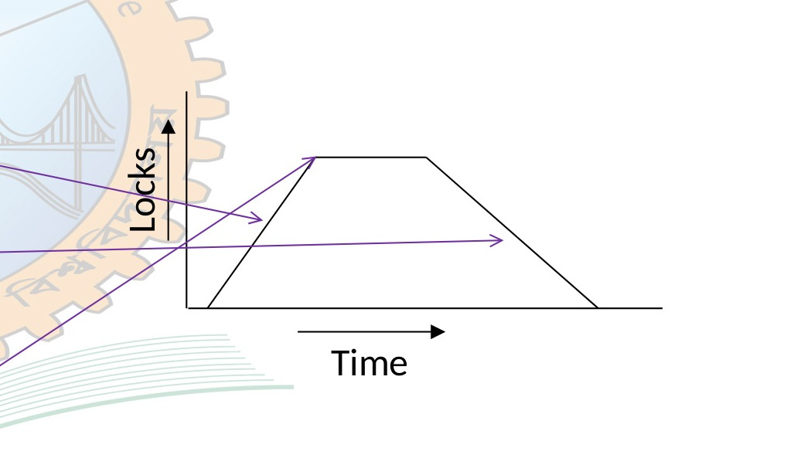
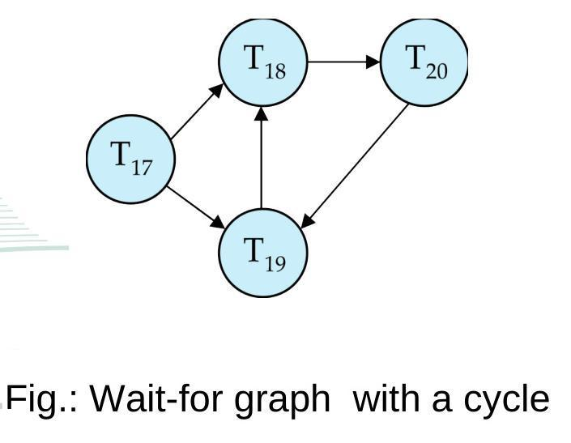
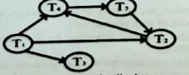

[← Prev: T10 · Serializability](T10_Serializability.md) | [Exam-style layer](../Topicwise_answers_exam_style/T11_Concurrency_Control_Protocols.md) | [Next: T12 · Recovery System and RAID →](T12_Recovery_System_and_RAID.md)

---

# T11 · Concurrency Control Protocols

> [!info] Topic card
> **Syllabus:** Unit 6 · **Weight:** 37 final marks (5.8%) in 6/7 papers
> **Sources:** Deck 08 · Textbook Ch. 18 §18.1–18.2, §18.5
> **Blocks in this file:** 9 final questions (8 blocks, 1 L2 merge)

## Subtopics in this file

| ID | Subtopic | Marks (Finals + CT) | Questions | Jump |
| :-- | :-- | :--: | :-- | :-- |
| T11.1 | Lock-based protocols: shared/exclusive locks, compatibility matrix, starvation | 0 + 0 | No questions | [[#T11.1 · Lock-based protocols: shared/exclusive locks, compatibility matrix, starvation\|Go]] |
| T11.2 | Two-phase locking: growing/shrinking phases, lock point, inserting lock/unlock instructions | 9 + 0 | 2017 Q.6(b), 2017 Q.7(a) | [[#T11.2 · Two-phase locking: growing/shrinking phases, lock point, inserting lock/unlock instructions\|Go]] |
| T11.3 | Strict / rigorous 2PL; drawbacks of 2PL | 0 + 0 | No questions | [[#T11.3 · Strict / rigorous 2PL; drawbacks of 2PL\|Go]] |
| T11.4 | Deadlock: conditions, prevention vs detection, wait-for graph, victim selection | 17 + 0 | 2017 Q.7(b), 2018 Q.5(b), 2020 Q.7(a), 2021 Q.8(a) | [[#T11.4 · Deadlock: conditions, prevention vs detection, wait-for graph, victim selection\|Go]] |
| T11.5 | Wait-die vs wound-wait | 0 + 0 | No questions | [[#T11.5 · Wait-die vs wound-wait\|Go]] |
| T11.6 | Timestamp ordering: R-TS/W-TS rules, trace a schedule; rolled-back transaction gets a NEW timestamp | 11 + 0 | 2018 Q.6(b), 2023 Q.8(c), 2024 Q.8(b) | [[#T11.6 · Timestamp ordering: R-TS/W-TS rules, trace a schedule; rolled-back transaction gets a NEW timestamp\|Go]] |

---

## T11.1 · Lock-based protocols: shared/exclusive locks, compatibility matrix, starvation

*No questions from past finals or class tests.*

*See also:* [[#2017 Q.7(a) · 05 Marks]] (starvation definition).

---

## T11.2 · Two-phase locking: growing/shrinking phases, lock point, inserting lock/unlock instructions

### 2017 Q.6(b) · 04 Marks

*Section B · Asked in: 2017 · L1 (asked once)*

**Question.** How concurrent execution of transactions are controlled using two phase based locking protocol? Briefly discuss with an example.

**Answer.**

**What the examiner wants.**  
The examiner wants the definition of Two-Phase Locking (2PL), descriptions of the two phases, the definition of lock point, and a clean concrete example. The expected mark split is 1 mark for the phase definitions, 1 mark for lock point and serializability guarantee, and 2 marks for the worked example.

**Key idea.**  
Simple locking allows a transaction to acquire and release locks at any time. But simple locking can create non-serializable schedules. 2PL solves this. It divides lock handling into two separate phases. In phase one, a transaction only grabs locks. In phase two, it only lets them go. Once a transaction drops a lock, it can never grab another. This rule guarantees conflict serializability.

**Step-by-step solution.**  
The Two-Phase Locking (2PL) protocol controls concurrent transactions by enforcing two sequential phases:

1. **Growing Phase:**
   - The transaction acquires needed locks (`lock-S` or `lock-X`).
   - It may upgrade a shared lock to an exclusive lock.
   - It cannot release any lock.
2. **Shrinking Phase:**
   - The transaction releases locks (`unlock`).
   - It may downgrade an exclusive lock to a shared lock.
   - It cannot acquire any new lock.

**Lock Point:**  
The moment the transaction acquires its final lock is its **lock point**. Once this point passes, unlocking begins. The order of lock points determines the equivalent serial execution order.

  
*Figure: Two-Phase Locking Protocol (Source: Deck 08, Slide 13)*

**Example:**  
Consider transaction $T_1$ reading $A$ and updating $B$:

```text
lock-S(A);         -- Growing phase begins
read(A);
lock-X(B);         -- Lock point (last lock acquired)
read(B);
B := B - 50;
write(B);
unlock(A);         -- Shrinking phase begins (no more locks allowed)
unlock(B);         -- Final unlock
```

Because all locks are acquired before any lock is released, $T_1$ obeys 2PL.

**Check.**  
*Quick self-test:*
- Q: Can a transaction acquire a lock after releasing one under 2PL?  
  A: No. Releasing a lock begins the shrinking phase, which strictly forbids acquiring new locks.
- Q: What ensures the equivalent serial schedule order under 2PL?  
  A: The transaction lock points. If $T_1$ hits its lock point before $T_2$, $T_1$ precedes $T_2$ in serial order.

> [!warning] Common mistakes
> - Confusing simple locking with 2PL. Simple locking permits interleaved lock and unlock statements. 2PL does not.
> - Omitting the lock point definition. Examiners award a dedicated mark for naming and explaining the lock point.
> - Forgetting that 2PL does not prevent deadlocks or cascading rollbacks. 2PL only guarantees serializability.

**Exam tip.**  
Draw the trapezoidal locks vs time diagram from Deck 08 Slide 13. Label the growing phase, peak lock point, and shrinking phase clearly.

**Sources.**  
- [Deck 08 · Slides 13–15](../LectureSlides/08_Concurrency_Control_Mechanisms.md)  
- [Textbook Ch. 18 §18.1.1](../Textbook/Chapter_18_Concurrency_Control/Chapter%2018%20-%20Concurrency%20Control.md)

---

### 2017 Q.7(a) · 05 Marks

*Section B · Asked in: 2017 · L1 (asked once)*

**Question.** What is starvation? Consider the following two transactions.

**T1:**  
  `read(A);`  
  `read(B);`  
  `if A = 0 then B:=B+15% of B;`  
  `write(B);`

**T2:**  
  `read(B);`  
  `read(A);`  
  `if B = 0 then A:=A+20% of A;`  
  `write(A);`

Add lock and unlock instructions to transaction T1 and T2, so that they observe the two phase locking protocol. Can the execution of these transactions result in a deadlock? Justify.

**Answer.**

**What the examiner wants.**  
This 5-mark question has three distinct components:
1. Definition of starvation in concurrency control (1 mark).
2. Inserting valid `lock-S`, `lock-X`, and `unlock` instructions into both transactions following 2PL rules (2 marks).
3. Stating clearly whether deadlock can occur and giving an interleaved execution sequence with a wait-for cycle to justify the answer (2 marks).

**Key idea.**  
Starvation happens when a transaction waits forever because other transactions keep jumping ahead with compatible locks. Under 2PL, a transaction must grab all locks before releasing any. $T_1$ accesses $A$ then $B$, while $T_2$ accesses $B$ then $A$. If $T_1$ locks $A$ and $T_2$ locks $B$, each transaction holds what the other wants next. Both wait forever. So 2PL does not prevent deadlock.

**Step-by-step solution.**  
**1. Starvation:**  
Starvation occurs when a transaction waits indefinitely for a lock on a data item. This happens when other transactions keep requesting and receiving compatible locks on that same item. The waiting transaction cannot proceed.

**2. Inserting 2PL Lock and Unlock Instructions:**  
- $T_1$ reads $A$ (needs `lock-S(A)`), reads $B$, and conditionally writes $B$ (needs `lock-X(B)`).
- $T_2$ reads $B$ (needs `lock-S(B)`), reads $A$, and conditionally writes $A$ (needs `lock-X(A)`).
- Under 2PL, all locks must be acquired before any unlock instruction is executed.

**Transaction T1 with 2PL instructions:**
```text
lock-S(A);
read(A);
lock-X(B);
read(B);
if A = 0 then B := B + 15% of B;
write(B);
unlock(A);
unlock(B);
```

**Transaction T2 with 2PL instructions:**
```text
lock-S(B);
read(B);
lock-X(A);
read(A);
if B = 0 then A := A + 20% of A;
write(A);
unlock(B);
unlock(A);
```

**3. Deadlock Analysis and Justification:**  
**Yes, the execution of these transactions can result in a deadlock.**

**Justification:**  
Consider the following concurrent interleaving:
1. $T_1$ executes `lock-S(A)` and `read(A)`. $T_1$ holds a shared lock on $A$.
2. $T_2$ executes `lock-S(B)` and `read(B)`. $T_2$ holds a shared lock on $B$.
3. $T_1$ issues `lock-X(B)`. Because exclusive mode conflicts with shared mode (by the lock-compatibility matrix, S and X are incompatible), $T_1$ must wait for $T_2$ to release $B$.
4. $T_2$ issues `lock-X(A)`. Because exclusive mode conflicts with shared mode (by the lock-compatibility matrix, S and X are incompatible), $T_2$ must wait for $T_1$ to release $A$.

At this point, $T_1$ is waiting for $T_2$, and $T_2$ is waiting for $T_1$. Under 2PL, neither transaction can unlock a data item during its growing phase. A circular wait forms:

$$\text{Cycle: } T_1 \to T_2 \to T_1$$

Neither transaction can make progress. Thus, the system is deadlocked.

  
*Figure: Interleaved execution and wait-for graph cycle producing deadlock between T1 and T2 under 2PL*

**Check.**  
*Trace check:*
- In $T_1$, locks are acquired at lines 1 and 3; unlocks occur at lines 7 and 8. No lock occurs after an unlock. 2PL is verified.
- In $T_2$, locks are acquired at lines 1 and 3; unlocks occur at lines 7 and 8. No lock occurs after an unlock. 2PL is verified.
- Cross-locking conflict: $T_1$ holds $A$, requests $B$. $T_2$ holds $B$, requests $A$. Cycle exists $\implies$ deadlock confirmed.
- **Lock-Compatibility Matrix:**

  | | S | X |
  | :---: | :---: | :---: |
  | **S** | Compatible (True) | Incompatible (False) |
  | **X** | Incompatible (False) | Incompatible (False) |
  Shared locks are mutually compatible ($S-S$). Any request involving an exclusive lock ($S-X, X-S, X-X$) conflicts, forcing the requesting transaction to wait.
- *Lock upgrade alternative:* If $T_1$ initially acquired `lock-S(B)` and upgraded to `lock-X(B)` before writing, the upgrade must occur within the growing phase. But because $T_2$ concurrently holds `lock-S(B)`, $T_1$'s upgrade request is blocked, leading to the same deadlock.

> [!warning] Common mistakes
> - Putting an unlock before the second lock. For example, unlocking $A$ before locking $B$ violates 2PL.
> - Requesting `lock-S(B)` for $T_1$ instead of `lock-X(B)`. Because $T_1$ writes $B$, it requires exclusive mode.
> - Answering that 2PL prevents deadlocks. 2PL guarantees serializability, not deadlock freedom.

**Exam tip.**  
Always list the 4-step interleaving in your answer. Showing $T_1$ holding $A$ while waiting for $B$, and $T_2$ holding $B$ while waiting for $A$, gives the examiner complete proof.

**Sources.**  
- [Deck 08 · Slides 11–13, 20–21](../LectureSlides/08_Concurrency_Control_Mechanisms.md)  
- [Textbook Ch. 18 §18.1.1, §18.2](../Textbook/Chapter_18_Concurrency_Control/Chapter%2018%20-%20Concurrency%20Control.md)

---

## T11.3 · Strict / rigorous 2PL; drawbacks of 2PL

*No questions from past finals or class tests.*

---

## T11.4 · Deadlock: conditions, prevention vs detection, wait-for graph, victim selection

### 2017 Q.7(b) · 04 Marks

*Section B · Asked in: 2017 · L1 (asked once)*

**Question.** Define deadlock. Explain how deadlock is prevented?

**Answer.**

**What the examiner wants.**  
The definition of deadlock in database systems (1 mark), followed by a clear explanation of the main deadlock prevention approaches: lock pre-declaration, lock ordering, timestamp-based schemes (wait-die and wound-wait), and timeout mechanisms (3 marks).

**Key idea.**  
A deadlock is a traffic jam of transactions. Transaction $A$ holds item 1 and waits for item 2. Transaction $B$ holds item 2 and waits for item 1. Neither can move. Deadlock prevention stops this before it can happen. The system either forces transactions to lock everything upfront, locks items in strict numerical order, or uses timestamps to abort transactions that might cause a cycle.

**Step-by-step solution.**  
**1. Deadlock Definition:**  
A deadlock is an execution state where two or more transactions wait indefinitely for data locks held by one another. None can proceed without external intervention.

**2. Deadlock Prevention Methods:**  
Deadlock prevention protocols guarantee that the system will never enter a deadlock state. Four primary methods are used:

- **Pre-declaration (Pre-claiming All Locks):**  
  Each transaction must request and receive all its locks at once before execution begins. If even one data item is unavailable, no locks are granted and the transaction waits.  
  *Drawbacks:* It is hard to know all required data items in advance. Resource usage is low because data items remain locked while idle.

- **Lock Ordering:**  
  The system establishes a global ordering on all data items ($d_1 < d_2 < \dots < d_n$). Transactions must request locks strictly in ascending order. Since all transactions request items in the same sequence, circular waits cannot form.

- **Timestamp-Based Preemption Schemes:**  
  Each transaction receives a unique timestamp $\text{TS}$ on arrival. When transaction $T_i$ requests an item held by $T_j$:
  - **Wait-Die (Non-preemptive):** If $T_i$ is older than $T_j$ ($\text{TS}(T_i) < \text{TS}(T_j)$), $T_i$ is allowed to wait. If $T_i$ is younger, $T_i$ dies (rolls back and restarts).
  - **Wound-Wait (Preemptive):** If $T_i$ is older than $T_j$, $T_i$ wounds $T_j$, preempting the lock and rolling $T_j$ back. If $T_i$ is younger, $T_i$ is allowed to wait.

  | Scheme | Older requests item from Younger | Younger requests item from Older | Type |
  | :--- | :--- | :--- | :--- |
  | **Wait-Die** | Older waits | Younger dies (rolls back) | Non-preemptive |
  | **Wound-Wait** | Older wounds younger (rolls back younger) | Younger waits | Preemptive |

- **Timeout-Based Scheme:**  
  A transaction waits for a requested lock only for a predefined timeout duration. If the lock is not granted in time, the transaction times out and rolls back. This prevents permanent deadlocks.

  
*Figure: Wait-for Graph with a cycle indicating deadlock (Source: Deck 08, Slide 24)*

**Check.**  
*Quick self-test:*
- Q: In wait-die, what happens when a young transaction requests a lock held by an old transaction?  
  A: The young transaction dies (rolls back).
- Q: In wound-wait, what happens when an old transaction requests a lock held by a young transaction?  
  A: The old transaction wounds the young transaction, forcing the young transaction to roll back.
- Q: Do wait-die and wound-wait allow circular waiting?  
  A: No. Edges in wait-die only go from old to young, and in wound-wait only from young to old. A cycle is impossible.

> [!warning] Common mistakes
> - Mixing up wait-die and wound-wait rules. Remember: in wait-die, only the older transaction ever waits. In wound-wait, only the younger transaction ever waits.
> - Omitting lock ordering. Lock ordering is the cleanest non-preemptive prevention scheme.
> - Confusing deadlock prevention with deadlock detection. Prevention avoids cycles; detection finds existing cycles.

**Exam tip.**  
Include the comparison table for wait-die vs wound-wait. Examiners frequently look for these exact conditions when grading deadlock prevention.

**Sources.**  
- [Deck 08 · Slides 20–24](../LectureSlides/08_Concurrency_Control_Mechanisms.md)  
- [Textbook Ch. 18 §18.2.1](../Textbook/Chapter_18_Concurrency_Control/Chapter%2018%20-%20Concurrency%20Control.md)

---

### 2018 Q.5(b) · 04 Marks

*Section B · Asked in: 2018 · L1 (asked once)*

**Question.** What do you know about deadlock in transaction management? Under what conditions it is less expensive to avoid deadlock than to allow deadlocks to occur and then to detect them?

**Answer.**

**What the examiner wants.**  
This question comes from Textbook Exercise 18.20. The examiner looks for the concept of deadlock in transactions (1 mark), followed by a clear trade-off analysis explaining when prevention or avoidance is cheaper than detection and recovery (3 marks).

**Key idea.**  
Deadlock detection lets transactions run freely until they lock up, then detects cycles and aborts victims. Avoidance or prevention restricts lock requests so deadlocks never happen. If transactions clash often, detecting deadlocks leads to constant, expensive rollbacks. In that case, prevention is cheaper. But if transactions rarely conflict, detection is cheaper because prevention imposes unnecessary rules and false aborts.

**Step-by-step solution.**  
**1. Deadlock in Transaction Management:**  
A deadlock is a state where concurrent transactions block one another permanently. Each transaction holds a lock that another transaction needs and waits for a lock that another holds. A circular wait forms in the system wait-for graph. The transactions can make no further progress. The database system must break the deadlock by picking a victim transaction and rolling it back.

**2. When Avoidance / Prevention is Less Expensive Than Detection:**  
Deadlock avoidance or prevention is less expensive than detection and recovery under these conditions:

1. **High Lock Contention (High Deadlock Frequency):**  
   When many transactions compete for the same shared data items, deadlocks happen frequently. Deadlock detection must run often, finding cycles and aborting transactions repeatedly. Rolling back transactions over and over wastes significant processing time. Prevention stops cycles before they occur, saving these rollback costs.
2. **Long or Work-Intensive Transactions:**  
   If transactions perform complex calculations or heavy disk updates, aborting a transaction near its completion wastes substantial work. Prevention avoids deep, expensive rollbacks.
3. **High Cost of Detection Overhead:**  
   Under heavy workloads, maintaining the wait-for graph and running cycle-detection algorithms adds noticeable CPU overhead. Prevention avoids this continuous monitoring cost.

**3. When Detection is Less Expensive:**  
Deadlock detection is cheaper when deadlocks are **rare**. This occurs when transactions are short, concurrency is moderate, and data access sets are largely disjoint. Under these conditions, transactions rarely block. Running detection only periodically allows maximum concurrency without the strict locking rules or false-positive aborts of prevention protocols.

**Check.**  
*Trade-off summary:*
- High contention + long transactions $\implies$ Avoidance / Prevention is cheaper.
- Low contention + short transactions $\implies$ Detection & Recovery is cheaper.

> [!warning] Common mistakes
> - Giving only the definition of deadlock and forgetting the condition comparison entirely.
> - Stating that prevention is always superior. Prevention reduces concurrency and can cause unnecessary early rollbacks.
> - Failing to mention lock contention as the main deciding factor.

**Exam tip.**  
Divide the second part of your answer into clear conditions: high contention vs low contention, and long vs short transactions.

**Sources.**  
- [Deck 08 · Slides 20–25](../LectureSlides/08_Concurrency_Control_Mechanisms.md)  
- [Textbook Ch. 18 §18.2, Exercise 18.20](../Textbook/Chapter_18_Concurrency_Control/Chapter%2018%20-%20Concurrency%20Control.md)

---

### 2020 Q.7(a) · 04 Marks

*Section B · Asked in: 2020 · L1 (asked once)*

**Question.** What is deadlock? Describe the time-shared locking protocol with example.

**Answer.**

**What the examiner wants.**  
The question asks for the definition of deadlock (1 mark) and a description of the "time-shared locking protocol" with an example (3 marks). As noted in the course syllabus, "time-shared locking protocol" is an exam misprint for Two-Phase Locking (2PL). The examiner expects the two phases of 2PL, the lock point, and an example schedule.

**Key idea.**  
State the misprint assumption right away so the examiner sees your grasp of the syllabus. Explain that 2PL enforces growing and shrinking phases to ensure serializability. Provide a short 4-step example showing locks acquired, lock point, and unlocks.

**Step-by-step solution.**  
*Assumption: "Time-shared locking protocol" is an exam misprint for the Two-Phase Locking (2PL) protocol.*

**1. Deadlock:**  
A deadlock is an execution state where two or more transactions wait indefinitely for locks held by each other. Neither transaction can proceed, and external system rollback is required to resolve the block.

**2. Two-Phase Locking (2PL) Protocol:**  
The Two-Phase Locking protocol ensures conflict serializability by requiring that each transaction acquires and releases locks in two distinct phases:

- **Growing Phase:** The transaction may acquire locks (shared or exclusive) and upgrade locks ($\text{S} \to \text{X}$). It cannot release any locks.
- **Shrinking Phase:** The transaction may release held locks and downgrade locks ($\text{X} \to \text{S}$). It cannot acquire any new locks.

**Lock Point:**  
The point in time where a transaction acquires its final lock is its **lock point**. Serializability is guaranteed in the order of transaction lock points.

  
*Figure: Two-Phase Locking Protocol (Source: Deck 08, Slide 13)*

**3. Example:**  
Consider transaction $T_1$ modifying accounts $A$ and $B$:

| Step | Action | Phase |
| :---: | :--- | :--- |
| 1 | $\text{lock-S}(A)$; $\text{read}(A)$ | Growing |
| 2 | $\text{lock-X}(B)$; $\text{read}(B)$; $\text{write}(B)$ | Growing (**Lock Point**) |
| 3 | $\text{unlock}(A)$ | Shrinking begins |
| 4 | $\text{unlock}(B)$ | Shrinking |

Because all locks precede the first unlock, $T_1$ obeys 2PL and guarantees serializability.

**Check.**  
*Self-test:*
- Q: Why is 2PL called two-phase?  
  A: Because lock acquisition and lock release are grouped into two separate phases that never overlap.
- Q: What does 2PL guarantee?  
  A: Conflict serializability.

> [!warning] Common mistakes
> - Leaving the question unanswered because "time-shared locking" does not exist in standard textbooks. Always add the assumption line and answer for 2PL.
> - Forgetting to define lock point.
> - Showing an example where an unlock is followed by another lock.

**Exam tip.**  
Start your answer with the explicit assumption line. Then deliver the textbook 2PL definition and table.

**Sources.**  
- [Deck 08 · Slides 13–15, 20](../LectureSlides/08_Concurrency_Control_Mechanisms.md)  
- [Textbook Ch. 18 §18.1.1, §18.2](../Textbook/Chapter_18_Concurrency_Control/Chapter%2018%20-%20Concurrency%20Control.md)

---

### 2021 Q.8(a) · 05 Marks

*Section B · CLO1 · Asked in: 2021 · L1 (asked once)*

**Question.** What is deadlock? Consider the following wait-for-graph:

  
*Figure 2021_Q8.a — Wait-for-graph for deadlock detection (Source: Page 2, Q.8(a))*

Determine whether the schedule contains any deadlock or not.

**Answer.**

**What the examiner wants.**  
The definition of deadlock (1 mark), followed by a graph analysis of the provided wait-for graph: listing vertices and edges (1 mark), detecting the cycle (1.5 marks), giving the verdict and identifying the deadlocked transactions (1 mark), and explaining how to break the deadlock (0.5 marks).

**Key idea.**  
A wait-for graph models who is waiting for whom. An arrow from $T_i$ to $T_j$ means $T_i$ is waiting for $T_j$ to release a lock. If you can follow arrows and return to where you started, you have a directed cycle. A cycle equals a deadlock. In this graph, $T_4 \to T_5 \to T_2 \to T_4$ forms a loop.

**Step-by-step solution.**  
**1. Deadlock Definition:**  
A deadlock is a situation where two or more transactions wait indefinitely for resources or data locks held by one another. None can continue without intervention.

**2. Graph Structure:**  
From the diagram:
- **Vertices (Transactions):** $V = \{T_1, T_2, T_3, T_4, T_5\}$
- **Directed Edges:** $E = \{(T_1, T_4), (T_1, T_2), (T_1, T_3), (T_4, T_5), (T_5, T_2), (T_2, T_4)\}$

A directed edge $T_i \to T_j$ indicates that transaction $T_i$ is waiting for a lock currently held by $T_j$.

**3. Cycle Detection:**  
We examine the paths in the graph:
- $T_4$ waits for $T_5$ (edge $T_4 \to T_5$)
- $T_5$ waits for $T_2$ (edge $T_5 \to T_2$)
- $T_2$ waits for $T_4$ (edge $T_2 \to T_4$)

These three edges form a closed directed cycle:

$$\mathbf{T_4 \to T_5 \to T_2 \to T_4}$$

**4. Verdict:**  
**Yes, the schedule contains a deadlock.**

**Deadlocked Transactions:**  
Transactions $\mathbf{T_2, T_4, \text{ and } T_5}$ are deadlocked.  
*Note on remaining transactions:* Transaction $T_1$ has outgoing edges to $T_2, T_3$, and $T_4$. It is blocked waiting for them, but it is not part of the cycle. Transaction $T_3$ has no outgoing edges and is not blocked.

**5. Deadlock Resolution:**  
The DBMS must resolve the deadlock by:
1. **Victim Selection:** Choose one transaction from the cycle ($T_2, T_4$, or $T_5$) that minimizes rollback cost.
2. **Rollback:** Abort or partially roll back the victim transaction to release its locks.
3. Breaking any single edge in the cycle breaks the loop, allowing the remaining transactions to finish.

**Check.**  
*Cycle verification:*
- $T_4 \to T_5 \implies T_4$ blocked on $T_5$.
- $T_5 \to T_2 \implies T_5$ blocked on $T_2$.
- $T_2 \to T_4 \implies T_2$ blocked on $T_4$.
- Returning to $T_4$ proves circular wait. Cycle length is 3. Deadlock is confirmed.

> [!warning] Common mistakes
> - Listing $T_1$ or $T_3$ as part of the deadlock cycle. $T_1$ points into the cycle, but no edge returns to $T_1$. $T_3$ has no outgoing edges. Only $T_2, T_4, T_5$ form the cycle.
> - Saying "no deadlock" because $T_3$ can finish. If any subset forms a cycle, the system contains a deadlock.
> - Forgetting to state how the deadlock is broken.

**Exam tip.**  
Explicitly write out the cycle $T_4 \to T_5 \to T_2 \to T_4$ and state the three specific transactions involved.

**Sources.**  
- [Deck 08 · Slides 24–25](../LectureSlides/08_Concurrency_Control_Mechanisms.md)  
- [Textbook Ch. 18 §18.2.2](../Textbook/Chapter_18_Concurrency_Control/Chapter%2018%20-%20Concurrency%20Control.md)

---

## T11.5 · Wait-die vs wound-wait

*No questions from past finals or class tests.*

*See also:* [[#2017 Q.7(b) · 04 Marks]] (wait-die and wound-wait as deadlock prevention schemes).

---

## T11.6 · Timestamp ordering: R-TS/W-TS rules, trace a schedule; rolled-back transaction gets a NEW timestamp

### 2018 Q.6(b) · 04 Marks

*Section B · Asked in: 2018, 2024 (CO3) · L2 merge*

**Question (2018 Q.6(b), 2024 Q.8(b) · identical text).** When a transaction is rolled back under timestamp ordering and it is assigned a new timestamp? Why can it not simply keep its old timestamp?

**Answer.**

**What the examiner wants.**  
This question comes from Textbook Exercise 18.26. The examiner wants:
1. The exact conditions under which a transaction is rolled back under timestamp ordering on read and write (1.5 marks).
2. The statement that a new, larger timestamp is assigned upon restart (0.5 marks).
3. The reasoning for why keeping the old timestamp fails, specifically pointing out repeated failures and starvation (2 marks).

**Key idea.**  
Timestamp ordering makes older transactions execute before younger ones. If an older transaction arrives late and tries to read or write an item that a younger transaction already altered, the order is broken. So the older transaction is rolled back. When it restarts, it must get a new, higher timestamp. If it kept its old timestamp, the exact same conflict would happen all over again, causing starvation.

**Step-by-step solution.**  
**1. When a Transaction is Rolled Back Under Timestamp Ordering:**  
Under the Timestamp Ordering (TSO) protocol, a transaction $T_i$ with timestamp $\text{TS}(T_i)$ is rolled back when it attempts an out-of-order operation:

- **On a `read(Q)` Operation:**  
  If $\text{TS}(T_i) < \text{W-timestamp}(Q)$, transaction $T_i$ needs to read a value of $Q$ that was already overwritten by a younger transaction. The read operation is rejected, and $T_i$ is rolled back.
- **On a `write(Q)` Operation:**  
  - If $\text{TS}(T_i) < \text{R-timestamp}(Q)$, the value of $Q$ produced by $T_i$ was needed previously by a younger transaction that already read an older value. The write operation is rejected, and $T_i$ is rolled back.
  - If $\text{TS}(T_i) < \text{W-timestamp}(Q)$, transaction $T_i$ attempts to write an obsolete value over a newer value written by a younger transaction. The write operation is rejected, and $T_i$ is rolled back.

**2. Assigning a New Timestamp:**  
When $T_i$ is rolled back, the system aborts it and cleans up its partial changes. When $T_i$ is restarted, the system assigns it a **new, larger timestamp** based on the current system clock or logical counter.

**3. Why It Cannot Keep Its Old Timestamp:**

1. **Avoids Immediate Repeat Failure:**  
   If $T_i$ kept its old timestamp, its timestamp would still be smaller than the updated $\text{R-timestamp}(Q)$ and $\text{W-timestamp}(Q)$ values on the data items. Upon restarting, when $T_i$ attempts the same operation, the exact same condition fails again.
2. **Prevents Starvation (Livelock):**  
   Keeping the old timestamp locks the transaction into an infinite abort-restart loop. It could never complete. Assigning a new timestamp gives it a higher priority relative to newer arrivals and allows it to proceed.
3. **Restores Serialization Order:**  
   A new timestamp positions the restarted transaction at the current moment in logical time. It now executes after the transactions that conflicted with it, allowing its operations to succeed.

*Short version for 2024 Q.8(b) (3 marks):* Give the read and write rollback conditions concisely. Then explain in 2 points why the old timestamp causes repeated aborts and starvation.

**Check.**  
*Logic check:*
- Suppose $T_1$ ($\text{TS}=10$) writes $A$, but $T_2$ ($\text{TS}=20$) already read $A$ ($\text{R-TS}(A)=20$).
- $T_1$ fails because $10 < 20$. $T_1$ is rolled back.
- If $T_1$ restarts with old $\text{TS}=10$, it re-attempts $\text{write}(A)$. $\text{R-TS}(A)$ is still 20. $10 < 20$ fails again immediately.
- If $T_1$ restarts with new $\text{TS}=25$, $25 \ge 20$. The write succeeds.

> [!warning] Common mistakes
> - Confusing timestamp ordering with wait-die or wound-wait. In wait-die and wound-wait, a rolled-back transaction keeps its old timestamp so it gains priority. In standard timestamp ordering, a rolled-back transaction MUST get a NEW timestamp to avoid repeat failures.
> - Stating only the read rollback condition and omitting the write rollback conditions.
> - Forgetting to use the term starvation or livelock.

**Exam tip.**  
Be very clear on the distinction: deadlock prevention (wait-die) keeps old timestamps; timestamp ordering (TSO) assigns new timestamps. Examiners check for this exact distinction.

**Sources.**  
- [Deck 08 · Slides 26–29](../LectureSlides/08_Concurrency_Control_Mechanisms.md)  
- [Textbook Ch. 18 §18.5.2, Exercise 18.26](../Textbook/Chapter_18_Concurrency_Control/Chapter%2018%20-%20Concurrency%20Control.md)

---

### 2023 Q.8(c) · 04 Marks

*Section B · CLO3 · Asked in: 2023 · L1 (asked once)*

**Question.** Discuss the given schedule based on Timestamp ordering protocol.

<table border="1" style="border-collapse: collapse; text-align: center;"><thead><tr><th style="padding: 4px 20px;">$T_1(100)$</th><th style="padding: 4px 20px;">$T_2(200)$</th><th style="padding: 4px 20px;">$T_3(300)$</th></tr></thead><tbody><tr><td style="padding: 4px 20px;">$R(A)$</td><td style="padding: 4px 20px;"></td><td style="padding: 4px 20px;"></td></tr><tr><td style="padding: 4px 20px;"></td><td style="padding: 4px 20px;">$R(B)$</td><td style="padding: 4px 20px;"></td></tr><tr><td style="padding: 4px 20px;">$W(C)$</td><td style="padding: 4px 20px;"></td><td style="padding: 4px 20px;"></td></tr><tr><td style="padding: 4px 20px;"></td><td style="padding: 4px 20px;"></td><td style="padding: 4px 20px;">$R(B)$</td></tr><tr><td style="padding: 4px 20px;">$R(C)$</td><td style="padding: 4px 20px;"></td><td style="padding: 4px 20px;"></td></tr><tr><td style="padding: 4px 20px;"></td><td style="padding: 4px 20px;">$W(B)$</td><td style="padding: 4px 20px;"></td></tr><tr><td style="padding: 4px 20px;"></td><td style="padding: 4px 20px;"></td><td style="padding: 4px 20px;">$W(A)$</td></tr></tbody></table>  
*(Note: In the original paper schedule, $W(C)$ of $T_1$ and $R(B)$ of $T_3$ occupy essentially the same vertical tier. Since $C$ and $B$ are disjoint data items, the concurrency protocol evaluation remains unaffected).*

**Answer.**

**What the examiner wants.**  
A step-by-step trace of each read and write operation in the schedule against the Timestamp Ordering (TSO) protocol rules. The trace must track read and write timestamps of items $A, B$, and $C$. The examiner looks for the critical conflict at step 6 where $T_2$ attempts $W(B)$ and is rolled back.

**Key idea.**  
Under TSO, operations must look like they ran in timestamp order: $T_1(100) \to T_2(200) \to T_3(300)$. When $T_3$ reads $B$, the read timestamp of $B$ jumps to 300. Later, $T_2$ tries to write $B$. But $T_2$ has timestamp 200, which is less than 300. $T_2$ is trying to write a value that $T_3$ should have seen. So the protocol rejects $T_2$'s write and rolls $T_2$ back.

**Step-by-step solution.**  
**1. Initial State:**  
- Transaction timestamps: $\text{TS}(T_1) = 100$, $\text{TS}(T_2) = 200$, $\text{TS}(T_3) = 300$.
- Initial data item timestamps:
  $$\text{R-TS}(A) = 0, \quad \text{W-TS}(A) = 0$$
  $$\text{R-TS}(B) = 0, \quad \text{W-TS}(B) = 0$$
  $$\text{R-TS}(C) = 0, \quad \text{W-TS}(C) = 0$$

**2. Step-by-Step Trace Table:**

| Step | Txn | Op | Protocol Rule & Condition Check | Action | Updated Timestamps |
| :---: | :---: | :---: | :--- | :--- | :--- |
| **1** | $T_1$ | $R(A)$ | $\text{TS}(T_1) \ge \text{W-TS}(A) \implies 100 \ge 0$ (Valid) | **Execute** | $\text{R-TS}(A) = \max(0, 100) = 100$ |
| **2** | $T_2$ | $R(B)$ | $\text{TS}(T_2) \ge \text{W-TS}(B) \implies 200 \ge 0$ (Valid) | **Execute** | $\text{R-TS}(B) = \max(0, 200) = 200$ |
| **3** | $T_1$ | $W(C)$ | $\text{TS}(T_1) \ge \text{R-TS}(C)$ and $\text{W-TS}(C) \implies 100 \ge 0$ (Valid) | **Execute** | $\text{W-TS}(C) = 100$ |
| **4** | $T_3$ | $R(B)$ | $\text{TS}(T_3) \ge \text{W-TS}(B) \implies 300 \ge 0$ (Valid) | **Execute** | $\text{R-TS}(B) = \max(200, 300) = 300$ |
| **5** | $T_1$ | $R(C)$ | $\text{TS}(T_1) \ge \text{W-TS}(C) \implies 100 \ge 100$ (Valid) | **Execute** | $\text{R-TS}(C) = \max(0, 100) = 100$ |
| **6** | $T_2$ | $W(B)$ | $\text{TS}(T_2) < \text{R-TS}(B) \implies 200 < 300$ (**Violated!**) | **REJECTED** | **$T_2$ is rolled back** |
| **7** | $T_3$ | $W(A)$ | $\text{TS}(T_3) \ge \text{R-TS}(A)$ and $\text{W-TS}(A) \implies 300 \ge 100$ (Valid) | **Execute** | $\text{W-TS}(A) = 300$ |

**3. Detailed Evaluation:**
- **Step 1 ($T_1: R(A)$):** $\text{TS}(T_1) \ge \text{W-TS}(A)$ holds ($100 \ge 0$). $\text{R-TS}(A)$ updates to 100.
- **Step 2 ($T_2: R(B)$):** $\text{TS}(T_2) \ge \text{W-TS}(B)$ holds ($200 \ge 0$). $\text{R-TS}(B)$ updates to 200.
- **Step 3 ($T_1: W(C)$):** $\text{TS}(T_1)$ is not less than $\text{R-TS}(C)$ or $\text{W-TS}(C)$. Write executes. $\text{W-TS}(C)$ updates to 100.
- **Step 4 ($T_3: R(B)$):** $\text{TS}(T_3) \ge \text{W-TS}(B)$ holds ($300 \ge 0$). $\text{R-TS}(B)$ updates to $\max(200, 300) = 300$.
- **Step 5 ($T_1: R(C)$):** $T_1$ reads the value of $C$ that it wrote at Step 3. $\text{TS}(T_1) \ge \text{W-TS}(C)$ holds ($100 \ge 100$). $\text{R-TS}(C)$ updates to 100.
- **Step 6 ($T_2: W(B)$):** $T_2$ issues a write on $B$. The protocol checks whether $\text{TS}(T_2) < \text{R-TS}(B)$. Here, $\text{TS}(T_2) = 200$ and $\text{R-TS}(B) = 300$. Because $200 < 300$, the check fails. $T_2$ is attempting to produce a value of $B$ that $T_3$ was supposed to read, but $T_3$ already read an older value. The write operation is rejected, and **$T_2$ is rolled back**.
- **Step 7 ($T_3: W(A)$):** $\text{TS}(T_3) = 300 \ge \text{R-TS}(A) = 100$ and $\ge \text{W-TS}(A) = 0$. Write executes. $\text{W-TS}(A)$ updates to 300.

**Conclusion:**  
**The schedule is not accepted without rollback.** At Step 6, transaction $T_2$ violates timestamp ordering and is rolled back. When restarted, $T_2$ must receive a new timestamp greater than 300.

**Check.**  
*Verification of conflict:*
- In timestamp ordering, the serial order must be $T_1 \to T_2 \to T_3$.
- In the schedule, $T_3$ reads $B$ before $T_2$ writes $B$. This enforces an execution order $T_3 \to T_2$ on item $B$.
- This contradicts the timestamp order $T_2 \to T_3$.
- Therefore, $T_2$'s write must fail and trigger a rollback.

> [!warning] Common mistakes
> - Missing the condition at Step 6 and concluding that the entire schedule succeeds.
> - Forgetting that $\text{R-TS}(B)$ became 300 at Step 4, causing $T_2$'s write at Step 6 to fail.
> - Thinking that Step 5 ($T_1: R(C)$) fails. Step 5 succeeds because $T_1$ reads its own previous write ($100 \ge 100$).

**Exam tip.**  
Always draw the step-by-step trace table with columns for Step, Transaction, Operation, Condition Check, Decision, and Updated Timestamps. This structure proves every step to the examiner.

**Sources.**  
- [Deck 08 · Slides 26–30](../LectureSlides/08_Concurrency_Control_Mechanisms.md)  
- [Textbook Ch. 18 §18.5.2](../Textbook/Chapter_18_Concurrency_Control/Chapter%2018%20-%20Concurrency%20Control.md)

---

[← Prev: T10 · Serializability](T10_Serializability.md) | [Exam-style layer](../Topicwise_answers_exam_style/T11_Concurrency_Control_Protocols.md) | [Next: T12 · Recovery System and RAID →](T12_Recovery_System_and_RAID.md)
