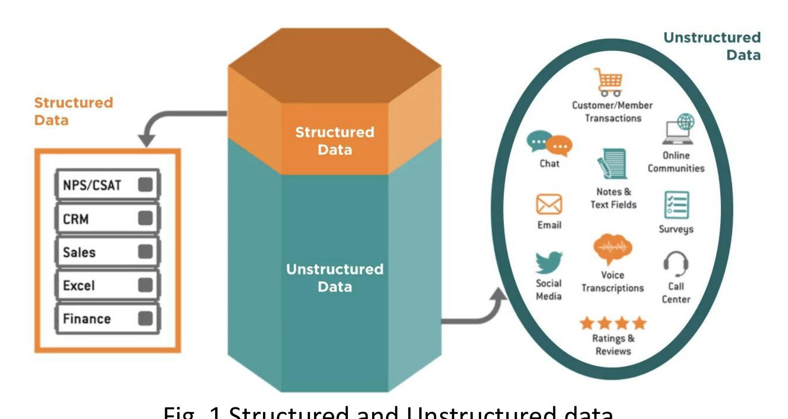

[← Previous: 🏠 Index](00_Index.md) | [🏠 Index](00_Index.md) | [Next: T01.2: File System vs. DBMS →](T01.02_File_System_vs_DBMS.md)

---

# T01.1: Data, DB, and DBMS Basics

> **Topic:** T01 — DB Concepts & Architecture | **Priority:** 🟢 Low (Foundational) | **Exam Frequency:** 0/7 finals (0 marks) · High-yield candidate
> **Sources:** Silberschatz 7e Ch. 1 (§1.1–1.2) · Lecture Deck 01 (Slides 2–5) · Raidah Class Note p. 1, 10 · Fahim Hand Note pp. 1–3

## Why This Topic Matters

This note covers the foundational vocabulary for the entire course. Even though past semester finals have not asked a standalone question on these basic definitions, instructors regularly test them in class tests, viva voce, and short introductory prompts. Getting comfortable with what separates raw data, information, metadata, and a DBMS will also give you the exact terminology you need to score full marks on Section A comparison questions.

---

## 📝 Key Definitions

> **Database-Management System (DBMS):** "A database-management system (DBMS) is a collection of interrelated data and a set of programs to access those data." — Silberschatz, Korth & Sudarshan, *Database System Concepts* (7th Ed.), §1.1 (p. 1)

> **Database:** "The collection of data, usually referred to as the database, contains information relevant to an enterprise." — Silberschatz, Korth & Sudarshan, *Database System Concepts* (7th Ed.), §1.1 (p. 1)

> **Data:** *(Course definition)* "Data is unorganized and unrefined facts; an individual unit that contains raw materials which do not carry any specific meaning." — Lecture Deck 01, Slide 3

> **Information:** *(Course definition)* "Information comprises processed, organized data presented in a meaningful context; a group of data that collectively carries a logical meaning." — Lecture Deck 01, Slide 3

> **Metadata:** *(Course definition)* "Data about data. It is a complete description that defines the database structure, storage formats, and integrity constraints stored in the system catalog." — Fahim Hand Note p. 1 / Lecture Deck 01, Slide 8

---

## Data vs. Information

In everyday conversation, people often use "data" and "information" interchangeably, but in database systems they represent two different stages of processing. Think of **data** as raw ingredients sitting on a kitchen counter, like an isolated number `85` written on a slip of paper. On its own, you have no idea whether `85` is a test score, a room number, or a temperature. Once the system processes, organizes, and attaches context to those raw facts, they become **information** that people can actually use to make decisions.

| Feature | Data | Information |
| :--- | :--- | :--- |
| **Definition** | Unorganized and unrefined raw facts. | Processed, organized data in a meaningful context. |
| **Meaning** | Carries no specific logical meaning on its own. | Carries a clear and actionable meaning. |
| **Dependency** | Exists independently of information. | Depends directly on the underlying raw data. |
| **Decision Making** | Not enough on its own for business decisions. | Ready and useful for decision making. |
| **Example** | A single student test score: `85`. | Class average score: `Class 2-2 average is 78.5`. |

---

## Structured vs. Unstructured Data

Not all digital data looks the same. Depending on whether records fit neatly into fixed tables, we divide data into two main categories:

1. **Structured Data:**
   - Fits neatly into standardized tables made of fixed rows and columns.
   - Every column follows a strict blueprint (schema) with a chosen data type and validation rules, making it easy for SQL databases to search and sort.
   - **Examples:** Relational tables in MySQL, banking ledgers, RUET student registration records, and Excel spreadsheets.

2. **Unstructured Data:**
   - Has no predefined table layout or uniform row format, so you cannot drop it straight into traditional rows and columns without extra processing.
   - Instead, systems store it as raw text documents, key-value blobs, media files, or object stores.
   - **Examples:** Customer email messages, voice recordings, social media posts, and scanned PDF reports.

*Figure 1.1: Structured data in tables compared to unstructured multimedia data (Lecture Deck 01, Slide 2).*

---

## Components of a DBMS Environment

A working database system is more than just files on a hard drive. It brings together five connected components that work as a complete environment:

1. **Hardware:**
   - The physical machines that run the database software and hold the stored records, including CPUs, RAM, solid-state or magnetic disks, and network cards.

2. **Software:**
   - The DBMS engine itself (such as MySQL, Oracle, or PostgreSQL), alongside the host operating system, network drivers, and client tools that connect to it.

3. **Data:**
   - **User Data:** The actual day-to-day records stored inside tables, such as student names or account balances.
   - **Metadata:** Often called "data about data." These are the structural rules stored inside the system catalog (data dictionary), including table names, column data types, indexes, and constraints.

4. **Procedures:**
   - The written rules and operating guidelines that tell staff how to set up the database, handle daily operations, manage user logins, and recover from crashes.

5. **Database Access Language:**
   - The command language used to build tables, read records, update values, and manage security. **Structured Query Language (SQL)** is the standard language used across almost all relational databases.

*Figure 1.2: DBMS architecture connecting database storage to applications and users (Lecture Deck 01, Slide 4).*

---

## Database User Classifications

People interact with a database in very different ways depending on their technical role. Silberschatz groups database users into four main types:

- **Naïve Users:** Everyday end users who interact with the database through ready-made forms, mobile apps, or web pages without writing any queries (for example, a student checking semester results on the university portal, or a bank teller transferring funds).
- **Application Programmers:** Software developers who write backend code in languages like Java, Python, or C++ and talk to the database through APIs (such as JDBC or ODBC) to build the forms that naïve users rely on.
- **Sophisticated Users:** Data analysts, researchers, and engineers who skip pre-built forms and write their own SQL queries or use analytics tools to pull custom insights directly from the database.
- **Database Administrator (DBA):** The lead specialist who holds central control over the entire system, managing schemas, user permissions, speed tuning, and regular backups.

---

## Core DBMS Functionalities

To serve all of those users reliably, a DBMS handles five core jobs:

1. **Define:** Lets you set up table structures, column data types, and validity rules (constraints) for your data.
2. **Construct:** Writes and organizes the actual records onto physical storage disks through the storage manager.
3. **Manipulate:** Runs queries to search records, insert new rows, update existing values, and build summary reports.
4. **Share:** Allows hundreds or thousands of users to read and update data at the same time without stepping on each other's changes.
5. **Protect:** Keeps data safe from hardware crashes, power failures, and unauthorized access.

---

## Representative Database Applications

Almost every modern organization runs on a database behind the scenes:

- **Banking and Finance:** Tracks customer accounts, loans, ATM withdrawals, and live stock market trades.
- **Universities:** Manages student admissions, course registrations, semester grade sheets, and faculty payroll.
- **Airlines and Railways:** Coordinates flight reservations, train schedules, and live seat bookings so two passengers never book the same seat.
- **Telecommunications:** Logs call records, mobile data usage, monthly bills, and prepaid balance recharges.
- **Manufacturing and Retail:** Tracks warehouse inventory, factory supply chains, and online shopping carts.

---

## 🔮 Likely Questions

### 🎯 LQ1 · Data vs. Information Comparison

> **Exam Target:** Class Test / Section A Conceptual Question — (3 marks)

**Question:**

Differentiate between data and information with suitable examples.

**Full Answer:**

Data consists of unorganized, raw facts that carry no specific meaning on their own. In contrast, information is processed, organized data presented in a clear context that people can understand and act upon.

| Feature | Data | Information |
| :--- | :--- | :--- |
| **Nature** | Raw, unrefined facts and figures. | Processed and organized output. |
| **Meaning** | Carries no clear meaning by itself. | Conveys clear, useful meaning. |
| **Dependency** | Exists independently of information. | Depends directly on underlying data. |
| **Decision Utility** | Cannot guide decisions directly. | Ready and useful for decision making. |

**Example:**
- **Data:** The isolated numbers `22`, `65`, and `88`.
- **Information:** "The average score of Section A in ECE 2215 is 71.6, with a highest score of 88."

---

### 🎯 LQ2 · Components of a DBMS Environment

> **Exam Target:** Semester Final Section A / Class Test — (4 marks)

**Question:**

What is a DBMS? Briefly describe the five major components of a DBMS environment.

**Full Answer:**

A **Database-Management System (DBMS)** is a collection of interrelated data together with a set of software programs designed to access, store, and manage that data efficiently.

The five major components of a DBMS environment are:

1. **Hardware:** Physical computer equipment, including CPUs, RAM, solid-state or magnetic storage disks, and network hardware.
2. **Software:** The core DBMS engine (such as MySQL or Oracle), the operating system, and client tools used to connect to the database.
3. **Data:** Both the actual user records stored in tables and the metadata (schema definitions, index directories, and constraints) stored in the system catalog.
4. **Procedures:** Documented rules, setup instructions, security policies, and backup routines that govern how the database is run.
5. **Database Access Language:** The command language (such as SQL) used to define table schemas (DDL), query or update rows (DML), and manage user permissions (DCL).

---

### 🎯 LQ3 · Structured vs. Unstructured Data

> **Exam Target:** Short Note / Modern DB Trends — (3 marks)

**Question:**

Explain the difference between structured and unstructured data. Give two practical examples of each.

**Full Answer:**

- **Structured Data:**
  - Follows a strict, predefined table schema made of fixed rows and columns.
  - Every value must match its column's declared data type and integrity rules, making it easy to store and query in a relational DBMS using SQL.
  - *Examples:* (1) A university student table with `(student_id, name, dept, cgpa)` columns, and (2) a bank transaction table with `(account_no, tx_date, amount, balance)` columns.

- **Unstructured Data:**
  - Has no fixed row layout or relational table schema, so it cannot be placed directly into traditional tables without conversion.
  - Usually stored in document databases, object storage, or key-value stores.
  - *Examples:* (1) Customer support audio recordings, and (2) scanned medical prescription images or free-text doctor notes.

---

## ⚡ Exam Tips & Common Mistakes

1. **Always Give Examples for Data vs. Information:** Stating definitions alone often loses 1 mark. Always provide a clear raw number (data) and its computed average or sentence form (information).
2. **Do Not Forget Programs in the DBMS Definition:** Defining a DBMS merely as "a collection of data" is incomplete. A DBMS must include both the *collection of interrelated data* AND the *set of programs to access those data*.
3. **Distinguish Metadata from User Data:** Metadata is data about data (schemas and constraints). In exams, clarify that metadata resides inside the system catalog or data dictionary.

---

## 🔗 Related Topics

- [T01.02: File System vs. DBMS](T01.02_File_System_vs_DBMS.md) (The eight classic disadvantages of file processing and advantages of DBMS)
- [T01.03: DBA Functions and Relation Schema](T01.03_DBA_Functions_and_Relation_Schema.md) (Administrative responsibilities and formal relation schema structures)
- [T01.04: Data Abstraction, Schemas, and Instances](T01.04_Data_Abstraction_Schemas_Instances.md) (The physical, logical, and view levels of data abstraction)

---

[← Previous: 🏠 Index](00_Index.md) | [🏠 Index](00_Index.md) | [Next: T01.2: File System vs. DBMS →](T01.02_File_System_vs_DBMS.md)
