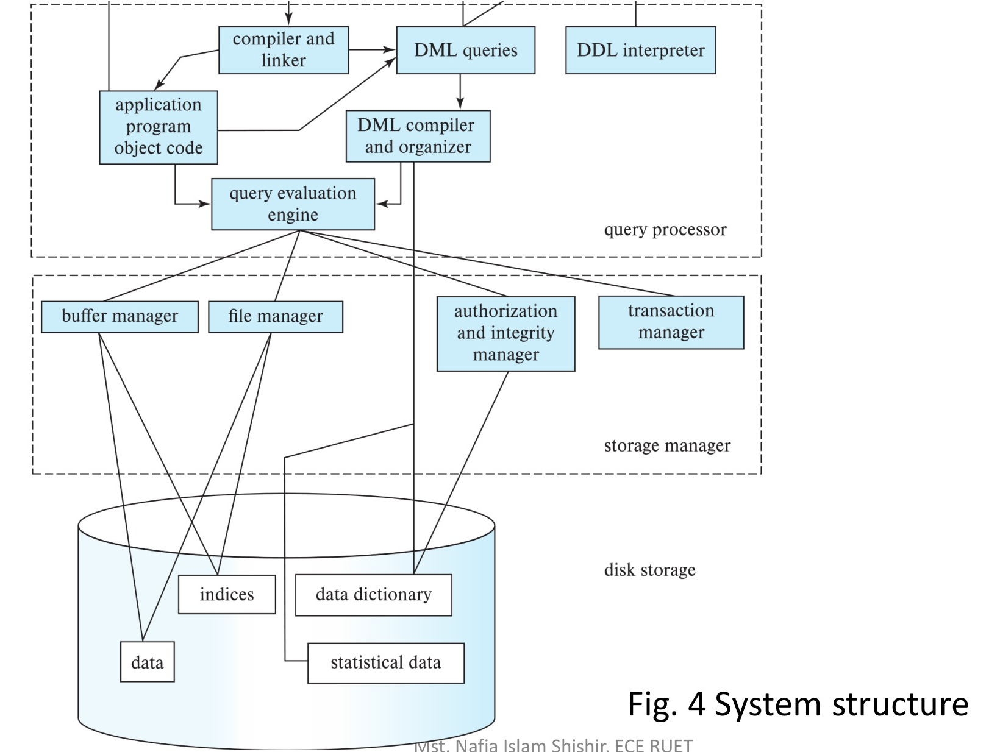

[← Previous: T01.5: DDL vs. DML](T01.05_DDL_vs_DML.md) | [🏠 Index](00_Index.md) | [Next: T01.7: Two-Tier vs. Three-Tier Architecture →](T01.07_Two_Tier_vs_Three_Tier_Architecture.md)

---

# T01.6: DBMS Engine Components

> **Topic:** T01 — DB Concepts & Architecture | **Priority:** ⭐ | **Exam Frequency:** 0/7 finals (0 marks)
> **Sources:** Silberschatz 7e Ch. 1 (§1.6) · Lecture Deck 01 (Slides 22–25, 28) · Class Notes (Raidah p. 12)

## Why This Topic Matters

What actually happens inside the database engine the moment you press "Enter" on an SQL query? Although past finals have not asked a standalone question on internal engine modules yet, Lecture Deck 01 (Slides 22–25, 28) and Silberschatz Chapter 1 (§1.6) devote several slides to the **Query Processor**, the **Storage Manager**, and the **three steps of query processing**. Instructors frequently highlight these diagrams in class, making them prime candidates for a 3-to-5-mark question in Section A or a class test.

---

## 📝 Key Definitions

> **Storage Manager:** "The **storage manager** is the component of a database system that provides the interface between the low-level data stored in the database and the application programs and queries submitted to the system." — Silberschatz, Korth & Sudarshan, *Database System Concepts* (7th Ed.), §1.6.1 (p. 19)

> **Query Optimization:** "The DML compiler also performs **query optimization**; that is, it picks the lowest cost evaluation plan from among the alternatives." — Silberschatz, Korth & Sudarshan, *Database System Concepts* (7th Ed.), §1.6.2 (p. 20)

> **Transaction:** "A **transaction** is a collection of operations that performs a single logical function in a database application." — Silberschatz, Korth & Sudarshan, *Database System Concepts* (7th Ed.), §1.6.3 (p. 20)

> **Buffer Manager:** "The **buffer manager**... is responsible for fetching data from disk storage into main memory, and deciding what data to cache in main memory." — Silberschatz, Korth & Sudarshan, *Database System Concepts* (7th Ed.), §1.6.1 (p. 19)

---

## Overall DBMS Engine Architecture

To understand how a DBMS works under the hood, imagine a busy restaurant kitchen. When you place an order in plain English (an SQL query), the head chef (**Query Processor**) reads your ticket, figures out the fastest recipe to cook it, and calls out ingredient requests. The pantry manager (**Storage Manager**) then fetches the exact ingredients from the walk-in freezer (**Disk Storage**) and places them on the kitchen counter (**RAM Buffer**) so the dish can be assembled quickly.

In the same way, a DBMS engine is divided into three main functional layers:

1. **The Query Processor (Top Layer):** Parses your SQL commands, picks the cheapest execution plan, and runs it.
2. **The Storage Manager (Middle Layer):** Translates those execution steps into fast RAM buffer reads and low-level disk file operations.
3. **The Transaction Management Component (Cross-Cutting Safety Layer):** Makes sure concurrent queries do not corrupt each other and that committed data survives power failures.


*Figure 1: Centralized database system structure illustrating query processor, storage manager, and physical disk storage.*

---

## 1. The Storage Manager Subsystem

Because the operating system only knows how to read and write raw blocks of bytes on a drive, the **Storage Manager** acts as the translator between high-level query steps and physical disk files.

### Four Functional Modules of the Storage Manager

1. **Authorization and Integrity Manager:**
   - Acts as the gatekeeper before any data is read or modified.
   - Checks whether the user has permission (`SELECT`, `INSERT`, `UPDATE`, `DELETE`) and verifies that new values obey all integrity rules (primary keys, foreign keys, and `CHECK` constraints).

2. **Transaction Manager:**
   - Keeps the database in a valid, consistent state even if the server crashes mid-update or dozens of users edit rows at the same time.

3. **File Manager:**
   - Manages how disk space is allocated and how tables, pages, and rows are organized inside physical files on the drive.

4. **Buffer Manager:**
   - Because reading from a disk is thousands of times slower than reading from RAM, applications never read disk blocks directly.
   - Instead, the **buffer manager** fetches disk blocks into a fast main-memory cache (the buffer pool) and uses replacement policies (like Least Recently Used, or LRU) to swap out old pages when RAM fills up. This lets a database with 16 GB of RAM smoothly handle a 10 TB dataset.

### Four Physical Structures on Disk

The storage manager reads and writes four main types of structures on secondary storage:

- **Data Files:** Hold the actual table rows (user data).
- **Data Dictionary:** Holds metadata (table schemas, column types, constraints, and user permissions).
- **Indices (Indexes):** Hold B+-tree or hash search structures that point directly to matching rows in the data files for fast lookups.
- **Statistical Data:** Holds summary counts (like how many rows are in each table or how many distinct values are in a column) so the query optimizer can estimate how much each query plan will cost.

---

## 2. The Query Processor Subsystem

When you submit a declarative SQL query, you only tell the database *what* rows you want, not *how* to find them. The **Query Processor** turns that high-level SQL text into a concrete step-by-step recipe.


*Figure 2: Three phases of query processing: parsing and translation, optimization, and evaluation.*

### Three Modules of the Query Processor

1. **DDL Interpreter:**
   - Handles schema-building commands (`CREATE TABLE`, `ALTER TABLE`, `DROP TABLE`) and records the resulting metadata inside the data dictionary.

2. **DML Compiler and Optimizer:**
   - Takes `SELECT`, `INSERT`, `UPDATE`, and `DELETE` statements and translates them into internal relational algebra expressions.
   - Because there are many ways to run the same query (for example, scanning a whole table versus using an index), the **Query Optimizer** checks the catalog's **statistical data**, estimates the disk I/O cost of each option, and picks the lowest-cost execution plan.

3. **Query Evaluation Engine:**
   - Takes the winning execution plan from the optimizer, runs its low-level operators by calling the storage manager, and sends the final result table back to the user.

---

## 3. Transaction Management and Concurrency Control

In a live system, hundreds of queries run at the same time, and power outages can strike at any moment. To keep data safe, the transaction subsystem relies on two specialized managers:

### Concurrency-Control Manager

- Coordinates simultaneous transactions so two users editing the same row do not overwrite each other's work.
- Uses locking protocols (like Two-Phase Locking, covered in `T11.01`) or timestamp ordering (`T11.03`) to prevent lost updates and dirty reads.

### Recovery Manager

- Ensures **atomicity** (every transaction either finishes completely or is completely undone) and **durability** (once a transaction commits, its changes are never lost).
- Writes every change to a write-ahead log (WAL) on disk so the database can replay or undo interrupted work automatically when the server restarts after a crash (`T12.02`).

---

## Summary of DBMS Engine Modules

| Subsystem | Component Module | Primary Function |
| :--- | :--- | :--- |
| **Query Processor** | DDL Interpreter | Parses schema commands and saves metadata in the data dictionary |
| | DML Compiler & Optimizer | Translates SQL into relational algebra and picks the lowest-cost plan |
| | Query Evaluation Engine | Executes the chosen plan by calling the storage manager |
| **Storage Manager** | Authorization & Integrity Manager | Verifies user permissions and checks integrity constraints |
| | Transaction Manager | Coordinates concurrent access and crash recovery |
| | File Manager | Allocates disk blocks and organizes files on storage |
| | Buffer Manager | Caches active disk blocks in RAM and flushes modified pages to disk |
| **Disk Storage** | Data Files | Stores the actual table rows (tuples) |
| | Data Dictionary | Stores metadata about schemas, constraints, and users |
| | Indices | Speeds up lookups using B+-tree or hash search keys |
| | Statistical Data | Gives table size and distribution stats to the query optimizer |

---

## 🔮 Likely Questions (High-Probability Predictions)

### 🎯 LQ1 · Functional Components of the Storage Manager

> **Predicted Format:** 3–4 Marks · Section A

**Question:**

Explain the main functional components of the storage manager in a database engine. Why is the buffer manager critical?

**Full Answer:**

The **storage manager** is the software layer that translates high-level query operations into low-level file system reads and writes on disk. Its four main components are:

1. **Authorization and Integrity Manager:** Verifies that the user has permission to read or modify the target table, and checks that every insert or update obeys defined integrity constraints (such as primary and foreign keys).
2. **Transaction Manager:** Ensures that database stays in a consistent state during crashes and coordinates concurrent transactions so they do not conflict.
3. **File Manager:** Allocates space on disk drives and manages the data structures used to store pages and records inside physical files.
4. **Buffer Manager:** Fetches data blocks from slow disk storage into fast main memory (RAM) and decides which pages to keep cached in memory.

**Why the Buffer Manager is Critical:**
Reading from physical disks is thousands of times slower than reading from RAM, and real-world databases are often much larger than a server's available memory. By caching frequently used disk blocks in RAM and swapping out inactive pages cleanly, the buffer manager lets the DBMS process massive datasets at near-memory speeds without hitting the disk on every read.

---

### 🎯 LQ2 · Three Phases of Query Processing

> **Predicted Format:** 3–4 Marks · Section A

**Question:**

Describe the three main steps involved in processing a query in a relational database management system.

**Full Answer:**

When a user submits an SQL query, the DBMS processes and runs it in three sequential steps:

1. **Parsing and Translation:**
   - The parser checks the SQL syntax and verifies that all table and column names exist in the data dictionary.
   - It then translates the SQL text into an internal relational algebra expression tree.

2. **Query Optimization:**
   - Because a single relational algebra expression can be executed in several different ways, the optimizer checks the catalog's statistical data (row counts, index heights, and column distributions) to estimate the disk I/O and CPU cost of each candidate strategy.
   - It then picks the execution plan with the lowest estimated cost.

3. **Query Evaluation:**
   - The query evaluation engine takes that winning execution plan, runs its physical operators by requesting pages from the storage manager, and returns the matching rows to the user.

---

### 🎯 LQ3 · DBMS Engine System Structure

> **Predicted Format:** 5 Marks · Section A

**Question:**

Draw and explain the overall system structure of a relational database management system.

**Full Answer:**

A relational DBMS engine is organized into three connected layers:

```text
[Users / Programmers]
        │
        ▼
┌────────────────────────────────────────────────────────┐
│                   QUERY PROCESSOR                      │
│  DDL Interpreter  ·  DML Compiler & Optimizer          │
│             Query Evaluation Engine                    │
└───────────────────────┬────────────────────────────────┘
                        │ Low-level storage calls
                        ▼
┌────────────────────────────────────────────────────────┐
│                   STORAGE MANAGER                      │
│  Buffer Manager  ·  File Manager                       │
│  Authorization & Integrity Manager                     │
│  Transaction Manager                                   │
└───────────────────────┬────────────────────────────────┘
                        │ Physical block I/O
                        ▼
┌────────────────────────────────────────────────────────┐
│                     DISK STORAGE                       │
│  Data Files  ·  Data Dictionary  ·  Indices  ·  Stats  │
└────────────────────────────────────────────────────────┘
```

1. **Query Processor:** Takes user SQL commands and turns them into low-level execution instructions. Its *DDL interpreter* saves schema definitions into the data dictionary, its *DML compiler and optimizer* picks the cheapest execution plan, and its *query evaluation engine* executes that plan.
2. **Storage Manager:** Acts as the bridge between the query processor and physical disks. It caches pages in RAM (*buffer manager*), manages disk file layouts (*file manager*), checks user permissions and constraints (*authorization and integrity manager*), and coordinates safe concurrent updates (*transaction manager*).
3. **Disk Storage:** Holds the permanent files on disk, including *data files* (table rows), the *data dictionary* (metadata), *indices* (B+-tree/hash lookup structures), and *statistical data* (used by the optimizer).

---

## ⚡ Exam Tips & Common Mistakes

1. **Do not confuse engine modules with application tiers:** The storage manager and query processor are internal C/C++ engine components. They are not the same as the client, application server, and database server tiers in application architecture.
2. **Remember the role of statistical data:** The optimizer cannot pick the best plan without data statistics. Always mention that catalog statistics inform the cost estimation.
3. **Understand the buffer manager boundary:** Application programs never read disk blocks directly. The buffer manager handles block caching transparently.

## 🔗 Related Topics

- [T01.05: DDL vs. DML](T01.05_DDL_vs_DML.md) (Language statements handled by the DDL interpreter and DML compiler)
- [T01.07: Two-Tier vs. Three-Tier Architecture](T01.07_Two_Tier_vs_Three_Tier_Architecture.md) (How applications connect to the database engine)
- [T09.01: ACID Properties](T09.01_ACID_Properties.md) (Principles enforced by the transaction and recovery managers)
- [T12.02: Role of the Recovery Manager](T12.02_Recovery_Manager_Role.md) (Detailed crash recovery algorithms)

---

[← Previous: T01.5: DDL vs. DML](T01.05_DDL_vs_DML.md) | [🏠 Index](00_Index.md) | [Next: T01.7: Two-Tier vs. Three-Tier Architecture →](T01.07_Two_Tier_vs_Three_Tier_Architecture.md)
