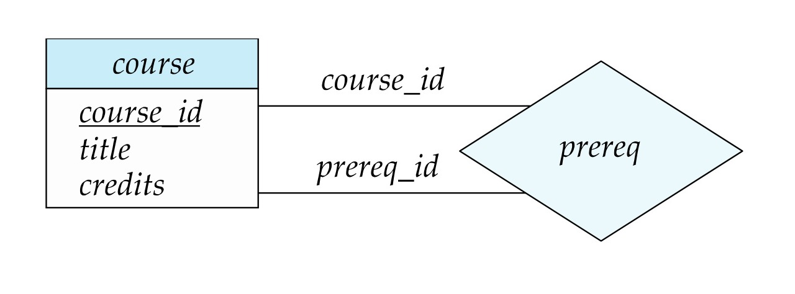

[← Previous: T01.7: Two-Tier vs. Three-Tier Architecture](T01.07_Two_Tier_vs_Three_Tier_Architecture.md) | [🏠 Index](00_Index.md) | [Next: T02.2: Attribute Types →](T02.02_Attribute_Types.md)

---

# T02.1: Entities, Relationships, and Degree

> **Topic:** T02 — E-R & EER Modeling | **Priority:** 🟢 | **Exam Frequency:** 1/7 finals (4 marks)
> **Sources:** Silberschatz 7e Ch. 6 (§6.2) · Lecture Deck 05 (Slides 7–16) · Class Notes (Raidah p. 18; Fahim p. 20–25)

## Why This Topic Matters

The Entity-Relationship (E-R) model is the starting point for designing almost any relational database from scratch. Across the 7 RUET semester finals, Topic T02 accounts for 67 marks (a 10.5% share of all marks). In 2021 Q.5(a), examiners asked students to define an E-R diagram and illustrate the different types of relationships by degree. Getting comfortable with unary, binary, and ternary relationships here will also keep you from making structural mistakes on the big E-R schema design questions later in this unit.

---

## 📝 Key Definitions

> **Entity:** An entity is a real-world object or thing that can be clearly told apart from all other objects. Each entity has its own set of attributes, such as a specific student or a specific course.

> **Entity Set:** An entity set is a collection of entities of the same type that share the same attributes. In an E-R diagram, an entity set is drawn as a rectangle, such as `student` or `instructor`.

> **Relationship:** A relationship is a meaningful connection among two or more entities. A relationship set groups relationships of the same type and is drawn as a diamond in an E-R diagram.

> **Degree of a Relationship Set:** The degree of a relationship set is the number of entity sets that participate in it. Common degrees are unary (degree 1), binary (degree 2), and ternary (degree 3).

> **E-R Data Model:** The Entity-Relationship (E-R) data model is a conceptual tool used to design databases. It describes the overall logical structure of a database using entities, attributes, and relationships.

---

## Conceptual Foundations of the E-R Model

Before writing a single `CREATE TABLE` statement, database designers sketch an E-R diagram to map out the real-world objects and their connections visually, without worrying about physical storage details or disk file formats.

### Core Graphical Components

- **Rectangles:** Represent entity sets (such as `instructor` or `student`), with primary key attributes underlined inside the box.
- **Diamonds:** Represent relationship sets (such as `advisor` or `takes`) that link participating entity sets together.
- **Lines:** Connect entity rectangles to relationship diamonds to show which entity sets participate in each relationship.
- **Role Labels:** Short labels placed on connecting lines when the same entity set participates in a relationship more than once.
- **Descriptive Attributes:** Undivided boxes connected to relationship diamonds by dashed lines (or ovals in classic Chen style) to store data that belongs to the relationship itself rather than to any single entity.

---

## Mathematical Definition of Relationship Sets

**Intuitive Idea:** Think of each entity set as a list of items, like a list of instructors and a list of students. If you took every possible pairing of one instructor and one student, you would get the Cartesian product. A **relationship set** is simply the subset of those combinations that actually exist in the real world (for example, the specific instructor-student pairs where the instructor really advises that student).

Formally, let $E_1, E_2, \dots, E_n$ be entity sets. A **relationship set** $R$ is a mathematical relation on $n \ge 2$ (possibly non-distinct) entity sets:

$$
R \subseteq \{(e_1, e_2, \dots, e_n) \mid e_1 \in E_1, e_2 \in E_2, \dots, e_n \in E_n\}
$$

Where:
- Each tuple $(e_1, e_2, \dots, e_n)$ is a specific **relationship instance** (one real-world connection).
- The entity sets $E_1, E_2, \dots, E_n$ **participate** in the relationship set $R$.
- The count $n$ of participating entity sets is called the **degree** of the relationship set.

---

## Classification of Relationships by Degree

The degree of a relationship set tells you how many entity sets are connected by the relationship diamond.

### 1. Unary (Recursive) Relationship (Degree 1)

In a unary (or recursive) relationship, only one entity set is involved, meaning entities from that set are linked to other entities in the exact same set.

- **Mechanics and Role Indicators:** Because both lines from the relationship diamond loop back to the same entity box, we have to write explicit **role labels** on the lines so the reader knows which role each entity plays.
- **Example:** In the `prereq` relationship on the `course` entity set, one course plays the role of the main course (`course_id`) while another course plays the role of its prerequisite (`prereq_id`).


*Figure 1: Roles in a recursive (unary) relationship prereq connected to entity set course.*

```text
       ┌───────────┐
       │  course   │
       └─────┬─────┘
  course_id  │  prereq_id
       ┌─────┴─────┐
       │  prereq   │
       └───────────┘
```

---

### 2. Binary Relationship (Degree 2)

A binary relationship connects two different entity sets and is by far the most common relationship type in real-world databases.

- **Mechanics:** Each relationship instance is an ordered pair $(e_1, e_2)$ that links one entity from $E_1$ to one entity from $E_2$.
- **Example:** The `advisor` relationship connects the `instructor` entity set to the `student` entity set. For example, the pair $(45565, 12345) \in \text{advisor}$ means that instructor 45565 (Katz) advises student 12345 (Shankar).


*Figure 2: Binary relationship advisor connecting instructor and student entity sets.*

---

### 3. Ternary Relationship (Degree 3)

A ternary relationship connects three distinct entity sets through a single relationship diamond at the same time.

- **Mechanics:** Each relationship instance is an ordered triple $(e_1, e_2, e_3)$ that captures a three-way connection.
- **Example:** The `proj_guide` relationship links `instructor`, `student`, and `project` together.
- **Why We Need It:** Suppose a student works on two different projects under two different instructors. If we only drew two separate binary relationships (`instructor-student` and `student-project`), we could tell which instructors advise the student and which projects the student works on, but we would lose track of *which instructor guides that student on which specific project*.


*Figure 3: Ternary relationship proj_guide connecting instructor, student, and project entity sets.*

---

### 4. Higher-Degree ($n$-ary) Relationships (Degree $n$)

In theory, a relationship set can connect any number $n$ of entity sets. In practice, relationships with degree $n > 3$ are very rare because they are hard to read and make cardinality constraints tricky to enforce.

> [!TIP]
> Any $n$-ary relationship can be converted into a set of binary relationships by creating a new central entity set (representing the event or contract itself) and linking it to each of the original entity sets with binary relationships.

---

## Descriptive Attributes on Relationships

Sometimes a piece of data describes the connection between entities rather than any single entity on its own. We call these properties **descriptive attributes** and attach them directly to the relationship diamond:

- **Example 1:** The `advisor` relationship between `instructor` and `student` can have a `date` attribute that records when that instructor started advising that student.
- **Example 2:** The `takes` relationship between `student` and `section` carries a `grade` attribute. A grade does not belong to a student alone (since a student gets different grades in different sections) or to a section alone (since many students get different grades in the same section), so it must live on the `takes` relationship.
- **Diagram Notation:** Drawn as an undivided rectangular box connected to the relationship diamond with a dashed line (or as an oval connected to the diamond in classic Chen notation).

---

## Degree Comparison Matrix

| Relationship Classification | Degree ($n$) | Participating Entity Sets | Example Scenario | Role Labels Required? |
| :--- | :---: | :--- | :--- | :---: |
| **Unary (Recursive)** | 1 | Single entity set associating with itself | `course` linked via `prereq` (`course_id`, `prereq_id`) | **Yes** (mandatory) |
| **Binary** | 2 | Two distinct entity sets | `instructor` linked to `student` via `advisor` | No (implicit) |
| **Ternary** | 3 | Three distinct entity sets | `instructor`, `student`, `project` via `proj_guide` | No (implicit) |
| **$n$-ary** | $n$ | $n$ participating entity sets ($n \ge 4$) | Multi-supplier contract tracking | Only if entity sets repeat |

---

## Worked Example: Choosing the Right Degree in Practice

### Scenario: Hospital Prescription Tracking

Suppose a hospital database tracks three entity sets: `doctor(doc_id, name)`, `patient(pat_id, name)`, and `medicine(med_code, brand_name)`.

1. **Unary check:** If some senior doctors supervise junior doctors, both sides of the relationship come from `doctor`. That gives a **Degree 1 (Unary)** relationship `supervises` with role labels `supervisor_id` and `trainee_id`.
2. **Binary check:** If each patient is assigned to a primary ward, linking `patient` to `ward` involves two distinct entity sets, which is a **Degree 2 (Binary)** relationship.
3. **Ternary check:** When a doctor prescribes a specific medicine to a patient with a `dosage` descriptive attribute, all three entity sets must be bound together in a single **Degree 3 (Ternary)** relationship `prescribes`. A specific instance like:
   $$
   (\text{DOC-12}, \text{PAT-405}, \text{MED-99}) \in \text{prescribes}
   $$
   records that doctor `DOC-12` prescribed medicine `MED-99` to patient `PAT-405`.

---

## Exam Variants

| Year & Question | Marks | Scenario / Data Given | Key Result / Answer Summary |
| :--- | :---: | :--- | :--- |
| **2021 Q.5(a)** | 4 | Define ER diagram and illustrate relationship types that can be represented | Define E-R diagram, then explain Unary, Binary, and Ternary relationships with diagrams and examples |

---

## 🏆 Golden Questions (Past Exam Archive)

### 🎯 GQ1 · 2021 Q.5(a) · ER Diagram Definition and Types of Relationship

> **Appeared:** 2021 Q.5(a) — (4 marks)

> **Question:** What is ER diagram? Illustrate different types of relationship that can be represented in ER diagram.

**Full Answer:**

#### 1. Definition of Entity-Relationship (E-R) Diagram

An **Entity-Relationship (E-R) diagram** is a graphical modeling tool that shows the conceptual schema and overall logical structure of a database. It represents a real-world system using three main building blocks:
- **Entities:** Real-world objects that can be distinguished from other objects (drawn as rectangles).
- **Attributes:** Descriptive properties of those entities or relationships (drawn as ovals in Chen notation or listed inside boxes).
- **Relationships:** Associations that connect two or more entities together (drawn as diamonds linked to entity rectangles by lines).

#### 2. Types of Relationships by Degree

The **degree** of a relationship set is the number of entity sets that participate in it. Based on degree, an E-R diagram represents three main types of relationships:

##### (i) Unary (Recursive) Relationship (Degree 1)
A relationship in which entities from a single entity set are associated with other entities in the exact same set. Because both connections go to the same entity box, explicit **role labels** are written on the lines to show the role each entity plays.

- *Example:* The `prereq` relationship on the `course` entity set, using the roles `course_id` (the course being taken) and `prereq_id` (the prerequisite course required first).

```text
       ┌───────────┐
       │  course   │
       └─────┬─────┘
  course_id  │  prereq_id
       ┌─────┴─────┐
       │  prereq   │
       └───────────┘
```

##### (ii) Binary Relationship (Degree 2)
An association that connects two distinct entity sets. This is the most common relationship type in database design.

- *Example:* The `advisor` relationship between `instructor` and `student`, which links a faculty member to the students they mentor.

```text
┌──────────────┐         ┌───────────┐         ┌───────────┐
│  instructor  ├─────────┤  advisor  ├─────────┤  student  │
└──────────────┘         └───────────┘         └───────────┘
```

##### (iii) Ternary Relationship (Degree 3)
An association that connects three distinct entity sets at the same time. It is used when a three-way connection cannot be broken into simple binary links without losing information.

- *Example:* The `proj_guide` relationship connecting `instructor`, `student`, and `project`, which records which instructor guides a specific student on a particular research project.

```text
                         ┌───────────┐
                         │  project  │
                         └─────┬─────┘
                               │
┌──────────────┐         ┌─────┴─────┐         ┌───────────┐
│  instructor  ├─────────┤proj_guide ├─────────┤  student  │
└──────────────┘         └───────────┘         └───────────┘
```

---

## ⚡ Exam Tips & Common Mistakes

1. **Do not confuse relationship degree with mapping cardinalities:** When an exam asks for "types of relationship", the primary classification is by **degree** (Unary, Binary, Ternary). Mapping cardinalities (1:1, 1:N, M:N) describe quantitative constraints, not relationship types. Mention both if space permits, but lead with degree.
2. **Always include role labels on unary relationships:** Drawing a recursive diamond without `course_id` and `prereq_id` role tags will lose 0.5 to 1 mark.
3. **Explain why ternary relationships exist:** Clearly state that a ternary relationship cannot always be replaced by two binary relationships. A ternary link preserves the exact three-way binding among instructor, student, and project.

## 🔗 Related Topics

- [T01.07: Two-Tier vs. Three-Tier Architecture](T01.07_Two_Tier_vs_Three_Tier_Architecture.md) (How application clients interface with backend schemas)
- [T02.02: Attribute Types](T02.02_Attribute_Types.md) (Simple, composite, multivalued, and derived attributes)
- [T02.03: Mapping Cardinality and Participation Constraints](T02.03_Mapping_Cardinality_and_Participation.md) (1:1, 1:N, M:N and total/partial constraints)
- [T02.06: Reduction of E-R Diagrams to Relational Tables](T02.06_Reduction_of_ER_to_Tables.md) (Transforming unary, binary, and ternary relationships into SQL tables)

---

[← Previous: T01.7: Two-Tier vs. Three-Tier Architecture](T01.07_Two_Tier_vs_Three_Tier_Architecture.md) | [🏠 Index](00_Index.md) | [Next: T02.2: Attribute Types →](T02.02_Attribute_Types.md)
