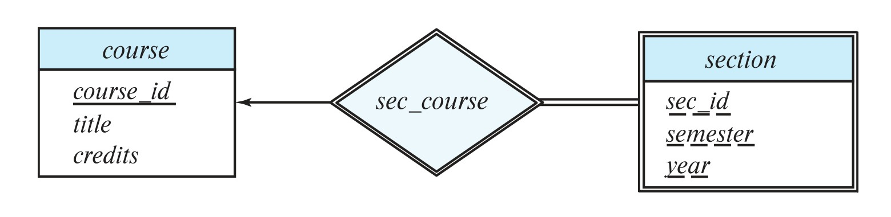

[← Previous: T02.3: Mapping Cardinality and Participation Constraints](T02.03_Mapping_Cardinality_and_Participation.md) | [🏠 Index](00_Index.md) | [Next: T02.5a: E-R Design Method →](T02.05a_ER_Design_Method_Student_and_Teacher_Course.md)

---

# T02.4: Weak vs. Strong Entity Sets

> **Topic:** T02 — E-R & EER Modeling | **Priority:** 🟠 High | **Exam Frequency:** 4/7 finals (11 marks)  
> **Sources:** Silberschatz 7e Ch. 6 (§6.2, §6.5.3, §6.7.3, pp. 245, 259–260, 267–268) · Lecture Deck 05 (Slides 34–37, 42, 48) · Classnote by Raidah (p. 19) · Handnote by Fahim (p. 21)

## Why This Topic Matters

Weak entity sets have appeared in 4 out of 7 RUET semester finals (accounting for 11 marks), making this one of the most frequently tested theory concepts in Unit 2. Exam questions typically ask you to compare strong and weak entity sets, explain what a discriminator (partial key) is, and show how a DBMS stores weak entity sets in tables. In real-world databases, weak entity sets model child items that only make sense inside a parent entity, such as university course sections, hotel room numbers, or employee dependents.

---

## 📝 Key Definitions

> **Weak Entity Set:** "A weak entity set is one whose existence is dependent on another entity set, called its **identifying entity set**; instead of associating a primary key with a weak entity, we use the primary key of the identifying entity, along with extra attributes, called **discriminator attributes** to uniquely identify a weak entity."  
> — Silberschatz, Korth & Sudarshan, *Database System Concepts* (7th Ed.), §6.5.3 (p. 259)

> **Strong Entity Set:** "An entity set that is not a weak entity set is termed a **strong entity set**."  
> — Silberschatz, Korth & Sudarshan, *Database System Concepts* (7th Ed.), §6.5.3 (p. 259)

> **Identifying Relationship:** "The relationship associating the weak entity set with the identifying entity set is called the **identifying relationship**."  
> — Silberschatz, Korth & Sudarshan, *Database System Concepts* (7th Ed.), §6.5.3 (p. 259)

> **Discriminator (Partial Key):** "...instead of associating a primary key with a weak entity, we use the primary key of the identifying entity, along with extra attributes, called **discriminator attributes** to uniquely identify a weak entity."  
> — Silberschatz, Korth & Sudarshan, *Database System Concepts* (7th Ed.), §6.5.3 (p. 259)

> **Entity Set:** "An entity set is a set of entities of the same type that share the same properties, or attributes."  
> — Silberschatz, Korth & Sudarshan, *Database System Concepts* (7th Ed.), §6.2.1 (p. 245)

---

## 1. Why Weak Entity Sets Exist

In real-world database design, some entities cannot stand on their own because they do not have enough of their own attributes to be uniquely identified across the whole database:

1. **No Global Key on Its Own:** Think of an apartment number like `Apt 3B` or a university course section like `Section A` in Fall 2024. Both `ECE 2215` and `CSE 2201` have a `Section A` in Fall 2024, so `(sec_id, semester, year)` is only unique *inside* a specific course, not across the entire university.
2. **Existence Dependency:** If a course is removed from the university catalog, all of its sections disappear with it. A section has no meaning without the parent course that owns it.
3. **Keeping the Schema Natural:** While a designer could invent a synthetic ID like `section_serial_98234`, doing so hides the natural parent-child link. Modeling `section` as a weak entity set keeps the real business structure clear.

---

## 2. Strong vs. Weak Entity Sets: Core Comparison

| Feature | Strong Entity Set | Weak Entity Set |
| :--- | :--- | :--- |
| **Primary Key** | Has enough of its own attributes to form a primary key. | Does not have enough attributes for a full primary key on its own, so it uses a partial key (discriminator). |
| **Existence Dependency** | Independent. Its existence does not depend on any other entity set. | Existence-dependent on an identifying (owner) strong entity set. |
| **Chen E-R Notation** | Single rectangle. | Double rectangle. |
| **Relationship Symbol** | Regular relationship diamond (single line). | Identifying relationship diamond (double diamond). |
| **Key Underlining** | Primary key is underlined with a **solid line**. | Discriminator is underlined with a **dashed line**. |
| **Primary Key Formula** | Built solely from its own candidate key attributes. | Built by combining the owner's primary key with its own discriminator. |
| **Participation in Identifying Relationship** | Can be partial or total. | Must have **total participation** (drawn as a double line). |
| **Cardinality of Identifying Relationship** | Typically the "One" side of the relationship. | Many-to-One ($N:1$) from the weak entity to the identifying entity. |
| **Relational Deletion Rule** | Normal deletion rules apply. | Uses `ON DELETE CASCADE` so child rows are deleted automatically if the owner is deleted. |
| **Real-World Example** | `course` (`course_id`, `title`, `credits`) | `section` (`sec_id`, `semester`, `year`) owned by `course` |

---

## 3. Visual E-R Notation for Weak Entity Sets

When drawing a weak entity set in an exam diagram, remember five visual markers:

1. **Double Rectangle:** Draws the weak entity set itself.
2. **Double Diamond:** Draws the identifying relationship set that links the weak entity to its owner.
3. **Dashed Underline:** Marks the discriminator (partial key) attributes inside the weak entity.
4. **Double Line:** Connects the weak entity to the double diamond to show total participation (every weak entity must have an owner).
5. **Directed Arrow ($\rightarrow$):** Points from the double diamond to the strong owner entity, showing that each weak entity belongs to at most one owner ($N:1$).


*Figure 1: Weak entity set section connected to strong entity set course via identifying relationship sec_course.*

---

## 4. How a DBMS Handles Weak Entity Sets

SQL does not have a special `CREATE WEAK TABLE` command. Instead, a relational DBMS turns a weak entity set into a standard table using three rules:

### Step 1: Build a Composite Primary Key
**Intuitive Analogy:** Just as `"Room 204"` only tells a delivery driver where to go once you combine it with `"ECE Building"`, a weak entity's discriminator only identifies a row once we combine it with the owner's primary key. Formally:

$$
\text{PK}(\text{Weak Entity}) = \text{PK}(\text{Identifying Entity}) \cup \text{Discriminator}(\text{Weak Entity})
$$

### Step 2: Create the Weak Entity Table (and Skip the Relationship Table!)
When converting the E-R diagram into relational tables:
- We create a table for the strong owner entity with its normal primary key.
- We create a table for the weak entity that includes the owner's primary key (as a foreign key), the discriminator columns, and any other attributes of the weak entity.
- **We do NOT create a separate table for the identifying relationship diamond.** Because the weak entity table already stores the owner's primary key and has total participation in a many-to-one ($N:1$) link, a separate relationship table would just duplicate the exact same key columns.

### Step 3: Enforce Existence Dependency with `ON DELETE CASCADE`
Because a weak entity cannot exist without its parent owner, deleting the parent row must automatically remove all of its dependent child rows. We enforce this in SQL by attaching `ON DELETE CASCADE` to the foreign key:

```sql
FOREIGN KEY (owner_pk) REFERENCES owner_table(owner_pk) ON DELETE CASCADE
```

---

## Worked Example: Building and Room (Mini-Trace)

Suppose a university campus tracks `building` (strong entity with PK `bldg_code` and `bldg_name`) and `room` (weak entity with discriminator `room_no` and attribute `capacity`), linked by the identifying relationship `bldg_room`:
- **Primary Key of `room`:** $\text{PK}(\text{room}) = \{\text{bldg\_code}\} \cup \{\text{room\_no}\} = (\text{bldg\_code}, \text{room\_no})$.
- **Relational Schemas:**
  - $\text{building}(\underline{\text{bldg\_code}}, \text{bldg\_name})$
  - $\text{room}(\underline{\text{bldg\_code}}, \underline{\text{room\_no}}, \text{capacity})$, where `bldg_code` is a foreign key referencing `building(bldg_code) ON DELETE CASCADE` (no table is needed for `bldg_room`).
- **Why it works:** Both the `"ECE"` building and the `"ME"` building can have a room `"101"`, stored cleanly as `('ECE', '101', 60)` and `('ME', '101', 80)`.

---

## Exam Variants

| Year & Question | Marks | Format / Focus | Key Elements Expected in Solution |
| :--- | :---: | :--- | :--- |
| **2018 Q.1(b)** | 4 | Define entity set, and explain strong and weak entity sets with examples. | Formal definition of entity set, detailed explanation of both types, and `course`/`section` examples. |
| **2019 Q.1(b)** | 3 | Definitions of entity and entity set, plus how a DBMS handles weak entity sets. | Definitions plus the 3-step DBMS handling process (composite PK, no separate relationship table, `ON DELETE CASCADE`). |
| **2020 Q.2(c)** | 2 | Differentiate weak vs. strong entity set with appropriate example. | Concise comparison table (Key, Dependency, E-R symbol, Example). |
| **2021 Q.8(c)** | 2 | Explain weak and strong entity set with appropriate example. | Concise explanation covering primary key formation, dependency, and `course`/`section` example. |

---

## 🏆 Golden Questions (Past Exam Archive)

### 🎯 GQ1 · 2018 Q.1(b) · Strong vs. Weak Entity Sets & Discriminator

> **Appeared:** 2018 Q.1(b) — (4 marks)

> **Question:** Define entity set. Explain the following with suitable example: (i) strong entity set and (ii) weak entity set.

**Full Answer:**

#### 1. Entity Set Definition
An **entity set** is a collection of entities of the same type that share the same properties or attributes (for example, the set of all students or all courses in a university).

#### 2. (i) Strong Entity Set
- **Concept:** A strong entity set has enough of its own attributes to uniquely identify every entity in the set. Because it has its own primary key, its existence does not depend on any other entity set.
- **E-R Representation:** Drawn as a single rectangle, with its primary key attribute underlined using a solid line.
- **Example:** The `course` entity set with attributes `course_id` (primary key), `title`, and `credits`. Every course across the university is uniquely identified by its own `course_id` (such as `'ECE 2215'`).

#### 3. (ii) Weak Entity Set
- **Concept:** A weak entity set does not have enough of its own attributes to form a primary key. Instead, its existence depends on an identifying (owner) strong entity set, and it uses a **discriminator (partial key)** to distinguish among the weak entities that belong to the same owner.
- **E-R Representation:** Drawn as a double rectangle with its discriminator underlined using a dashed line, connected to its owner through a double diamond (identifying relationship) and a double line (total participation).
- **Primary Key Formation:**
  $$
  \text{PK}(\text{Weak Entity}) = \text{PK}(\text{Identifying Entity}) \cup \text{Discriminator}
  $$
- **Example:** The `section` entity set with discriminator attributes `sec_id`, `semester`, and `year`. Because different courses can both have a `Section A` in `Fall 2024`, a section is uniquely identified only by combining its owner's `course_id` with its discriminator: `(course_id, sec_id, semester, year)`.

---

### 🎯 GQ2 · 2019 Q.1(b) · Entity, Entity Set, and DBMS Handling of Weak Entity Sets

> **Appeared:** 2019 Q.1(b) — (3 marks)

> **Question:** What are entity and entity set? How is a weak entity set handled in DBMS? Explain.

**Full Answer:**

#### 1. Definitions
- **Entity:** An entity is a real-world "thing" or "object" that is distinguishable from all other objects (such as a specific student or a specific course).
- **Entity Set:** An entity set is a collection of entities of the same type that share the same attributes (such as the set of all students at RUET).

#### 2. How a Weak Entity Set is Handled in a DBMS
A relational DBMS implements a weak entity set using three mechanisms:

1. **Composite Primary Key Construction:**
   Because the weak entity lacks a full key of its own, the DBMS builds its primary key by combining the primary key of the identifying strong entity with the weak entity's discriminator (partial key):
   $$
   \text{PK}(\text{Weak}) = \text{PK}(\text{Identifying Entity}) \cup \text{Discriminator}
   $$
   For example, for `section` owned by `course`, $\text{PK}(\text{section}) = (\text{course\_id}, \text{sec\_id}, \text{semester}, \text{year})$.
2. **Table Reduction Without an Extra Relationship Table:**
   The DBMS creates a relational table for the weak entity that includes the owner's primary key as a foreign key alongside the weak entity's own attributes. No separate table is created for the identifying relationship diamond because the relationship is many-to-one ($N:1$) with total participation, so its link is already captured inside the weak entity table.
3. **Foreign Key Constraint with Cascading Delete (`ON DELETE CASCADE`):**
   To enforce existence dependency, the foreign key in the weak entity table is declared with `ON DELETE CASCADE` (and `ON UPDATE CASCADE`). That way, if an owner row (like `'ECE 2215'` in `course`) is deleted, the DBMS automatically deletes all of its dependent rows in `section`:
   ```sql
   CREATE TABLE section (
       course_id   VARCHAR(8),
       sec_id      VARCHAR(8),
       semester    VARCHAR(6),
       year        NUMERIC(4,0),
       PRIMARY KEY (course_id, sec_id, semester, year),
       FOREIGN KEY (course_id) REFERENCES course(course_id) ON DELETE CASCADE
   );
   ```

---

### 🎯 GQ3 · 2020 Q.2(c) · Pairwise Differences: Strong vs. Weak Entity Sets

> **Appeared:** 2020 Q.2(c) — (2 marks)

> **Question:** Explain the difference between a weak and a strong entity set with appropriate example.

**Full Answer:**

| Feature | Strong Entity Set | Weak Entity Set |
| :--- | :--- | :--- |
| **Primary Key** | Has enough of its own attributes to form a primary key. | Lacks a full primary key of its own and relies on a partial key (discriminator) plus the owner's primary key. |
| **Existence Dependency** | Independent of any other entity set. | Existence-dependent on an identifying strong entity set. |
| **E-R Diagram Notation** | Drawn as a single rectangle with a solid-underlined primary key. | Drawn as a double rectangle with a dashed-underlined discriminator. |
| **Relationship Set** | Connected via a regular relationship (single diamond). | Connected to its owner via an identifying relationship (double diamond) with total participation (double line). |
| **Example** | `course` with primary key `course_id`. | `section` (`sec_id`, `semester`, `year`) identified by `course`. |

- **Strong Entity Example:** `course(course_id, title, credits)` exists independently and is uniquely identified by `course_id`.
- **Weak Entity Example:** `section(course_id, sec_id, semester, year)` depends on `course` and uses the composite primary key `(course_id, sec_id, semester, year)`.

---

### 🎯 GQ4 · 2021 Q.8(c) · Weak and Strong Entity Sets

> **Appeared:** 2021 Q.8(c) — (2 marks)

> **Question:** Explain weak and strong entity set with appropriate example.

**Full Answer:**

#### Strong Entity Set
A **strong entity set** is an entity set that has enough of its own attributes to uniquely identify each of its entities. It exists independently in the database schema, and in an E-R diagram it is drawn as a single rectangle with a solid-underlined primary key.
- *Example:* `course` with primary key `course_id` and attributes `title` and `credits`.

#### Weak Entity Set
A **weak entity set** is an entity set whose attributes cannot form a primary key on their own, making it existence-dependent on an identifying (owner) strong entity set. It uses a partial key (**discriminator**) to tell apart entities owned by the same parent. In an E-R diagram, it is drawn as a double rectangle with a dashed-underlined discriminator and linked to its owner through a double diamond.
- *Example:* `section` with discriminator `(sec_id, semester, year)` depends on `course`, forming the full composite primary key `(course_id, sec_id, semester, year)`.

---

## 📖 High-Yield Exercises from the Book

> [!NOTE]
> **Direct-Hit Exam Hit:** Textbook Exercise 6.17 (Definitions of weak entity set, identifying relationship, and discriminator) appeared in **2020 Q.2(c)** and **2021 Q.8(c)**, and is fully solved above in [Golden Question 1](#-golden-questions-past-exam-archive). Below is the fresh drill on converting weak entity sets.

### 🎯 HYE-01 · Practice Exercise 6.7 · Converting Weak Entity Sets to Strong Entity Sets

> **Source:** Silberschatz 7e · Chapter 6 (Practice Exercise 6.7)  
> **Exam Relevance:** High-Probability Exam Design Drill  
> **Key Tested Concept:** Mechanism and consequences of converting a weak entity set to a strong entity set by migrating primary key attributes.

**Problem Statement:**
> 1. Describe the precise design procedure to convert a **weak entity set** into a **strong entity set**.
> 2. Apply this procedure to the classic `section` weak entity set (identified by strong entity set `course` via identifying relationship `sec_course`).
> 3. Analyze the database consequences of this transformation regarding **data redundancy**, **relationship set simplification**, and **referential integrity**.

**Model Exam-Style Solution:**

1. **Conversion Procedure:**
   - A weak entity set $W$ lacks a primary key and is identified by a discriminator (partial key) combined with the primary key of its identifying strong entity set $E$.
   - **Transformation Step:** Convert $W$ into a strong entity set by **explicitly adding all the primary key attribute(s) of $E$ into $W$ as native attributes**.
   - The newly added attributes combined with the original discriminator now form the independent primary key of $W$.
   - The identifying relationship set is replaced with a regular binary relationship set (or absorbed via foreign key).

2. **Application to the `section` Entity Set:**
   - **Original Weak Entity Representation:**
     - Identifying Strong Entity: `course(course_id, title, credits)` with PK `course_id`.
     - Weak Entity: `section(sec_id, semester, year)` with discriminator `{sec_id, semester, year}` (dashed underline).
     - Identifying Relationship: `sec_course` (identifying relationship, double diamond).
   - **Transformed Strong Entity Representation:**
     - Add `course_id` directly into the attribute set of `section`.
     - Now `section(course_id, sec_id, semester, year)` has its own independent composite primary key:
       $$
       \text{Primary Key}(\text{section}) = \{\text{course\_id}, \text{sec\_id}, \text{semester}, \text{year}\}
       $$
     - Relationship `sec_course` is no longer identifying (rendered as a single diamond rather than a double diamond), or can be omitted altogether if modeled relationally.

3. **Trade-offs and System Consequences:**
   - **Redundancy:** In the E-R conceptual model, adding `course_id` to `section` creates explicit attribute duplication between entity sets. However, when converted to relational tables, weak entity reduction *already* places `course_id` in the `section` table! Thus, at the relational schema level, there is **zero additional storage overhead**.
   - **Diagram Complexity:** Converting to strong entities eliminates double diamonds and double rectangles, simplifying the E-R diagram.
   - **Constraint Loss in E-R:** In the original weak entity model, the existence dependency is explicitly stated by the double-rectangle notation. Making `section` strong obscures the semantic reality that a section cannot logically exist without an underlying course, relying instead on foreign key constraints in DDL. $\blacksquare$

**💡 RUET Exam Takeaway:**
Examiners love asking: *"Does converting a weak entity to a strong entity increase storage in the final relational schema?"* The answer is **NO**! Relational table reduction for weak entity sets already includes the owner's primary key as foreign key attributes.

---


## ⚡ Exam Tips & Common Mistakes

1. **Never write "weak entities have no keys":** That is a classic exam trap. A weak entity set does not have its *own standalone primary key*, but it always has a **discriminator (partial key)** and forms a full **composite primary key** by borrowing its owner's primary key.
2. **Do not create a separate table for the identifying relationship:** When reducing an E-R diagram to tables, the double-diamond identifying relationship is absorbed directly into the weak entity table via the owner's foreign key.
3. **Always mention `ON DELETE CASCADE`:** Whenever an exam question asks how a DBMS handles weak entity sets (like 2019 Q.1(b)), explicitly write `ON DELETE CASCADE` to show how existence dependency is enforced in SQL.
4. **Check all four Chen diagram symbols:** In drawings, make sure you include a **double rectangle** (weak entity), **double diamond** (identifying relationship), **dashed underline** (discriminator), and **double line** (total participation).

---

## 🔗 Related Topics

- [T02.01: Entities, Relationships, and Degree](T02.01_Entities_Relationships_and_Degree.md): Fundamentals of entities and relationships.
- [T02.03: Mapping Cardinality and Participation Constraints](T02.03_Mapping_Cardinality_and_Participation.md): Total participation and cardinality ratios.
- [T02.06: Reduction of E-R Diagrams to Relational Tables](T02.06_Reduction_of_ER_to_Tables.md): Complete relational table conversion rules.
- [T03.02: Relational Keys](T03.02_Keys.md): Primary keys, candidate keys, and foreign keys.
- [T03.03: Referential Integrity & Foreign Key Constraints](T03.03_Referential_Integrity_and_Foreign_Keys.md): Foreign key actions and cascade deletions.

---

[← Previous: T02.3: Mapping Cardinality and Participation Constraints](T02.03_Mapping_Cardinality_and_Participation.md) | [🏠 Index](00_Index.md) | [Next: T02.5a: E-R Design Method →](T02.05a_ER_Design_Method_Student_and_Teacher_Course.md)
