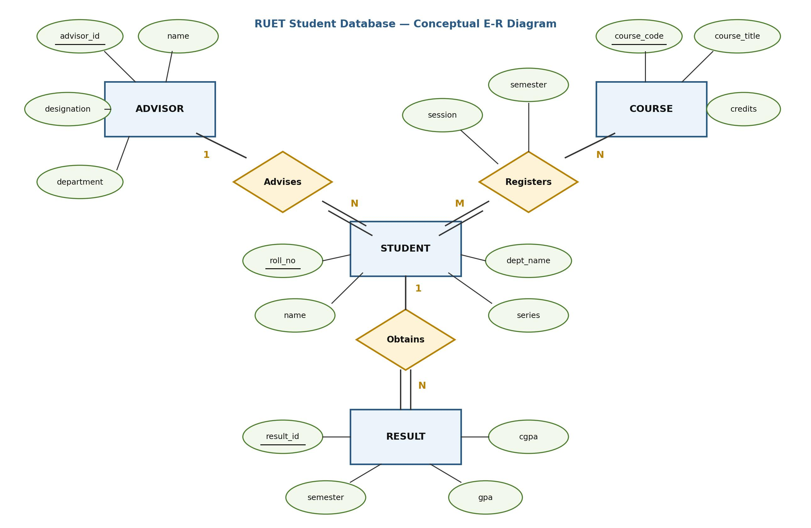
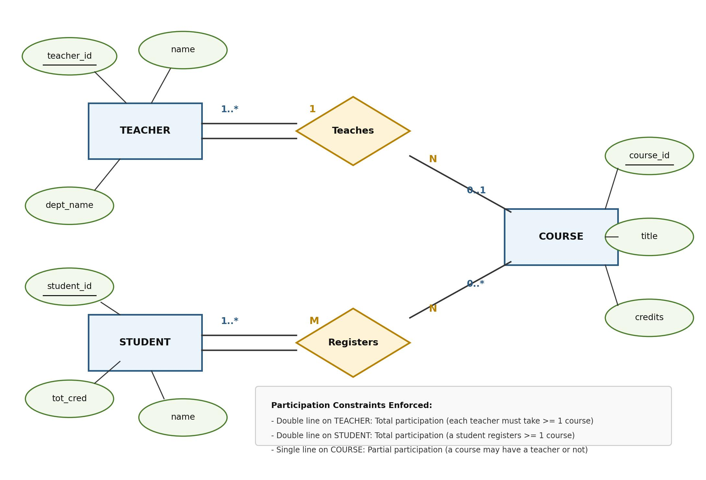

[← Previous: T02.4: Weak vs. Strong Entity Sets](T02.04_Weak_vs_Strong_Entity_Sets.md) | [🏠 Index](00_Index.md) | [Next: T02.5b: E-R Design →](T02.05b_ER_Design_Ticketing_Library_University.md)

---

# T02.5a: E-R Design Method — Student and Teacher-Course DBs

> **Topic:** T02 — E-R & EER Modeling | **Priority:** 🔴 High | **Exam Frequency:** 5/7 finals (+ CT-02 Q2) (24 marks)
> **Sources:** Silberschatz 7e Ch. 6 (§6.1–6.4, §6.9) · Lecture Deck 05 (Slides 7–39) · Raidah Notes (p. 18–19) · Fahim Notes (p. 20–30)

## Why This Topic Matters

Scenario-based E-R diagram questions show up in almost every RUET semester final and usually carry 5 to 6 marks each. These questions give you a short paragraph describing a real-world system and ask you to turn it into a clean Chen-notation E-R diagram. To score full marks, you need a repeatable method for spotting entity sets, choosing primary keys, linking entities with relationship diamonds, and marking the exact cardinality and participation constraints.

---

## 📝 Key Definitions

> **Entity:** "An entity is a “thing” or “object” in the real world that is distinguishable from all other objects." — Silberschatz, Korth & Sudarshan, *Database System Concepts* (7th Ed.), §6.2.1 (p. 244)

> **Entity Set:** "An entity set is a set of entities of the same type that share the same properties, or attributes." — Silberschatz, Korth & Sudarshan, *Database System Concepts* (7th Ed.), §6.2.1 (p. 245)

> **Relationship Set:** "A relationship is an association among several entities... Formally, a relationship set is a mathematical relation on $n \ge 2$ (possibly nondistinct) entity sets." — Silberschatz, Korth & Sudarshan, *Database System Concepts* (7th Ed.), §6.2.2 (p. 246–247)

> **Entity-Relationship Data Model:** "The entity-relationship (E-R) data model was developed to facilitate database design by allowing specification of an enterprise schema that represents the overall logical structure of a database." — Silberschatz, Korth & Sudarshan, *Database System Concepts* (7th Ed.), §6.2 (p. 244)

> **Total Participation:** "The participation of an entity set $E$ in a relationship set $R$ is said to be total if every entity in $E$ must participate in at least one relationship in $R$." — Silberschatz, Korth & Sudarshan, *Database System Concepts* (7th Ed.), §6.4 (p. 255)

---

## The 5-Step E-R Design Recipe

**Intuitive Grammar Trick:** When you read an exam prompt, treat the English sentences like a blueprint: **nouns** that have their own properties become **entity rectangles**, **smaller details** about those nouns become **attribute ovals**, and **verbs** that connect two nouns become **relationship diamonds**.

Follow these five steps in order on any E-R design question:

### Step 1: Spot Entity Sets from Key Nouns
Read the problem statement and underline the main nouns that represent distinct people, physical objects, or major records (such as `STUDENT`, `ADVISOR`, `BOOK`, or `TRAIN`). Draw each entity set as a rectangle labeled with a singular noun.

### Step 2: Attach Attributes and Underline Primary Keys
For each entity rectangle, list 3 to 4 realistic descriptive properties and draw them as ovals connected to the rectangle:
- Pick one attribute that uniquely identifies each entity and **underline** it as the primary key (such as `roll_no` or `course_code`).
- Branch out composite attributes into smaller ovals (like `name` into `first_name` and `last_name`) and use a double oval for multivalued attributes (like `phone`).

### Step 3: Turn Connecting Verbs into Relationship Diamonds
Look for the action verbs that link your entity sets together (such as *registers*, *advises*, *teaches*, or *obtains*). Draw a diamond for each verb, connect it to the participating entity rectangles, and attach any interaction-specific attributes (like `semester` or `session`) directly to the diamond.

### Step 4: Mark Cardinality and Participation Constraints
Check the business rules in the prompt to label the connecting lines:
- **Mapping Cardinality:** Decide whether each link is $1:1$, $1:N$, $N:1$, or $M:N$, and write the ratio labels ($1$, $N$, $M$) clearly beside the entity boxes.
- **Participation:** Whenever the prompt says an entity *"must"*, *"at least one"*, or *"every"* participate in the relationship, draw a **double line** for total participation. If participation is optional (*"may or may not"*), use a **single line** for partial participation.

### Step 5: Do a Quick Chen Notation Check
Before moving to the next exam question, verify that your drawing uses:
- **Rectangles** for entity sets, **Diamonds** for relationship sets, and **Ovals** for attributes.
- **Solid underlines** under every primary key.
- **Double lines** for total participation and clear **$1, N, M$** cardinality labels on every branch.

```text
[ Entity Set ] -------- < Relationship Set > ======== [ Entity Set ]
  (Rectangle)                (Diamond)      (Double Line   (Rectangle)
                                             for Total)
```

---

## Common Design Pitfalls and Silberschatz Rules

Silberschatz (§6.9) warns against three mistakes that frequently cost students marks on E-R design problems:

### 1. The Foreign Key Attribute Trap
Never draw the primary key of one entity set as an attribute oval on another entity set!
- **Wrong:** Attaching an `advisor_id` oval to the `STUDENT` rectangle.
- **Right:** Connect `STUDENT` and `ADVISOR` through the `Advises` relationship diamond. In an E-R diagram, the diamond itself represents the connection, and foreign keys only appear later when you convert the diagram into SQL tables.

### 2. Misplacing Relationship Attributes on Entities
If an attribute describes the *interaction* between two entities, attach it to the relationship diamond rather than to either entity box.
- For example, when a student registers for a course in `"Fall 2024"`, `semester` and `session` belong on the `Registers` diamond. Putting `semester` inside `COURSE` would wrongly imply that the course itself only exists in that single semester.

### 3. Overusing Weak Entity Sets
Only use a double rectangle and double diamond when an entity genuinely has no standalone primary key and depends on an owner (like `section` owned by `course`). If an entity has its own unique ID (like `result_id` or `ticket_id`), draw it as a normal strong entity with a double line for total participation.

---

## Worked Example: Applying the 5-Step Recipe (Clinic Mini-Trace)

Suppose a prompt asks you to model a clinic where *"each patient is assigned to a ward, and doctors ordering lab tests for patients must be recorded with the test date"*:
1. **Nouns $\rightarrow$ Entities:** `PATIENT` ($\underline{\text{pat\_id}}$, `name`), `WARD` ($\underline{\text{ward\_no}}$, `floor`), and `DOCTOR` ($\underline{\text{doc\_id}}$, `specialty`).
2. **Verbs $\rightarrow$ Relationships:** `Admitted_To` linking `PATIENT` and `WARD`, and `Consults` linking `DOCTOR` and `PATIENT` (with descriptive attribute `visit_date` on the diamond).
3. **Constraints $\rightarrow$ Lines:** One ward holds many patients ($1:N$), and every admitted patient must have a ward (double line on `PATIENT`), while a doctor may consult many patients and a patient may see multiple doctors ($M:N$).

---

## Exam Variants

| Year & Question | Marks | Scenario / Constraints | Key Deliverables & Line Styles |
| :--- | :---: | :--- | :--- |
| **2017 Q.1(b)** | 6 | RUET student database: student info, advisor, registration, result. | 4 entities (`STUDENT`, `ADVISOR`, `COURSE`, `RESULT`), 3 relationships (`Advises`, `Registers`, `Obtains`), double lines on student and result. |
| **2024 Q.1(b)** | 2 | Identical problem text to 2017 Q.1(b). | Same 4 entities and 3 relationships, streamlined to show primary keys and main attributes for 2 marks. |
| **2018 Q.1(c)** | 5 | Teacher, Student, Course with 3 explicit constraints: (i) Teacher $\ge 1$ course, (ii) Student $\ge 1$ course, (iii) Course may have teacher or not. | Definition of E-R model (1 mark) plus diagram with double line on `TEACHER`, double line on `STUDENT`, and single line on `COURSE` (4 marks). |

---

## 🏆 Golden Questions (Past Exam Archive)

### 🎯 GQ1 · 2017 Q.1(b) / 2024 Q.1(b) · RUET Student Database

> **Appeared:** 2017 Q.1(b) (06 Marks, Sec A) · 2024 Q.1(b) (02 Marks, Sec A, CO3)

> **Question:** Draw an E-R diagram for RUET student database which can be used to store student's basic information, course advisor's information, subject registration, result information.
>
> *(Note: In 2024 Q.1(b), the question text appeared with identical wording: "Draw an E-R diagram for RUET student database which can be used to store student’s basic information, course advisor’s information, subject registration, result information.")*

**Full Answer:**

#### 1. Entity Sets and Attributes
- **`STUDENT`:** Stores personal and academic identity.
  - Primary Key: `roll_no` (underlined)
  - Descriptive Attributes: `name`, `dept_name`, `series`
- **`ADVISOR`:** Stores faculty advisor records.
  - Primary Key: `advisor_id` (underlined)
  - Descriptive Attributes: `name`, `designation`, `department`
- **`COURSE`:** Stores academic subjects offered by departments.
  - Primary Key: `course_code` (underlined)
  - Descriptive Attributes: `course_title`, `credits`
- **`RESULT`:** Stores semester grade and performance records.
  - Primary Key: `result_id` (underlined)
  - Descriptive Attributes: `semester`, `gpa`, `cgpa`

#### 2. Relationship Sets and Cardinalities
- **`Advises` ($1:N$):** Connects `ADVISOR` and `STUDENT`.
  - Cardinality: One advisor counsels many students, while each student is assigned to at most one advisor.
  - Participation: Total participation on the `STUDENT` side (double line), because every enrolled RUET student must have an assigned course advisor.
- **`Registers` ($M:N$):** Connects `STUDENT` and `COURSE`.
  - Cardinality: A student registers for multiple courses per term, and each course has multiple registered students.
  - Participation: Total participation on the `STUDENT` side (double line).
  - Descriptive Attributes on Relationship: `session`, `semester`.
- **`Obtains` ($1:N$):** Connects `STUDENT` and `RESULT`.
  - Cardinality: One student obtains several semester results over their degree, while each result record belongs to a single student.
  - Participation: Total participation on the `RESULT` side (double line), because a result record cannot exist without the student who earned it.

#### 3. E-R Diagram


*Figure 1: RUET Student Database Conceptual E-R Diagram.*

#### 4. Exam Strategy for 2-Mark vs. 6-Mark Versions
- **In a 6-Mark Exam (2017):** Draw the full diagram in Figure 1 with all attribute ovals, underline every primary key, trace double lines for total participation, and include the written breakdown of entities and relationships above.
- **In a 2-Mark Exam (2024):** Sketch the four entity rectangles (`STUDENT`, `ADVISOR`, `COURSE`, `RESULT`) and three relationship diamonds (`Advises`, `Registers`, `Obtains`), underline the four primary keys (`roll_no`, `advisor_id`, `course_code`, `result_id`), label the cardinalities ($1, N, M$), and skip the extra non-key ovals so you finish in under two minutes.

---

### 🎯 GQ2 · 2018 Q.1(c) · Teacher-Student-Course with Participation Constraints

> **Appeared:** 2018 Q.1(c) (05 Marks, Sec A)

*(Sorting Note: Tests participation constraints, see T02.3)*

> **Question:** What is E-R model? Draw an E-R diagram that includes teacher, student and course entities with following constraints: (i) Each teacher must take at least one course; (ii) A student can register one or more courses; (iii) A course may have teacher or not.

**Full Answer:**

#### 1. What is the E-R Model?
The Entity-Relationship (E-R) model is a high-level conceptual data model introduced by Peter Chen. It describes the logical structure of a real-world system as a collection of objects called **entities** and the **relationships** that connect them, using an E-R diagram as a visual blueprint for database design.

#### 2. Constraint Analysis and Line-Style Mapping
Each of the three constraints in the prompt tells us whether to draw a single or double line:

1. **Constraint (i): "Each teacher must take at least one course"**
   - Because every teacher participates in `Teaches` at least once (minimum cardinality $1$), `TEACHER` has **total participation**.
   - **Diagram Line:** Draw a **double line** from `TEACHER` to the `Teaches` diamond ($1..\text{*}$).
2. **Constraint (ii): "A student can register one or more courses"**
   - Because every student registers for at least one course (minimum cardinality $1$), `STUDENT` also has **total participation** in `Registers`.
   - **Diagram Line:** Draw a **double line** from `STUDENT` to the `Registers` diamond ($1..\text{*}$, with mapping ratio $M:N$).
3. **Constraint (iii): "A course may have teacher or not"**
   - Because a course can exist in the catalog even when no teacher is assigned to it yet (minimum cardinality $0$), `COURSE` has **partial participation** in `Teaches`.
   - **Diagram Line:** Draw a **single line** from `COURSE` to the `Teaches` diamond ($0..1$ or $0..\text{*}$).

#### 3. Entity Sets and Attributes
- **`TEACHER`:** `teacher_id` (PK, underlined), `name`, `dept_name`.
- **`STUDENT`:** `student_id` (PK, underlined), `name`, `tot_cred`.
- **`COURSE`:** `course_id` (PK, underlined), `title`, `credits`.

#### 4. E-R Diagram


*Figure 2: E-R Diagram with Total and Partial Participation Constraints.*

#### 5. Verification Checklist
- `TEACHER` to `Teaches`: Double line drawn ($\ge 1$ course per teacher verified).
- `STUDENT` to `Registers`: Double line drawn ($\ge 1$ course per student verified).
- `COURSE` to `Teaches`: Single line drawn ($0$ or more teachers per course verified).
- Primary keys `teacher_id`, `student_id`, and `course_id` are clearly underlined.

---

## 📖 High-Yield Exercises from the Book

> [!NOTE]
> **Direct-Hit Exam Hit & Zero-Redundancy:** Textbook Practice Exercise 6.2 (Designing an E-R database for student, course, and section marks using ternary modeling vs. an entity set with binary relationships) appeared directly in **2018 Q.2(c)** (5 marks). In accordance with the vault's Zero-Redundancy rule, this question is fully solved with its complete diagram and relational reduction in [T02.06 GQ1](T02.06_Reduction_of_ER_to_Tables.md#🎯-gq1--2018-q2c--ternary-examination-marks-e-r-diagram--relational-data-model). For full enterprise scenario designs, see [T02.05b](T02.05b_ER_Design_Ticketing_Library_University.md#📖-high-yield-exercises-from-the-book) for Car Insurance (PE 6.1) and Hospital Enterprise (EX 6.15).

---

## ⚡ Exam Tips & Common Mistakes

1. **Highlight Double Lines Clearly:** When drawing total participation in the exam booklet, trace the double lines firmly. If lines look blurred, examiners may mark them as single lines.
2. **Do Not Put Foreign Keys in Entities:** An advisor's ID must never appear as an attribute oval on the `STUDENT` rectangle. Foreign keys belong in relational tables, not in conceptual E-R diagrams.
3. **Always Label Cardinality Ratios:** Write $1$, $N$, or $M$ on every relationship branch. Do not leave the examiner guessing whether a relationship is $1:N$ or $M:N$.
4. **Descriptive Attributes on Diamonds:** Whenever an attribute depends on the interaction between two entities (like `session` or `marks`), attach it to the relationship diamond with a solid line.
5. **Calibrate for Marks:** If an E-R question is worth 2 marks, sketch the entity rectangles, relationship diamonds, and primary keys. If it carries 5 or 6 marks, draw all attribute ovals and include an entity breakdown table.

---

## 🔗 Related Topics

- [T02.3: Mapping Cardinality & Participation Constraints](T02.03_Mapping_Cardinality_and_Participation.md): Theoretical foundation of 1:1, 1:N, M:N ratios and double lines
- [T02.4: Weak vs. Strong Entity Sets](T02.04_Weak_vs_Strong_Entity_Sets.md): Identifying relationships and discriminator keys
- [T02.5b: E-R Design — Ticketing, Library, University](T02.05b_ER_Design_Ticketing_Library_University.md): Complex scenario modeling with transactional entities
- [T02.6: Reduction of E-R Diagrams to Relational Tables](T02.06_Reduction_of_ER_to_Tables.md): Rules for transforming E-R designs into SQL relational tables

---

[← Previous: T02.4: Weak vs. Strong Entity Sets](T02.04_Weak_vs_Strong_Entity_Sets.md) | [🏠 Index](00_Index.md) | [Next: T02.5b: E-R Design →](T02.05b_ER_Design_Ticketing_Library_University.md)
