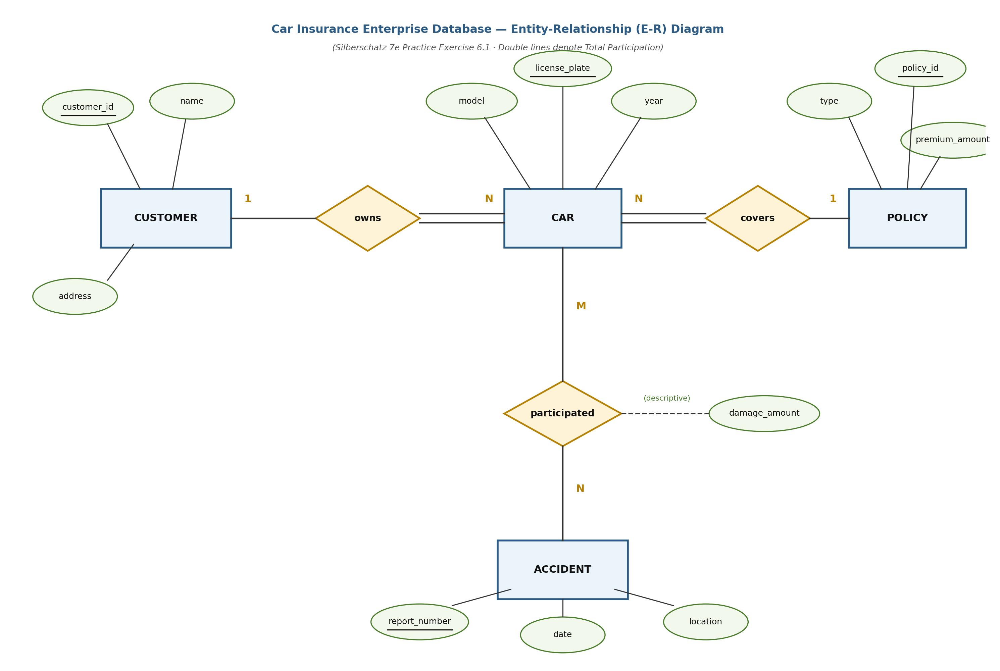
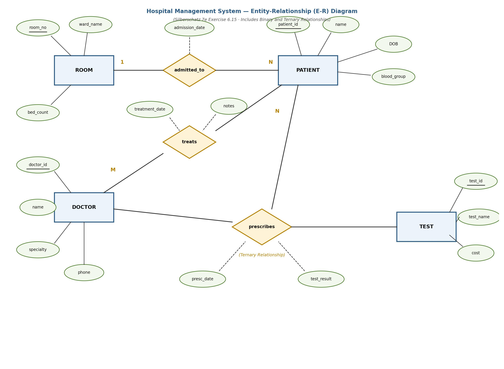

[← Previous: T02.5a: E-R Design Method](T02.05a_ER_Design_Method_Student_and_Teacher_Course.md) | [🏠 Index](00_Index.md) | [Next: T02.6: Reduction of E-R Diagrams to Relational Tables →](T02.06_Reduction_of_ER_to_Tables.md)

---

# T02.5b: E-R Design — Train E-Ticketing, Library, and University

> **Topic:** T02 — E-R & EER Modeling | **Priority:** 🔴 High | **Exam Frequency:** 5/7 finals (+ CT-02 Q2) (24 marks)
> **Sources:** Silberschatz 7e Ch. 6 (§6.1–6.4, §6.7, §6.9) · Lecture Deck 05 (Slides 7–39) · CT-02 Question Paper

## Why This Topic Matters

Advanced scenario questions in RUET exams go beyond simple two-entity diagrams. Recent papers test multi-step real-world workflows like railway e-ticketing (2019), library circulation tracking (2023), and university course management (CT-02). In these systems, everyday actions like booking a seat, borrowing a book, or placing a hold cannot stay as simple relationship diamonds. Because the database has to track their history, receipts, and status over time, you often need to promote these actions into full entity sets with their own primary keys and attributes.

---

## 📝 Key Definitions

> **Descriptive Attribute:** A descriptive attribute is an attribute attached to a relationship set rather than an entity set. It records information about the interaction itself, such as `booking_date` on a ticket relationship or `arrival_time` on a train stop.

> **Mapping Cardinality:** Mapping cardinality (or cardinality ratio) states the maximum number of entities to which another entity can link through a relationship set. Binary relationships have four ratios: $1:1$, $1:N$, $N:1$, and $M:N$.

> **Participation Constraint:** A participation constraint specifies whether every entity in an entity set must take part in a relationship set. Participation is total (drawn as a double line) when every entity must participate, and partial (drawn as a single line) when participation is optional.

> **Entity Sets versus Relationship Sets:** In E-R design, a simple link between nouns is modeled as a relationship diamond. When an action has its own tracking ID, multiple attributes, or links to other actions (like a ticket or a book loan), it is modeled as an independent entity set.

---

## Modeling Real-World Transactions: Entities vs. Relationships

When designing an E-R diagram from a word problem, one of the trickiest decisions is choosing whether an action (like booking, borrowing, or enrolling) should be drawn as a relationship diamond or as an entity rectangle.

### Intuitive Rule of Thumb: "Link" vs. "Receipt"
Think of a **relationship diamond** as a simple link between nouns, and an **entity rectangle** as an official receipt or transaction slip that gets filed in its own cabinet.

### When an Action Stays a Relationship Diamond
Keep an action as a relationship diamond when it only connects two entities and does not need its own independent tracking ID:
- For example, a faculty advisor guiding a student is just a link, so an `Advises` diamond works well.
- Similarly, a student taking a course can stay an `Enrolls` diamond if you only need to attach basic descriptive attributes like `enroll_date` or `grade`.

### When an Action Must Become an Independent Entity Set
Promote an action to its own entity rectangle whenever any of these four conditions hold:
1. **The action has many attributes of its own:** When a train booking carries a ticket number, journey date, seat number, coach number, fare, and payment status, crowding all of those ovals onto a relationship diamond makes the diagram messy and hard to read.
2. **The action has its own real-world ID:** A train ticket or a library checkout slip exists as a real document with a unique tracking number (`ticket_no`, `borrow_id`).
3. **The action connects to a third party:** In a library system, a single checkout record links to the member borrowing the book, the book itself, and the staff clerk who issued it. Once an action has to link to several different entities, treating it as its own entity rectangle keeps the relationships clean and binary.
4. **The exam prompt explicitly lists it as an entity:** In 2023 Q.1(a), the question explicitly tells you to consider `Borrowing` and `Reservations` as entities. Drawing them as diamonds instead of rectangles will cost you marks immediately.

---

## Comparing the Three Classic RUET Exam Domains

Before diving into the full exam solutions below, notice how each domain separates **permanent master records** (people, books, trains) from **operational activity** (tickets, loans, enrollments):

### 1. Train E-Ticketing Architecture (Rajshahi High-Tech Authority)
Instead of linking passengers directly to trains with a many-to-many diamond, we place a `TICKET` entity in the middle:
- **Master Entities:** `PASSENGER` (commuter profiles), `TRAIN` (scheduled services), and `STATION` (physical stops).
- **Transaction Entity:** `TICKET` (holds the seat reservation, fare, and journey date).
- **How They Connect:** One passenger books many tickets ($1:N$), and many tickets are issued for one train ($N:1$). Separately, trains stop at many stations ($M:N$), with `arrival_time` and `dep_time` placed right on the `Stops_At` diamond because the schedule depends on both the train and the station.

### 2. Library Management Architecture (RUET Central Library)
A circulation database separates the library catalog from daily desk transactions:
- **Master Entities:** `BOOKS` (catalog inventory), `MEMBERS` (students and faculty), and `STAFF` (library clerks).
- **Transaction Entities:** `BORROWING` (checkout and return logs) and `RESERVATIONS` (hold queues for checked-out books).
- **How They Connect:** Staff members issue borrowings ($1:N$), while library members initiate both borrowings ($1:N$) and reservations ($1:N$). Each borrowing or reservation record points to a specific book ($N:1$).

### 3. University Course-Teaching Architecture
When a prompt only mentions `STUDENT`, `COURSE`, and `TEACHER`, `COURSE` acts as the central hub:
- **How They Connect:** Students enroll in many courses ($M:N$ via `Enrolls`), while each course is taught by one teacher ($1:N$ from `TEACHER` to `COURSE` via `Teaches`). Notice that teachers and students never connect directly; they always meet through the courses they share.

---

## Exam Variants

| Year & Question | Marks | Scenario / System Domain | Key Entities & Structural Nuance |
| :--- | :---: | :--- | :--- |
| **2019 Q.1(c)** | 6 | Train E-Ticketing System (Rajshahi High-Tech Authority). | 4 entities (`PASSENGER`, `TICKET`, `TRAIN`, `STATION`), 3 relationships (`Books`, `For_Train`, `Stops_At`). Ticket is an entity; `Stops_At` has arrival/departure attributes. |
| **2023 Q.1(a)** | 5 | RUET Central Library Management System. | Explicitly specifies 5 entities: `Books`, `Members`, `Staff`, `Borrowing`, `Reservations`. Both transactions modeled as rectangles. |
| **CT-02 Q.02** | 10 | University Enterprise (Students, Courses, Teachers). | Two-part structure: (a) Tabular decomposition of entities, keys, and cardinalities (4m); (b) Full Chen-notation diagram (6m). |

---

## 🏆 Golden Questions (Past Exam Archive)

### 🎯 GQ1 · 2019 Q.1(c) · Train E-Ticketing System (Rajshahi High-Tech Authority)

> **Appeared:** 2019 Q.1(c) (06 Marks, Sec A)

**Question:**

Suppose you are recruited as a database specialist by the Rajshahi High-Tech authority to help them design a database for train e-ticketing system efficiently. Now think the regular features and draw an E-R diagram accordingly.

**Full Answer:**

#### 1. System Requirements and Entity Sets
A complete train e-ticketing database requires four major entity sets:

1. **`PASSENGER`:** Represents registered commuters and ticket buyers.
   - Primary Key: `user_id` (underlined)
   - Descriptive Attributes: `name`, `nid`, `phone`
2. **`TICKET`:** Represents booked journey records issued to passengers.
   - Primary Key: `ticket_no` (underlined)
   - Descriptive Attributes: `journey_date`, `seat_no`, `fare`, `class`
3. **`TRAIN`:** Represents railway train services.
   - Primary Key: `train_no` (underlined)
   - Descriptive Attributes: `train_name`, `total_seats`
4. **`STATION`:** Represents physical railway stops across the railway route.
   - Primary Key: `station_code` (underlined)
   - Descriptive Attributes: `station_name`, `city`

#### 2. Relationship Sets and Cardinalities
- **`Books` ($1:N$):** Connects `PASSENGER` and `TICKET`.
  - A passenger can book one or more tickets over time.
  - Each individual ticket belongs to exactly one passenger.
  - Participation: Total participation on the `TICKET` side (double line), because an issued ticket must belong to a passenger.
  - Descriptive Attribute on Diamond: `booking_date`.
- **`For_Train` ($N:1$):** Connects `TICKET` and `TRAIN`.
  - Many tickets are issued for a specific train journey.
  - Each ticket is valid for exactly one train.
  - Participation: Total participation on the `TICKET` side (double line).
- **`Stops_At` ($M:N$):** Connects `TRAIN` and `STATION`.
  - A train stops at multiple stations along its route.
  - Each station services multiple train lines.
  - Descriptive Attributes on Diamond: `arrival_time`, `dep_time`.

#### 3. E-R Diagram

*Figure 1: Train E-Ticketing System E-R Diagram.*

#### 4. Design Highlights
- Modeling `TICKET` as an independent entity set avoids a wide, unnormalized relationship between Passenger and Train.
- Attaching `arrival_time` and `dep_time` to `Stops_At` captures the schedule timetable accurately, since arrival time depends on both the specific train and the station.

---

### 🎯 GQ2 · 2023 Q.1(a) · RUET Central Library Management System

> **Appeared:** 2023 Q.1(a) (05 Marks, Sec A, CLO4)

**Question:**

Draw an ER diagram for RUET Central Library Management System. You have to consider the entities mentioned below:  
(i) Books (ii) Members (iii) Staff (iv) Borrowing (v) Reservations

**Full Answer:**

#### 1. Design Specification Note
The question explicitly lists five items: Books, Members, Staff, Borrowing, and Reservations. All five must be modeled as entity rectangles. Modeling Borrowing or Reservations as relationship diamonds violates the prompt requirements and loses marks.

#### 2. Entity Sets and Attributes
1. **`BOOKS`:** Stores catalog and inventory information.
   - Primary Key: `book_id` (underlined)
   - Descriptive Attributes: `isbn`, `title`, `author`, `edition`
2. **`MEMBERS`:** Stores registered patrons (students, teachers, and university researchers).
   - Primary Key: `member_id` (underlined)
   - Descriptive Attributes: `name`, `type`, `department`
3. **`STAFF`:** Stores library officers and attendants managing the desk.
   - Primary Key: `staff_id` (underlined)
   - Descriptive Attributes: `name`, `designation`
4. **`BORROWING`:** Represents loan transactions.
   - Primary Key: `borrow_id` (underlined)
   - Descriptive Attributes: `borrow_date`, `due_date`, `return_date`
5. **`RESERVATIONS`:** Represents hold requests placed on checked-out books.
   - Primary Key: `res_id` (underlined)
   - Descriptive Attributes: `res_date`, `status`

#### 3. Relationship Sets and Mapping Cardinalities
- **`Issues` ($1:N$):** Connects `STAFF` to `BORROWING`. One staff member processes many borrowing records. Each borrowing record is handled by one staff member.
- **`Borrows` ($1:N$):** Connects `MEMBERS` to `BORROWING`. One member initiates many borrowing records over time. Each borrowing record belongs to one member.
- **`Includes` ($N:1$):** Connects `BORROWING` to `BOOKS`. Multiple borrowing records refer to books over different periods. Each borrowing record refers to a specific book.
- **`Reserves` ($1:N$):** Connects `MEMBERS` to `RESERVATIONS`. One member can place multiple book reservations. Each reservation belongs to one member.
- **`For_Book` ($N:1$):** Connects `RESERVATIONS` to `BOOKS`. Multiple reservations can queue for popular books. Each reservation record targets one book.

#### 4. E-R Diagram

*Figure 2: RUET Central Library Management System E-R Diagram.*

#### 5. Verification Checklist
- (i) `BOOKS`: Rectangle present with PK `book_id` $\checkmark$
- (ii) `MEMBERS`: Rectangle present with PK `member_id` $\checkmark$
- (iii) `STAFF`: Rectangle present with PK `staff_id` $\checkmark$
- (iv) `BORROWING`: Rectangle present with PK `borrow_id` $\checkmark$
- (v) `RESERVATIONS`: Rectangle present with PK `res_id` $\checkmark$
- All 5 required entities appear as rectangles with primary keys underlined.

---

### 🎯 GQ3 · CT-02 Q.02(a–b) · University Enterprise Database

> **Appeared:** CT-02 Q.02(a–b) (10 Marks, CO3)

**Question:**

A university maintains information about Students, Courses, and Teachers. A student can enroll in several courses and each course can have many students. Each course is taught by one teacher, though a teacher may teach several courses.  
**(a)** Identify the entities, attributes, primary keys, relationships, and cardinalities. `[04 Marks]`  
**(b)** Draw the complete ER diagram. `[06 Marks]`

**Full Answer:**

#### (a) Identification of Database Components (4 Marks)

##### 1. Entity Sets and Attributes

| Entity Set | Description | Attributes | Primary Key |
| :--- | :--- | :--- | :--- |
| **`STUDENT`** | Enrolled undergraduate and graduate students | `student_id`, `name`, `email`, `dept_name` | `student_id` |
| **`COURSE`** | Academic courses offered by departments | `course_id`, `title`, `credits` | `course_id` |
| **`TEACHER`** | Faculty members teaching academic courses | `teacher_id`, `name`, `dept_name`, `phone` | `teacher_id` |

##### 2. Relationships and Cardinality Rules
- **`Enrolls` Relationship Set:**
  - **Entities Involved:** `STUDENT` and `COURSE`.
  - **Cardinality:** Many-to-Many (**$M:N$**). The text states: *"A student can enroll in several courses and each course can have many students."*
  - **Primary Key of Relationship:** Composite key `(student_id, course_id)`.
- **`Teaches` Relationship Set:**
  - **Entities Involved:** `TEACHER` and `COURSE`.
  - **Cardinality:** One-to-Many (**$1:N$** from `TEACHER` to `COURSE`). The text states: *"Each course is taught by one teacher, though a teacher may teach several courses."*
  - **Primary Key of Relationship:** `course_id` (since each course has exactly one teacher).

---

#### (b) Complete E-R Diagram (6 Marks)

The E-R diagram below incorporates all identified components, with entity sets drawn as rectangles, relationship sets drawn as diamonds, attributes drawn as ovals, and primary keys underlined.

*Figure 3: University Enterprise Complete E-R Diagram.*

#### Cardinality Verification Check
- `TEACHER` connects to `Teaches` with label `$1$`.
- `Teaches` connects to `COURSE` with label `$N$`. This confirms that a teacher teaches several courses, while each course connects to one teacher.
- `STUDENT` connects to `Enrolls` with label `$M$`.
- `Enrolls` connects to `COURSE` with label `$N$`. This confirms many-to-many enrollment.

---

## 📖 High-Yield Exercises from the Book

### 🎯 HYE-01 · Practice Exercise 6.1 · E-R Design for Car Insurance Enterprise

> **Source:** Silberschatz 7e · Chapter 6 (Practice Exercise 6.1)  
> **Exam Relevance:** High-Probability Full Enterprise Design Question (10–14 Marks)  
> **Key Tested Concept:** Modeling multi-entity real-world enterprise schemas with cardinalities, total participation, and relational reduction.

**Problem Statement:**
> Design a complete Entity-Relationship (E-R) diagram for a **Car Insurance Company** database:
> - Customers have a unique `customer_id`, `name`, and `address`.
> - Customers own one or more cars. Each car has a `license_plate_number`, `model`, and `year`.
> - Cars are covered by insurance policies. Each policy has a `policy_id`, `type`, and `premium_amount`.
> - An accident is recorded with a unique `report_number`, `date`, and `location`.
> - A car can be involved in zero, one, or multiple accidents. In each accident, the specific `damage_amount` for each involved car must be recorded.
> Specify entities, attributes, primary keys, relationship sets, and mapping cardinalities.

**Model Exam-Style Solution:**

1. **Entity Sets & Attributes:**
   - **`customer`**: $\{\underline{\text{customer\_id}}, \text{name}, \text{address}\}$
   - **`car`**: $\{\underline{\text{license\_plate}}, \text{model}, \text{year}\}$
   - **`policy`**: $\{\underline{\text{policy\_id}}, \text{type}, \text{premium\_amount}\}$
   - **`accident`**: $\{\underline{\text{report\_number}}, \text{date}, \text{location}\}$

2. **Relationship Sets & Mapping Cardinalities:**
   - **`owns`** (between `customer` and `car`):
     - Cardinality: **$1:N$** (One customer owns many cars; each car is owned by exactly one customer).
     - Participation: `car` has **total participation** (a car must be owned by a customer).
   - **`covers`** (between `policy` and `car`):
     - Cardinality: **$1:N$** or **$1:1$** (Each policy covers one or more specific cars; each car has a policy).
     - Participation: `car` has **total participation**.
   - **`participated`** (between `car` and `accident`):
     - Cardinality: **$M:N$** (A car can be in multiple accidents; an accident can involve multiple cars).
     - Descriptive Attribute: `damage_amount` (associated with the relationship set `participated`).

3. **E-R Diagram:**

*Figure 4: Car Insurance Enterprise Database E-R Diagram (Chen Notation).*

4. **Relational Schema Reduction:**
   - $\text{Customer}(\underline{\text{customer\_id}}, \text{name}, \text{address})$
   - $\text{Car}(\underline{\text{license\_plate}}, \text{model}, \text{year}, \text{customer\_id}^*, \text{policy\_id}^*)$
   - $\text{Policy}(\underline{\text{policy\_id}}, \text{type}, \text{premium\_amount})$
   - $\text{Accident}(\underline{\text{report\_number}}, \text{date}, \text{location})$
   - $\text{Participated}(\underline{\text{license\_plate}^*, \text{report\_number}^*}, \text{damage\_amount})$ $\blacksquare$

**💡 RUET Exam Takeaway:**
Always place `damage_amount` on the **$M:N$ relationship set `participated`**, NOT in `accident` and NOT in `car`! Different cars in the same accident sustain different amounts of damage.

---

### 🎯 HYE-02 · Exercise 6.15 · E-R Design for Hospital Management System

> **Source:** Silberschatz 7e · Chapter 6 (Exercise 6.15)  
> **Exam Relevance:** Prime Overdue Medical Enterprise Design Scenario  
> **Key Tested Concept:** Multi-entity hospital workflow: patients, physicians, diagnostic tests, treatments, and composite/multivalued attributes.

**Problem Statement:**
> Design an Entity-Relationship (E-R) diagram for a **Hospital Database**:
> - Patients have a unique `patient_id`, `name`, `date_of_birth`, and `blood_group`.
> - Doctors have a unique `doctor_id`, `name`, `specialty`, and `phone_number`.
> - Diagnostic tests have a unique `test_id`, `test_name`, and `standard_cost`.
> - A patient is admitted to a room (`room_no`, `ward_name`).
> - A doctor prescribes tests for a patient on a specific `prescription_date`, recording the `test_result`.
> - Doctors perform treatments on patients, recording `treatment_date` and `dosage`.

**Model Exam-Style Solution:**

1. **Entity Sets & Attributes:**
   - **`patient`**: $\{\underline{\text{patient\_id}}, \text{name}, \text{DOB}, \text{blood\_group}\}$
   - **`doctor`**: $\{\underline{\text{doctor\_id}}, \text{name}, \text{specialty}, \text{phone}\}$
   - **`room`**: $\{\underline{\text{room\_no}}, \text{ward\_name}, \text{bed\_count}\}$
   - **`test`**: $\{\underline{\text{test\_id}}, \text{test\_name}, \text{cost}\}$

2. **Relationship Sets & Modeling:**
   - **`admitted_to`** (Patient $\rightarrow$ Room):
     - Cardinality: **$N:1$** (Each admitted patient occupies one room; a room accommodates multiple patients).
     - Descriptive attribute: `admission_date`.
   - **`prescribes_test`** (Ternary relationship among Patient, Doctor, Test):
     - Degree: **Ternary** ($M:N:P$).
     - Descriptive attributes: `date`, `test_result`.
     - Alternatively, modeled as an entity set `Test_Order` with binary relationships to Patient, Doctor, and Test.
   - **`treats`** (Patient $\leftrightarrow$ Doctor):
     - Cardinality: **$M:N$**.
     - Descriptive attributes: `treatment_date`, `notes`.

3. **E-R Diagram:**

*Figure 5: Hospital Management System E-R Diagram (Chen Notation).*

4. **Relational Table Reduction:**
   - $\text{Patient}(\underline{\text{patient\_id}}, \text{name}, \text{DOB}, \text{blood\_group}, \text{room\_no}^*, \text{admission\_date})$
   - $\text{Doctor}(\underline{\text{doctor\_id}}, \text{name}, \text{specialty}, \text{phone})$
   - $\text{Room}(\underline{\text{room\_no}}, \text{ward\_name}, \text{bed\_count})$
   - $\text{Test}(\underline{\text{test\_id}}, \text{test\_name}, \text{cost})$
   - $\text{Prescribes\_Test}(\underline{\text{patient\_id}^*, \text{doctor\_id}^*, \text{test\_id}^*, \text{date}}, \text{test\_result})$
   - $\text{Treats}(\underline{\text{patient\_id}^*, \text{doctor\_id}^*, \text{treatment\_date}}, \text{notes})$ $\blacksquare$

**💡 RUET Exam Takeaway:**
Whenever a scenario connects three entities with descriptive attributes (Doctor prescribes Test to Patient), model it as a **Ternary Relationship** or reify it into a dedicated entity set.

---

## ⚡ Exam Tips & Common Mistakes

1. **Read the Required Entity List First:** In questions like 2023 Q.1(a), the examiner explicitly names five entities. If you draw Borrowing as a diamond instead of a rectangle, you lose marks immediately.
2. **Never Draw Direct Links Between Teacher and Student:** In university schemas, students enroll in courses, and teachers instruct courses. The two entities interact through the `COURSE` entity, not via a direct diagonal relationship.
3. **Include Timetable Attributes on Junctions:** For railway systems, place `arrival_time` and `dep_time` on the `Stops_At` relationship diamond. Arrival times depend on both the train and the station.
4. **Use Structured Tables for Multi-Part Questions:** When a problem splits into (a) identification and (b) drawing, provide a structured Markdown table for part (a). This secures the component marks before the examiner even looks at your diagram.

---

## 🔗 Related Topics

- [T02.3: Mapping Cardinality & Participation Constraints](T02.03_Mapping_Cardinality_and_Participation.md): Cardinality ratios and participation limits
- [T02.5a: E-R Design Method — Student and Teacher-Course DBs](T02.05a_ER_Design_Method_Student_and_Teacher_Course.md): The 5-step recipe and basic student/advisor models
- [T02.6: Reduction of E-R Diagrams to Relational Tables](T02.06_Reduction_of_ER_to_Tables.md): Converting entity and relationship sets into relational tables
- [T03.4: Relational Schema Diagrams](T03.04_Schema_Diagrams.md): Visualizing schemas as relational tables with foreign key arrows

---

[← Previous: T02.5a: E-R Design Method](T02.05a_ER_Design_Method_Student_and_Teacher_Course.md) | [🏠 Index](00_Index.md) | [Next: T02.6: Reduction of E-R Diagrams to Relational Tables →](T02.06_Reduction_of_ER_to_Tables.md)
