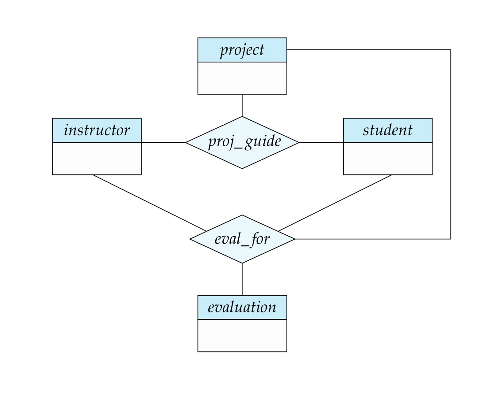

[← Previous: T02.7: EER Specialization and Generalization](T02.07_EER_Specialization_Generalization.md) | [🏠 Index](00_Index.md) | [Next: T03.1: Relation, Tuple, Attribute, and Domain →](T03.01_Relation_Tuple_Domain.md)

---

# T02.8: EER Aggregation

> **Topic:** T02 — E-R & EER Modeling | **Priority:** 🟡 Medium | **Exam Frequency:** 2/7 finals (5 marks: 2018 Q2b, 2020 Q3a)
> **Sources:** Silberschatz 7e Ch. 6 (§6.8.5, §6.8.6.2) · Lecture Deck 05 (Slides 57–60) · Class Notes

## Why This Topic Matters

Basic Entity-Relationship (E-R) diagrams have a strict drawing rule: a relationship diamond can only connect to entity rectangles, never directly to another relationship diamond. But what happens when you need to record an action *about* an existing relationship (such as an evaluation filed for a specific student-instructor-project guidance assignment)? **Aggregation** solves this problem by drawing a box around the first relationship so the rest of the diagram can treat it just like a regular entity. In RUET finals, this appears as both a 2-mark definition question (2020 Q.3(a)) and a 3-mark question asking for two real-world examples (2018 Q.2(b)).

---

## 📝 Key Definitions

> **Aggregation:** Aggregation is an EER abstraction that treats an entire relationship set and its participating entity sets as a single higher-level entity set. In an E-R diagram, a rectangular bounding box is drawn around the inner relationship so it can connect to other relationships without duplicating data.

---

## The Fundamental Limitation: Relationships Between Relationships

In basic E-R modeling, a relationship diamond can only link entity rectangles. You are never allowed to draw a line from one diamond straight to another diamond.

To see why that becomes a problem, picture a university project scenario with three entity sets: `instructor`, `student`, and `project`. They are connected by a ternary relationship diamond called `proj_guide` (meaning a specific instructor guides a specific student on a specific project). Now suppose the university requires the instructor to submit periodic `evaluation` reports on how that guidance assignment is going.

If we try to model this using only basic E-R shapes, both of our options are flawed:

1. **Drawing a Diamond-to-Diamond Line is Illegal:** E-R syntax forbids connecting a new `eval_for` diamond directly to the `proj_guide` diamond.
2. **Adding a 4-Way Diamond Creates Redundancy:** If we keep `proj_guide` (3-way) and also draw a separate 4-way relationship `eval_for` linking `instructor`, `student`, `project`, and `evaluation` (as shown in Figure 1), every evaluated team has its `(instructor, student, project)` pairing stored twice. Worse yet, we cannot simply delete `proj_guide` and keep only `eval_for`, because a newly formed project team must be recorded in the database *before* it receives its first evaluation!

*Figure 1: Motivation for aggregation showing redundant relationship sets proj_guide and eval_for (Source: Lecture Deck 05, Slide 57).*

---

## How Aggregation Solves the Problem

Aggregation fixes this cleanly by letting you "package" an entire relationship into a single box:

1. **Draw the Bounding Box:** We draw a large rectangle around the `proj_guide` diamond and its three participating entity sets (`instructor`, `student`, and `project`).
2. **Treat the Box as One Entity:** From the outside, that entire bounding box now acts like a single higher-level entity set. We can connect it to `evaluation` using an ordinary binary relationship diamond called `eval_for`.
3. **Zero Redundancy:** Project guidance teams are recorded once in `proj_guide`, even if they have zero evaluations so far. Whenever an evaluation is filed, `eval_for` simply links the `evaluation` ID to that aggregated team.

*Figure 2: Aggregation representation in an E-R diagram. The bounding box treats proj_guide as an abstract entity connected to evaluation via relationship eval_for (Source: Lecture Deck 05, Slide 59).*

---

## Reduction of Aggregation to Relational Schemas

### Intuitive Rule: What is the "Primary Key" of a Bounding Box?
Students often wonder if the aggregate bounding box gets its own table or needs a brand-new ID column. **It does not!** The bounding box is just a visual wrapper around the inner relationship (`proj_guide`). Because of this, the primary key of the aggregate box is simply the **composite primary key of the relationship inside it**: $(\text{s\_id}, \text{project\_id}, \text{i\_id})$.

When we convert Figure 2 into relational tables, we follow two simple steps:

1. **Reduce the Inner Relationship as Normal:** The ternary relationship inside the box becomes a standard table whose primary key combines the keys of `student`, `project`, and `instructor`:
   $$\text{proj\_guide}(\underline{\text{s\_id}}, \underline{\text{project\_id}}, \underline{\text{i\_id}})$$
2. **Reduce the Outer Connecting Relationship:** The table for `eval_for` combines the primary key of the aggregate box with the primary key of `evaluation` (plus any descriptive attributes on `eval_for`):
   $$\text{eval\_for}(\underline{\text{s\_id}}, \underline{\text{project\_id}}, \underline{\text{i\_id}}, \underline{\text{evaluation\_id}})$$
   *(Note: If each evaluation report belongs to only one guidance team, meaning `eval_for` is many-to-one from `evaluation` to `proj_guide`, you can even merge `(s_id, project_id, i_id)` directly into the `evaluation` table!)*

---

## Quick Mini-Trace: How the Tables Avoid Redundancy

Suppose student `S1` works on project `P10` under instructor `I5`, and student `S2` just started project `P20` under instructor `I8` (no evaluation yet):

- **`proj_guide` table:** Holds `(S1, P10, I5)` and `(S2, P20, I8)`. Both active teams are safely recorded even though `S2` has no evaluation yet.
- **`eval_for` table:** Holds `(S1, P10, I5, E101)` and `(S1, P10, I5, E102)` for two monthly evaluations of `S1`'s project, referencing `(S1, P10, I5)` in `proj_guide` via a composite foreign key.

---

## Exam Variants

| Year & Question | Marks | Scenario / Data Given | Key Result / Answer Summary |
| :--- | :---: | :--- | :--- |
| **2018 Q.2(b)** | 3 | Theoretical definition with practical utility requirement | Define aggregation as an abstraction treating relationships as entities. Provide two concrete examples (Project Guidance Evaluation and Employee Task Monitoring). |
| **2020 Q.3(a)** | 2 | Core concept definition in E-R design | Concise definition of aggregation, limitation of standard E-R, and bounding box diagram sketch. |

---

## 🏆 Golden Questions (Past Exam Archive)

### 🎯 GQ1 · 2018 Q.2(b) · Concept of Aggregation and Two Examples

> **Appeared:** 2018 Q.2(b) — (3 marks)

**Question:**

Define the concept of aggregation. Give two examples of where this concept is useful.

**Full Answer:**

**1. Definition of Aggregation:**
Aggregation is an abstraction in the Extended Entity-Relationship (EER) model through which a relationship set is treated as a higher-level abstract entity set. This allows a relationship to participate in further relationships with other entity sets without introducing redundancy.

**Why it is needed:** In basic E-R modeling, relationships cannot be connected directly to other relationships. Aggregation overcomes this limitation by enclosing the relationship and its participating entities inside an abstract entity boundary.

**2. Two Examples Where Aggregation is Useful:**

- **Example 1: Student Project Guidance and Evaluation Report**  
  Consider the ternary relationship `proj_guide` associating `student`, `instructor`, and `project`. Suppose an instructor must submit an `evaluation` report for that specific student-project pairing. Connecting `evaluation` directly to the three entities creates a redundant 4-way relationship. By aggregating `proj_guide` into a single higher-level entity, the entity `evaluation` links cleanly to `proj_guide` through a binary relationship `eval_for`.

- **Example 2: Employee Job Assignment and Manager Monitoring**  
  Consider employees working on projects through the relationship `Works_On(employee, project)`. A department manager needs to monitor that specific work assignment. A binary relationship between `manager` and `Works_On` is illegal in basic E-R. By aggregating `Works_On(employee, project)` into an entity, the `manager` entity participates directly in a relationship `Monitors` with the aggregate entity.

---

### 🎯 GQ2 · 2020 Q.3(a) · Aggregation in ER-Model Design

> **Appeared:** 2020 Q.3(a) — (2 marks)

**Question:**

What is aggregation in ER-model design?

**Full Answer:**

**Aggregation in E-R Model Design:**
Aggregation is an abstraction construct in E-R modeling where a relationship set, along with its participating entity sets, is treated as a single higher-level abstract entity set.

**Purpose and Representation:**
1. **Solves E-R Limitation:** Basic E-R modeling does not allow relationships between relationships. Aggregation enables relationships to participate in further relationships.
2. **Eliminates Redundancy:** It avoids constructing unnecessary multi-way relationships that duplicate entity associations.
3. **Visual Notation:** In an E-R diagram, aggregation is represented by drawing a bounding rectangle around the relationship diamond and its participating entity rectangles. Other relationships then link directly to this enclosing rectangle.

---

## ⚡ Exam Tips & Common Mistakes

1. **Do Not Confuse E-R Aggregation with SQL Aggregation:** This is the most common exam trap. SQL aggregation refers to aggregate functions like `AVG()`, `COUNT()`, and `SUM()`. E-R aggregation is an abstraction mechanism that treats a relationship as an entity.
2. **Never Draw Diamonds Connected to Diamonds:** If you draw a line directly between two relationship diamonds, RUET examiners will dock marks. Always draw a rectangular bounding box around the primary relationship first.
3. **State the Relational Table Consequence:** Mention that the schema of the connecting relationship inherits the primary key of the aggregated relationship table.
4. **Always Provide the Evaluation Example:** The `proj_guide` with `eval_for` example is taken straight from Silberschatz and Lecture Deck 05. Memorize it for full marks.

---

## 🔗 Related Topics

- [T02.01: Entities, Relationships, and Degree](T02.01_Entities_Relationships_and_Degree.md): Fundamental building blocks of E-R modeling.
- [T02.6: Reduction of E-R Diagrams to Relational Tables](T02.06_Reduction_of_ER_to_Tables.md): Rules for converting relationship sets and weak entities into relational schemas.
- [T02.7: EER Specialization and Generalization](T02.07_EER_Specialization_Generalization.md): Superclass and subclass inheritance hierarchies in EER.

---

[← Previous: T02.7: EER Specialization and Generalization](T02.07_EER_Specialization_Generalization.md) | [🏠 Index](00_Index.md) | [Next: T03.1: Relation, Tuple, Attribute, and Domain →](T03.01_Relation_Tuple_Domain.md)
