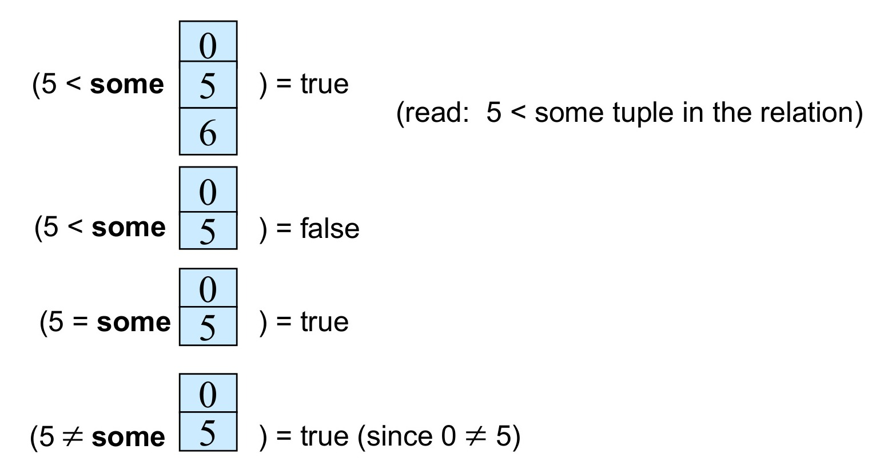
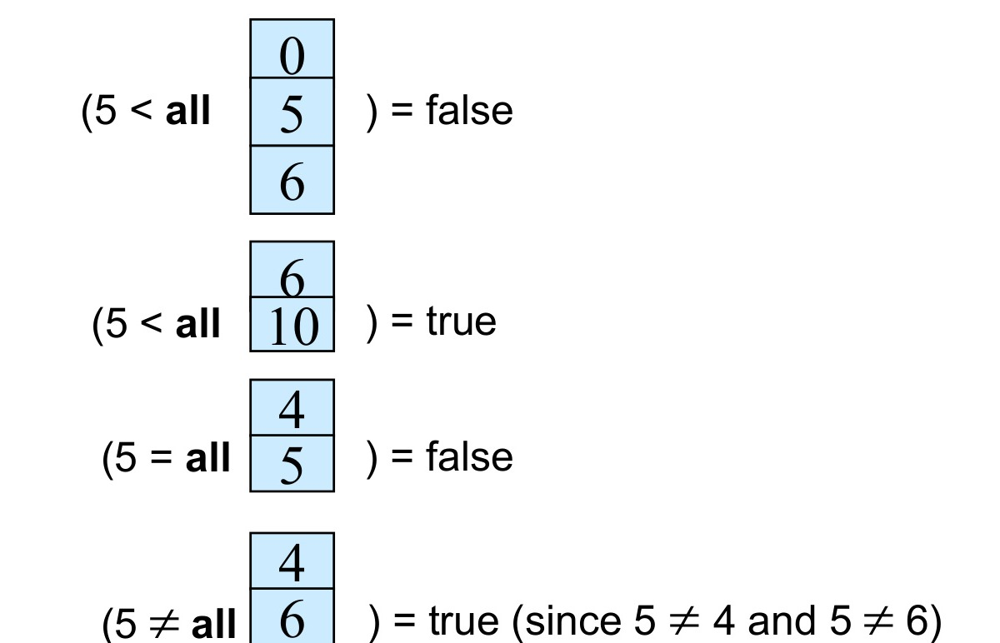

[← Previous: T05.5b: Weighted CGPA and Extremes Without LIMIT](T05.05b_CGPA_and_Extremes_Without_LIMIT.md) | [🏠 Index](00_Index.md) | [Next: T05.7a: Multi-Table SQL Query Sets →](T05.07a_Query_Sets_Covid_and_Company.md)

---

# T05.6: SQL Subqueries (IN, SOME, ALL, EXISTS, Correlated)

> **Topic:** T05 — SQL (DDL, DML, Aggregates, Subqueries) | **Priority:** 🟡 | **Exam Frequency:** 2/7 finals (+ CT-02) (8 marks)  
> **Sources:** Silberschatz 7e Ch. 3 (§3.8) · Lecture Deck 03 (Slides 35–52) · Raidah Notes (pp. 16–17) · Fahim Notes (pp. 56–58)

## Why This Topic Matters

RUET tests subquery fundamentals in both conceptual and computational formats. Semester finals in 2019 Q.8(b) and 2024 Q.6(a) explicitly ask students to explain subqueries with two distinct examples for 4 marks each. CT-02 Q.01(c) tests scalar comparison against table-wide aggregates. Mastering subquery syntax in `WHERE`, `FROM`, and `SELECT` clauses is essential to solve the 44 marks of multi-table business schema problems in T05.7.

---

## 📝 Key Definitions

> **Subquery:** "A **subquery** is a `select-from-where` expression that is nested within another query." — Silberschatz, Korth & Sudarshan, *Database System Concepts* (7th Ed.), §3.8 (p. 98)

> **Correlated Subquery:** "A subquery that uses a correlation name from an outer query is called a **correlated subquery**." — Silberschatz, Korth & Sudarshan, *Database System Concepts* (7th Ed.), §3.8.3 (p. 101)

> **Scalar Subquery:** "SQL allows subqueries to occur wherever an expression returning a value is permitted, provided the subquery returns only one tuple containing a single attribute; such subqueries are called **scalar subqueries**." — Silberschatz, Korth & Sudarshan, *Database System Concepts* (7th Ed.), §3.8.7 (p. 104)

> **The WITH Clause:** "The **with** clause provides a way of defining a temporary relation whose definition is available only to the query in which the `with` clause occurs." — Silberschatz, Korth & Sudarshan, *Database System Concepts* (7th Ed.), §3.8.6 (p. 104)

---

## Subquery Foundations and Structural Placement

A subquery (also called an inner query or nested query) passes its output directly to an enclosing outer query. SQL allows nesting in three primary clauses:

```sql
SELECT A1, A2, ..., An
FROM r1, r2, ..., rm
WHERE P;
```

1. **WHERE Clause Placement:** The predicate $P$ compares an attribute to the set or scalar returned by a subquery:
   $$
   \text{attribute} \quad \langle\text{operation}\rangle \quad (\text{subquery})
   $$
2. **FROM Clause Placement:** The relation $r_i$ is replaced by a subquery expression. In SQL, this creates a temporary derived relation.
3. **SELECT Clause Placement:** An attribute $A_i$ is replaced by a scalar subquery returning exactly one value per outer tuple.

---

## Set Membership: IN and NOT IN

The `IN` operator tests whether a given value belongs to a set of values produced by a subquery or an explicit list. The `NOT IN` operator tests for absence of membership.

### Example: Courses Offered in Both Fall 2017 and Spring 2018

```sql
SELECT DISTINCT course_id
FROM section
WHERE semester = 'Fall' AND year = 2017
  AND course_id IN (
      SELECT course_id
      FROM section
      WHERE semester = 'Spring' AND year = 2018
  );
```

### The Three-Valued Logic Trap with NOT IN and NULL

If the inner query returns a set containing even a single `NULL` value, `NOT IN` behaves counterintuitively:
- The expression `val NOT IN (10, 20, NULL)` expands to `val <> 10 AND val <> 20 AND val <> NULL`.
- In SQL, `val <> NULL` evaluates to `UNKNOWN`.
- Because `TRUE AND UNKNOWN` yields `UNKNOWN`, the entire `WHERE` clause evaluates to `UNKNOWN`.
- Because of this, the outer query returns zero rows! Always filter out nulls (`WHERE attribute IS NOT NULL`) in the inner query when using `NOT IN`.

---

## Set Comparison: SOME / ANY and ALL

When a subquery returns a whole list of numbers instead of a single value, you cannot compare a column to it using a plain `>` or `<` sign alone. Instead, SQL gives you two modifiers (`SOME` and `ALL`) that let you compare a single value against every number in a subquery's output list.

### 1. The SOME / ANY Clause

Think of `> SOME` (or its exact synonym `> ANY`) as meaning **"greater than at least one value in the list"** (in other words, greater than the minimum value of the set):

$$
F \quad \langle\text{comp}\rangle \quad \textbf{some } r \iff \exists t \in r \ (F \ \langle\text{comp}\rangle \ t)
$$


*Figure 1: Definition and evaluation of the 'some' clause (Source: Lecture Deck 03, Slide 41).*

### 2. The ALL Clause

Think of `> ALL` as meaning **"greater than every single value in the list"** (in other words, strictly greater than the maximum value of the set):

$$
F \quad \langle\text{comp}\rangle \quad \textbf{all } r \iff \forall t \in r \ (F \ \langle\text{comp}\rangle \ t)
$$


*Figure 2: Definition and evaluation of the 'all' clause (Source: Lecture Deck 03, Slide 43).*

### Rigorous Equivalence and Non-Equivalence Rules

Exam questions often test how `= SOME`, `<> SOME`, `= ALL`, and `<> ALL` relate to `IN` and `NOT IN`:

| Comparison Expression | Equivalent Standard Form | Status | Reason / Counterexample |
| :--- | :--- | :---: | :--- |
| `= SOME` | `IN` | **Identical** | True if the value matches at least one element in the list. |
| `<> SOME` | `NOT IN` | **NOT Equivalent** | Suppose the list is $\{0, 5\}$. Then $5 \ne \textbf{some } \{0, 5\}$ is true because $5 \ne 0$, whereas $5 \text{ NOT IN } \{0, 5\}$ is false! |
| `<> ALL` | `NOT IN` | **Identical** | True only if the value is different from every single element in the list. |
| `= ALL` | `IN` | **NOT Equivalent** | True only if every single element in the list equals that value. |

---

## Testing for Empty Relations: EXISTS and NOT EXISTS

Rather than comparing column values, `EXISTS` simply checks whether a subquery produces **at least one row**:
- $\textbf{exists } r \iff r \ne \emptyset$ (evaluates to `TRUE` as soon as the inner query finds 1 or more matching rows).
- $\textbf{not exists } r \iff r = \emptyset$ (evaluates to `TRUE` only when the inner query returns zero rows).

### Correlated Subquery Execution Mechanics

Most ordinary subqueries are **uncorrelated**, meaning the inner query runs once on its own and hands its result to the outer query. In contrast, a **correlated subquery** refers to a table alias from the outer query inside its own `WHERE` clause. Because its filter depends on the current outer row, you can think of a correlated subquery like a nested `for`-loop: for each row the outer query visits, the inner query re-runs using that row's values.

```sql
SELECT course_id
FROM section AS S
WHERE semester = 'Fall' AND year = 2017
  AND EXISTS (
      SELECT *
      FROM section AS T
      WHERE semester = 'Spring' AND year = 2018
        AND S.course_id = T.course_id
  );
```

#### Step-by-Step Evaluation Trace (from Raidah Class Notes, p. 16)

Given `section` relation:
- Fall 2017 sections: `course_id` values $\{101, 102, 103\}$.
- Spring 2018 sections: `course_id` values $\{101, 103, 105\}$.

1. Outer query examines row with `S.course_id = 101`:
   - Inner query searches for `T.course_id = 101` in Spring 2018.
   - Match found: inner query returns 1 row.
   - `EXISTS` evaluates to `TRUE`, so course `101` is kept in the output.
2. Outer query examines row with `S.course_id = 102`:
   - Inner query searches for `T.course_id = 102` in Spring 2018.
   - No match: inner query returns empty set $\emptyset$.
   - `EXISTS` evaluates to `FALSE`, so course `102` is discarded.
3. Outer query examines row with `S.course_id = 103`:
   - Inner query finds a match in Spring 2018.
   - `EXISTS` evaluates to `TRUE`, so course `103` is kept in the output.
- Final output: $\{101, 103\}$.

---

## Universal Quantification: NOT EXISTS and EXCEPT

How do we write a query for "Find all students who have taken **every** Biology course" when SQL has no built-in `FOR ALL` keyword? We use a clever everyday equivalence called double negation: **"A student has taken every Biology course if there is NO Biology course that the student has NOT taken."**

In set notation, set $X$ (all Biology courses) is completely contained inside set $Y$ (courses taken by student $S$) if subtracting $Y$ from $X$ leaves nothing behind:

$$
X \subseteq Y \iff X - Y = \emptyset
$$

In SQL, we subtract the student's taken courses from the required Biology courses using `EXCEPT`, and wrap that inside `NOT EXISTS` to check that no missing course remains:

```sql
SELECT DISTINCT S.ID, S.name
FROM student AS S
WHERE NOT EXISTS (
    (SELECT course_id FROM course WHERE dept_name = 'Biology')
    EXCEPT
    (SELECT T.course_id FROM takes AS T WHERE T.ID = S.ID)
);
```

### Universal Quantification Evaluation Trace:
- Suppose Biology offers two courses: $\{B_1, B_2\}$.
- Student Rahim took $\{B_1, B_2, C_1\}$. Subtracting Rahim's courses from the Biology courses leaves $\{B_1, B_2\} - \{B_1, B_2, C_1\} = \emptyset$ (zero missing courses). Because the result is empty, `NOT EXISTS` returns **TRUE** and Rahim is selected.
- Student Karim took only $\{B_1\}$. Subtracting Karim's courses leaves $\{B_1, B_2\} - \{B_1\} = \{B_2\}$ (one missing course). Because `{B_2}` is not empty, `NOT EXISTS` returns **FALSE** and Karim is excluded.

---

## Subqueries in the FROM Clause and the WITH Clause

### 1. Subqueries in the FROM Clause (Derived Tables)

Any `SELECT` statement produces a relation. Therefore, a subquery can appear in the `FROM` clause as a derived relation.

```sql
SELECT dept_name, avg_salary
FROM (
    SELECT dept_name, AVG(salary) AS avg_salary
    FROM instructor
    GROUP BY dept_name
) AS dept_avg
WHERE avg_salary > 42000;
```

> [!NOTE]
> MySQL requires every derived table in the `FROM` clause to have an explicit alias (such as `AS dept_avg`). Omitting the alias triggers an error: `Every derived table must have its own alias`.

### 2. The WITH Clause (Common Table Expressions)

The `WITH` clause defines temporary relations available only within the executing statement. It clarifies multi-step calculations:

```sql
WITH max_budget (value) AS (
    SELECT MAX(budget)
    FROM department
)
SELECT department.dept_name
FROM department, max_budget
WHERE department.budget = max_budget.value;
```

---

## Scalar Subqueries and Execution Rules

A subquery that returns a single row and a single column is a **scalar subquery**. It can appear anywhere a single value is expected, including comparison expressions and the `SELECT` list.

```sql
SELECT dept_name,
       (SELECT COUNT(*)
        FROM instructor
        WHERE department.dept_name = instructor.dept_name) AS num_instructors
FROM department;
```

> [!WARNING]
> If a subquery used with a scalar comparison operator (`>`, `=`, `<`) returns more than one tuple at runtime, the database engine raises an error: `Subquery returns more than 1 row`.

---

## Worked Example (Flagship Subquery Drill)

**Problem:** Find the names and salaries of all employees whose salary is greater than the average salary of their own department. (Adapted from 2023 Q.3(a)(iii)).

**Schema:** `employee(ssn, fname, lname, salary, dept_no)`

### Step-by-Step Solution:

1. **Identify correlation dependency:** The comparison requires the average salary of the employee's specific department (`dept_no`), not the entire company.
2. **Formulate inner query:** The inner query calculates the average salary for the outer employee's department:
   ```sql
   SELECT AVG(e2.salary)
   FROM employee e2
   WHERE e2.dept_no = e1.dept_no
   ```
3. **Formulate outer query:** The outer query scans each employee $e1$ and tests whether `e1.salary >` that computed department average:

```sql
SELECT e1.fname, e1.lname, e1.salary
FROM employee e1
WHERE e1.salary > (
    SELECT AVG(e2.salary)
    FROM employee e2
    WHERE e2.dept_no = e1.dept_no
);
```

### Correlated Department Average Trace:
- Employee 101 in Dept 1 earns \$45,000. Dept 1 average is \$40,000. \$45,000 > \$40,000 $\implies$ Included.
- Employee 102 in Dept 1 earns \$35,000. Dept 1 average is \$40,000. \$35,000 > \$40,000 $\implies$ Discarded.
- Employee 103 in Dept 2 earns \$52,000. Dept 2 average is \$55,000. \$52,000 > \$55,000 $\implies$ Discarded.

---

## Exam Variants

| Year & Question | Marks | Scenario / Data Given | Key Result / Answer Summary |
| :--- | :---: | :--- | :--- |
| **2019 Q.8(b)** | 4 | Open / conceptual subquery prompt | Two distinct subquery examples (`IN` set membership + `AVG` scalar comparison) |
| **2024 Q.6(a)** | 4 | Conceptual subquery prompt (CO2) | Formal definition + two distinct examples with inner/outer execution trace |
| **CT-02 Q.01(c)** | 3 | Student schema (`StudentID, Name, Department, Semester, CGPA`) | Uncorrelated scalar subquery: `WHERE CGPA > (SELECT AVG(CGPA) FROM STUDENT)` |

---

## 🏆 Golden Questions (Past Exam Archive)

### 🎯 GQ1 · 2024 Q.6(a) · Explain Subqueries with Two Suitable Examples

> **Appeared:** 2024 Q.6(a) — (4 marks)

**Question:**

Explain sub-queries with two suitable examples.

**Full Answer:**

#### 1. Conceptual Explanation
A **subquery** (or nested query) is a `SELECT` query embedded within another SQL statement (the outer query). Subqueries enable multi-step data retrieval within a single declarative statement. The outer query uses the intermediate result set or scalar value computed by the inner query.

Subqueries can be placed in:
- The `WHERE` clause (filtering rows via `IN`, `EXISTS`, or comparison operators).
- The `FROM` clause (serving as a temporary derived table).
- The `SELECT` clause (generating dynamic scalar column values).

#### 2. Example 1: Set Membership Subquery using `IN`
*Task:* Find all courses offered in the Fall 2017 semester that were also offered in the Spring 2018 semester.

```sql
SELECT DISTINCT course_id
FROM section
WHERE semester = 'Fall' AND year = 2017
  AND course_id IN (
      SELECT course_id
      FROM section
      WHERE semester = 'Spring' AND year = 2018
  );
```
- **Execution Mechanism:** The inner subquery runs first and compiles the set of course identifiers offered in Spring 2018. The outer query iterates over Fall 2017 sections and retains only those courses present in that set.

#### 3. Example 2: Scalar Aggregate Subquery using Comparison Operator
*Task:* Find the names and salaries of all instructors whose salary is strictly greater than the university-wide average instructor salary.

```sql
SELECT name, salary
FROM instructor
WHERE salary > (
    SELECT AVG(salary)
    FROM instructor
);
```
- **Execution Mechanism:** The inner subquery executes once and computes a single numeric value (e.g., \$68,000). The outer query evaluates the predicate `salary > 68000` for every tuple in the `instructor` table.

---

### 🎯 GQ2 · 2019 Q.8(b) · Write Down Two Examples of Using Sub-queries

> **Appeared:** 2019 Q.8(b) — (4 marks)

**Question:**

Write down two examples of using sub-queries.

**Full Answer:**

#### Example 1: Subquery with Set Comparison (`IN`)
Find student IDs of all students enrolled in the 'ECE' department who have taken course 'ECE-2215':

```sql
SELECT StudentID, Name
FROM STUDENT
WHERE Department = 'ECE'
  AND StudentID IN (
      SELECT StudentID
      FROM ENROLLMENT
      WHERE CourseCode = 'ECE-2215'
  );
```
- **Explanation:** The inner subquery extracts the list of students registered in course `ECE-2215`. The outer query filters students belonging to the ECE department against this candidate list.

#### Example 2: Subquery with Aggregate Function in `WHERE` Clause
Find the roll numbers and names of all students whose marks exceed the class average marks:

```sql
SELECT rollno, name, marks
FROM student
WHERE marks > (
    SELECT AVG(marks)
    FROM student
);
```
- **Explanation:** Aggregate functions cannot be placed directly inside a `WHERE` predicate. The nested subquery computes `AVG(marks)` as a scalar value, allowing the outer query to filter records against it.

---

### 🎯 GQ3 · CT-02 Q.01(c) · Students with CGPA Greater than Overall Average

> **Appeared:** CT-02 Q.01(c) — (3 marks)

**Question:**

Given $\text{STUDENT}(\text{StudentID}, \text{Name}, \text{Department}, \text{Semester}, \text{CGPA})$, write SQL query:  
**(c)** Find students whose CGPA is greater than the overall average CGPA.

**Full Answer:**

```sql
SELECT *
FROM STUDENT
WHERE CGPA > (
    SELECT AVG(CGPA)
    FROM STUDENT
);
```

#### Detailed Execution Check:
1. Aggregate functions like `AVG()` cannot appear directly in the `WHERE` clause of the same query block (e.g., `WHERE CGPA > AVG(CGPA)` causes a SQL syntax error).
2. The nested subquery `(SELECT AVG(CGPA) FROM STUDENT)` computes the table-wide mean across all student records.
3. If student CGPAs are $\{3.25, 3.50, 3.75, 4.00\}$, the inner subquery returns $\frac{14.50}{4} = 3.625$.
4. The outer query evaluates `WHERE CGPA > 3.625`, returning the records with 3.75 and 4.00.

---

## 📖 High-Yield Exercises from the Book

### 🎯 HYE-01 · Exercise 3.20 · Equivalence of `<> ALL` and `NOT IN` & The `NULL` Trap

> **Source:** Silberschatz 7e · Chapter 3 (Exercise 3.20)  
> **Exam Relevance:** Prime Overdue Advanced Theory Drill  
> **Key Tested Concept:** Mathematical equivalence of `<> ALL` and `NOT IN`, and the three-valued logic (`UNKNOWN`) trap.

**Problem Statement:**
> 1. Prove that the predicate `val <> ALL (SELECT ...)` is logically equivalent to `val NOT IN (SELECT ...)`.
> 2. Explain the catastrophic **`NULL` trap**: What does `val NOT IN (SELECT ...)` evaluate to if the subquery returns at least one `NULL` value?
> 3. Provide an example showing how `NOT EXISTS` provides a safer alternative to `NOT IN` when dealing with nullable columns.

**Model Exam-Style Solution:**

1. **Proof of Logical Equivalence:**
   - Let subquery result set be $S = \{s_1, s_2, \dots, s_n\}$.
   - **Definition of `val NOT IN S`:**
     $$
     \text{val NOT IN } S \iff \neg(\text{val} = s_1 \lor \text{val} = s_2 \lor \dots \lor \text{val} = s_n)
     $$
   - Applying **De Morgan's Laws** to distribute negation:
     $$
     \neg(A \lor B) \equiv \neg A \land \neg B
     $$
     $$
     \text{val NOT IN } S \iff (\text{val} \neq s_1) \land (\text{val} \neq s_2) \land \dots \land (\text{val} \neq s_n)
     $$
   - **Definition of `val <> ALL S`:**
     By definition, `val <> ALL S` evaluates to `TRUE` if and only if `val <> s_i` is `TRUE` for every element $s_i \in S$:
     $$
     \text{val <> ALL } S \iff \bigwedge_{i=1}^n (\text{val} \neq s_i)
     $$
   - Since both expressions are identical conjunctions of inequality comparisons, **`<> ALL` is strictly equivalent to `NOT IN`**. $\blacksquare$

2. **The `NULL` Trap in Three-Valued Logic:**
   - Suppose the subquery returns $S = \{10, \text{NULL}\}$.
   - Let `val = 5`. Evaluate `5 NOT IN (10, NULL)`:
     $$
     5 \neq 10 \land 5 \neq \text{NULL}
     $$
     $$
     \text{TRUE} \land \text{UNKNOWN} \implies \mathbf{UNKNOWN}
     $$
   - In SQL `WHERE` clauses, only rows evaluating to `TRUE` are returned. Rows evaluating to `UNKNOWN` or `FALSE` are filtered out!
   - Therefore, if a subquery returns **even a single `NULL` value**, `val NOT IN (...)` evaluates to `UNKNOWN` for *every single row*, and the query returns **ZERO ROWS (an empty result set)**!

3. **Safe Alternative using `NOT EXISTS`:**
   - Instead of:
     ```sql
     SELECT name FROM student WHERE ID NOT IN (SELECT ID FROM takes);
     ```
   - Use the correlated `NOT EXISTS` clause:
     ```sql
     SELECT s.name 
     FROM student s 
     WHERE NOT EXISTS (
         SELECT 1 FROM takes t WHERE t.ID = s.ID
     );
     ```
   - `NOT EXISTS` checks for tuple existence and is unaffected by `NULL` values in non-correlated columns. $\blacksquare$

**💡 RUET Exam Takeaway:**
Remember: **`NOT IN` with nulls in the subquery returns NOTHING!** Always mention the 3-valued logic truth table ($\text{TRUE} \land \text{UNKNOWN} = \text{UNKNOWN}$).

---

### 🎯 HYE-02 · Exercise 3.31 · Subquery Formulations for Disjoint Offerings

> **Source:** Silberschatz 7e · Chapter 3 (Exercise 3.31)  
> **Exam Relevance:** High-Probability Subquery Exam Drill  
> **Key Tested Concept:** Set-difference queries using `NOT IN` and correlated `NOT EXISTS`.

**Problem Statement:**
> Using the university database relations:
> - $\text{instructor}(\underline{\text{ID}}, \text{name}, \text{dept\_name}, \text{salary})$
> - $\text{teaches}(\underline{\text{ID}, \text{course\_id}, \text{sec\_id}, \text{semester}, \text{year}})$
> Write an SQL query to find the names of all instructors who **taught in Spring 2018, but did NOT teach in Spring 2017**:
> 1. Formulate the query using the `NOT IN` subquery construct.
> 2. Formulate the query using the correlated `NOT EXISTS` construct.

**Model Exam-Style Solution:**

1. **Formulation 1: Using `NOT IN`:**
```sql
SELECT DISTINCT i.name
FROM instructor i
JOIN teaches t ON i.ID = t.ID
WHERE t.semester = 'Spring' AND t.year = 2018
  AND i.ID NOT IN (
      SELECT ID
      FROM teaches
      WHERE semester = 'Spring' AND year = 2017
  );
```

2. **Formulation 2: Using Correlated `NOT EXISTS`:**
```sql
SELECT DISTINCT i.name
FROM instructor i
JOIN teaches t ON i.ID = t.ID
WHERE t.semester = 'Spring' AND t.year = 2018
  AND NOT EXISTS (
      SELECT 1
      FROM teaches t2
      WHERE t2.ID = i.ID
        AND t2.semester = 'Spring' 
        AND t2.year = 2017
  );
```

**Step-by-Step Logic:**
- The outer query identifies all instructors who taught in Spring 2018.
- The subquery identifies the set of instructors who taught in Spring 2017.
- `NOT IN` (or `NOT EXISTS`) filters out any instructor present in the 2017 subquery, leaving only those instructors whose 2018 teaching activity was disjoint from 2017. $\blacksquare$

**💡 RUET Exam Takeaway:**
Correlated `NOT EXISTS` is preferred by database optimizers because it can short-circuit as soon as the first matching tuple is encountered.

---


## ⚡ Exam Tips & Common Mistakes

1. **Never Place Aggregates Directly in WHERE:** Writing `WHERE salary > AVG(salary)` causes a syntax error. Always wrap the aggregate in a scalar subquery: `WHERE salary > (SELECT AVG(salary) FROM ...)`.
2. **Give Two Mechanically Different Examples:** In 4-mark subquery questions, provide one set-membership subquery (`IN` or `EXISTS`) and one scalar aggregate subquery (`AVG`). Providing two identical `IN` queries loses marks.
3. **Always Alias Derived Tables in MySQL:** A subquery in the `FROM` clause must have an alias (e.g., `FROM (...) AS t1`), otherwise MySQL rejects the query.
4. **Be Wary of NULL Values in NOT IN:** If the inner subquery returns even one `NULL`, `NOT IN` returns no rows for the entire query. Add `WHERE col IS NOT NULL` to the inner query.
5. **Correlated Subquery Efficiency:** Remember that an uncorrelated subquery executes once, whereas a correlated subquery executes once for every tuple processed by the outer query.

---

## 🔗 Related Topics

- [T05.5a: GROUP BY and HAVING Clauses](T05.05a_GROUP_BY_and_HAVING.md): Aggregate groupings and post-group filtering
- [T05.5b: Weighted CGPA and Extremes Without LIMIT](T05.05b_CGPA_and_Extremes_Without_LIMIT.md): Finding maximums and averages without procedural constructs
- [T05.7a: Multi-Table SQL Query Sets: Covid and Company](T05.07a_Query_Sets_Covid_and_Company.md): Complex business queries using multi-level subqueries
- [T05.7b: Multi-Table SQL Query Sets: Insurance and E-Commerce](T05.07b_Query_Sets_Insurance_and_Ecommerce.md): Subqueries for unsold products (`NOT IN` / `NOT EXISTS`)

---

[← Previous: T05.5b: Weighted CGPA and Extremes Without LIMIT](T05.05b_CGPA_and_Extremes_Without_LIMIT.md) | [🏠 Index](00_Index.md) | [Next: T05.7a: Multi-Table SQL Query Sets →](T05.07a_Query_Sets_Covid_and_Company.md)
