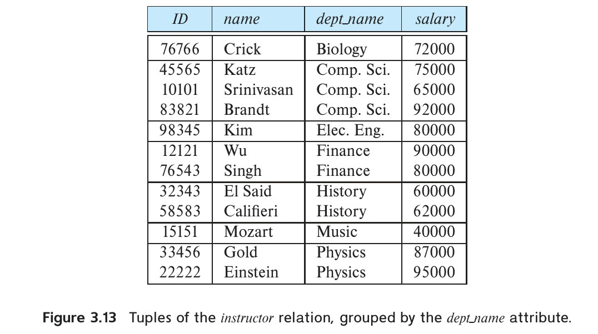

[← Previous: T05.7b: Multi-Table SQL Query Sets](T05.07b_Query_Sets_Insurance_and_Ecommerce.md) | [🏠 Index](00_Index.md) | [Next: T05.9: TRUNCATE vs. DELETE →](T05.09_TRUNCATE_vs_DELETE.md)

---

# T05.8: SQL Short Notes — ON DELETE CASCADE, GROUP BY, ORDER BY, AS

> **Topic:** T05 — SQL (DDL, DML, Aggregates, Subqueries) | **Priority:** 🟠 High | **Exam Frequency:** 3/7 finals (10 marks) [2019 Q.8(c), 2023 Q.6(c), 2024 Q.7(b)]  
> **Sources:** Silberschatz 7e Ch. 3 (§3.4.1, §3.4.4, §3.7.2), Ch. 4 (§4.4.5) · Lecture Deck 03 (Slides 8, 20, 24, 32–33) · Fahim Notes (pp. 46–47, 50)

## Why This Topic Matters

Short-note questions in ECE 2215 test whether you truly understand how everyday SQL clauses work under the hood. RUET exams frequently pair foreign-key cascading rules with query clauses like `GROUP BY`, `ORDER BY`, and `AS` (appearing in 2019, 2023, and 2024). To score full marks on these short notes, always give three things for each item: a clear one-sentence definition, a quick explanation of how the database executes it, and a short, working 3-to-5 line SQL example.

---

## 📝 Key Definitions

> **ON DELETE CASCADE:** "Because of the clause **on delete cascade** associated with the foreign-key declaration, if a delete of a tuple in *department* results in this referential-integrity constraint being violated, the system does not reject the delete. Instead, the delete 'cascades' to the *course* relation, deleting the tuple that refers to the department that was deleted." — Silberschatz, Korth & Sudarshan, *Database System Concepts* (7th Ed.), §4.4.5 (p. 150)

> **GROUP BY Clause:** "There are circumstances where we would like to apply the aggregate function not only to a single set of tuples, but also to a group of sets of tuples; we specify this in SQL using the **group by** clause. The attribute or attributes given in the `group by` clause are used to form groups. Tuples with the same value on all attributes in the `group by` clause are placed in one group." — Silberschatz, Korth & Sudarshan, *Database System Concepts* (7th Ed.), §3.7.2 (p. 92)

> **ORDER BY Clause:** "The **order by** clause causes the tuples in the result of a query to appear in sorted order." — Silberschatz, Korth & Sudarshan, *Database System Concepts* (7th Ed.), §3.4.4 (p. 83)

> **AS Clause (The Rename Operation):** "SQL provides a way of renaming the attributes of a result relation. It uses the **as** clause, taking the form: `old-name as new-name`... The **as** clause can also be used to rename a relation." — Silberschatz, Korth & Sudarshan, *Database System Concepts* (7th Ed.), §3.4.1 (pp. 79–80)

---

## Deep Dive: ON DELETE CASCADE

### 1. Intuitive Analogy and Purpose
Think of a parent row (like a `department`) as a folder on your computer, and the child rows that reference it (like `course` records in that department) as files inside that folder. By default, SQL protects child rows from becoming "orphans" by blocking you from deleting a non-empty folder.

When you attach `ON DELETE CASCADE` to a foreign key, you tell the database: *"If someone deletes the parent folder, automatically delete all the files inside it too."* That way, the database stays completely consistent without forcing you to hunt down and delete child rows by hand first.

*(Exam terminology note: RUET exam papers often print this phrase as "ON CASCADE DELETE". In standard SQL and MySQL, the actual code syntax is `ON DELETE CASCADE`.)*

### 2. Standard Syntax
You declare `ON DELETE CASCADE` right inside the `CREATE TABLE` (or `ALTER TABLE`) statement when setting up a `FOREIGN KEY`:

```sql
CREATE TABLE department (
    dept_name VARCHAR(20) PRIMARY KEY,
    building VARCHAR(15),
    budget NUMERIC(12, 2)
);

CREATE TABLE course (
    course_id VARCHAR(8) PRIMARY KEY,
    title VARCHAR(50),
    dept_name VARCHAR(20),
    credits NUMERIC(2, 0),
    FOREIGN KEY (dept_name) REFERENCES department(dept_name)
        ON DELETE CASCADE
        ON UPDATE CASCADE
);
```

### 3. Cascading Chains and Rollback Rules
1. **Multi-level Cascades:** Cascading deletes can ripple across multiple tables. For example, if table $A$ is referenced by table $B$ with `ON DELETE CASCADE`, and table $B$ is referenced by table $C$ with `ON DELETE CASCADE`, deleting a row in $A$ automatically deletes its child rows in $B$, which then triggers automatic deletions in $C$.
2. **All-or-Nothing Rollback:** If any step along that chain hits a roadblock (for instance, table $C$ is referenced by table $D$ without cascade permission), the database aborts the entire operation and rolls back every single deletion so no partial changes are left behind.

### 4. Comparison with Other Foreign Key Actions
- `ON DELETE RESTRICT` / `NO ACTION`: Blocks the parent deletion if any matching child rows exist (this is the default behavior in SQL).
- `ON DELETE CASCADE`: Automatically deletes all matching child rows alongside the parent row.
- `ON DELETE SET NULL`: Keeps the child rows alive, but sets their foreign key column to `NULL` (only works if that column allows `NULL` values).
- `ON DELETE SET DEFAULT`: Sets the child foreign key column to its pre-configured default value.

---

## Deep Dive: GROUP BY

### 1. Intuitive Analogy and Mechanism
Imagine sorting a stack of employee files into separate bins by department name, and then running a calculator on each bin to find that department's average salary. That is exactly how `GROUP BY` works. It gathers all rows that share the same value in the grouping column(s) into a single bucket, and then runs aggregate functions (`COUNT`, `SUM`, `AVG`, `MIN`, `MAX`) once per bucket to output one summary row per group.

```sql
SELECT dept_name, AVG(salary) AS avg_salary
FROM instructor
GROUP BY dept_name;
```


*Figure 1: Tuples of the instructor relation grouped by the dept_name attribute (Silberschatz Figure 3.13).*

### 2. The Golden Rule of Grouping
Whenever a query uses `GROUP BY`, every column listed in `SELECT` that is **not** wrapped inside an aggregate function (`COUNT`, `AVG`, etc.) **must** appear in the `GROUP BY` list:

```sql
/* ILLEGAL QUERY in standard SQL and MySQL ONLY_FULL_GROUP_BY */
SELECT dept_name, ID, AVG(salary)
FROM instructor
GROUP BY dept_name;
```
*Why this fails:* Each `dept_name` bucket collapses down into **one** output row showing one average salary. Because the Computer Science department has many different instructors with different `ID` values, the database has no way of knowing which single `ID` to print on that summary line!

### 3. SQL Query Execution Order
Even though you write `SELECT` first, the database engine actually runs a query in this step-by-step order:
1. `FROM` (loads and joins the base tables)
2. `WHERE` (filters out individual rows *before* grouping)
3. `GROUP BY` (places the surviving rows into buckets)
4. `HAVING` (filters entire buckets based on aggregate results)
5. `SELECT` (computes the final output columns and aliases)
6. `ORDER BY` (sorts the final output table right before displaying it)

---

## Deep Dive: ORDER BY

### 1. Purpose and Syntax
In the relational model, a table is an unordered set of rows, so the database makes no promise about what order rows will appear in unless you ask. Adding `ORDER BY` at the very end of your query sorts the output rows before returning them to you:

```sql
SELECT name, dept_name, salary
FROM instructor
ORDER BY salary DESC, name ASC;
```

### 2. Key Rules and Features
- **Default Sort Order:** If you do not specify a direction, `ORDER BY` sorts in ascending order (`ASC`, from lowest to highest or $A$ to $Z$) by default.
- **Descending Sort:** Adding the `DESC` keyword flips the sort order from highest to lowest (or $Z$ to $A$).
- **Tie-Breaking with Multiple Columns:** When you list multiple columns (like `ORDER BY salary DESC, name ASC`), SQL sorts by the first column (`salary DESC`) first. Whenever two instructors are tied with the exact same salary, it uses the second column (`name ASC`) to break the tie alphabetically.
- **Sorting by Expressions or Aliases:** Because `ORDER BY` runs *after* `SELECT`, it is the one clause where you can legally refer to column aliases created in `SELECT`:
  ```sql
  SELECT ID, salary * 1.10 AS projected_salary
  FROM instructor
  ORDER BY projected_salary DESC;
  ```
- **NULL Handling:** In MySQL, `NULL` values are treated as the smallest possible values, so they show up first in `ASC` order and last in `DESC` order.

---

## Deep Dive: The AS Clause

### 1. Purpose and Applications
The `AS` keyword creates a temporary nickname (alias) for a column or a table that lasts only for that single query. It does not rename anything permanently on disk.

### 2. Column Aliasing
Column aliases give clean, readable headers to calculated formulas or aggregate outputs in your result table:

```sql
SELECT name, salary, salary * 0.15 AS annual_bonus
FROM instructor;
```

### 3. Table Aliasing (Tuple Variables)
Table aliases give short nicknames to long table names so you do not have to type the full name repeatedly. Even more importantly, table aliases are **mandatory** in a self-join, where you join a table to itself and need two separate labels (`T` and `S`) to tell the two copies apart:

```sql
/* Find instructors who earn more than at least one instructor in Biology */
SELECT DISTINCT T.name
FROM instructor AS T, instructor AS S
WHERE T.salary > S.salary AND S.dept_name = 'Biology';
```

*(Note: The `AS` keyword itself is optional in SQL, so writing `instructor AS T` is completely equivalent to writing `instructor T`.)*

---

## Exam Variants

| Year & Question | Marks | Clauses Tested | Key Result / Answer Summary |
| :--- | :---: | :--- | :--- |
| **2019 Q.8(c)** | 4 | `ON CASCADE DELETE`, `GROUP BY` | Define foreign-key cascading delete and aggregate row grouping with sample queries. |
| **2023 Q.6(c)** | 2 | `ON CASCADE DELETE` | Explain automatic parent-to-child row deletion and write `CREATE TABLE` syntax. |
| **2024 Q.7(b)** | 4 | `ON CASCADE DELETE`, `GROUP BY`, `ORDER BY`, `AS` | Full set of short notes covering 4 core SQL clauses (1 mark per item). |

---

## 🏆 Golden Questions (Past Exam Archive)

### 🎯 GQ1 · 2024 Q.7(b) · Short Notes on SQL Statements (Cascade, Group By, Order By, As)

> **Appeared:** 2024 Q.7(b) — (4 marks)

**Question:**

Write short note on the following statements –  
i) ON CASCADE DELETE  
ii) Group By  
iii) Order By  
iv) As

*(Note: "ON CASCADE DELETE" printed verbatim in original paper; standard SQL syntax is ON DELETE CASCADE)*

**Full Answer:**

#### i) ON CASCADE DELETE (Standard SQL: ON DELETE CASCADE)
- **Definition:** A referential integrity option attached to a foreign key declaration.
- **How It Works:** When a parent row in the referenced table is deleted, the DBMS automatically deletes all matching child rows in the referencing table. This prevents orphaned records and keeps foreign keys consistent.
- **Syntax Example:**
  ```sql
  CREATE TABLE student (
      student_id INT PRIMARY KEY,
      dept_name VARCHAR(20),
      FOREIGN KEY (dept_name) REFERENCES department(dept_name)
          ON DELETE CASCADE
  );
  ```

#### ii) Group By
- **Definition:** A query clause that divides table rows into summary groups based on matching values in one or more columns.
- **How It Works:** Rows that share the exact same value in the `GROUP BY` columns are placed into a single group. Aggregate functions (`COUNT`, `SUM`, `AVG`, `MIN`, `MAX`) then calculate a single summary value for each group. Any non-aggregated column in `SELECT` must also appear in `GROUP BY`.
- **Syntax Example:**
  ```sql
  SELECT dept_name, COUNT(ID) AS total_instructors, AVG(salary) AS avg_sal
  FROM instructor
  GROUP BY dept_name;
  ```

#### iii) Order By
- **Definition:** An SQL clause that sorts the output rows of a query in a specified order.
- **How It Works:** Rows are sorted in ascending (`ASC`, the default) or descending (`DESC`) order using one or more columns. When multiple columns are listed, SQL sorts by the first column and uses later columns from left to right to break ties.
- **Syntax Example:**
  ```sql
  SELECT name, dept_name, salary
  FROM instructor
  ORDER BY dept_name ASC, salary DESC;
  ```

#### iv) As
- **Definition:** An SQL keyword used to assign a temporary alias (nickname) to a column expression or a table within a query.
- **How It Works:** In the `SELECT` clause, `AS` gives a clean header to calculated values or aggregates in the output table. In the `FROM` clause, `AS` creates short table nicknames and allows a table to be joined to itself (self-join).
- **Syntax Example:**
  ```sql
  SELECT emp.name AS employee_name, emp.salary * 1.10 AS revised_salary
  FROM employee AS emp;
  ```

---

### 🎯 GQ2 · 2019 Q.8(c) · Short Notes on ON CASCADE DELETE and Group By

> **Appeared:** 2019 Q.8(c) — (4 marks)

**Question:**

Write short note on the following statements.  
(i) ON CASCADE DELETE.  
(ii) Group By.

**Full Answer:**

#### (i) ON CASCADE DELETE (ON DELETE CASCADE)
`ON DELETE CASCADE` is a foreign-key integrity rule. In a relational database, child rows must always point to valid parent rows. When `ON DELETE CASCADE` is enabled on a foreign key and a parent row is deleted, the database automatically deletes all child rows that point to that parent:

```sql
CREATE TABLE takes (
    ID VARCHAR(5),
    course_id VARCHAR(8),
    sec_id VARCHAR(8),
    semester VARCHAR(6),
    year NUMERIC(4, 0),
    PRIMARY KEY (ID, course_id, sec_id, semester, year),
    FOREIGN KEY (ID) REFERENCES student(ID)
        ON DELETE CASCADE
);
```
*Effect:* Running `DELETE FROM student WHERE ID = '12345';` deletes that student from `student` and automatically removes all of student `'12345'`'s course enrollment rows from `takes`.

#### (ii) Group By
The `GROUP BY` clause gathers rows that share the same values in specified columns into summary buckets so aggregate functions can be calculated on each bucket separately:

```sql
SELECT dept_name, MAX(salary) AS highest_salary
FROM instructor
GROUP BY dept_name;
```
*Key Rule:* Every column in the `SELECT` list that is not wrapped inside an aggregate function must be listed in the `GROUP BY` clause so the database has a single, unambiguous value to print for each group.

---

### 🎯 GQ3 · 2023 Q.6(c) · Short Note on ON CASCADE DELETE

> **Appeared:** 2023 Q.6(c) — (2 marks)

**Question:**

Write short note on " ON CASCADE DELETE".

**Full Answer:**

`ON DELETE CASCADE` (written in the question paper as "ON CASCADE DELETE") is a foreign-key constraint option in SQL:

1. **Purpose:** It keeps parent and child tables consistent by automating child-row cleanup when a parent record is removed.
2. **Behavior:** When a row in the parent table is deleted, the DBMS automatically deletes every row in the child table whose foreign key matches the deleted parent's primary key.
3. **Contrast with Default:** Without `ON DELETE CASCADE`, trying to delete a parent row that still has child rows causes a foreign-key constraint error and aborts the delete.
4. **Syntax Example:**
   ```sql
   CREATE TABLE order_items (
       item_id INT PRIMARY KEY,
       order_id INT,
       product_id INT,
       FOREIGN KEY (order_id) REFERENCES orders(order_id)
           ON DELETE CASCADE
   );
   ```
   If `order_id = 501` is deleted from `orders`, all line items for order `501` in `order_items` are deleted automatically.

---

## ⚡ Exam Tips & Common Mistakes

1. **Syntax Precision:** Remember that standard SQL syntax is `ON DELETE CASCADE`. If the exam prompt writes "ON CASCADE DELETE", mention the exam label first, but explicitly write the standard syntax `ON DELETE CASCADE` in your code snippet.
2. **Always Include Code Snippets:** Even for a 1-mark or 2-mark short note, write a 3-line SQL example. Examiners look for correct syntax (`FOREIGN KEY (...) REFERENCES ... ON DELETE CASCADE`).
3. **The GROUP BY Column Trap:** Never project an unaggregated column that is missing from the `GROUP BY` list. Doing so is illegal in standard SQL and loses marks.
4. **AS Scope Limitation:** Remember that column aliases created with `AS` cannot be referenced in the `WHERE` clause because `WHERE` executes before `SELECT`.

## 🔗 Related Topics

- [T03.03: Referential Integrity and Foreign Keys](T03.03_Referential_Integrity_and_Foreign_Keys.md) — Fundamental rules of parent and child foreign key relationships
- [T05.05a: GROUP BY and HAVING Clauses](T05.05a_GROUP_BY_and_HAVING.md) — Complex aggregation queries with HAVING and multiple grouping columns
- [T05.09: TRUNCATE vs. DELETE](T05.09_TRUNCATE_vs_DELETE.md) — Comparing table truncation with row-level deletions

---

[← Previous: T05.7b: Multi-Table SQL Query Sets](T05.07b_Query_Sets_Insurance_and_Ecommerce.md) | [🏠 Index](00_Index.md) | [Next: T05.9: TRUNCATE vs. DELETE →](T05.09_TRUNCATE_vs_DELETE.md)
