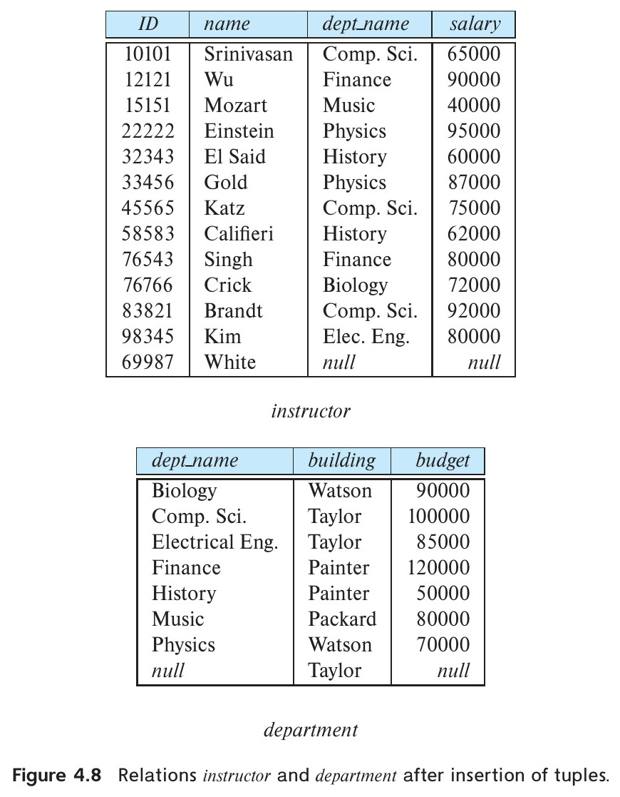

[← Previous: T06.4: SQL Views](T06.04_Views.md) | [🏠 Index](00_Index.md) | [Next: T07.1: SQL Triggers →](T07.01_Triggers_Definition_and_Syntax.md)

---

# T06.5: View Expansion, Updatable Views, and Materialized Views

> **Topic:** T06 — Joins & Views | **Priority:** ⭐ High-Yield Potential (Unasked) | **Exam Frequency:** 0/7 finals (0 marks) [Taught in Deck 04 Slides 29–34 & Ch. 4 §4.2.3–4.2.4]  
> **Sources:** Silberschatz 7e Ch. 4 (§4.2.2–§4.2.4) · Lecture Deck 04 (Slides 27–34)

## Why This Topic Matters

While basic view creation appeared in 2023, the mechanics of how a database expands, updates, and caches views have not yet been tested in RUET finals. Lecture Deck 04 spends eight slides (Slides 27–34) on view dependencies, view expansion, updatable view rules, and materialized views. Because these slides sit right next to the 2023 exam question in Unit 4, they are prime candidates for upcoming semester finals.

---

## 📝 Key Definitions

> **View Expansion:** "A view relation can be expanded in terms of the definitions of the views that it depends on... Wherever a view relation appears in a query, it is replaced by the stored query expression. When the query is evaluated, the view relation is computed and then deleted after the query finishes." — Silberschatz, Korth & Sudarshan, *Database System Concepts* (7th Ed.), §4.2.2–4.2.3 (pp. 139–140)

> **Materialized View:** "Certain database systems allow view relations to be stored, but they make sure that, if the actual relations used in the view definition change, the view is kept up-to-date. Such views are called **materialized views**." — Silberschatz, Korth & Sudarshan, *Database System Concepts* (7th Ed.), §4.2.3 (p. 140)

> **Updatable View:** "In general, an SQL view is said to be **updatable** (i.e., inserts, updates, or deletes can be applied on the view) if the following conditions are all satisfied by the query defining the view: The **from** clause has only one database relation; The **select** clause contains only attribute names of the relation and does not have any expressions, aggregates, or **distinct** specification; Any attribute not listed in the **select** clause can be set to null... The query does not have a **group by** or **having** clause." — Silberschatz, Korth & Sudarshan, *Database System Concepts* (7th Ed.), §4.2.4 (pp. 141–142)

---

## View Dependencies and View Expansion

### 1. View Dependency Hierarchy
Because a view behaves like a virtual table, you can build one view on top of another view. When we write $v_1 \to v_2$, we simply mean that view $v_1$'s query reads from view $v_2$:
- **Direct Dependency ($v_1 \to v_2$):** View $v_1$ depends directly on view $v_2$ if $v_2$ appears in the `FROM` clause of $v_1$.
- **Transitive Dependency:** View $v_1$ depends on $v_3$ if there is a chain of views linking them, such as $v_1 \to v_2 \to v_3$.
- **Recursive Views:** A view is recursive if it depends on itself, either directly or through a chain of other views.

### 2. View Expansion Mechanism
Since virtual views hold no physical rows on disk, how does the database actually run a query on a view? It uses **view expansion**, which works like find-and-replace on SQL queries: whenever the query processor sees a view name in a `FROM` clause, it replaces that name with the view's saved `SELECT` query. If that view was built on top of a second view, the engine repeats the substitution until only physical base tables remain.

For example, suppose we define a base view `ece_courses` and a second view `ece_3credit_courses` on top of it:

```sql
CREATE VIEW ece_courses AS
SELECT course_id, title, credits FROM course WHERE dept_name = 'ECE';

CREATE VIEW ece_3credit_courses AS
SELECT course_id, title FROM ece_courses WHERE credits = 3;
```

When a user runs `SELECT * FROM ece_3credit_courses;`, the query processor substitutes the definition of `ece_courses` into the `FROM` clause:

```sql
SELECT course_id, title
FROM (
    SELECT course_id, title, credits
    FROM course
    WHERE dept_name = 'ECE'
) AS ece_courses
WHERE credits = 3;
```
The query optimizer then flattens this nested query into a single scan on the base table `course` with `WHERE dept_name = 'ECE' AND credits = 3`.

---

## Updatable Views: Rules, Ambiguities, and Constraints

### 1. Why Modifying Views is Difficult
A virtual view does not exist on disk. Because of this, if you run an `INSERT`, `UPDATE`, or `DELETE` on a view, the DBMS has to translate your command into an equivalent change on the underlying base tables. For many views, that reverse translation is ambiguous or impossible.

### 2. Update Ambiguity and Insertion Anomalies
To see why view updates can fail, look at a view that joins `instructor` and `department`:

```sql
CREATE VIEW instructor_info AS
SELECT ID, name, building
FROM instructor, department
WHERE instructor.dept_name = department.dept_name;
```

Suppose a user tries to insert a new row through this view:

```sql
INSERT INTO instructor_info
VALUES ('69987', 'White', 'Taylor');
```

The database immediately runs into three roadblocks:
1. To insert a row into `instructor`, it needs a `dept_name`. What if multiple departments (say, Computer Science and Electrical Engineering) share the `'Taylor'` building? The DBMS cannot guess which department White belongs to.
2. What if no existing department is in the `'Taylor'` building yet?
3. Even if the DBMS inserts `('69987', 'White', null, null)` into `instructor` and `(null, 'Taylor', null)` into `department`, the join condition `instructor.dept_name = department.dept_name` fails on `NULL = NULL`. That means the newly inserted row still would not show up in the view!


*Figure 1: Relations instructor and department after insertion of tuples through a view, showing NULL insertion anomalies (Silberschatz Figure 4.8).*

### 3. The 4 SQL Standard Conditions for Updatable Views
To avoid these ambiguities, standard SQL allows `INSERT`, `UPDATE`, or `DELETE` on a view only when every row in the view maps cleanly one-to-one to a single row in a single base table. Specifically, all four of these rules must hold:

1. **Single Relation in FROM:** The `FROM` clause references only one base database relation (no joins, unions, or subqueries).
2. **Simple Attributes in SELECT:** The `SELECT` list contains only column names from that table, with no arithmetic expressions, aggregates (`SUM`, `AVG`, etc.), or `DISTINCT`.
3. **Nullable Missing Columns:** Any column of the base table left out of the view's `SELECT` list can be set to `NULL` (or has a `DEFAULT` value) and is not blocked by `NOT NULL` or `PRIMARY KEY`.
4. **No Grouping:** The query has no `GROUP BY` or `HAVING` clause.

### 4. The WITH CHECK OPTION Clause
Even when a view meets all four rules, a strange quirk can happen if the view has a `WHERE` filter. Look at this updatable view:

```sql
CREATE VIEW history_instructors AS
SELECT *
FROM instructor
WHERE dept_name = 'History';
```

If someone runs:
```sql
INSERT INTO history_instructors
VALUES ('25566', 'Brown', 'Biology', 100000);
```

By default, SQL allows this insert into the underlying `instructor` table! However, because Brown's department is `'Biology'`, the new row immediately disappears from `history_instructors`.

To block inserts or updates that would vanish from the view, add `WITH CHECK OPTION` at the end of the view definition:

```sql
CREATE VIEW history_instructors AS
SELECT *
FROM instructor
WHERE dept_name = 'History'
WITH CHECK OPTION;
```
With `WITH CHECK OPTION` enabled, the DBMS checks every `INSERT` and `UPDATE` against the view's `WHERE` condition and rejects any row where `dept_name = 'History'` is false.

### 5. INSTEAD OF Triggers
When a view joins multiple tables and therefore cannot be updated directly, many database systems let you attach an `INSTEAD OF` trigger to the view. The trigger catches the `INSERT`, `UPDATE`, or `DELETE` statement on the view and runs custom SQL statements to update each underlying base table cleanly.

---

## Materialized Views vs. Standard Virtual Views

### 1. The Concept of Materialization
If a view joins huge tables and aggregates millions of rows, recomputing it from scratch on every query is too slow. A **materialized view** solves this by actually saving the computed result rows on disk like a physical cache table. When an application queries the materialized view, the database reads the precomputed rows straight from disk without re-running the slow joins or aggregates.

### 2. View Maintenance Strategies
Whenever the underlying base tables change, a materialized view's saved rows become out of date. Keeping the stored view synchronized with its base tables is called **view maintenance**, and databases handle it in three ways:
1. **Immediate (Eager) Maintenance:** The DBMS updates the materialized view right inside the same transaction whenever a base table changes. Queries always see fresh data, but every `INSERT`, `UPDATE`, or `DELETE` on the base tables becomes slower.
2. **Deferred (Lazy) Maintenance:** The DBMS marks the view as stale when base tables change, but waits to recompute it until the next time someone actually queries the view.
3. **Periodic (Snapshot) Maintenance:** The DBMS refreshes the view on a fixed schedule (such as every hour or every night). This approach is popular in analytics and data warehouses where slightly outdated numbers are fine.

### 3. Comparison Matrix

| Architectural Feature | Standard Virtual View | Materialized View |
| :--- | :--- | :--- |
| **Physical Storage** | None (stores only query text in catalog) | Stored physically on disk as a table |
| **Query Performance** | Slower (evaluates query on demand) | Extremely fast (reads precomputed data) |
| **Data Freshness** | Always 100% current and fresh | May be stale depending on refresh policy |
| **Write Overhead** | Zero overhead on base table updates | Significant overhead (triggers maintenance) |
| **Ideal Use Case** | Security masking, query abstraction | OLAP, reporting, data warehousing |

---

## 🔮 Likely Questions (High-Probability RUET Exam Blueprint)

### 🎯 LQ1 · Conditions for Updatable Views in SQL

> **Appeared:** Likely Question (Exam Blueprint Unit 4) — (4 marks)

**Question:**

Under what conditions is an SQL view updatable? Explain why updates cannot be performed on views defined with aggregations or multi-table joins.

**Full Answer:**

#### 1. SQL Standard Conditions for an Updatable View
In SQL, an `INSERT`, `UPDATE`, or `DELETE` operation can be performed through a view only if all four conditions are satisfied:
1. The `FROM` clause references only one base table.
2. The `SELECT` clause contains only column names without expressions, calculated fields, aggregate functions, or the `DISTINCT` keyword.
3. Any base table column omitted from the `SELECT` clause permits `NULL` values (i.e., it is not defined as `NOT NULL` or `PRIMARY KEY` without a default).
4. The query does not contain a `GROUP BY` or `HAVING` clause.

#### 2. Why Updates Fail on Aggregated Views
Consider a view defined as:
```sql
CREATE VIEW dept_avg AS
SELECT dept_name, AVG(salary) AS avg_salary
FROM instructor
GROUP BY dept_name;
```
If a user updates `avg_salary` to 85,000 for the `'Comp. Sci.'` department, the DBMS cannot determine how to adjust individual instructor salaries. Many different combinations of individual salary changes produce an average of 85,000. Because no unique inverse mapping exists, the operation is prohibited.

#### 3. Why Updates Fail on Multi-Table Join Views
In a join view combining `instructor` and `department`, inserting a record with a new department building requires inserting `NULL` values into unspecified base columns. The resulting base tuples fail to satisfy the join predicate, preventing the inserted row from appearing in the view.

---

### 🎯 LQ2 · Virtual Views vs. Materialized Views and View Maintenance

> **Appeared:** Likely Question (Exam Blueprint Unit 4) — (4 marks)

**Question:**

Distinguish between a standard virtual view and a materialized view. Discuss the trade-offs involved in maintaining a materialized view.

**Full Answer:**

#### 1. Comparison
- **Standard Virtual View:** A virtual relation defined by an SQL query. The DBMS stores only the query specification in the data dictionary. Every time the view is referenced, the query processor substitutes the stored definition and computes the result dynamically. It consumes no disk space for data.
- **Materialized View:** A view whose query result is computed and physically stored on disk like an actual table. Queries against a materialized view execute rapidly because the DBMS reads precomputed rows directly without re-evaluating joins or aggregations.

#### 2. Trade-Offs and Maintenance Strategies
Materializing a view trades database write performance and storage space for query read speed:
- **Query Acceleration:** Dramatically accelerates complex decision-support and data warehousing queries that aggregate millions of rows.
- **Storage Cost:** Consumes physical disk storage for tuples and indexes.
- **Update Overhead:** When base relations are modified, the materialized view must be refreshed:
  - *Immediate Maintenance:* Updates the view immediately upon base table modification. This keeps data strictly consistent but increases write latency.
  - *Lazy / Periodic Maintenance:* Refreshes the view on access or at scheduled intervals. This reduces write overhead but leaves data temporarily stale.

---

### 🎯 LQ3 · View Expansion and Nested View Resolution

> **Appeared:** Likely Question (Exam Blueprint Unit 4) — (3 marks)

**Question:**

What is view expansion? Show how the DBMS expands a query on a view defined over another view using an example.

**Full Answer:**

#### 1. Concept of View Expansion
**View expansion** is a query rewriting transformation performed by the DBMS query processor. It replaces view references in a user query with their underlying SQL query definitions. This process recurses until the entire query is expressed purely in terms of physical base relations.

#### 2. Concrete Example
Assume a base view `physics_fall_2017`:
```sql
CREATE VIEW physics_fall_2017 AS
SELECT course.course_id, sec_id, building, room_number
FROM course, section
WHERE course.course_id = section.course_id
  AND course.dept_name = 'Physics'
  AND section.semester = 'Fall'
  AND section.year = 2017;
```

A second view `physics_watson` is defined over `physics_fall_2017`:
```sql
CREATE VIEW physics_watson AS
SELECT course_id, room_number
FROM physics_fall_2017
WHERE building = 'Watson';
```

When a user executes `SELECT * FROM physics_watson;`, the query processor expands the view definition:

```sql
SELECT course_id, room_number
FROM (
    SELECT course.course_id, sec_id, building, room_number
    FROM course, section
    WHERE course.course_id = section.course_id
      AND course.dept_name = 'Physics'
      AND section.semester = 'Fall'
      AND section.year = 2017
) AS physics_fall_2017
WHERE building = 'Watson';
```
The query optimizer flattens this subquery, producing an efficient execution plan that scans `course` and `section` directly.

---

## 📖 High-Yield Exercises from the Book

### 🎯 HYE-01 · Exercise 4.13 · SQL Standard Conditions for Updatable Views

> **Source:** Silberschatz 7e · Chapter 4 (Exercise 4.13)  
> **Exam Relevance:** Prime Overdue Advanced Views Question (Obtained in 2024 Exam)  
> **Key Tested Concept:** Exact SQL standard conditions required for a view to be updatable, `WITH CHECK OPTION`, and update ambiguity.

**Problem Statement:**
> 1. State the **four mandatory conditions** defined by the SQL standard for a view to be considered **updatable** (permitting `INSERT`, `UPDATE`, and `DELETE`).
> 2. Explain why a view containing an **aggregation operator** (`COUNT`, `SUM`, `AVG`) or a **`GROUP BY` clause** cannot be updatable.
> 3. Explain the purpose and behavior of the **`WITH CHECK OPTION`** clause in view definitions.

**Model Exam-Style Solution:**

1. **SQL Standard Conditions for Updatable Views:**
   Under the SQL standard, a view is updatable if and only if all of the following conditions are met:
   1. **Single Table Source:** The `FROM` clause contains exactly **one database relation** (no joins).
   2. **No Aggregation or Deduplication:** The `SELECT` clause does **not** contain aggregate functions (`SUM`, `AVG`, `COUNT`, `MAX`, `MIN`), and does not use `DISTINCT`.
   3. **No Grouping:** The query does **not** contain a `GROUP BY` or `HAVING` clause.
   4. **Primary Key Inclusion:** Any attribute of the underlying base relation that is declared `NOT NULL` and lacks a default value must be present in the view's `SELECT` list (otherwise an `INSERT` would leave a required base column undefined).

2. **Why Aggregated / Grouped Views Cannot Be Updated:**
   - Consider a view `dept_avg_sal` defined as:

```sql
CREATE VIEW dept_avg_sal AS
SELECT dept_name, AVG(salary) AS avg_sal
FROM instructor
GROUP BY dept_name;
```
   - Suppose a user attempts to update this view:

```sql
UPDATE dept_avg_sal SET avg_sal = 90000 WHERE dept_name = 'ECE';
```
   - **The Semantic Ambiguity:** How should the DBMS apply this update to individual instructors in the `ECE` department?
     - Should every ECE instructor's salary be set to 90,000?
     - Should one instructor's salary be increased by the difference?
     - Should all instructors receive a proportional percentage raise?
   - Because a single aggregate row corresponds to multiple underlying base tuples, there is no unique, deterministic mapping to update base tuples. Hence, updates through aggregated views are strictly forbidden.

3. **The `WITH CHECK OPTION` Clause:**
   - **Purpose:** Prevents modifications through a view that would produce rows that do not satisfy the view's `WHERE` predicate.
   - **Example:**

```sql
CREATE VIEW ece_instructors AS
SELECT ID, name, dept_name, salary
FROM instructor
WHERE dept_name = 'ECE'
WITH CHECK OPTION;
```
   - **Behavior:**
     - If a user attempts to update:

```sql
UPDATE ece_instructors SET dept_name = 'Finance' WHERE ID = '10101';
```
     - Without `WITH CHECK OPTION`, this update succeeds, but the row immediately vanishes from the view!
     - With `WITH CHECK OPTION`, the DBMS checks the new row against `WHERE dept_name = 'ECE'`. Since the updated row violates the condition, the DBMS **rejects the update with an error**. $\blacksquare$

**💡 RUET Exam Takeaway:**
Always emphasize: **An updatable view must map each view tuple to exactly ONE unique base relation tuple!** Any construct that breaks this 1:1 mapping (joins, aggregation, grouping, distinct) disables updatability.

---


## ⚡ Exam Tips & Common Mistakes

1. **The Four Updatable View Rules:** Memorize the four conditions for updatable views (single base table, simple attributes, nullable missing columns, no grouping). These are frequently tested in engineering oral exams and final papers.
2. **The WITH CHECK OPTION Trap:** Remember the role of `WITH CHECK OPTION`. It ensures that updates or inserts through a view satisfy the view's `WHERE` clause, preventing tuples from silently disappearing.
3. **Materialized Views in MySQL:** Note that MySQL standard community edition does not natively support automated materialized views like Oracle or PostgreSQL. In MySQL, developers simulate them using scheduled tables and triggers.
4. **View Expansion vs. Query Execution:** View expansion is a compile-time syntactic query rewrite. It occurs before physical query optimization and execution.

## 🔗 Related Topics

- [T06.04: SQL Views and Benefits](T06.04_Views.md) — Fundamental view definitions, syntax, and benefits
- [T07.01: SQL Triggers](T07.01_Triggers_Definition_and_Syntax.md) — Using INSTEAD OF triggers to update complex non-updatable views
- [T13.01: Database Security Threats and Authorization](T13.01_Security_and_Authorization.md) — Granting view permissions for row-level and column-level security

---

[← Previous: T06.4: SQL Views](T06.04_Views.md) | [🏠 Index](00_Index.md) | [Next: T07.1: SQL Triggers →](T07.01_Triggers_Definition_and_Syntax.md)
