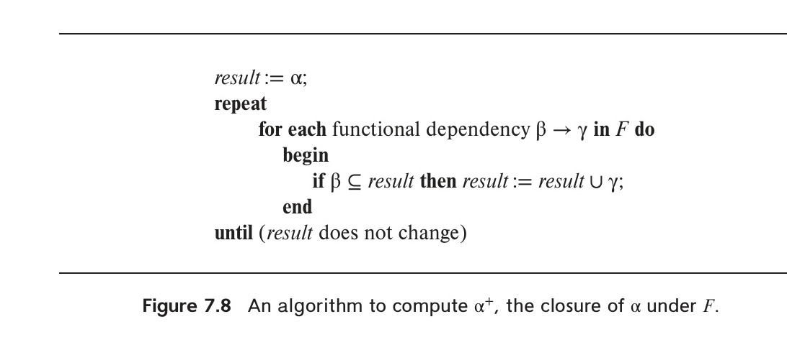

[← Previous: T08.3: Armstrong's Axioms and Additional Inference Rules](T08.03_Armstrongs_Axioms.md) | [🏠 Index](00_Index.md) | [Next: T08.5: Canonical Cover of Functional Dependencies →](T08.05_Canonical_Cover.md)

---

# T08.4: Attribute Closure and Finding Candidate Keys

> **Topic:** T08 — Normalization & Functional Dependencies | **Priority:** 🟢 | **Exam Frequency:** 1/7 finals (+ CT-03 Q1(a)) (8 marks total: 4m final + 4m CT)
> **Sources:** Silberschatz 7e Ch. 7 (§7.4.2, pp. 323–324) · Lecture Deck 06 (Slides 25–29) · Classnote by Raidah (pp. 20–21)

## Why This Topic Matters

Attribute closure ($X^+$) is the workhorse algorithm of relational database design. Instead of writing long symbolic proofs with Armstrong's axioms, computing $X^+$ lets you quickly find all candidate keys, check whether a functional dependency holds, and test normal forms. RUET exams regularly feature direct closure calculations and candidate-key problems, so learning the L/R/M/N attribute shortcut will save you plenty of time and keep you from missing composite keys.

---

## 📝 Key Definitions

> **Attribute Closure ($\alpha^+$):** "Let $\alpha$ be a set of attributes. We call the set of all attributes functionally determined by $\alpha$ under a set $F$ of functional dependencies the closure of $\alpha$ under $F$; we denote it by $\alpha^+$." — Silberschatz, Korth & Sudarshan, *Database System Concepts* (7th Ed.), §7.4.2 (p. 323)

> **Superkey:** "A superkey is a set of one or more attributes that, taken collectively, allow us to identify uniquely a tuple in the relation." — Silberschatz, Korth & Sudarshan, *Database System Concepts* (7th Ed.), §2.3 (p. 44)

> **Candidate Key:** "We are often interested in superkeys for which no proper subset is a superkey. Such minimal superkeys are called candidate keys." — Silberschatz, Korth & Sudarshan, *Database System Concepts* (7th Ed.), §2.3 (p. 44)

> **Closure of a Set of Functional Dependencies ($F^+$):** "Let $F$ be a set of functional dependencies. The closure of $F$, denoted by $F^+$, is the set of all functional dependencies logically implied by $F$." — Silberschatz, Korth & Sudarshan, *Database System Concepts* (7th Ed.), §7.4.1 (p. 321)

---

## The Attribute Closure Algorithm ($X^+$)

### Intuition: Why Compute $X^+$ Instead of $F^+$?

Suppose you want to know whether a dependency $\alpha \rightarrow \beta$ is logically implied by $F$. Generating the entire set of implied dependencies $F^+$ is a nightmare because a table with $n$ attributes has $2^n$ subsets and up to $2^{2n}$ possible dependencies.

Attribute closure ($\alpha^+$) solves this in linear time. Think of $\alpha^+$ as a snowball: you start with the attributes in $\alpha$, and every time you see a functional dependency whose left side is already inside your snowball, you toss its right-hand side into the snowball too. When the snowball stops growing, you have found every attribute that $\alpha$ can possibly determine!

### Algorithmic Procedure

Let $\alpha$ be a set of attributes and $F$ be the given set of functional dependencies:

```text
result := alpha;
repeat
    for each functional dependency beta -> gamma in F do
    begin
        if beta is a subset of result then
            result := result union gamma;
    end
until (result does not change);
return result;
```


*Figure 1: Algorithm to compute attribute closure $\alpha^+$ under $F$ (Silberschatz 7e, Figure 7.8).*

### Practical Applications of Attribute Closure

1. **Testing for a Superkey:**  
   Compute $\alpha^+$. If $\alpha^+$ contains every attribute in table $R$ ($\alpha^+ = R$), then $\alpha$ uniquely identifies every row and is a **superkey** of $R$.
2. **Testing Whether a Functional Dependency Holds:**  
   To check if $\alpha \rightarrow \beta$ is in $F^+$, just compute $\alpha^+$. By Armstrong's Union and Decomposition rules, $\alpha \rightarrow \beta$ holds if and only if $\beta \subseteq \alpha^+$.
3. **Representing the Full Dependency Closure $F^+$:**  
   For any subset $\gamma \subseteq R$, computing $\gamma^+$ immediately tells you every attribute determined by $\gamma$ (namely, $\gamma \rightarrow S$ for every subset $S \subseteq \gamma^+$).

---

## Finding All Candidate Keys: The L/R/M/N Shortcut

During an exam, you don't want to guess and check all $2^n - 1$ attribute subsets by hand (for 5 attributes, that is 31 combinations!). By sorting the attributes based on where they appear in the arrows of $F$, you can skip over 80% of those checks.

### Intuition Behind the L/R/M/N Buckets

- If an attribute **never appears on the right-hand side** of any arrow (Classes **L** and **N**), no other attribute can ever generate it. The only way it can end up in a closure is if you start with it in your key! So every candidate key *must* include all $L$ and $N$ attributes.
- Conversely, if an attribute **only appears on the right-hand side** and never on the left (Class **R**), it never helps unlock any other attribute. Including it in a key is dead weight, so it can *never* be part of a minimal candidate key.

### Attribute Classification Matrix

Inspect the left-hand side (LHS) and right-hand side (RHS) of every non-trivial functional dependency in $F$:

| Class | Position in FDs | Status in Candidate Keys | Action Required |
| :--- | :--- | :--- | :--- |
| **L (Left-only)** | Appears only on LHS | **Must belong to every candidate key** | Add to base key set immediately |
| **R (Right-only)** | Appears only on RHS | **Can never belong to any candidate key** | Discard from key search |
| **N (Neither)** | Does not appear on LHS or RHS | **Must belong to every candidate key** | Add to base key set immediately |
| **M (Middle / Both)** | Appears on both LHS and RHS | **May or may not belong to candidate keys** | Test in combinations with $(L \cup N)$ |

### Step-by-Step Search Algorithm

1. **Step 1:** Sort all attributes of $R$ into the four buckets $L$, $R$, $M$, and $N$.
2. **Step 2:** Form the mandatory starting core $K_{\text{core}} = L \cup N$.
3. **Step 3:** Compute the closure $K_{\text{core}}^+$.
   - If $K_{\text{core}}^+ = R$ (and $K_{\text{core}}$ is non-empty), then $K_{\text{core}}$ is the **unique candidate key** and you are completely done!
   - If $K_{\text{core}}^+ \neq R$, you need help from the middle bucket $M$.
4. **Step 4:** Add one attribute at a time from $M$ to $K_{\text{core}}$ and test $(K_{\text{core}} \cup \{M_i\})^+$.
   - Whenever a combination reaches all of $R$, mark it as a candidate key.
   - If some attributes from $M$ still haven't formed a key, test pairs of remaining $M$ attributes with $K_{\text{core}}$, moving from smaller sets to larger sets.
5. **Step 5 (Minimality Check):**  
   Never test or keep a larger set that already contains a smaller candidate key inside it. For example, if $\{AE\}$ is already a candidate key, skip $\{ABE\}$ and $\{ACE\}$ because they are non-minimal superkeys.

---

## Candidate Key Drills (From Lecture Deck 06)

### Drill 1: Linear FD Chain (Slide 26)

Let $R(A, B, C, D, E)$ with functional dependencies:
$$
F = \{A \rightarrow B, \; B \rightarrow C, \; C \rightarrow D, \; D \rightarrow E\}
$$

- Classification:
  - LHS attributes: $\{A, B, C, D\}$
  - RHS attributes: $\{B, C, D, E\}$
  - $L = \{A\}$, $R = \{E\}$, $M = \{B, C, D\}$, $N = \emptyset$
- Essential core: $\{A\}$
- Compute $A^+$:
  - Start: $\{A\}$
  - Using $A \rightarrow B$: $\{A, B\}$
  - Using $B \rightarrow C$: $\{A, B, C\}$
  - Using $C \rightarrow D$: $\{A, B, C, D\}$
  - Using $D \rightarrow E$: $\{A, B, C, D, E\}$
  - $A^+ = \{A, B, C, D, E\} = R$
- Result:
  - Candidate Key: $\{A\}$
  - Prime Attributes: $\{A\}$
  - Non-Prime Attributes: $\{B, C, D, E\}$

### Drill 2: Cyclic Dependencies (Slide 27)

Let $R(A, B, C, D)$ with functional dependencies:
$$
F = \{A \rightarrow B, \; B \rightarrow C, \; C \rightarrow D, \; D \rightarrow A\}
$$

- Classification:
  - All attributes appear on both sides: $M = \{A, B, C, D\}$, $L = \emptyset$, $R = \emptyset$, $N = \emptyset$.
- Compute closures of single attributes:
  - $A^+ = \{A, B, C, D\} = R$
  - $B^+ = \{B, C, D, A\} = R$
  - $C^+ = \{C, D, A, B\} = R$
  - $D^+ = \{D, A, B, C\} = R$
- Result:
  - Candidate Keys: $\{A\}, \{B\}, \{C\}, \{D\}$
  - Prime Attributes: $\{A, B, C, D\}$
  - Non-Prime Attributes: $\emptyset$

### Drill 3: Missing RHS Attributes (Slide 28)

Let $R(A, B, C, D, E)$ with functional dependencies:
$$
F = \{A \rightarrow B, \; B \rightarrow C, \; CD \rightarrow E\}
$$

- Classification:
  - LHS attributes: $\{A, B, C, D\}$
  - RHS attributes: $\{B, C, E\}$
  - $L = \{A, D\}$, $R = \{E\}$, $M = \{B, C\}$, $N = \emptyset$
- Essential core: $\{A, D\}$
- Compute $(AD)^+$:
  - Start: $\{A, D\}$
  - Using $A \rightarrow B$: $\{A, B, D\}$
  - Using $B \rightarrow C$: $\{A, B, C, D\}$
  - Using $CD \rightarrow E$: $\{A, B, C, D, E\} = R$
- Verify minimality:
  - $A^+ = \{A, B, C\} \neq R$
  - $D^+ = \{D\} \neq R$
- Result:
  - Candidate Key: $\{AD\}$
  - Prime Attributes: $\{A, D\}$
  - Non-Prime Attributes: $\{B, C, E\}$

### Drill 4: Multi-Key Overlap (Slide 29)

Let $R(A, B, C, D, E)$ with functional dependencies:
$$
F = \{A \rightarrow B, \; BC \rightarrow D, \; E \rightarrow C, \; D \rightarrow A\}
$$

- Classification:
  - LHS: $\{A, B, C, D, E\}$
  - RHS: $\{A, B, C, D\}$
  - $L = \{E\}$, $R = \emptyset$, $M = \{A, B, C, D\}$, $N = \emptyset$
- Essential core: $\{E\}$. Compute $E^+ = \{E, C\} \neq R$.
- Combine $E$ with single attributes from $M$:
  - $(AE)^+$: Using $A \rightarrow B$, $E \rightarrow C$, $BC \rightarrow D \implies \{A, B, C, D, E\} = R \implies \{AE\}$ is a CK.
  - $(BE)^+$: Using $E \rightarrow C$, $BC \rightarrow D$, $D \rightarrow A \implies \{A, B, C, D, E\} = R \implies \{BE\}$ is a CK.
  - $(DE)^+$: Using $D \rightarrow A$, $A \rightarrow B$, $E \rightarrow C \implies \{A, B, C, D, E\} = R \implies \{DE\}$ is a CK.
  - $(CE)^+$: $C^+ = \{C\}$, so $(CE)^+ = \{C, E\} \neq R$.
- Result:
  - Candidate Keys: $\{AE\}, \{BE\}, \{DE\}$
  - Prime Attributes: $\{A, B, D, E\}$
  - Non-Prime Attributes: $\{C\}$

---

## Worked Example: Rapid L/R/M/N Key-Finding Walkthrough

Notice how Drills 1–4 above cover the four classic patterns from Lecture Deck 06 (Slides 26–29): a single linear chain, a full cycle, a two-attribute core, and an overlapping multi-key relation. Before tackling the full past-exam questions below, let us trace one more compact mini-example where an attribute in $R$ is completely absent from $F$ (bucket $N$):

Let $R(A, B, C, D, E)$ with $F = \{A \rightarrow B, \; BC \rightarrow D\}$.
1. **Classify attributes:** $A$ and $C$ appear only on the LHS ($L = \{A, C\}$), $D$ appears only on the RHS ($R = \{D\}$), $B$ appears on both sides ($M = \{B\}$), and $E$ never appears in any FD at all ($N = \{E\}$).
2. **Form the mandatory core:** $K_{\text{core}} = L \cup N = \{A, C, E\}$.
3. **Test the core closure:** Starting from $\{A, C, E\}$, applying $A \rightarrow B$ gives $\{A, B, C, E\}$, and applying $BC \rightarrow D$ gives $\{A, B, C, D, E\} = R$.
4. **Conclude immediately:** Since $K_{\text{core}}^+ = R$ and every attribute in $L \cup N$ is strictly required, $\{ACE\}$ is the unique candidate key (no need to test $B$ or $D$ at all!).

---

## Exam Variants

| Year & Question | Marks | Scenario / Data Given | Key Result / Answer Summary |
| :--- | :---: | :--- | :--- |
| **2021 Q.5(b)** | 4 | $r(A, B, C, D, E)$, $F = \{A \to BC, CD \to E, B \to D, E \to A\}$ | Candidate keys: $\{A\}, \{E\}, \{BC\}, \{CD\}$ |
| **CT-03 Q.01(a)** | 4 | $\text{ENROLLMENT}$ schema with 7 attributes and 4 FDs | Unique candidate key: $\{\text{StudentID}, \text{CourseID}\}$ |

---

## 🏆 Golden Questions (Past Exam Archive)

### 🎯 GQ1 · 2021 Q.5(b) · Closure of F and Candidate Keys

> **Appeared:** 2021 Q.5(b) — (04 Marks, Section B, CLO1)

**Question:**

Compute the closure of the following set F of functional dependencies for relational schema r (A, B, C, D, E).

  $A \to BC$  
  $CD \to E$  
  $B \to D$  
  $E \to A$

List the candidate Keys for R.

**Full Answer:**

#### 1. Closure of Functional Dependencies ($F^+$)

Why do we represent $F^+$ by computing the attribute closures $\{A^+, B^+, C^+, D^+, E^+\}$ instead of listing every single dependency? Because a 5-attribute relation has $2^5 = 32$ attribute subsets, which generate over a hundred trivial and non-trivial FDs in $F^+$. Since any dependency $X \rightarrow Y$ belongs to $F^+$ if and only if $Y \subseteq X^+$, listing the attribute closures for the single attributes and key-generating pairs gives the exact, compact mathematical representation of $F^+$ that examiners expect:

1. **Closure of $A$ ($A^+$):**
   - Initial set: $\{A\}$
   - Apply $A \rightarrow BC$: $\{A, B, C\}$
   - Apply $B \rightarrow D$: $\{A, B, C, D\}$
   - Apply $CD \rightarrow E$: $\{A, B, C, D, E\}$
   - Result: $A^+ = \{A, B, C, D, E\}$

2. **Closure of $B$ ($B^+$):**
   - Initial set: $\{B\}$
   - Apply $B \rightarrow D$: $\{B, D\}$
   - Result: $B^+ = \{B, D\}$

3. **Closure of $C$ ($C^+$):**
   - No dependency has $C$ alone on the left-hand side.
   - Result: $C^+ = \{C\}$

4. **Closure of $D$ ($D^+$):**
   - No dependency has $D$ alone on the left-hand side.
   - Result: $D^+ = \{D\}$

5. **Closure of $E$ ($E^+$):**
   - Initial set: $\{E\}$
   - Apply $E \rightarrow A$: $\{E, A\}$
   - Since $A^+ = \{A, B, C, D, E\}$, we get all attributes.
   - Result: $E^+ = \{A, B, C, D, E\}$

6. **Key Pair Closures:**
   - $BC^+$: Apply $B \rightarrow D \implies \{B, C, D\}$. Apply $CD \rightarrow E \implies \{B, C, D, E\}$. Apply $E \rightarrow A \implies \{A, B, C, D, E\} = R$.
   - $CD^+$: Apply $CD \rightarrow E \implies \{C, D, E\}$. Apply $E \rightarrow A \implies \{A, C, D, E\}$. Apply $A \rightarrow BC \implies \{A, B, C, D, E\} = R$.

**Key Non-Trivial Functional Dependencies in $F^+$ (Derived using Armstrong's Axioms):**
- $A \rightarrow D$ (Decomposition of $A \rightarrow BC$ to $A \rightarrow B$, then Transitivity with $B \rightarrow D$).
- $A \rightarrow E$ (Transitivity from $A \rightarrow CD$ and $CD \rightarrow E$).
- $E \rightarrow B, \; E \rightarrow C, \; E \rightarrow D$ (Transitivity from $E \rightarrow A$ and $A \rightarrow BCDE$).
- $BC \rightarrow E$ (Augmentation of $B \rightarrow D$ to $BC \rightarrow CD$, then Transitivity with $CD \rightarrow E$).
- $CD \rightarrow A, \; CD \rightarrow B$ (Transitivity from $CD \rightarrow E$, $E \rightarrow A$, and $A \rightarrow B$).

#### 2. Candidate Keys for $R$

A candidate key is a minimal superkey. Its closure must contain all attributes $\{A, B, C, D, E\}$, and no proper subset may be a superkey.

- $A^+ = \{A, B, C, D, E\} \implies \{A\}$ is a candidate key.
- $E^+ = \{A, B, C, D, E\} \implies \{E\}$ is a candidate key.
- $BC^+ = \{A, B, C, D, E\}$, while $B^+ = \{B, D\} \neq R$ and $C^+ = \{C\} \neq R \implies \{BC\}$ is a candidate key.
- $CD^+ = \{A, B, C, D, E\}$, while $C^+ = \{C\} \neq R$ and $D^+ = \{D\} \neq R \implies \{CD\}$ is a candidate key.

$$
\text{Candidate Keys} = \{A\}, \; \{E\}, \; \{BC\}, \; \{CD\}
$$

---

### 🎯 GQ2 · CT-03 Q.01(a) · Candidate Key of ENROLLMENT Schema

> **Appeared:** CT-03 Q.01(a) — (04 Marks, CO3)

**Question:**

Consider $\text{ENROLLMENT}(\text{StudentID}, \text{StudentName}, \text{CourseID}, \text{CourseName}, \text{InstructorID}, \text{InstructorName}, \text{Grade})$ with functional dependencies: $\text{StudentID} \rightarrow \text{StudentName}$; $\text{CourseID} \rightarrow \text{CourseName}, \text{InstructorID}$; $\text{InstructorID} \rightarrow \text{InstructorName}$; $(\text{StudentID}, \text{CourseID}) \rightarrow \text{Grade}$.  
**(a)** Identify all the possible candidate key of the relation.

**Full Answer:**

#### 1. Identify Attributes Not on Any RHS

Inspect the right-hand sides of all given dependencies:
- Right-hand side attributes:
  $$
  \text{RHS} = \{\text{StudentName}, \; \text{CourseName}, \; \text{InstructorID}, \; \text{InstructorName}, \; \text{Grade}\}
  $$
- Attributes that never appear on the RHS of any dependency:
  $$
  L = \{\text{StudentID}, \; \text{CourseID}\}
  $$
- Because neither $\text{StudentID}$ nor $\text{CourseID}$ can be functionally determined by any other attribute, both attributes **must be present in every candidate key**.

#### 2. Compute the Attribute Closure of $\{\text{StudentID}, \text{CourseID}\}$

- **Step 1 (Initial Set):**  
  $$X^+ = \{\text{StudentID}, \; \text{CourseID}\}$$
- **Step 2 (Apply $\text{StudentID} \rightarrow \text{StudentName}$):**  
  $$X^+ = \{\text{StudentID}, \; \text{CourseID}, \; \text{StudentName}\}$$
- **Step 3 (Apply $\text{CourseID} \rightarrow \text{CourseName}, \text{InstructorID}$):**  
  $$X^+ = \{\text{StudentID}, \; \text{CourseID}, \; \text{StudentName}, \; \text{CourseName}, \; \text{InstructorID}\}$$
- **Step 4 (Apply $\text{InstructorID} \rightarrow \text{InstructorName}$):**  
  $$X^+ = \{\text{StudentID}, \; \text{CourseID}, \; \text{StudentName}, \; \text{CourseName}, \; \text{InstructorID}, \; \text{InstructorName}\}$$
- **Step 5 (Apply $(\text{StudentID}, \text{CourseID}) \rightarrow \text{Grade}$):**  
  $$X^+ = \{\text{StudentID}, \; \text{CourseID}, \; \text{StudentName}, \; \text{CourseName}, \; \text{InstructorID}, \; \text{InstructorName}, \; \text{Grade}\} = R$$

#### 3. Test for Minimality

We check both proper subsets of $\{\text{StudentID}, \text{CourseID}\}$:
- $\{\text{StudentID}\}^+ = \{\text{StudentID}, \text{StudentName}\} \neq R$
- $\{\text{CourseID}\}^+ = \{\text{CourseID}, \text{CourseName}, \text{InstructorID}, \text{InstructorName}\} \neq R$

Neither proper subset determines all attributes of $R$. Therefore, $\{\text{StudentID}, \text{CourseID}\}$ is minimal.

$$
\boxed{\text{Candidate Key} = \{\text{StudentID}, \text{CourseID}\}}
$$

This is the only candidate key for the relation.

---

## ⚡ Exam Tips & Common Mistakes

1. **Do not attempt to list all of $F^+$:** The full closure $F^+$ contains hundreds of dependencies. State clearly that $F^+$ is too large, compute the attribute closures for single attributes and relevant combinations, and derive key non-trivial dependencies using Armstrong's axioms.
2. **Always start with Left-only attributes:** Identifying attributes that never appear on any RHS immediately establishes the minimal core of every candidate key.
3. **Prove minimality explicitly:** Stating that a set determines $R$ only proves it is a superkey. You must show that every proper subset fails to determine $R$ to prove it is a candidate key.
4. **Watch for composite keys:** In 2021 Q.5(b), many students found $\{A\}$ and $\{E\}$ but missed the composite candidate keys $\{BC\}$ and $\{CD\}$. Always test combinations of middle attributes.

---

## 🔗 Related Topics

- [T08.02: Functional Dependencies and Attribute Classification](T08.02_Functional_Dependency_Types.md) — Prime vs. non-prime attribute classifications
- [T08.03: Armstrong's Axioms and Additional Inference Rules](T08.03_Armstrongs_Axioms.md) — Sound and complete inference rules
- [T08.05: Canonical Cover of Functional Dependencies](T08.05_Canonical_Cover.md) — Eliminating extraneous attributes from FD sets
- [T08.07: Testing 2NF from a Functional Dependency Set](T08.07_2NF_Test_from_FDs.md) — Detecting partial dependencies using candidate keys

---

[← Previous: T08.3: Armstrong's Axioms and Additional Inference Rules](T08.03_Armstrongs_Axioms.md) | [🏠 Index](00_Index.md) | [Next: T08.5: Canonical Cover of Functional Dependencies →](T08.05_Canonical_Cover.md)
