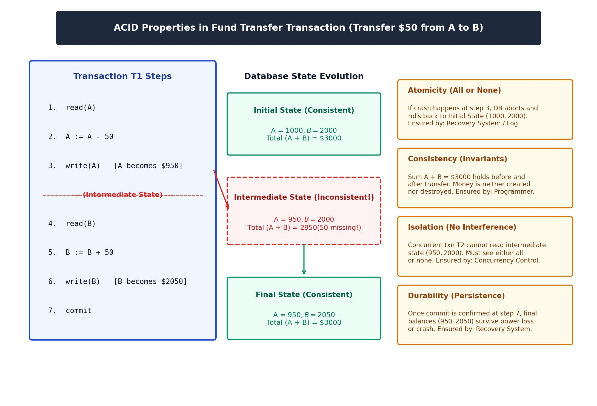

[← Previous: T08.11: Lossless-Join Decomposition and Dependency Preservation](T08.11_Lossless_Join_and_Dependency_Preservation.md) | [🏠 Index](00_Index.md) | [Next: T09.2: The Consistency Property in Depth →](T09.02_Consistency.md)

---

# T09.1: ACID Properties of Transactions

> **Topic:** T09 — Transactions, ACID & Anomalies | **Priority:** 🔴 High Priority | **Exam Frequency:** 5/7 finals + CT-04 Q1 (18 final marks + 6 CT marks = 24 marks total)  
> **Sources:** Silberschatz 7e Ch. 17 (§17.1–§17.2, pp. 799–804) · Lecture Deck 07 (Slides 3–7) · Raidah Class Notes (pp. 25–26)

## Why This Topic Matters

ACID properties are the foundation of database transaction management and one of the most frequently tested topics in ECE 2215, appearing in 5 out of 7 semester finals plus Class Test 4. Exam questions ask for both crisp definitions and the exact DBMS subsystem that enforces each property. You will also regularly be asked to trace a bank transfer transaction step by step, explain what goes wrong when any of the four properties is missing, or sketch a state-evolution diagram.

---

## 📝 Key Definitions

> **Transaction:** "A **transaction** is a **unit** of program execution that accesses and possibly updates various data items. ... A transaction is delimited by statements (or function calls) of the form **begin transaction** and **end transaction**. The transaction consists of all operations executed between the **begin transaction** and **end transaction**."  
> — Silberschatz, Korth & Sudarshan, *Database System Concepts* (7th Ed.), §17.1 (p. 799)

> **Atomicity:** "Either all operations of the transaction are reflected properly in the database, or none are."  
> — Silberschatz, Korth & Sudarshan, *Database System Concepts* (7th Ed.), §17.1 (p. 800)

> **Consistency:** "Execution of a transaction in isolation (i.e., with no other transaction executing concurrently) preserves the consistency of the database."  
> — Silberschatz, Korth & Sudarshan, *Database System Concepts* (7th Ed.), §17.1 (p. 800)

> **Isolation:** "Even though multiple transactions may execute concurrently, the system guarantees that, for every pair of transactions $T_i$ and $T_j$, it appears to $T_i$ that either $T_j$ finished execution before $T_i$ started or $T_j$ started execution after $T_i$ finished. Thus, each transaction is unaware of other transactions executing concurrently in the system."  
> — Silberschatz, Korth & Sudarshan, *Database System Concepts* (7th Ed.), §17.1 (pp. 800–801)

> **Durability:** "After a transaction completes successfully, the changes it has made to the database persist, even if there are system failures."  
> — Silberschatz, Korth & Sudarshan, *Database System Concepts* (7th Ed.), §17.1 (p. 801)

---

## The Four ACID Properties Explained

Think of a **transaction** as a single business task (like sending money or booking a train ticket) that takes several SQL reads and writes under the hood. To keep your data safe even when the power goes out or hundreds of users click at the same time, every relational DBMS enforces four guarantees known as **ACID**:

### 1. Atomicity ("All-or-Nothing")

A transaction usually involves multiple read and write steps. Atomicity guarantees that either **every single step** finishes and takes effect, or **none of them do**. If a transaction is cut off halfway through, the database undoes everything it did so far, leaving the data as if the transaction never started.

- **Threat / Failure Mode:** A power outage, OS crash, network drop, or software error right in the middle of a transaction (for example, after money is deducted from one account, but before it is added to the other).
- **Enforcing Subsystem:** The **Recovery System**.
- **Mechanism:** Before changing any data page on disk, the DBMS writes an **undo log record** using Write-Ahead Logging (WAL). If the transaction crashes midway, the recovery manager reads the undo log and rolls back every partial change.

### 2. Consistency (Preservation of Rules and Invariants)

Suppose the database starts in a valid state where all table constraints and real-world business rules hold true. Consistency guarantees that running a transaction from start to finish on its own leaves the database in another valid state where all those rules still hold.

- **Threat / Failure Mode:** Buggy application code or invalid user input (for example, a bug that deducts \$50 from the sender but adds \$100 to the receiver).
- **Enforcing Subsystem:** The **Application Programmer** (who must write bug-free business logic) together with the **DBMS Integrity Subsystem** (which checks `PRIMARY KEY`, `FOREIGN KEY`, and `CHECK` constraints).
- **Mechanism:** The DBMS blocks any statement that breaks schema constraints, while the developer makes sure the program preserves business invariants (like keeping the total money before and after a transfer equal).

### 3. Isolation (Shielding Concurrent Transactions)

In a real system, dozens of transactions run at the same time. Isolation guarantees that running transactions concurrently produces the exact same result as running them one by one in a strict line (serially). Any half-finished, uncommitted changes made by one transaction stay completely invisible to other transactions until it commits.

- **Threat / Failure Mode:** Concurrency bugs like dirty reads, lost updates, or unrepeatable reads when two transactions interleave their reads and writes on the same row.
- **Enforcing Subsystem:** The **Concurrency-Control System**.
- **Mechanism:** Enforced using locking protocols (such as Two-Phase Locking, 2PL), Timestamp Ordering (TSO), or Multi-Version Concurrency Control (MVCC).

### 4. Durability (Permanent Survival After Commit)

Once a transaction finishes all its steps and the DBMS confirms `commit`, its changes are permanent. Even if the server loses power one millisecond after the commit message is sent, the committed data will never be lost.

- **Threat / Failure Mode:** A power blackout or OS crash right after the user sees "Payment Successful," while the updated pages are still sitting in volatile RAM.
- **Enforcing Subsystem:** The **Recovery System**.
- **Mechanism:** Before confirming a `commit`, the DBMS flushes **redo log records** to non-volatile disk or SSD storage. When the server reboots after a crash, the recovery manager replays those redo logs to restore every committed change.

### Summary of ACID Properties and Enforcing Components

| Property | Core Guarantee | Typical Threat Mitigated | Enforcing Component |
| :--- | :--- | :--- | :--- |
| **Atomicity** | All operations take effect or none do | Mid-execution hardware failure or crash | Recovery System (Undo Log) |
| **Consistency** | Invariants and schema constraints hold | Flawed program logic or invalid inputs | Programmer Logic + DBMS Constraints |
| **Isolation** | Intermediate states hidden from other transactions | Interleaved concurrent execution conflicts | Concurrency-Control System (2PL/TSO) |
| **Durability** | Committed data persists permanently | System crash immediately after commit | Recovery System (Redo Log on Stable Storage) |

---

## Intuitive Mini-Example: How ACID Works Together

Before looking at the full Silberschatz \$50 bank transfer problem in the Golden Questions below, let's trace a quick 4-line mobile wallet transfer of **BDT 200** from Wallet $X$ (initially BDT 500) to Wallet $Y$ (initially BDT 300):

1. **Consistency** checks that total wallet money stays $\text{BDT } 500 + 300 = \text{BDT } 800$ both before ($500 + 300$) and after ($300 + 500$) the transfer.
2. **Atomicity** protects you if the server crashes right after $X$ drops to BDT 300 (before $Y$ gets the BDT 200) by rolling $X$ back to BDT 500.
3. **Isolation** stops a second transaction from peeking during that middle moment when $X = 300$ and $Y = 300$ (which temporarily sums to BDT 600).
4. **Durability** guarantees that once the app shows "Transfer Complete," the new balances ($X = 300, Y = 500$) are safely logged on disk even if the server room loses power a second later.

*Figure 9.1: State evolution diagram for a fund transfer transaction (tested in 2018 Q.4b below).*

---

## Exam Variants

The table below summarizes all past semester final and class test questions on ACID properties:

| Year & Question | Marks | Format / Focus | Key Elements Expected in Solution |
| :--- | :---: | :--- | :--- |
| **2017 Q.5(a)** | 4 | Definition and brief discussion | 1-mark concise description per property, naming the enforcing subsystems. |
| **2018 Q.4(b)** | 4 | Description with appropriate diagram | Structured explanation + \$50 transfer diagram showing state evolution. |
| **2021 Q.7(a)** | 4 | Detailed explanation | Full explanation of each property with failure prevention roles. |
| **2023 Q.4(b)** | 4 | Importance with suitable example | Justify why each property is essential and show concrete failure consequences. |
| **2024 Q.6(c)** | 2 | Concise discussion | Fast, calibrated 0.5-mark bullet points per property. |
| **CT-04 Q.01** | 6 | Definition of transaction + 4 properties | Formal transaction definition (1.5m) + detailed ACID discussion (4.5m). |

---

## 🏆 Golden Questions (Past Exam Archive)

### 🎯 GQ1 · 2017 Q.5(a) · ACID Properties Discussion

> **Appeared:** 2017 Q.5(a) [also 2021 Q.7(a), 2024 Q.6(c)] — (4 marks)

**Question:**

Briefly discuss the ACID properties of transaction.

**Full Answer:**

A **transaction** is a logical unit of program execution that accesses and possibly updates various data items in a database. Delimited between `begin transaction` and `end transaction`, a transaction must preserve database integrity despite hardware crashes and concurrent users. To guarantee correctness, the DBMS enforces the four **ACID** properties:

1. **Atomicity ("All-or-None"):**
   - **Meaning:** Either all operations of the transaction are properly reflected in the database, or none are.
   - **Operational Rule:** If a failure occurs before the transaction finishes, all partial updates made so far are rolled back.
   - **Enforced by:** The **Recovery System** using write-ahead undo log records.

2. **Consistency (Preservation of Invariants):**
   - **Meaning:** Execution of a transaction in isolation preserves database consistency. The database transitions from one valid state satisfying all integrity rules to another valid state.
   - **Operational Rule:** Total assets and domain constraints remain intact across the execution.
   - **Enforced by:** The **Application Programmer** (correct business logic) and the DBMS **Integrity Constraint Subsystem** (primary keys, foreign keys, `CHECK` constraints).

3. **Isolation (Shielding Concurrent Access):**
   - **Meaning:** Even though multiple transactions execute concurrently, the system guarantees that each transaction is unaware of other concurrently executing transactions.
   - **Operational Rule:** Intermediate, uncommitted updates remain completely hidden from concurrent transactions.
   - **Enforced by:** The **Concurrency-Control System** using locking mechanisms (such as 2PL) or timestamp protocols.

4. **Durability (Persistence):**
   - **Meaning:** After a transaction completes successfully and commits, all changes made to the database persist permanently, even if system crashes or power failures happen right afterward.
   - **Operational Rule:** Committed data is saved to non-volatile stable storage before the commit call confirms.
   - **Enforced by:** The **Recovery System** using write-ahead redo logs.

*(Calibrated note for 2-mark variant in 2024 Q.6(c): Write one clear sentence for each property mentioning its primary guarantee and enforcing subsystem.)*

---

### 🎯 GQ2 · 2018 Q.4(b) · ACID Properties with Diagram

> **Appeared:** 2018 Q.4(b) — (4 marks)

**Question:**

Describe the ACID-properties of database system with appropriate diagram.

**Full Answer:**

To ensure data reliability against system crashes and concurrent interleaved execution, every database transaction must satisfy the four **ACID** properties: Atomicity, Consistency, Isolation, and Durability.

#### Illustration: Bank Fund Transfer ($T_1$)

Consider accounts $A$ and $B$ with initial balances of \$1000 and \$2000, respectively. Transaction $T_1$ transfers \$50 from account $A$ to account $B$:

$$
\begin{aligned}
1.&\quad \text{read}(A) \\
2.&\quad A := A - 50 \\
3.&\quad \text{write}(A) \quad [A \text{ becomes } \$950] \\
4.&\quad \text{read}(B) \\
5.&\quad B := B + 50 \\
6.&\quad \text{write}(B) \quad [B \text{ becomes } \$2050] \\
7.&\quad \text{commit}
\end{aligned}
$$

#### Illustrative Diagram

*Figure 9.2: ACID properties in fund transfer transaction.*

#### Description of Properties Mapped to the Diagram

1. **Atomicity:** If the system crashes after step 3, account $A$ is \$950 while account $B$ remains \$2000. Without atomicity, \$50 is lost. The recovery system uses undo log records to roll back $A$ to \$1000, ensuring all-or-none execution.
2. **Consistency:** The business invariant is $A + B = \$3000$. The initial state (\$1000 + \$2000 = \$3000) and the final state (\$950 + \$2050 = \$3000) both satisfy this rule. Money is neither created nor destroyed.
3. **Isolation:** Between steps 3 and 6, the intermediate total is temporarily $\$950 + \$2000 = \$2950$. The concurrency control system blocks concurrent transaction $T_2$ from reading this intermediate state. $T_2$ sees either pre-transfer balances or post-transfer balances.
4. **Durability:** After step 7 commits, balances $A = \$950$ and $B = \$2050$ are recorded to stable storage. The updates survive immediate power loss or operating system reboot.

---

### 🎯 GQ3 · 2021 Q.7(a) · Detailed Explanation of ACID Properties

> **Appeared:** 2021 Q.7(a) — (4 marks)

**Question:**

Explain the ACID properties of transaction.

**Full Answer:**

A **transaction** is a logical unit of database processing that includes one or more database access operations. Delimited by `begin transaction` and `commit`/`abort`, transactions must maintain database integrity under all operating conditions.

The four ACID properties provide complete protection:

1. **Atomicity:**
   - **Concept:** Guarantees all-or-nothing execution.
   - **Protection:** Prevents incomplete transactions from leaving partial updates in the database. If any operation within the transaction fails or the operating system halts, the recovery manager aborts the transaction and reverses all partial modifications using undo logs.

2. **Consistency:**
   - **Concept:** Guarantees preservation of database validity and invariants.
   - **Protection:** Moves the database from one valid state satisfying all integrity constraints (primary keys, foreign keys, domain checks) and application invariants to another valid state. The application programmer guarantees correct arithmetic logic, while the DBMS validates constraints.

3. **Isolation:**
   - **Concept:** Shields concurrently executing transactions from one another.
   - **Protection:** Ensures that concurrent transactions execute as if they were running sequentially. Intermediate uncommitted modifications are hidden from other transactions, preventing anomalies such as dirty reads or lost updates. Enforced by locking schemes or timestamp ordering.

4. **Durability:**
   - **Concept:** Guarantees permanence of committed updates.
   - **Protection:** Ensures that once a transaction completes successfully and receives a commit confirmation, its modifications persist permanently in non-volatile storage. Even if a complete power failure occurs immediately afterward, the database re-creates the updates using redo logs during crash recovery.

---

### 🎯 GQ4 · 2023 Q.4(b) · Importance of ACID Properties with Example

> **Appeared:** 2023 Q.4(b) — (4 marks)

**Question:**

Briefly explain the importance of ACID properties of transactions with suitable example.

**Full Answer:**

Databases support multi-user environments and mission-critical financial applications. The ACID properties are essential because without them, hardware failures and concurrent access would inevitably corrupt data and produce catastrophic business errors.

#### Concrete Scenario

Consider a banking system where customer $A$ holds \$1000 and customer $B$ holds \$2000. The business invariant requires total funds to remain constant: $A + B = \$3000$. Transaction $T_1$ transfers \$50 from $A$ to $B$.

#### Importance of Each Property and Failure Consequences

1. **Importance of Atomicity:**
   - **Disaster without Atomicity:** Suppose the database server loses power right after deducting \$50 from account $A$, before adding \$50 to account $B$. Account $A$ is \$950, while account $B$ is \$2000. Customer $A$ lost \$50, but customer $B$ never received it.
   - **Importance:** Atomicity requires the recovery system to undo the deduction, restoring $A$ back to \$1000 so that no customer funds disappear.

2. **Importance of Consistency:**
   - **Disaster without Consistency:** Suppose a flawed transaction program debits \$50 from $A$ but credits \$100 to $B$. The final total becomes $\$950 + \$2100 = \$3050$. The bank creates \$50 out of thin air.
   - **Importance:** Consistency ensures transaction logic satisfies mathematical invariants ($A + B = \$3000$), preserving the accuracy of real-world financial records.

3. **Importance of Isolation:**
   - **Disaster without Isolation:** Between the debit to $A$ and the credit to $B$, the intermediate total is temporarily $\$950 + \$2000 = \$2950$. If an automated audit transaction $T_2$ runs concurrently and reads account balances during this window, it detects an apparent \$50 discrepancy and raises a false regulatory alarm.
   - **Importance:** Isolation hides uncommitted intermediate states. $T_2$ is forced to read data either completely before $T_1$ (\$3000) or completely after $T_1$ (\$3000).

4. **Importance of Durability:**
   - **Disaster without Durability:** Transaction $T_1$ finishes, prints a successful transfer receipt for the customer, and terminates. Two seconds later, the server experiences a power outage while the updates are still sitting in volatile RAM cache. Upon reboot, the database reverts to the old balances, wiping out the confirmed transfer.
   - **Importance:** Durability guarantees that committed data is written to non-volatile stable log storage before confirmation, ensuring customer transactions survive power outages.

---

### 🎯 GQ5 · 2024 Q.6(c) · Concise Discussion of ACID Properties

> **Appeared:** 2024 Q.6(c) — (2 marks)

**Question:**

Briefly discuss the ACID properties of transaction.

**Full Answer:**

A **transaction** is a logical unit of database work. To preserve data integrity during system failures and concurrent execution, the DBMS ensures four **ACID** properties:

- **Atomicity ("All-or-None"):** All operations of the transaction take effect in the database or none do. If a crash interrupts execution, partial changes are rolled back by the recovery system using undo logs.
- **Consistency:** Execution in isolation preserves database validity. If the database starts in a consistent state satisfying all integrity constraints and business invariants, it ends in a consistent state.
- **Isolation:** Each transaction executes unaware of other concurrent transactions. Intermediate uncommitted modifications remain hidden from concurrent transactions, enforced by the concurrency-control system.
- **Durability:** Once a transaction commits successfully, its updates persist permanently on non-volatile stable storage, surviving any later power outages and system crashes.

---

### 🎯 GQ6 · CT-04 Q.01 · Definition and Detailed Explanation

> **Appeared:** CT-04 Q.01 — (6 marks)

**Question:**

Define a transaction? Explain the four ACID properties of a transaction with suitable examples.

**Full Answer:**

#### 1. Definition of a Transaction

A **transaction** is a logical unit of program execution that accesses and possibly updates various data items in a database. It is initiated by an application program and delimited by statements of the form `begin transaction` and `end transaction` (`commit` or `abort`). To the database user, a transaction appears as a single indivisible operation that transforms the database from one consistent state to another.

#### 2. The Four ACID Properties with Examples

Consider transaction $T_1$ transferring \$50 from account $A$ (initially \$1000) to account $B$ (initially \$2000):

$$
T_1: \text{read}(A) \to A := A - 50 \to \text{write}(A) \to \text{read}(B) \to B := B + 50 \to \text{write}(B) \to \text{commit}
$$

1. **Atomicity:**
   - **Explanation:** All operations in the transaction must be properly reflected in the database, or none are.
   - **Example:** If the database crashes after executing $\text{write}(A)$, account $A$ has \$950 while account $B$ still has \$2000. Atomicity requires the recovery system to undo the update on $A$, restoring its balance to \$1000.
   - **Enforcement:** Recovery system using write-ahead undo logging.

2. **Consistency:**
   - **Explanation:** A transaction executed in isolation must preserve database consistency, satisfying all explicit constraints and implicit invariants.
   - **Example:** The business invariant requires total funds $A + B = \$3000$. Before execution, $A + B = \$1000 + \$2000 = \$3000$. After completion, $A + B = \$950 + \$2050 = \$3000$.
   - **Enforcement:** Application programmer logic supported by DBMS integrity constraints (`PRIMARY KEY`, `FOREIGN KEY`, `CHECK`).

3. **Isolation:**
   - **Explanation:** Even when multiple transactions execute concurrently, each transaction must execute without interference. Intermediate uncommitted states remain invisible to other transactions.
   - **Example:** After step 3, $A = \$950$ and $B = \$2000$. If another transaction $T_2$ runs concurrently to calculate total assets ($A + B$), isolation prevents $T_2$ from reading the intermediate sum \$2950. $T_2$ reads either \$3000 before $T_1$ runs or \$3000 after $T_1$ completes.
   - **Enforcement:** Concurrency-control system using two-phase locking (2PL) or timestamp protocols.

4. **Durability:**
   - **Explanation:** Once a transaction completes successfully and commits, all of its updates persist permanently and cannot be lost due to future crashes.
   - **Example:** Once $T_1$ executes `commit` at step 7, updates $A = \$950$ and $B = \$2050$ are recorded to stable disk storage. If the server loses power a moment later, the values remain intact upon reboot.
   - **Enforcement:** Recovery system using redo log records written to stable storage.

---

## ⚡ Exam Tips & Common Mistakes

1. **Name the Enforcing Component:** Examiners specifically look for the database subsystem responsible for each property. Always state: Atomicity $\to$ Recovery System (undo log), Consistency $\to$ Application Programmer + DBMS Constraints, Isolation $\to$ Concurrency-Control System, and Durability $\to$ Recovery System (redo log on stable storage).
2. **Do Not Confuse Atomicity and Isolation:** Atomicity deals with failure and rollback (what happens when a transaction crashes midway). Isolation deals with concurrency (what concurrent transactions are allowed to observe while execution is underway).
3. **Remember Programmer Responsibility for Consistency:** A common student mistake is asserting that the DBMS guarantees consistency automatically. If application code erroneously debits \$50 and credits \$500, the DBMS executes valid SQL statements, but business consistency is destroyed. The application programmer is primarily responsible for consistent logic.
4. **Always Use Concrete Numerical Balances:** In fund transfer examples, explicitly state $A = \$1000, B = \$2000$, and the invariant $A + B = \$3000$. Show the intermediate state (\$950, \$2000, sum \$2950) to make the explanation undeniable.
5. **Draw the Evolution Diagram for 4-Mark Questions:** When a question says "with appropriate diagram" (like 2018 Q.4(b)), draw the three state boxes (Initial, Intermediate, Final) and connect them with arrows indicating the ACID guarantees.

## 🔗 Related Topics

- [T09.02: The Consistency Property in Depth](T09.02_Consistency.md): Detailed analysis of explicit constraints vs. implicit application invariants.
- [T09.03: Transaction States and Life-Cycle Diagram](T09.03_Transaction_States.md): The five states of a transaction (Active, Partially Committed, Committed, Failed, Aborted).
- [T09.04: Concurrent Execution and Schedules](T09.04_Concurrent_Execution_and_Schedules.md): Serial vs. serializable schedules and advantages of concurrent execution.
- [T09.05: Concurrency Anomalies (Dirty Read, Lost Update, Unrepeatable Read)](T09.05_Concurrency_Problems.md): Disasters that occur when isolation is violated.
- [T11.02: Two-Phase Locking (2PL)](T11.02_Two_Phase_Locking.md): Protocols used by the concurrency-control system to enforce isolation.
- [T12.01: Failure Classification and Recovery Concepts](T12.01_Failure_Classification.md): Mechanisms used by the recovery system to enforce atomicity and durability.

---

[← Previous: T08.11: Lossless-Join Decomposition and Dependency Preservation](T08.11_Lossless_Join_and_Dependency_Preservation.md) | [🏠 Index](00_Index.md) | [Next: T09.2: The Consistency Property in Depth →](T09.02_Consistency.md)
