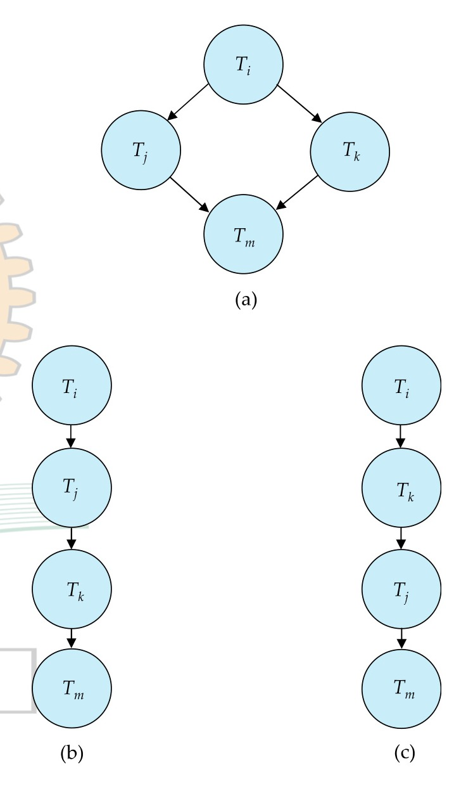

[← Previous: T10.2: Conflict Equivalence by Swapping Non-Conflicting Instructions](T10.02_Conflict_Equivalence_by_Swapping.md) | [🏠 Index](00_Index.md) | [Next: T10.3b: Precedence-Graph Drills I (2020 Q6a & 2021 Q7b) →](T10.03b_Precedence_Graph_Drills_I.md)

---

# T10.3a: Precedence-Graph Method and Cycle Detection

> **Topic:** T10 — Serializability | **Priority:** 🔴 | **Exam Frequency:** 5/7 finals (+ CT-04) (26 marks)  
> **Sources:** Silberschatz 7e Ch. 17 (§17.6) · Lecture Deck 07 (Slides 25–26) · Raidah Notes (p. 26)

## Why This Topic Matters

Testing whether a schedule is conflict serializable by manually swapping adjacent instructions is slow and error-prone once a schedule grows beyond a few steps. Precedence graphs turn that tedious swapping puzzle into a fast, visual graph test that appears in nearly every ECE 2215 semester final and class test. By drawing one node per transaction and adding directed arrows for conflicting operations, you can check conflict serializability simply by looking for a directed cycle. If the graph has no cycles, topological sorting immediately gives you every valid equivalent serial schedule.

---

## 📝 Key Definitions

> **Precedence Graph:** "Consider a schedule $S$. We construct a directed graph, called a **precedence graph**, from $S$. This graph consists of a pair $G = (V, E)$, where $V$ is a set of vertices and $E$ is a set of edges. The set of vertices consists of all the transactions participating in the schedule. The set of edges consists of all edges $T_i \rightarrow T_j$ for which one of three conditions holds:
> 1. $T_i$ executes $\text{write}(Q)$ before $T_j$ executes $\text{read}(Q)$.
> 2. $T_i$ executes $\text{read}(Q)$ before $T_j$ executes $\text{write}(Q)$.
> 3. $T_i$ executes $\text{write}(Q)$ before $T_j$ executes $\text{write}(Q)$."
> — Silberschatz, Korth & Sudarshan, *Database System Concepts* (7th Ed.), §17.6 (p. 816)

> **Conflict Serializability Test:** "If the precedence graph for $S$ has a cycle, then schedule $S$ is not conflict serializable. If the graph contains no cycles, then the schedule $S$ is conflict serializable."
> — Silberschatz, Korth & Sudarshan, *Database System Concepts* (7th Ed.), §17.6 (p. 817)

> **Topological Sorting:** "A **serializability order** of the transactions can be obtained by finding a linear order consistent with the partial order of the precedence graph. This process is called **topological sorting**. There are, in general, several possible linear orders that can be obtained through a topological sort."
> — Silberschatz, Korth & Sudarshan, *Database System Concepts* (7th Ed.), §17.6 (p. 817)

---

## Core Mechanics of Precedence Graphs

### Intuition: What Does an Arrow $T_i \to T_j$ Actually Mean?

Before looking at formal notation, think of a precedence graph as a ** scoreboard of irreversible steps**. Whenever transaction $T_i$ and transaction $T_j$ touch the same data item $Q$ and at least one of them writes to $Q$, whoever went first locked in their place in line. Drawing a directed arrow $T_i \to T_j$ simply means: *"$T_i$ acted on a shared item before $T_j$ in a way that cannot be swapped, so in any equivalent serial schedule, $T_i$ must run before $T_j$."*

A precedence graph (also called a serialization graph) is a directed graph $G = (V, E)$ built directly from an interleaved transaction schedule.

### Mathematical Formulation

The graph consists of two sets:

1. **Vertex Set ($V$):** Each vertex represents an active transaction in the schedule:

$$
V = \{T_1, T_2, \dots, T_n\}
$$

2. **Edge Set ($E$):** A directed edge $T_i \to T_j$ is added if and only if an operation of $T_i$ runs before and conflicts with an operation of $T_j$ on some shared data item $Q$ (where $i \neq j$).

### The Three Conflict Edge Conditions

We draw a directed edge $T_i \to T_j$ whenever $T_i$ acts on data item $Q$ before $T_j$ and their operations match any of these three conflict patterns:

| Condition Name | Step-by-Step Operation Order | Why They Conflict | Precedence Edge |
| :--- | :--- | :--- | :---: |
| **Read-Write Conflict ($R \to W$)** | $T_i$ executes $\text{read}(Q)$ before $T_j$ executes $\text{write}(Q)$ | $T_i$ reads the old value before $T_j$ overwrites it | $T_i \longrightarrow T_j$ |
| **Write-Read Conflict ($W \to R$)** | $T_i$ executes $\text{write}(Q)$ before $T_j$ executes $\text{read}(Q)$ | $T_j$ reads the updated value produced by $T_i$ | $T_i \longrightarrow T_j$ |
| **Write-Write Conflict ($W \to W$)** | $T_i$ executes $\text{write}(Q)$ before $T_j$ executes $\text{write}(Q)$ | $T_j$ overwrites the value written by $T_i$ | $T_i \longrightarrow T_j$ |

### Operations That Never Create Graph Edges

To avoid drawing false edges on an exam, keep in mind three situations that never cause a conflict:
- **Read-Read pairs ($R \to R$):** Reading a value does not change the database state, so two transactions reading the same item $Q$ never conflict.
- **Different data items:** An operation on item $A$ has no effect on an operation on item $B$ ($A \neq B$).
- **Same-transaction operations:** Two instructions inside the same transaction $T_i$ simply follow $T_i$'s own program order and never create self-loops in the graph.

---

## Step-by-Step Graph Construction Algorithm

Use this four-step scanning procedure to build precedence graphs without missing edges under exam time pressure:

```text
Algorithm: Precedence Graph Construction
Input: Interleaved schedule S of transactions {T1, T2, ..., Tn}
Output: Precedence graph G = (V, E)

1. Filter operations:
   Discard local arithmetic statements (such as "A := A + 10").
   Keep only database storage operations: read(Q) and write(Q).

2. Number the sequence:
   Number the remaining database operations in top-to-bottom timeline order: 1, 2, ..., m.

3. Scan for conflicts:
   For step k from 1 to m - 1:
       Let Op_k be an operation executed by Ti on data item Q.
       For step p from k + 1 to m:
           Let Op_p be an operation executed by Tj on data item Q.
           If Ti != Tj and (Op_k is a write or Op_p is a write):
               Add directed edge Ti -> Tj to edge set E.

4. Deduplicate edges:
   Combine duplicate arrows between the same pair of nodes into a single directed edge.
```

---

## Cycle Detection and Serializability Verdict

Once you have built the directed graph $G = (V, E)$, checking conflict serializability comes down to looking for a directed cycle:

1. **How Cycle Detection Works:** In code, we can check for cycles using Depth-First Search (DFS) or Kahn's topological sort algorithm. For a graph with $n$ transaction nodes and $e$ edges, cycle detection takes $\mathcal{O}(n + e)$ time, which is at most $\mathcal{O}(n^2)$ time.
2. **Reading the Verdict:**
   - **If $G$ has a directed cycle:** The schedule is **NOT conflict serializable**. For instance, a cycle $T_1 \to T_2 \to T_1$ claims that $T_1$ must run completely before $T_2$ and $T_2$ must also run completely before $T_1$, which is impossible in any serial schedule.
   - **If $G$ has no cycles (it is a Directed Acyclic Graph, or DAG):** The schedule is **conflict serializable**, and the arrows define a valid partial ordering of the transactions.

---

## Topological Sorting and Serial Schedule Generation

When a precedence graph has no cycles, we find its equivalent serial schedules using **topological sorting**. Think of topological sorting as lining up transactions so that every arrow in the graph points strictly from left to right.

### The In-Degree Method (Raidah Class Notes)

The **in-degree** of a vertex is the number of arrows pointing *into* that vertex:
- **$\text{in-degree}(T_k) = 0$:** No other transaction has to finish before $T_k$, so $T_k$ is free to run first.
- **Step-by-Step Sorting Process:**
  1. Count the in-degree of every transaction vertex in the graph.
  2. Pick any vertex whose in-degree is $0$ and write it next in your serial schedule.
  3. Erase that vertex and all of its outgoing arrows from the graph.
  4. Update the in-degrees of the remaining vertices.
  5. Repeat steps 2 through 4 until every transaction has been placed in the schedule.

If two or more vertices have an in-degree of $0$ at the same time, you can pick any of them next. Branching into each choice gives you all possible equivalent serial schedules.


*Figure 1: Precedence graph DAG (a) with two valid topological sort orders (b) and (c) (Source: Lecture Deck 07, Slide 26).*

In Figure 1, graph (a) has edges $T_i \to T_j$, $T_i \to T_k$, $T_j \to T_m$, and $T_k \to T_m$. Once $T_i$ finishes, both $T_j$ and $T_k$ have in-degree $0$, so they can run in either order before $T_m$. This produces two valid serial schedules:

$$
\langle T_i, T_j, T_k, T_m \rangle \quad \text{and} \quad \langle T_i, T_k, T_j, T_m \rangle
$$

---

## Worked Example: Step-by-Step Execution Trace

Consider three transactions $T_1, T_2, T_3$ executing the following schedule:

| Step | Transaction | Operation |
| :---: | :---: | :--- |
| 1 | $T_1$ | $\text{read}(A)$ |
| 2 | $T_2$ | $\text{read}(B)$ |
| 3 | $T_1$ | $\text{write}(A)$ |
| 4 | $T_3$ | $\text{read}(A)$ |
| 5 | $T_2$ | $\text{write}(B)$ |
| 6 | $T_3$ | $\text{write}(A)$ |

### 1. Conflict Scanning

- **Data item $A$:**
  - Step 1 ($T_1: \text{read}(A)$) precedes Step 6 ($T_3: \text{write}(A)$) $\implies T_1 \to T_3$.
  - Step 3 ($T_1: \text{write}(A)$) precedes Step 4 ($T_3: \text{read}(A)$) $\implies T_1 \to T_3$.
  - Step 3 ($T_1: \text{write}(A)$) precedes Step 6 ($T_3: \text{write}(A)$) $\implies T_1 \to T_3$.
- **Data item $B$:**
  - Step 2 and Step 5 belong to the same transaction $T_2$, so they create no edges.
  - No other transaction touches $B$.

### 2. Resulting Graph and Topological Sort

- Vertices: $\{T_1, T_2, T_3\}$
- Edges: $\{T_1 \to T_3\}$
- Cycle Check: The graph contains no cycles. The schedule is conflict serializable.
- Topological Sort:
  - In-degrees: $\text{in-degree}(T_1) = 0$, $\text{in-degree}(T_2) = 0$, $\text{in-degree}(T_3) = 1$.
  - We can start with either $T_1$ or $T_2$.
  - Valid serial orders:
    1. $\langle T_1, T_3, T_2 \rangle$
    2. $\langle T_1, T_2, T_3 \rangle$
    3. $\langle T_2, T_1, T_3 \rangle$

---

## Exam Variants

The precedence-graph questions in ECE 2215 semester finals test specific structural patterns:

| Year & Question | Marks | Scenario / Data Given | Key Result / Answer Summary |
| :--- | :---: | :--- | :--- |
| **2018 Q.6(c)** | 4 | Two transactions ($T_1, T_2$), items $A$ and $B$, tabular schedule with local arithmetic | Cycle between $T_1$ and $T_2$ on both items $A$ and $B$. Not conflict serializable. |
| **2024 Q.8(c)** | 4 | Identical schedule to 2018 Q.6(c) presented in compressed column blocks | Exact repeat of 2018 Q.6(c). Conflicting 2-cycle $T_1 \leftrightarrow T_2$. Not conflict serializable. |
| **CT-04 Q.04** | 6 | Three transactions ($T_1, T_2, T_3$), items $A$ and $B$, multiple interleaved writes on $B$ | Direct 2-cycle between $T_1$ and $T_3$ on item $B$. Not conflict serializable. |

---

## 🏆 Golden Questions (Past Exam Archive)

### 🎯 GQ1 · 2018 Q.6(c) = 2024 Q.8(c) · Cycle Between Two Transactions on Items A and B

> **Appeared:** 2018 Q.6(c) (4 marks), repeated verbatim in 2024 Q.8(c) (4 marks)

**Question (2018 Q.6(c)):**

Consider the following schedule.

<table border="1" cellpadding="4" style="border-collapse: collapse; margin-top: 6px; margin-bottom: 6px;"><thead><tr><th style="padding: 4px 20px; text-align: center;">T<sub>1</sub></th><th style="padding: 4px 20px; text-align: center;">T<sub>2</sub></th></tr></thead><tbody><tr><td style="padding: 3px 12px;">read(A);</td><td></td></tr><tr><td style="padding: 3px 12px;">A:=A+10;</td><td></td></tr><tr><td></td><td style="padding: 3px 12px;">read(A);</td></tr><tr><td></td><td style="padding: 3px 12px;">A:=A-100;</td></tr><tr><td></td><td style="padding: 3px 12px;">write(A);</td></tr><tr><td></td><td style="padding: 3px 12px;">read(B);</td></tr><tr><td style="padding: 3px 12px;">write(A);</td><td></td></tr><tr><td style="padding: 3px 12px;">read(B);</td><td></td></tr><tr><td style="padding: 3px 12px;">B:=B-10;</td><td></td></tr><tr><td style="padding: 3px 12px;">write(B)</td><td></td></tr><tr><td></td><td style="padding: 3px 12px;">B:=B+100;</td></tr><tr><td></td><td style="padding: 3px 12px;">write(B);</td></tr></tbody></table>  
Determine whether the schedule is conflict serializable or not?

*(Note: In 2024 Q.8(c), RUET reprinted this exact schedule with identical operations formatted in vertical blocks).*

**Full Answer:**

#### 1. Step-by-Step Timeline of Operations

We ignore the local arithmetic statements (`A:=A+10`, `A:=A-100`, `B:=B-10`, `B:=B+100`) because they only modify CPU registers or local memory, and list the database `read` and `write` instructions in timeline order:

1. Step 1: $T_1: \text{read}(A)$
2. Step 2: $T_2: \text{read}(A)$
3. Step 3: $T_2: \text{write}(A)$
4. Step 4: $T_2: \text{read}(B)$
5. Step 5: $T_1: \text{write}(A)$
6. Step 6: $T_1: \text{read}(B)$
7. Step 7: $T_1: \text{write}(B)$
8. Step 8: $T_2: \text{write}(B)$

#### 2. Finding the Conflicting Pairs

Next, we find every pair of operations on the same data item from different transactions where at least one operation is a write:

- **Conflicts on Data Item $A$:**
  - Step 1 ($T_1: \text{read}(A)$) runs before Step 3 ($T_2: \text{write}(A)$) $\implies$ edge $T_1 \to T_2$.
  - Step 2 ($T_2: \text{read}(A)$) runs before Step 5 ($T_1: \text{write}(A)$) $\implies$ edge $T_2 \to T_1$.
  - Step 3 ($T_2: \text{write}(A)$) runs before Step 5 ($T_1: \text{write}(A)$) $\implies$ edge $T_2 \to T_1$.
- **Conflicts on Data Item $B$:**
  - Step 4 ($T_2: \text{read}(B)$) runs before Step 7 ($T_1: \text{write}(B)$) $\implies$ edge $T_2 \to T_1$.
  - Step 6 ($T_1: \text{read}(B)$) runs before Step 8 ($T_2: \text{write}(B)$) $\implies$ edge $T_1 \to T_2$.
  - Step 7 ($T_1: \text{write}(B)$) runs before Step 8 ($T_2: \text{write}(B)$) $\implies$ edge $T_1 \to T_2$.

#### 3. Precedence Graph Construction


*Figure 2: Precedence graph for 2018 Q.6(c) showing conflicting cycle between T1 and T2.*


*Figure 3: Precedence graph for 2024 Q.8(c) confirming identical cycle between T1 and T2.*

The precedence graph consists of:
- Vertices: $V = \{T_1, T_2\}$
- Directed edges: $E = \{T_1 \to T_2, T_2 \to T_1\}$

These two opposing arrows form a directed cycle:

$$
T_1 \longleftrightarrow T_2
$$

#### 4. Verdict for 2018 Q.6(c) and 2024 Q.8(c)

Because the precedence graph contains a directed cycle ($T_1 \to T_2 \to T_1$), the schedule is **NOT conflict serializable**, and no equivalent serial execution order exists.

---

### 🎯 GQ2 · CT-04 Q.04 · Interleaved Writes on Item B Across Three Transactions

> **Appeared:** CT-04 Q.04 — (6 marks)

**Question:**

Determine whether the schedule is conflict serializable or not. If it is serializable, give the equivalent serial order.

<table border="1" style="border-collapse: collapse; text-align: center; margin-top: 6px; margin-bottom: 6px;"><thead><tr><th style="padding: 4px 16px;">$T_1$</th><th style="padding: 4px 16px;">$T_2$</th><th style="padding: 4px 16px;">$T_3$</th></tr></thead><tbody><tr><td style="padding: 3px 12px;">$\text{Write}(A)$</td><td></td><td></td></tr><tr><td></td><td style="padding: 3px 12px;">$\text{Read}(A)$</td><td></td></tr><tr><td></td><td></td><td style="padding: 3px 12px;">$\text{Write}(B)$</td></tr><tr><td style="padding: 3px 12px;">$\text{Write}(B)$</td><td></td><td></td></tr><tr><td></td><td></td><td style="padding: 3px 12px;">$\text{Write}(B)$</td></tr><tr><td></td><td style="padding: 3px 12px;">$\text{Write}(A)$</td><td></td></tr><tr><td></td><td></td><td style="padding: 3px 12px;">$\text{Read}(B)$</td></tr><tr><td></td><td style="padding: 3px 12px;">$\text{Read}(B)$</td><td></td></tr></tbody></table>

**Full Answer:**

#### 1. Step-by-Step Timeline for CT-04 Q.04

We number the 8 instructions from top to bottom in the order they run:

- Step 1: $T_1: \text{Write}(A)$
- Step 2: $T_2: \text{Read}(A)$
- Step 3: $T_3: \text{Write}(B)$
- Step 4: $T_1: \text{Write}(B)$
- Step 5: $T_3: \text{Write}(B)$
- Step 6: $T_2: \text{Write}(A)$
- Step 7: $T_3: \text{Read}(B)$
- Step 8: $T_2: \text{Read}(B)$

#### 2. Conflict Analysis by Data Item

- **Conflicts on data item $A$:**
  - Step 1 ($T_1: \text{Write}(A)$) runs before Step 2 ($T_2: \text{Read}(A)$) $\implies T_1 \to T_2$.
  - Step 1 ($T_1: \text{Write}(A)$) runs before Step 6 ($T_2: \text{Write}(A)$) $\implies T_1 \to T_2$.
  - Notice that Step 2 and Step 6 both belong to $T_2$, so they do not create an edge.
- **Conflicts on data item $B$:**
  - Step 3 ($T_3: \text{Write}(B)$) runs before Step 4 ($T_1: \text{Write}(B)$) $\implies T_3 \to T_1$.
  - Step 3 ($T_3: \text{Write}(B)$) runs before Step 8 ($T_2: \text{Read}(B)$) $\implies T_3 \to T_2$.
  - Step 4 ($T_1: \text{Write}(B)$) runs before Step 5 ($T_3: \text{Write}(B)$) $\implies T_1 \to T_3$.
  - Step 4 ($T_1: \text{Write}(B)$) runs before Step 7 ($T_3: \text{Read}(B)$) $\implies T_1 \to T_3$.
  - Step 4 ($T_1: \text{Write}(B)$) runs before Step 8 ($T_2: \text{Read}(B)$) $\implies T_1 \to T_2$.
  - Step 5 ($T_3: \text{Write}(B)$) runs before Step 8 ($T_2: \text{Read}(B)$) $\implies T_3 \to T_2$.

#### 3. Precedence Graph and Cycle Detection


*Figure 4: Precedence graph for CT-04 Q.04 showing cycle between T1 and T3.*

The graph consists of:
- Vertices: $V = \{T_1, T_2, T_3\}$
- Directed edges:
  - $T_1 \to T_2$ (from conflicts on $A$ and $B$)
  - $T_3 \to T_2$ (from conflicts on $B$)
  - $T_3 \to T_1$ (from Step 3 $\text{Write}(B)$ before Step 4 $\text{Write}(B)$)
  - $T_1 \to T_3$ (from Step 4 $\text{Write}(B)$ before Step 5 $\text{Write}(B)$ and Step 7 $\text{Read}(B)$)

Between $T_1$ and $T_3$, the two opposing edges form a direct cycle:

$$
T_1 \longleftrightarrow T_3
$$

#### 4. Verdict for CT-04 Q.04

Because the precedence graph contains a directed cycle ($T_1 \leftrightarrow T_3$), the schedule is **NOT conflict serializable**, so **no equivalent serial order exists**.

---

## ⚡ Exam Tips & Common Mistakes

1. **Ignore local variable math:** Statements like `A := A + 10` only update local CPU registers rather than database disk/buffer pages. Only compare $\text{read}(Q)$ and $\text{write}(Q)$ instructions when building your graph.
2. **Never draw edges between steps of the same transaction:** If $T_2$ reads $A$ and later $T_2$ writes $A$, that is just $T_2$'s internal program order and never adds an arrow to the precedence graph.
3. **Check every data item completely:** Even if you already found a cycle on data item $A$, still list the conflicts on item $B$. Showing all conflicting pairs across every data item guarantees full marks on RUET grading rubrics.
4. **Explicitly write that no serial order exists when a cycle appears:** If the prompt asks for an equivalent serial order and you find a cycle, state clearly that no equivalent serial schedule exists rather than guessing an order.

---

## 🔗 Related Topics

- [T10.2: Conflict Equivalence by Swapping Non-Conflicting Instructions](T10.02_Conflict_Equivalence_by_Swapping.md): Manual instruction swapping proof for conflict equivalence.
- [T10.3b: Precedence-Graph Drills I (2020 Q6a & 2021 Q7b)](T10.03b_Precedence_Graph_Drills_I.md): Single-item schedules and linear acyclic precedence graphs.
- [T10.3c: Precedence-Graph Drills II (2021 Q7c & 2023 Q8b)](T10.03c_Precedence_Graph_Drills_II.md): 4-transaction DAG analysis and exhaustive topological sorting.
- [T10.4: Building Serializable and Non-Serializable Schedules](T10.04_Building_Serializable_Schedules.md): Constructing concurrent schedules under consistency constraints.
- [T10.5: View Serializability and Blind Writes](T10.05_View_Serializability.md): Testing view equivalence when conflict serializability fails.

---

[← Previous: T10.2: Conflict Equivalence by Swapping Non-Conflicting Instructions](T10.02_Conflict_Equivalence_by_Swapping.md) | [🏠 Index](00_Index.md) | [Next: T10.3b: Precedence-Graph Drills I (2020 Q6a & 2021 Q7b) →](T10.03b_Precedence_Graph_Drills_I.md)
