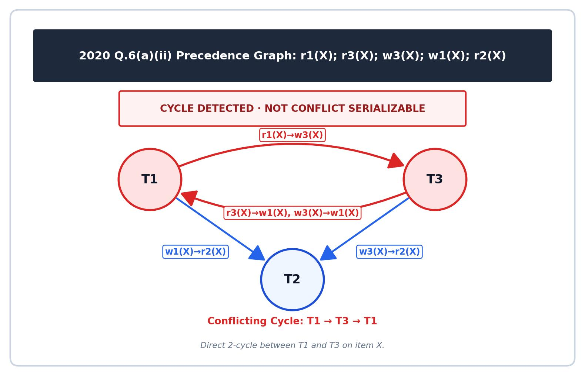

[← Previous: T10.3a: Precedence-Graph Method and Cycle Detection](T10.03a_Precedence_Graph_Method.md) | [🏠 Index](00_Index.md) | [Next: T10.3c: Precedence-Graph Drills II (2021 Q7c & 2023 Q8b) →](T10.03c_Precedence_Graph_Drills_II.md)

---

# T10.3b: Precedence-Graph Drills I (2020 Q6a & 2021 Q7b)

> **Topic:** T10 — Serializability | **Priority:** 🔴 | **Exam Frequency:** 5/7 finals (+ CT-04) (26 marks)  
> **Sources:** Silberschatz 7e Ch. 17 (§17.6) · Lecture Deck 07 (Slides 25–26) · Raidah Notes (p. 26)

## Why This Topic Matters

Instead of always printing multi-column tables, RUET exams often write schedules as a single compact line of subscripted symbols or interleave operations that all point in the same direction. For example, 2020 Q.6(a) gave two short three-transaction schedules on a single data item $X$ where both options hid cycles that many students missed. Then in 2021 Q.7(b), the exam combined a definition question with an interleaved two-item schedule whose conflicts all flow from $T_1$ to $T_2$. Working through both patterns will help you read subscript schedules quickly and avoid the trap of assuming at least one option on the paper must be serializable.

---

## 📝 Key Definitions

> **Conflict Serializability:** A concurrent schedule $S$ is conflict serializable if it is conflict equivalent to a serial schedule. You can transform $S$ into that serial schedule by swapping adjacent non-conflicting instructions, which holds if and only if the precedence graph of $S$ has no directed cycles.

> **Precedence Graph:** A precedence graph for a schedule $S$ is a directed graph $G = (V, E)$ where each vertex in $V$ is a transaction and each directed edge $T_i \to T_j$ in $E$ shows that $T_i$ must precede $T_j$ in any equivalent serial schedule. We draw $T_i \to T_j$ ($i \neq j$) whenever one of three conflicts occurs on a shared data item $Q$:
> 1. $T_i$ executes $\text{write}(Q)$ before $T_j$ executes $\text{read}(Q)$.
> 2. $T_i$ executes $\text{read}(Q)$ before $T_j$ executes $\text{write}(Q)$.
> 3. $T_i$ executes $\text{write}(Q)$ before $T_j$ executes $\text{write}(Q)$.

> **In-Degree Zero Property:** The in-degree of a transaction vertex is the number of incoming edges pointing to it in the precedence graph. A vertex with in-degree $0$ has no prior conflicting transactions waiting ahead of it, so it can execute first in an equivalent serial schedule.

---

## Reading Compact Subscript Notation

In many exam problems, a schedule is written as a single horizontal string instead of a multi-column table:

$$
S = r_1(X);\, r_3(X);\, w_1(X);\, r_2(X);\, w_3(X)
$$

### How to Read the Symbols

Think of each term as a compact `action_transaction(item)` tag read from left to right:
- $r_i(X)$ means transaction $T_i$ runs $\text{read}(X)$.
- $w_i(X)$ means transaction $T_i$ runs $\text{write}(X)$.
- The separators mark the exact timeline order from step 1 on the left to the final step on the right.

### Turning a Compact String into a Step-by-Step Timeline

To avoid skipping pairs when scanning a horizontal string, rewrite the sequence as a numbered list first:

| Step Index | Expression | Transaction | Action | Target Item |
| :---: | :---: | :---: | :---: | :---: |
| 1 | $r_1(X)$ | $T_1$ | Read | $X$ |
| 2 | $r_3(X)$ | $T_3$ | Read | $X$ |
| 3 | $w_1(X)$ | $T_1$ | Write | $X$ |
| 4 | $r_2(X)$ | $T_2$ | Read | $X$ |
| 5 | $w_3(X)$ | $T_3$ | Write | $X$ |

---

## Single-Item Schedules and Hidden Cycles

When every transaction in a schedule accesses the exact same data item $X$, conflicts pile up quickly:

1. **Every Write Conflicts with Almost Everything Else:** Because all operations target the same item $X$, any write operation $w_i(X)$ conflicts with every earlier and later operation from any other transaction $T_j$ ($j \neq i$). Only two reads ($r_i(X)$ and $r_j(X)$) pass each other peacefully.
2. **The Mutual Read-Before-Write Trap:** Suppose $T_1$ reads $X$ before $T_3$ writes $X$, which forces the arrow $T_1 \to T_3$. If $T_3$ also reads $X$ before $T_1$ writes $X$, that adds the reverse arrow $T_3 \to T_1$. Whenever two transactions both read an item before the other writes it, they immediately lock into a two-node cycle:

$$
T_1 \longleftrightarrow T_3
$$

3. **The "Neither Option Is Serializable" Exam Trap:** Examiners often ask, *"Which of the following schedule is (conflict) serializable?"* Under exam pressure, it is tempting to assume that at least one of the given schedules must be serializable. In 2020 Q.6(a), however, **both** schedules contain cycles and neither is conflict serializable. Always trust your precedence graph.

---

## Unidirectional Dependency Schedules

Interleaving two transactions does not automatically create a cycle. As long as every conflict between two transactions points in the **same direction**, the schedule remains conflict serializable.

### Interleaving Without Reversing the Arrow

Suppose $T_1$ and $T_2$ both work on data items $A$ and $B$:
- $T_1$ finishes reading and writing $A$ before $T_2$ touches $A$, which gives the arrow $T_1 \to T_2$.
- Later, $T_1$ also finishes reading and writing $B$ before $T_2$ touches $B$, which again gives the arrow $T_1 \to T_2$.

Even though the operations on $A$ and $B$ are interleaved over time, every single conflict points from $T_1$ to $T_2$. Because no operation in $T_2$ ever runs before a conflicting operation in $T_1$, the precedence graph has only the single edge $T_1 \to T_2$. That makes the graph acyclic and gives the unique equivalent serial order:

$$
\boxed{\langle T_1, T_2 \rangle}
$$

---

## Worked Example: Detecting Mutual Single-Item Cycles

Consider the schedule:
$$
S_E = r_1(A);\, w_2(A);\, r_2(B);\, w_1(B)
$$

1. **Step 1 ($r_1(A)$) vs Step 2 ($w_2(A)$):**
   - $T_1$ reads $A$ before $T_2$ writes $A$.
   - Conflict type: $R \to W$ on item $A$.
   - Graph edge: $T_1 \to T_2$.
2. **Step 3 ($r_2(B)$) vs Step 4 ($w_1(B)$):**
   - $T_2$ reads $B$ before $T_1$ writes $B$.
   - Conflict type: $R \to W$ on item $B$.
   - Graph edge: $T_2 \to T_1$.
3. **Cycle Verdict:**
   - The edge set is $\{T_1 \to T_2, T_2 \to T_1\}$.
   - Directed cycle detected: $T_1 \leftrightarrow T_2$.
   - $S_E$ is **not conflict serializable**.

---

## Exam Variants

| Year & Question | Marks | Scenario / Data Given | Key Result / Answer Summary |
| :--- | :---: | :--- | :--- |
| **2020 Q.6(a)(i)** | 3 | Single-item compact schedule: $r_1(X); r_3(X); w_1(X); r_2(X); w_3(X)$ | Cycle $T_1 \leftrightarrow T_3$ and 3-cycle $T_1 \to T_2 \to T_3 \to T_1$. Not conflict serializable. |
| **2020 Q.6(a)(ii)** | 3 | Single-item compact schedule: $r_1(X); r_3(X); w_3(X); w_1(X); r_2(X)$ | Cycle $T_1 \leftrightarrow T_3$. Not conflict serializable. Neither schedule is serializable. |
| **2021 Q.7(b)** | 4 | Define conflict serializability; analyze 8-step tabular schedule on $A$ and $B$ | Formal definition given; single edge $T_1 \to T_2$; conflict serializable; serial order $\langle T_1, T_2 \rangle$. |

---

## 🏆 Golden Questions (Past Exam Archive)

### 🎯 GQ1 · 2020 Q.6(a) · Single-Item Compact Schedules with Three Transactions

> **Appeared:** 2020 Q.6(a) — (6 marks)

**Question:**

Which of the following schedule is (conflict) serializable? For each serializable schedule, determine the equivalent serial schedules.  
(i) $r_1(X);\, r_3(X);\, w_1(X);\, r_2(X);\, w_3(X)$  
(ii) $r_1(X);\, r_3(X);\, w_3(X);\, w_1(X);\, r_2(X)$

**Full Answer:**

Both schedules operate on a single shared data item $X$ across transactions $T_1, T_2, T_3$. Any two operations from different transactions conflict if at least one operation is a write.

#### Part (i): Analysis of Schedule (i)

Schedule (i) has 5 operations in chronological sequence:
1. Step 1: $T_1: r(X)$
2. Step 2: $T_3: r(X)$
3. Step 3: $T_1: w(X)$
4. Step 4: $T_2: r(X)$
5. Step 5: $T_3: w(X)$

**Conflicting Pairs on Item $X$:**
1. Step 1 ($T_1: r(X)$) precedes Step 5 ($T_3: w(X)$) $\implies T_1 \to T_3$.
2. Step 2 ($T_3: r(X)$) precedes Step 3 ($T_1: w(X)$) $\implies T_3 \to T_1$.
3. Step 3 ($T_1: w(X)$) precedes Step 4 ($T_2: r(X)$) $\implies T_1 \to T_2$.
4. Step 3 ($T_1: w(X)$) precedes Step 5 ($T_3: w(X)$) $\implies T_1 \to T_3$.
5. Step 4 ($T_2: r(X)$) precedes Step 5 ($T_3: w(X)$) $\implies T_2 \to T_3$.

The directed edges in the precedence graph are:
$$
T_1 \longrightarrow T_3, \quad T_3 \longrightarrow T_1, \quad T_1 \longrightarrow T_2, \quad T_2 \longrightarrow T_3
$$

*Figure 1: Precedence graph for 2020 Q.6(a)(i) showing cycles T1-T3 and T1-T2-T3.*

**Cycle Detection for Schedule (i):**
- Direct 2-cycle between $T_1$ and $T_3$: $T_1 \to T_3 \to T_1$.
- 3-cycle through all three transactions: $T_1 \to T_2 \to T_3 \to T_1$.

**Verdict for (i):** Because the precedence graph contains directed cycles, Schedule (i) is **NOT conflict serializable**. No equivalent serial schedule exists.

---

#### Part (ii): Analysis of Schedule (ii)

Schedule (ii) has 5 operations in chronological sequence:
1. Step 1: $T_1: r(X)$
2. Step 2: $T_3: r(X)$
3. Step 3: $T_3: w(X)$
4. Step 4: $T_1: w(X)$
5. Step 5: $T_2: r(X)$

**Conflicting Pairs on Item $X$:**
1. Step 1 ($T_1: r(X)$) precedes Step 3 ($T_3: w(X)$) $\implies T_1 \to T_3$.
2. Step 2 ($T_3: r(X)$) precedes Step 4 ($T_1: w(X)$) $\implies T_3 \to T_1$.
3. Step 3 ($T_3: w(X)$) precedes Step 4 ($T_1: w(X)$) $\implies T_3 \to T_1$.
4. Step 3 ($T_3: w(X)$) precedes Step 5 ($T_2: r(X)$) $\implies T_3 \to T_2$.
5. Step 4 ($T_1: w(X)$) precedes Step 5 ($T_2: r(X)$) $\implies T_1 \to T_2$.

The directed edges in the precedence graph are:
$$
T_1 \longrightarrow T_3, \quad T_3 \longrightarrow T_1, \quad T_3 \longrightarrow T_2, \quad T_1 \longrightarrow T_2
$$

*Figure 2: Precedence graph for 2020 Q.6(a)(ii) showing cycle between T1 and T3.*

**Cycle Detection for Schedule (ii):**
- Direct 2-cycle between $T_1$ and $T_3$: $T_1 \leftrightarrow T_3$.

**Verdict for (ii):** Because the precedence graph contains a directed cycle, Schedule (ii) is **NOT conflict serializable**. No equivalent serial schedule exists.

**Conclusion for 2020 Q.6(a):** **Neither schedule is conflict serializable.**

---

### 🎯 GQ2 · 2021 Q.7(b) · Definition and Unidirectional Interleaved Schedule

> **Appeared:** 2021 Q.7(b) — (4 marks)

**Question:**

Define conflict serializability. Check whether the following schedule is a conflict serializable or not.

<table border="1" style="border-collapse: collapse; text-align: center;"><thead><tr><th style="padding: 4px 20px;">$T_1$</th><th style="padding: 4px 20px;">$T_2$</th></tr></thead><tbody><tr><td style="padding: 4px 20px;">read(A)</td><td style="padding: 4px 20px;"></td></tr><tr><td style="padding: 4px 20px;">write(A)</td><td style="padding: 4px 20px;"></td></tr><tr><td style="padding: 4px 20px;"></td><td style="padding: 4px 20px;">read(A)</td></tr><tr><td style="padding: 4px 20px;"></td><td style="padding: 4px 20px;">write(A)</td></tr><tr><td style="padding: 4px 20px;">read(B)</td><td style="padding: 4px 20px;"></td></tr><tr><td style="padding: 4px 20px;">write(B)</td><td style="padding: 4px 20px;"></td></tr><tr><td style="padding: 4px 20px;"></td><td style="padding: 4px 20px;">read(B)</td></tr><tr><td style="padding: 4px 20px;"></td><td style="padding: 4px 20px;">write(B)</td></tr></tbody></table>

*(Sorting Note: First sentence asks to define conflict serializability, cross-ref T10.1)*

**Full Answer:**

#### 1. Definition of Conflict Serializability

A schedule $S$ is **conflict serializable** if it is conflict equivalent to some serial schedule. Two schedules are conflict equivalent if one schedule can be transformed into the other schedule by a series of swaps of non-conflicting adjacent instructions.

#### 2. Detailed Conflict Trace for 2021 Q.7(b)

We trace the 8 operations in chronological order:
- Operations on Item $A$:
  1. Step 1: $T_1: \text{read}(A)$
  2. Step 2: $T_1: \text{write}(A)$
  3. Step 3: $T_2: \text{read}(A)$
  4. Step 4: $T_2: \text{write}(A)$
- Operations on Item $B$:
  5. Step 5: $T_1: \text{read}(B)$
  6. Step 6: $T_1: \text{write}(B)$
  7. Step 7: $T_2: \text{read}(B)$
  8. Step 8: $T_2: \text{write}(B)$

**Conflicting Pairs:**
- **On data item $A$:**
  - Step 1 ($T_1: \text{read}(A)$) precedes Step 4 ($T_2: \text{write}(A)$) $\implies T_1 \to T_2$.
  - Step 2 ($T_1: \text{write}(A)$) precedes Step 3 ($T_2: \text{read}(A)$) $\implies T_1 \to T_2$.
  - Step 2 ($T_1: \text{write}(A)$) precedes Step 4 ($T_2: \text{write}(A)$) $\implies T_1 \to T_2$.
- **On data item $B$:**
  - Step 5 ($T_1: \text{read}(B)$) precedes Step 8 ($T_2: \text{write}(B)$) $\implies T_1 \to T_2$.
  - Step 6 ($T_1: \text{write}(B)$) precedes Step 7 ($T_2: \text{read}(B)$) $\implies T_1 \to T_2$.
  - Step 6 ($T_1: \text{write}(B)$) precedes Step 8 ($T_2: \text{write}(B)$) $\implies T_1 \to T_2$.

Every single conflicting pair directs from $T_1$ to $T_2$. No operation in $T_2$ precedes any conflicting operation in $T_1$.

#### 3. Precedence Graph and Result for 2021 Q.7(b)

*Figure 3: Precedence graph for 2021 Q.7(b) showing single edge T1 to T2.*

The graph consists of:
- Vertices: $V = \{T_1, T_2\}$
- Directed edge: $E = \{T_1 \to T_2\}$

Because the graph has no cycles, it is a directed acyclic graph (DAG).

**Result:** The schedule is **conflict serializable**, and its unique equivalent serial execution order is:

$$
\boxed{\langle T_1, T_2 \rangle}
$$

---

## ⚡ Exam Tips & Common Mistakes

1. **Do not assume one of the choices has to be serializable:** In 2020 Q.6(a), RUET asked *"Which of the following schedule is (conflict) serializable?"*, and both schedules turned out to have cycles. Concluding that neither schedule is conflict serializable is completely correct.
2. **Never skip the opening definition:** In 2021 Q.7(b), the prompt starts with *"Define conflict serializability."* Jumping straight to the table trace without writing the 2-sentence definition costs 1 full mark.
3. **Box the final serial order:** Whenever a schedule is serializable, write out and box the final transaction sequence clearly as $\boxed{\langle T_1, T_2 \rangle}$.
4. **Check every write against all earlier operations:** When scanning a single-line schedule like $r_1(X); r_3(X); w_1(X); r_2(X); w_3(X)$, look at each write ($w_1(X)$ and $w_3(X)$) and pair it with every earlier and later operation from other transactions so you do not miss 3-node cycles like $T_1 \to T_2 \to T_3 \to T_1$.

---

## 🔗 Related Topics

- [T10.1: Conflicting Instructions and Conflict Serializability](T10.01_Conflicting_Instructions.md): Fundamental conflict definitions and the four operation pairs.
- [T10.3a: Precedence-Graph Method and Cycle Detection](T10.03a_Precedence_Graph_Method.md): General algorithm, formal definitions, and cycle detection rules.
- [T10.3c: Precedence-Graph Drills II (2021 Q7c & 2023 Q8b)](T10.03c_Precedence_Graph_Drills_II.md): 4-transaction DAG analysis and multiple topological sort orders.
- [T10.4: Building Serializable and Non-Serializable Schedules](T10.04_Building_Serializable_Schedules.md): Designing schedules satisfying consistency constraints.
- [T10.5: View Serializability and Blind Writes](T10.05_View_Serializability.md): Schedules that are view serializable despite precedence-graph cycles.

---

[← Previous: T10.3a: Precedence-Graph Method and Cycle Detection](T10.03a_Precedence_Graph_Method.md) | [🏠 Index](00_Index.md) | [Next: T10.3c: Precedence-Graph Drills II (2021 Q7c & 2023 Q8b) →](T10.03c_Precedence_Graph_Drills_II.md)
