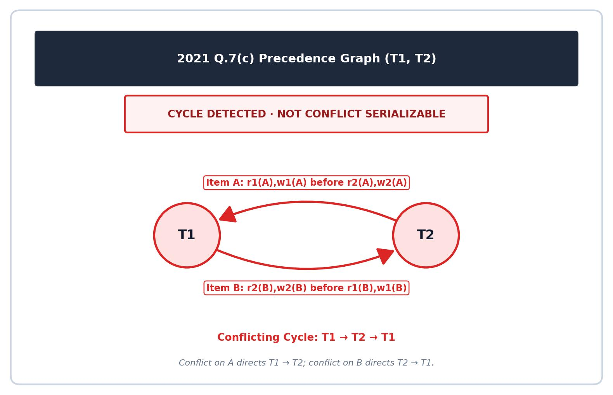

[← Previous: T10.3b: Precedence-Graph Drills I (2020 Q6a & 2021 Q7b)](T10.03b_Precedence_Graph_Drills_I.md) | [🏠 Index](00_Index.md) | [Next: T10.4: Building Serializable and Non-Serializable Schedules →](T10.04_Building_Serializable_Schedules.md)

---

# T10.3c: Precedence-Graph Drills II (2021 Q7c & 2023 Q8b)

> **Topic:** T10 — Serializability | **Priority:** 🔴 | **Exam Frequency:** 5/7 finals (+ CT-04) (26 marks)  
> **Sources:** Silberschatz 7e Ch. 17 (§17.6) · Lecture Deck 07 (Slides 25–26) · Raidah Notes (pp. 26–27)

## Why This Topic Matters

Once you are comfortable with basic precedence graphs, RUET exams push the concept in two harder directions: **cross-item cycles** and **four-transaction graphs with multiple serial orders**. In 2021 Q.7(c), two transactions take turns neatly on $A$ and $B$ without ever overlapping on the same item at the same moment, yet their opposite orderings on $A$ and $B$ lock them into a cycle. Then in 2023 Q.8(b), the exam introduced a four-transaction schedule and asked for *all* possible serialized schedules. Mastering how to list every valid topological sort from a branching graph is key to earning full marks on these questions.

---

## 📝 Key Definitions

> **Topological Sorting:** Topological sorting finds a linear ordering of all transactions in an acyclic precedence graph so that if edge $T_i \to T_j$ exists, $T_i$ appears before $T_j$ in the line. When multiple vertices have in-degree $0$ at the same step, branching into each choice produces all possible equivalent serial schedules.

> **Precedence Graph:** A precedence graph for a schedule $S$ is a directed graph $G = (V, E)$ whose vertices $V$ are the transactions in $S$. We add a directed edge $T_i \to T_j$ ($i \neq j$) to $E$ whenever $T_i$ and $T_j$ access the same item $Q$ in one of three conflicting orders:
> 1. $T_i$ executes $\text{write}(Q)$ before $T_j$ executes $\text{read}(Q)$.
> 2. $T_i$ executes $\text{read}(Q)$ before $T_j$ executes $\text{write}(Q)$.
> 3. $T_i$ executes $\text{write}(Q)$ before $T_j$ executes $\text{write}(Q)$.

> **Partial Order and Linear Extension:** A directed acyclic precedence graph defines a partial order among transactions because some pairs of transactions have no directed path between them. A linear extension is a complete one-by-one ordering of all transactions that obeys every directed edge in the partial order, yielding a valid equivalent serial schedule.

---

## Cross-Item Dependency Cycles

A classic exam trap is a schedule that looks tidy on each individual data item but reverses the transaction order between two different items. Even if $T_1$ and $T_2$ never interleave in the middle of updating a single item, conflicting orders across two items $A$ and $B$ still create a cycle.

### Why Alternating Across Items $A$ and $B$ Breaks Serializability

Suppose $T_1$ reads and writes item $A$ before $T_2$ touches $A$, while $T_2$ reads and writes item $B$ before $T_1$ touches $B$:

1. **Conflict on Item $A$:** Because $T_1$ updates $A$ before $T_2$ reads and writes $A$, $T_1$ must come before $T_2$ ($T_1 \to T_2$).
2. **Conflict on Item $B$:** Because $T_2$ updates $B$ before $T_1$ reads and writes $B$, $T_2$ must come before $T_1$ ($T_2 \to T_1$).
3. **Why No Serial Order Can Work:**
   - If we try the serial schedule $\langle T_1, T_2 \rangle$, $T_1$ has to run all of its instructions (including on $B$) before $T_2$ starts, which breaks the order on item $B$.
   - If we try the serial schedule $\langle T_2, T_1 \rangle$, $T_2$ has to run all of its instructions (including on $A$) before $T_1$ starts, which breaks the order on item $A$.
   - Because neither serial order works, the schedule is not conflict serializable.

---

## Multi-Transaction DAGs and Partial Orders

### Intuition: Prerequisite Charts and Free-Floating Nodes

Think of an acyclic precedence graph like a university course prerequisite chart. Some courses form a strict chain (Course 1 $\to$ Course 3 $\to$ Course 2) that you must take in exact sequence. Meanwhile, an elective like Course 4 might only have one rule: you must take it *before* Course 2 ($T_4 \to T_2$), with no connection to Course 1 or Course 3. That single rule lets you slot $T_4$ into three different places in your schedule: before $T_1$, between $T_1$ and $T_3$, or between $T_3$ and $T_2$.

In formal terms:
- A directed edge $T_i \to T_j$ means $T_i$ must appear somewhere to the left of $T_j$ in the final serial schedule ($T_i < T_j$).
- Chains of arrows lock in transitive orderings automatically: if $T_1 \to T_3$ and $T_3 \to T_2$, then $T_1 < T_3 < T_2$ is fixed in every valid serial schedule.
- If two vertices $T_a$ and $T_b$ have no directed path between them in either direction, they can appear in either relative order ($T_a$ before $T_b$, or $T_b$ before $T_a$) as long as all of their own incoming and outgoing arrows are respected.

---

## Exhaustive Topological Sorting Algorithm

When an exam question asks to *"determine all the possible serialized schedules"*, follow this systematic procedure:

```text
Algorithm: Finding All Equivalent Serial Schedules
Input: Acyclic Precedence Graph G = (V, E)
Output: Set of all valid linear serial schedules

1. Identify the Rigid Backbone:
   Find the longest directed path or chain in the graph.
   Example: T1 -> T3 -> T2 establishes the fixed relative order (T1 < T3 < T2).

2. Identify Unconstrained or Partially Constrained Vertices:
   Identify vertices outside the main chain and list their exact incoming/outgoing edges.
   Example: T4 has edge T4 -> T2, but no edge with T1 or T3.
   Constraint: T4 must appear before T2.

3. Interleave Permutations:
   Place the partially constrained vertex into every slot that respects its constraints:
   - Slot 1: Before T1  --> <T4, T1, T3, T2>
   - Slot 2: Between T1 and T3 --> <T1, T4, T3, T2>
   - Slot 3: Between T3 and T2 --> <T1, T3, T4, T2>
   - Slot 4: After T2 --> INVALID (violates T4 -> T2).

4. Combinatorial Check:
   Verify that no permutations were missed and none violate graph edges.
```

---

## Worked Example: 4-Node Branching DAG

Consider a directed acyclic graph with transactions $\{T_1, T_2, T_3, T_4\}$ and edges:
$$
E = \{T_1 \to T_2, \; T_1 \to T_3, \; T_2 \to T_4, \; T_3 \to T_4\}
$$

1. **Edge Constraints:**
   - $T_1$ has in-degree 0. $T_1$ must execute first in every valid schedule.
   - $T_4$ has out-degree 0 and depends on both $T_2$ and $T_3$. $T_4$ must execute last in every valid schedule.
   - $T_2$ and $T_3$ both execute after $T_1$ and before $T_4$.
2. **Mutual Dependency Between $T_2$ and $T_3$:**
   - There is no directed edge between $T_2$ and $T_3$.
3. **Valid Serial Schedules:**
   - Option 1: $T_2$ before $T_3 \implies \langle T_1, T_2, T_3, T_4 \rangle$
   - Option 2: $T_3$ before $T_2 \implies \langle T_1, T_3, T_2, T_4 \rangle$
   - There are exactly 2 valid serial orders.

---

## Exam Variants

| Year & Question | Marks | Scenario / Data Given | Key Result / Answer Summary |
| :--- | :---: | :--- | :--- |
| **2021 Q.7(c)** | 4 | Tabular schedule with 2 transactions and 8 steps alternating across $A$ and $B$ | Direct 2-cycle $T_1 \leftrightarrow T_2$. Not serializable. No execution order exists. |
| **2023 Q.8(b)** | 4 | Tabular schedule with 4 transactions ($T_1, T_2, T_3, T_4$) and 7 steps | Acyclic DAG. Conflict serializable. Exactly 3 equivalent serial schedules: $\langle T_4, T_1, T_3, T_2 \rangle$, $\langle T_1, T_4, T_3, T_2 \rangle$, $\langle T_1, T_3, T_4, T_2 \rangle$. |

---

## 🏆 Golden Questions (Past Exam Archive)

### 🎯 GQ1 · 2021 Q.7(c) · Cross-Item Alternating Schedule and Cycle Detection

> **Appeared:** 2021 Q.7(c) — (4 marks)

**Question:**

Consider the following schedule:

<table border="1" style="border-collapse: collapse; text-align: center;"><thead><tr><th style="padding: 4px 20px;">$T_1$</th><th style="padding: 4px 20px;">$T_2$</th></tr></thead><tbody><tr><td style="padding: 4px 20px;">r(A)</td><td style="padding: 4px 20px;"></td></tr><tr><td style="padding: 4px 20px;">w(A)</td><td style="padding: 4px 20px;"></td></tr><tr><td style="padding: 4px 20px;"></td><td style="padding: 4px 20px;">r(B)</td></tr><tr><td style="padding: 4px 20px;"></td><td style="padding: 4px 20px;">w(B)</td></tr><tr><td style="padding: 4px 20px;">r(B)</td><td style="padding: 4px 20px;"></td></tr><tr><td style="padding: 4px 20px;">w(B)</td><td style="padding: 4px 20px;"></td></tr><tr><td style="padding: 4px 20px;"></td><td style="padding: 4px 20px;">r(A)</td></tr><tr><td style="padding: 4px 20px;"></td><td style="padding: 4px 20px;">w(A)</td></tr></tbody></table>  
Using precedence graph find whether the schedule is serializable or not. If serializable, then find the order of execution.

**Full Answer:**

#### 1. Step-by-Step Timeline of Operations

We number the 8 rows of the schedule from top to bottom:
- Step 1: $T_1: r(A)$
- Step 2: $T_1: w(A)$
- Step 3: $T_2: r(B)$
- Step 4: $T_2: w(B)$
- Step 5: $T_1: r(B)$
- Step 6: $T_1: w(B)$
- Step 7: $T_2: r(A)$
- Step 8: $T_2: w(A)$

#### 2. Conflicts on Data Item A

We check all pairs of operations on item $A$ between $T_1$ and $T_2$:
- Step 1 ($T_1: r(A)$) runs before Step 8 ($T_2: w(A)$) $\implies T_1 \to T_2$.
- Step 2 ($T_1: w(A)$) runs before Step 7 ($T_2: r(A)$) $\implies T_1 \to T_2$.
- Step 2 ($T_1: w(A)$) runs before Step 8 ($T_2: w(A)$) $\implies T_1 \to T_2$.

Every conflicting pair on data item $A$ requires:

$$
T_1 \longrightarrow T_2
$$

#### 3. Conflicts on Data Item B

Next, we check all pairs of operations on item $B$ between $T_1$ and $T_2$:
- Step 3 ($T_2: r(B)$) runs before Step 6 ($T_1: w(B)$) $\implies T_2 \to T_1$.
- Step 4 ($T_2: w(B)$) runs before Step 5 ($T_1: r(B)$) $\implies T_2 \to T_1$.
- Step 4 ($T_2: w(B)$) runs before Step 6 ($T_1: w(B)$) $\implies T_2 \to T_1$.

Every conflicting pair on data item $B$ requires:

$$
T_2 \longrightarrow T_1
$$

#### 4. Precedence Graph Construction and Verdict for 2021 Q.7(c)


*Figure 1: Precedence graph for 2021 Q.7(c) showing directed cycle T1-T2.*

The precedence graph consists of:
- Vertices: $V = \{T_1, T_2\}$
- Directed edges: $E = \{T_1 \to T_2, T_2 \to T_1\}$

These two opposing arrows form a directed cycle:

$$
T_1 \longleftrightarrow T_2
$$

**Result:** Because the precedence graph contains a cycle, the schedule is **NOT serializable**, and **no valid order of execution exists**.

---

### 🎯 GQ2 · 2023 Q.8(b) · Four-Transaction Schedule with Multiple Equivalent Serial Orders

> **Appeared:** 2023 Q.8(b) — (4 marks)

**Question:**

Check whether the given schedules S is conflict serializeable or not. If yes, then determine all the possible serialized schedules.

<table border="1" style="border-collapse: collapse; text-align: center;"><thead><tr><th style="padding: 4px 20px;">$T_1$</th><th style="padding: 4px 20px;">$T_2$</th><th style="padding: 4px 20px;">$T_3$</th><th style="padding: 4px 20px;">$T_4$</th></tr></thead><tbody><tr><td style="padding: 4px 20px;"></td><td style="padding: 4px 20px;"></td><td style="padding: 4px 20px;"></td><td style="padding: 4px 20px;">$R(A)$</td></tr><tr><td style="padding: 4px 20px;"></td><td style="padding: 4px 20px;">$R(A)$</td><td style="padding: 4px 20px;"></td><td style="padding: 4px 20px;"></td></tr><tr><td style="padding: 4px 20px;">$W(B)$</td><td style="padding: 4px 20px;"></td><td style="padding: 4px 20px;"></td><td style="padding: 4px 20px;"></td></tr><tr><td style="padding: 4px 20px;"></td><td style="padding: 4px 20px;"></td><td style="padding: 4px 20px;">$R(A)$</td><td style="padding: 4px 20px;"></td></tr><tr><td style="padding: 4px 20px;"></td><td style="padding: 4px 20px;">$W(A)$</td><td style="padding: 4px 20px;"></td><td style="padding: 4px 20px;"></td></tr><tr><td style="padding: 4px 20px;"></td><td style="padding: 4px 20px;"></td><td style="padding: 4px 20px;">$R(B)$</td><td style="padding: 4px 20px;"></td></tr><tr><td style="padding: 4px 20px;"></td><td style="padding: 4px 20px;">$W(B)$</td><td style="padding: 4px 20px;"></td><td style="padding: 4px 20px;"></td></tr></tbody></table>  
*(Note: "schedules S is conflict serializeable" printed verbatim from original question paper)*

**Full Answer:**

#### 1. Step-by-Step Timeline for 2023 Q.8(b)

We number the 7 rows of schedule $S$ in top-to-bottom timeline order:
- Step 1: $T_4: R(A)$
- Step 2: $T_2: R(A)$
- Step 3: $T_1: W(B)$
- Step 4: $T_3: R(A)$
- Step 5: $T_2: W(A)$
- Step 6: $T_3: R(B)$
- Step 7: $T_2: W(B)$

#### 2. Conflicting Pairs Analysis for 2023 Q.8(b)

We compare operations across different transactions on shared items $A$ and $B$:

- **Conflicts on Data Item $A$:**
  - Step 1 ($T_4: R(A)$) runs before Step 5 ($T_2: W(A)$) $\implies T_4 \to T_2$.
  - Step 4 ($T_3: R(A)$) runs before Step 5 ($T_2: W(A)$) $\implies T_3 \to T_2$.
  - (Step 2 and Step 5 both belong to $T_2$, so they do not produce an edge).
- **Conflicts on Data Item $B$:**
  - Step 3 ($T_1: W(B)$) runs before Step 6 ($T_3: R(B)$) $\implies T_1 \to T_3$.
  - Step 3 ($T_1: W(B)$) runs before Step 7 ($T_2: W(B)$) $\implies T_1 \to T_2$.
  - Step 6 ($T_3: R(B)$) runs before Step 7 ($T_2: W(B)$) $\implies T_3 \to T_2$.

#### 3. Precedence Graph and Cycle Check for 2023 Q.8(b)


*Figure 2: Precedence graph DAG with 4 transactions for 2023 Q.8(b).*

The directed edges are:

$$
T_1 \longrightarrow T_3, \quad T_3 \longrightarrow T_2, \quad T_4 \longrightarrow T_2, \quad T_1 \longrightarrow T_2
$$

Because all arrows flow forward toward $T_2$ without any backward edges or cycles, the graph is a DAG.  
**Verdict:** Schedule $S$ is **conflict serializable**.

#### 4. Finding All Possible Serialized Schedules for 2023 Q.8(b)

To find every valid serialized schedule, we run a topological sort on the DAG:

1. **Backbone Chain:**
   - $T_1$ must run before $T_3$ ($T_1 \to T_3$), and $T_3$ must run before $T_2$ ($T_3 \to T_2$).
   - This locks three of the four transactions into a fixed relative order:

$$
T_1 < T_3 < T_2
$$

2. **Placing $T_4$:**
   - The only arrow attached to $T_4$ is $T_4 \to T_2$, with no edge between $T_4$ and $T_1$ or between $T_4$ and $T_3$.
   - That means $T_4$ can go in any slot as long as it appears before $T_2$.
3. **Listing All 3 Valid Orders:**
   - Slot 1 ($T_4$ before $T_1$):

$$
\boxed{\langle T_4, T_1, T_3, T_2 \rangle}
$$

   - Slot 2 ($T_4$ between $T_1$ and $T_3$):

$$
\boxed{\langle T_1, T_4, T_3, T_2 \rangle}
$$

   - Slot 3 ($T_4$ between $T_3$ and $T_2$):

$$
\boxed{\langle T_1, T_3, T_4, T_2 \rangle}
$$

   - Placing $T_4$ after $T_2$ would violate the edge $T_4 \to T_2$.

**Final Result:** There are exactly **3** possible serialized schedules.

---

## ⚡ Exam Tips & Common Mistakes

1. **List every valid topological order when asked for "all":** In 2023 Q.8(b), the prompt asks for *"all the possible serialized schedules"*. Writing just one serial order when three exist will cost you marks.
2. **Do not invent edges between read-only pairs:** In 2023 Q.8(b), $T_4$ only reads $A$, and neither $T_1$ nor $T_3$ ever writes $A$. Because reads never conflict with reads or with operations on $B$, $T_4$ has no edge with $T_1$ or $T_3$.
3. **Use a quick factorial check to confirm your count:** With 4 transactions, there are $4! = 24$ total permutations. The chain $T_1 < T_3 < T_2$ fixes the relative order of 3 items, leaving $24 / 3! = 4$ candidate slots for $T_4$. Since $T_4$ cannot go after $T_2$, we subtract that 1 invalid slot to confirm that $4 - 1 = 3$ valid schedules remain.
4. **Explicitly write that no order exists when you find a cycle:** In 2021 Q.7(c), the prompt asks *"If serializable, then find the order of execution."* Once you show the cycle $T_1 \leftrightarrow T_2$, state clearly that no valid order of execution exists.

---

## 🔗 Related Topics

- [T10.2: Conflict Equivalence by Swapping Non-Conflicting Instructions](T10.02_Conflict_Equivalence_by_Swapping.md): Step-by-step instruction swapping proof.
- [T10.3a: Precedence-Graph Method and Cycle Detection](T10.03a_Precedence_Graph_Method.md): Graph construction algorithm, formal definitions, and cycle detection.
- [T10.3b: Precedence-Graph Drills I (2020 Q6a & 2021 Q7b)](T10.03b_Precedence_Graph_Drills_I.md): Single-item compact schedules and unidirectional dependency traces.
- [T10.4: Building Serializable and Non-Serializable Schedules](T10.04_Building_Serializable_Schedules.md): Synthesizing concurrent schedules under application invariants.
- [T10.5: View Serializability and Blind Writes](T10.05_View_Serializability.md): View equivalence conditions when schedules fail conflict serializability.

---

[← Previous: T10.3b: Precedence-Graph Drills I (2020 Q6a & 2021 Q7b)](T10.03b_Precedence_Graph_Drills_I.md) | [🏠 Index](00_Index.md) | [Next: T10.4: Building Serializable and Non-Serializable Schedules →](T10.04_Building_Serializable_Schedules.md)
