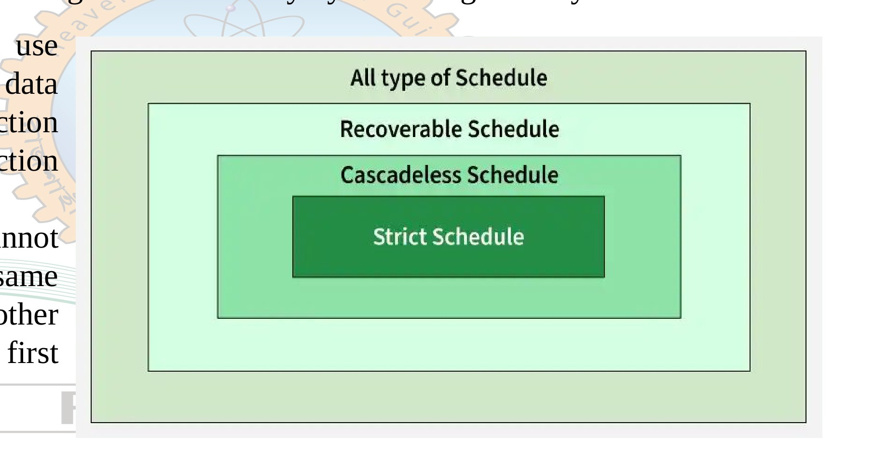

[← Previous: T10.5: View Serializability and Blind Writes](T10.05_View_Serializability.md) | [🏠 Index](00_Index.md) | [Next: T11.1: Shared and Exclusive Locks & Compatibility Matrix →](T11.01_Shared_Exclusive_Locks.md)

---

# T10.6: Recoverable, Cascadeless, and Strict Schedules

> **Topic:** T10 — Serializability | **Priority:** 🟢 | **Exam Frequency:** 0/7 finals (⭐ High-Yield Candidate)
> **Sources:** Silberschatz 7e Ch. 17 (§17.7, pp. 819–821) · Lecture Deck 08 (Slides 3–8) · Raidah Notes (Suggestions)

## Why This Topic Matters

Serializability keeps a database consistent when every transaction finishes normally. In real systems, however, transactions can crash or abort halfway through execution. When that happens, the recovery manager has to undo the failed transaction's changes. If a second transaction has already read those uncommitted changes and committed its own work, the database is trapped: it cannot undo the committed transaction without breaking durability, and it cannot leave the bad data in place without breaking atomicity. Recoverable, cascadeless, and strict schedules establish clear rules so the database can always recover cleanly from crashes. While this topic has not appeared in past final papers yet, it takes up a major section of Lecture Deck 08 and is a prime candidate for upcoming exams.

---

## 📝 Key Definitions

> **Recoverable Schedule:** "A **recoverable schedule** is one where, for each pair of transactions $T_i$ and $T_j$ such that $T_j$ reads a data item previously written by $T_i$, the commit operation of $T_i$ appears before the commit operation of $T_j$."  
> — Silberschatz, Korth & Sudarshan, *Database System Concepts* (7th Ed.), §17.7.1 (p. 820)

> **Cascading Rollback:** "This phenomenon, in which a single transaction failure leads to a series of transaction rollbacks, is called **cascading rollback**."  
> — Silberschatz, Korth & Sudarshan, *Database System Concepts* (7th Ed.), §17.7.2 (p. 821)

> **Cascadeless Schedule:** "Formally, a **cascadeless schedule** is one where, for each pair of transactions $T_i$ and $T_j$ such that $T_j$ reads a data item previously written by $T_i$, the commit operation of $T_i$ appears before the read operation of $T_j$."  
> — Silberschatz, Korth & Sudarshan, *Database System Concepts* (7th Ed.), §17.7.2 (p. 821)

> **Strict Schedule:** "A schedule is strict if it is both recoverable and cascadeless. A strict schedule ensures strong data consistency by following two key rules: 1. A transaction cannot use (read) uncommitted data from another transaction until that transaction commits. 2. A transaction cannot update (write) the same data modified by another transaction until the first one commits."  
> — Lecture Deck 08, Slide 8 *(Course definition)*

---

## Intuitive Mental Model: The Three Levels of Safety

Before looking at formal timelines, think of two teammates, $T_1$ and $T_2$, working on a shared report:

1. **Recoverable ("Wait to submit"):** $T_2$ is allowed to peek at $T_1$'s rough draft before $T_1$ finishes. However, $T_2$ promises not to submit its own final work until $T_1$ officially submits first. If $T_1$ scraps its draft, $T_2$ is still unsubmitted and can scrap its work too.
2. **Cascadeless ("No peeking at drafts"):** $T_2$ is not even allowed to read $T_1$'s changes until $T_1$ officially commits. Because nobody ever reads unfinished work, a failure in $T_1$ never forces anyone else to start over.
3. **Strict ("Hands off until committed"):** Nobody can read **or overwrite** $T_1$'s uncommitted changes until $T_1$ commits or aborts. That way, if $T_1$ fails, the database can simply restore the original value of the data item without accidentally wiping out someone else's update.

---

## Classification of Schedules by Recoverability

Concurrency control protocols restrict transaction schedules to those that can recover cleanly from crashes. As shown in Figure 1, all possible schedules form a nested hierarchy of increasing safety:

*Figure 1: Classification hierarchy showing nested containment: All Schedules $\supset$ Recoverable $\supset$ Cascadeless $\supset$ Strict (Source: Lecture Deck 08, Slide 8).*

In set notation, each stricter class is a subset of the one around it:

$$
\text{Strict Schedules} \subset \text{Cascadeless Schedules} \subset \text{Recoverable Schedules} \subset \text{All Possible Schedules}
$$

- Every strict schedule is automatically cascadeless and recoverable.
- Every cascadeless schedule is automatically recoverable, because if $T_i$ commits before $T_j$ reads, then $T_i$ definitely commits before $T_j$ commits.
- Not every recoverable schedule is cascadeless, because a recoverable schedule still allows reading uncommitted data as long as the reader delays its commit.
- Non-recoverable schedules are never allowed in an ACID-compliant database.

---

## Non-Recoverable Schedules & The Dirty Read Hazard

A schedule is **non-recoverable** (or irrecoverable) if transaction $T_j$ reads uncommitted data written by $T_i$ and then commits before $T_i$ commits.

### Concrete Non-Recoverable Schedule Trace

Suppose transactions $T_1$ and $T_2$ operate on bank balance $A$ (initially $\$100$):

| Step | Transaction $T_1$ | Transaction $T_2$ | Database State | Note |
| :--: | :--- | :--- | :---: | :--- |
| 1 | $\text{read}(A)$ | | $A = 100$ | $T_1$ reads initial balance |
| 2 | $A := A + 50$ | | | Local buffer calculation |
| 3 | $\text{write}(A)$ | | $A = 150$ | Uncommitted dirty write |
| 4 | | $\text{read}(A)$ | $A = 150$ | **Dirty Read:** $T_2$ reads uncommitted value |
| 5 | | $\text{commit}$ | $A = 150$ | **Fatal Error:** $T_2$ commits permanently |
| 6 | $\text{failure / abort}$ | | | $T_1$ crashes before committing |

### Why This Destroys Database Integrity
1. Transaction $T_1$ aborted at Step 6. By **Atomicity**, every change made by $T_1$ must be undone as if $T_1$ never ran, so $A$ must go back to $\$100$.
2. However, $T_2$ already read $A = 150$, finished its work, and committed at Step 5. By **Durability**, once a transaction commits, its results are permanent and cannot be rolled back.
3. This leaves the recovery manager in an impossible bind: rolling back $T_2$ violates durability, while keeping $T_2$'s results violates atomicity and consistency. Because recovery is impossible, the database must prevent $T_2$ from committing at Step 5.

---

## Recoverable Schedules: The Commit Order Rule

To prevent non-recoverable states, the database enforces the **Commit Order Rule**:

> **The Commit Order Rule:**  
> Whenever transaction $T_j$ reads a data item previously written by transaction $T_i$, $T_j$ must wait until $T_i$ commits before $T_j$ is allowed to commit:
>
> $$
> \text{Commit}(T_i) < \text{Commit}(T_j)
> $$

### Trace of a Recoverable Schedule

Let us fix the previous schedule by delaying $T_2$'s commit until after $T_1$ commits:

| Step | Transaction $T_1$ | Transaction $T_2$ | Note |
| :--: | :--- | :--- | :--- |
| 1 | $\text{read}(A)$ | | |
| 2 | $\text{write}(A)$ | | Uncommitted write by $T_1$ |
| 3 | | $\text{read}(A)$ | $T_2$ reads uncommitted value |
| 4 | $\text{commit}$ | | $T_1$ commits first |
| 5 | | $\text{commit}$ | $T_2$ commits safely afterward |

Now see what happens if $T_1$ aborts at Step 4 instead of committing:
- Because $T_2$ has not committed yet, the recovery manager can safely abort $T_2$ along with $T_1$.
- Both transactions are rolled back cleanly, preserving atomicity and making the schedule **recoverable**.

---

## Cascading Rollbacks vs. Cascadeless Schedules

While recoverable schedules guarantee that the database *can* recover, they still allow a costly domino effect known as cascading rollback.

### The Cascading Rollback Problem
In a recoverable schedule, active transactions can still read uncommitted data. When $T_1$ aborts, every uncommitted transaction that read $T_1$'s dirty data must also abort. If those transactions wrote new values that were read by even more transactions, a single failure triggers a chain reaction of rollbacks across the system:

| Step | $T_1$ | $T_2$ | $T_3$ | $T_4$ | Impact |
| :--: | :--- | :--- | :--- | :--- | :--- |
| 1 | $\text{read}(A)$ | | | | |
| 2 | $\text{write}(A)$ | | | | $T_1$ writes uncommitted $A$ |
| 3 | | $\text{read}(A)$ | | | $T_2$ reads dirty $A$ from $T_1$ |
| 4 | | $\text{write}(A)$ | | | $T_2$ writes dirty $A$ |
| 5 | | | $\text{read}(A)$ | | $T_3$ reads dirty $A$ from $T_2$ |
| 6 | | | $\text{write}(A)$ | | $T_3$ writes dirty $A$ |
| 7 | | | | $\text{read}(A)$ | $T_4$ reads dirty $A$ from $T_3$ |
| 8 | **$\text{abort}$** | | | | **$T_1$ fails!** |
| 9 | | **$\text{abort}$** | | | $T_2$ forced to roll back |
| 10 | | | **$\text{abort}$** | | $T_3$ forced to roll back |
| 11 | | | | **$\text{abort}$** | $T_4$ forced to roll back |

Here, a single crash in $T_1$ at Step 8 wipes out the work of $T_2$, $T_3$, and $T_4$, wasting huge amounts of CPU time and disk I/O.

### The Cascadeless Solution: The Read-After-Commit Rule
To eliminate cascading rollbacks, we move the restriction from the *commit* step to the *read* step:

> **The Cascadeless Rule:**  
> Transaction $T_j$ cannot read a data item written by $T_i$ until $T_i$ has already committed (or aborted):
>
> $$
> \text{Commit}(T_i) < \text{Read}_j(A)
> $$

Because dirty reads are blocked outright, transactions only ever read committed data. If $T_1$ fails, no other transaction has seen its uncommitted changes, so only $T_1$ needs to roll back.

---

## Strict Schedules: Preventing Overwriting Uncommitted Writes

Cascadeless schedules stop dirty reads, but they still allow **dirty writes**, where one transaction overwrites an uncommitted value written by another transaction.

To see why dirty writes cause trouble during recovery, trace this cascadeless sequence on item $A$ (initially $A = 50$):
1. $T_1$ writes $A = 100$ (before-image is $50$).
2. $T_2$ writes $A = 200$ before $T_1$ commits. Notice that $T_2$ did not read $A$, so the schedule is still cascadeless.
3. Now $T_1$ aborts.
4. If the recovery manager undoes $T_1$ by restoring $A$'s before-image ($A = 50$), it accidentally wipes out $T_2$'s valid update ($A = 200$)!

To make transaction undo fast and independent, commercial databases require **strict schedules**.

### Strict Schedule Rules
A schedule is **strict** if both reads and writes wait for prior writers to finish:
1. No transaction can **read** data item $Q$ until the transaction that last wrote $Q$ has committed or aborted.
2. No transaction can **write** data item $Q$ until the transaction that last wrote $Q$ has committed or aborted.

$$
\text{Commit}(T_i) < \text{Read}_j(Q) \quad \text{and} \quad \text{Commit}(T_i) < \text{Write}_j(Q)
$$

### Why Strict Schedules Are Preferred in Practice
In a strict schedule, rolling back an aborted transaction is effortless. The recovery manager simply restores the saved before-image of each modified item. Because no other transaction was allowed to read or overwrite that item in the meantime, restoring the old value never interferes with any other transaction. In practice, databases enforce strict schedules automatically using **Strict Two-Phase Locking (Strict 2PL)**.

---

## Comparison Summary: Recoverable vs. Cascadeless vs. Strict

| Feature | Recoverable Schedule | Cascadeless Schedule | Strict Schedule |
| :--- | :--- | :--- | :--- |
| **Rule for Reads** | $T_j$ may read uncommitted data, but its commit must wait: $\text{Commit}(T_i) < \text{Commit}(T_j)$ | $T_j$ cannot read until writer commits: $\text{Commit}(T_i) < \text{Read}_j(Q)$ | $T_j$ cannot read until writer commits: $\text{Commit}(T_i) < \text{Read}_j(Q)$ |
| **Rule for Writes** | Uncommitted writes can be overwritten | Uncommitted writes can be overwritten | Uncommitted writes cannot be overwritten: $\text{Commit}(T_i) < \text{Write}_j(Q)$ |
| **Cascading Rollback Risk?** | Yes, if an early writer aborts | No, completely eliminated | No, completely eliminated |
| **Dirty Read Allowed?** | Yes (as long as commit is delayed) | No | No |
| **Dirty Write Allowed?** | Yes | Yes | No |
| **Undo / Rollback Process** | Complex, may roll back many transactions | Simple, roll back only the failing transaction | Trivial, restore before-images directly |
| **Concurrency Level** | Highest concurrency | Moderate concurrency | Slightly lower concurrency, highest safety |
| **Enforcing Protocol** | Commit dependency tracking | Read-committed isolation | Strict 2PL / Rigorous 2PL |

---

## 🔮 Likely Questions

### 🎯 LQ1 · Distinguish Between Recoverable and Cascadeless Schedules with Examples

**Question:**

Define recoverable and cascadeless schedules. Provide example schedules to show why every cascadeless schedule is recoverable, but not every recoverable schedule is cascadeless.

**Full Answer:**

#### 1. Definitions
- **Recoverable Schedule:** A schedule in which, for every pair of transactions $T_i$ and $T_j$ where $T_j$ reads a data item previously written by $T_i$, the commit operation of $T_i$ appears before the commit operation of $T_j$ ($\text{commit}(T_i) < \text{commit}(T_j)$).
- **Cascadeless Schedule:** A schedule in which, for every pair of transactions $T_i$ and $T_j$ where $T_j$ reads a data item previously written by $T_i$, the commit operation of $T_i$ appears before the read operation of $T_j$ ($\text{commit}(T_i) < \text{read}_j(Q)$).

#### 2. Example 1: Recoverable but NOT Cascadeless

| Step | Transaction $T_1$ | Transaction $T_2$ |
| :--: | :--- | :--- |
| 1 | $\text{write}(A)$ | |
| 2 | | $\text{read}(A)$ |
| 3 | $\text{commit}$ | |
| 4 | | $\text{commit}$ |

- Here, $T_2$ reads $A$ at Step 2 after $T_1$ writes it, before $T_1$ has committed.
- Because $T_1$ commits at Step 3 before $T_2$ commits at Step 4 ($\text{commit}(T_1) < \text{commit}(T_2)$), the schedule is **recoverable**.
- However, because $T_2$ read uncommitted data at Step 2, an abort by $T_1$ at Step 3 would force $T_2$ to abort as well. Thus, the schedule is **not cascadeless**.

#### 3. Example 2: Cascadeless (and Therefore Recoverable)

| Step | Transaction $T_1$ | Transaction $T_2$ |
| :--: | :--- | :--- |
| 1 | $\text{write}(A)$ | |
| 2 | $\text{commit}$ | |
| 3 | | $\text{read}(A)$ |
| 4 | | $\text{commit}$ |

- Here, $T_1$ commits at Step 2 before $T_2$ reads $A$ at Step 3 ($\text{commit}(T_1) < \text{read}_2(A)$).
- Because $T_2$ only reads committed data, a failure in $T_1$ can never force $T_2$ to roll back, making the schedule **cascadeless**.
- Since $T_2$ must read $A$ before $T_2$ finishes and commits ($\text{read}_2(A) < \text{commit}(T_2)$), we automatically get $\text{commit}(T_1) < \text{read}_2(A) < \text{commit}(T_2)$. Therefore, every cascadeless schedule is also recoverable.

---

### 🎯 LQ2 · Explain Cascading Rollback with a Timeline Schedule and State How to Prevent It

**Question:**

What is cascading rollback? Illustrate how cascading rollback occurs using an interleaved schedule of three transactions. How can a database system prevent cascading rollback?

**Full Answer:**

#### 1. Definition of Cascading Rollback
Cascading rollback is a phenomenon where the failure and rollback of a single transaction forces a chain of other active transactions to roll back because they read uncommitted data produced directly or indirectly by the failed transaction.

#### 2. Timeline Schedule Illustrating Cascading Rollback
Consider three concurrent transactions $T_1$, $T_2$, and $T_3$ operating on account $A$ (initially $A = 100$):

| Step | Transaction $T_1$ | Transaction $T_2$ | Transaction $T_3$ | Explanation |
| :--: | :--- | :--- | :--- | :--- |
| 1 | $\text{read}(A)$ | | | $T_1$ reads $A = 100$ |
| 2 | $A := A - 20$ | | | |
| 3 | $\text{write}(A)$ | | | $T_1$ writes $A = 80$ (uncommitted) |
| 4 | | $\text{read}(A)$ | | $T_2$ reads dirty value $A = 80$ |
| 5 | | $A := A + 50$ | | |
| 6 | | $\text{write}(A)$ | | $T_2$ writes $A = 130$ (uncommitted) |
| 7 | | | $\text{read}(A)$ | $T_3$ reads dirty value $A = 130$ |
| 8 | **$\text{abort}$** | | | **$T_1$ crashes and aborts** |
| 9 | | **$\text{abort}$** | | **$T_2$ must roll back** (read dirty data from $T_1$) |
| 10 | | | **$\text{abort}$** | **$T_3$ must roll back** (read dirty data from $T_2$) |

When $T_1$ aborts at Step 8, $T_2$ must be rolled back at Step 9 because its calculation depended on $T_1$'s uncommitted write. Rolling back $T_2$ then invalidates the value read by $T_3$, forcing $T_3$ to roll back at Step 10.

#### 3. How to Prevent Cascading Rollback
A database system prevents cascading rollbacks by enforcing **cascadeless schedules** (for example, via Strict 2PL):
- **Rule:** Prohibit any transaction from reading uncommitted data ($\text{commit}(T_i) < \text{read}_j(A)$).
- **Mechanism:** Hold exclusive write locks until commit or abort, so any transaction requesting to read a modified item waits until the writer finishes.
- With this rule in place, Steps 4 and 7 wait until $T_1$ finishes. If $T_1$ aborts, only $T_1$ rolls back and no other transaction is affected.

---

### 🎯 LQ3 · Define Strict Schedules and Explain the Containment Hierarchy of Schedules

**Question:**

Define a strict schedule. Why is a strict schedule stronger than a cascadeless schedule? Draw and explain the containment hierarchy of schedules based on recoverability.

**Full Answer:**

#### 1. Definition of Strict Schedule
A schedule is **strict** if no transaction is allowed to either read or overwrite a data item modified by another transaction until that first transaction has committed or aborted:
1. $\text{Commit}(T_i) < \text{Read}_j(Q)$ (no dirty reads).
2. $\text{Commit}(T_i) < \text{Write}_j(Q)$ (no dirty writes).

#### 2. Why Strict Is Stronger than Cascadeless
A cascadeless schedule only blocks dirty reads ($\text{commit}(T_i) < \text{read}_j(Q)$). It still allows transaction $T_2$ to overwrite data item $Q$ while $T_1$'s earlier write on $Q$ is uncommitted.
- If $T_1$ later aborts, restoring $T_1$'s before-image would overwrite $T_2$'s valid update, causing a lost update.
- A strict schedule blocks both uncommitted reads and uncommitted writes. Because no transaction touches $Q$ until $T_1$ finishes, rolling back $T_1$ simply means restoring $Q$'s before-image without any risk of wiping out another transaction's work.

#### 3. Containment Hierarchy
Schedules form a four-level nested hierarchy based on recoverability:
- **All Schedules:** Every possible interleaved sequence of transaction operations.
- **Recoverable Schedules:** Enforces commit order ($\text{commit}_i < \text{commit}_j$) so committed transactions never depend on aborted ones.
- **Cascadeless Schedules:** Enforces read-after-commit ($\text{commit}_i < \text{read}_j$) to eliminate cascading rollbacks.
- **Strict Schedules:** Enforces both read-after-commit and write-after-commit ($\text{commit}_i < \text{read}_j$ and $\text{commit}_i < \text{write}_j$) so rollbacks can safely restore before-images.

$$
\text{Strict} \subset \text{Cascadeless} \subset \text{Recoverable} \subset \text{All Schedules}
$$

---

## 📖 High-Yield Exercises from the Book

### 🎯 HYE-01 · Practice Exercise 17.9 · Recoverability vs Cascadelessness Verification

> **Source:** Silberschatz 7e · Chapter 17 (Practice Exercise 17.9)  
> **Exam Relevance:** High-Probability Schedule Safety Drill  
> **Key Tested Concept:** Testing whether an interleaved schedule is recoverable and whether it is cascadeless.

**Problem Statement:**
> Consider the following schedule $S_1$ involving transactions $T_1, T_2, T_3$:
> $$
> S_1: r_1(A); \quad w_1(A); \quad r_2(A); \quad w_2(B); \quad r_3(B); \quad c_1; \quad c_2; \quad c_3
> $$
> 1. Determine whether schedule $S_1$ is **recoverable**.
> 2. Determine whether schedule $S_1$ is **cascadeless**.
> 3. If it is not cascadeless, modify the schedule to make it cascadeless while retaining the same operations.

**Model Exam-Style Solution:**

1. **Recoverability Check:**
   - **Definition:** A schedule is recoverable if, for every transaction pair $(T_i, T_j)$ where $T_j$ reads a data item previously written by $T_i$, the commit operation of $T_i$ appears **before** the commit operation of $T_j$ ($c_i < c_j$).
   - **Read-From Dependencies in $S_1$:**
     - $T_2$ reads $A$ written by $T_1$. Therefore, we require $c_1 < c_2$. In $S_1$, $c_1$ occurs before $c_2$ ($\checkmark$).
     - $T_3$ reads $B$ written by $T_2$. Therefore, we require $c_2 < c_3$. In $S_1$, $c_2$ occurs before $c_3$ ($\checkmark$).
   - **Verdict:** Schedule $S_1$ is **recoverable**.

2. **Cascadelessness Check:**
   - **Definition:** A schedule is cascadeless (avoids cascading aborts) if, for every transaction pair $(T_i, T_j)$ where $T_j$ reads a data item written by $T_i$, the commit operation of $T_i$ appears **before the read operation** of $T_j$ ($c_i < r_j$).
   - **Inspection of Reads in $S_1$:**
     - $T_2$ reads $A$ at Step 3, but $T_1$ does not commit until Step 6. Here $r_2(A) < c_1$.
     - $T_3$ reads $B$ at Step 5, but $T_2$ does not commit until Step 7. Here $r_3(B) < c_2$.
   - If $T_1$ were to abort before Step 6, $T_2$ would have read dirty uncommitted data and must be aborted; cascading further to abort $T_3$.
   - **Verdict:** Schedule $S_1$ is **NOT cascadeless**.

3. **Modification for Cascadelessness:**
   - Delay the reads until the respective writing transaction has committed:
     $$
     S_1': r_1(A); \quad w_1(A); \quad \mathbf{c_1}; \quad r_2(A); \quad w_2(B); \quad \mathbf{c_2}; \quad r_3(B); \quad \mathbf{c_3}
     $$
   - Now every transaction reads only committed data, ensuring $S_1'$ is both recoverable and cascadeless. $\blacksquare$

**💡 RUET Exam Takeaway:**
Remember the dependency hierarchy:
$$
\text{Strict} \subset \text{Cascadeless} \subset \text{Recoverable}
$$
Every cascadeless schedule is recoverable, but not every recoverable schedule is cascadeless.

---

### 🎯 HYE-02 · Exercise 17.19 · Strict Schedules and Efficient Recovery

> **Source:** Silberschatz 7e · Chapter 17 (Exercise 17.19)  
> **Exam Relevance:** Prime Overdue Systems & Recovery Theory Question  
> **Key Tested Concept:** Definition of strict schedules, simple undo recovery, and isolation levels.

**Problem Statement:**
> 1. Formally define a **strict schedule**.
> 2. Explain why strict schedules are preferred in commercial database systems over merely cascadeless schedules.
> 3. Show how strictness simplifies crash recovery (specifically the undo mechanism).

**Model Exam-Style Solution:**

1. **Formal Definition of Strict Schedules:**
   A schedule is **strict** if, for any transaction $T_i$ that writes a data item $Q$ ($w_i(Q)$), **no other transaction $T_j$ may read OR write $Q$** until $T_i$ has either committed or aborted:
   $$
   w_i(Q) < r_j(Q) \implies (c_i < r_j(Q) \lor a_i < r_j(Q))
   $$
   $$
   w_i(Q) < w_j(Q) \implies (c_i < w_j(Q) \lor a_i < w_j(Q))
   $$

2. **Why Strict Schedules are Preferred over Merely Cascadeless Schedules:**
   - **Cascadeless condition:** Only restricts *reads* ($w_i(Q) < r_j(Q) \implies c_i < r_j(Q)$). It allows concurrent *writes* on uncommitted data ($w_i(Q) < w_j(Q) < c_i$).
   - **Overwriting Uncommitted Data Problem:** If $T_1$ writes $A$, then $T_2$ writes $A$, and then $T_1$ aborts:
     - Under a merely cascadeless schedule, $T_2$ was allowed to write $A$ without $T_1$ committing.
     - When $T_1$ aborts, what should the value of $A$ be restored to?
     - If we restore $A$ to the value before $T_1$, we accidentally wipe out $T_2$'s write!
     - If we keep $T_2$'s write, we violate atomicity because $T_1$'s modification was not cleanly rolled back.
   - Strict schedules completely disallow concurrent writes to uncommitted data, preventing this dilemma entirely.

3. **Simplification of Undo Recovery:**
   - In a strict schedule, because no other transaction has modified $Q$ between $T_i$'s write and $T_i$'s abort, undoing $T_i$'s modification to $Q$ is trivially achieved by **restoring $Q$ to its before-image (pre-image)** recorded in the log.
   - No cascading rollbacks and no complex compensation calculations are required. $\blacksquare$

**💡 RUET Exam Takeaway:**
Strict Two-Phase Locking (holding all exclusive locks until commit) is used by default in PostgreSQL, MySQL/InnoDB, and Oracle precisely because it automatically enforces strict schedules.

---

## ⚡ Exam Tips & Common Mistakes

1. **Commit order vs. Read order:** Do not mix up the conditions for recoverable and cascadeless schedules. Recoverable compares two commits ($\text{commit}(T_i) < \text{commit}(T_j)$), whereas cascadeless requires the writer to commit before the reader even reads ($\text{commit}(T_i) < \text{read}_j(Q)$).
2. **Serializability vs. Recoverability:** These two properties are independent. A schedule can be conflict serializable yet non-recoverable (if a transaction unlocks early and another commits off dirty data), or recoverable yet non-serializable. A correct database scheduler must guarantee both.
3. **Mention the Dirty Write hazard for Strict Schedules:** Whenever an exam asks why cascadeless schedules are not enough on their own, explain how overwriting uncommitted data breaks before-image restoration during undo.
4. **Sketch the nested boxes:** Always draw the 4-layer nested diagram (`All` $\supset$ `Recoverable` $\supset$ `Cascadeless` $\supset$ `Strict`) on schedule classification questions for full visual marks.

---

## 🔗 Related Topics

- [T09.01: ACID Properties](T09.01_ACID_Properties.md) — Atomicity and Durability requirements during crash recovery
- [T09.05: Concurrency Problems](T09.05_Concurrency_Problems.md) — Dirty read and dirty write anomalies
- [T10.05: View Serializability and Blind Writes](T10.05_View_Serializability.md) — Relationship with final write conditions
- [T11.01: Shared and Exclusive Locks & Compatibility Matrix](T11.01_Shared_Exclusive_Locks.md) — Locking foundations for concurrency control
- [T11.03: Strict and Rigorous 2PL](T11.03_Strict_and_Rigorous_2PL.md) — Concurrency protocols that enforce strict schedules

---

[← Previous: T10.5: View Serializability and Blind Writes](T10.05_View_Serializability.md) | [🏠 Index](00_Index.md) | [Next: T11.1: Shared and Exclusive Locks & Compatibility Matrix →](T11.01_Shared_Exclusive_Locks.md)
