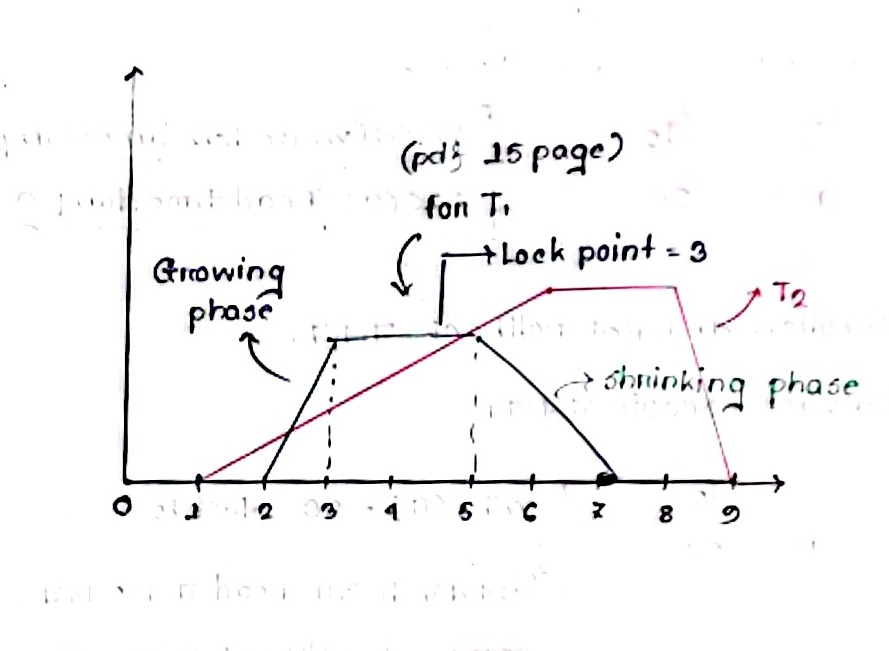

[← Previous: T11.1: Shared and Exclusive Locks & Compatibility Matrix](T11.01_Shared_Exclusive_Locks.md) | [🏠 Index](00_Index.md) | [Next: T11.3: Strict 2PL, Rigorous 2PL, and Drawbacks of 2PL →](T11.03_Strict_and_Rigorous_2PL.md)

---

# T11.2: Two-Phase Locking (2PL) Protocol

> **Topic:** T11 — Concurrency Control Protocols | **Priority:** 🟢 | **Exam Frequency:** 1/7 finals (2 questions: 9 marks)
> **Sources:** Silberschatz 7e Ch. 18 (§18.1.3, pp. 841–844) · Lecture Deck 08 (Slides 13–18) · Raidah Notes (p. 30)

## Why This Topic Matters

In `T11.01`, we saw that releasing a lock too early lets other transactions observe half-finished updates and breaks serializability. **Two-Phase Locking (2PL)** fixes this problem with one simple rule: a transaction must finish acquiring *all* of its locks before it is allowed to release *any* lock. By dividing every transaction into a lock-gathering phase and a lock-releasing phase, 2PL guarantees conflict serializability. In the 2017 final exam, 2PL accounted for 9 marks across two separate questions (`Q.6(b)` and `Q.7(a)`), testing both the theory of lock points and the hands-on skill of inserting `lock-S`, `lock-X`, and `unlock` instructions into transaction code.

---

## 📝 Key Definitions

> **Two-Phase Locking Protocol:** "One protocol that ensures serializability is the **two-phase locking protocol**. This protocol requires that each transaction issue lock and unlock requests in two phases:
> 1. **Growing phase**. A transaction may obtain locks, but may not release any lock.
> 2. **Shrinking phase**. A transaction may release locks, but may not obtain any new locks."  
> — Silberschatz, Korth & Sudarshan, *Database System Concepts* (7th Ed.), §18.1.3 (p. 841)

> **Lock Point:** "The point in the schedule where the transaction has obtained its final lock (that is, the end of its growing phase) is called the **lock point** of the transaction. Now, transactions can be ordered according to their lock points—this ordering is an equivalent serial schedule for the transactions."  
> — Silberschatz, Korth & Sudarshan, *Database System Concepts* (7th Ed.), §18.1.3 (p. 841)

> **Lock Conversions (Upgrade and Downgrade):** "We denote the conversion from shared to exclusive mode by `upgrade`, and from exclusive to shared mode by `downgrade`. Lock conversion that upgrades a lock can occur only in the growing phase, whereas conversion that downgrades a lock can occur only in the shrinking phase."  
> — Silberschatz, Korth & Sudarshan, *Database System Concepts* (7th Ed.), §18.1.3 (p. 842)

---

## Core Mechanics of Two-Phase Locking

Under the Two-Phase Locking (2PL) protocol, every transaction's lifecycle is split into two back-to-back stages:

### 1. The Growing Phase (Acquiring Locks)
- When a transaction starts, it is in the growing phase.
- It can request new shared locks (`lock-S`) or exclusive locks (`lock-X`), and it can **upgrade** an existing `S` lock into an `X` lock.
- **Strict Rule:** The transaction cannot release (`unlock`) any lock during this phase.

### 2. The Shrinking Phase (Releasing Locks)
- The moment the transaction executes its very first `unlock` (or `downgrade`) instruction, it enters the shrinking phase.
- From this point onward, it can release held locks (`unlock`) or **downgrade** an `X` lock to an `S` lock.
- **Strict Rule:** Once in the shrinking phase, the transaction can never request a new lock or upgrade an existing lock.

### Why 2PL Guarantees Conflict Serializability
Think of why a cycle in a precedence graph ($T_1 \to T_2 \to T_1$) cannot happen under 2PL:
- For $T_1 \to T_2$ to exist, $T_1$ must lock, access, and **unlock** some shared item $Q$ before $T_2$ locks $Q$. That means $T_1$ has already entered its shrinking phase before $T_2$ finishes its growing phase.
- For $T_2 \to T_1$ to also exist on another item $R$, $T_2$ would have to unlock $R$ before $T_1$ locks $R$.
- But $T_1$ is already in its shrinking phase, so $T_1$ is forbidden from acquiring any new lock after $T_2$ unlocks! Because no transaction can acquire a lock after releasing one, circular conflict dependencies are impossible, and every 2PL schedule is conflict serializable.

---

## The Concept of Lock Point & Serialization Order

The **lock point** of a transaction is the exact moment when it acquires its **last lock** (the peak of the graph at the end of its growing phase).


*Figure 1: Two-Phase Locking protocol graph illustrating growing phase, lock point, and shrinking phase (Source: Raidah Class Notes, p. 30).*

### Finding the Equivalent Serial Schedule
Because a transaction holds every lock it needs at its lock point, any conflicting transaction that has not reached its own lock point yet must wait. As a result, ordering transactions by their lock points gives you a valid equivalent serial schedule right away:

$$
\text{Lock Point}(T_i) < \text{Lock Point}(T_j) \implies T_i \longrightarrow T_j
$$

For instance, in the schedule from Lecture Deck 08 (Slide 15):
- Transaction $T_1$ acquires its final lock at Step 3 ($\text{Lock Point}_1 = 3$).
- Transaction $T_2$ acquires its final lock at Step 6 ($\text{Lock Point}_2 = 6$).
- Since $3 < 6$, the concurrent execution is conflict-equivalent to the serial schedule:

$$
\boxed{\langle T_1, T_2 \rangle}
$$

---

## Lock Conversions: Upgrade and Downgrade

Suppose a transaction reads a large table early on, does a long calculation, and only updates one record at the very end. If it had to hold an exclusive lock (`lock-X`) for the entire time, no other transaction could even read that record during the calculation.

To boost concurrency without breaking the two-phase rule, 2PL supports **lock conversions**:

### 1. Upgrade (`lock-S` $\to$ `lock-X`)
- Converts a held shared lock into an exclusive lock when the transaction is ready to write.
- **When allowed:** **Only during the growing phase**, because upgrading expands the transaction's lock privileges (just like acquiring a new lock).

### 2. Downgrade (`lock-X` $\to$ `lock-S`)
- Drops an exclusive lock down to a shared lock once the transaction finishes writing, while still keeping read access.
- **When allowed:** **Only during the shrinking phase**, because downgrading gives up exclusive write privileges (just like releasing a lock).

---

## Limitations of Basic 2PL

While Basic 2PL guarantees conflict serializability, it still leaves two serious vulnerabilities open:

1. **Deadlocks can still happen:**  
   If $T_1$ locks $X$ and waits for $Y$, while $T_2$ locks $Y$ and waits for $X$, neither transaction can release its held lock (because both are still in their growing phases). Both transactions get stuck forever unless a deadlock handler steps in.
2. **Cascading rollbacks can still happen:**  
   Basic 2PL allows a transaction to release an exclusive lock during its shrinking phase *before* committing. If another transaction locks and reads that uncommitted value and the first transaction later aborts, the reader is forced to roll back too.

Database systems fix the cascading rollback problem using **Strict 2PL** and **Rigorous 2PL** (covered in `T11.03`), which hold locks until commit.

---

## Illustrative Mini-Example: Adding 2PL Locks & Checking Deadlock

Before tackling the full past-exam questions below, let us walk through a quick two-item example to see how to wrap raw operations in 2PL instructions.

Suppose two inventory transactions update stock counts $X$ and $Y$:
- $T_A$: `read(X); write(Y);`
- $T_B$: `read(Y); write(X);`

### Step 1: Choose Lock Modes & Apply the 2PL Rule
- Reading an item requires `lock-S`, while writing requires `lock-X`.
- To obey 2PL, every `lock` instruction must come **before** the first `unlock` instruction:

| Step | $T_A$ (with 2PL) | $T_B$ (with 2PL) | Phase Note |
| :--: | :--- | :--- | :--- |
| 1 | `lock-S(X); read(X);` | `lock-S(Y); read(Y);` | Growing phase starts |
| 2 | `lock-X(Y); write(Y);` | `lock-X(X); write(X);` | **Lock Point** (final lock acquired) |
| 3 | `unlock(X); unlock(Y);` | `unlock(Y); unlock(X);` | Shrinking phase |

### Step 2: Check If They Can Deadlock
If $T_A$ and $T_B$ run Step 1 at the same time, $T_A$ holds `lock-S(X)` and $T_B$ holds `lock-S(Y)`. At Step 2, $T_A$ requests `lock-X(Y)` (which conflicts with $T_B$'s shared lock on $Y$, so $T_A$ waits), and $T_B$ requests `lock-X(X)` (which conflicts with $T_A$'s shared lock on $X$, so $T_B$ waits). Neither can unlock during its growing phase, producing a classic deadlock cycle $T_A \leftrightarrow T_B$.

---

## Exam Variants

| Year & Question | Marks | Scenario / Data Given | Key Result / Answer Summary |
| :--- | :---: | :--- | :--- |
| **2017 Q.6(b)** | 4 | Concurrency control via 2PL protocol with example | Define growing and shrinking phases, lock point, and give concrete money transfer example |
| **2017 Q.7(a)** | 5 | Starvation definition, inserting 2PL locks on $T_1, T_2$, and deadlock check | Define starvation, insert `lock-S`/`lock-X` before `unlock`, and prove deadlock via wait-for cycle |

---

## 🏆 Golden Questions (Past Exam Archive)

### 🎯 GQ1 · 2017 Q.6(b) · 2PL Protocol Definition, Mechanics, and Example

> **Appeared:** 2017 Q.6(b) — (04 marks)

**Question:**

How concurrent execution of transactions are controlled using two phase based locking protocol? Briefly discuss with an example.

**Full Answer:**

#### 1. How 2PL Controls Concurrent Execution
The Two-Phase Locking (2PL) protocol controls concurrent transactions by requiring every transaction to request and release locks in two sequential, non-overlapping phases:

1. **Growing Phase:**
   - A transaction may acquire new locks (`lock-S` or `lock-X`) and may upgrade an existing shared lock to an exclusive lock (`upgrade`).
   - **Key Rule:** No lock may be released during this phase.
2. **Shrinking Phase:**
   - A transaction may release held locks (`unlock`) and may downgrade an existing exclusive lock to a shared lock (`downgrade`).
   - **Key Rule:** No new lock may be acquired (or upgraded) once the first lock has been released.

#### 2. The Lock Point and Serializability
The exact point in the schedule where a transaction acquires its final lock is called its **lock point**. Once a transaction releases its first lock, it crosses into the shrinking phase. Because no transaction can acquire new locks after unlocking, conflicting transactions cannot form cycles in the precedence graph, and the schedule is guaranteed to be conflict serializable in the order of the transactions' lock points.

#### 3. Concrete Example
Consider transaction $T_1$ transferring $\$50$ from account $B$ to account $A$:

```text
lock-S(B);         -- Growing phase starts
read(B);
lock-X(B);         -- Lock upgrade (S -> X)
B := B - 50;
write(B);
lock-X(A);         -- LOCK POINT: Final lock acquired
read(A);
A := A + 50;
write(A);
unlock(B);         -- Shrinking phase starts (no new locks allowed)
unlock(A);         -- Final lock released
```

In this transaction:
- All lock requests and upgrades happen between lines 1 and 6 (Growing Phase), with line 6 marking the **lock point**.
- All `unlock` operations happen at lines 10 and 11 (Shrinking Phase).
- Because $T_1$ holds both $A$ and $B$ at its lock point before unlocking anything, no other transaction can read an inconsistent sum of $A + B$.

---

### 🎯 GQ2 · 2017 Q.7(a) · Starvation, 2PL Instruction Insertion, and Deadlock Justification

> **Appeared:** 2017 Q.7(a) — (05 marks)

**Question:**

What is starvation? Consider the following two transactions.

**T1:**  
  `read(A);`  
  `read(B);`  
  `if A = 0 then B:=B+15% of B;`  
  `write(B);`

**T2:**  
  `read(B);`  
  `read(A);`  
  `if B = 0 then A:=A+20% of A;`  
  `write(A);`

Add lock and unlock instructions to transaction T1 and T2, so that they observe the two phase locking protocol. Can the execution of these transactions result in a deadlock? Justify.

**Full Answer:**

#### Part 1: What is Starvation?
Starvation occurs when a transaction waits indefinitely to acquire a lock on a data item because the concurrency control manager repeatedly grants locks to other incoming transactions first. For example, a transaction waiting for an exclusive lock (`lock-X`) on item $Q$ can starve if a continuous stream of new transactions keeps being granted compatible shared locks (`lock-S`) on $Q$.

#### Part 2: Adding 2PL Lock and Unlock Instructions
To obey the Two-Phase Locking (2PL) protocol, each transaction must acquire all required locks (`lock-S` for read-only items, `lock-X` for items that are both read and written) before executing its first `unlock` instruction:
- **$T_1$:** Only reads $A$ (`lock-S(A)`), and both reads and writes $B$ (`lock-X(B)`).
- **$T_2$:** Only reads $B$ (`lock-S(B)`), and both reads and writes $A$ (`lock-X(A)`).

**Transaction T1 with 2PL Instructions:**
```text
lock-S(A);
read(A);
lock-X(B);
read(B);
if A = 0 then B := B + 15% of B;
write(B);
unlock(A);
unlock(B);
```

**Transaction T2 with 2PL Instructions:**
```text
lock-S(B);
read(B);
lock-X(A);
read(A);
if B = 0 then A := A + 20% of A;
write(A);
unlock(B);
unlock(A);
```

*(Note: Alternatively, $T_1$ could acquire `lock-S(B)` before `read(B)` and call `upgrade(B)` before `write(B)`, provided both locks and upgrades finish before the first `unlock`.)*

#### Part 3: Deadlock Analysis and Justification
**Yes, the concurrent execution of $T_1$ and $T_2$ can result in a deadlock.**

**Justification:**  
Consider the following interleaved execution schedule:

1. $T_1$ executes `lock-S(A)` and `read(A)`, so $T_1$ now holds a shared lock on $A$.
2. $T_2$ executes `lock-S(B)` and `read(B)`, so $T_2$ now holds a shared lock on $B$.
3. $T_1$ next requests `lock-X(B)`. Because exclusive mode conflicts with the shared lock currently held by $T_2$ on $B$, $T_1$ is blocked and must wait for $T_2$.
4. $T_2$ next requests `lock-X(A)`. Because exclusive mode conflicts with the shared lock currently held by $T_1$ on $A$, $T_2$ is blocked and must wait for $T_1$.

At this point, $T_1$ is waiting for $T_2$ to release $B$, and $T_2$ is waiting for $T_1$ to release $A$. Because both transactions are still in their growing phase, 2PL forbids either of them from unlocking its held item early. This creates a closed cycle in the wait-for graph:

$$
T_1 \longleftrightarrow T_2
$$


*Figure 2: Interleaved execution schedule and wait-for graph producing deadlock cycle $T_1 \to T_2 \to T_1$ under 2PL.*

Because neither transaction can move forward, the schedule is deadlocked.

---

## ⚡ Exam Tips & Common Mistakes

1. **Every `lock` before the first `unlock`:** When adding 2PL instructions to exam code snippets, double-check that all `lock-S` and `lock-X` calls sit above all `unlock` calls. Placing even one `unlock` before a later `lock` breaks 2PL and loses marks.
2. **2PL does NOT prevent deadlocks:** Never write that 2PL prevents deadlocks. Basic 2PL guarantees conflict serializability, but transactions can still deadlock when they request locks in opposite orders.
3. **Always mention the Lock Point:** In descriptive 2PL questions, explicitly define the **lock point** (where the last lock is acquired) and note that the lock-point order gives the equivalent serial order.
4. **Upgrade vs. Downgrade phases:** Keep the direction straight: **upgrades** (`S` $\to$ `X`) are only allowed in the **growing phase**, while **downgrades** (`X` $\to$ `S`) are only allowed in the **shrinking phase**.

---

## 🔗 Related Topics

- [T10.01: Conflicting Instructions and Conflict Serializability](T10.01_Conflicting_Instructions.md) — Conflict definitions that 2PL enforces
- [T11.01: Shared and Exclusive Locks & Compatibility Matrix](T11.01_Shared_Exclusive_Locks.md) — Fundamental lock modes and starvation
- [T11.03: Strict 2PL, Rigorous 2PL, and Drawbacks of 2PL](T11.03_Strict_and_Rigorous_2PL.md) — Variations that eliminate cascading rollbacks
- [T11.04: Deadlock](T11.04_Deadlock.md) — Detection using wait-for graphs and deadlock prevention

---

[← Previous: T11.1: Shared and Exclusive Locks & Compatibility Matrix](T11.01_Shared_Exclusive_Locks.md) | [🏠 Index](00_Index.md) | [Next: T11.3: Strict 2PL, Rigorous 2PL, and Drawbacks of 2PL →](T11.03_Strict_and_Rigorous_2PL.md)
