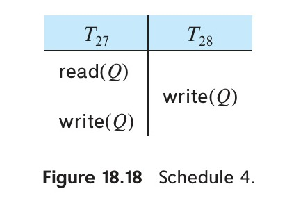

[← Previous: T11.5: Wait-Die vs. Wound-Wait Deadlock Prevention](T11.05_Wait_Die_vs_Wound_Wait.md) | [🏠 Index](00_Index.md) | [Next: T12.1: Failure Classification and Recovery Precautions →](T12.01_Failure_Classification.md)

---

# T11.6: Timestamp-Ordering (TSO) Protocol

> **Topic:** T11 — Concurrency Control Protocols | **Priority:** 🟠 | **Exam Frequency:** 3/7 finals (11 marks)
> **Sources:** Silberschatz 7e Ch. 18 (§18.5, pp. 861–865) · Lecture Deck 08 (Slides 26–30) · Raidah Notes (pp. 31–32)

## Why This Topic Matters

The Timestamp-Ordering (TSO) protocol offers a lock-free way to manage concurrent transactions. By locking in the serialization order before transactions even run, TSO guarantees conflict serializability and completely eliminates deadlocks. This topic shows up regularly in RUET semester finals, both as conceptual questions about why rolled-back transactions need new timestamps and as step-by-step schedule traces. Once you understand the read/write rules, Thomas' Write Rule, and the timestamp reassignment trap, these questions become straightforward marks.

---

## 📝 Key Definitions

> **Timestamp-Ordering Protocol:** "The timestamp-ordering protocol ensures that any conflicting read and write operations are executed in timestamp order." — Silberschatz, Korth & Sudarshan, *Database System Concepts* (7th Ed.), §18.5.2 (p. 862)

> **Data Item Timestamps:** "W-timestamp($Q$) denotes the largest timestamp of any transaction that executed write($Q$) successfully. R-timestamp($Q$) denotes the largest timestamp of any transaction that executed read($Q$) successfully." — Silberschatz, Korth & Sudarshan, *Database System Concepts* (7th Ed.), §18.5.1 (p. 862)

> **Thomas' Write Rule:** "The modification, called Thomas' write rule, relaxes the check for the write operation. Under Thomas' write rule, the write operation is simply ignored (that is, not executed), and $T_i$ is allowed to proceed." — Silberschatz, Korth & Sudarshan, *Database System Concepts* (7th Ed.), §18.5.3 (pp. 864–865)

---

## Principles of Timestamp Ordering

Instead of making transactions wait in lock queues when conflicts happen, timestamp-based protocols decide the equivalent serial order up front:

### 1. Assigning Transaction Timestamps $\text{TS}(T_i)$
Each transaction $T_i$ gets a unique, fixed timestamp $\text{TS}(T_i)$ right when it starts:
- **System Clock:** Uses the server's wall-clock time when $T_i$ enters the system.
- **Logical Counter:** Increments a simple counter ($1, 2, 3, \dots$) each time a new transaction starts.

The golden rule of the protocol is simple:

$$\textbf{Timestamp Order} = \textbf{Serializability Order}$$

So if $\text{TS}(T_i) < \text{TS}(T_j)$, the final schedule must behave just like a serial schedule where $T_i$ ran completely before $T_j$.

### 2. Timestamps Associated with Data Items
How does the database know if a transaction is acting out of order? Every data item $Q$ keeps two "high-water mark" stickers on itself:
- **$\text{W-timestamp}(Q)$:** The timestamp of the youngest transaction that has successfully written to $Q$ so far.
- **$\text{R-timestamp}(Q)$:** The timestamp of the youngest transaction that has successfully read $Q$ so far.

Both stickers start at $0$ when the database boots up. Whenever a transaction $T_i$ tries to read or write $Q$, the database compares $\text{TS}(T_i)$ against these two stickers to check if a younger transaction has already moved $Q$ "into the future."

---

## Protocol Rules for Read and Write Operations

When transaction $T_i$ tries to read or write data item $Q$, the concurrency control manager checks whether $T_i$ is arriving "too late":

### 1. Read Rule: Transaction $T_i$ Issues $\text{read}(Q)$
1. **Out-of-Order Check:**

$$\text{TS}(T_i) < \text{W-timestamp}(Q)$$

   - *What went wrong:* $T_i$ is an older transaction trying to read $Q$, but a younger transaction has already overwritten $Q$ with a newer value. The old value $T_i$ needed is gone.
   - *Decision:* The $\text{read}$ is **rejected**, and $T_i$ is **rolled back**.
2. **Valid Execution:**

$$\text{TS}(T_i) \ge \text{W-timestamp}(Q)$$

   - *Why it works:* Nobody younger than $T_i$ has overwritten $Q$ yet, so the current value of $Q$ is safe for $T_i$ to read.
   - *Decision:* The $\text{read}$ is **executed**, and we update the read sticker if $T_i$ is the newest reader so far:

$$\text{R-timestamp}(Q) := \max(\text{R-timestamp}(Q), \text{TS}(T_i))$$

---

### 2. Write Rule: Transaction $T_i$ Issues $\text{write}(Q)$
1. **Read-Conflict Check:**

$$\text{TS}(T_i) < \text{R-timestamp}(Q)$$

   - *What went wrong:* A younger transaction has already read $Q$. In serial order, that younger transaction should have seen $T_i$'s new value, but it already read the old one.
   - *Decision:* The $\text{write}$ is **rejected**, and $T_i$ is **rolled back**.
2. **Write-Conflict Check (Obsolete Write):**

$$\text{TS}(T_i) < \text{W-timestamp}(Q)$$

   - *What went wrong:* $T_i$ is trying to write an older value over a newer value that a younger transaction already wrote to $Q$.
   - *Decision:* Under standard TSO, the $\text{write}$ is **rejected**, and $T_i$ is **rolled back**.
3. **Valid Execution:**

$$\text{TS}(T_i) \ge \text{R-timestamp}(Q) \quad \text{and} \quad \text{TS}(T_i) \ge \text{W-timestamp}(Q)$$

   - *Decision:* The $\text{write}$ is **executed**, and we update the write sticker to $T_i$'s timestamp:

$$\text{W-timestamp}(Q) := \text{TS}(T_i)$$

*Figure 18.17: Schedule 3 executing under the timestamp-ordering protocol (Source: Silberschatz 7e, Figure 18.17).*

---

## ⚠️ The Critical Timestamp Reassignment Trap

Both 2018 Q.6(b) and 2024 Q.8(b) ask why a rolled-back transaction must get a **new** timestamp under TSO instead of keeping its old one:

> [!WARNING]
> - **In Timestamp Ordering (TSO):** When a transaction is rolled back, it **MUST GET A NEW, LARGER TIMESTAMP** when it restarts.
> - **Why it cannot keep its old timestamp:**
>   1. **Immediate Repeat Failure:** If $T_i$ kept its old timestamp, $\text{TS}(T_i)$ would still be smaller than the $\text{R-timestamp}(Q)$ or $\text{W-timestamp}(Q)$ stored on $Q$. As soon as $T_i$ restarted and reached the same step, it would fail the exact same inequality check all over again.
>   2. **Preventing Starvation (Livelock):** Keeping the old timestamp would trap $T_i$ in an endless abort-and-restart loop. Giving it a fresh timestamp breaks the loop.
>   3. **Restoring Serial Order:** A new timestamp moves $T_i$ to the end of the line in logical time, placing it after the younger transactions that caused the conflict so its reads and writes can succeed.

### Cross-Protocol Timestamp Comparison:

| Protocol Category | Protocol Name | Restart Timestamp Policy | Architectural Reason |
| :--- | :--- | :--- | :--- |
| **Deadlock Prevention** | Wait-Die / Wound-Wait | **Keeps OLD (Original) Timestamp** | An old timestamp increases seniority over time, ensuring the transaction eventually runs without dying. |
| **Concurrency Control** | Timestamp Ordering (TSO) | **Receives NEW (Higher) Timestamp** | An old timestamp would keep clashing with the higher timestamps already recorded on data items, causing permanent starvation. |

---

## Thomas' Write Rule

What if an older transaction $T_i$ tries to write to $Q$ after a younger transaction $T_j$ has already written to $Q$, and nobody has read $Q$ in between? In a serial schedule where $T_i$ ran before $T_j$, $T_i$'s write would have been immediately overwritten by $T_j$'s write anyway! **Thomas' Write Rule** uses this insight to avoid unnecessary rollbacks:

*Figure 18.18: Schedule 4 illustrating Thomas' write rule where obsolete write is ignored (Source: Silberschatz 7e, Figure 18.18).*

### The Relaxed Write Rule:
When transaction $T_i$ issues $\text{write}(Q)$:
1. If $\text{TS}(T_i) < \text{R-timestamp}(Q) \implies$ **Reject and roll back $T_i$** (a younger transaction already read the wrong value, so we still have to abort $T_i$).
2. If $\text{TS}(T_i) < \text{W-timestamp}(Q)$ (and $\text{TS}(T_i) \ge \text{R-timestamp}(Q)$) $\implies$ **IGNORE (SKIP) THE WRITE OPERATION**. Do not roll back $T_i$. Just skip the outdated write and let $T_i$ keep running!
3. Otherwise $\implies$ **Execute the write**, and set $\text{W-timestamp}(Q) := \text{TS}(T_i)$.

### Why Thomas' Write Rule Matters:
- Because $T_i$'s outdated write would have been overwritten by the younger transaction anyway, skipping it leaves the exact same final value in the database.
- **View Serializability:** Thomas' Write Rule allows schedules that are **view serializable even though they are not conflict serializable**.

---

## Strengths and Limitations of Timestamp Ordering

### Strengths:
1. **No Deadlocks:** Because transactions never wait for each other (they either run immediately or abort), deadlocks are impossible.
2. **Automatic Conflict Serializability:** All conflicting reads and writes are forced to follow timestamp order.

### Limitations:
1. **Cascading Rollbacks and Unrecoverability:** Basic TSO does not stop a transaction from reading uncommitted data written by another transaction. If $T_1$ writes $A$, $T_2$ reads $A$ and commits, and then $T_1$ aborts, the schedule becomes unrecoverable. To fix this, databases delay commits or hold write locks until commit time.
2. **Starvation of Long Transactions:** A long transaction that touches many items has a high chance of running into a younger transaction's timestamp and getting rolled back repeatedly.

---

## Worked Example: Mini Schedule Trace

Before tackling the full 3-transaction past exam problem in `GQ2`, let's trace a compact 5-step schedule on a single data item $X$ with two transactions:

$$\text{TS}(T_1) = 5, \quad \text{TS}(T_2) = 8$$

Initially, data item $X$ has $\text{R-TS}(X) = 0$ and $\text{W-TS}(X) = 0$.

| Step | Txn | Operation | Protocol Condition Check | Decision | Updated Timestamp State |
| :---: | :---: | :---: | :--- | :--- | :--- |
| **1** | $T_1$ | $R(X)$ | $\text{TS}(T_1) \ge \text{W-TS}(X) \implies 5 \ge 0$ | **Execute** | $\text{R-TS}(X) = \max(0, 5) = 5, \text{W-TS}(X) = 0$ |
| **2** | $T_2$ | $W(X)$ | $\text{TS}(T_2) \ge \text{R-TS}(X)\ (8 \ge 5)$ and $\ge \text{W-TS}(X)\ (8 \ge 0)$ | **Execute** | $\text{R-TS}(X) = 5, \text{W-TS}(X) = 8$ |
| **3** | $T_2$ | $R(X)$ | $\text{TS}(T_2) \ge \text{W-TS}(X) \implies 8 \ge 8$ | **Execute** | $\text{R-TS}(X) = \max(5, 8) = 8, \text{W-TS}(X) = 8$ |
| **4** | $T_1$ | $W(X)$ | $\text{TS}(T_1) < \text{R-TS}(X) \implies 5 < 8$ (**Violated!**) | **REJECTED** | **$T_1$ is rolled back** |
| **5** | $T_1\text{ (new)}$ | $W(X)$ | Restarted with new $\text{TS}(T_1) = 10 \ge 8$ | **Execute** | $\text{R-TS}(X) = 8, \text{W-TS}(X) = 10$ |

### What Happened in This Trace:
- In Steps 1 to 3, $T_1$ reads $X$ and then the younger transaction $T_2$ ($\text{TS}=8$) writes and reads $X$, pushing both $\text{W-TS}(X)$ and $\text{R-TS}(X)$ up to $8$.
- At Step 4, $T_1$ ($\text{TS}=5$) tries to write to $X$. Because $\text{TS}(T_1) = 5 < \text{R-TS}(X) = 8$, the younger transaction $T_2$ has already read $X$ at Step 3 without seeing $T_1$'s write. Standard TSO (and even Thomas' Write Rule, since $\text{TS}(T_1) < \text{R-TS}(X)$) rejects the write and rolls $T_1$ back.
- At Step 5, $T_1$ restarts with a brand-new timestamp $\text{TS}(T_1) = 10$, which is larger than $8$, allowing its write to succeed.

---

## Exam Variants

| Year & Question | Marks | Scenario / Data Given | Key Result / Answer Summary |
| :--- | :---: | :--- | :--- |
| **2018 Q.6(b)** | 4 | Conceptual question from Textbook Exercise 18.26 | Stated read/write rollback conditions; proved why keeping old timestamp causes repeat failure and starvation |
| **2023 Q.8(c)** | 4 | 7-step schedule on items $A, B, C$ with $T_1(100), T_2(200), T_3(300)$ | Traced step-by-step; caught Step 6 read-conflict on $B$; rolled back $T_2$ and assigned new timestamp |
| **2024 Q.8(b)** | 3 | Identical repeat of 2018 Q.6(b) | Concisely stated rollback conditions and proved necessity of new timestamp assignment |

---

## 🏆 Golden Questions (Past Exam Archive)

### 🎯 GQ1 · 2018 Q.6(b) / 2024 Q.8(b) · Rolled Back Transaction Timestamp Assignment

> **Appeared:** 2018 Q.6(b) (04 marks), 2024 Q.8(b) (03 marks, CO3) — Identical repeat question

**Question:**

When a transaction is rolled back under timestamp ordering and it is assigned a new timestamp? Why can it not simply keep its old timestamp?

**Full Answer:**

**1. When a Transaction is Rolled Back Under Timestamp Ordering:**
Under the Timestamp Ordering (TSO) protocol, an active transaction $T_i$ with timestamp $\text{TS}(T_i)$ is rejected and rolled back whenever it attempts an out-of-order operation that violates the serialization schedule:

- **On a `read(Q)` Operation:**
  $$\text{TS}(T_i) < \text{W-timestamp}(Q)$$
  Transaction $T_i$ is attempting to read an old value of data item $Q$ that has already been overwritten by a younger transaction. The read operation is rejected, and $T_i$ is rolled back.
- **On a `write(Q)` Operation:**
  1. $\text{TS}(T_i) < \text{R-timestamp}(Q)$: The value of $Q$ produced by $T_i$ was needed previously by a younger transaction that already read an older value. The write is rejected, and $T_i$ is rolled back.
  2. $\text{TS}(T_i) < \text{W-timestamp}(Q)$: $T_i$ is attempting to overwrite $Q$ with an obsolete value after a younger transaction has already updated it. The write is rejected, and $T_i$ is rolled back.

**2. Assigning a New Timestamp Upon Restart:**
When $T_i$ is rolled back, the system aborts it and undoes its updates. When $T_i$ is restarted, the concurrency control manager assigns it a **new, larger timestamp** using the current system clock or incremented logical counter.

**3. Why It Cannot Keep Its Old Timestamp:**
A rolled-back transaction cannot retain its old timestamp for three critical reasons:

1. **Avoids Immediate Repeat Failure:**
   If $T_i$ kept its old timestamp, $\text{TS}(T_i)$ would remain smaller than the updated $\text{R-timestamp}(Q)$ and $\text{W-timestamp}(Q)$ values on disk. Upon restarting, when $T_i$ re-executes the exact same operation, the condition $\text{TS}(T_i) < \text{R-timestamp}(Q)$ or $\text{TS}(T_i) < \text{W-timestamp}(Q)$ would fail immediately all over again.
2. **Prevents Starvation (Livelock):**
   Retaining the old timestamp traps the transaction in an endless abort-and-restart cycle. The transaction could never make forward progress. Assigning a fresh, higher timestamp breaks the live-lock and allows it to complete.
3. **Establishes Valid Logical Serialization Order:**
   A new timestamp positions the transaction at the current moment in logical time. It executes after the transactions that conflicted with it, allowing its reads and writes to be accepted.

---

### 🎯 GQ2 · 2023 Q.8(c) · Trace Schedule Under Timestamp Ordering Protocol

> **Appeared:** 2023 Q.8(c) — (04 marks, CLO3)

**Question:**

Discuss the given schedule based on Timestamp ordering protocol.

<table border="1" style="border-collapse: collapse; text-align: center;"><thead><tr><th style="padding: 4px 20px;">$T_1(100)$</th><th style="padding: 4px 20px;">$T_2(200)$</th><th style="padding: 4px 20px;">$T_3(300)$</th></tr></thead><tbody><tr><td style="padding: 4px 20px;">$R(A)$</td><td style="padding: 4px 20px;"></td><td style="padding: 4px 20px;"></td></tr><tr><td style="padding: 4px 20px;"></td><td style="padding: 4px 20px;">$R(B)$</td><td style="padding: 4px 20px;"></td></tr><tr><td style="padding: 4px 20px;">$W(C)$</td><td style="padding: 4px 20px;"></td><td style="padding: 4px 20px;"></td></tr><tr><td style="padding: 4px 20px;"></td><td style="padding: 4px 20px;"></td><td style="padding: 4px 20px;">$R(B)$</td></tr><tr><td style="padding: 4px 20px;">$R(C)$</td><td style="padding: 4px 20px;"></td><td style="padding: 4px 20px;"></td></tr><tr><td style="padding: 4px 20px;"></td><td style="padding: 4px 20px;">$W(B)$</td><td style="padding: 4px 20px;"></td></tr><tr><td style="padding: 4px 20px;"></td><td style="padding: 4px 20px;"></td><td style="padding: 4px 20px;">$W(A)$</td></tr></tbody></table>  
*(Note: In the original paper schedule, $W(C)$ of $T_1$ and $R(B)$ of $T_3$ occupy essentially the same vertical tier. Since $C$ and $B$ are disjoint data items, the concurrency protocol evaluation remains unaffected).*

**Full Answer:**

**1. Initial Configuration:**
- Transaction timestamps:
  $$\text{TS}(T_1) = 100, \quad \text{TS}(T_2) = 200, \quad \text{TS}(T_3) = 300$$
- Initial data item timestamps:
  $$\text{R-TS}(A) = \text{W-TS}(A) = 0$$
  $$\text{R-TS}(B) = \text{W-TS}(B) = 0$$
  $$\text{R-TS}(C) = \text{W-TS}(C) = 0$$

**2. Step-by-Step Operation Trace:**

| Step | Transaction | Operation | Condition Checked | Protocol Action | State of Timestamps |
| :---: | :---: | :---: | :--- | :--- | :--- |
| **1** | $T_1$ | $R(A)$ | $\text{TS}(T_1) \ge \text{W-TS}(A) \implies 100 \ge 0$ | **Valid (Execute)** | $\text{R-TS}(A) = \max(0, 100) = 100$ |
| **2** | $T_2$ | $R(B)$ | $\text{TS}(T_2) \ge \text{W-TS}(B) \implies 200 \ge 0$ | **Valid (Execute)** | $\text{R-TS}(B) = \max(0, 200) = 200$ |
| **3** | $T_1$ | $W(C)$ | $\text{TS}(T_1) \ge \text{R-TS}(C), \text{W-TS}(C) \implies 100 \ge 0$ | **Valid (Execute)** | $\text{W-TS}(C) = 100$ |
| **4** | $T_3$ | $R(B)$ | $\text{TS}(T_3) \ge \text{W-TS}(B) \implies 300 \ge 0$ | **Valid (Execute)** | $\text{R-TS}(B) = \max(200, 300) = 300$ |
| **5** | $T_1$ | $R(C)$ | $\text{TS}(T_1) \ge \text{W-TS}(C) \implies 100 \ge 100$ | **Valid (Execute)** | $\text{R-TS}(C) = \max(0, 100) = 100$ |
| **6** | $T_2$ | $W(B)$ | $\text{TS}(T_2) < \text{R-TS}(B) \implies 200 < 300$ | **REJECTED** | **$T_2$ is rolled back** |
| **7** | $T_3$ | $W(A)$ | $\text{TS}(T_3) \ge \text{R-TS}(A), \text{W-TS}(A) \implies 300 \ge 100$ | **Valid (Execute)** | $\text{W-TS}(A) = 300$ |

**3. Detailed Analysis of Execution Steps:**
- **Step 1 ($T_1: R(A)$):** Valid because $100 \ge 0$. Sets $\text{R-TS}(A) = 100$.
- **Step 2 ($T_2: R(B)$):** Valid because $200 \ge 0$. Sets $\text{R-TS}(B) = 200$.
- **Step 3 ($T_1: W(C)$):** Valid because $100 \ge 0$. Sets $\text{W-TS}(C) = 100$.
- **Step 4 ($T_3: R(B)$):** Valid because $300 \ge 0$. Sets $\text{R-TS}(B) = \max(200, 300) = 300$.
- **Step 5 ($T_1: R(C)$):** $T_1$ reads data item $C$ which it wrote at Step 3. Because $\text{TS}(T_1) = 100 \ge \text{W-TS}(C) = 100$, the read is permitted. Sets $\text{R-TS}(C) = 100$.
- **Step 6 ($T_2: W(B)$): The Conflict**
  - $T_2$ attempts to write data item $B$.
  - The protocol checks whether $\text{TS}(T_2) < \text{R-TS}(B)$.
  - Here, $\text{TS}(T_2) = 200$, while $\text{R-TS}(B) = 300$ (updated by $T_3$ in Step 4).
  - Because $200 < 300$, the condition is violated. $T_2$ is attempting to produce a value of $B$ that $T_3$ was supposed to read according to timestamp ordering, but $T_3$ has already read an older value.
  - Therefore, the $\text{write}(B)$ operation is **rejected**, and **transaction $T_2$ is aborted and rolled back**.
- **Step 7 ($T_3: W(A)$):** $\text{TS}(T_3) = 300 \ge \text{R-TS}(A) = 100$ and $\ge \text{W-TS}(A) = 0$. The operation executes successfully, setting $\text{W-TS}(A) = 300$.

**Conclusion:**
**The schedule is not accepted without rollback.** At Step 6, transaction $T_2$ violates the timestamp-ordering protocol and is rolled back. When restarted, transaction $T_2$ must be assigned a new timestamp greater than 300.

---

## 📖 High-Yield Exercises from the Book

> [!NOTE]
> **Direct-Hit Exam Hit:** Textbook Exercise 18.26 (Proving that rolled-back transactions receive a NEW timestamp upon restart under TSO) appeared in **2018 Q.6(b)** and **2024 Q.8(b)**, and is fully solved above in [Golden Question 2](#-golden-questions-past-exam-archive). Below is the fresh drill tracing the complete TSO protocol.

### 🎯 HYE-01 · Practice Exercise 18.8 · Timestamp Ordering Protocol Algorithmic Trace

> **Source:** Silberschatz 7e · Chapter 18 (Practice Exercise 18.8)  
> **Exam Relevance:** Prime Overdue Mathematical Trace Drill  
> **Key Tested Concept:** Step-by-step evaluation of read and write operations against $R\text{-TS}(Q)$ and $W\text{-TS}(Q)$ under the Timestamp Ordering protocol.

**Problem Statement:**
> Transactions $T_1, T_2, T_3$ enter the database system with assigned timestamps:
> $$
> \text{TS}(T_1) = 100, \quad \text{TS}(T_2) = 200, \quad \text{TS}(T_3) = 300
> $$
> Initial read and write timestamps of data items $A$ and $B$ are:
> $$
> R\text{-TS}(A) = 0, \quad W\text{-TS}(A) = 0, \quad R\text{-TS}(B) = 0, \quad W\text{-TS}(B) = 0
> $$
> Trace the following sequence of operations under the standard Timestamp Ordering (TSO) protocol. For each operation, specify whether it is **allowed** or **aborted/rolled back**, and update $R\text{-TS}$ and $W\text{-TS}$:
> 1. $T_1: \text{read}(A)$
> 2. $T_2: \text{write}(A)$
> 3. $T_3: \text{read}(A)$
> 4. $T_1: \text{write}(A)$
> 5. $T_2: \text{write}(B)$
> 6. $T_1: \text{read}(B)$

**Model Exam-Style Solution:**

1. **Step 1: $T_1: \text{read}(A)$ [$\text{TS}(T_1) = 100$]**
   - Check write timestamp: Is $\text{TS}(T_1) < W\text{-TS}(A)$? $100 < 0$ is **False**.
   - **Verdict:** Operation is **ALLOWED**.
   - Update read timestamp:
     $$
     R\text{-TS}(A) = \max(R\text{-TS}(A), \text{TS}(T_1)) = \max(0, 100) = \mathbf{100}
     $$

2. **Step 2: $T_2: \text{write}(A)$ [$\text{TS}(T_2) = 200$]**
   - Check read timestamp: Is $\text{TS}(T_2) < R\text{-TS}(A)$? $200 < 100$ is **False**.
   - Check write timestamp: Is $\text{TS}(T_2) < W\text{-TS}(A)$? $200 < 0$ is **False**.
   - **Verdict:** Operation is **ALLOWED**.
   - Update write timestamp:
     $$
     W\text{-TS}(A) = \text{TS}(T_2) = \mathbf{200}
     $$

3. **Step 3: $T_3: \text{read}(A)$ [$\text{TS}(T_3) = 300$]**
   - Check write timestamp: Is $\text{TS}(T_3) < W\text{-TS}(A)$? $300 < 200$ is **False**.
   - **Verdict:** Operation is **ALLOWED**.
   - Update read timestamp:
     $$
     R\text{-TS}(A) = \max(100, 300) = \mathbf{300}
     $$

4. **Step 4: $T_1: \text{write}(A)$ [$\text{TS}(T_1) = 100$]**
   - Check read timestamp: Is $\text{TS}(T_1) < R\text{-TS}(A)$?
     $$
     100 < 300 \implies \mathbf{True!}
     $$
   - **Explanation:** $T_3$ (with $\text{TS}=300$) has already read the value of $A$. If $T_1$ were allowed to write $A$ now, $T_3$ would have read an obsolete value, violating serializability.
   - **Verdict:** $T_1$ is **REJECTED, ABORTED, and ROLLED BACK**.
   - Upon restart, $T_1$ will be assigned a **new, larger timestamp** ($\text{TS} > 300$).

5. **Step 5: $T_2: \text{write}(B)$ [$\text{TS}(T_2) = 200$]**
   - Is $\text{TS}(T_2) < R\text{-TS}(B)$? $200 < 0$ is False.
   - Is $\text{TS}(T_2) < W\text{-TS}(B)$? $200 < 0$ is False.
   - **Verdict:** Operation is **ALLOWED**.
   - $W\text{-TS}(B) = \mathbf{200}$.

6. **Step 6: $T_1: \text{read}(B)$**
   - Since $T_1$ was already aborted at Step 4, this operation is not executed (or if attempted before restart, it is invalid).

**Summary State Table:**

| Step | Operation | Condition Evaluated | Outcome | New $R\text{-TS}$ | New $W\text{-TS}$ |
| :--: | :--- | :--- | :---: | :---: | :---: |
| 1 | $T_1: \text{read}(A)$ | $100 \ge W\text{-TS}(A) = 0$ | **Allowed** | $R\text{-TS}(A) = 100$ | $W\text{-TS}(A) = 0$ |
| 2 | $T_2: \text{write}(A)$ | $200 \ge 100 \text{ and } 200 \ge 0$ | **Allowed** | $R\text{-TS}(A) = 100$ | $W\text{-TS}(A) = 200$ |
| 3 | $T_3: \text{read}(A)$ | $300 \ge W\text{-TS}(A) = 200$ | **Allowed** | $R\text{-TS}(A) = 300$ | $W\text{-TS}(A) = 200$ |
| 4 | $T_1: \text{write}(A)$ | $100 < R\text{-TS}(A) = 300$ | **Aborted** | — | — |
| 5 | $T_2: \text{write}(B)$ | $200 \ge 0 \text{ and } 200 \ge 0$ | **Allowed** | $R\text{-TS}(B) = 0$ | $W\text{-TS}(B) = 200$ |

**💡 RUET Exam Takeaway:**
In TSO traces, when testing a write, **check both $R\text{-TS}$ and $W\text{-TS}$**. If $\text{TS}(T_i) < R\text{-TS}(Q)$, an operation that should have read $T_i$'s value has already executed, triggering an immediate abort.

---

## ⚡ Exam Tips & Common Mistakes

1. **Step 5 Self-Read:** Notice that in 2023 Q.8(c), $T_1$ reading $C$ after writing $C$ is valid because $\text{TS}(T_1) \ge \text{W-TS}(C)$ ($100 \ge 100$). Do not falsely flag self-reads as conflicts.
2. **Step 6 Catch:** The critical mark-earning step is Step 6 where $200 < 300$. State clearly that $T_3$ already read $B$ at Step 4, causing $T_2$'s write to be rejected.
3. **Trace Table Requirement:** Always format schedule questions with a 6-column trace table (Step, Txn, Op, Condition Check, Decision, Updated Timestamps). Examiners give full credit when this table is clearly laid out.
4. **Thomas' Write Rule Distinction:** Under standard TSO, write-after-write with smaller timestamp causes rollback. Under Thomas' Write Rule, it is ignored without aborting. State which rule is being evaluated.

## 🔗 Related Topics

- [T11.05: Wait-Die vs. Wound-Wait](T11.05_Wait_Die_vs_Wound_Wait.md) — Timestamp-based deadlock prevention where rolled-back transactions keep original timestamps
- [T11.02: Two-Phase Locking Protocol](T11.02_Two_Phase_Locking.md) — Lock-based alternative to timestamp ordering
- [T10.05: View Serializability](T10.05_View_Serializability.md) — Why Thomas' Write Rule guarantees view serializability without conflict serializability
- [T12.01: Failure Classification and Recovery Precautions](T12.01_Failure_Classification.md) — How recovery systems handle rolled-back transactions

---

[← Previous: T11.5: Wait-Die vs. Wound-Wait Deadlock Prevention](T11.05_Wait_Die_vs_Wound_Wait.md) | [🏠 Index](00_Index.md) | [Next: T12.1: Failure Classification and Recovery Precautions →](T12.01_Failure_Classification.md)
