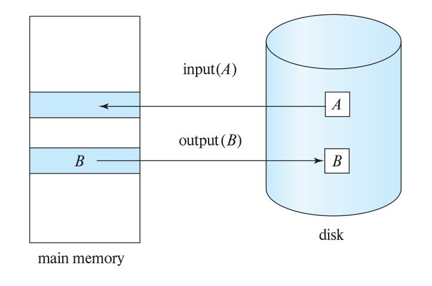

[← Previous: T11.6: Timestamp-Ordering (TSO) Protocol](T11.06_Timestamp_Ordering.md) | [🏠 Index](00_Index.md) | [Next: T12.2: Role of the Recovery Manager →](T12.02_Recovery_Manager_Role.md)

---

# T12.1: Failure Classification and Recovery Precautions

> **Topic:** T12 — Recovery System & RAID | **Priority:** 🔴 High | **Exam Frequency:** 5/7 finals (17 marks)
> **Sources:** Silberschatz 7e Ch. 19 (§19.1–19.2) · Lecture Deck 01 (Slide 23, 26) · Lecture Deck 07 (Slide 8)

## Why This Topic Matters

Every database runs on physical hardware that can fail without warning. Power cuts, software bugs, operating system crashes, and worn-out disk drives can all put your data at risk. To build a reliable system, we first group failures by what they break and then pair them with proactive safeguards during normal operation. Because this topic has appeared in 5 out of 7 RUET semester finals (worth 17 marks total), knowing the three main failure classes and the difference between runtime precautions and post-crash recovery methods is an easy way to pick up full marks.

---

## 📝 Key Definitions

> **Recovery Scheme:** A recovery scheme is a built-in database subsystem that restores the database to a clean, consistent state after a failure. It enforces atomicity by undoing unfinished transactions and enforces durability by keeping all changes from committed transactions.

> **Fail-Stop Assumption:** The fail-stop assumption states that hardware faults or operating system bugs simply stop the CPU and wipe volatile RAM without corrupting non-volatile disk storage. Because the disk stays intact, the recovery manager can read the disk log on reboot and restore the database.

> **Recovery Algorithms:** Recovery algorithms are procedures that guarantee database consistency, transaction atomicity, and durability across crashes. Every recovery algorithm has two parts: precautions taken during normal operation (such as write-ahead logging and checkpoints) and repair actions taken after a crash (such as log undo and redo scans).

---

## The Three Fundamental Classes of DBMS Failure

In database systems, we classify failures based on whether they hit a single transaction, wipe out volatile RAM, or physically damage disk storage:

```text
                        ┌─────────────────────────────────┐
                        │       DBMS Failure Modes        │
                        └────────────────┬────────────────┘
                                         │
         ┌───────────────────────────────┼───────────────────────────────┐
         ▼                               ▼                               ▼
┌──────────────────┐           ┌──────────────────┐            ┌──────────────────┐
│   Transaction    │           │      System      │            │   Disk / Media   │
│     Failure      │           │      Crash       │            │     Failure      │
└────────┬─────────┘           └────────┬─────────┘            └────────┬─────────┘
         │                              │                               │
    ┌────┴────┐                         │                               │
    ▼         ▼                         ▼                               ▼
 Logical    System               Volatile Memory                 Non-Volatile Disk
  Error     Error               (RAM Buffer) Lost               Sectors Destroyed
 (Bad Data) (Deadlock)          Disks Intact (Fail-Stop)        (RAID / Backup Needed)
```

### 1. Transaction Failure
A transaction failure happens when a single transaction has to abort before finishing its work, even though the database server itself is still running fine. These failures come from two main sources:
- **Logical Errors:** The transaction cannot continue because of a problem inside its own logic or input data, such as division by zero, arithmetic overflow, invalid user input, or a missing record.
- **System Errors:** The database engine stops the transaction because the system entered an undesirable state, such as a deadlock (where the concurrency manager picks this transaction as the victim to roll back) or a lock timeout. Unlike logical errors, a transaction aborted for a system error can usually succeed if it restarts later.

### 2. System Crash
A system crash happens when a power outage, hardware fault, or operating system bug brings the entire database server to a halt:
- **Volatile Storage Loss:** Everything in main memory (RAM), including active transaction workspaces and in-memory buffer caches, is wiped out immediately.
- **The Fail-Stop Assumption:** Database recovery relies on the **fail-stop assumption**, which means hardware or OS faults simply stop the CPU without scribbling garbage onto the hard drives. Because the non-volatile disk stays uncorrupted, the recovery manager can read the disk log on reboot and rebuild the lost memory state.

### 3. Disk Failure
A disk failure happens when a physical storage drive gets damaged or loses sectors during a read/write transfer:
- **Causes:** Head crashes, worn-out magnetic surfaces, bad sectors, or disk controller failures destroy data blocks on non-volatile storage.
- **Recovery Requirement:** Because the data on those disk blocks is gone, the database has to rebuild it from redundant copies, such as mirrored RAID drives or off-site archival backups plus archived logs.

### 4. Site or Disaster Failure (Catastrophic Failure)
In rare disasters like fires, floods, or earthquakes, an entire server room can be destroyed. Because local RAID arrays will not survive a building fire, enterprise databases stream their transaction logs over a wide-area network to a remote backup site.

---

## Storage Types and Resilience

To understand why some crashes are easier to recover from than others, it helps to look at the three storage tiers a database uses:

| Storage Type | Speed & Cost | Persistence | Failure Vulnerability | Example Hardware |
| :--- | :--- | :--- | :--- | :--- |
| **Volatile Storage** | Very Fast, High Cost | Lost on power loss or crash | Wiped completely during any system crash | CPU registers, cache, main memory (RAM) |
| **Non-Volatile Storage** | Moderate, Medium Cost | Survives power loss and system crashes | Vulnerable to physical disk head crashes and bad sectors | Magnetic hard disks, solid-state drives (SSDs), optical media |
| **Stable Storage** | Slower (requires multi-write) | Survives all hardware and power failures | Immune to single-point hardware failure (approximated) | Mirrored RAID disks with battery NVRAM, remote replicated storage |

Strictly speaking, **stable storage** is an ideal theoretical concept where data can never be lost. In practice, database servers approximate stable storage by writing multiple copies of every log block onto separate physical disks (via RAID) or across remote servers.

---

## Data Access: Buffer Blocks vs. Physical Blocks

Because hard disks are much slower than RAM, a transaction never edits a disk block directly on the drive. Instead, the database copies the block into a temporary workspace in RAM (called a **buffer block**), edits it there, and writes it back to disk later.


*Figure 12.1: Block storage operations between main memory buffers and physical disk (Silberschatz Figure 19.1).*

The database moves blocks between disk and RAM using two basic operations:
- $\text{input}(B)$: Copies physical block $B$ from disk into a main memory buffer block so transactions can read or modify it.
- $\text{output}(B)$: Writes the modified buffer block $B$ from RAM back to disk, overwriting the physical block on non-volatile storage.
- **Force-Output:** A special call where the database forces a buffer block onto disk right away instead of waiting for the buffer manager's normal background flush.

Why does this distinction matter? If a transaction updates a value in RAM and the power goes out before $\text{output}(B)$ writes that block to disk, the update vanishes with the RAM. Conversely, if $\text{output}(B)$ writes an uncommitted transaction's change to disk and the server crashes before the transaction finishes, the disk now holds dirty, uncommitted data! Recovery algorithms solve both problems.

---

## Runtime Precautions vs. Recovery Methods

Exams frequently ask you to separate **precautions** (what the database does *before* a crash during normal operation) from **recovery methods** (what the database does *after* a crash to clean up):

```text
┌─────────────────────────────────────────────────────────────────────────────┐
│                         Complete Failure Management                         │
└──────────────────────────────────────┬──────────────────────────────────────┘
                                       │
            ┌──────────────────────────┴──────────────────────────┐
            ▼                                                     ▼
┌───────────────────────────────┐             ┌───────────────────────────────┐
│     Runtime Precautions       │             │       Recovery Methods        │
│    (Proactive / Preventive)   │             │     (Reactive Post-Crash)     │
├───────────────────────────────┤             ├───────────────────────────────┤
│ • Write-Ahead Logging (WAL)   │             │ • Log Undo (Aborted Txns)     │
│ • Non-Volatile RAM (NVRAM)    │             │ • Log Redo (Committed Txns)   │
│ • RAID Arrays (Disk Mirroring)│             │ • Checkpoint Restart Scan     │
│ • Uninterruptible Power (UPS) │             │ • Shadow Paging Pointer Swap  │
│ • Periodic Checkpoints        │             │ • Archival Backup Restore     │
│ • Off-site Archival Backups   │             │ • Roll-Forward Log Replay     │
└───────────────────────────────┘             └───────────────────────────────┘
```

### 1. Precautions Taken During Normal Operation
To make sure a future crash is recoverable, the DBMS takes five main precautions while running normally:
- **Write-Ahead Logging (WAL):** Always flush the log record describing an update to stable storage *before* writing the modified data block to disk.
- **Battery-Backed NVRAM and UPS:** Use backup batteries so sudden power cuts do not wipe out in-flight buffer writes mid-transfer.
- **RAID Storage Arrays:** Store data across mirrored (RAID 1) or parity-protected (RAID 5/6) disks so a dead hard drive does not lose data.
- **Regular Checkpointing:** Periodically flush dirty RAM buffers to disk and mark the log so the recovery manager does not have to replay the entire log from day one.
- **Archival Off-Site Dumps:** Take scheduled full backups to separate tapes or cloud storage in case a disk array or building fails.

### 2. Post-Failure Recovery Methods
Once a crash actually happens and the server reboots, the recovery manager runs these procedures to restore a clean state:
- **Log-Based Undo:** Scans the log backward to reverse any changes made by transactions that were still unfinished when the crash hit, restoring their old values ($V_1$).
- **Log-Based Redo:** Scans the log forward to reapply changes made by transactions that had already committed before the crash ($V_2$), making sure their work is not lost.
- **Checkpoint-Guided Recovery:** Starts the recovery scan from the latest checkpoint record instead of the beginning of the log, saving huge amounts of reboot time.
- **Shadow Paging:** Keeps a shadow page table pointing to untouched disk blocks and commits by flipping a single `db-pointer` on disk, avoiding log undo passes altogether.
- **Archival Roll-Forward:** After a disk failure, loads the latest full backup onto a replacement drive and replays the archived transaction logs up to the moment of failure.

---

## Exam Variants

The table below summarizes how failure classification and recovery precautions have been tested in RUET semester finals:

| Year & Question | Marks | Scenario / Data Given | Key Result / Answer Summary |
| :--- | :---: | :--- | :--- |
| **2017 Q.6(c)** | 3 | Direct theory on DBMS failures | Three classes: Transaction failure (logical/system), System crash (fail-stop), Disk failure. |
| **2018 Q.5(c)** (Part 1) | 2 | Split question: discuss each failure type | Concise 1-sentence breakdown of transaction failure, system crash, and disk failure. |
| **2019 Q.4(b)** | 5 | Three-part question: failure modes, precautions, recovery methods | 3 failure modes, 4 runtime precautions (WAL, UPS, RAID, archives), and 4 recovery methods (undo/redo, checkpoints, shadow paging, archival restore). |
| **2023 Q.7(a)** | 3 | Types of failures that occur in a database system | Same 3 primary classes with storage failure modes explained. |
| **2024 Q.3(b)** | 4 | Failure modes, precautions, and recovery methods | Structured response across failures, proactive precautions, and reactive recovery algorithms. |

---

## 🏆 Golden Questions (Past Exam Archive)

### 🎯 GQ1 · 2017 Q.6(c) · Classification of DBMS Failures

> **Appeared:** 2017 Q.6(c) (3 marks) — Section B

**Question:**

Classify and discuss the failures in DBMS.

**Full Answer:**

A database management system experiences three primary classes of failure, distinguished by the affected storage and execution layer:

1. **Transaction Failure:** An individual transaction aborts before reaching its normal completion. It does not crash the database engine.
   - *Logical Error:* Caused by internal software or input logic errors. Examples include division by zero, numeric overflow, bad input format, or requested data not found.
   - *System Error:* Caused by undesirable system states. Examples include deadlock victim selection by the concurrency controller or transaction timeouts. The transaction must abort and restart later.

2. **System Crash:** A hardware malfunction, power loss, or operating system bug halts the database server.
   - The contents of **volatile storage** (main memory RAM and cache buffers) are lost.
   - The contents of **non-volatile storage** (disk drives) remain intact and uncorrupted under the **fail-stop assumption**.
   - Active transactions that were executing during the crash are interrupted and must be recovered upon reboot.

3. **Disk Failure:** Physical media destruction destroys data blocks on non-volatile storage.
   - Causes include disk head crashes, magnetic surface defects, bad sectors, or data bus transfer failures.
   - Recovery requires redundant data structures, such as RAID storage arrays or archival backups stored on separate media.

*(Optional fourth class: Site/Disaster Failure, where fire, flood, or power grid collapse destroys an entire facility, requiring off-site replication).*

---

### 🎯 GQ2 · 2018 Q.5(c) [Part 1] · Failure Types in DBMS

> **Appeared:** 2018 Q.5(c) [Part 1] (2 of 4 marks) — Section B

**Question:**

Discuss each type of failure that can happen in DBMS. How does RAID model help to recover a system?

*(Note: This is Part 1 covering the failure discussion for 2 marks. For the second part on RAID recovery, see T12.04).*

**Full Answer:**

A DBMS is subject to three primary failure types:

1. **Transaction Failure:** A single transaction aborts due to internal logical errors (such as invalid user inputs or division by zero) or system concurrency actions (such as deadlock aborts).
2. **System Crash:** Hardware faults or power outages erase volatile main memory (RAM). Non-volatile disk blocks remain intact under the fail-stop assumption.
3. **Disk Failure:** Physical head crashes, bad sectors, or hardware wear destroy non-volatile disk blocks.

---

### 🎯 GQ3 · 2019 Q.4(b) · Failure Modes, Precautions, and Recovery Methods

> **Appeared:** 2019 Q.4(b) (5 marks) — Section A

**Question:**

How many ways a DBMS could be failed? What precautions should be taken considering the failure of DBMS and point out the recovery methods.

**Full Answer:**

A complete database fault-tolerance strategy covers failure modes, runtime precautions, and recovery algorithms:

#### 1. Ways a DBMS Can Fail
A DBMS can fail in three primary ways (plus external catastrophe):
- **Transaction Failure:** Caused by internal logic errors (bad inputs, division by zero) or system concurrency aborts (deadlocks).
- **System Crash:** Caused by power cuts, CPU failures, or operating system halts. Erases volatile RAM while disk storage survives intact.
- **Disk Failure:** Caused by physical head crashes, bad sectors, or mechanical wear destroying disk storage blocks.
- **Disaster / Site Failure:** Caused by fires, floods, or earthquakes destroying an entire data center.

#### 2. Precautions Taken During Normal Operation
To prepare for failures, the DBMS implements proactive safeguards during standard execution:
- **Write-Ahead Logging (WAL):** Every modification log record must reach stable storage before the modified data block is written to disk.
- **Uninterruptible Power Supply (UPS) & Battery NVRAM:** Prevents cache data loss and partial block writes during sudden power interruptions.
- **RAID Disk Arrays:** Uses disk mirroring (RAID 1) or distributed parity (RAID 5/6) to tolerate single or double drive failures without data loss.
- **Periodic Checkpointing:** Periodically forces modified memory buffers to disk and records active transaction IDs to limit restart time.
- **Archival Off-Site Backups:** Creates periodic full or incremental database dumps on remote physical media or cloud storage.

#### 3. Post-Failure Recovery Methods
When restarting after a failure, the database executes specific recovery procedures:
- **Log-Based Recovery (Undo / Redo):**
  - *Undo:* Scans backward to restore pre-failure values ($V_1$) for all transactions active at crash time, ensuring atomicity.
  - *Redo:* Scans forward to reapply new values ($V_2$) for all transactions that committed before the crash, ensuring durability.
- **Checkpoint-Guided Restart:** Uses the checkpoint record to identify active transactions and avoids redoing transactions that committed before the checkpoint.
- **Shadow Paging:** Replaces log-based undo by maintaining two page tables (current and shadow). It commits updates by atomically updating a disk pointer.
- **Archival Restore & Roll-Forward:** Replaces a ruined physical disk with a spare, restores the last full archival backup, and replays archived logs up to the crash point.

---

### 🎯 GQ4 · 2023 Q.7(a) · Types of Failures in a Database System

> **Appeared:** 2023 Q.7(a) (3 marks) — Section B · CLO2

**Question:**

Explain the different types of failures that can occur in a database system.

**Full Answer:**

A database management system is vulnerable to three principal classes of failure based on the affected hardware and software layers:

1. **Transaction Failure:**
   - *Logical Errors:* The transaction cannot complete because of an internal error condition such as arithmetic overflow, division by zero, invalid input syntax, or requested data not found.
   - *System Errors:* The database terminates the transaction because the system entered an undesirable state, such as a concurrency deadlock (victim abort) or transaction lock timeout.

2. **System Crash:**
   - Hardware malfunctions, power outages, or operating system kernel panics bring the database server to an abrupt halt.
   - Volatile memory (RAM cache buffers) is entirely lost.
   - Non-volatile disk storage remains intact and uncorrupted under the **fail-stop assumption**.

3. **Disk Failure:**
   - Physical defects on non-volatile media, such as disk head crashes, magnetic surface degradation, or bad sectors, destroy disk blocks.
   - Data must be reconstructed using RAID parity/mirrors or restored from off-site archival backups.

---

### 🎯 GQ5 · 2024 Q.3(b) · Ways of DBMS Failure, Precautions, and Recovery Methods

> **Appeared:** 2024 Q.3(b) (4 marks) — Section A · CO1

**Question:**

Discuss the ways of DBMS can be failed. Also, mention the precautions should be taken considering the failure of DBMS and point out the recovery methods.

**Full Answer:**

A complete fault-tolerance strategy addresses failure modes, preventive precautions, and post-crash recovery methods:

**Part 1: Ways a DBMS Can Fail**
- **Transaction Failure:** Aborts caused by internal logical bugs (invalid user inputs, division by zero) or system concurrency decisions (deadlock victim rollbacks).
- **System Crash:** Server halts due to power cuts, CPU faults, or OS crashes. Wipes volatile RAM while non-volatile disk stays intact (fail-stop assumption).
- **Disk Failure:** Physical head crashes, bad sectors, or bus failures that destroy non-volatile disk blocks.
- **Site/Disaster Failure:** Complete destruction of a physical data center due to natural disasters (fire, earthquake).

**Part 2: Precautions Taken During Normal Operation**
- **Write-Ahead Logging (WAL):** Ensure update log records reach stable storage before modified data blocks are flushed to disk.
- **UPS and Battery-Backed NVRAM:** Protect in-flight buffer cache data against sudden power loss.
- **RAID Arrays:** Employ mirroring (RAID 1) or distributed parity (RAID 5/6) to survive drive failures without downtime.
- **Periodic Checkpoints:** Periodically flush dirty blocks to disk and log active transaction IDs, bounding post-crash recovery time.
- **Archival Off-Site Dumps:** Maintain scheduled cold backups in remote cloud or tape storage.

**Part 3: Post-Failure Recovery Methods**
- **Log Undo Pass:** Scans log records backward to revert modifications made by active, uncommitted transactions, restoring original values ($V_1$) to enforce atomicity.
- **Log Redo Pass:** Scans log records forward to reapply modifications made by committed transactions, applying new values ($V_2$) to enforce durability.
- **Checkpoint-Guided Recovery:** Skips redoing transactions that committed before the most recent checkpoint, drastically speeding up restart time.
- **Shadow Paging:** Atomically flips `db-pointer` to point from the current page table to the shadow page table, avoiding log-based undo passes.
- **Archival Restore & Roll-Forward:** Restores the last offline backup onto a replacement disk and rolls forward through subsequent transaction logs.

---

## 📖 High-Yield Exercises from the Book

### 🎯 HYE-01 · Exercise 19.14 · Storage Hierarchy & I/O Cost Trade-Offs in Recovery

> **Source:** Silberschatz 7e · Chapter 19 (Exercise 19.14)  
> **Exam Relevance:** High-Probability Systems Theory Question  
> **Key Tested Concept:** Comparative analysis of volatile, nonvolatile, and stable storage in terms of physical access latency, I/O transfer cost, and fault-tolerance roles.

**Problem Statement:**
> Explain the difference between the three storage types—**volatile storage**, **nonvolatile storage**, and **stable storage**—in terms of access speed, durability, and **I/O cost**.

**Model Exam-Style Solution:**

1. **Comparative Overview of Storage Types:**

| Storage Type | Typical Media | Volatility & Failure Survival | Access Latency | Transfer Cost per Block Operation | Role in DBMS Recovery |
| :--- | :--- | :--- | :--- | :--- | :--- |
| **Volatile Storage** | Main memory (DRAM), CPU cache, SRAM | Content lost across power loss, OS crashes, or CPU halts | Tens of nanoseconds ($10^{-9}\text{ s}$) | **0 block I/Os** (Direct memory load/store via bus) | High-speed buffer pool for active data items and in-memory log buffer |
| **Non-Volatile Storage** | Magnetic hard disks (HDDs), Solid-State Drives (SSDs), Flash, Optical media | Survives system crashes and power cuts under the *fail-stop assumption*; vulnerable to physical disk head crashes and media decay | Microseconds ($10^{-6}\text{ s}$) for SSDs; Milliseconds ($10^{-3}\text{ s}$) for HDDs (seek + rotational latency) | **1 physical I/O** ($\text{input}(B)$ read or $\text{output}(B)$ write) | Permanent database storage; holding database tables and indexes |
| **Stable Storage** | Idealized abstraction approximated via RAID arrays (mirrored disks), battery-backed NVRAM, and remote off-site replication | Survives *all* system crashes, disk head crashes, bad sectors, and localized physical site disasters | Milliseconds to tens of milliseconds (dominated by multi-disk synchronization and network round-trip time) | **$\ge 2$ physical I/O writes** (Sequential dual-writes with verify) + network transfer overhead | Storing Write-Ahead Log records and checkpoint markers to guarantee ACID Durability |

2. **I/O Cost Analysis:**
   - **Volatile Storage:**
     - Incurs zero secondary storage I/O. Access occurs via standard machine instructions (`LOAD`/`STORE`) directly over the CPU memory bus.
     - However, because it cannot survive a power failure, data cannot be considered durable while residing solely in volatile storage.
   - **Non-Volatile Storage:**
     - Every block read requires an $\text{input}(B)$ operation (transferring a 4 KB–8 KB physical block into memory cache).
     - Every block write requires an $\text{output}(B)$ operation (flushing a modified buffer block back to disk).
     - For magnetic HDDs, each random I/O incurs mechanical seek latency ($\approx 4\text{–}8\text{ ms}$) plus rotational delay ($\approx 2\text{–}4\text{ ms}$), making disk I/O the primary bottleneck in transaction processing.
   - **Stable Storage:**
     - To ensure that a failure during data transfer (such as a power failure while writing a sector) does not corrupt the block, stable storage cannot rely on a single physical write.
     - Implementing a single write to stable storage requires **two consecutive physical block writes** to separate non-volatile drives:
       1. Write to Primary Disk Block 1.
       2. Await hardware write confirmation and verify block checksum.
       3. Write to Secondary/Mirrored Disk Block 2.
       4. Await confirmation.
     - Consequently, the I/O write cost of stable storage is **at least double ($2\times$) that of non-volatile storage**, plus the added computational overhead of checksum verification and logging synchronization. $\blacksquare$

**💡 RUET Exam Takeaway:**
When asked to compare storage types in terms of I/O cost, examiners look for the numerical contrast: **Volatile = 0 disk I/O**; **Non-volatile = 1 physical disk I/O**; **Stable = $\ge 2$ physical disk I/Os (dual writes + checksum verify)**.

---

### 🎯 HYE-02 · Exercise 19.15 · Theoretical Limits of Stable Storage and Practical Realization

> **Source:** Silberschatz 7e · Chapter 19 (Exercise 19.15)  
> **Exam Relevance:** Prime Overdue Advanced Recovery Drill  
> **Key Tested Concept:** Why infallible stable storage is theoretically impossible, and how modern enterprise DBMSs simulate it using redundant disk arrays, dual-write protocols, and off-site replication.

**Problem Statement:**
> "Stable storage cannot be implemented."
> 1. Explain from a theoretical and physical perspective why stable storage cannot truly be implemented.
> 2. Explain the detailed techniques and protocols database systems use to solve this problem and approximate stable storage in practice.

**Model Exam-Style Solution:**

1. **Why True Stable Storage Cannot Be Implemented:**
   - **Non-Zero Physical Failure Probability:** Every physical storage medium—whether magnetic platters, silicon NAND flash, or optical layers—is subject to physical wear, electromagnetic interference, component degradation, and hardware defects.
   - **Common-Mode & Catastrophic Failures:** Even if data is replicated across multiple local disks, independent failure modes cannot be 100% guaranteed. Events such as:
     - Simultaneous power surges that fry disk controller boards,
     - Catastrophic physical disasters (fire, flooding, earthquake destroying the entire server room),
     - Malicious physical destruction or war,
     will destroy all local replicas simultaneously.
   - **Theoretical Impossibility:** Because the probability of simultaneous destruction of all copies $P(\text{all fail}) > 0$, an *absolutely infallible* storage medium that *never* loses data under any circumstance is physically impossible to construct.

2. **How Database Systems Deal With This Problem in Practice:**
   DBMSs approximate stable storage by implementing multi-tiered redundancy such that the probability of data loss is reduced to an infinitesimally small value (e.g., $99.999999999\%$ reliability, or "eleven nines"):

   - **Technique 1: Mirrored Disks (RAID 1 / RAID 10) with Independent Power & Controllers:**
     - Two identical physical blocks are maintained on separate disks attached to independent host bus adapters.

   - **Technique 2: The Careful Dual-Write Protocol (Atomic Block Write Algorithm):**
     - To survive failures occurring *in the middle of a write* (partial block writes), the DBMS executes the following strict sequential protocol:

```text
       Buffer Block B (in RAM)
                 │
                 ├───────────────────────────────┐
                 │ 1. Write Block Copy 1         │
                 ▼                               │
       ┌──────────────────┐                      │
       │  Physical Disk 1 │                      │
       └─────────┬────────┘                      │
                 │ 2. Wait for completion        │
                 │    & checksum validation      │
                 ▼                               │
                 ├───────────────────────────────┘
                 │ 3. Write Block Copy 2
                 ▼
       ┌──────────────────┐
       │  Physical Disk 2 │
       └─────────┬────────┘
                 │ 4. Output complete!
                 ▼
```

     - **Crash Recovery Rule for Mirrored Blocks:**
       During post-crash restart, the DBMS checks both copies:
       1. If one block has an invalid checksum (corrupted by a mid-write crash), its contents are overwritten by the good block.
       2. If both blocks have valid checksums but differing contents (crash occurred after Step 2 but before Step 4), the DBMS replaces the contents of Block 2 with Block 1.
       3. Result: The write either completely succeeds or leaves the previous consistent version intact—guaranteeing **atomic block writes**.

   - **Technique 3: Remote Backup and Disaster Recovery:**
     - To survive physical site destruction, updates written to local stable storage are transmitted synchronously or asynchronously over optical fiber networks to a geographically remote secondary data center (e.g., in another city or country).

   - **Technique 4: Periodic Archival Dumps:**
     - Full snapshots of the database are periodically written to durable offline media (magnetic tapes or immutable cloud storage) and stored in secure off-site vaults. $\blacksquare$

**💡 RUET Exam Takeaway:**
To earn full marks on Exercise 19.15, break your answer into the two requested parts: (1) Theory: non-zero probability of simultaneous failure / disaster; (2) Practice: Mirrored disk dual-write protocol with checksums, RAID redundancy, and remote off-site replication.

---

## ⚡ Exam Tips & Common Mistakes

1. **System Crash vs. Disk Failure Trap:** A system crash only destroys volatile memory (RAM buffers). Disks survive uncorrupted under the fail-stop assumption. Never say a system crash destroys disk data.
2. **Precautions vs. Recovery Methods Trap:** Precautions happen *before* a crash (WAL, RAID, UPS, checkpoints). Recovery methods execute *after* a crash (undo, redo, roll-forward). Keeping these two lists distinct earns full marks.
3. **Always Cite the Fail-Stop Assumption:** When discussing system crashes, state that modern systems rely on the fail-stop assumption. It shows examiners you understand textbook recovery foundations.
4. **Distinguish Logical vs. System Transaction Errors:** A logical error is internal to the application code (like division by zero). A system error is external (like deadlock victim selection).

---

## 🔗 Related Topics

- [T12.02: Role of the Recovery Manager](T12.02_Recovery_Manager_Role.md) — Why transaction aborts require recovery even if hardware never crashes.
- [T12.03: Log-Based Recovery and Shadow Paging](T12.03_Log_Based_Recovery_and_Shadow_Paging.md) — Deep dive into WAL, undo/redo passes, and checkpoint mechanics.
- [T12.04: RAID Levels and Storage Reliability](T12.04_RAID_Levels.md) — Hardware disk redundancy, parity math, and recovery roles.
- [T09.03: Transaction States](T09.03_Transaction_States.md) — The active, partially committed, failed, and aborted state lifecycle.

---

[← Previous: T11.6: Timestamp-Ordering (TSO) Protocol](T11.06_Timestamp_Ordering.md) | [🏠 Index](00_Index.md) | [Next: T12.2: Role of the Recovery Manager →](T12.02_Recovery_Manager_Role.md)
