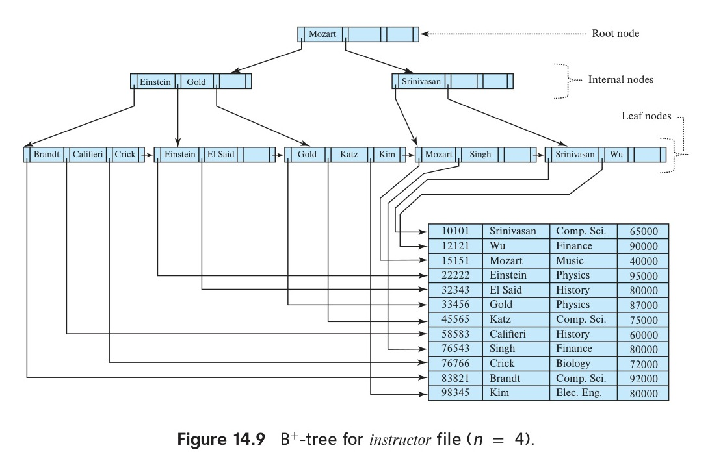

[← Previous: T13.2: SQL Injection](T13.02_SQL_Injection.md) | [🏠 Index](00_Index.md) | [Next: T13.4: Static vs. Dynamic Hashing →](T13.04_Static_vs_Dynamic_Hashing.md)

---

# T13.3: Ordered Indexing — Dense vs. Sparse Index and B+-Trees

> **Topic:** T13 — Security, Indexing & Hashing | **Priority:** 🟢 Low | **Exam Frequency:** 1/7 finals (+ 0 CTs) (2 marks)
> **Sources:** Silberschatz 7e Ch. 14 (§14.1, §14.2, §14.3)

## Why This Topic Matters

Ordered indices are the primary access structures used by relational database engines to accelerate data retrieval. Without an index, the database engine must scan every block in a table to satisfy a query. This topic appeared in 2023 Q.8(a) for 2 marks as a short note comparing dense and sparse indices. Understanding the tradeoff between query lookup speed, storage overhead, and file ordering constraints is essential for database exams.

---

## 📝 Key Definitions

> **Index Entry:** "An index entry, or index record, consists of a search-key value and pointers to one or more records with that value as their search-key value." — Silberschatz, Korth & Sudarshan, *Database System Concepts* (7th Ed.), §14.2.1 (p. 626)

> **Dense Index:** "In a dense index, an index entry appears for every search-key value in the file. In a dense clustering index, the index record contains the search-key value and a pointer to the first data record with that search-key value... In a dense nonclustering index, the index must store a list of pointers to all records with the same search-key value." — Silberschatz, Korth & Sudarshan, *Database System Concepts* (7th Ed.), §14.2.1 (p. 626)

> **Sparse Index:** "In a sparse index, an index entry appears for only some of the search-key values. Sparse indices can be used only if the relation is stored in sorted order of the search key; that is, if the index is a clustering index." — Silberschatz, Korth & Sudarshan, *Database System Concepts* (7th Ed.), §14.2.1 (p. 626)

> **B+-Tree:** "A B+-tree index takes the form of a balanced tree in which every path from the root of the tree to a leaf of the tree is of the same length." — Silberschatz, Korth & Sudarshan, *Database System Concepts* (7th Ed.), §14.3 (p. 634)

---

## Fundamentals of Database Indexing

Think of a database index like the index at the back of a textbook. Instead of reading all 1,000 pages from start to finish (a **full-table scan**) just to find one topic, you look up the keyword in a sorted index and jump straight to the exact page number.

Before comparing index types, let's clarify four core terms:

1. **Search Key:** Any attribute or combination of attributes used to look up records in a file (for example, `ID` or `dept_name`). Note that a "search key" in indexing does not have to be unique like a primary key or candidate key.
2. **Index Entry (Index Record):** A small pair consisting of a search-key value and one or more pointers to the disk block and offset where those records live.
3. **Clustering Index (Primary Index):** An index built on the exact same attribute that determines how the data file is physically sorted on disk. Because a file can only be physically sorted in one order, a table can have **at most one** clustering index.
4. **Non-Clustering Index (Secondary Index):** An index built on any attribute whose order differs from the physical sort order of the data file. A table can have many secondary indices.

---

## Dense Indices: Structure and Mechanics

In a **dense index**, the index stores an entry for **every single search-key value** that exists in the data file.


*Figure 13.2: Dense clustering index on the instructor file sorted by ID (Source: Textbook Ch. 14, Fig. 14.2).*

### How a Dense Index Works

- **On a Sorted File (Dense Clustering Index):** Because rows with the same search key sit right next to each other on disk, the index entry only needs to point to the *first* record with that search-key value.
- **On an Unsorted File (Dense Secondary Index):** Because rows with the same search-key value (such as `dept_name = 'Physics'`) might be scattered across dozens of different disk blocks, the index entry must store a list of pointers to *every* matching record.
- **How Lookup Works:**
  1. The database runs a fast search on the index file for your target key $K$.
  2. Because every search-key value has its own entry in a dense index, the database immediately knows whether $K$ exists without even touching the data file.
  3. If found, it follows the pointer directly to the exact disk block and record.
- **Pros:**
  - Fastest possible lookup, since every key points straight to its record.
  - Works on **both sorted and unsorted** files (which is why every secondary index *must* be dense).
- **Cons:**
  - Takes up a lot of space (one entry per search-key value), so a large dense index may not fit in RAM.
  - Higher update cost, because inserting or deleting a record almost always forces an update to the index too.

---

## Sparse Indices: Structure and Mechanics

In a **sparse index**, the index stores entries for **only some of the search-key values**, typically just **one entry per disk block** (pointing to the first record in that block).


*Figure 13.3: Sparse clustering index on the instructor file sorted by ID (Source: Textbook Ch. 14, Fig. 14.3).*

### Intuitive Analogy & Strict Rule: Why the File Must Be Sorted

Think of the guide words printed at the very top corner of a dictionary page. The top of page 42 might only say **"Apple"**, and the top of page 43 says **"Apricot"**. Even though **"Apply"** is not printed in the page header, you know with 100% certainty that **"Apply"** must be on page 42 because the dictionary is alphabetically sorted and `"Apple" <= "Apply" < "Apricot"`.

If the dictionary words were printed in random order, those top-of-page guide words would be completely useless! For the exact same reason, **a sparse index can only be built if the data file is physically sorted on the search key** (a clustering index).

### How a Sparse Index Works

- **How Lookup Works for Target Key $K$:**
  1. Look through the sparse index for the **largest index key $K_i$ that is less than or equal to $K$** ($K_i \le K$).
  2. Follow $K_i$'s pointer to load that single disk block into memory.
  3. Scan forward through the records inside that block in RAM until you find $K$ (or hit a key larger than $K$, proving $K$ is not in the file).
- **Pros:**
  - Tiny storage footprint. Because there is only one entry per disk block instead of one per row, the sparse index often fits completely inside fast main memory (RAM).
  - Cheaper inserts and deletes. You can add or remove rows inside a block without touching the sparse index at all, unless you change the very first record of a block.
- **Cons:**
  - Lookup requires a short sequential scan inside the target disk block after loading it.
  - Cannot be used if the file is not physically sorted on the search key.

### Why "One Entry Per Disk Block" Is the Sweet Spot

In database systems, reading a block from a disk takes milliseconds, whereas scanning through a block that is already in CPU memory takes only microseconds (thousands of times faster). By keeping exactly **one sparse index entry per disk block**, the index stays small enough to sit in RAM while still guaranteeing that you only ever fetch **one data block from disk** to find your record.

---

## Side-by-Side Comparison: Dense vs. Sparse Index

| Feature | Dense Index | Sparse Index |
| :--- | :--- | :--- |
| **Number of Entries** | One entry for every search-key value in the data file. | One entry for only some search-key values (typically one per data block). |
| **File Order Requirement** | Can be built on sorted or unsorted files. | Strictly requires the data file to be physically sorted on the search key. |
| **Lookup Performance** | Faster. Directly retrieves the target record location. | Slower. Requires index lookup followed by a sequential scan within the block. |
| **Space Overhead** | Large. Index file can approach the size of the data file itself. | Small. Index file is compact and often fits entirely in RAM. |
| **Maintenance Cost** | High. File insertions and deletions frequently require updating the index. | Low. Records can often be inserted or removed within a block without index updates. |
| **Applicability** | Required for all secondary (non-clustering) indices and optional for primary indices. | Usable only for primary (clustering) indices. |
| **Analogy** | Subject index at the back of a textbook with an entry for every topic. | Guide words at the top of a dictionary page showing the first word per page. |

---

## Multilevel Indices and B+-Tree Architecture

What happens when a table grows to hundreds of millions of rows? Even a sparse index with one entry per block becomes too large to fit in RAM! If an index takes up $b$ blocks on disk, running a binary search across those index blocks on disk costs:

$$
\lceil \log_2(b) \rceil
$$

random disk reads. For example, if $b = 10{,}000$ blocks, binary search needs $\lceil \log_2(10{,}000) \rceil = 14$ disk reads just to search the index itself.

### Multilevel Index Intuition

Instead of binary-searching a huge index on disk, we can build a **sparse index on top of the index**! The original index becomes the *inner index*, and the smaller sparse index on top becomes the *outer index*. If the outer index is still too big for RAM, we add one more level on top, creating a **multilevel tree**.

### B+-Tree Index Files: Why Fanout and Splits Matter

A **B+-tree** is a self-balancing multilevel index that automatically keeps every path from the root to any leaf the exact same length, even as thousands of rows are inserted and deleted.


*Figure 13.4: Complete balanced B+-tree index on the instructor file with fanout n = 4 (Source: Textbook Ch. 14, Fig. 14.9).*

#### Intuitive Meaning of Fanout ($n$) and Node Splits
- **What Fanout ($n$) Means:** The parameter $n$ (called the **fanout** or order) is the maximum number of pointers a single B+-tree node can hold. A node with $n$ pointers can hold up to $n - 1$ search-key values.
- **Why High Fanout Makes Databases Fast:** In Figure 13.4, $n = 4$ is tiny just so the diagram fits on a page. In a real database, a single 4 KB disk block holds around $n = 100$ pointers! With a fanout of 100, a 3-level B+-tree can index $100^3 = 1{,}000{,}000$ leaf blocks in just 3 steps. And since the top levels stay cached in RAM, finding any record out of millions takes just **1 disk read**.
- **How Node Splits Keep the Tree Balanced:** Every node must stay at least half full. When you insert a new key into a leaf node that already has $n - 1$ keys, the node overflows and **splits** into two nodes, pushing its middle separator key up into the parent node. If the parent is also full, the parent splits too, all the way up to the root. Because the tree only grows taller when the root itself splits, all leaves stay at the exact same depth.

### B+-Tree Node Structure ($n$ Pointers, $n - 1$ Keys)

1. **Leaf Nodes (Bottom Level = Dense Index):**
   - Every search key in the table appears in a leaf node.
   - The first $n - 1$ pointers ($P_1, \dots, P_{n-1}$) point directly to the data records on disk for keys $K_1, \dots, K_{n-1}$.
   - The last pointer $P_n$ is special: it links each leaf node to its right-hand neighbor leaf node in sorted order. That way, if a query asks for `WHERE salary BETWEEN 50000 AND 90000`, the database finds `50000` in a leaf and then simply glides across the $P_n$ sibling pointers without climbing back up the tree!
2. **Internal / Non-Leaf Nodes (Upper Levels = Multilevel Sparse Index):**
   - Internal nodes act like traffic signposts that route your search down to the right child node.
   - If an internal node currently holds $m$ pointers, pointer $P_1$ leads to keys strictly less than $K_1$, each middle pointer $P_i$ leads to keys in the range $[K_{i-1}, K_i)$, and the last active pointer $P_m$ leads to keys greater than or equal to $K_{m-1}$.

---

## Worked Example: Looking Up `ID = 22222` (`Einstein`) Across All Three Indices

Let's trace how the database locates instructor `ID = 22222` (`Einstein`) in Figures 13.2, 13.3, and 13.4 so you can see the difference immediately:

### 1. Using the Dense Index (Figure 13.2)
1. Search the dense index for `22222`. Because every ID is listed, we find `22222` right in the index.
2. Follow its pointer straight to the fourth record in the data file (`22222, Einstein, Physics, 95000`).
3. **Result:** Direct hit with zero scanning of neighboring rows.

### 2. Using the Sparse Index (Figure 13.3)
1. Check the sparse index entries: `10101`, `32343`, and `76766`. Notice `22222` is not listed!
2. Pick the largest index key that is $\le 22222$, which is `10101`.
3. Follow `10101`'s pointer to load the first disk block into memory, and scan downward from `10101`:
   - `10101` (Srinivasan) $\rightarrow$ keep scanning
   - `12121` (Wu) $\rightarrow$ keep scanning
   - `15151` (Mozart) $\rightarrow$ keep scanning
   - `22222` (Einstein) $\rightarrow$ **Found!**
4. **Result:** Smaller index in RAM, traded for a quick 4-row scan inside the loaded block.

### 3. Using the B+-Tree Index on `name` (Figure 13.4, fanout $n = 4$)
Suppose we search for `'Einstein'` in the B+-tree of Figure 13.4:
1. **Root Node `[Mozart]`:** Since `'Einstein' < 'Mozart'`, follow the left pointer $P_1$.
2. **Internal Node `[Einstein | Gold]`:** Here $K_1 = \text{'Einstein'}$ and $K_2 = \text{'Gold'}$. Because our target satisfies $\text{'Einstein'} \le \text{'Einstein'} < \text{'Gold'}$, we follow the middle pointer $P_2$.
3. **Leaf Node `[Einstein | El Said]`:** We find `'Einstein'` in the leaf and follow its record pointer $P_1$ to fetch the row from disk.

---

## Exam Variants

| Year & Question | Marks | Scenario / Data Given | Key Result / Answer Summary |
| :--- | :---: | :--- | :--- |
| **2023 Q.8(a)** | 2 | Short note on dense and sparse index | Define dense (entry for every key) and sparse (entry for some keys), state the lookup rule, and give a 4-row comparison table. |
| **Expected Variant 1** | 4 | Multilevel index calculation | Calculate binary search cost $\lceil \log_2 b \rceil$ vs. 2-level sparse index I/O savings. |
| **Expected Variant 2** | 3 | B+-tree leaf vs internal node structure | Detail leaf chaining pointer $P_n$ and non-leaf subtree routing ranges. |

---

## 🏆 Golden Questions (Past Exam Archive)

### 🎯 GQ1 · 2023 Q.8(a) · Short Note on Dense and Sparse Index

> **Appeared:** 2023 Q.8(a) — (02 marks)

**Question:**

Write short note on dense and sparse index.

**Full Answer:**

**1. Dense Index:**
- An index structure that contains an index record for **every search-key value** present in the data file.
- **Lookup:** The database engine searches the index for the search key and immediately follows its pointer directly to the target data record.
- **Advantage:** Faster lookup speed because every key maps directly to a record pointer.
- **Disadvantage:** Large storage overhead and higher maintenance cost on record insertions and deletions. It can be built on sorted or unsorted data files.

**2. Sparse Index:**
- An index structure that contains index records for **only some of the search-key values** in the data file (typically one entry per disk block).
- **Lookup:** The database engine finds the largest index value that is less than or equal to the target search key, follows that pointer to the target data block, and scans the block sequentially to locate the record.
- **Advantage:** Much smaller index size (often fits in main memory) and lower insertion/deletion maintenance overhead.
- **Prerequisite:** Can **only** be used if the data file is physically sorted on the search key (clustering index).

**3. Comparison Summary:**

| Feature | Dense Index | Sparse Index |
| :--- | :--- | :--- |
| **Index Records** | Entry for every search-key value. | Entry for only some search-key values. |
| **Lookup Speed** | Faster (direct pointer to record). | Slower (index lookup + block scan). |
| **Storage Overhead** | High (large index size). | Low (compact index size). |
| **File Order** | Can be sorted or unsorted. | File must be sorted on search key. |

---

## 📖 High-Yield Exercises from the Book

### 🎯 HYE-01 · Practice Exercise 14.2 · Dense vs Sparse Indices Comparative Trade-Offs

> **Source:** Silberschatz 7e · Chapter 14 (Practice Exercise 14.2)  
> **Exam Relevance:** High-Probability Indexing Question (RUET Syllabus Unit 8)  
> **Key Tested Concept:** Index storage overhead, search time, record insertion/deletion maintenance, and clustering prerequisites.

**Problem Statement:**
> 1. Distinguish between a **Dense Index** and a **Sparse Index**, illustrating each with a schematic diagram.
> 2. Explain why a sparse index can **ONLY** be used if the relation is physically sorted (ordered) on the search key, whereas a dense index can be built on an unordered file.
> 3. Compare dense and sparse indices across:
>    - Index file storage footprint.
>    - Record lookup time (disk I/O operations).
>    - Maintenance overhead during record insertions and deletions.

**Model Exam-Style Solution:**

1. **Definitions & Diagrams:**
   - **Dense Index:** An index record (search-key value, pointer) appears for **every single search-key value** in the data file.
   - **Sparse Index:** An index record appears for **only some search-key values** (typically one index entry per physical disk block).

```text
   Dense Index (Entry for every key):             Sparse Index (Entry per data block):
   Index File            Data File                Index File            Data File
   ┌─────────┬──┐       ┌────────────────┐        ┌─────────┬──┐       ┌────────────────┐
   │ Adams   │ ─┼──────►│ Adams ...      │        │ Adams   │ ─┼──────►│ Adams ...      │
   ├─────────┼──┤       ├────────────────┤        ├─────────┼──┤       │ Bennett ...    │
   │ Bennett │ ─┼──────►│ Bennett ...    │        │ Brandt  │ ─┼──┐    └────────────────┘
   ├─────────┼──┤       ├────────────────┤        └─────────┴──┘  │    ┌────────────────┐
   │ Brandt  │ ─┼──────►│ Brandt ...     │                        └───►│ Brandt ...     │
   ├─────────┼──┤       ├────────────────┤                             │ Califieri ...  │
   │ Chavez  │ ─┼──────►│ Chavez ...     │                             └────────────────┘
   └─────────┴──┘       └────────────────┘
```

2. **Why Sparse Indexing Requires Physically Sorted Files:**
   - In a sparse index, to find a record with search-key value $K$, the search locates the largest index key value $K_i \le K$ and follows the pointer to that block.
   - The search then scans **sequentially** through the data records in that block and subsequent blocks until $K$ is found.
   - If the data file were unsorted, records with key $K$ could reside randomly in any block on disk! A sparse index cannot guarantee which block contains $K$ unless the data file is strictly sorted.
   - In contrast, a dense index can index an unsorted file (secondary index) because every single key has a direct pointer to its exact physical location.

3. **Comparative Evaluation Matrix:**

| Dimension | Dense Index | Sparse Index |
| :--- | :--- | :--- |
| **Storage Footprint** | **Large** (Contains an entry for every record or search key; may not fit in RAM). | **Very Small** (Contains 1 entry per block; easily fits entirely in RAM). |
| **Lookup Time** | **Faster** (Direct binary search on index locates the exact pointer; 1 index read + 1 data block read). | **Slightly Slower** (Binary search on index locates block pointer + sequential scan of records within the disk block). |
| **Insertion Overhead** | **High** (Inserting a new key requires inserting a new index entry into the index file, potentially splitting index blocks). | **Low** (Inserting a record into an existing block requires no index change unless a new disk block is allocated). |
| **Deletion Overhead** | **High** (Deleting a key requires removing the index entry). | **Low** (Deleting a record requires no change unless it was the first record in the block). |

$\blacksquare$

**💡 RUET Exam Takeaway:**
Remember the trade-off rule: **Dense index = faster lookup, higher storage/update cost. Sparse index = minimal storage, lower update cost, but requires sorted file.**

---


## ⚡ Exam Tips & Common Mistakes

1. **The Unsorted File Trap:** Never state that a sparse index can be used on an unsorted file. A sparse index strictly requires the data file to be ordered on the search key.
2. **Dense Index on Secondary Keys:** Remember that secondary indices must always be dense. Because the underlying file is sorted by some other attribute, records with identical secondary keys are scattered across different blocks.
3. **Dictionary Analogy:** Use the textbook analogy in short notes: a dense index is like the subject index at the back of a book, while a sparse index is like the guide word at the top of a dictionary page.
4. **Block-Level Optimization:** Mention that a sparse index with one entry per disk block is the standard engineering balance, eliminating unnecessary disk I/O while minimizing index memory footprint.

---

## 🔗 Related Topics

- [T13.04: Static vs. Dynamic Hashing](T13.04_Static_vs_Dynamic_Hashing.md) — Direct $O(1)$ equality indexing versus tree-based range indexing.
- [T13.02: SQL Injection — Mechanism and Prevention](T13.02_SQL_Injection.md) — Application security and query parameterization.
- [T03.02: Relational Keys](T03.02_Keys.md) — Super keys, candidate keys, and primary keys as search keys.

---

[← Previous: T13.2: SQL Injection](T13.02_SQL_Injection.md) | [🏠 Index](00_Index.md) | [Next: T13.4: Static vs. Dynamic Hashing →](T13.04_Static_vs_Dynamic_Hashing.md)
