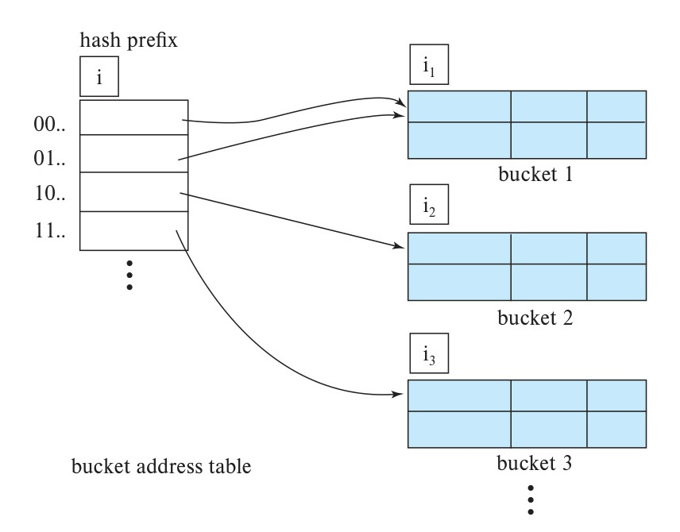

[← Previous: T13.3: Ordered Indexing](T13.03_Dense_vs_Sparse_Index.md) | [🏠 Index](00_Index.md) | [Next: Master Formula & Syntax Sheet →](99_Master_Formula_and_Syntax_Sheet.md)

---

# T13.4: Static vs. Dynamic Hashing

> **Topic:** T13 — Security, Indexing & Hashing | **Priority:** 🟢 Low | **Exam Frequency:** 1/7 finals (+ 0 CTs) (3 marks)
> **Sources:** Silberschatz 7e Ch. 14 (§14.5), Ch. 24 (§24.5)

## Why This Topic Matters

Hashing enables direct constant-time $O(1)$ record access for equality queries without traversing tree pointer paths. In semester finals, this subtopic appeared in 2017 Q.7(c) for 3 marks. The examiner tests the formal definition of hashing and asks for a structured differentiation between static and dynamic hashing. Understanding bucket overflows, directory doubling, and incremental reorganization in extendable hashing ensures top marks.

---

## 📝 Key Definitions

> **Bucket:** A bucket is a unit of storage in a hash structure that can hold one or more records. One bucket typically corresponds to a single physical disk block.

> **Hash Function:** A hash function $h: K \rightarrow B$ maps a search-key value from $K$ directly to a bucket address in $B$. A good hash function spreads keys uniformly and randomly across all buckets for $O(1)$ lookups.

> **Static Hashing:** Static hashing is a hashing scheme where the number of buckets is fixed when the index is created. Full buckets use overflow chains, and expanding the index requires rebuilding the entire file with a new hash function.

> **Dynamic Hashing:** Dynamic hashing is a hashing scheme where the number of buckets grows and shrinks dynamically with the data. Methods like extendable hashing split only the overflowing bucket so lookups stay $O(1)$ without rebuilding the whole file.

---

## Fundamentals of Hashing in Database Systems

In ordered indexing (like a B+-tree), looking up a record requires walking down a tree of pointers from the root to a leaf. **Hashing** takes a completely different approach: instead of searching an index structure, it feeds the search key into a mathematical formula that calculates the exact disk block address where the record belongs in a single step ($O(1)$ time).

### Intuitive Meaning of $h: K \rightarrow B$

Let $K$ be the set of all possible search-key values (such as student IDs or department names), and let $B$ be the set of physical **bucket** addresses on disk. A **hash function** $h$ is simply a rule that takes any key $K$ and returns a bucket number in $B$:

$$
h: K \rightarrow B
$$

For example, if we have 10 buckets numbered `0` through `9`, a simple hash function on numeric IDs is $h(\text{ID}) = \text{ID} \bmod 10$. Passing in `ID = 22227` immediately gives bucket `7`, so the database jumps straight to bucket `7` on disk!

A **bucket** is a unit of storage (usually one physical disk block) that can hold several records:

- **Hash File Organization:** The actual table rows are stored directly inside the hash buckets on disk.
- **Secondary Hash Index:** The hash buckets store `(search_key, pointer)` pairs that point to rows stored in a separate data file.

### What Makes a Good Hash Function?

To avoid piling all records into one or two buckets while leaving the rest empty, a good hash function needs two properties:

1. **Uniform Distribution:** It spreads keys evenly across all buckets in $B$, so every bucket gets roughly the same fraction of total records.
2. **Random Distribution:** Even if real-world keys are clustered together (like student IDs `2310001`, `2310002`, `2310003`), the hash function scrambles them across totally unrelated buckets so natural clusters do not overload a single bucket.

---

## Static Hashing: Mechanics and Limitations

In **static hashing**, the total number of buckets $|B|$ is locked in when the database is first created. Because $|B|$ never changes automatically, the hash function $h(K)$ always maps keys to the same fixed set of buckets.

### How Many Buckets Should We Allocate Initially?

Suppose we expect our table to hold $n_r$ total records, and each bucket (disk block) can fit $f_r$ records. If we allocated only $n_r / f_r$ buckets, even tiny variations in the hash distribution would cause buckets to overflow immediately. To leave breathing room, designers add roughly $20\%$ extra space (a fudge factor $d \approx 0.20$):

$$
n_B = \left\lceil \frac{n_r}{f_r} \cdot (1 + d) \right\rceil
$$

### Bucket Overflow and Overflow Chaining

Even with extra space, a bucket will eventually fill up and suffer a **bucket overflow** when another record hashes to that same bucket. This happens for two reasons:
1. **Insufficient Buckets ($n_r$ grew too large):** The table grew much bigger than the original estimate when the file was created.
2. **Bucket Skew:** Either many rows have the exact same search-key value (for example, thousands of students in the `'ECE'` department), or the hash function happened to send too many distinct keys to the same bucket.

When a primary bucket is full, the database cannot just throw the new record away. Instead, it uses **overflow chaining** (also called **closed addressing**):

*Figure 13.5: Overflow chaining in a disk-based hash structure (Source: Textbook Ch. 14, Fig. 14.25).*

As shown in Figure 13.5, the database allocates a brand-new overflow block elsewhere on disk and links it to the full bucket with a pointer. If that overflow block fills up too, it links another one, forming a linked list of disk blocks.

### Three Major Flaws of Static Hashing

Because the bucket count is frozen, static hashing runs into serious trouble as a database changes size over time:

1. **Lookup Speed Degrades Over Time:** As the database grows, overflow chains get longer and longer. Instead of fetching 1 disk block in $O(1)$ time, the database has to chase a long chain of overflow blocks on disk, slowing lookups down toward $O(N)$.
2. **Wasted Disk Space If You Over-Allocate:** If you try to avoid overflows by creating a massive number of buckets up front for what the database *might* need five years from now, most of those disk blocks sit completely empty for years.
3. **Painful Offline Rebuilds:** Once overflow chains get too slow, the only fix in static hashing is to pick a brand-new hash function for a larger bucket count, read every single row in the database, recompute its hash, and rewrite the entire file from scratch. This heavy reorganization locks out normal database users.

---

## Dynamic Hashing: The Extendable Hashing Protocol

**Dynamic hashing** solves the static hashing dilemma by letting the number of buckets grow and shrink smoothly on the fly. The most important dynamic hashing scheme in database systems is **extendable hashing**.

### Intuitive Idea: Using a Phonebook Directory of Bit Prefixes

Instead of hashing a key directly to a fixed disk block, extendable hashing makes the hash function output a long binary string (such as a 32-bit binary number like `10110100...`). At the beginning, when the table is tiny, we only look at the **first 1 or 2 bits** of that binary hash!

We also place a small, fast pointer array in memory called the **bucket address table** (or **directory**). Whenever a single bucket overflows, we do **not** rebuild the whole database. Instead, we split *only* that one full bucket into two buckets and look at one extra bit of the binary hash to separate its records.

### Extendable Hashing Components ($i$ vs. $i_j$)

To understand how extendable hashing works, keep these four pieces straight:

1. **Binary Hash Output:** $h(K)$ produces a long bit string (typically 32 bits).
2. **Bucket Address Table (Directory):** An in-memory table of pointers indexed by the first $i$ bits of the hash value.
3. **Global Depth ($i$):** The number of prefix bits currently used by the directory. Because an $i$-bit binary prefix has $2^i$ possible combinations, the directory always has exactly **$2^i$ slots**.
4. **Local Depth ($i_j$):** A number stored inside each physical bucket $j$ telling us how many prefix bits are actually shared by the records inside *that specific bucket*.

*Figure 13.6: General extendable hash structure with bucket address table and local depths (Source: Textbook Ch. 24, Fig. 24.8).*

### Why Multiple Directory Slots Point to the Same Bucket

Why does each bucket have its own local depth $i_j$ separate from the directory's global depth $i$? Because some buckets fill up and split faster than others!

If the directory is currently using $i = 3$ bits (8 slots: `000` through `111`), a quiet bucket $j$ that has only split once might still have local depth $i_j = 1$ (meaning it holds all records starting with `0`, regardless of the second and third bits). Therefore, all 4 directory slots starting with `0` (`000`, `001`, `010`, and `011`) point to that same physical bucket $j$. In general, the number of directory pointers sharing bucket $j$ is:

$$
2^{(i - i_j)}
$$

- When $i_j < i$, multiple directory pointers ($2^{i - i_j} \ge 2$) share bucket $j$.
- When $i_j = i$, only $2^0 = 1$ single directory pointer points to bucket $j$.

---

## Extendable Hashing Lookup and Insertion Algorithms

### How Lookup Works (Always 1 Disk Block Read)
1. Compute the binary hash $h(K)$ for your search key $K$.
2. Read the first $i$ bits of $h(K)$ (where $i$ is the global depth).
3. Go to that $i$-bit index in the directory and follow its pointer to physical bucket $j$ on disk.
4. Load bucket $j$ and scan its records in memory for $K$.

### What Happens When Bucket $j$ Overflows on Insert?

When a new record hashes to a bucket $j$ that is already full, extendable hashing checks whether bucket $j$'s local depth $i_j$ is smaller than or equal to the directory's global depth $i$:

#### Case 1: Local Depth Is Less Than Global Depth ($i_j < i$, No Directory Doubling)
- **Why this case is easy:** Because $i_j < i$, at least two directory slots are currently pointing to bucket $j$. That means the directory *already* has enough bit slots to tell two split buckets apart without growing!
- **Step-by-Step Action:**
  1. Allocate one new physical bucket $z$ on disk.
  2. Increase the local depth of both bucket $j$ and bucket $z$ from $i_j$ to $i_j + 1$.
  3. Re-examine the records that were in bucket $j$ (plus the new record) using their $(i_j + 1)$-th prefix bit: records with `0` in that bit stay in bucket $j$, and records with `1` in that bit move to bucket $z$.
  4. Repoint the second half of bucket $j$'s old directory pointers so they now point to bucket $z$.
  5. **The directory itself does not double**, and no other buckets in the database are touched!

#### Case 2: Local Depth Equals Global Depth ($i_j = i$, Directory Doubles First)
- **Why the directory must grow:** Because $i_j = i$, only **one** directory slot points to bucket $j$. If we split bucket $j$ into two buckets right now, a single directory slot cannot point to two different buckets at once. We need one more bit in the directory!
- **Step-by-Step Action:**
  1. **Double the directory:** Increase the global depth $i$ to $i + 1$, which doubles the number of directory slots from $2^i$ to $2^{i+1}$. Each old slot $k$ becomes two adjacent slots (`k0` and `k1`) that initially copy the old pointer.
  2. Now that $i$ has increased by 1, bucket $j$ has $i_j < i$, which puts us right back in **Case 1**!
  3. Allocate new bucket $z$, set both local depths to $i_j + 1$, split bucket $j$'s records using the new bit, and point slot `k0` to bucket $j$ and slot `k1` to bucket $z$.
  4. Notice that even when the in-memory pointer directory doubles, **we still only split and rewrite that one overflowing disk bucket $j$**! All other buckets on disk stay untouched.

---

## Side-by-Side Comparison: Static vs. Dynamic Hashing

| Feature | Static Hashing | Dynamic Hashing (Extendable Hashing) |
| :--- | :--- | :--- |
| **Number of Buckets** | Fixed when the database is created. | Adjusts dynamically as the database expands or shrinks. |
| **Overflow Handling** | Uses long overflow bucket chains (closed addressing). | Avoids long chains by splitting overflowing buckets and redistributing records. |
| **Lookup Performance** | Degrades over time as overflow chains grow longer ($O(N)$ worst case). | Remains consistently fast ($O(1)$ block accesses) even after massive database growth. |
| **Reorganization Method** | Requires full offline rebuild of the entire file with a new hash function. | Reorganizes incrementally, one bucket at a time, without stopping database access. |
| **Space Utilization** | Poor. Low bucket count causes overflows, while high bucket count wastes disk space. | High. Storage capacity scales smoothly and proportionally to actual stored records. |
| **Indirection Overhead** | Direct address computation with no auxiliary pointer table. | Extra memory reference required to read the bucket address table directory. |
| **Typical Implementations** | Modulo hashing with overflow block pointers. | Extendable hashing (directory-based) and linear hashing (directory-less). |

---

## Hashing vs. Ordered Indexing (B+-Trees)

When should a database administrator build a **hash index** versus a **B+-tree index**?

1. **Equality Point Queries (`WHERE ID = 22222`):**
   - **Hashing wins:** Computes $h(\text{ID})$ directly in $O(1)$ time and fetches the bucket in 1 disk read.
   - **B+-tree:** Must walk from the root down through internal nodes to the leaf in $O(\log n)$ steps.
2. **Range Queries (`WHERE salary BETWEEN 50000 AND 80000`):**
   - **B+-tree wins easily:** Finds `50000` in a leaf node and then walks straight across the sorted leaf sibling pointers ($P_n$) until `80000`.
   - **Hashing fails completely:** Remember that a good hash function deliberately scrambles consecutive numbers (`50000`, `50001`, `50002`) across completely random buckets! Because there is no order among hash buckets, a hash index cannot answer `<`, `>`, or `BETWEEN` queries at all, forcing a slow full-table scan.

---

## Worked Example: Tracing Both Split Cases in Extendable Hashing

Let's trace two insertions on a tiny extendable hash structure where each bucket holds at most **$f_r = 2$ records** so you can see both Case 1 ($i_j < i$) and Case 2 ($i_j = i$) in action.

### Starting State (Global Depth $i = 2$)
- Because $i = 2$, the directory has $2^2 = 4$ slots: `00`, `01`, `10`, and `11`.
- **Bucket A** has local depth $i_A = 2$, is pointed to only by slot `00`, and is currently full with two keys whose hashes start with `00`: `[0010, 0011]`.
- **Bucket B** has local depth $i_B = 1$, is shared by slots `10` and `11` ($2^{2-1} = 2$ pointers), and is currently full with two keys whose hashes start with `1`: `[1001, 1110]`.

### Insert 1: Add Hash `1010` (Triggers Case 1: $i_B < i$)
1. Read the first $i = 2$ bits of `1010`, which are `10`.
2. Directory slot `10` points to **Bucket B**, which is already full (`[1001, 1110]`).
3. Check local vs. global depth: $i_B = 1 < i = 2$ (**Case 1**). Because two directory slots (`10` and `11`) already share Bucket B, we can split Bucket B **without doubling the directory**!
4. **How the Split Works:**
   - Create **Bucket C** and bump both local depths to $1 + 1 = 2$ ($i_B = 2, i_C = 2$).
   - Divide the three keys (`1001`, `1110`, and the new `1010`) using their 2-bit prefixes:
     - Prefix `10` stays in **Bucket B**: `[1001, 1010]`.
     - Prefix `11` moves to **Bucket C**: `[1110]`.
   - Point directory slot `10` to Bucket B and directory slot `11` to Bucket C. Global depth stays $i = 2$.

### Insert 2: Add Hash `0001` (Triggers Case 2: $i_A = i$)
1. Read the first $i = 2$ bits of `0001`, which are `00`.
2. Directory slot `00` points to **Bucket A**, which is also full (`[0010, 0011]`).
3. Check local vs. global depth: $i_A = 2 = i$ (**Case 2**). Only one slot (`00`) points to Bucket A, so we **must double the directory first**!
4. **How the Split Works:**
   - **Double the directory:** Increase global depth to $i = 3$, expanding the directory to $2^3 = 8$ slots (`000` through `111`). Slots `000` and `001` both initially point to Bucket A.
   - Create **Bucket D** and bump both local depths to $2 + 1 = 3$ ($i_A = 3, i_D = 3$).
   - Divide the three keys (`0010`, `0011`, and the new `0001`) using their 3-bit prefixes:
     - Prefix `000` goes into **Bucket A**: `[0001]`.
     - Prefix `001` moves to **Bucket D**: `[0010, 0011]`.
   - Point directory slot `000` to Bucket A and slot `001` to Bucket D. Notice Bucket B and Bucket C were never touched on disk!

---

## Exam Variants

| Year & Question | Marks | Scenario / Data Given | Key Result / Answer Summary |
| :--- | :---: | :--- | :--- |
| **2017 Q.7(c)** | 3 | What is hashing? Differentiate between static and dynamic hashing. | State mathematical definition $h: K \rightarrow B$, explain buckets, provide 5-row comparative breakdown. |
| **Expected Variant 1** | 4 | Extendable hashing directory doubling mechanics | Explain global depth $i$, local depth $i_j$, and conditions triggering directory doubling vs single bucket split. |
| **Expected Variant 2** | 3 | Hashing vs B+-tree index selection | Compare point query performance against range query feasibility, and explain why hashing cannot support range searches. |

---

## 🏆 Golden Questions (Past Exam Archive)

### 🎯 GQ1 · 2017 Q.7(c) · Definition of Hashing and Static vs. Dynamic Comparison

> **Appeared:** 2017 Q.7(c) — (03 marks)

**Question:**

What is hashing? Differentiate between static and dynamic hashing.

**Full Answer:**

**1. What is Hashing?**  
**Hashing** is a database file organization and indexing technique that enables direct, constant-time ($O(1)$) retrieval of records for equality search queries. It uses a mathematical function $h$, called a **hash function**, that maps a search-key value $K$ directly to a physical storage address $B$, known as a **bucket**:

$$
h: K \rightarrow B
$$

A **bucket** is a storage unit, typically a physical disk block, that stores one or more data records or index pointers.

**2. Differentiation Between Static and Dynamic Hashing:**

| Comparison Parameter | Static Hashing | Dynamic Hashing (Extendable / Linear Hashing) |
| :--- | :--- | :--- |
| **Bucket Count** | Fixed at database creation time. | Increases and decreases dynamically to accommodate database growth or shrinkage. |
| **Overflow Management** | Handles full buckets using overflow chaining (linked lists of auxiliary blocks). | Minimizes or avoids overflow chains by splitting full buckets and redistributing records. |
| **Search Performance** | Degrades over time as long overflow chains require slow sequential disk scans. | Retains steady $O(1)$ lookup performance regardless of the volume of data inserted. |
| **Database Reorganization** | Requires periodic offline rebuilding of the entire file with a new hash function. | Reorganizes dynamically and incrementally, one bucket at a time, without stopping database access. |
| **Space Utilization** | Inefficient. Reserving buckets for future growth wastes space, while reserving too few triggers overflow. | Highly efficient. Buckets are allocated on demand as data volume increases. |
| **Auxiliary Structures** | None. Buckets are accessed directly from the calculated hash index. | Uses a bucket address table (directory) in extendable hashing, adding a minor indirection level. |

---

## 📖 High-Yield Exercises from the Book

### 🎯 HYE-01 · Exercise 14.12 · B+-Tree Indexing vs Hash Indexing Trade-Offs

> **Source:** Silberschatz 7e · Chapter 14 (Exercise 14.12)  
> **Exam Relevance:** Prime Overdue Advanced Indexing Drill  
> **Key Tested Concept:** Point query vs range query performance, dynamic bucket growth, and index selection criteria.

**Problem Statement:**
> Database designers must frequently choose between a **B+-tree index** and a **Hash index** (Extendible Hashing).
> 1. Compare the theoretical time complexity of B+-trees and Hash indices for:
>    - **Point (equality) lookups:** `WHERE ID = '10101'`
>    - **Range queries:** `WHERE salary BETWEEN 50000 AND 80000`
> 2. Explain why a standard Hash index is completely **unusable for range queries**.
> 3. In what practical database scenarios is a Hash index distinctly superior to a B+-tree?

**Model Exam-Style Solution:**

1. **Time Complexity Comparison:**

| Query Type | Hash Index (Extendible Hashing) | B+-Tree Index (Height $h$) |
| :--- | :---: | :---: |
| **Point Lookup ($K = v$)** | **$O(1)$** (1–2 disk block I/Os) | **$O(\log_B N)$** ($h$ disk block I/Os, typically 3–4) |
| **Range Scan ($v_1 \le K \le v_2$)** | **$O(N)$** (Requires full file scan) | **$O(\log_B N + M)$** ($M$ matching blocks traversed via leaf pointers) |
| **Insertion / Deletion** | **$O(1)$** average | **$O(\log_B N)$** (node split/merge) |

2. **Why Hash Indices Cannot Support Range Queries:**
   - A cryptographic or pseudo-random hash function $h(K)$ is deliberately designed to **distribute keys uniformly and randomly** across the bucket address space to minimize collisions.
   - Consequently, two search-key values that are numerically or alphabetically adjacent (e.g., `salary = 50000` and `salary = 50001`) hash to completely unrelated, distant buckets!
   - There is no physical or logical ordering among hash buckets.
   - To satisfy a range query like `WHERE salary BETWEEN 50000 AND 80000`, the DBMS would have to evaluate the hash function for every single possible value in the range, or scan all buckets in the entire database sequentially ($O(N)$ full table scan).
   - In contrast, a B+-tree keeps all search keys in strictly sorted order in its leaf nodes, connected by doubly linked sibling pointers. Once the first value ($50000$) is located in $O(\log N)$ time, the remaining records are retrieved by simply scanning along the linked leaf level until $80000$ is reached.

3. **When Hash Indexing is Superior:**
   - **Key-Value & In-Memory Caches:** High-throughput lookups by unique primary key (e.g., session tokens, user ID lookups, Redis/Memcached architectures).
   - **Equality-Only Join Processing:** Building hash tables in memory for Hash Joins ($R \bowtie_{R.A = S.A} S$).
   - **Very Wide Keys:** When search keys are long strings (e.g., URLs, cryptographic hashes), storing full keys in B+-tree nodes wastes node fan-out, whereas hash indices store fixed-width integer bucket hashes. $\blacksquare$

**💡 RUET Exam Takeaway:**
B+-trees are the **default index** in almost all relational databases (InnoDB, PostgreSQL) because real-world workloads involve range queries (`BETWEEN`, `<`, `>`), sorting (`ORDER BY`), and prefix matches (`LIKE 'abc%'`), none of which can be served by a Hash index.

---

## ⚡ Exam Tips & Common Mistakes

1. **State the Formal Mathematical Definition:** Do not just write "hashing is a fast lookup method". Always state $h: K \rightarrow B$ where $K$ is the set of search-key values and $B$ is the set of bucket addresses.
2. **Explain Incremental Reorganization:** The most important distinction of dynamic hashing is that reorganization occurs *incrementally on one bucket at a time*, rather than requiring a complete file rebuild.
3. **The Range Query Trap:** Always remember that hash indices cannot support range queries (e.g., `BETWEEN` or `<`). Mention this in any comparison with B+-trees.
4. **Directory Doubling Condition:** In extendable hashing, directory doubling occurs *only* when the overflowing bucket's local depth equals the directory's global depth ($i_j = i$). If $i_j < i$, only the bucket splits without doubling the directory.

---

## 🔗 Related Topics

- [T13.03: Ordered Indexing — Dense vs. Sparse Index and B+-Trees](T13.03_Dense_vs_Sparse_Index.md) — Tree-based access structures and range query support.
- [T13.01: Database Security Threats and Authorization](T13.01_Security_and_Authorization.md) — Security policies, authorization graphs, and system defense.
- [Master Formula & Syntax Sheet](99_Master_Formula_and_Syntax_Sheet.md) — Complete formula guide for database indexing, normalization, and recovery.

---

[← Previous: T13.3: Ordered Indexing](T13.03_Dense_vs_Sparse_Index.md) | [🏠 Index](00_Index.md) | [Next: Master Formula & Syntax Sheet →](99_Master_Formula_and_Syntax_Sheet.md)
