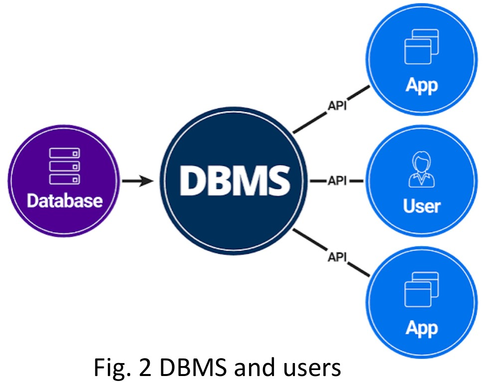

[← Previous: 🏠 Index](00_Index.md) | [🏠 Index](00_Index.md) | [Next: T01.2: File System vs. DBMS →](T01.02_File_System_vs_DBMS.md)

---

# T01.1: Data, DB, and DBMS Basics

> **Topic:** T01 · DB Concepts & Architecture | **Priority:** 🟢 Low (Foundational) | **Exam Frequency:** 0/7 finals (0 marks) · High-yield candidate
> **Sources:** Silberschatz 7e Ch. 1 (§1.1–1.2) · Lecture Deck 01 (Slides 2–5) · Raidah Class Note p. 1, 10 · Fahim Hand Note pp. 1–3

---

## Data vs. Information

**Data:** Data consists of raw, unorganized facts and figures that carry no specific meaning on their own. An isolated number like `85` or a single word without context is raw data.

**Information:** Information is data that has been processed, organized, and placed in a meaningful context. People use information to make decisions. For example, turning raw test scores into a class average produces useful information.

**Metadata:** Metadata is data about data. It is the complete set of structural rules stored in the system catalog. It defines table structures, column data types, storage formats, and integrity constraints.

| Feature | Data | Information |
| :--- | :--- | :--- |
| **Definition** | Unorganized and unrefined raw facts. | Processed, organized data in a meaningful context. |
| **Meaning** | Carries no specific logical meaning on its own. | Carries a clear and actionable meaning. |
| **Dependency** | Exists independently of information. | Depends directly on the underlying raw data. |
| **Decision Making** | Not enough on its own for business decisions. | Ready and useful for decision making. |
| **Example** | A single student test score: `85`. | Class average score: `Class 2-2 average is 78.5`. |

---

## Structured vs. Unstructured Data

Digital data falls into two main categories based on whether records fit into fixed tables:

1. **Structured Data:**
   - Fits into standardized tables made of fixed rows and columns.
   - Every column follows a strict schema with a chosen data type and validation rules.
   - Relational databases search and sort structured data quickly using SQL.
   - **Examples:** Relational tables in MySQL, banking ledgers, RUET student registration records, and spreadsheets.

2. **Unstructured Data:**
   - Has no predefined table layout or uniform row format.
   - Systems cannot store it directly in traditional rows and columns without extra processing.
   - Systems store it as raw text documents, key-value blobs, media files, or object stores.
   - **Examples:** Customer email messages, voice recordings, social media posts, and scanned PDF reports.

*Figure 1.1: Structured data in tables compared to unstructured multimedia data (Deck 01, Slide 2).*

---

## Database and DBMS Fundamentals

**Database:** A database is an organized collection of related data that models a real-world enterprise or system. For example, a university database stores records for students, instructors, courses, and grades in one central place.

**Database-Management System (DBMS):** A Database-Management System is a collection of interrelated data and a set of software programs to access, store, and manage that data. Its primary goal is to provide a way to store and retrieve database information that is both convenient and efficient.

### Components of a DBMS Environment

A complete DBMS environment brings together five connected components:

1. **Hardware:** The physical computer equipment that runs the software and holds records, including CPUs, RAM, storage drives, and network cards.
2. **Software:** The core DBMS engine (such as MySQL, PostgreSQL, or Oracle), the operating system, network drivers, and client applications.
3. **Data:**
   - **User Data:** The operational records stored inside tables, such as student names or account balances.
   - **Metadata:** Structural definitions stored in the system catalog (data dictionary), including schemas, types, and constraints.
4. **Procedures:** The written rules and guidelines for system setup, user account management, daily operations, and crash recovery.
5. **Database Access Language:** The command language used to define schemas, query records, and manage security. Structured Query Language (SQL) is the universal standard.

*Figure 1.2: DBMS architecture connecting database storage to applications and users (Deck 01, Slide 4).*

---

## Database Users and Core Functionalities

### Database User Types

Silberschatz groups database users into four categories based on their technical role:

- **Naïve Users:** End users who interact with the system through pre-written forms, mobile apps, or web interfaces without writing SQL queries (for example, a student checking exam grades on a university portal).
- **Application Programmers:** Software engineers who write backend programs in languages like Python, Java, or C++ and connect to the database through APIs like JDBC or ODBC.
- **Sophisticated Users:** Analysts, researchers, and engineers who write their own SQL queries or use data tools to pull custom insights directly.
- **Database Administrator (DBA):** The person who holds central control over the entire system, managing schemas, user permissions, performance tuning, and backups.

### Core DBMS Functionalities

A DBMS performs five fundamental tasks:

1. **Define:** Specify table schemas, column data types, and integrity constraints.
2. **Construct:** Store and organize records on physical media through the storage manager.
3. **Manipulate:** Query records, insert new rows, update values, and generate reports.
4. **Share:** Allow multiple users and programs to read and edit data concurrently without conflicts.
5. **Protect:** Maintain data integrity against system crashes, hardware failures, and unauthorized access.

---

## 🔮 Likely Questions

### 🎯 LQ1 · Data vs. Information Comparison · 03 Marks

> *Section A / Class Test Target*

**Question.** Differentiate between data and information with suitable examples.

**Answer.**

Data consists of unorganized, raw facts that carry no specific meaning on their own. In contrast, information is processed, organized data placed in a meaningful context to make it useful for decision making.

| Feature | Data | Information |
| :--- | :--- | :--- |
| **Nature** | Raw, unrefined facts and figures. | Processed and structured output. |
| **Meaning** | Carries no clear meaning by itself. | Conveys clear, useful meaning. |
| **Dependency** | Exists independently of information. | Depends directly on the underlying raw data. |
| **Decision Utility** | Cannot guide decisions on its own. | Ready and useful for decision making. |

**Example:**
- **Data:** Isolated numbers like `22`, `65`, and `88`.
- **Information:** "The average exam score in ECE 2215 is 71.6, with a maximum score of 88."

---

### 🎯 LQ2 · Components of a DBMS Environment · 04 Marks

> *Section A / Class Test Target*

**Question.** What is a DBMS? Briefly describe the five major components of a DBMS environment.

**Answer.**

A **Database-Management System (DBMS)** is a collection of interrelated data and a set of software programs designed to access, store, and manage that data conveniently and efficiently.

The five major components of a DBMS environment are:

1. **Hardware:** The physical computers, storage drives, memory, and networking equipment used to run the software and hold data.
2. **Software:** The DBMS software engine (such as MySQL or Oracle), the operating system, and the application tools used to access data.
3. **Data:** The stored information, including user records in tables and metadata (table definitions and rules) in the system catalog.
4. **Procedures:** Documented rules, policies, and guidelines that dictate how to install, operate, secure, and back up the database.
5. **Database Access Language:** The language used to create tables, query records, and assign permissions. SQL is the standard language.

---

### 🎯 LQ3 · Structured vs. Unstructured Data · 03 Marks

> *Section A / Short Note Target*

**Question.** Explain the difference between structured and unstructured data. Give two practical examples of each.

**Answer.**

- **Structured Data:**
  - Follows a strict, predefined schema made of fixed rows and columns.
  - Every value matches a declared column data type and validation rule. Relational databases manage and query it with SQL.
  - *Examples:* (1) A university student table with `(roll_no, name, dept, cgpa)`, and (2) a bank account table with `(account_no, balance, branch)`.

- **Unstructured Data:**
  - Has no predefined table structure or uniform layout. It cannot sit directly in traditional relational tables without conversion.
  - Systems store it as raw text files, audio/video streams, or object blobs.
  - *Examples:* (1) Customer call audio recordings, and (2) scanned PDF documents or handwritten doctor prescriptions.

---

## ⚡ Exam Tips & Common Mistakes

- **Always include examples for data vs. information:** Stating definitions alone loses marks. Always show a raw number (data) and a computed sentence or statistic (information).
- **Include both data and programs in the DBMS definition:** A DBMS is not just a collection of data. It is the collection of interrelated data **and** the set of programs to access that data.
- **Identify metadata correctly:** Metadata is data about data (schemas, indexes, constraints) stored in the data dictionary or system catalog.

---

## 🔗 Related Topics

- [T01.02: File System vs. DBMS](T01.02_File_System_vs_DBMS.md) · The eight classic disadvantages of file processing and DBMS advantages.
- [T01.03: DBA Functions and Relation Schema](T01.03_DBA_Functions_and_Relation_Schema.md) · Administrative responsibilities and formal relation schema structures.
- [T01.04: Data Abstraction, Schemas, and Instances](T01.04_Data_Abstraction_Schemas_Instances.md) · The physical, logical, and view levels of data abstraction.

---

[← Previous: 🏠 Index](00_Index.md) | [🏠 Index](00_Index.md) | [Next: T01.2: File System vs. DBMS →](T01.02_File_System_vs_DBMS.md)
