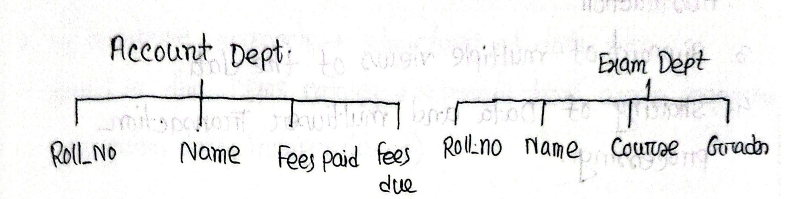

[← Previous: T01.1: Data, DB, and DBMS Basics](T01.01_Data_DB_and_DBMS_Basics.md) | [🏠 Index](00_Index.md) | [Next: T01.3: DBA Functions and Relation Schema →](T01.03_DBA_Functions_and_Relation_Schema.md)

---

# T01.2: File System vs. DBMS

> **Topic:** T01 · DB Concepts & Architecture | **Priority:** 🔴 High | **Exam Frequency:** 5/7 finals (6 appearances, 21 marks) · 2017 Q1a, 2018 Q1a, 2019 Q1a, 2021 Q1a, 2023 Q1b, 2024 Q1a
> **Sources:** Silberschatz 7e Ch. 1 (§1.2) · Lecture Deck 01 (Slides 6–7) · Raidah Class Note p. 4 · Fahim Hand Note p. 5

---

## The Eight Disadvantages of File-Processing Systems

**File-Processing System:** A file-processing system stores permanent records in separate operating-system files. Users write and run custom application programs in languages like C or Java to read or update records in each file.

**Data Redundancy:** Storing the same data in multiple separate files. It wastes disk space and increases update overhead.

**Data Inconsistency:** Duplicate copies of data no longer match each other because updates changed one file but missed others.

**Atomicity:** The requirement that a multi-step transaction must happen completely or not at all.

Traditional file-processing systems suffer from eight major technical drawbacks:

### 1. Data Redundancy and Inconsistency
- Different departments create their own files over time. This leads to duplicate records across departments.
- For example, a student's name and contact number might exist in Accounts, Library, and Exam Office files.
- Updating data in one file while missing other files creates conflicting, inconsistent records.

*Figure 1.1: Independent departmental file systems duplicating student attributes (Handnote by Fahim, Page 5).*

### 2. Difficulty in Accessing Data
- File systems lack a declarative query language like SQL.
- Fetching any new ad-hoc report requires writing, compiling, and testing a new application program.

### 3. Data Isolation
- Data is scattered across multiple files in different formats (such as text, binary, or CSV).
- Writing code to join records across these incompatible files is difficult and slow.

### 4. Integrity Problems
- Business rules (such as non-negative balances or valid grade ranges) must be hardcoded into every individual program.
- Adding a new rule requires modifying every program that touches the file. Overlooking one program allows invalid data into the file.

### 5. Atomicity Problems
- A multi-step operation (like a fund transfer between bank accounts) must either complete fully or be completely undone.
- A system crash or power outage midway through updates leaves files in a corrupted state because file systems lack automated rollback logging.

### 6. Concurrent-Access Anomalies
- When multiple programs read and update the same file at the same time, operations interleave unpredictably.
- This creates lost updates and race conditions. Operating systems only offer whole-file locks, which stall other users.

### 7. Security Problems
- Operating systems enforce permissions at the whole-file level.
- Granting access to a file exposes all rows and columns. File systems cannot easily hide specific sensitive fields like salaries.

### 8. Program-Data Dependence
- Application code contains hardcoded record structures and byte offsets.
- Changing a single column width or data type breaks existing programs and requires recompiling all software that reads that file.

---

## Comparison: File-Processing System vs. DBMS

| Feature | File-Processing System | Database Management System (DBMS) |
| :--- | :--- | :--- |
| **Data Storage** | Scattered, independent files managed by separate application scripts. | Centralized repository managed by a single DBMS engine. |
| **Data Redundancy** | High. Identical records are stored across multiple departmental files. | Minimal. Normalized tables ensure each fact is stored once. |
| **Data Consistency** | Low. Separate copies get out of sync when updates miss files. | High. A single update immediately reflects across all user views. |
| **Data Access** | Requires writing and compiling custom code for every new query. | Provides declarative queries (SQL) for instant ad-hoc data retrieval. |
| **Data Independence** | Program-data dependent. Storage changes break existing programs. | High data independence. Physical storage changes do not break programs. |
| **Integrity Enforcement** | Hardcoded inside scattered application source files. | Declared once in schema constraints (`CHECK`, `FOREIGN KEY`) and enforced centrally. |
| **Crash Recovery** | Manual. Crashes during updates leave files corrupt and half-written. | Automated write-ahead logging (WAL) guarantees atomicity and crash recovery. |
| **Concurrency Control** | Coarse whole-file locks that cause bottlenecks during multi-user writes. | Fine-grained row-level locking and transaction isolation protocols. |
| **Security Control** | Coarse OS file permissions (read/write on the entire file). | Fine-grained user privileges down to specific tables, views, and columns. |
| **Cost & Complexity** | Low initial cost; uses standard OS tools. | Higher initial software cost, memory overhead, and administrative setup. |

---

## Why a Database Stores Information Efficiently

When justifying the statement that a database stores information efficiently, explain three core areas of efficiency:

1. **Storage Efficiency (Eliminating Redundancy):**
   - Normalization stores each fact in one central place.
   - It eliminates duplicated columns across department files, saves disk space, and avoids synchronization errors.

2. **Retrieval Efficiency (Indexing and Query Optimization):**
   - File systems scan files line by line in $O(n)$ linear time.
   - A DBMS uses B+ tree or hash indexes to find matching records in $O(\log n)$ or $O(1)$ time.
   - The cost-based query optimizer picks the fastest execution plan automatically.

3. **Operational Efficiency (Concurrency and Data Independence):**
   - Multiple users read and write records concurrently through fine-grained locks without data corruption.
   - DBAs can adjust storage structures or add indexes without rewriting application programs.

---

## 🏆 Golden Questions (Past Exam Archive)

### 🎯 GQ1 · 2017 Q.1(a) & 2021 Q.1(a) · 04 Marks

> *Section A · Asked in: 2017, 2021 (CLO1) · L2 merge*

**Question (2017 Q.1(a)).** Write down four significant differences between a file processing system and a DBMS.

**Question (2021 Q.1(a)).** Discuss four significant differences between a file-processing system and a DBMS.

**Answer.**

| Feature | File Processing System | DBMS (Database Management System) |
| :--- | :--- | :--- |
| **Data Redundancy & Inconsistency** | Data is duplicated across multiple separate files. Different copies easily get out of sync. | Centralizes data storage. Normalization avoids duplication and keeps copies consistent. |
| **Data Access & Retrieval** | Programmers must write a new custom program in C or Java for each new query. | Users write declarative queries (like SQL) to retrieve ad-hoc data quickly without new code. |
| **Data Isolation & Independence** | Data structures and application code are tightly coupled. Changing a file structure breaks programs. | Provides data abstraction. Changes to physical storage structures do not affect application programs. |
| **Concurrent Access & Recovery** | Hard to coordinate simultaneous access. Multiple updates cause lost data. Crash recovery is manual. | Built-in concurrency control prevents conflicting updates. Automated logging and recovery preserve ACID properties. |

*Variant for 2021 Q.1(a) (4 marks):* The same four differences directly answer the question.

---

### 🎯 GQ2 · 2018 Q.1(a) · 03 Marks

> *Section A · Asked in: 2018 · L1 (asked once)*

**Question.** "A database is a tool for storing information efficiently"- Justify this statement.

**Answer.**

A database stores information efficiently by removing the major storage and access bottlenecks of traditional file systems:

1. **Storage Efficiency (Redundancy Control):** A database stores each fact in one place. It eliminates duplicate records across separate department files. This saves disk storage and prevents inconsistent copies.
2. **Retrieval Efficiency (Indexing and Query Optimization):** The DBMS uses tree or hash indexes. It also uses a cost-based query optimizer. This allows the system to find records in milliseconds without scanning whole files.
3. **Operational Efficiency (Concurrency and Data Independence):** Multiple users can query and update data at the same time without data corruption. Also, physical storage layouts can change without breaking existing application programs.

---

### 🎯 GQ3 · 2019 Q.1(a) & 2023 Q.1(b) · 03 Marks

> *Section A · Asked in: 2019, 2023 (CLO1) · L2 merge*

**Question (2019 Q.1(a)).** Why DBMS is important? What are its advantages?

**Question (2023 Q.1(b)).** What are the advantages of DBMS over file processing system?

**Answer.**

**Importance of DBMS:**  
A DBMS provides centralized, secure, and coordinated control over an organization's data. It replaces scattered operating system files and ensures that data remains reliable, shared, and recoverable during hardware or software crashes.

**Advantages of DBMS over File Processing Systems:**
1. **Control of Data Redundancy and Inconsistency:** Centralized data storage minimizes duplicate entries and prevents conflicting records.
2. **Data Independence:** Physical storage structures can change without requiring updates to application programs.
3. **Fast and Convenient Data Access:** Declarative query languages (like SQL) retrieve data without custom low-level programming.
4. **Transaction Management (ACID Properties):** Guarantees atomicity during crashes and protects data integrity during concurrent multi-user access.
5. **Data Security and Integrity Constraints:** Restricts unauthorized access through user privileges and enforces business rules automatically.

*Variant for 2023 Q.1(b) (3 marks):* Focus directly on the 5 advantages over file processing systems; omit the general importance statement.

---

### 🎯 GQ4 · 2024 Q.1(a) · 04 Marks

> *Section A · CO1 · Asked in: 2024 · L1 (asked once)*

**Question.** A courier tracking company maintains large files for daily parcel updates. The data grows rapidly and requires fast retrieval. Choose between a file based system and a DBMS and justify the decision.

**Answer.**

**Decision:** Choose a **DBMS (Database Management System)**.

**Justification:**
1. **Rapid Data Growth and Scalability:** As parcel records grow rapidly each day, a DBMS manages storage dynamically with tables and secondary storage. A file system suffers from large unwieldy files, data isolation, and slow sequential processing.
2. **Fast Retrieval via Indexing:** Customers and couriers need instant tracking updates. A DBMS builds B+ tree indexes on tracking numbers (`parcel_id`). This delivers lookup results in milliseconds instead of scanning large files line by line.
3. **Concurrent Multi-User Updates:** Delivery drivers, sorting hubs, and recipients update and read parcel records at the same time. A DBMS provides concurrency control to prevent lost updates and race conditions. A file system would require file locking, which blocks other users.
4. **Data Integrity and Constraints:** A DBMS automatically enforces rules. For example, status codes must be valid, and tracking IDs cannot be null or duplicated. File systems require custom application code to check every update.
5. **Crash Recovery and Backup:** Courier data cannot be lost during system crashes or power failures. A DBMS maintains write-ahead logs (WAL) and automatic transaction rollback to preserve tracking history.

---

## ⚡ Exam Tips & Common Mistakes

- **Avoid vague non-technical points:** Do not say "file systems are old and DBMS is new". Use exact technical terms: *data redundancy*, *atomicity*, *concurrent access anomalies*, *data independence*, and *declarative query access*.
- **Tie answers directly to given scenarios:** When an exam prompt gives a scenario (like the 2024 courier tracking company), link each DBMS feature directly to the scenario requirements (rapid growth, fast tracking lookups, concurrent updates).
- **Format differences as tables:** For "four significant differences", present a 4-row Markdown table with explicit feature labels. This makes it easy for examiners to award 1 mark per row.

---

## 🔗 Related Topics

- [T01.01: Data, DB, and DBMS Basics](T01.01_Data_DB_and_DBMS_Basics.md) · Fundamental definitions of data, databases, and metadata.
- [T01.03: DBA Functions and Relation Schema](T01.03_DBA_Functions_and_Relation_Schema.md) · Central administrative control and relational schema design.
- [T01.04: Data Abstraction, Schemas, and Instances](T01.04_Data_Abstraction_Schemas_Instances.md) · How physical data independence separates storage from logic.
- [T09.01: ACID Properties](T09.01_ACID_Properties.md) · Atomicity, consistency, isolation, and durability mechanisms.

---

[← Previous: T01.1: Data, DB, and DBMS Basics](T01.01_Data_DB_and_DBMS_Basics.md) | [🏠 Index](00_Index.md) | [Next: T01.3: DBA Functions and Relation Schema →](T01.03_DBA_Functions_and_Relation_Schema.md)
