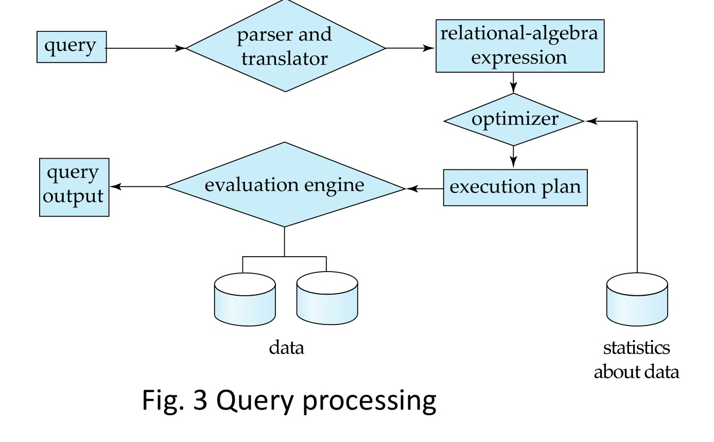

[← Previous: T01.5: DDL vs. DML](T01.05_DDL_vs_DML.md) | [🏠 Index](00_Index.md) | [Next: T01.7: Two-Tier vs. Three-Tier Architecture →](T01.07_Two_Tier_vs_Three_Tier_Architecture.md)

---

# T01.6: DBMS Engine Components

> **Topic:** T01 · DB Concepts & Architecture | **Priority:** ⭐ | **Exam Frequency:** 0/7 finals (0 marks) · Prime Class Test / Section A Candidate
> **Sources:** Silberschatz 7e Ch. 1 (§1.6) · Lecture Deck 01 (Slides 22–25, 28) · Class Notes (Raidah p. 12)

---

## Overall DBMS Engine Architecture

**Storage Manager:** The storage manager is the internal DBMS subsystem that provides the interface between low-level data stored on disk and application programs and queries submitted to the system.

**Query Optimization:** The phase where the DML compiler evaluates candidate execution plans and selects the lowest-cost plan based on database catalog statistics.

**Transaction:** A collection of operations that performs a single logical function in a database application, preserving ACID properties.

**Buffer Manager:** The module responsible for allocating space in main memory (the buffer pool) and transferring data blocks between disk storage and main memory.

A relational DBMS engine is organized into three connected functional layers:

1. **Query Processor (Top Layer):** Parses SQL statements, generates candidate execution plans, selects the cheapest plan, and runs it.
2. **Storage Manager (Middle Layer):** Translates high-level query operations into memory buffer reads and physical disk I/O requests.
3. **Disk Storage (Bottom Layer):** Holds the physical files containing table data, metadata, indexes, and statistical summaries.

*Figure 1.1: Centralized database system structure illustrating query processor, storage manager, and physical disk storage (Deck 01, Slide 28).*

---

## 1. Storage Manager Subsystem

The storage manager provides access to disk-resident data while maintaining database integrity and fast execution.

### Four Functional Modules

1. **Authorization and Integrity Manager:**
   - Tests user access permissions before allowing queries to run.
   - Verifies that new data satisfies all integrity constraints (such as `PRIMARY KEY`, `FOREIGN KEY`, and `CHECK`).
2. **Transaction Manager:**
   - Ensures that the database remains in a consistent state despite system crashes.
   - Coordinates concurrent transactions to prevent conflicts.
3. **File Manager:**
   - Allocates storage space on disk drives.
   - Manages data structures used to store records and pages in physical files.
4. **Buffer Manager:**
   - Caches disk blocks in a high-speed memory pool (RAM).
   - Uses replacement algorithms (like LRU) to swap pages between disk and RAM. This allows the DBMS to handle datasets far larger than physical memory.

### Four Physical Disk Structures

- **Data Files:** Store the actual relational table records (tuples).
- **Data Dictionary:** Stores system metadata (table schemas, column types, integrity rules, and access privileges).
- **Indices:** Provide search structures (B+ trees and hash buckets) for fast record lookup.
- **Statistical Data:** Stores summary metrics (table row counts, block counts, and distinct value distributions) used by the query optimizer.

---

## 2. Query Processor Subsystem

The query processor turns declarative SQL text into executable machine instructions through three modules:

1. **DDL Interpreter:** Parses DDL statements (`CREATE`, `ALTER`, `DROP`) and records the resulting definitions in the data dictionary.
2. **DML Compiler and Optimizer:**
   - Translates DML statements (`SELECT`, `INSERT`, `UPDATE`, `DELETE`) into relational algebra expressions.
   - Checks catalog statistics to evaluate candidate execution plans and selects the plan with the lowest estimated disk I/O cost.
3. **Query Evaluation Engine:** Executes the chosen low-level execution plan by calling the storage manager.

*Figure 1.2: Three phases of query processing: parsing and translation, optimization, and evaluation (Deck 01, Slide 25).*

---

## 3. Transaction Management and Concurrency Control

- **Concurrency-Control Manager:** Coordinates simultaneous transaction execution so interleaved operations do not corrupt data. It enforces locking protocols (such as Two-Phase Locking) or timestamp-ordering rules.
- **Recovery Manager:** Maintains transaction atomicity and durability. It writes every modification to a write-ahead log (WAL) on disk so interrupted transactions can be rolled back or reapplied after a system failure.

---

## Summary of DBMS Engine Modules

| Subsystem | Component Module | Primary Function |
| :--- | :--- | :--- |
| **Query Processor** | DDL Interpreter | Parses schema commands and updates the data dictionary. |
| | DML Compiler & Optimizer | Translates SQL into relational algebra and selects the lowest-cost plan. |
| | Query Evaluation Engine | Executes the physical plan by requesting pages from the storage manager. |
| **Storage Manager** | Authorization & Integrity Manager | Enforces security privileges and schema constraints. |
| | Transaction Manager | Coordinates concurrent transactions and preserves consistency. |
| | File Manager | Allocates disk blocks and manages file organizations. |
| | Buffer Manager | Caches active disk blocks in RAM and flushes dirty pages to disk. |
| **Disk Storage** | Data Files | Stores the user table records. |
| | Data Dictionary | Stores metadata about schemas, types, and constraints. |
| | Indices | Speeds up row retrieval using B+ trees and hash tables. |
| | Statistical Data | Supplies distribution statistics to the query optimizer. |

---

## 🔮 Likely Questions

### 🎯 LQ1 · Functional Components of the Storage Manager · 04 Marks

> *Section A / Class Test Target*

**Question.** Explain the main functional components of the storage manager in a database engine. Why is the buffer manager critical?

**Answer.**

The **storage manager** is the subsystem that translates high-level query operations into low-level file system reads and writes on disk. Its four main components are:

1. **Authorization and Integrity Manager:** Verifies that the user has permission to read or modify the target table, and checks that every insert or update obeys defined integrity constraints (such as primary and foreign keys).
2. **Transaction Manager:** Ensures that database stays in a consistent state during crashes and coordinates concurrent transactions so they do not conflict.
3. **File Manager:** Allocates space on disk drives and manages the data structures used to store pages and records inside physical files.
4. **Buffer Manager:** Fetches data blocks from slow disk storage into fast main memory (RAM) and decides which pages to keep cached in memory.

**Why the Buffer Manager is Critical:**
Reading from physical disks is thousands of times slower than reading from RAM, and databases are often much larger than a server's available memory. By caching frequently used disk blocks in RAM and swapping out inactive pages cleanly, the buffer manager lets the DBMS process massive datasets at near-memory speeds without hitting the disk on every read.

---

### 🎯 LQ2 · Three Phases of Query Processing · 03 Marks

> *Section A / Class Test Target*

**Question.** Describe the three main steps involved in processing a query in a relational database management system.

**Answer.**

When a user submits an SQL query, the DBMS processes and runs it in three sequential steps:

1. **Parsing and Translation:**
   - The parser checks the SQL syntax and verifies that all table and column names exist in the data dictionary.
   - It then translates the SQL text into an internal relational algebra expression tree.

2. **Query Optimization:**
   - Because a single relational algebra expression can be executed in several different ways, the optimizer checks the catalog's statistical data (row counts, index heights, and column distributions) to estimate the disk I/O and CPU cost of each candidate strategy.
   - It then picks the execution plan with the lowest estimated cost.

3. **Query Evaluation:**
   - The query evaluation engine takes that winning execution plan, runs its physical operators by requesting pages from the storage manager, and returns the matching rows to the user.

---

### 🎯 LQ3 · DBMS Engine System Structure · 05 Marks

> *Section A / Class Test Target*

**Question.** Draw and explain the overall system structure of a relational database management system.

**Answer.**

A relational DBMS engine is organized into three connected layers:

*Figure: Centralized DBMS system structure (Deck 01, Slide 28)*

1. **Query Processor:** Takes user SQL commands and turns them into low-level execution instructions. Its DDL interpreter saves schema definitions into the data dictionary, its DML compiler and optimizer picks the cheapest execution plan, and its query evaluation engine executes that plan.
2. **Storage Manager:** Acts as the bridge between the query processor and physical disks. It caches pages in RAM (buffer manager), manages disk file layouts (file manager), checks user permissions and constraints (authorization and integrity manager), and coordinates safe concurrent updates (transaction manager).
3. **Disk Storage:** Holds the permanent files on disk, including data files (table rows), the data dictionary (metadata), indices (B+ tree/hash lookup structures), and statistical data (used by the optimizer).

---

## ⚡ Exam Tips & Common Mistakes

- **Do not confuse engine modules with application tiers:** The storage manager and query processor are internal C/C++ engine components. They are not the same as client, application server, and database server tiers in application architecture.
- **Remember the role of statistical data:** The optimizer cannot pick the best plan without data statistics. Always mention that catalog statistics inform cost estimation.
- **Understand the buffer manager boundary:** Application code never accesses raw disk blocks directly; the buffer manager handles block caching transparently.

---

## 🔗 Related Topics

- [T01.05: DDL vs. DML](T01.05_DDL_vs_DML.md) · Language statements handled by the DDL interpreter and DML compiler.
- [T01.07: Two-Tier vs. Three-Tier Architecture](T01.07_Two_Tier_vs_Three_Tier_Architecture.md) · How applications connect to the database engine.
- [T09.01: ACID Properties](T09.01_ACID_Properties.md) · Principles enforced by the transaction and recovery managers.
- [T12.02: Role of the Recovery Manager](T12.02_Recovery_Manager_Role.md) · Detailed crash recovery algorithms.

---

[← Previous: T01.5: DDL vs. DML](T01.05_DDL_vs_DML.md) | [🏠 Index](00_Index.md) | [Next: T01.7: Two-Tier vs. Three-Tier Architecture →](T01.07_Two_Tier_vs_Three_Tier_Architecture.md)
