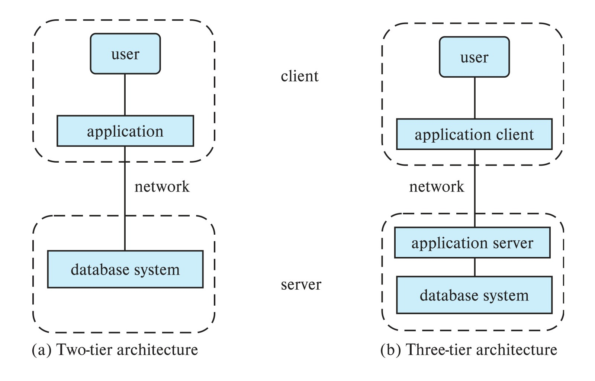

[← Previous: T01.6: DBMS Engine Components](T01.06_DBMS_Engine_Components.md) | [🏠 Index](00_Index.md) | [Next: T02.1: Entities, Relationships, and Degree →](T02.01_Entities_Relationships_and_Degree.md)

---

# T01.7: Two-Tier vs. Three-Tier Architecture

> **Topic:** T01 · DB Concepts & Architecture | **Priority:** 🟢 | **Exam Frequency:** 1/7 finals (+ CT-01) (5 marks) · 2020 Q1b, CT-01 Q03
> **Sources:** Silberschatz 7e Ch. 1 (§1.7) · Lecture Deck 01 (Slides 29–31) · Class Notes (Raidah p. 12)

---

## Architectural Comparison

**Two-Tier Architecture:** A client-server structure where the application logic and user interface run on the client machine and communicate directly with the database system via APIs like ODBC or JDBC.

**Three-Tier Architecture:** An architecture where an intermediate application server separates the client user interface from the database server. The client runs only a presentation interface, the middle tier runs business logic, and the database server manages data.

**Business Logic:** The core rules, validations, and computational algorithms that govern application workflows. In three-tier systems, business logic lives centrally on the application server.

*Figure 1.1: Two-tier and three-tier database architectures (Deck 01, Slide 30).*

---

## 1. Two-Tier Architecture (Client-Server)

In a two-tier architecture, the application logic runs directly on the user's client machine.

### Execution Flow and Limitations

1. The client machine runs a desktop application that combines the user interface, business logic, and SQL generation.
2. The client opens a direct network connection to the database server using ODBC or JDBC.
3. The database executes queries and sends raw tuples back across the network.

**Limitations:**
- **Thick (Fat) Client:** Every user machine requires database drivers and client software installations. Updating a business rule requires redeploying software across every client PC.
- **Security Exposure:** Storing database credentials and opening database ports to client networks leaves systems vulnerable to direct attack.
- **Connection Overhead:** Each client holds a dedicated database connection. Hundreds of active clients exhaust server memory and CPU threads.

---

## 2. Three-Tier Architecture (Web & Enterprise Era)

In a three-tier architecture, an application server sits between the client device and the database engine.

### The Three Functional Layers

1. **Presentation Layer (Client Front End):**
   - Runs in a web browser or mobile app.
   - Collects user inputs and displays formatted results over HTTP/HTTPS.
   - Contains no database drivers and no database connection credentials.
2. **Business Logic Layer (Application Server):**
   - Runs on backend application servers (written in Python, Java, Node.js, C#, or PHP).
   - Validates user input, enforces domain business rules, and communicates with the database using connection pooling.
3. **Data Access Layer (Database Server):**
   - Runs the DBMS engine inside a protected private subnet behind a firewall.
   - Manages physical storage, executes SQL queries, enforces relational constraints, and guarantees ACID transactions.

---

## Feature Comparison Table

| Feature | Two-Tier Architecture | Three-Tier Architecture |
| :--- | :--- | :--- |
| **Physical Tiers** | 2 tiers (Client machine and Database server). | 3 tiers (Client machine, Application server, Database server). |
| **Client Type** | Thick (fat) client requiring local DB drivers. | Thin client (standard web browser or mobile app). |
| **Business Logic Location** | Resides and runs directly on client devices. | Centralized on the intermediate application server. |
| **Database Communication** | Direct client-to-database calls via ODBC or JDBC. | Client calls Application Server; Application Server calls DBMS. |
| **Security Exposure** | High: DB credentials and listening ports exposed to clients. | Low: Database sits behind a firewall; clients never access it directly. |
| **Connection Handling** | One dedicated DB connection per user client. | Application server reuses shared connection pools. |
| **Software Maintenance** | Code updates must be deployed to each user machine. | Updated once on the central application server. |
| **Scalability** | Poor: Degrades rapidly past a few hundred connections. | High: Supports millions of concurrent users via load balancing. |

---

## Why Three-Tier Architecture Suits Web Applications

Three-tier architecture is the universal standard for web applications for four practical reasons:

1. **Thin Client Operation:** Web users access sites through standard browsers that cannot safely maintain heavy ODBC/JDBC driver stacks. The browser only renders HTML and exchanges JSON over HTTP/HTTPS.
2. **Strict Security and Credential Protection:** Opening database ports (such as 3306 or 1521) to the public internet invites attacks. A three-tier design isolates the database inside a private subnet behind a firewall. Only the trusted application server holds credentials.
3. **Connection Pooling:** Opening database connections is resource-intensive. The application server maintains a shared pool of open database sessions and reuses them across thousands of concurrent web requests.
4. **Centralized Maintenance:** When business rules change (such as grading formulas or tax rules), developers deploy code once on the application server without updating user devices.

---

## 🏆 Golden Questions (Past Exam Archive)

### 🎯 GQ1 · 2020 Q.1(b) · 03 Marks

> *Section A · Asked in: 2020 · L1 (asked once)*

**Question.** Differentiate between the two-tier architecture and three-tier architecture of database. Which is better suited for web application? Why?

**Answer.**

**Differences between Two-Tier and Three-Tier Architectures:**

| Feature | Two-Tier Architecture | Three-Tier Architecture |
| :--- | :--- | :--- |
| **Application Placement** | The application logic resides entirely on the client machine. | The client holds only the presentation layer. Application logic resides on an intermediate application server. |
| **Database Communication** | The client invokes database system calls directly over the network (using ODBC or JDBC). | The client communicates with the application server, which in turn contacts the database system. |
| **Client Overhead** | Thick (fat) client. Requires database drivers and business code installed on each client. | Thin client. Runs in a web browser or simple mobile interface. |

*Figure: Two-tier and three-tier database architectures (Deck 01, Slide 30)*

**Web Application Choice & Reason:**  
**Three-tier architecture is better suited for web applications.**
- **Reason:** Web clients (browsers) should remain thin and lightweight without direct database drivers. Placing application logic on an intermediate server protects database credentials behind firewalls and allows connection pooling for thousands of concurrent users.

---

### 🎯 GQ2 · CT-01 Q.03 · 02 Marks

> *CT-01 · CO1 · Asked in: CT-01 · L1 (asked once)*

**Question.** Describe the structure of a database application.

**Answer.**

A database application connects user interfaces to the database engine through three functional layers:

1. **Presentation Layer (Client Front End):** The client interface (web browser, mobile app, or desktop form) through which users enter input and view results.
2. **Business Logic Layer (Application Server):** Programs written in host languages (like Python, Java, or C++) that implement business rules, validate input, and issue database queries.
3. **Data Access Layer (Database Server / DBMS Engine):** The database system that uses APIs (such as JDBC or ODBC) to execute SQL queries, manage transactions, and persist data.

---

## ⚡ Exam Tips & Common Mistakes

- **State your web choice immediately:** In 2020 Q.1(b), state **"Three-tier architecture is better suited for web applications"** as the first sentence of your recommendation so the examiner spots it immediately.
- **Give concrete technical arguments:** Cite **thin clients (browsers)**, **connection pooling**, and **firewall credential isolation**.
- **Distinguish application tiers from internal DBMS modules:** The query processor and storage manager are internal engine components (Topic T01.6). Two-tier and three-tier architectures describe network distribution among the **client**, **application server**, and **database server**.

---

## 🔗 Related Topics

- [T01.06: DBMS Engine Components](T01.06_DBMS_Engine_Components.md) · Internal query processing and storage management modules.
- [T02.01: Entities, Relationships, and Degree](T02.01_Entities_Relationships_and_Degree.md) · Conceptual data modeling for enterprise applications.
- [T13.01: Database Security Threats and Authorization](T13.01_Security_and_Authorization.md) · Network security, authorization, and firewall boundaries.

---

[← Previous: T01.6: DBMS Engine Components](T01.06_DBMS_Engine_Components.md) | [🏠 Index](00_Index.md) | [Next: T02.1: Entities, Relationships, and Degree →](T02.01_Entities_Relationships_and_Degree.md)
