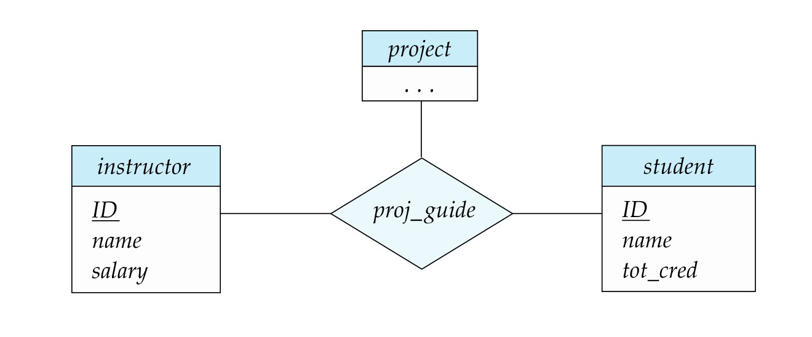

[← Previous: T01.07 Two-Tier vs Three-Tier Architecture](T01.07_Two_Tier_vs_Three_Tier_Architecture.md) | [🏠 Index](00_Index.md) | [Next: T02.02 Attribute Types →](T02.02_Attribute_Types.md)

---

# T02.1: Entities, Relationships, and Degree

> **Topic:** T02 · E-R & EER Modeling | **Priority:** 🟢 Low | **Exam Frequency:** 1/7 finals (4 marks)  
> **Sources:** Silberschatz 7e Ch. 6 (§6.2) · Lecture Deck 05 (Slides 7–16) · Class Notes (Raidah p. 18; Fahim pp. 20–25)

---

## Conceptual Foundations of the E-R Model

**Entity-Relationship (E-R) Data Model:** A high-level conceptual data model that views the real world as a collection of basic objects called entities and relationships among them. Database designers use it to sketch schemas visually before writing SQL DDL.

**Entity:** A distinct real-world object or thing that exists and can be distinguished from other objects (for example, a specific student `2310035` or an instructor `22222`).

**Entity Set:** A collection of entities of the same type that share the same properties or attributes (such as all students in a university). In Chen E-R notation, an entity set is drawn as a **rectangle**.

**Relationship:** An association among two or more entities.

**Relationship Set:** A mathematical relation on $n \ge 2$ (possibly non-distinct) entity sets:

$$
R \subseteq \{(e_1, e_2, \dots, e_n) \mid e_1 \in E_1, e_2 \in E_2, \dots, e_n \in E_n\}
$$

Where each tuple $(e_1, e_2, \dots, e_n)$ is a relationship instance. In an E-R diagram, a relationship set is drawn as a **diamond**.

---

## Classification of Relationships by Degree

**Degree of a Relationship Set:** The number of participating entity sets in a relationship set. Based on degree, relationships are classified into unary, binary, ternary, and $n$-ary.

### 1. Unary (Recursive) Relationship (Degree 1)

Only one entity set participates in the relationship set. Entities of this set relate to other entities within the same set.

- **Role Labels:** Because both lines link to the same entity rectangle, explicit role labels must be written on the edges to show each entity's role.
- **Example:** A `course` entity relates to another `course` via the `prereq` relationship set. The role labels are `course_id` (the target course) and `prereq_id` (the prerequisite course).

*Figure 1: Roles in a recursive (unary) relationship prereq connected to entity set course (Deck 05, Slide 14).*

### 2. Binary Relationship (Degree 2)

Connects two distinct entity sets. This is the most common relationship type in relational database modeling.

- **Example:** The `advisor` relationship set connects `instructor` and `student`. The relationship instance $(45565, 12345) \in \text{advisor}$ records that instructor 45565 advises student 12345.

*Figure 2: Binary relationship advisor connecting instructor and student entity sets (Deck 05, Slide 11).*

### 3. Ternary Relationship (Degree 3)

Connects three distinct entity sets simultaneously through a single relationship diamond.

- **Why It Is Needed:** If three binary relationships were used instead (`instructor-student`, `student-project`, `instructor-project`), the database would lose track of which specific instructor guides which student on which exact project. The ternary link preserves this three-way binding.
- **Example:** The `proj_guide` relationship set connects `instructor`, `student`, and `project`.

*Figure 3: Ternary relationship proj_guide connecting instructor, student, and project entity sets (Deck 05, Slide 16).*

### 4. Higher-Degree ($n$-ary) Relationships (Degree $n$)

Connects $n \ge 4$ entity sets. In practice, relationships with degree $n > 3$ are rare. They are difficult to visualize and maintain. Designers usually replace an $n$-ary relationship with an entity set and multiple binary relationships.

---

## Degree Comparison Matrix

| Relationship Classification | Degree ($n$) | Description | Example | Role Labels Required? |
| :--- | :---: | :--- | :--- | :---: |
| **Unary (Recursive)** | 1 | Association among entities of the same set | `course` $\xrightarrow{\text{prereq}}$ `course` | **Yes** (mandatory) |
| **Binary** | 2 | Association between two distinct entity sets | `instructor` $\xrightarrow{\text{advisor}}$ `student` | No (implicit) |
| **Ternary** | 3 | Association among three distinct entity sets | `instructor`, `student`, `project` $\xrightarrow{\text{proj\_guide}}$ | No (implicit) |
| **$n$-ary** | $n$ | Association among $n$ entity sets ($n \ge 4$) | Supply-chain delivery contracts | Only if entity sets repeat |

---

## Descriptive Attributes on Relationships

**Descriptive Attribute:** An attribute attached directly to a relationship diamond rather than to any participating entity rectangle. It records data about the relationship instance itself.

- **Example 1:** The `advisor` relationship between `instructor` and `student` can have a `date` attribute recording when the advising began.
- **Example 2:** The `takes` relationship between `student` and `course` carries a `grade` attribute. Grade depends on both student and course together. It cannot belong to either entity alone.
- **Notation:** Drawn as an oval connected to the relationship diamond with a solid line.

---

## 🏆 Golden Questions (Past Exam Archive)

### 🎯 GQ1 · 2021 Q.5(a) · ER Diagram Definition and Relationship Types · [04 Marks]

> *Section B · CLO1 · Asked in: 2021 · L1 (asked once)*

**Question (2021 Q.5(a)).** What is ER diagram? Illustrate different types of relationship that can be represented in ER diagram.

**Answer.**

#### 1. Definition of E-R Diagram
An **Entity-Relationship (E-R) diagram** is a graphical tool used in database design. It represents the conceptual schema of an enterprise by depicting entities, their attributes, and the relationships among them.

#### 2. Types of Relationships by Degree
The **degree** of a relationship set is the number of participating entity sets. Different types of relationships based on degree include:

1. **Unary (Recursive) Relationship (Degree 1):**
   - The same entity set participates more than once in different roles.
   - Requires explicit role labels on the connecting lines.
   - *Example:* A `course` entity related to another `course` entity via a `prereq` relationship (roles: `course_id` and `prereq_id`).

2. **Binary Relationship (Degree 2):**
   - Involves two distinct entity sets. This is the most common relationship type.
   - *Example:* `instructor` and `student` linked by the `advisor` relationship.

3. **Ternary Relationship (Degree 3):**
   - Involves three distinct entity sets simultaneously.
   - It captures associations that cannot be factored into binary relationships without losing information.
   - *Example:* `proj_guide` linking `instructor`, `student`, and `project`.

| Relationship Type | Degree | Description | Example |
| :--- | :---: | :--- | :--- |
| **Unary (Recursive)** | 1 | Association among entities of the same entity set | Course $\xrightarrow{\text{prereq}}$ Course |
| **Binary** | 2 | Association between two distinct entity sets | Instructor $\xrightarrow{\text{advisor}}$ Student |
| **Ternary** | 3 | Association among three distinct entity sets | Instructor, Student, Project $\xrightarrow{\text{proj\_guide}}$ |
| **$n$-ary** | $n$ | Association among $n$ entity sets | Rare; usually decomposed into binary |

---

## ⚡ Exam Tips & Common Mistakes

- **Degree vs. Cardinality Trap:** When asked for "types of relationship", classify by **degree** (Unary, Binary, Ternary). Do not give only mapping cardinalities (1:1, 1:N, M:N). Mention degree first.
- **Unary Role Labels:** Always write role labels (such as `course_id` and `prereq_id`) on recursive lines. Leaving lines unlabeled loses marks.
- **Why Ternary Exists:** Remember that a ternary relationship cannot always be split into two binary relationships. Binary splits lose the specific three-way binding.

## 🔗 Related Topics

- [T02.02: Attribute Types](T02.02_Attribute_Types.md) · Simple, composite, multivalued, and derived attributes
- [T02.03: Mapping Cardinality and Participation Constraints](T02.03_Mapping_Cardinality_and_Participation.md) · 1:1, 1:N, M:N ratios and total vs. partial constraints
- [T02.06: Reduction of E-R Diagrams to Relational Tables](T02.06_Reduction_of_ER_to_Tables.md) · Converting unary, binary, and ternary relationships into tables

---

[← Previous: T01.07 Two-Tier vs Three-Tier Architecture](T01.07_Two_Tier_vs_Three_Tier_Architecture.md) | [🏠 Index](00_Index.md) | [Next: T02.02 Attribute Types →](T02.02_Attribute_Types.md)
