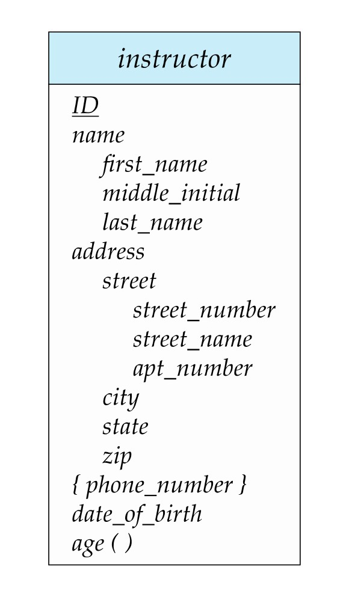

[← Previous: T02.01 Entities, Relationships, and Degree](T02.01_Entities_Relationships_and_Degree.md) | [🏠 Index](00_Index.md) | [Next: T02.03 Mapping Cardinality and Participation Constraints →](T02.03_Mapping_Cardinality_and_Participation.md)

---

# T02.2: Attribute Types

> **Topic:** T02 · E-R & EER Modeling | **Priority:** 🟡 Medium | **Exam Frequency:** 2/7 finals (8 marks)  
> **Sources:** Silberschatz 7e Ch. 6 (§6.2, §6.3, pp. 244–252) · Lecture Deck 05 (Slides 17–19) · Classnote by Raidah (p. 18) · Handnote by Fahim (pp. 26–27)

---

## Core Classification of Attributes

**Entity:** A distinct real-world object or thing that exists and is distinguishable from other objects (for example, instructor `22222`).

**Attribute:** A descriptive property possessed by every member of an entity set (such as `name`, `salary`). In Chen notation, drawn as an **ellipse**.

**Domain:** The set of permitted values for an attribute.

Attributes are classified along three independent axes:
1. **Divisibility:** Simple (Atomic) vs. Composite
2. **Cardinality:** Single-Valued vs. Multivalued
3. **Storage:** Stored (Base) vs. Derived

---

## 1. Simple vs. Composite Attributes

**Simple (Atomic) Attribute:** An attribute that cannot be divided into smaller subparts. It holds a single indivisible scalar value from its domain.
- *Examples:* `salary`, `student_id`, `credits`, `gpa`.

**Composite Attribute:** An attribute that can be divided into smaller subparts that form independent attributes. It groups related properties hierarchically.
- *Examples:* `name` (divided into `first_name`, `middle_initial`, `last_name`), `address` (divided into `street`, `city`, `state`, `zip_code`).

| Feature | Simple (Atomic) Attribute | Composite Attribute |
| :--- | :--- | :--- |
| **Divisibility** | Cannot be divided into smaller parts. | Can be divided into smaller independent subparts. |
| **Structure** | Single scalar value. | Hierarchical tree of component attributes. |
| **Chen Notation** | Single ellipse connected to entity rectangle. | Ellipse branching out into sub-ellipses. |
| **Table Storage** | Maps to a single table column. | Flattened into separate columns for each leaf subpart. |
| **Example** | `salary`, `student_id`, `credits` | `name` (`first_name`, `last_name`), `address` (`city`, `zip`) |

---

## 2. Single-Valued vs. Multivalued Attributes

**Single-Valued Attribute:** An attribute that holds at most one value for a specific entity instance.
- *Examples:* `date_of_birth`, `national_id`, `department_name`.

**Multivalued Attribute:** An attribute that can hold a set of zero, one, or multiple values for a single entity instance. In set terms, its domain is the power set $2^D$ of an underlying domain $D$.
- *Examples:* `phone_numbers`, `degrees`, `skills`.

| Feature | Single-Valued Attribute | Multivalued Attribute |
| :--- | :--- | :--- |
| **Values per Entity** | Exactly one value (or null) per record. | Zero, one, or multiple values per record. |
| **Domain Type** | Atomic domain value. | Set domain: $2^{\text{Domain}}$. |
| **Chen Notation** | Single ellipse. | Double concentric ellipse ($\large\boldsymbol{\odot}$). |
| **Table Storage** | Stored directly in the main entity table. | Converted into a separate child table with the entity PK. |
| **Example** | `date_of_birth`, `roll_no`, `salary` | `phone_numbers`, `degrees`, `email_addresses` |

---

## 3. Stored vs. Derived Attributes

**Stored (Base) Attribute:** An attribute whose value is physically saved on disk inside the database table.
- *Examples:* `date_of_birth`, `admission_date`, `unit_price`.

**Derived Attribute:** An attribute whose value is not stored physically on disk. It is computed dynamically from stored attributes or system values when queried.
- *Examples:* `age` (derived from `current_date - date_of_birth`), `total_cost` (`price * quantity`).
- *Advantage:* Saves disk space and prevents stale data when related values change over time.

| Feature | Stored (Base) Attribute | Derived Attribute |
| :--- | :--- | :--- |
| **Storage Location** | Saved physically in disk blocks. | Not stored on disk; computed dynamically at query time. |
| **Freshness** | Can become outdated if related facts change. | Always up to date when queried. |
| **Chen Notation** | Solid ellipse. | Dashed ellipse. |
| **Implementation** | Table column. | SQL view, generated column, or query expression. |
| **Example** | `date_of_birth`, `hourly_rate` | `age`, `students_advised` |

---

## 4. Null Values

A **null** value represents an unknown or non-applicable value. Silberschatz identifies three cases:
1. **Not Applicable:** The property does not apply (for example, `apt_number` for a standalone house).
2. **Missing (Unknown Value):** The value exists in reality, but is not currently known (such as missing middle name).
3. **Unknown Existence:** It is not known whether the attribute value even exists.

---

## 5. Visual Notation Summary & Relational Mapping

| Attribute Type | Chen E-R Symbol | Tabular Symbol | Relational Mapping Rule |
| :--- | :--- | :--- | :--- |
| **Primary Key** | Ellipse with underlined text | `<u>ID</u>` | Primary key column in entity table |
| **Simple Attribute** | Single solid ellipse | Plain text | Normal column in entity table |
| **Composite Attribute** | Ellipse branching to sub-ellipses | Hierarchy tree | Flattened into separate leaf columns |
| **Multivalued Attribute** | Double concentric ellipse | `{ phone }` | Separate table: $(\underline{\text{PK}}, \underline{\text{attribute}})$ |
| **Derived Attribute** | Dashed ellipse | `age ()` | Omitted from table (computed via query/view) |

*Figure 1: Complex attributes on the instructor entity set in ER notation (Deck 05, Slide 19).*

---

## 🏆 Golden Questions (Past Exam Archive)

### 🎯 GQ1 · 2020 Q.5(a) · Differentiate Attribute Types · [04 Marks]

> *Section B · Asked in: 2020 · L1 (asked once)*

**Question (2020 Q.5(a)).** Differentiate between-  
(i) Simple and composite attribute  
(ii) Single-valued and multi-valued attribute

**Answer.**

#### (i) Simple vs Composite Attribute

| Feature | Simple (Atomic) Attribute | Composite Attribute |
| :--- | :--- | :--- |
| **Definition** | Cannot be divided into smaller subparts. | Can be divided into smaller subparts that form independent attributes. |
| **Structure** | Holds a single atomic value from its domain. | Forms a hierarchy of component attributes. |
| **E-R Notation** | Single ellipse connected to the entity rectangle. | An ellipse connected to component ellipses. |
| **Storage / Schema** | Maps to a single column in a relational table. | Flattened into separate columns for each subpart. |
| **Example** | `salary`, `student_id`, `credits` | `name` (`first_name`, `last_name`), `address` (`street`, `city`, `zip_code`) |

#### (ii) Single-Valued vs Multi-Valued Attribute

| Feature | Single-Valued Attribute | Multi-Valued Attribute |
| :--- | :--- | :--- |
| **Definition** | Holds at most one value for a specific entity instance. | Can hold a set of values for a single entity instance. |
| **Values per Entity** | Exactly one value per record. | Zero, one, or multiple values per record. |
| **E-R Notation** | Single ellipse. | Double ellipse (concentric ellipses). |
| **Table Conversion** | Stored directly in the main entity table. | Converted into a separate table with the entity primary key. |
| **Example** | `date_of_birth`, `roll_no`, `nid` | `phone_numbers`, `degrees`, `email_addresses` |

---

### 🎯 GQ2 · 2021 Q.3(b) · Entity, Attribute, and Complex Attributes · [04 Marks]

> *Section A · CLO4 · Asked in: 2021 · L1 (asked once)*

**Question (2021 Q.3(b)).** Define entity and attribute. Explain the following attributes-  
(i) Multi-valued  
(ii) Derived  
(iii) Composite

**Answer.**

- **Entity:** A "thing" or "object" in the real world that exists and is distinguishable from other objects (e.g., a specific instructor `ID = 22222`, or a student).
- **Attribute:** A descriptive property possessed by all members of an entity set (e.g., `name`, `salary`).

#### Explanation of Attribute Types:

1. **Multi-valued Attribute:**
   - Holds a set of multiple values for a single entity instance.
   - Depicted by a **double ellipse** in Chen notation.
   - Converted into a separate table with the entity primary key to preserve First Normal Form (1NF).
   - *Example:* An instructor may have multiple phone numbers (`phone_numbers` = `{0171..., 0181...}`).

2. **Derived Attribute:**
   - The value is not stored directly on disk. It is computed from stored attributes or system values.
   - Depicted by a **dashed ellipse** in Chen notation.
   - Keeps data fresh automatically without manual updates.
   - *Example:* `age` derived from current date minus `date_of_birth`.

3. **Composite Attribute:**
   - Can be divided into smaller component attributes with independent meanings.
   - Depicted by an ellipse with attached branches leading to sub-ellipses.
   - Flattened into individual columns in the relational table.
   - *Example:* `name` divided into `first_name`, `middle_initial`, and `last_name`.

*Figure 2: Complex Attributes in ER Diagram Notation (Deck 05, Slide 19).*

---

## ⚡ Exam Tips & Common Mistakes

- **Always Give Concrete Examples:** Omitting examples (`salary`, `name`, `phone_numbers`, `age`) loses up to half the marks.
- **Composite vs. Multivalued Difference:** Composite attributes have parts with *different meanings* (`first_name`, `last_name`). Multivalued attributes have multiple values with the *same meaning* (multiple phone numbers).
- **Multivalued Relational Rule:** State clearly that multivalued attributes violate 1NF if stored in a single table cell. They must be moved to a separate table.
- **Chen Symbols:** Remember concentric double ellipses for multivalued, dashed ellipses for derived, and branched ellipses for composite.

## 🔗 Related Topics

- [T02.01: Entities, Relationships, and Degree](T02.01_Entities_Relationships_and_Degree.md) · Basic definitions of entities and entity sets
- [T02.03: Mapping Cardinality and Participation Constraints](T02.03_Mapping_Cardinality_and_Participation.md) · Relationships and constraints
- [T02.06: Reduction of E-R Diagrams to Relational Tables](T02.06_Reduction_of_ER_to_Tables.md) · Schema transformation rules for composite and multivalued attributes
- [T08.06: Normal Forms (1NF, 2NF, and 3NF)](T08.06_Normal_Forms_1NF_2NF_3NF.md) · Eliminating multivalued attributes to satisfy 1NF

---

[← Previous: T02.01 Entities, Relationships, and Degree](T02.01_Entities_Relationships_and_Degree.md) | [🏠 Index](00_Index.md) | [Next: T02.03 Mapping Cardinality and Participation Constraints →](T02.03_Mapping_Cardinality_and_Participation.md)
