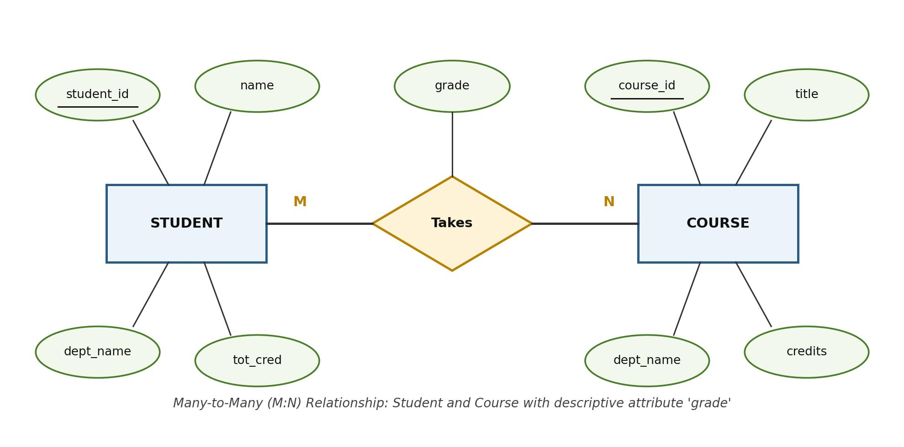

[← Previous: T02.02 Attribute Types](T02.02_Attribute_Types.md) | [🏠 Index](00_Index.md) | [Next: T02.04 Weak vs Strong Entity Sets →](T02.04_Weak_vs_Strong_Entity_Sets.md)

---

# T02.3: Mapping Cardinality and Participation Constraints

> **Topic:** T02 · E-R & EER Modeling | **Priority:** 🟡 Medium | **Exam Frequency:** 2/7 finals (8 marks)  
> **Sources:** Silberschatz 7e Ch. 6 (§6.4, pp. 252–258) · Lecture Deck 05 (Slides 20–28) · Classnote by Raidah (pp. 18–19) · Handnote by Fahim (pp. 28–30)

---

## 1. Mapping Cardinality Ratios (Binary Relationships)

**Mapping Cardinality:** Expresses the number of entities to which another entity can be associated via a relationship set. For a binary relationship set $R$ between entity sets $A$ and $B$, mapping cardinalities fall into four types:

- **Arrow Notation Rule:** In Silberschatz E-R diagrams, a **directed arrow ($\rightarrow$)** points to the **"at most one"** side. An **undirected line ($-$)** represents **"many"** (zero or more).

### The Four Binary Mapping Cardinality Types

1. **One-to-One (1:1):**
   - An entity in $A$ is associated with at most one entity in $B$, and an entity in $B$ is associated with at most one entity in $A$.
   - **E-R Notation:** Arrows point to both $A$ and $B$.
   - **Example:** A department has at most one head instructor (`dept_head`), and an instructor heads at most one department.

2. **One-to-Many (1:N):**
   - An entity in $A$ is associated with any number (0 or more) of entities in $B$. An entity in $B$ is associated with at most one entity in $A$.
   - **E-R Notation:** Directed arrow points to $A$ ("one" side); undirected line connects to $B$ ("many" side).
   - **Example:** An instructor advises many students, but each student has at most one advisor (`advisor`).

3. **Many-to-One (N:1):**
   - An entity in $A$ is associated with at most one entity in $B$. An entity in $B$ is associated with any number of entities in $A$.
   - **E-R Notation:** Undirected line connects to $A$ ("many" side); directed arrow points to $B$ ("one" side).
   - **Example:** Many students belong to one academic department (`stud_dept`), while each student belongs to only one department.

4. **Many-to-Many (M:N):**
   - An entity in $A$ is associated with any number of entities in $B$, and an entity in $B$ is associated with any number of entities in $A$.
   - **E-R Notation:** Undirected lines connect to both $A$ and $B$ (no arrows).
   - **Example:** A student can register for multiple courses, and a course can contain multiple students (`Takes`).

---

## Cardinality Comparison Matrix

| Cardinality Ratio | Entity $A$ Associates With | Entity $B$ Associates With | Arrow Placement in E-R | Primary Key Rule for Relationship |
| :---: | :--- | :--- | :--- | :--- |
| **1:1** | At most 1 in $B$ | At most 1 in $A$ | Arrows to both $A$ and $B$ | Primary key of either $A$ or $B$ |
| **1:N** | Zero or more in $B$ | At most 1 in $A$ | Arrow to $A$ ("one" side) | Primary key of $B$ (the "Many" side) |
| **N:1** | At most 1 in $B$ | Zero or more in $A$ | Arrow to $B$ ("one" side) | Primary key of $A$ (the "Many" side) |
| **M:N** | Zero or more in $B$ | Zero or more in $A$ | No arrows (undirected lines) | Composite key: $\text{PK}(A) \cup \text{PK}(B)$ |

---

## 2. Participation Constraints

While mapping cardinality sets the maximum number of links, participation constraints specify the minimum.

**Total Participation (Existence Dependency):** Every entity in the entity set must participate in at least one relationship instance in the relationship set.
- **Chen Notation:** Drawn as a **double line** between the entity rectangle and the relationship diamond.
- **Example:** Every student must have an assigned advisor (`student` has total participation in `advisor`).

**Partial Participation:** Some entities in the entity set may not participate in any relationship instance.
- **Chen Notation:** Drawn as a **single line**.
- **Example:** Some instructors do not advise any students (`instructor` has partial participation in `advisor`).


*Figure 1: Total participation (double line) of student and partial participation (single line) of instructor in advisor relationship (Deck 05, Slide 27).*

---

## 3. Min..Max Constraint Notation ($l..h$)

In min..max notation, a pair $l..h$ is placed on the edge connecting an entity set $E$ to a relationship set $R$:
- $l$ is the **minimum** participation count ($l = 1$ means total; $l = 0$ means partial).
- $h$ is the **maximum** participation count ($h = 1$ means at most one; $h = *$ means unlimited).

Common pairs:
- $0..*$ : Partial participation, many associations.
- $1..1$ : Total participation, exactly one association.
- $1..*$ : Total participation, at least one association.
- $0..1$ : Partial participation, at most one association.

---

## 4. Cardinality Constraints on Ternary Relationships

In a ternary (or higher-degree) relationship diamond, Silberschatz allows **at most one arrow** leaving the diamond:
- An arrow pointing to entity set $C$ means each pair $(a, b) \in A \times B$ is associated with at most one entity in $C$.
- Two or more arrows on a ternary diamond are not permitted because they create conflicting interpretations.

---

## 5. Converting a Many-to-Many (M:N) Relationship to Tables

In relational design, an $M:N$ relationship cannot be stored by adding a foreign key to either entity table without creating repeating groups and violating 1NF. It requires a dedicated table:

1. Create a dedicated relation schema for the relationship set (the **junction table**).
2. Include the primary key of each participating entity set as foreign keys in this new table.
3. Include any descriptive attributes associated with the relationship set.
4. Set the composite primary key of the new table as the union of both foreign keys:
   $$
   \text{PK}(\text{Junction Table}) = \text{PK}(A) \cup \text{PK}(B)
   $$


*Figure 2: Many-to-Many Relationship Model and Reduction to Relational Table.*

---

## 🏆 Golden Questions (Past Exam Archive)

### 🎯 GQ1 · 2018 Q.3(c) · Mapping Cardinality & M:N Conversion to Table · [04 Marks]

> *Section A · Asked in: 2018 · L1 (asked once)*

**Question (2018 Q.3(c)).** What is mapping cardinality? How a many to many relationship can be converted into table. Explain with example.

**Answer.**

#### 1. Mapping Cardinality
Mapping cardinality (or cardinality ratio) expresses the number of entities to which another entity can be associated via a relationship set. For binary relationships, it must be 1:1, 1:N, N:1, or M:N.

#### 2. Conversion of an M:N Relationship into a Table
1. Create a dedicated relation schema for the relationship set.
2. Include the primary key of each participating entity set as foreign keys in this new table.
3. Include any descriptive attributes associated with the relationship set.
4. The composite primary key of the new table is formed by the union of the primary keys of both participating entity sets.


*Figure 3: Many-to-Many Relationship Model and Reduction to Relational Table.*

#### 3. Example (`student`, `course`, and `takes`)
- Entity `STUDENT` with attributes `student_id` (PK), `name`.
- Entity `COURSE` with attributes `course_id` (PK), `title`.
- Relationship `Takes` (M:N) with descriptive attribute `grade`.

**Relational Schemas:**

**student**(**student_id**, name)  
`PK: student_id`

**course**(**course_id**, title)  
`PK: course_id`

**takes**(**student_id**, **course_id**, grade)  
`PK: (student_id, course_id)`  
`FK: student_id references student(student_id), course_id references course(course_id)`

```sql
CREATE TABLE takes (
    student_id   VARCHAR(10),
    course_id    VARCHAR(8),
    grade        VARCHAR(2),
    PRIMARY KEY (student_id, course_id),
    FOREIGN KEY (student_id) REFERENCES student(student_id) ON DELETE CASCADE,
    FOREIGN KEY (course_id) REFERENCES course(course_id) ON DELETE CASCADE
);
```

---

### 🎯 GQ2 · 2020 Q.1(c) · Mapping Cardinalities & Four Types · [04 Marks]

> *Section A · Asked in: 2020 · L1 (asked once)*

**Question (2020 Q.1(c)).** What is mapping cardinalities? Define different types of cardinalities.

**Answer.**

#### 1. Definition
Mapping cardinality specifies how many entities from one entity set can be associated with entities from another entity set through a binary relationship set.

#### 2. Types of Mapping Cardinalities

1. **One-to-One (1:1):**
   - An entity in $A$ is associated with at most one entity in $B$, and an entity in $B$ is associated with at most one entity in $A$.
   - *Example:* A department has at most one head (`dept_head`).

2. **One-to-Many (1:N):**
   - An entity in $A$ is associated with any number (0 or more) of entities in $B$. An entity in $B$ is associated with at most one entity in $A$.
   - *Example:* An instructor advises many students, but each student has at most one advisor.

3. **Many-to-One (N:1):**
   - An entity in $A$ is associated with at most one entity in $B$. An entity in $B$ is associated with any number of entities in $A$.
   - *Example:* Many students belong to one department.

4. **Many-to-Many (M:N):**
   - An entity in $A$ is associated with any number of entities in $B$, and an entity in $B$ is associated with any number of entities in $A$.
   - *Example:* A student can register for multiple courses, and a course can contain multiple students.

---

## ⚡ Exam Tips & Common Mistakes

- **Arrow Direction Trap:** In Silberschatz notation, the arrow points to the **ONE** side. Do not draw arrows pointing to the "many" side. Remember: Arrow = "At most one", Line = "Many".
- **Junction Table Primary Key:** When converting an M:N relationship to a table, both foreign keys together form the composite primary key. Selecting only one foreign key violates entity integrity.
- **Descriptive Attributes:** Descriptive attributes on relationships (such as `grade`) go into the junction table, never into the entity tables.
- **Participation Double Line:** Total participation requires a double line connecting the entity rectangle to the relationship diamond.

## 🔗 Related Topics

- [T02.02: Attribute Types](T02.02_Attribute_Types.md) · Attribute definitions and symbols
- [T02.04: Weak vs Strong Entity Sets](T02.04_Weak_vs_Strong_Entity_Sets.md) · Total participation in identifying relationships
- [T02.05a: E-R Design: Student and Teacher-Course DBs](T02.05a_ER_Design_Method_Student_and_Teacher_Course.md) · Applying cardinality constraints in full designs
- [T02.06: Reduction of E-R Diagrams to Relational Tables](T02.06_Reduction_of_ER_to_Tables.md) · Reduction rules for 1:1, 1:N, and M:N relationships

---

[← Previous: T02.02 Attribute Types](T02.02_Attribute_Types.md) | [🏠 Index](00_Index.md) | [Next: T02.04 Weak vs Strong Entity Sets →](T02.04_Weak_vs_Strong_Entity_Sets.md)
