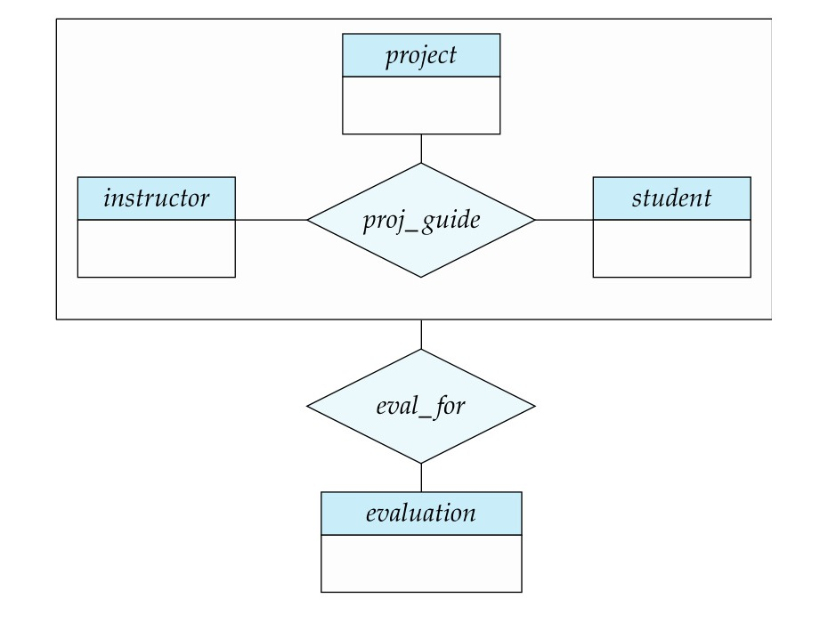

[← Previous: T02.07 EER Specialization and Generalization](T02.07_EER_Specialization_Generalization.md) | [🏠 Index](00_Index.md) | [Next: T03.01 Relation, Tuple, Domain, and Schema →](T03.01_Relation_Tuple_Domain.md)

---

# T02.8: EER Aggregation

> **Topic:** T02 · E-R & EER Modeling | **Priority:** 🟡 Medium | **Exam Frequency:** 2/7 finals (5 marks: 2018 Q2b, 2020 Q3a)  
> **Sources:** Silberschatz 7e Ch. 6 (§6.8.5, §6.8.6.2) · Lecture Deck 05 (Slides 57–60) · Class Notes

---

## The Fundamental Limitation: Relationships Between Relationships

**Aggregation:** An abstraction in E-R and EER modeling through which a relationship set (along with its participating entity sets) is treated as a higher-level abstract entity set.

In basic E-R modeling, a relationship diamond can connect only to entity rectangles. Connecting a relationship diamond directly to another relationship diamond is illegal.

Consider a university project guidance system:
- Three entity sets: `instructor`, `student`, and `project`.
- A ternary relationship set: `proj_guide` (an instructor guides a student on a project).
- Suppose periodic `evaluation` reports must be recorded for each guidance assignment.

Without aggregation, modeling this requires either:
1. Connecting diamond to diamond (syntax error in E-R).
2. Creating an unnormalized 4-way relationship `eval_for(instructor, student, project, evaluation)`. This causes data redundancy: active guidance assignments cannot be recorded before receiving their first evaluation report.

*Figure 1: Motivation for Aggregation showing redundant relationship sets proj_guide and eval_for (Deck 05, Slide 57).*

---

## How Aggregation Solves the Problem

Aggregation solves this limitation by enclosing the relationship and its participating entities in a rectangular bounding box:

1. **Bounding Rectangle:** A box is drawn around `proj_guide` and entity sets `instructor`, `student`, and `project`.
2. **Abstract Entity:** From the outside, this bounded box is treated as a single higher-level entity set.
3. **Clean Binary Connection:** The entity set `evaluation` links to the aggregate box via a simple binary relationship set `eval_for`.

*Figure 2: Aggregation Representation in E-R Diagram (Deck 05, Slide 59).*

---

## Reduction of Aggregation to Relational Tables

The aggregate bounding box does not require a new surrogate primary key. Its identifier is simply the composite primary key of the enclosed relationship:

1. **Inner Relationship Table:**
   $$
   \text{proj\_guide}(\underline{\text{s\_id}}, \underline{\text{project\_id}}, \underline{\text{i\_id}})
   $$
2. **Connecting Relationship Table:**
   $$
   \text{eval\_for}(\underline{\text{s\_id}}, \underline{\text{project\_id}}, \underline{\text{i\_id}}, \underline{\text{evaluation\_id}})
   $$
   `FK: (s_id, project_id, i_id) references proj_guide`  
   `FK: evaluation_id references evaluation`

---

## 🏆 Golden Questions (Past Exam Archive)

### 🎯 GQ1 · 2018 Q.2(b) / 2020 Q.3(a) · Concept of Aggregation and Practical Examples · [03 Marks / 02 Marks]

> *Section A · Asked in: 2018 (03 Marks), 2020 (02 Marks) · L2 merge*

**Question (2018 Q.2(b)).** Define the concept of aggregation. Give two examples of where this concept is useful.

**Question (2020 Q.3(a)).** What is aggregation in ER-model design?

**Answer.**

#### 1. Definition
**Aggregation** is an abstraction in E-R modeling through which a relationship set is treated as a higher-level abstract entity set. This allows the relationship itself to participate in further relationships with other entity sets without duplicating attributes.

*Figure 3: Aggregation Representation in E-R Diagram (Deck 05, Slide 59).*

#### 2. Two Examples Where Aggregation is Useful

1. **Student Project Evaluation:**  
   The ternary relationship `proj_guide` associates `student`, `instructor`, and `project`. To record an `evaluation` for that specific guidance assignment, treating `proj_guide` as an aggregate entity avoids creating an overlapping 4-way relationship. `evaluation` links directly to the aggregate `proj_guide` through the relationship `eval_for`.

2. **Employee Project Monitoring:**  
   Employees work on projects via the relationship `Works_On`. A manager needs to monitor that specific work assignment. By aggregating `Works_On` into an entity, the `manager` can participate in a relationship `Monitors` directly with the aggregate entity `(Employee, Project)`.

*Short version for 2020 Q.3(a) (2 marks):*  
Give the definition of aggregation and describe Example 1 (`proj_guide` with `eval_for`) in 2 lines.

---

## ⚡ Exam Tips & Common Mistakes

- **E-R vs. SQL Aggregation:** Do not confuse E-R aggregation with SQL aggregate functions (`COUNT`, `SUM`, `AVG`). E-R aggregation is a conceptual abstraction treating a relationship as an entity.
- **Never Connect Diamonds to Diamonds:** In basic E-R, diamonds cannot connect directly to diamonds. Draw a bounding rectangle around the inner relationship first.
- **Relational Primary Key:** In table reduction, the aggregate entity inherits the composite primary key of the inner relationship.
- **Standard Example:** Use the textbook `proj_guide` and `eval_for` example for guaranteed full marks.

## 🔗 Related Topics

- [T02.01: Entities, Relationships, and Degree](T02.01_Entities_Relationships_and_Degree.md) · Relationship sets and ternary relationships
- [T02.06: Reduction of E-R Diagrams to Relational Tables](T02.06_Reduction_of_ER_to_Tables.md) · Converting relationship sets to tables
- [T02.07: EER Specialization and Generalization](T02.07_EER_Specialization_Generalization.md) · EER abstraction hierarchies

---

[← Previous: T02.07 EER Specialization and Generalization](T02.07_EER_Specialization_Generalization.md) | [🏠 Index](00_Index.md) | [Next: T03.01 Relation, Tuple, Domain, and Schema →](T03.01_Relation_Tuple_Domain.md)
