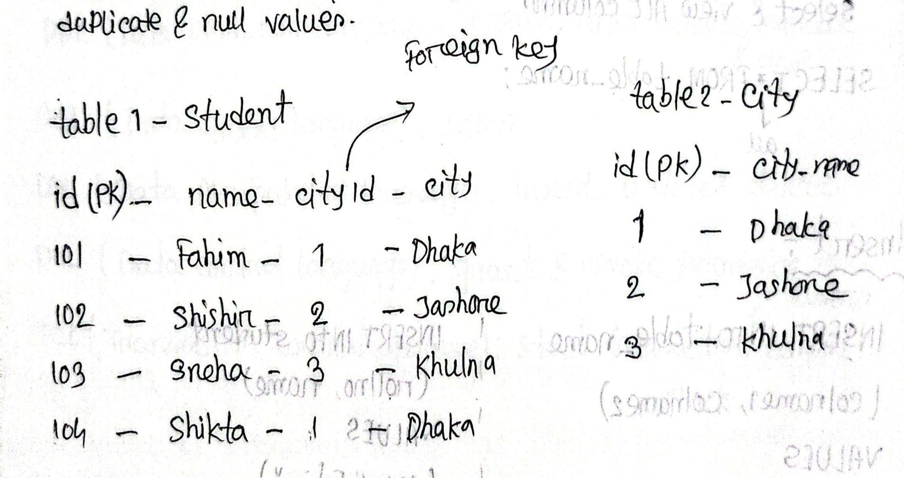

[← Previous: T03.1 · Relation, Tuple, Attribute, and Domain](T03.01_Relation_Tuple_Domain.md) | [🏠 Index](00_Index.md) | [Next: T03.3 · Referential Integrity and Foreign Key Syntax →](T03.03_Referential_Integrity_and_Foreign_Keys.md)

---

# T03.2: Relational Keys (Super, Candidate, Primary, Foreign)

> **Topic:** T03 · Relational Model, Keys & Integrity | **Priority:** 🔴 High | **Exam Frequency:** 5/7 finals · 21 marks
> **Sources:** Silberschatz 7e Ch. 2 (§2.3) · Lecture Deck 02 (Slide 7) · Lecture Deck 06 (Slides 11–13) · Class Notes (Raidah p. 5, 7, 13, 19, 20; Fahim p. 36, 46–47)

---

## Key Concepts and the Key Hierarchy

Because relational tables do not use physical row numbers, keys identify individual tuples and link related tables.

**Superkey:** A superkey is a set of one or more attributes whose combined values uniquely identify each tuple in a relation. Formally, for all distinct tuples $t_1, t_2 \in r$, $t_1 \neq t_2 \implies t_1[K] \neq t_2[K]$. A superkey can include redundant attributes.

**Candidate Key:** A candidate key is a minimal superkey. It uniquely identifies every tuple, and no proper subset of its attributes can do so. Removing any column destroys uniqueness.

**Primary Key:** A primary key is the specific candidate key selected by the database designer as the principal row identifier. It must be unique and cannot contain `NULL` (enforcing Entity Integrity).

**Alternate Key (Secondary Key):** An alternate key is any candidate key not selected as the primary key. In SQL, alternate keys are enforced using `UNIQUE` constraints.

**Composite Key:** A composite key is any key made of two or more attributes working together to identify tuples. It can be a composite superkey, candidate key, or primary key.

**Foreign Key:** A foreign key is an attribute (or set of attributes) in a child table whose values reference the primary key of a parent table. It enforces referential integrity.

### Subset Inclusion Formula

Every primary key is chosen from candidate keys, and every candidate key is a minimal superkey:

$$
\text{Primary Key} \subseteq \text{Candidate Keys} \subseteq \text{Super Keys}
$$

### Master Comparison Table

| Key Type | Plain-English Definition | Minimal? | NULL Allowed? | Max Per Table | Main Purpose |
| :--- | :--- | :---: | :---: | :---: | :--- |
| **Super Key** | Any set of attributes that uniquely identifies a row. | No (extra columns allowed) | No for identifying columns | Unlimited | Baseline uniqueness. |
| **Candidate Key** | A minimal super key with no redundant columns. | Yes (strictly minimal) | Yes (unless `NOT NULL`) | Multiple | Pool of eligible unique identifiers. |
| **Primary Key** | The single candidate key selected as the main row ID. | Yes | No (never allowed) | Exactly 1 | Principal row identifier (`PRIMARY KEY`). |
| **Alternate Key** | Any candidate key not chosen as primary key. | Yes | Yes (unless `NOT NULL`) | Multiple | Secondary unique identifier (`UNIQUE`). |
| **Composite Key** | Any key made of two or more attributes. | Depends on key tier | Depends on key tier | Multiple | Identifies rows in junction tables. |
| **Foreign Key** | Column(s) referencing the primary key of another table. | Matches parent PK | Yes (if relationship is optional) | Multiple | Links tables and prevents orphan rows. |

---

## Running University Example

Consider relation schema $\text{Student}(\underline{\text{student\_id}}, \text{name}, \text{email}, \text{nid}, \text{dept\_name})$:

| student_id | name | email | nid | dept_name |
| :--- | :--- | :--- | :--- | :--- |
| 101 | Akib | akib@gmail.com | 1999123456 | ECE |
| 102 | Shuvo | shuvo@gmail.com | 2000654321 | ECE |
| 103 | Sakib | sakib@gmail.com | 2001987654 | ETE |

- **Super Keys:** Any set containing a candidate key: $\{\text{student\_id}\}$, $\{\text{email}\}$, $\{\text{student\_id}, \text{name}\}$, $\{\text{email}, \text{dept\_name}\}$.
- **Candidate Keys:** Minimal unique sets: $\{\text{student\_id}\}$, $\{\text{email}\}$, $\{\text{nid}\}$.
- **Primary Key:** The chosen identifier: $\{\text{student\_id}\}$.
- **Alternate Keys:** Unchosen candidate keys: $\{\text{email}\}$, $\{\text{nid}\}$.
- **Composite Key:** In table $\text{Takes}(\underline{\text{student\_id}}, \underline{\text{course\_id}}, \text{grade})$, neither column alone identifies an enrollment. The combination $\{\text{student\_id}, \text{course\_id}\}$ forms a composite candidate and primary key.
- **Foreign Key:** In $\text{Student}$, `dept_name` is a foreign key referencing $\text{Department}(\underline{\text{dept\_name}})$.

*Figure: Primary key and foreign key relationship between Student and City tables (Class Notes by Fahim, Page 36).*

---

## Foreign Key Rules and Referential Actions

Foreign keys prevent orphan rows when parent records change. Designers specify automated rules:

- `ON DELETE CASCADE` / `ON UPDATE CASCADE`: Deleting or updating a parent row automatically deletes or updates matching child rows.
- `ON DELETE SET NULL`: Sets child foreign key columns to `NULL` when the parent row is deleted.
- `RESTRICT` / `NO ACTION`: Blocks deleting or updating a parent record if matching child records exist.

---

## 🏆 Golden Questions (Past Exam Archive)

### 🎯 GQ1 · 2023 Q.3(b) / 2018 Q.2(a) / 2021 Q.2(b) · Distinctions Among Keys · 04 Marks

> *Section A · Asked in: 2023 Q.3(b) (4 marks, CLO2) · 2018 Q.2(a) (4 marks) · 2021 Q.2(b) (3 marks, CLO1) · L2 Merge*

**Question (2023 Q.3(b)).** Explain the distinctions among the terms-  
(i) Primary key  
(ii) Candidate key  
(iii) Super key  
(iv) Composite key

**Question (2018 Q.2(a)).** Explain the distinctions among the terms primary key, candidate key, and super key with proper example.

**Question (2021 Q.2(b)).** Differentiate among Superkey, Candidate Key and Primary Key with an appropriate example.

**Answer.**

A key is an attribute or set of attributes used to identify rows in a table.

**Distinctions Among Keys:**

| Key Type | Definition | Minimality | NULL Allowed |
| :--- | :--- | :--- | :--- |
| **(i) Primary Key** | The candidate key chosen by the database designer to identify tuples uniquely. | Yes (minimal) | No (never allowed) |
| **(ii) Candidate Key** | A minimal super key. Removing any attribute destroys uniqueness. | Yes (strictly minimal) | Yes (unless constrained `NOT NULL`) |
| **(iii) Super Key** | Any set of attributes that uniquely identifies a row. May contain extra attributes. | No (can have redundant attributes) | No for identifying columns |
| **(iv) Composite Key** | A key that consists of two or more attributes rather than a single attribute. | Can be minimal (candidate) or non-minimal | Depends on whether it is PK or unique |

**Relationship:**

$$
\text{Primary Key} \subseteq \text{Candidate Keys} \subseteq \text{Super Keys}
$$

**Running Example:**  
Consider relation $\text{Student}(\underline{\text{student\_id}}, \text{name}, \text{email}, \text{nid}, \text{dept\_name})$:

| student_id | name | email | nid | dept_name |
| :--- | :--- | :--- | :--- | :--- |
| 101 | Akib | akib@gmail.com | 1999123456 | ECE |
| 102 | Shuvo | shuvo@gmail.com | 2000654321 | ECE |
| 103 | Sakib | sakib@gmail.com | 2001987654 | ETE |

- **Super Key:** Any set containing a candidate key. Examples: $\{\text{student\_id}\}$, $\{\text{email}\}$, $\{\text{student\_id}, \text{name}\}$, $\{\text{email}, \text{dept\_name}\}$.
- **Candidate Key:** Minimal sets with no extra columns: $\{\text{student\_id}\}$, $\{\text{email}\}$, $\{\text{nid}\}$.
- **Primary Key:** The chosen identifier: $\{\text{student\_id}\}$.
- **Composite Key:** In table $\text{Takes}(\underline{\text{student\_id}}, \underline{\text{course\_id}}, \text{grade})$, the combination $\{\text{student\_id}, \text{course\_id}\}$ forms a composite candidate and primary key. Neither column alone identifies an enrollment record.

*Variant for 2018 Q.2(a) (4 marks):* Omit (iv) Composite key. Keep the definitions, distinctions table, and the Student running example for Super Key, Candidate Key, and Primary Key.  
*Variant for 2021 Q.2(b) (3 marks):* Same as 2018 Q.2(a). Present the 3-row distinction table and the Student relation key classification.

---

### 🎯 GQ2 · 2019 Q.6(b) · Different Keys and Foreign Key Importance · 06 Marks

> *Section B · Asked in: 2019 Q.6(b) (6 marks) · L1*

**Question (2019 Q.6(b)).** Discuss the different keys in DBMS. Write down the importance and use of foreign key with example.

**Answer.**

**1. Different Keys in DBMS:**
- **Super Key:** An attribute or group of attributes that uniquely identifies each tuple in a table. It can include redundant attributes. Example: $\{\text{student\_id}, \text{name}\}$.
- **Candidate Key:** A minimal super key with no redundant attributes. Removing any attribute breaks uniqueness. Example: $\{\text{student\_id}\}$, $\{\text{email}\}$.
- **Primary Key:** The candidate key selected by the designer to uniquely identify records. It cannot be NULL. Example: $\{\text{student\_id}\}$.
- **Alternate Key (Secondary Key):** Any candidate key that was not chosen as the primary key. Example: $\{\text{email}\}$, $\{\text{nid}\}$.
- **Composite Key:** A key that consists of two or more attributes. Example: $\{\text{student\_id}, \text{course\_id}\}$ in table $\text{Takes}$.
- **Foreign Key:** An attribute in a table that references the primary key of another table.

**2. Importance and Use of Foreign Key:**
- **Referential Integrity:** It guarantees that child rows point to valid parent rows. It prevents orphan or dangling records.
- **Table Relationships:** It links independent tables together without duplicating non-key data. This avoids update anomalies.
- **Automated Consistency:** It supports cascading actions (`CASCADE`, `SET NULL`, `RESTRICT`). When parent records change, child records update or delete automatically.

**Example:**  
Consider two relations:
- Parent table: $\text{Department}(\underline{\text{dept\_name}}, \text{building}, \text{budget})$
- Child table: $\text{Student}(\underline{\text{student\_id}}, \text{name}, \text{email}, \text{dept\_name})$

Here, `dept_name` in $\text{Student}$ is a foreign key referencing `dept_name` in $\text{Department}$.
- **Use:** If student 101 enrolls in `'ECE'`, `'ECE'` must exist in $\text{Department}$.
- **Protection:** If a user tries to insert a student with `dept_name = 'Civil'`, and `'Civil'` is not in $\text{Department}$, the DBMS rejects the insert. This protects database integrity.

---

### 🎯 GQ3 · 2020 Q.2(b) · Short Notes on Keys · 04 Marks

> *Section A · Asked in: 2020 Q.2(b) (4 marks) · L1*

**Question (2020 Q.2(b)).** Write short note about: Super Key, Candidate Key, Primary Key, and Foreign Key.

**Answer.**

**1. Super Key:**
- **Definition:** A set of one or more attributes that uniquely identifies a tuple in a relation.
- **Features:** It can have extra attributes. If $K$ is a super key, any superset of $K$ is also a super key.
- **Example:** In $\text{Student}(\underline{\text{student\_id}}, \text{name}, \text{email}, \text{dept\_name})$, both $\{\text{student\_id}\}$ and $\{\text{student\_id}, \text{name}\}$ are super keys.

**2. Candidate Key:**
- **Definition:** A minimal super key. No proper subset can uniquely identify a tuple.
- **Features:** It has zero redundant attributes. A table can have multiple candidate keys.
- **Example:** Both $\{\text{student\_id}\}$ and $\{\text{email}\}$ are candidate keys for $\text{Student}$.

**3. Primary Key:**
- **Definition:** The specific candidate key chosen by the database designer to identify rows.
- **Features:** Must be unique and cannot contain NULL (`NOT NULL`). It should rarely or never change.
- **Example:** $\{\text{student\_id}\}$ is chosen as the primary key of $\text{Student}$.

**4. Foreign Key:**
- **Definition:** An attribute in a referencing table that matches the primary key of a referenced table.
- **Features:** It enforces referential integrity. Every value must match an existing parent key or be NULL.
- **Example:** `dept_name` in $\text{Student}$ is a foreign key referencing $\text{Department}(\text{dept\_name})$.

---

## ⚡ Exam Tips & Common Mistakes

- **Write the Hierarchy Formula:** Writing $\text{Primary Key} \subseteq \text{Candidate Keys} \subseteq \text{Super Keys}$ scores immediate theory points.
- **Composite Key is Not a Hierarchy Level:** A composite key simply means any key consisting of two or more columns. It can be a composite primary, candidate, or super key.
- **Entity Integrity Constraint:** Remember that primary keys can never contain `NULL`. Candidate keys can theoretically allow `NULL` unless marked `NOT NULL`.
- **Foreign Keys Reference Candidate Keys Too:** A foreign key does not have to point to a primary key. It can reference any candidate key declared `UNIQUE` in the parent table.

## 🔗 Related Topics

- [T03.01: Relation, Tuple, Attribute, and Domain](T03.01_Relation_Tuple_Domain.md) · [T03.03: Referential Integrity and Foreign Key Syntax](T03.03_Referential_Integrity_and_Foreign_Keys.md) · [T08.04: Attribute Closure and Finding Candidate Keys](T08.04_Attribute_Closure_and_Candidate_Keys.md)

---

[← Previous: T03.1 · Relation, Tuple, Attribute, and Domain](T03.01_Relation_Tuple_Domain.md) | [🏠 Index](00_Index.md) | [Next: T03.3 · Referential Integrity and Foreign Key Syntax →](T03.03_Referential_Integrity_and_Foreign_Keys.md)
