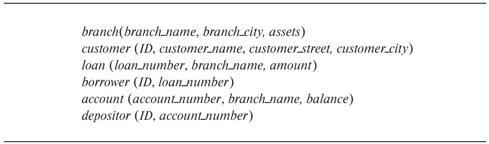

[← Previous: T03.3 · Referential Integrity and Foreign Key Syntax](T03.03_Referential_Integrity_and_Foreign_Keys.md) | [🏠 Index](00_Index.md) | [Next: T04.1 · Basic Relational Algebra Operators →](T04.01_Basic_RA_Operators.md)

---

# T03.4: Schema Diagrams

> **Topic:** T03 · Relational Model, Keys & Integrity | **Priority:** 🟢 Low | **Exam Frequency:** 0/7 finals (+ CT-01 Q02 · 5 marks)
> **Sources:** Silberschatz 7e Ch. 2 (§2.4, pp. 46–47) · Lecture Deck 02 (Slide 8) · CT-01 Q.02

---

## Anatomy of a Relational Schema Diagram

A relational schema diagram provides a visual blueprint of a database schema.

**Schema Diagram:** A schema diagram is a visual blueprint of a relational database schema. It displays each relation as a rectangular box with the relation name in the header and all attributes listed inside.

**Foreign Key Arrow Convention:** In a schema diagram, primary key attributes are underlined inside their relation box. Directed arrows start from the foreign key attributes in the child relation and point directly to the referenced primary key in the parent relation.

### Structural Elements

Every relational schema diagram uses four standard elements:

1. **Relation Box:** Draw each table as a rectangular box with the table name in the header section.
2. **Attribute List:** List all columns vertically inside the table box.
3. **Primary Key Underline:** Underline every attribute in the primary key. If a table uses a composite primary key, underline every column that belongs to the key.
4. **Directed Dependency Arrow:** Draw a directed arrow starting at the foreign key column in the child table and landing on the primary key in the parent table.

### Strict Arrow Direction Rule

The arrow direction follows one strict convention:
- **Origin (Tail):** The foreign key column in the **referencing (child)** relation.
- **Destination (Head):** The primary key column in the **referenced (parent)** relation.

The child table references the parent table for validation, so the arrow always points toward the parent primary key.

*Figure: Relational schema diagram for the bank database showing primary keys and foreign key reference arrows (Silberschatz 7e Fig. 2.18).*

### Schema Diagram vs. Entity-Relationship (ER) Diagram

Students often confuse schema diagrams with ER diagrams. They belong to different design stages and use different notation:

| Feature | Relational Schema Diagram | Entity-Relationship (ER) Diagram |
| :--- | :--- | :--- |
| **Model Level** | Logical relational model (table-level). | Conceptual design model. |
| **Basic Shapes** | Rectangular boxes for relations. | Rectangles (Entities), Diamonds (Relationships), Ovals (Attributes). |
| **Connections** | Directed arrows from child FK to parent PK. | Lines connecting entities and relationship diamonds. |
| **Attributes** | Listed as text inside table boxes. | Drawn as separate attribute ovals. |
| **Keys** | Underlined inside the table box. | Underlined inside attribute ovals. |
| **Exam Trap** | Drawing diamonds or ovals here loses all marks. | Drawing table column boxes loses all marks. |

---

## The Standard University Schema Diagram

Silberschatz and Slide Deck 02 use the university database schema as their baseline:

- $\text{department}(\underline{\text{dept\_name}}, \text{building}, \text{budget})$
- $\text{instructor}(\underline{\text{ID}}, \text{name}, \text{dept\_name}, \text{salary})$
  - $\text{dept\_name} \rightarrow \text{department}(\text{dept\_name})$
- $\text{course}(\underline{\text{course\_id}}, \text{title}, \text{dept\_name}, \text{credits})$
  - $\text{dept\_name} \rightarrow \text{department}(\text{dept\_name})$
- $\text{section}(\underline{\text{course\_id}}, \underline{\text{sec\_id}}, \underline{\text{semester}}, \underline{\text{year}}, \text{building}, \text{room\_number}, \text{time\_slot\_id})$
  - $\text{course\_id} \rightarrow \text{course}(\text{course\_id})$
- $\text{teaches}(\underline{\text{ID}}, \underline{\text{course\_id}}, \underline{\text{sec\_id}}, \underline{\text{semester}}, \underline{\text{year}})$
  - $\text{ID} \rightarrow \text{instructor}(\text{ID})$
- $\text{student}(\underline{\text{ID}}, \text{name}, \text{dept\_name}, \text{tot\_cred})$
  - $\text{dept\_name} \rightarrow \text{department}(\text{dept\_name})$
- $\text{takes}(\underline{\text{ID}}, \underline{\text{course\_id}}, \underline{\text{sec\_id}}, \underline{\text{semester}}, \underline{\text{year}}, \text{grade})$
  - $\text{ID} \rightarrow \text{student}(\text{ID})$

---

## 🏆 Golden Questions (Past Exam Archive)

### 🎯 GQ1 · CT-01 Q.02 · ECE Department Schema Diagram · 05 Marks

> *Class Test 01 · CO1 · Asked in: CT-01 Q.02 (5 marks) · L1*

**Question (CT-01 Q.02).** Draw a schema diagram for ECE, including 5 tables (Students, Courses, Instructors, Classroom, Results).

**Answer.**

**1. Relational Schemas and Keys:**
- $\text{Students}(\underline{\text{student\_id}}, \text{name}, \text{email}, \text{dept\_name})$
- $\text{Instructors}(\underline{\text{instructor\_id}}, \text{name}, \text{dept\_name}, \text{salary})$
- $\text{Classroom}(\underline{\text{building}}, \underline{\text{room\_number}}, \text{capacity})$
- $\text{Courses}(\underline{\text{course\_id}}, \text{title}, \text{credits}, \text{instructor\_id}, \text{building}, \text{room\_number})$
  - $\text{instructor\_id} \rightarrow \text{Instructors}(\text{instructor\_id})$
  - $(\text{building}, \text{room\_number}) \rightarrow \text{Classroom}(\text{building}, \text{room\_number})$
- $\text{Results}(\underline{\text{student\_id}}, \underline{\text{course\_id}}, \underline{\text{semester}}, \text{marks}, \text{grade})$
  - $\text{student\_id} \rightarrow \text{Students}(\text{student\_id})$
  - $\text{course\_id} \rightarrow \text{Courses}(\text{course\_id})$

**2. Relational Schema Diagram:**  
In Silberschatz style, each table is shown as a box with its attributes. Primary keys are underlined. Directed arrows point from foreign key attributes to the referenced primary keys.

*Figure: Relational schema diagram for ECE with 5 tables and foreign key references.*

---

## 🔮 Likely Questions

### 🎯 LQ1 · University 4-Table Core Schema Diagram · 04 Marks

**Question.** Draw a relational schema diagram for a university database consisting of `Department`, `Instructor`, `Course`, and `Section`. Clearly indicate primary keys and foreign key constraints.

**Answer.**

**1. Relational Schemas:**
- $\text{Department}(\underline{\text{dept\_name}}, \text{building}, \text{budget})$
- $\text{Instructor}(\underline{\text{ID}}, \text{name}, \text{dept\_name}, \text{salary})$
  - $\text{dept\_name} \rightarrow \text{Department}(\text{dept\_name})$
- $\text{Course}(\underline{\text{course\_id}}, \text{title}, \text{dept\_name}, \text{credits})$
  - $\text{dept\_name} \rightarrow \text{Department}(\text{dept\_name})$
- $\text{Section}(\underline{\text{course\_id}}, \underline{\text{sec\_id}}, \underline{\text{semester}}, \underline{\text{year}}, \text{building}, \text{room\_number})$
  - $\text{course\_id} \rightarrow \text{Course}(\text{course\_id})$

**2. Diagram Construction:**
- Draw four rectangular boxes with the relation names in the header.
- Underline primary key attributes: `dept_name` in `Department`, `ID` in `Instructor`, `course_id` in `Course`, and composite key `(course_id, sec_id, semester, year)` in `Section`.
- Connect directed arrows pointing from:
  - `Instructor.dept_name` $\rightarrow$ `Department.dept_name`
  - `Course.dept_name` $\rightarrow$ `Department.dept_name`
  - `Section.course_id` $\rightarrow$ `Course.course_id`

---

## ⚡ Exam Tips & Common Mistakes

- **Never Draw an ER Diagram:** If the question asks for a schema diagram, do not draw diamonds or ovals. Draw rectangular table boxes with column names inside.
- **Underline All Primary Keys:** Every table box must have its primary key attribute(s) underlined. If it is a composite key, underline each component attribute.
- **Arrow Direction Matters:** Arrows always point from child foreign key to parent primary key. Drawing them backward loses marks.
- **Specify Schemas First:** On your exam paper, write down the schema notation with underlined keys before drawing the boxes. This guarantees partial credit even if you run out of drawing space.

## 🔗 Related Topics

- [T02.06: Reduction of E-R to Relational Tables](T02.06_Reduction_of_ER_to_Tables.md) · [T03.02: Relational Keys](T03.02_Keys.md) · [T03.03: Referential Integrity and Foreign Key Syntax](T03.03_Referential_Integrity_and_Foreign_Keys.md)

---

[← Previous: T03.3 · Referential Integrity and Foreign Key Syntax](T03.03_Referential_Integrity_and_Foreign_Keys.md) | [🏠 Index](00_Index.md) | [Next: T04.1 · Basic Relational Algebra Operators →](T04.01_Basic_RA_Operators.md)
