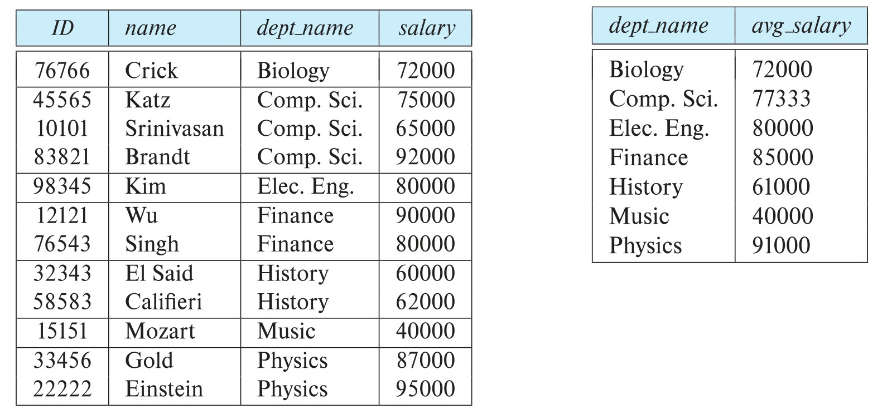

[← Previous: T04.1 Basic RA Operators](T04.01_Basic_RA_Operators.md) | [🏠 Index](00_Index.md) | [Next: T04.2b RA Queries · Covid and Vaccine →](T04.02b_RA_Queries_Covid_and_Vaccine.md)

---

# T04.2a: RA Queries: Employee, Insurance, and Updates

> **Topic:** T04 · Relational Algebra & Calculus | **Priority:** 🔴 | **Exam Frequency:** 6/7 finals (+ CT-01 Q4) (41 marks in T04.2)
> **Sources:** Silberschatz 7e Ch. 2 (§2.6), Ch. 16 (§16.1) · Lecture Deck 02 (Slides 9–29) · Raidah Class Notes (pp. 13–14)

---

## Relational Algebra Query Formulation Recipe

**Relational algebra:** A procedural query language where operators take one or two relations as input and return a new relation as output. Nest operators to answer complex queries.

When translating an English query into relational algebra, follow this five-step sequence:

1. **Identify Target Attributes (Projection $\Pi$):**
   **Project operation ($\Pi$):** Selects specific columns vertically and automatically eliminates duplicates. If a question asks for employee names, the outermost operator must be $\Pi_{\text{person\_name}}(\dots)$.
2. **Identify Source Tables and Join Conditions:**
   Use natural join ($\bowtie$) if tables share identical attribute names. Use theta join ($\bowtie_\theta$) with an explicit condition if matching attributes have different names (for example, $\text{owns.license} = \text{participated.car}$).
3. **Identify Filtering Conditions (Selection $\sigma$):**
   **Select operation ($\sigma$):** Filters rows horizontally using a boolean predicate $p$ with comparison ($=, \neq, <, \le, >, \ge$) and logical connectives ($\land, \lor, \neg$).
4. **Identify Special Idioms:**
   **Set-difference operation ($-$):** A binary operator returning tuples present in the first relation but absent from the second (used to express "only", "never", or "not" conditions).
   **Aggregate functions:** Mathematical summary functions ($\text{count}, \text{sum}, \text{avg}, \text{min}, \text{max}$) that take a collection of attribute values and compute a single summary value across groups.
5. **Verify Attribute Compatibility:**
   Ensure relations are union-compatible before applying $\cup, \cap, -$.

### Common Query Translation Idioms

| English Requirement | Relational Algebra Pattern | Mathematical Formulation |
| :--- | :--- | :--- |
| **Matching across tables** | Natural join ($\bowtie$) or theta join ($\bowtie_\theta$) | $r \bowtie s$ or $r \bowtie_{r.A = s.B} s$ |
| **Only / but not / never** | Set difference ($-$) | $\Pi_A(\sigma_{P_1}(r)) - \Pi_A(\sigma_{P_2}(s))$ |
| **Either ... or ... (combined)** | Set union ($\cup$) | $\Pi_A(r) \cup \Pi_A(s)$ (must be union-compatible) |
| **Count, sum, avg per group** | Grouped aggregation (${}_{G}\gamma_{F}$) | ${}_{\text{group\_attrs}}\gamma_{\text{agg\_func}(\text{target\_attr})}(r)$ |
| **Overall peak / maximum** | Two-stage scalar aggregation | $\gamma_{\text{max}(C)}({}_G\gamma_{\text{count}(A) \ \text{as} \ C}(r))$ |

*Figure 1: Group by aggregation mechanics showing department grouping and average salary calculation (Source: Lecture Deck 02, Slide 29).*

---

## Mechanics of Relational Algebra Updates (6e-Style)

**Database modification (assignment $\leftarrow$):** Relational algebra expressions compute new relation values rather than modifying records in place. To update specific tuples in a relation $r$, split $r$ into modified tuples and untouched tuples, union them, and reassign the result to $r$:

$$
r \leftarrow T_{\text{modified}} \cup T_{\text{untouched}}
$$

### The Four-Step Update Sequence

1. **Isolate Target Records:** Filter relation $r$ using selection predicate $P$:

$$
T_{\text{target}} \leftarrow \sigma_P(r)
$$

2. **Compute Modified Records:** Apply generalized projection ($\Pi$) to recalculate target columns while keeping all other columns in their original positions:

$$
T_{\text{modified}} \leftarrow \Pi_{A_1, \dots, \text{new\_expression}, \dots, A_n}(T_{\text{target}})
$$

3. **Isolate Untouched Records:** Subtract target tuples from relation $r$ to keep all other records unchanged:

$$
T_{\text{untouched}} \leftarrow r - T_{\text{target}}
$$

4. **Combine and Overwrite:** Union modified tuples with untouched tuples and assign back to $r$:

$$
r \leftarrow T_{\text{modified}} \cup T_{\text{untouched}}
$$

> [!WARNING]
> Never write $r \leftarrow T_{\text{modified}}$ alone. Doing so overwrites the relation with only the modified rows, deleting every untouched record in the database.

*Figure 2: Relational schema for the employee database (Source: Silberschatz 7e, Figure 2.17).*

---

## 🏆 Golden Questions (Past Exam Archive)

### 🎯 GQ1 · 2017 Q.2(a) · Employee Database Queries & Updates · [08 Marks]

> *Section A · Asked in: 2017 · L1 (asked once)*

**Question.** Consider the following relational database.  
  `employee(person_name, street, city)`  
  `works(person_name, company_name, salary)`  
  `company(company_name, city)`  
  `manages(person_name, manager_name)`  
Now write down the relational algebra(Not SQL) to express each of following queries:  
(i) Find the names of all employees who live in the city same as their corresponding company location.  
(ii) Give a 10% salary raise to all the managers only.  
(iii) Update the city information of the employee named "James" to "Newtown".  
(iv) Find the company with most employees.

**Answer.**

#### (i) Employees living in the same city as their company

Natural join matches `person_name`, `company_name`, and enforces `employee.city = company.city`:

$$
T_1 \leftarrow \text{employee} \bowtie \text{works} \bowtie \text{company}
$$

$$
\Pi_{\text{person\_name}}(T_1)
$$

Equivalently, in a single expression:

$$
\Pi_{\text{person\_name}}(\text{employee} \bowtie \text{works} \bowtie \text{company})
$$

#### (ii) Give a 10% salary raise to all managers only

Identify manager names, join with their work records, compute the raise, and union with untouched non-manager records:

$$
M \leftarrow \rho_{M(\text{person\_name})}(\Pi_{\text{manager\_name}}(\text{manages}))
$$

$$
T_{\text{mgr}} \leftarrow \text{works} \bowtie M
$$

$$
T_{\text{raised}} \leftarrow \Pi_{\text{person\_name}, \text{company\_name}, \text{salary} * 1.1}(T_{\text{mgr}})
$$

$$
T_{\text{untouched}} \leftarrow \text{works} - T_{\text{mgr}}
$$

$$
\text{works} \leftarrow T_{\text{raised}} \cup T_{\text{untouched}}
$$

#### (iii) Update city of employee "James" to "Newtown"

Replace the city attribute for James and keep all other employee records unchanged:

$$
T_{\text{james}} \leftarrow \sigma_{\text{person\_name} = \text{"James"}}(\text{employee})
$$

$$
T_{\text{updated}} \leftarrow \Pi_{\text{person\_name}, \text{street}, \text{"Newtown"}}(T_{\text{james}})
$$

$$
T_{\text{untouched}} \leftarrow \text{employee} - T_{\text{james}}
$$

$$
\text{employee} \leftarrow T_{\text{updated}} \cup T_{\text{untouched}}
$$

#### (iv) Find the company with the most employees

Count employees per company, find the maximum count, and select the matching company name:

$$
T_{\text{counts}} \leftarrow {}_{\text{company\_name}}\gamma_{\text{count}(\text{person\_name}) \ \text{as} \ \text{num\_emp}}(\text{works})
$$

$$
T_{\text{max}} \leftarrow \gamma_{\text{max}(\text{num\_emp}) \ \text{as} \ \text{max\_emp}}(T_{\text{counts}})
$$

$$
\Pi_{\text{company\_name}}(\sigma_{\text{num\_emp} = \text{max\_emp}}(T_{\text{counts}} \times T_{\text{max}}))
$$

---

### 🎯 GQ2 · 2018 Q.3(a) · Insurance Database Aggregation & Damage Update · [06 Marks]

> *Section A · Asked in: 2018 · L1 (asked once)*

**Question.** Consider the following insurance database, where primary keys are underlined.  
person (<u>driver_id</u>, name, address)  
car (<u>license</u>, model, year)  
accident (<u>report_number</u>, date, location)  
owns (<u>driver_id</u>, license)  
participated (<u>driver_id</u>, car, <u>report_number</u>, damage_amount)

Write down the relational algebra statement for the following queries:  
(i) Find the total number of people who owned cars that were involved in accidents in 1989.  
(ii) Find the number of accidents in which the cars belonging to "John Smith" were involved.  
(iii) Update the damage amounts for the car with license number "AABB2019" in the accident with report_number "AR201930" to \$3000.

**Answer.**

*Assumption: The calendar year is extracted from the `date` attribute using $\text{year}(\text{date}) = 1989$.*

#### (i) Total number of people who owned cars involved in accidents in 1989

Join accident records from 1989 with participated cars and ownership data, then count distinct owners:

$$
T_1 \leftarrow \sigma_{\text{year}(\text{date}) = 1989}(\text{accident}) \bowtie \text{participated}
$$

$$
T_2 \leftarrow T_1 \bowtie_{\text{participated.car} = \text{owns.license}} \text{owns}
$$

$$
\gamma_{\text{count-distinct}(\text{owns.driver\_id})}(T_2)
$$

#### (ii) Number of accidents involving cars belonging to "John Smith"

Find cars owned by John Smith, join with accident participation records, and count distinct accidents:

$$
T_{\text{john\_cars}} \leftarrow \sigma_{\text{name} = \text{"John Smith"}}(\text{person}) \bowtie \text{owns}
$$

$$
T_{\text{accidents}} \leftarrow T_{\text{john\_cars}} \bowtie_{\text{owns.license} = \text{participated.car}} \text{participated}
$$

$$
\gamma_{\text{count-distinct}(\text{report\_number})}(T_{\text{accidents}})
$$

#### (iii) Update damage amounts for car "AABB2019" in accident "AR201930" to \$3000

Define the predicate for the target accident record and update the `damage_amount` attribute:

$$
P \equiv (\text{car} = \text{"AABB2019"} \land \text{report\_number} = \text{"AR201930"})
$$

$$
T_{\text{target}} \leftarrow \sigma_P(\text{participated})
$$

$$
T_{\text{updated}} \leftarrow \Pi_{\text{driver\_id}, \text{car}, \text{report\_number}, 3000}(T_{\text{target}})
$$

$$
T_{\text{untouched}} \leftarrow \text{participated} - T_{\text{target}}
$$

$$
\text{participated} \leftarrow T_{\text{updated}} \cup T_{\text{untouched}}
$$

---

## ⚡ Exam Tips & Common Mistakes

- **Write Relational Algebra, Not SQL:** When the prompt states "Not SQL", never write `SELECT`, `UPDATE`, `FROM`, or `WHERE`. Use Greek operators ($\sigma, \Pi, \rho, \gamma$) and relational operations ($\bowtie, \times, -, \cup, \cap$).
- **Always Include Untouched Tuples in Updates:** Relational algebra update is not an in-place mutation. Always write $r \leftarrow T_{\text{updated}} \cup (r - T_{\text{target}})$.
- **Use count-distinct for Real-World Entities:** When counting persons or accident reports across joined tables, write `count-distinct`. A plain `count` inflates totals if a person owns multiple cars or a car appears multiple times.
- **Join Attribute Mismatch Trap:** If matching columns have different names (such as `owns.license` and `participated.car`), write an explicit theta join: $T_1 \bowtie_{\text{participated.car} = \text{owns.license}} \text{owns}$. Using natural join here would fail to link them.
- **Use Stepwise Assignments:** Writing huge single-line expressions causes parenthesis mistakes. Use intermediate assignments ($T_1, T_2$) to keep answers clean and easy to grade.

---

## 🔗 Related Topics

- [T04.1: Basic RA Operators](T04.01_Basic_RA_Operators.md) · Fundamental operator properties and Cartesian products.
- [T04.2b: RA Queries · Covid and Vaccine](T04.02b_RA_Queries_Covid_and_Vaccine.md) · Healthcare schemas and set difference "only" logic.
- [T04.2c: RA Queries · Customer Orders & Projects](T04.02c_RA_Queries_Orders_Projects_CT.md) · Order filters, multiple project allocations, and university drills.
- [T04.3: Explaining RA Expressions in Words](T04.03_Explaining_RA_Expressions.md) · Translating algebraic expressions into plain English.
- [T04.4: Extended RA Aggregation](T04.04_Extended_RA_Aggregation.md) · Mathematical rules of the aggregate operator $\gamma$.

---

[← Previous: T04.1 Basic RA Operators](T04.01_Basic_RA_Operators.md) | [🏠 Index](00_Index.md) | [Next: T04.2b RA Queries · Covid and Vaccine →](T04.02b_RA_Queries_Covid_and_Vaccine.md)
