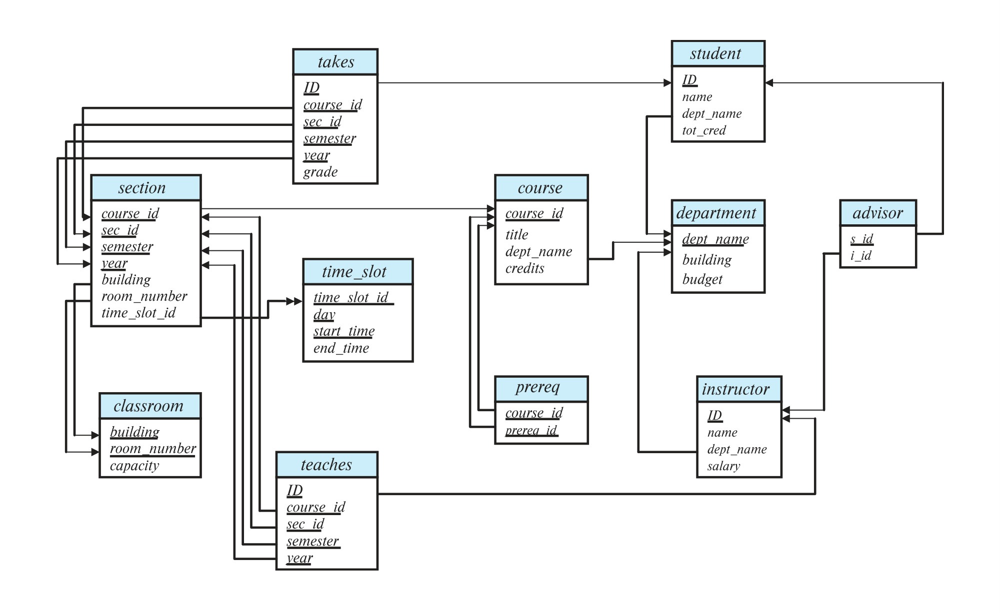

[← Previous: T04.2b RA Queries · Covid and Vaccine](T04.02b_RA_Queries_Covid_and_Vaccine.md) | [🏠 Index](00_Index.md) | [Next: T04.3 Explaining RA Expressions in Words →](T04.03_Explaining_RA_Expressions.md)

---

# T04.2c: RA Queries: Orders, Projects, and University Schemas

> **Topic:** T04 · Relational Algebra & Calculus | **Priority:** 🔴 | **Exam Frequency:** 6/7 finals (+ CT-01 Q4) (41 marks in T04.2)
> **Sources:** Silberschatz 7e Ch. 2 (§2.6), Ch. 16 (§16.1) · Lecture Deck 02 (Slides 8–29) · Raidah Class Notes (pp. 13–14)

---

## Query Formulation Across Enterprise Schemas

**Rename operation ($\rho$):** A unary operator that assigns an alias to a relation or its attributes. Written as $\rho_x(E)$ or $\rho_{x(A_1, \dots, A_n)}(E)$, it prevents ambiguity during self-joins.

**Cartesian product ($\times$):** A binary operator pairing every tuple of relation $r$ with every tuple of relation $s$.

**Aggregate functions:** Mathematical summarization operators (`count`, `sum`, `avg`, `min`, `max`) evaluated over groups using ${}_G\gamma_F(r)$.

### 1. Detecting Entities with "Multiple" Records (At Least Two)

When an exam question asks for entities associated with more than one item (such as employees working on multiple projects, or customers ordering multiple products), choose between two methods:

#### Method 1: Extended Relational Algebra via $\gamma$ (Fastest in Exams)

Group the link table by entity ID, count distinct associated items, and filter for counts greater than 1:

$$
T_{\text{counts}} \leftarrow {}_{\text{id}}\gamma_{\text{count-distinct}(\text{product}) \ \text{as} \ \text{prod\_count}}(\text{order})
$$

$$
\Pi_{\text{id}}(\sigma_{\text{prod\_count} > 1}(T_{\text{counts}}))
$$

#### Method 2: Pure Relational Algebra via Self-Join (No $\gamma$ Required)

Create two renamed copies of the table, take their Cartesian product, and select pairs with matching entity IDs but different items:

$$
O_1 \leftarrow \rho_{O_1}(\text{order}), \qquad O_2 \leftarrow \rho_{O_2}(\text{order})
$$

$$
\Pi_{O_1.\text{id}}(\sigma_{O_1.\text{id} = O_2.\text{id} \land O_1.\text{product} \neq O_2.\text{product}}(O_1 \times O_2))
$$

---

## Union Compatibility and Pre-Projection Rules

**Union compatibility:** Two relations must have identical arity (number of attributes) and matching attribute domains at each position before undergoing set operations ($\cup, \cap, -$).

When relations have different numbers of attributes, direct union fails. For example:
- $\text{STUDENT}(\text{Student\_ID}, \text{Name}, \text{Dept\_Name}, \text{CGPA})$ has arity 4.
- $\text{ALUMNI}(\text{Student\_ID}, \text{Name}, \text{Dept\_Name})$ has arity 3.

Writing $\text{STUDENT} \cup \text{ALUMNI}$ is illegal. You must project both relations down to the shared target attributes first:

$$
\Pi_{\text{Student\_ID}, \text{Name}}(\text{STUDENT}) \cup \Pi_{\text{Student\_ID}, \text{Name}}(\text{ALUMNI})
$$

Both projected relations have arity 2 with matching domains, satisfying union compatibility.

*Figure 1: University Database relational schema diagram showing relations, keys, and foreign keys (Source: Lecture Deck 02, Slide 8).*

---

## 🏆 Golden Questions (Past Exam Archive)

### 🎯 GQ1 · 2021 Q.2(a) · Customer and Order Database Queries · [05 Marks]

> *Section A · CLO2 · Asked in: 2021 · L1 (asked once)*

**Question.** Consider the following relation schema:  
  customer (<u>id</u>, name, age, gender)  
  order (<u>id</u>, product, price, date)

Now, give expression in relational algebra to-  
(i) find name of the customers who are male.  
(ii) find name of all customers who have purchased car as product.  
(iii) find the details of all customers who have purchased "phone" as product and the price is less than \$300.

**Answer.**

*Assumption: The attribute `order.id` represents the customer identifier that placed the order.*

#### (i) Names of male customers

$$
\Pi_{\text{name}}(\sigma_{\text{gender} = \text{"male"}}(\text{customer}))
$$

#### (ii) Names of all customers who purchased car as product

Join customer and order on `id`, filter for product "car", and project customer names:

$$
\Pi_{\text{name}}(\text{customer} \bowtie \sigma_{\text{product} = \text{"car"}}(\text{order}))
$$

#### (iii) Details of all customers who purchased "phone" priced under \$300

Filter order records for product "phone" with price below 300, then join with customer:

$$
T_{\text{target\_orders}} \leftarrow \sigma_{\text{product} = \text{"phone"} \land \text{price} < 300}(\text{order})
$$

$$
\text{customer} \bowtie T_{\text{target\_orders}}
$$

To project customer attributes only:

$$
\Pi_{\text{customer.id}, \text{name}, \text{age}, \text{gender}}(\text{customer} \bowtie T_{\text{target\_orders}})
$$

---

### 🎯 GQ2 · 2024 Q.2(b) · Employees Working on Multiple Projects · [04 Marks]

> *Section A · CO1 · Asked in: 2024 · L1 (asked once)*

**Question.** EMPLOYEE (EID, Name, Department, Salary)  
PROJECT (PID, Name, Budget)  
WORKS_ON (EID, PID, Hours)  
Suppose a company wants to find employees working on multiple projects. Write the relational algebra expression for it.

**Answer.**

#### Method 1: Extended Relational Algebra via Aggregation

Group `WORKS_ON` by `EID`, filter for counts strictly greater than 1, and join with `EMPLOYEE`:

$$
T_{\text{counts}} \leftarrow {}_{\text{EID}}\gamma_{\text{count}(\text{PID}) \ \text{as} \ \text{proj\_count}}(\text{WORKS\_ON})
$$

$$
T_{\text{multi}} \leftarrow \sigma_{\text{proj\_count} > 1}(T_{\text{counts}})
$$

$$
\Pi_{\text{EID}, \text{Name}}(\text{EMPLOYEE} \bowtie T_{\text{multi}})
$$

#### Method 2: Pure Relational Algebra via Self-Join

Self-join `WORKS_ON` with itself to find matching employees on different projects:

$$
\Pi_{\text{EID}, \text{Name}}(\text{EMPLOYEE} \bowtie \Pi_{W_1.\text{EID}}(\sigma_{W_1.\text{EID} = W_2.\text{EID} \land W_1.\text{PID} \neq W_2.\text{PID}}(\rho_{W_1}(\text{WORKS\_ON}) \times \rho_{W_2}(\text{WORKS\_ON}))))
$$

---

### 🎯 GQ3 · CT-01 Q.04(v–viii) · University Student, Course, Alumni Schema Drills · [04 Marks]

> *CT-01 · CO1 · Asked in: CT-01 · L1 (asked once)*

**Question.** Relations: $\text{STUDENT}(\text{Student\_ID}, \text{Name}, \text{Dept\_Name}, \text{CGPA})$, $\text{COURSE}(\text{Course\_ID}, \text{Course\_Name}, \text{Student\_ID}, \text{Semester}, \text{Marks})$, $\text{ALUMNI}(\text{Student\_ID}, \text{Name}, \text{Dept\_Name})$.  
Write the relational algebra expressions for the following conditions using the relations above:  
**(v)** Rename the relation $\text{STUDENT}$ as $\text{S}$ and display the $\text{Student\_ID}$ and $\text{Name}$ of all students.  
**(vi)** Retrieve the $\text{Student\_ID}$, $\text{Name}$, and $\text{Course\_Name}$ of all students who belong to the CSE department and scored 80 or more marks in any course.  
**(vii)** Retrieve the $\text{Student\_ID}$ and $\text{Name}$ of all students who are either in the $\text{STUDENT}$ relation or the $\text{ALUMNI}$ relation.  
**(viii)** Determine the number of students in each department.  
*(Note: Sub-parts are numbered v, vi, vii, viii on the original question script; part viii uses $\gamma$ aggregation, see T04.4).*

**Answer.**

#### (v) Rename relation STUDENT as S and display Student_ID and Name

$$
\Pi_{\text{Student\_ID}, \text{Name}}(\rho_S(\text{STUDENT}))
$$

#### (vi) Student_ID, Name, and Course_Name for CSE students with Marks $\ge 80$

Filter students in CSE and courses with marks 80 or higher, join on `Student_ID`, and project:

$$
T_1 \leftarrow \sigma_{\text{Dept\_Name} = \text{"CSE"}}(\text{STUDENT})
$$

$$
T_2 \leftarrow \sigma_{\text{Marks} \ge 80}(\text{COURSE})
$$

$$
\Pi_{\text{Student\_ID}, \text{Name}, \text{Course\_Name}}(T_1 \bowtie T_2)
$$

#### (vii) Student_ID and Name of students in either STUDENT or ALUMNI

Project both relations to the same attributes to satisfy union compatibility, then take the union:

$$
\Pi_{\text{Student\_ID}, \text{Name}}(\text{STUDENT}) \cup \Pi_{\text{Student\_ID}, \text{Name}}(\text{ALUMNI})
$$

#### (viii) Number of students in each department

Group `STUDENT` by department name and count student identifiers:

$$
{}_{\text{Dept\_Name}}\gamma_{\text{count}(\text{Student\_ID})}(\text{STUDENT})
$$

---

## ⚡ Exam Tips & Common Mistakes

- **Check Union Compatibility Before $\cup$:** Do not write $R \cup S$ when relations have different numbers of columns. Project down to matching attributes first.
- **Numbers Do Not Need Quotes:** In numeric comparisons ($\text{price} < 300$, $\text{Marks} \ge 80$), write numbers as bare numeric literals, not strings.
- **Enforce Inequality in Self-Joins:** In self-joins for multiple items, writing $W_1.\text{PID} \neq W_2.\text{PID}$ is required. Writing $W_1.\text{PID} = W_2.\text{PID}$ matches each row with itself.
- **Natural Join Matches Shared Names:** In CT-01 Q.04(vi), both `STUDENT` and `COURSE` have `Student_ID`. The natural join $\bowtie$ automatically links them on this attribute.
- **State Foreign Key Assumptions:** When schemas lack explicit foreign keys (such as `order.id` referencing `customer.id`), write a brief assumption line stating that `order.id` identifies the customer.

---

## 🔗 Related Topics

- [T04.1: Basic RA Operators](T04.01_Basic_RA_Operators.md) · Fundamental selections, projections, and Cartesian products.
- [T04.2a: RA Queries · Employee & Insurance](T04.02a_RA_Queries_Employee_and_Insurance.md) · Multi-table joins and 6e relational update syntax.
- [T04.2b: RA Queries · Covid and Vaccine](T04.02b_RA_Queries_Covid_and_Vaccine.md) · Healthcare schemas and set difference logic.
- [T04.3: Explaining RA Expressions in Words](T04.03_Explaining_RA_Expressions.md) · Interpreting relational expressions in plain English.
- [T04.4: Extended RA Aggregation](T04.04_Extended_RA_Aggregation.md) · Advanced grouping and aggregate functions.

---

[← Previous: T04.2b RA Queries · Covid and Vaccine](T04.02b_RA_Queries_Covid_and_Vaccine.md) | [🏠 Index](00_Index.md) | [Next: T04.3 Explaining RA Expressions in Words →](T04.03_Explaining_RA_Expressions.md)
