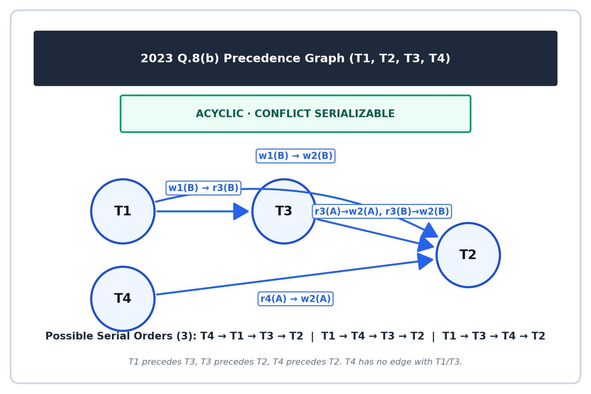

[← Previous: T10.03b Precedence-Graph Drills I](T10.03b_Precedence_Graph_Drills_I.md) | [🏠 Index](00_Index.md) | [Next: T10.04 Building Serializable Schedules →](T10.04_Building_Serializable_Schedules.md)

---

# T10.3c: Precedence-Graph Drills II (2021 Q7c & 2023 Q8b)

> **Topic:** T10 · Serializability | **Priority:** 🔴 | **Exam Frequency:** 5/7 finals (+ CT-04) (26 marks)
> **Sources:** Silberschatz 7e Ch. 17 (§17.6) · Lecture Deck 07 (Slides 25–26) · Raidah Notes (pp. 26–27)

---

## 1. Cross-Item Conflict Cycles

**Cross-Item Conflict Cycle:** A cycle formed when transactions access multiple items in opposite conflicting orders ($T_1 \to T_2$ on item $A$, and $T_2 \to T_1$ on item $B$), even without interleaving individual operations on either item.

Suppose $T_1$ reads and writes item $A$ before $T_2$ touches $A$, while $T_2$ reads and writes item $B$ before $T_1$ touches $B$:
- **On item $A$:** $T_1$ precedes $T_2 \implies T_1 \longrightarrow T_2$.
- **On item $B$:** $T_2$ precedes $T_1 \implies T_2 \longrightarrow T_1$.
- **Result:** Even though each item was updated cleanly without interruption, the opposite dependencies create a cycle:
$$
T_1 \longleftrightarrow T_2
$$

Serial schedule $\langle T_1, T_2 \rangle$ violates the order on item $B$. Serial schedule $\langle T_2, T_1 \rangle$ violates the order on item $A$. Thus, no serial execution can match this schedule.

---

## 2. Multi-Transaction DAGs and Partial Orders

**Precedence Graph:** A directed graph $G = (V, E)$ where vertices $V$ represent transactions and directed edges $T_i \to T_j$ represent conflicting operations where $T_i$ precedes $T_j$.

**Partial Order and Linear Extension:** A directed acyclic graph defines a partial order because some pairs of transactions have no directed path between them. A linear extension is a complete serial ordering of all transactions that obeys every edge in the partial order, giving a valid equivalent serial schedule.

**Topological Sorting:** The algorithm that arranges the vertices of an acyclic precedence graph into a linear sequence preserving all edge dependencies to yield equivalent serial schedules.

### Algorithm to Enumerate All Valid Serial Orders

```text
Algorithm: Enumerating All Valid Serial Schedules
1. Identify the rigid backbone chain:
   Find the longest directed path. Example: T1 -> T3 -> T2 fixes the order T1 < T3 < T2.
2. Check constraints on remaining vertices:
   Identify unconstrained or partially constrained vertices.
   Example: T4 -> T2 requires T4 to execute before T2 (no edge with T1 or T3).
3. Interleave valid slots:
   Slot T4 into every valid position that preserves its constraints:
   - Slot 1: Before T1  --> <T4, T1, T3, T2>
   - Slot 2: Between T1 and T3 --> <T1, T4, T3, T2>
   - Slot 3: Between T3 and T2 --> <T1, T3, T4, T2>
   - After T2: Invalid (violates T4 -> T2).
```

---

## 🏆 Golden Questions (Past Exam Archive)

### 🎯 GQ1 · 2021 Q.7(c) · 04 Marks

> *Section B · CLO3 · Asked in: 2021 · L1 (asked once)*

**Question (2021 Q.7(c)).** Consider the following schedule:

<table border="1" style="border-collapse: collapse; text-align: center;"><thead><tr><th style="padding: 4px 20px;">$T_1$</th><th style="padding: 4px 20px;">$T_2$</th></tr></thead><tbody><tr><td style="padding: 4px 20px;">r(A)</td><td style="padding: 4px 20px;"></td></tr><tr><td style="padding: 4px 20px;">w(A)</td><td style="padding: 4px 20px;"></td></tr><tr><td style="padding: 4px 20px;"></td><td style="padding: 4px 20px;">r(B)</td></tr><tr><td style="padding: 4px 20px;"></td><td style="padding: 4px 20px;">w(B)</td></tr><tr><td style="padding: 4px 20px;">r(B)</td><td style="padding: 4px 20px;"></td></tr><tr><td style="padding: 4px 20px;">w(B)</td><td style="padding: 4px 20px;"></td></tr><tr><td style="padding: 4px 20px;"></td><td style="padding: 4px 20px;">r(A)</td></tr><tr><td style="padding: 4px 20px;"></td><td style="padding: 4px 20px;">w(A)</td></tr></tbody></table>  
Using precedence graph find whether the schedule is serializable or not. If serializable, then find the order of execution.

**Answer.**

We trace all conflicting operations between $T_1$ and $T_2$:

1. **Conflicts on data item $A$:**
   - $T_1$ executes $r(A)$ and $w(A)$ at steps 1–2.
   - $T_2$ executes $r(A)$ and $w(A)$ at steps 7–8.
   - Since $T_1$ accesses $A$ before $T_2$, this adds the directed edge:
     $$
     T_1 \longrightarrow T_2
     $$
2. **Conflicts on data item $B$:**
   - $T_2$ executes $r(B)$ and $w(B)$ at steps 3–4.
   - $T_1$ executes $r(B)$ and $w(B)$ at steps 5–6.
   - Since $T_2$ accesses $B$ before $T_1$, this adds the directed edge:
     $$
     T_2 \longrightarrow T_1
     $$

#### Precedence Graph


*Figure 1: Precedence graph for 2021 Q.7(c) showing directed cycle T1-T2.*

The graph contains two directed edges:
- $T_1 \to T_2$ (due to item $A$)
- $T_2 \to T_1$ (due to item $B$)

This forms a cycle:
$$
T_1 \longleftrightarrow T_2
$$

**Result:** Because the precedence graph contains a cycle, the schedule is **NOT serializable**. There is no equivalent order of execution.

---

### 🎯 GQ2 · 2023 Q.8(b) · 04 Marks

> *Section B · CLO3 · Asked in: 2023 · L1 (asked once)*

**Question (2023 Q.8(b)).** Check whether the given schedules S is conflict serializeable or not. If yes, then determine all the possible serialized schedules.

<table border="1" style="border-collapse: collapse; text-align: center;"><thead><tr><th style="padding: 4px 20px;">$T_1$</th><th style="padding: 4px 20px;">$T_2$</th><th style="padding: 4px 20px;">$T_3$</th><th style="padding: 4px 20px;">$T_4$</th></tr></thead><tbody><tr><td style="padding: 4px 20px;"></td><td style="padding: 4px 20px;"></td><td style="padding: 4px 20px;"></td><td style="padding: 4px 20px;">$R(A)$</td></tr><tr><td style="padding: 4px 20px;"></td><td style="padding: 4px 20px;">$R(A)$</td><td style="padding: 4px 20px;"></td><td style="padding: 4px 20px;"></td></tr><tr><td style="padding: 4px 20px;">$W(B)$</td><td style="padding: 4px 20px;"></td><td style="padding: 4px 20px;"></td><td style="padding: 4px 20px;"></td></tr><tr><td style="padding: 4px 20px;"></td><td style="padding: 4px 20px;"></td><td style="padding: 4px 20px;">$R(A)$</td><td style="padding: 4px 20px;"></td></tr><tr><td style="padding: 4px 20px;"></td><td style="padding: 4px 20px;">$W(A)$</td><td style="padding: 4px 20px;"></td><td style="padding: 4px 20px;"></td></tr><tr><td style="padding: 4px 20px;"></td><td style="padding: 4px 20px;"></td><td style="padding: 4px 20px;">$R(B)$</td><td style="padding: 4px 20px;"></td></tr><tr><td style="padding: 4px 20px;"></td><td style="padding: 4px 20px;">$W(B)$</td><td style="padding: 4px 20px;"></td><td style="padding: 4px 20px;"></td></tr></tbody></table>  
*(Note: "schedules S is conflict serializeable" printed verbatim from original question paper)*

**Answer.**

We list the operations of schedule $S$ in chronological order:
1. $T_4: R(A)$
2. $T_2: R(A)$
3. $T_1: W(B)$
4. $T_3: R(A)$
5. $T_2: W(A)$
6. $T_3: R(B)$
7. $T_2: W(B)$

#### Conflicting Pairs Analysis

- Step 1 ($T_4: R(A)$) precedes Step 5 ($T_2: W(A)$) $\implies T_4 \to T_2$
- Step 3 ($T_1: W(B)$) precedes Step 6 ($T_3: R(B)$) $\implies T_1 \to T_3$
- Step 3 ($T_1: W(B)$) precedes Step 7 ($T_2: W(B)$) $\implies T_1 \to T_2$
- Step 4 ($T_3: R(A)$) precedes Step 5 ($T_2: W(A)$) $\implies T_3 \to T_2$
- Step 6 ($T_3: R(B)$) precedes Step 7 ($T_2: W(B)$) $\implies T_3 \to T_2$

#### Precedence Graph


*Figure 2: Precedence graph DAG with 4 nodes for 2023 Q.8(b).*

The edges of the graph are:
$$
T_1 \longrightarrow T_3, \quad T_3 \longrightarrow T_2, \quad T_4 \longrightarrow T_2, \quad T_1 \longrightarrow T_2
$$

The precedence graph is **acyclic** (a Directed Acyclic Graph). Therefore, schedule $S$ is **conflict serializable**.

#### All Possible Serialized Schedules

From the graph dependencies:
- $T_1$ must appear before $T_3$, and $T_3$ must appear before $T_2$: relative order is $T_1 < T_3 < T_2$.
- $T_4$ must appear before $T_2$ ($T_4 \to T_2$).
- $T_4$ has no dependency with $T_1$ or $T_3$.

We interleave $T_4$ anywhere before $T_2$. This yields exactly 3 valid topological sorts:
1. $\boxed{\langle T_4, T_1, T_3, T_2 \rangle}$
2. $\boxed{\langle T_1, T_4, T_3, T_2 \rangle}$
3. $\boxed{\langle T_1, T_3, T_4, T_2 \rangle}$

---

## ⚡ Exam Tips & Common Mistakes

- **List all topological orders when asked for "all":** In 2023 Q.8(b), writing only one serial order loses marks. Provide all three valid orders.
- **Do not invent edges between read-only transactions:** In 2023 Q.8(b), $T_4$ only reads $A$, and neither $T_1$ nor $T_3$ writes $A$. Thus, $T_4$ has no edge with $T_1$ or $T_3$.
- **Explicitly state when no serial order exists:** In 2021 Q.7(c), clearly state that no valid serial schedule exists once a cycle is found.

## 🔗 Related Topics

- [T10.03a: Precedence-Graph Method](T10.03a_Precedence_Graph_Method.md) · [T10.03b: Precedence-Graph Drills I](T10.03b_Precedence_Graph_Drills_I.md)
- [T10.04: Building Serializable Schedules](T10.04_Building_Serializable_Schedules.md) · [T10.05: View Serializability](T10.05_View_Serializability.md)

---

[← Previous: T10.03b Precedence-Graph Drills I](T10.03b_Precedence_Graph_Drills_I.md) | [🏠 Index](00_Index.md) | [Next: T10.04 Building Serializable Schedules →](T10.04_Building_Serializable_Schedules.md)
