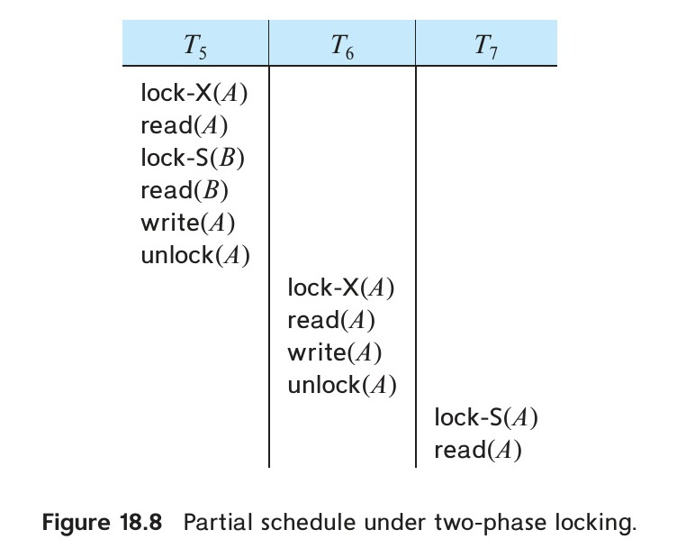

[← Previous: T11.02 Two-Phase Locking (2PL) Protocol](T11.02_Two_Phase_Locking.md) | [🏠 Index](00_Index.md) | [Next: T11.04 Deadlock Handling →](T11.04_Deadlock.md)

---

# T11.03: Strict 2PL, Rigorous 2PL, and Drawbacks of 2PL

> **Topic:** T11 · Concurrency Control Protocols | **Priority:** ⭐ | **Exam Frequency:** 0/7 finals (0 marks)
> **Sources:** Silberschatz 7e Ch. 18 (§18.1.3, pp. 842–844) · Lecture Deck 08 (Slides 16–19) · Raidah Notes (p. 30)

---

## Drawbacks of Basic Two-Phase Locking

Basic Two-Phase Locking (2PL) guarantees conflict serializability. But it allows transactions to release locks during the shrinking phase before committing. This causes three serious drawbacks:

### 1. Cascading Rollbacks

Under Basic 2PL, transaction $T_1$ can release an exclusive lock on item $A$ while still active. Transaction $T_2$ can then lock and read $A$. If $T_1$ aborts later, $T_2$ has read dirty data and must roll back too. If $T_3$ read data from $T_2$, $T_3$ must also roll back.

  
*Figure 18.8: Partial schedule under basic two-phase locking showing cascading rollback (Source: Silberschatz 7e, Figure 18.8)*

In Figure 18.8:
1. $T_5$ locks $A$ in exclusive mode and $B$ in shared mode, updates $A$, and releases $A$ early.
2. $T_6$ locks $A$, reads $T_5$'s uncommitted value, updates $A$, and unlocks $A$.
3. $T_7$ locks $A$ and reads $T_6$'s uncommitted value.
4. When $T_5$ aborts, $T_6$ must roll back. In turn, $T_7$ must also roll back, causing a cascading abort chain.

### 2. Irrecoverable Schedules

If transaction $T_1$ releases an exclusive lock on modified item $A$ before committing, transaction $T_2$ can read that uncommitted value and commit. If $T_1$ then aborts, ACID durability forbids rolling back committed transaction $T_2$. Because $T_2$ read invalid uncommitted data from an aborted transaction, the database is left in a permanently irrecoverable state.

### 3. Deadlock Susceptibility

Basic 2PL does not eliminate deadlocks. When two transactions request locks in opposite orders, circular waits can still form.

---

## Strict Two-Phase Locking (Strict 2PL)

**Strict Two-Phase Locking (Strict 2PL):** A variant of Two-Phase Locking that requires all **exclusive ($X$) locks** to be held until the transaction commits or aborts. Shared ($S$) locks may still be released early during the shrinking phase.

### Rules of Strict 2PL

1. **Two-Phase Rule:** All lock acquisitions must precede the first unlock operation.
2. **Hold Write Locks Until End:** Every exclusive ($X$) lock must be held continuously until the transaction commits or aborts.
3. **Early Shared Lock Release:** Shared ($S$) locks may be released during the shrinking phase before commit.

### Why Strict 2PL Works

Holding write locks until commit ensures no other transaction can read or overwrite uncommitted updates. This prevents dirty reads and dirty writes, guaranteeing that all schedules are **strict**, **cascadeless**, and **recoverable**.

---

## Rigorous Two-Phase Locking (Rigorous 2PL)

**Rigorous Two-Phase Locking (Rigorous 2PL):** A stricter variant of Two-Phase Locking that requires **all locks (both shared $S$ and exclusive $X$)** to be held until the transaction commits or aborts.

### Rules of Rigorous 2PL

1. **Two-Phase Rule:** Locks are acquired as needed during execution.
2. **Hold All Locks Until End:** No lock (shared or exclusive) is released until the transaction commits or aborts.
3. **No Gradual Shrinking Phase:** All locks are released in a single step upon transaction termination.

### Why Commercial Engines Use Rigorous 2PL

1. **Commit-Order Serialization:** Transactions serialize in the exact order in which they commit. If $T_1$ conflicts with $T_2$ and accesses item $Q$ first, $T_1$ holds its lock on $Q$ until commit. So $T_2$ cannot access $Q$ until $T_1$ commits. Thus, conflict order matches commit order.
2. **Simpler Lock Manager:** Application code does not need explicit unlock logic. The database automatically acquires locks during SQL execution and releases all of them at `COMMIT` or `ROLLBACK`.

---

## Comparison of 2PL Variants

| Feature / Metric | Basic 2PL | Strict 2PL | Rigorous 2PL |
| :--- | :--- | :--- | :--- |
| **Lock Acquisition** | Growing phase only | Growing phase only | Growing phase only |
| **Shared ($S$) Lock Release** | Shrinking phase | Shrinking phase | **Only at commit / abort** |
| **Exclusive ($X$) Lock Release** | Shrinking phase | **Only at commit / abort** | **Only at commit / abort** |
| **Conflict Serializability** | Guaranteed | Guaranteed | Guaranteed |
| **Recoverability** | Not guaranteed | **Guaranteed** | **Guaranteed** |
| **Cascadeless Schedules** | Not guaranteed | **Guaranteed** | **Guaranteed** |
| **Deadlock Freedom** | Not guaranteed (deadlocks occur) | Not guaranteed (deadlocks occur) | Not guaranteed (deadlocks occur) |
| **Serialization Order** | Order of lock points | Order of lock points | **Order of commit points** |
| **Concurrency Level** | Highest | Moderate | Lowest |
| **Industry Adoption** | Rarely used alone | Specialized systems | **Default in most RDBMSs** |

**Lock Point:** The point in time where a transaction acquires its final lock. Basic and Strict 2PL serialize transactions in the order of their lock points, whereas Rigorous 2PL serializes transactions in the order of their commit points.

---

## 🔮 Likely Questions

### 🎯 LQ1 · Drawbacks of Basic 2PL and the Strict 2PL Solution · [04 Marks]

> *Expected Exam Format · 4 Marks*

**Question.** Explain the major drawbacks of the basic Two-Phase Locking (2PL) protocol. How does the Strict Two-Phase Locking protocol overcome these drawbacks?

**Answer.**

**1. Drawbacks of Basic 2PL:**
- **Cascading Rollbacks:** In Basic 2PL, a transaction can release an exclusive lock during its shrinking phase before committing. If another transaction reads that uncommitted data and the writer aborts, the reader must roll back too, causing cascading aborts across dependent transactions.
- **Irrecoverable Schedules:** If the second transaction reads the uncommitted data and commits before the writer aborts, the schedule becomes irrecoverable because committed transactions cannot be undone.
- **Deadlock Vulnerability:** Basic 2PL does not prevent circular wait conditions when transactions request locks in conflicting orders.

**2. How Strict 2PL Solves These Drawbacks:**
Strict 2PL adds one rule to Basic 2PL:
- **Rule:** All exclusive ($X$) locks acquired by a transaction must be held continuously until that transaction commits or aborts.
- Because write locks are held until commit, other transactions cannot read or overwrite uncommitted data. This eliminates dirty reads and guarantees that schedules are strict, cascadeless, and recoverable.

---

### 🎯 LQ2 · Strict 2PL vs. Rigorous 2PL and Commit Ordering · [04 Marks]

> *Expected Exam Format · 4 Marks*

**Question.** Differentiate between Strict Two-Phase Locking and Rigorous Two-Phase Locking protocols. Why is Rigorous 2PL easier to implement in commercial database management systems?

**Answer.**

**1. Difference Between Strict 2PL and Rigorous 2PL:**

| Criteria | Strict 2PL | Rigorous 2PL |
| :--- | :--- | :--- |
| **Exclusive ($X$) Locks** | Held until commit or abort | Held until commit or abort |
| **Shared ($S$) Locks** | Released early in shrinking phase | **Held until commit or abort** |
| **Shrinking Phase** | Present (for shared locks) | Absent (all locks released at commit) |
| **Serialization Order** | Order of transaction **lock points** | Order of transaction **commit points** |
| **Concurrency** | Slightly higher for readers | Slightly lower concurrency |

**2. Why Rigorous 2PL Is Preferred in Commercial RDBMSs:**
1. **Commit-Order Serialization:** Transactions serialize in the order they commit. This matches user expectations and simplifies transaction logging and replication.
2. **Automatic Lock Management:** The system does not need complex logic to track when shared locks can be safely unlocked early. The database engine simply grabs locks as SQL queries run and releases all locks in one batch when `COMMIT` or `ROLLBACK` executes.

---

### 🎯 LQ3 · Proving Irrecoverability under Basic 2PL · [04 Marks]

> *Expected Exam Format · 4 Marks*

**Question.** Can a schedule generated under the Basic 2PL protocol lead to an irrecoverable schedule? Justify your answer with an explicit execution schedule.

**Answer.**

**Yes, a schedule obeying Basic 2PL can be irrecoverable.**

Basic 2PL requires all lock acquisitions to precede the first unlock operation. But it does not require locks to be held until commit. If a transaction unlocks modified data early, another transaction can read that data and commit before the writer aborts.

**Explicit Execution Schedule:**

Consider transactions $T_1$ and $T_2$ accessing data item $A$:

| Step | Transaction $T_1$ | Transaction $T_2$ | Event Description |
| :---: | :--- | :--- | :--- |
| 1 | $\text{lock-X}(A)$ | | $T_1$ acquires exclusive lock |
| 2 | $\text{read}(A)$ | | $T_1$ reads $A$ |
| 3 | $A := A + 50$ | | $T_1$ updates $A$ |
| 4 | $\text{write}(A)$ | | $T_1$ writes uncommitted $A$ |
| 5 | $\text{unlock}(A)$ | | $T_1$ unlocks early (valid in Basic 2PL) |
| 6 | | $\text{lock-S}(A)$ | $T_2$ acquires shared lock |
| 7 | | $\text{read}(A)$ | $T_2$ reads uncommitted value |
| 8 | | $\text{unlock}(A)$ | $T_2$ releases lock |
| 9 | | **commit** | $T_2$ commits permanently |
| 10 | **abort** | | $T_1$ crashes and aborts |

**Analysis:**
At Step 9, $T_2$ commits. At Step 10, $T_1$ aborts. Under ACID durability, committed transaction $T_2$ cannot be undone. But $T_2$ read an update from aborted transaction $T_1$. Therefore, the schedule is **irrecoverable**.

---

## ⚡ Exam Tips & Common Mistakes

- **None of the 2PL Variants Prevent Deadlocks:** Basic 2PL, Strict 2PL, and Rigorous 2PL can all suffer from deadlocks. Holding locks until commit eliminates cascading rollbacks, not deadlocks.
- **Which Lock Is Held Until Commit:**
  - **Strict 2PL:** Holds **Exclusive ($X$)** locks until commit ($S$ locks may release early).
  - **Rigorous 2PL:** Holds **ALL ($S$ and $X$)** locks until commit.
- **Serialization Order Contrast:** Basic and Strict 2PL serialize in **lock-point order**. Rigorous 2PL serializes in **commit order**.
- **Conversion Phase Rules:** Upgrades ($S \to X$) belong only in the growing phase. Downgrades ($X \to S$) belong only in the shrinking phase.

---

## 🔗 Related Topics

- [T10.06: Recoverable, Cascadeless, and Strict Schedules](T10.06_Recoverable_Cascadeless_Strict_Schedules.md) · Formal definitions of recoverability and strictness
- [T11.02: Two-Phase Locking (2PL) Protocol](T11.02_Two_Phase_Locking.md) · Core 2PL mechanics, phases, and lock points
- [T11.04: Deadlock Handling](T11.04_Deadlock.md) · Wait-for graphs, prevention, and detection under locking protocols
- [T11.05: Wait-Die vs. Wound-Wait](T11.05_Wait_Die_vs_Wound_Wait.md) · Timestamp-based preemption to prevent locking deadlocks

---

[← Previous: T11.02 Two-Phase Locking (2PL) Protocol](T11.02_Two_Phase_Locking.md) | [🏠 Index](00_Index.md) | [Next: T11.04 Deadlock Handling →](T11.04_Deadlock.md)
