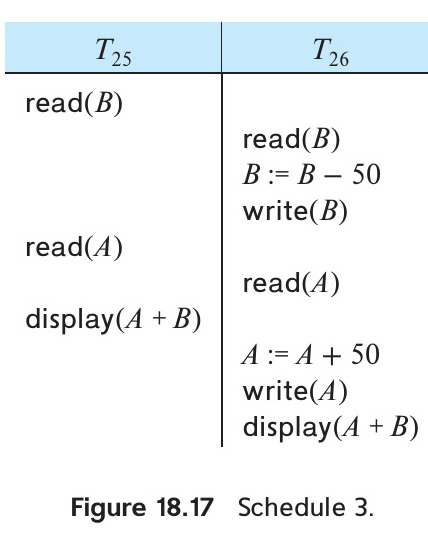

[← Previous: T11.05 Wait-Die vs. Wound-Wait Deadlock Prevention](T11.05_Wait_Die_vs_Wound_Wait.md) | [🏠 Index](00_Index.md) | [Next: T12.01 Failure Classification and Recovery Precautions →](T12.01_Failure_Classification.md)

---

# T11.06: Timestamp-Ordering (TSO) Protocol

> **Topic:** T11 · Concurrency Control Protocols | **Priority:** 🟠 | **Exam Frequency:** 3/7 finals (11 marks)
> **Sources:** Silberschatz 7e Ch. 18 (§18.5, pp. 861–865) · Lecture Deck 08 (Slides 26–30) · Raidah Notes (pp. 31–32)

---

## Principles of Timestamp Ordering

**Timestamp-Ordering Protocol (TSO):** A lock-free concurrency control protocol that assigns each transaction $T_i$ a unique startup timestamp $\text{TS}(T_i)$ and ensures that conflicting operations execute in timestamp order. Because transactions never wait in lock queues, deadlocks are impossible.

**Timestamp Order Equals Serialization Order:**
If $\text{TS}(T_i) < \text{TS}(T_j)$, the system ensures the schedule is equivalent to a serial schedule where $T_i$ appears before $T_j$.

### Timestamps on Transactions and Data Items

1. **Transaction Timestamps ($\text{TS}(T_i)$):** Assigned when $T_i$ enters the system using either the wall-clock time or a logical counter.
2. **Data Item Timestamps:** Every data item $Q$ stores two timestamp values:
   - **$\text{W-timestamp}(Q)$:** The largest timestamp of any transaction that successfully executed $\text{write}(Q)$.
   - **$\text{R-timestamp}(Q)$:** The largest timestamp of any transaction that successfully executed $\text{read}(Q)$.

Both values start at $0$ when the database initializes.

---

## Protocol Rules for Read and Write Operations

### 1. Read Rule: Transaction $T_i$ Issues $\text{read}(Q)$

1. **Conflict Check:**
   $$
   \text{TS}(T_i) < \text{W-timestamp}(Q)
   $$
   - *Meaning:* A younger transaction has already overwritten $Q$. The value $T_i$ needed is gone.
   - *Action:* The $\text{read}$ is **rejected**, and $T_i$ is **rolled back**.
2. **Valid Execution:**
   $$
   \text{TS}(T_i) \ge \text{W-timestamp}(Q)
   $$
   - *Action:* The $\text{read}$ is **executed**, and the read timestamp is updated:
   $$
   \text{R-timestamp}(Q) := \max(\text{R-timestamp}(Q), \text{TS}(T_i))
   $$

---

### 2. Write Rule: Transaction $T_i$ Issues $\text{write}(Q)$

1. **Read-Conflict Check:**
   $$
   \text{TS}(T_i) < \text{R-timestamp}(Q)
   $$
   - *Meaning:* A younger transaction has already read $Q$. In serial order, that younger transaction should have read $T_i$'s new value, but it already read an older value.
   - *Action:* The $\text{write}$ is **rejected**, and $T_i$ is **rolled back**.
2. **Write-Conflict Check (Obsolete Write):**
   $$
   \text{TS}(T_i) < \text{W-timestamp}(Q)
   $$
   - *Meaning:* $T_i$ is attempting to overwrite $Q$ with an obsolete value after a younger transaction has already updated it.
   - *Action:* Under standard TSO, the $\text{write}$ is **rejected**, and $T_i$ is **rolled back**.
3. **Valid Execution:**
   $$
   \text{TS}(T_i) \ge \text{R-timestamp}(Q) \quad \text{and} \quad \text{TS}(T_i) \ge \text{W-timestamp}(Q)
   $$
   - *Action:* The $\text{write}$ is **executed**, and the write timestamp is updated:
   $$
   \text{W-timestamp}(Q) := \text{TS}(T_i)
   $$

  
*Figure 18.17: Schedule 3 executing under the timestamp-ordering protocol (Source: Silberschatz 7e, Figure 18.17)*

---

## The Critical Timestamp Reassignment Trap

> [!WARNING]
> - **In Timestamp Ordering (TSO):** When a transaction is rolled back, it **MUST RECEIVE A NEW, LARGER TIMESTAMP** upon restart.
> - **Why it cannot keep its old timestamp:**
>   1. **Immediate Repeat Abort:** If $T_i$ kept its old timestamp, $\text{TS}(T_i)$ would still be smaller than the updated data item timestamps on disk. On restart, it would fail the exact same inequality check at the exact same step.
>   2. **Prevents Starvation (Livelock):** Keeping the old timestamp traps the transaction in an endless abort-restart loop. A fresh timestamp breaks this cycle.
>   3. **Restores Valid Serialization Order:** A new timestamp places the transaction after the conflicting transactions in logical time, allowing its operations to execute.

### Cross-Protocol Timestamp Summary

| Protocol Category | Protocol Name | Restart Timestamp Policy | Architectural Reason |
| :--- | :--- | :--- | :--- |
| **Deadlock Prevention** | Wait-Die / Wound-Wait | **Keeps OLD Timestamp** | Seniority increases over time, guaranteeing completion without starvation. |
| **Concurrency Control** | Timestamp Ordering (TSO) | **Gets NEW Timestamp** | Old timestamp would repeatedly fail against higher disk timestamps. |

---

## Thomas' Write Rule

**Thomas' Write Rule:** A modification to the Timestamp-Ordering write rule that ignores obsolete writes instead of aborting the transaction.

When transaction $T_i$ issues $\text{write}(Q)$:
1. If $\text{TS}(T_i) < \text{R-timestamp}(Q) \implies$ **Reject and roll back $T_i$** (a younger transaction already read the wrong value).
2. If $\text{TS}(T_i) < \text{W-timestamp}(Q)$ and $\text{TS}(T_i) \ge \text{R-timestamp}(Q) \implies$ **IGNORE (SKIP) THE WRITE**. Do not roll back $T_i$. Let $T_i$ continue execution!
3. Otherwise $\implies$ **Execute the write**, and set $\text{W-timestamp}(Q) := \text{TS}(T_i)$.

  
*Figure 18.18: Schedule 4 illustrating Thomas' write rule where obsolete write is ignored (Source: Silberschatz 7e, Figure 18.18)*

### Why Thomas' Write Rule Matters

Because $T_i$'s write would have been overwritten by the younger transaction anyway, skipping it preserves the exact same final database state. This rule produces schedules that are **view serializable but not conflict serializable**.

---

## Strengths and Limitations of Timestamp Ordering

### Strengths
1. **Deadlock Freedom:** Transactions never wait for each other, making deadlocks impossible.
2. **Guaranteed Conflict Serializability:** Operations execute in strict timestamp order.

### Limitations
1. **Cascading Rollbacks and Unrecoverability:** Basic TSO permits reading uncommitted data written by active transactions. If the writer aborts, the reader must roll back. DBMSs prevent this by buffering writes or holding commit operations.
2. **Starvation of Long Transactions:** Long transactions touching many records have a high probability of clashing with younger transactions and aborting repeatedly.

---

## 🏆 Golden Questions (Past Exam Archive)

### 🎯 GQ1 · 2018 Q.6(b) / 2024 Q.8(b) · Rolled Back Transaction Timestamp Assignment · [04 / 03 Marks]

> *Section B · Asked in: 2018 (4 marks), 2024 (3 marks, CO3) · L2 repeat merge*

**Question (2018 Q.6(b), 2024 Q.8(b) · identical text).** When a transaction is rolled back under timestamp ordering and it is assigned a new timestamp? Why can it not simply keep its old timestamp?

**Answer.**

**When a Transaction is Rolled Back Under Timestamp Ordering:**  
Under the Timestamp Ordering (TSO) protocol, a transaction $T_i$ is rolled back whenever it attempts an operation that conflicts with a younger transaction:

1. **On Read:** $T_i$ issues $\text{read}(Q)$, but $\text{TS}(T_i) < \text{W-timestamp}(Q)$.  
   $T_i$ is attempting to read an older value of $Q$ that has already been overwritten by a younger transaction. The read is rejected and $T_i$ is rolled back.
2. **On Write:**
   - $T_i$ issues $\text{write}(Q)$, but $\text{TS}(T_i) < \text{R-timestamp}(Q)$.  
     The value of $Q$ that $T_i$ is producing was needed previously by a younger transaction, which already read an older value. The write is rejected and $T_i$ is rolled back.
   - $T_i$ issues $\text{write}(Q)$, but $\text{TS}(T_i) < \text{W-timestamp}(Q)$.  
     $T_i$ is attempting to overwrite $Q$ with an obsolete value after a younger transaction has already written it. The write is rejected and $T_i$ is rolled back.

**Assigning a New Timestamp:**  
When $T_i$ is rolled back, the system aborts it and restarts it. Upon restarting, the system assigns $T_i$ a **new, larger timestamp** using the current system clock or logical counter.

**Why It Cannot Keep Its Old Timestamp:**

1. **Avoids Immediate Re-abort:**  
   If $T_i$ kept its old timestamp, $\text{TS}(T_i)$ would remain smaller than the $\text{R-timestamp}$ or $\text{W-timestamp}$ values already written by the younger transactions. On restarting, when $T_i$ reaches the same step, the exact same timestamp check would fail again.
2. **Prevents Starvation (Livelock):**  
   Keeping the old timestamp traps the transaction in an endless abort and restart loop. It would never finish. A new timestamp breaks this cycle.
3. **Correct Serial Order:**  
   A new timestamp assigns the transaction a fresh position in the logical serialization order, placing it after the conflicting transactions and allowing its operations to execute successfully.

*Variant for 2024 Q.8(b) (3 marks):* Give the read and write rollback conditions concisely. Then explain in two points why the old timestamp causes repeated aborts and starvation.

---

### 🎯 GQ2 · 2023 Q.8(c) · Trace Schedule Under Timestamp Ordering Protocol · [04 Marks]

> *Section B · CLO3 · Asked in: 2023 · L1 (asked once)*

**Question (2023 Q.8(c)).** Discuss the given schedule based on Timestamp ordering protocol.

| $T_1(100)$ | $T_2(200)$ | $T_3(300)$ |
| :---: | :---: | :---: |
| $R(A)$ | | |
| | $R(B)$ | |
| $W(C)$ | | |
| | | $R(B)$ |
| $R(C)$ | | |
| | $W(B)$ | |
| | | $W(A)$ |

*(Note: In the original paper schedule, $W(C)$ of $T_1$ and $R(B)$ of $T_3$ occupy essentially the same vertical tier. Since $C$ and $B$ are disjoint data items, the concurrency protocol evaluation remains unaffected).*

**Answer.**

**Initial Setup:**  
- Transaction timestamps: $\text{TS}(T_1) = 100$, $\text{TS}(T_2) = 200$, $\text{TS}(T_3) = 300$.
- Initial data item timestamps:
  $$
  \text{R-TS}(A) = \text{W-TS}(A) = 0
  $$
  $$
  \text{R-TS}(B) = \text{W-TS}(B) = 0
  $$
  $$
  \text{R-TS}(C) = \text{W-TS}(C) = 0
  $$

**Step-by-Step Execution Trace:**

| Step | Txn | Op | Protocol Condition Check | Decision | Updated Timestamp State |
| :---: | :---: | :---: | :--- | :--- | :--- |
| **1** | $T_1$ | $R(A)$ | $\text{TS}(T_1) \ge \text{W-TS}(A) \implies 100 \ge 0$ (Valid) | **Execute** | $\text{R-TS}(A) = \max(0, 100) = 100$ |
| **2** | $T_2$ | $R(B)$ | $\text{TS}(T_2) \ge \text{W-TS}(B) \implies 200 \ge 0$ (Valid) | **Execute** | $\text{R-TS}(B) = \max(0, 200) = 200$ |
| **3** | $T_1$ | $W(C)$ | $\text{TS}(T_1) \ge \text{R-TS}(C)$ and $\text{W-TS}(C) \implies 100 \ge 0$ (Valid) | **Execute** | $\text{W-TS}(C) = 100$ |
| **4** | $T_3$ | $R(B)$ | $\text{TS}(T_3) \ge \text{W-TS}(B) \implies 300 \ge 0$ (Valid) | **Execute** | $\text{R-TS}(B) = \max(200, 300) = 300$ |
| **5** | $T_1$ | $R(C)$ | $\text{TS}(T_1) \ge \text{W-TS}(C) \implies 100 \ge 100$ (Valid) | **Execute** | $\text{R-TS}(C) = \max(0, 100) = 100$ |
| **6** | $T_2$ | $W(B)$ | $\text{TS}(T_2) < \text{R-TS}(B) \implies 200 < 300$ (**Violated!**) | **REJECTED** | **$T_2$ is rolled back** |
| **7** | $T_3$ | $W(A)$ | $\text{TS}(T_3) \ge \text{R-TS}(A)$ and $\text{W-TS}(A) \implies 300 \ge 100$ (Valid) | **Execute** | $\text{W-TS}(A) = 300$ |

**Evaluation and Discussion:**

1. **Steps 1 through 5:** Each read and write operation satisfies the timestamp ordering rules. Operations execute in valid order.
2. **Conflict at Step 6:** Transaction $T_2$ ($\text{TS}=200$) attempts to write item $B$. But at Step 4, transaction $T_3$ ($\text{TS}=300$) has already read $B$, setting $\text{R-TS}(B) = 300$. Because $\text{TS}(T_2) < \text{R-TS}(B)$ ($200 < 300$), $T_2$ is producing a value of $B$ that $T_3$ needed to read. The system assumed that value would never be produced.
3. **Rollback Action:** The write operation $W(B)$ by $T_2$ is **rejected**. The system **rolls back transaction $T_2$**.
4. **Step 7:** $T_3$ executes $W(A)$ successfully because $\text{TS}(T_3) = 300 \ge \text{R-TS}(A) = 100$.

**Conclusion:**  
**The schedule is not accepted without rollback.** Transaction $\mathbf{T_2}$ is aborted and rolled back at Step 6. When restarted, $T_2$ must be assigned a new timestamp greater than 300.

---

## ⚡ Exam Tips & Common Mistakes

- **Step 5 Self-Read Check:** In 2023 Q.8(c), $T_1$ reads $C$ after writing $C$. This is valid because $\text{TS}(T_1) \ge \text{W-TS}(C)$ ($100 \ge 100$). Never flag a transaction reading its own write as an error.
- **Step 6 Conflict Explanation:** The mark-earning step is Step 6 where $200 < 300$. State clearly that $T_3$ read $B$ at Step 4, setting $\text{R-TS}(B) = 300$, which makes $T_2$'s subsequent write invalid.
- **Trace Table Format:** Always format trace questions using a 6-column table (Step, Txn, Op, Condition Check, Decision, Updated Timestamps). Full marks depend on this structured presentation.
- **Thomas' Write Rule vs. Standard TSO:** Under standard TSO, an outdated write ($\text{TS} < \text{W-TS}$) causes rollback. Under Thomas' Write Rule, it is ignored without aborting. Explicitly mention if Thomas' rule is applicable.

---

## 🔗 Related Topics

- [T11.05: Wait-Die vs. Wound-Wait](T11.05_Wait_Die_vs_Wound_Wait.md) · Timestamp-based deadlock prevention where transactions keep old timestamps
- [T11.02: Two-Phase Locking Protocol](T11.02_Two_Phase_Locking.md) · Lock-based alternative to timestamp ordering
- [T10.05: View Serializability](T10.05_View_Serializability.md) · How Thomas' Write Rule achieves view serializability
- [T12.01: Failure Classification and Recovery Precautions](T12.01_Failure_Classification.md) · Handling aborted transactions during recovery

---

[← Previous: T11.05 Wait-Die vs. Wound-Wait Deadlock Prevention](T11.05_Wait_Die_vs_Wound_Wait.md) | [🏠 Index](00_Index.md) | [Next: T12.01 Failure Classification and Recovery Precautions →](T12.01_Failure_Classification.md)
