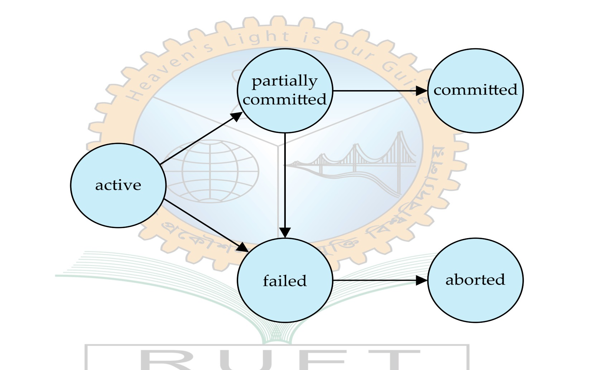

[← Previous: T12.1 Failure Classification and Recovery Precautions](T12.01_Failure_Classification.md) | [🏠 Index](00_Index.md) | [Next: T12.3 Log-Based Recovery and Shadow Paging →](T12.03_Log_Based_Recovery_and_Shadow_Paging.md)

---

# T12.2: Role of the Recovery Manager

> **Topic:** T12 · Recovery System & RAID | **Priority:** 🟢 Foundational | **Exam Frequency:** 1/7 finals · 4 marks
> **Sources:** Silberschatz 7e Ch. 17 (§17.1–17.3), Ch. 19 (§19.1, §19.4) · Lecture Deck 01 (Slide 26) · Lecture Deck 07 (Slide 8)

---

## The Recovery Manager & Core ACID Guarantees

**Recovery Manager:** The recovery manager is the DBMS component responsible for enforcing transaction atomicity and durability. It tracks active operations and uses the transaction log to undo aborted transactions and redo committed updates after crashes.

**Atomicity:** Atomicity is the all-or-nothing guarantee that either all operations of a transaction succeed and persist, or the database remains completely unchanged as if the transaction never ran.

**Aborted Transaction and Rollback:** An aborted transaction is a transaction that halts prematurely without completing. The recovery manager executes a rollback by reading the undo log backward and restoring each modified item to its pre-transaction value ($V_1$).

---

## Why a Never-Failing Server Still Needs a Recovery Manager

If computer hardware, power supplies, and operating systems never crash, a recovery manager is still strictly necessary.

Crash-proof hardware eliminates system crashes and disk failures. But it does nothing to prevent individual **transaction failures**. Transactions routinely abort during normal daily processing on perfectly healthy hardware.

| Hardware Reliability Eliminates | Hardware Reliability Does NOT Eliminate |
| :--- | :--- |
| ✗ Power grid outages | ✓ Application logical errors (divide by zero, overflow) |
| ✗ Operating system kernel panics | ✓ Explicit user or application `ROLLBACK` commands |
| ✗ Disk head crashes | ✓ Concurrency deadlock victim selections |
| ✗ Media surface defects | ✓ Integrity constraint violations (`PRIMARY KEY`, `FOREIGN KEY`) |

Because these aborted transactions leave partial modifications in volatile buffer pools and on disk, the database must roll them back to preserve consistency and atomicity.

---

## Sources of Transaction Abort During Normal Execution

Transactions abort during routine processing for four primary reasons:

### 1. Internal Logical Errors
A transaction may run into bad data or flawed logic partway through its execution:
- Arithmetic overflow or division by zero.
- Searching for a record or account ID that does not exist.
- Unhandled application exceptions that stop execution.

### 2. Explicit User or Application Rollback
An application or user may voluntarily abort a transaction based on business logic:
- A banking transaction subtracts money from an account, checks a withdrawal limit rule, and issues `ROLLBACK` because the balance was insufficient.
- An airline booking transaction cancels itself if the last seat is taken before checkout finishes.

### 3. Integrity Constraint Violations
The DBMS blocks any update that violates relational schema rules:
- Inserting a duplicate value into a `PRIMARY KEY` or `UNIQUE` column.
- Violating a `FOREIGN KEY` reference.
- Failing a `CHECK` constraint (such as setting an account balance below zero).

If an update fails a constraint check after earlier statements in the same transaction modified data, the DBMS must abort the transaction and undo those earlier updates.

### 4. Concurrency Control and Deadlock Victim Selection
When concurrent transactions access overlapping data items:
- If transactions become deadlocked waiting for each other's locks, the concurrency manager selects one transaction as a victim, aborts it, and rolls it back.
- Under the Timestamp-Ordering (TSO) protocol, any transaction that attempts to read or write data out of timestamp order is aborted and restarted.

---

## Preserving Atomicity: The Concrete Need for Rollback

Atomicity states that transactions cannot leave partial results:

$$
\text{Database Modifications} \in \{\text{All Updates Committed}, \text{Zero Updates Applied}\}
$$

Consider a transfer of \$100 from account $A$ to account $B$:
1. Deduct \$100 from account $A$.
2. Add \$100 to account $B$.

Suppose Step 1 modifies account $A$ in memory or on disk. Right before Step 2 executes, the transaction aborts due to a constraint violation on account $B$ or a deadlock.

Without a recovery manager, the \$100 deduction on account $A$ remains in the database. Money vanishes from account $A$ without entering account $B$! The recovery manager prevents this corruption by reading the undo log and restoring account $A$ to its original pre-transaction balance.

---

## Transaction State Transitions and the Recovery Manager

The recovery manager oversees the transition from a failed state to an aborted state:

*Figure 12.2: Transaction state transition lifecycle showing rollback from failed to aborted state (Slide Deck 07, Slide 8).*

1. **Active:** The transaction executes statements and writes updates to buffer blocks.
2. **Failed:** Upon detecting an error, constraint violation, or deadlock abort, the transaction moves from Active to Failed.
3. **Rollback Phase:** The recovery manager reads the transaction's log records in reverse chronological order and restores old values ($V_1$) for all modified items.
4. **Aborted:** Once all partial updates are erased and locks released, the transaction enters the Aborted state.

---

## 🏆 Golden Questions (Past Exam Archive)

### 🎯 GQ1 · 2018 Q.8(b) · Necessity of Recovery Manager in a Never-Failing System · [04 Marks]

> *Section B · Asked in: 2018 Q.8(b) (4 marks) · L1 · Textbook Exercise 17.1*

**Question.** Suppose that there is a database system that never failed, is a recovery manager required for this system? Justify your answer.

**Answer.**

**Yes, a recovery manager is still required.**

Even in a hypothetical system where the hardware and operating system never crash, a recovery manager is essential for the following reasons:

1. **Transactions Still Abort:** A failure-free hardware platform prevents system crashes and disk failures. But individual transactions still fail and must be rolled back.
2. **Causes of Transaction Abort:**
   - *Logical Errors:* A transaction may encounter bad user input, division by zero, arithmetic overflow, or missing data.
   - *Explicit User Aborts:* An application or user may voluntarily cancel an operation (such as issuing a `ROLLBACK` when funds are insufficient).
   - *Integrity Violations:* A transaction may violate primary key, foreign key, or check constraints, forcing an abort.
   - *Deadlock Resolution:* The concurrency controller may select a transaction as a deadlock victim and abort it to break the cycle.
3. **Preserving Atomicity:** The ACID property of **Atomicity** requires that all changes of an aborted transaction be undone. The database must return to its pre-transaction state.
4. **Execution of Rollback:** The recovery manager reads undo log records, restores old data values in the buffer and disk, and releases locks. Without a recovery manager, aborted transactions would leave partial, corrupted updates in the database.

---

## ⚡ Exam Tips & Common Mistakes

- **Never Answer "No":** Answering "No" earns zero marks. A recovery manager is needed for transaction aborts, not just system crashes.
- **Link Directly to Atomicity:** Always define atomicity ("all-or-nothing"). Partial updates must be erased when a transaction aborts.
- **Cite Concrete Abort Examples:** Mention deadlocks, division by zero, application `ROLLBACK` calls, and foreign key constraint violations.
- **System Crash vs. Transaction Abort:** A system crash affects all running transactions. A transaction abort affects only one transaction, but still requires log undo operations.

---

## 🔗 Related Topics

- [T12.1: Failure Classification and Recovery Precautions](T12.01_Failure_Classification.md) · Differences between transaction failures, system crashes, and disk failures.
- [T12.3: Log-Based Recovery and Shadow Paging](T12.03_Log_Based_Recovery_and_Shadow_Paging.md) · How undo logs and WAL implement transaction rollback.
- [T09.1: ACID Properties](T09.01_ACID_Properties.md) · Detailed breakdown of Atomicity, Consistency, Isolation, and Durability.
- [T11.4: Deadlock Handling](T11.04_Deadlock.md) · Deadlock detection and victim selection triggering rollbacks.

---

[← Previous: T12.1 Failure Classification and Recovery Precautions](T12.01_Failure_Classification.md) | [🏠 Index](00_Index.md) | [Next: T12.3 Log-Based Recovery and Shadow Paging →](T12.03_Log_Based_Recovery_and_Shadow_Paging.md)
