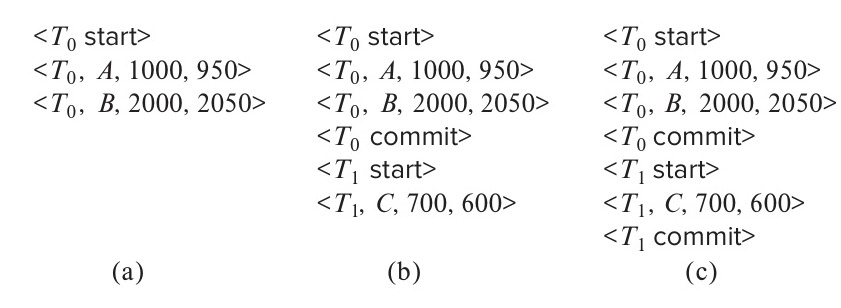

[← Previous: T12.2 Role of the Recovery Manager](T12.02_Recovery_Manager_Role.md) | [🏠 Index](00_Index.md) | [Next: T12.4 RAID Levels and Storage Reliability →](T12.04_RAID_Levels.md)

---

# T12.3: Log-Based Recovery (WAL, Undo/Redo, Checkpoints) and Shadow Paging

> **Topic:** T12 · Recovery System & RAID | **Priority:** 🟡 Core | **Exam Frequency:** 2/7 finals · 7 marks
> **Sources:** Silberschatz 7e Ch. 19 (§19.3–19.4, Note 19.1) · Lecture Deck 07 (Slide 8)

---

## Log Records and the Write-Ahead Logging (WAL) Protocol

**Log:** The log is an append-only sequence of records stored on stable storage that tracks every database modification.

**Update Log Record:** Every write operation generates an update record with four fields:

$$
\langle T_i, X, V_1, V_2 \rangle
$$

- $T_i$: Identifier of the transaction performing the write.
- $X$: Identifier of the modified data item (disk block and offset).
- $V_1$: Old value of $X$ before this write (used by undo operations).
- $V_2$: New value of $X$ after this write (used by redo operations).

State records mark transaction boundaries: $\langle T_i\text{ start}\rangle$, $\langle T_i\text{ commit}\rangle$, and $\langle T_i\text{ abort}\rangle$.

**Write-Ahead Logging (WAL):** Write-Ahead Logging is a recovery protocol enforcing two fundamental rules:
1. **The Undo Rule:** The update log record $\langle T_i, X, V_1, V_2 \rangle$ must reach stable storage before the modified data block is written to disk. This ensures that if the system crashes after the dirty block is written, the old value $V_1$ is on disk to undo the uncommitted change.
2. **The Commit (Redo) Rule:** The commit record $\langle T_i\text{ commit}\rangle$ must reach stable storage before the transaction confirms success to the user. Data blocks can be written to disk lazily later, because the log preserves $V_2$ to redo changes if a crash occurs.

---

## Deferred vs. Immediate Database Modification

Databases handle when modifications reach the shared buffer pool and disk:

| Feature | Deferred Modification | Immediate Modification |
| :--- | :--- | :--- |
| **When Buffer is Modified** | Postponed until transaction commits | Updated immediately while transaction is active |
| **Disk Writes During Execution** | None (updates kept in private memory) | Dirty blocks can be flushed to disk at any time |
| **Undo Requirement** | Never needs undo (dirty data never reaches disk) | **Requires Undo** (uncommitted writes reach disk before crash) |
| **Redo Requirement** | **Requires Redo** | **Requires Redo** |
| **Memory Overhead** | High (must buffer all updates in local transaction memory) | Low (uses standard shared buffer pool) |
| **Concurrency Support** | Snapshot isolation, validation-based concurrency | Standard Two-Phase Locking (2PL) |

Most enterprise DBMS engines use immediate modification because buffering updates in private memory wastes RAM for large transactions.

---

## Undo and Redo Mechanics

**Undo and Redo Operations:** Undo and redo are the two log-replay passes executed after a crash. Undo scans backward through an uncommitted transaction's log records and restores each item to its old value ($X \leftarrow V_1$). Redo scans forward through a committed transaction's log records and reapplies each item to its new value ($X \leftarrow V_2$).

When a system restarts after a crash, the recovery manager scans the log to determine which transactions to reapply (redo) and which to reverse (undo).


*Figure 12.3: System log states during transaction execution and failure points (Silberschatz Figure 19.4).*

### 1. Transaction Classification
- **Redo-List:** Contains transactions that have $\langle T_i\text{ start}\rangle$ and a matching $\langle T_i\text{ commit}\rangle$ (or $\langle T_i\text{ abort}\rangle$). Their updates must be durable on disk.
- **Undo-List:** Contains transactions that have $\langle T_i\text{ start}\rangle$ but neither $\langle T_i\text{ commit}\rangle$ nor $\langle T_i\text{ abort}\rangle$. They were active when the crash occurred, so their partial updates must be undone.

### 2. The Redo Phase (Forward Scan)
The recovery manager scans the log forward from the oldest relevant record:
- For each update record $\langle T_i, X, V_1, V_2 \rangle$ where $T_i \in \text{Redo-List}$, it sets $X \leftarrow V_2$.
- Redo is **idempotent**: reapplying $V_2$ multiple times produces the exact same state.

### 3. The Undo Phase (Backward Scan)
The recovery manager scans the log backward from the end of the log:
- For each update record $\langle T_i, X, V_1, V_2 \rangle$ where $T_i \in \text{Undo-List}$, it restores the old value: $X \leftarrow V_1$.
- Once the scan reaches $\langle T_i\text{ start}\rangle$, it writes $\langle T_i\text{ abort}\rangle$ to the log and removes $T_i$ from the undo-list.

---

## Checkpointing: Bounding Recovery Time

Scanning the log from the very beginning of database creation would cause unacceptably long reboot times. Checkpointing periodically creates bookmarks in the log.

**Checkpoint:** A checkpoint is a periodic synchronization step where the DBMS flushes dirty data and log buffers to disk and records active transaction identifiers to limit post-crash recovery scans.

### Checkpoint Execution Steps
1. Output all log records currently in main memory to stable storage.
2. Output all modified buffer blocks (dirty pages) to disk.
3. Write a $\langle\text{checkpoint } L\rangle$ record to stable storage, where $L$ lists all transactions active at that moment.

### How Checkpoints Accelerate Recovery
Because Step 2 forces all dirty blocks to disk, any transaction that committed *before* the checkpoint has 100% of its updates on disk. The recovery manager never needs to redo it! Recovery only scans back to the start of the oldest transaction in $L$.

---

## Shadow Paging

**Shadow Paging:** Shadow paging is a copy-on-write recovery technique that avoids log-based undo passes by maintaining two page tables: a current page table and a shadow page table.

### How Shadow Paging Works
1. Data blocks are accessed via a page table. A single disk pointer (`db-pointer`) points to the active page table.
2. During execution, the current page table handles active updates while the shadow page table points to the original, untouched disk blocks.
3. When a page is modified, the DBMS writes it to a new disk block and updates the current page table to point to this new block. The original block remains unchanged on disk.
4. **Commit:** The DBMS writes all modified pages to disk and atomically flips `db-pointer` to point to the current page table.
5. **Abort / Crash Recovery:** If a crash happens before `db-pointer` flips, the system reboots pointing to the original shadow page table. New blocks are garbage-collected. No undo pass is required.

### Disadvantages of Shadow Paging
- **Disk Fragmentation:** Writing modified pages to new locations destroys page clustering, slowing sequential table scans.
- **Page Table Overhead:** Copying and managing large page tables introduces high memory and I/O overhead.
- **Poor Concurrency:** Handling multiple concurrent transactions modifying different pages in the same page table is complex. For these reasons, relational databases prefer Write-Ahead Logging.

---

## 🏆 Golden Questions (Past Exam Archive)

### 🎯 GQ1 · 2017 Q.6(d) · Log-Based Recovery Approach to Ensure Atomicity · [03 Marks]

> *Section B · Asked in: 2017 Q.6(d) (3 marks) · L1*

**Question.** Discuss shortly the log-based recovery approach to ensure atomicity despite of failures of DBMS.

**Answer.**

Log-based recovery ensures atomicity by recording every database update in an append-only log on stable storage before modifying the actual database on disk.

1. **Log Records:** The system writes structured records:
   - $\langle T_i\text{ start}\rangle$, $\langle T_i\text{ commit}\rangle$, and $\langle T_i\text{ abort}\rangle$ track transaction state.
   - Update records $\langle T_i, X, V_1, V_2\rangle$ store the transaction ID, data item $X$, old value $V_1$ (for undo), and new value $V_2$ (for redo).
2. **Write-Ahead Logging (WAL) Rule:**
   - The update log record must reach stable storage before the corresponding data item is written to disk.
   - All log records of a transaction must reach stable storage before the transaction commits.
3. **Ensuring Atomicity on Failure:**
   - If a transaction aborts or the system crashes while it is active (no commit record in log), the recovery manager executes $\text{undo}(T_i)$. It uses the old values $V_1$ to reverse all partial modifications.
   - If the transaction committed before the crash, $\text{redo}(T_i)$ applies new values $V_2$ to guarantee durability.
   - *Alternative:* Shadow paging ensures atomicity without logs by maintaining current and shadow page tables, but it causes disk fragmentation.

---

### 🎯 GQ2 · 2023 Q.7(b) · Log-Based Recovery and Worked Crash Trace · [04 Marks]

> *Section B · Asked in: 2023 Q.7(b) (4 marks, CLO2) · L1*

**Question.** What is log based recovery? Illustrate with an example of a system crash and recovery process.

**Answer.**

#### Definition
**Log-based recovery** is a crash recovery technique that records all database update actions on stable storage in a sequential log prior to updating the database on disk. By maintaining both old and new values, the recovery manager can undo incomplete transactions and redo committed transactions after a failure.

#### System Crash Example
Consider three transactions running on data items $A$, $B$, and $C$ with initial values $A = 1000$, $B = 2000$, and $C = 500$:
- $T_1$ transfers \$100 from $A$ to $B$ (commits).
- $T_2$ adds \$200 to $C$ (commits).
- $T_3$ subtracts \$50 from $B$ (active during crash).

**State of Log on Stable Storage at Crash:**
```text
1. <T1 start>
2. <T1, A, 1000, 900>
3. <T1, B, 2000, 2100>
4. <T1 commit>
5. <T2 start>
6. <T2, C, 500, 700>
7. <T3 start>
8. <T2 commit>
9. <T3, B, 2100, 2050>
---- CRASH OCCURS HERE ----
```

#### Recovery Process
1. **Analysis:** The recovery manager scans the log to classify transactions:
   - **Redo-list** = $\{T_1, T_2\}$ (both contain `<start>` and `<commit>` records).
   - **Undo-list** = $\{T_3\}$ (contains `<start>` but no `<commit>` or `<abort>` record).
2. **Redo Phase:** Scans the log forward to re-apply updates for committed transactions:
   - Redo $T_1$: set $A \leftarrow 900$, $B \leftarrow 2100$.
   - Redo $T_2$: set $C \leftarrow 700$.
3. **Undo Phase:** Scans the log backward to rollback uncommitted transactions:
   - Undo $T_3$: restores $B$ to its old value $2100$ using record 9.
   - Writes $\langle T_3\text{ abort}\rangle$ to the log.

**Final Database State:**
$A = 900$, $B = 2100$, $C = 700$. Both atomicity for $T_3$ and durability for $T_1$ and $T_2$ are satisfied.

---

## ⚡ Exam Tips & Common Mistakes

- **Four-Field Log Record:** An update record must have four elements: $\langle T_i, X, V_1, V_2 \rangle$. Omitting $V_1$ prevents undo; omitting $V_2$ prevents redo.
- **Redo List Classification:** A transaction belongs on the redo list if and only if it has both `<start>` and `<commit>` (or `<abort>`) records. Uncommitted transactions go to the undo list.
- **Scan Directions:** Redo scans **forward** (replaying history); Undo scans **backward** (reversing uncommitted edits from newest to oldest).
- **WAL Flush Ordering:** State clearly that log records must reach stable storage *before* dirty data blocks reach disk.
- **Shadow Paging Drawbacks:** Always cite **disk fragmentation** and concurrency complexity when contrasting shadow paging with WAL.

---

## 🔗 Related Topics

- [T12.1: Failure Classification and Recovery Precautions](T12.01_Failure_Classification.md) · Failure modes that require log recovery.
- [T12.2: Role of the Recovery Manager](T12.02_Recovery_Manager_Role.md) · How the recovery manager rolls back failed transactions.
- [T12.4: RAID Levels and Storage Reliability](T12.04_RAID_Levels.md) · Physical disk arrays that approximate stable storage.
- [T09.1: ACID Properties](T09.01_ACID_Properties.md) · Atomicity and Durability implementation details.

---

[← Previous: T12.2 Role of the Recovery Manager](T12.02_Recovery_Manager_Role.md) | [🏠 Index](00_Index.md) | [Next: T12.4 RAID Levels and Storage Reliability →](T12.04_RAID_Levels.md)
