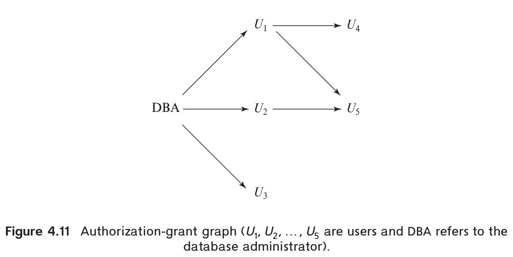

[← Previous: T12.4 RAID Levels](T12.04_RAID_Levels.md) | [🏠 Index](00_Index.md) | [Next: T13.2 SQL Injection →](T13.02_SQL_Injection.md)

---

# T13.1: Database Security Threats and Authorization

> **Topic:** T13 · Security, Indexing & Hashing | **Priority:** 🟢 Low | **Exam Frequency:** 1/7 finals · 4 marks
> **Sources:** Silberschatz 7e Ch. 4 (§4.7), Ch. 9 (§9.8) · Lecture Deck 01 (Slides 22–23)

---

## The CIA Triad in Database Systems

**Database Security:** Database security is the set of tools, access controls, and policies used to protect a database. It stops unauthorized access, tampering, and service outages to protect confidentiality, integrity, and availability.

Database security policies revolve around three core goals, known as the **CIA triad**:

1. **Confidentiality:** Keeps sensitive data hidden from unauthorized users. Systems enforce this through access control lists, security views, and data encryption.
2. **Integrity:** Stops unauthorized users from adding, modifying, or deleting records. Systems protect integrity using domain constraints, foreign keys, triggers, and privilege controls.
3. **Availability:** Ensures that authorized users can read and write data when needed. Systems defend availability against Denial of Service (DoS) attacks, hardware crashes, and deadlocks.

---

## Four Main Threats to Database Security

Exams test four specific threats along with technical countermeasures:

### 1. SQL Injection (Query Manipulation)

- **Threat:** Attackers enter malicious SQL syntax into user input fields. The application glues this raw input into dynamic queries without sanitization. The database parser executes the injected instructions.
- **Damage:** Attackers bypass login screens, steal private records, modify data, or drop entire tables.
- **Countermeasure:** Use prepared statements with parameterized queries (`PreparedStatement` in JDBC). Validate input types against strict rules and check dynamic tokens against an allowlist. Enforce least privilege on application accounts.

### 2. Privilege Abuse and Excessive Rights

- **Threat:** Users or rogue insiders get more permissions than their daily jobs require. Attackers also use stolen credentials to access restricted tables.
- **Damage:** Insider data leaks, unauthorized salary or grade changes, and record tampering.
- **Countermeasure:** Enforce the principle of least privilege using Role-Based Access Control (RBAC). Restrict base table visibility using SQL views. Require multi-factor authentication (MFA) and separate administrative duties.

### 3. Data Eavesdropping and Storage Leakage

- **Threat:** Attackers intercept unencrypted query results over local networks using packet sniffers. Attackers also steal unencrypted database backup files or disk storage drives.
- **Damage:** Theft of plaintext passwords, financial records, and private customer data.
- **Countermeasure:** Encrypt network connections between clients and servers using TLS/SSL. Encrypt database files and backup media using Transparent Data Encryption (TDE) with keys managed in a key management service.

### 4. Denial of Service (DoS)

- **Threat:** Attackers flood the database engine with thousands of connection requests or run unindexed queries that force huge Cartesian products and sorting.
- **Damage:** The server exhausts CPU, memory, and connection pool capacity, blocking legitimate queries.
- **Countermeasure:** Use connection pooling, set query timeout limits, place database firewalls with rate limiting, and maintain proper indices to avoid full-table scans.

---

## SQL Authorization Architecture

**Authorization:** Authorization defines what actions an authenticated user can execute on specific database objects (relations, views, attributes).

The SQL standard provides fine-grained privileges:

| Privilege | Permitted Action | Example Target |
| :--- | :--- | :--- |
| `SELECT` | Reading tuples from a table or view | `SELECT * FROM instructor` |
| `INSERT` | Inserting new tuples into a table | `INSERT INTO department VALUES (...)` |
| `UPDATE` | Modifying existing attribute values | `UPDATE instructor SET salary = salary * 1.05` |
| `DELETE` | Deleting tuples from a table | `DELETE FROM student WHERE tot_cred = 0` |
| `REFERENCES` | Declaring foreign keys that reference the target relation | `FOREIGN KEY (dept_name) REFERENCES department` |
| `ALL PRIVILEGES` | Granting all allowable rights on the target object | Full table control |

> [!NOTE]
> Why does SQL need a separate `REFERENCES` privilege? If user A adds a foreign key pointing to user B's table, user B cannot delete or modify their own rows without violating user A's key. Therefore, user B must grant explicit `REFERENCES` permission first.

### The `GRANT` and `REVOKE` Statements

Database administrators grant permissions using `GRANT`:

```sql
GRANT SELECT, INSERT ON student TO registrar, dean;
GRANT UPDATE (salary) ON instructor TO payroll_dept;
```

Administrators remove permissions using `REVOKE`:

```sql
REVOKE INSERT ON student FROM registrar;
REVOKE UPDATE (salary) ON instructor FROM payroll_dept;
```

---

## Role-Based Access Control (RBAC)

**Role:** A role is a named set of privileges that represents a job function. Administrators grant privileges to the role once, then assign the role to multiple users.

```sql
-- Step 1: Create a role
CREATE ROLE instructor;

-- Step 2: Grant object privileges to the role
GRANT SELECT ON takes TO instructor;
GRANT UPDATE (grade) ON takes TO instructor;

-- Step 3: Assign the role to individual users
GRANT instructor TO Satoshi, Amit;
```

Roles can inherit from other roles in a hierarchy:

```sql
CREATE ROLE dean;
GRANT instructor TO dean;
GRANT dean TO Satoshi;
```

Here `Satoshi` gets every permission granted to `dean` plus all permissions from `instructor`.

---

## Authorization via Views

Views allow administrators to hide specific columns or rows from users. Instead of granting permissions on physical base tables, administrators grant access only on the view:

```sql
-- Create a security view hiding instructor salaries
CREATE VIEW faculty_public AS
    SELECT ID, name, dept_name
    FROM instructor;

-- Grant access on the view, keeping the base table private
GRANT SELECT ON faculty_public TO academic_advisors;
```

Members of `academic_advisors` query `faculty_public` freely, but direct queries on the `instructor` table salary attribute fail.

---

## Authorization Graphs and Cascading Revocation

When administrators add `WITH GRANT OPTION`, the recipient user can pass the privilege to other users:

```sql
GRANT SELECT ON instructor TO Amit WITH GRANT OPTION;
```

The DBMS tracks privilege grants using a directed **authorization-grant graph**. Nodes represent users (rooted at `DBA`), and directed edges show who granted the privilege to whom.


*Figure 13.1: Authorization-grant graph ($U_1, \dots, U_5$ are users and DBA is the database administrator) (Source: Textbook Ch. 4, Fig. 4.11).*

### Rules of Privilege Revocation

A user retains a privilege if and only if a directed path exists from the root (`DBA`) to that user node.

- **Cascading Revocation (`CASCADE`):** The default SQL behavior. When a user loses a privilege, all outgoing grant edges from that user are removed. Any downstream user who no longer has an unbroken path to `DBA` loses the privilege too.
  - In Figure 13.1, if `DBA` revokes access from $U_1$, edge $\text{DBA} \rightarrow U_1$ is removed. User $U_4$ loses access because its only path ran through $U_1$.
  - User $U_5$ **keeps** the privilege because an alternative valid path remains: $\text{DBA} \rightarrow U_2 \rightarrow U_5$.
- **Restricted Revocation (`RESTRICT`):** If revoking a privilege would cause cascading revocations to other users, the DBMS aborts the command and returns an error.
- **Cyclic Grants ($U_2 \rightleftharpoons U_3$):** If users grant privileges to each other in a closed cycle and the link from `DBA` is cut, the cycle cannot sustain privileges. Both users lose the privilege because neither connects to `DBA`.

---

## Audit Trails and Forensic Accountability

**Audit Trail:** An audit trail is a chronological log of all changes (`INSERT`, `UPDATE`, `DELETE`) executed in the database. It records who made each change, what values changed, and when the change occurred.

Audit logs record:
- The user account, client IP address, and application name.
- The transaction timestamp.
- The operation type (`INSERT`, `UPDATE`, `DELETE`).
- Before-and-after values of altered tuples.

Production systems write audit records to append-only storage or write-once ledger tables so attackers cannot erase evidence.

---

## 🏆 Golden Questions (Past Exam Archive)

### 🎯 GQ1 · 2017 Q.8(a) · Four Main Threats to Database Security · 04 Marks

> *Section B · Asked in: 2017 (04 marks)*

**Question (2017 Q.8(a)).** Describe four of the main threats to database security.

**Answer.**

Four main threats to database security and their technical countermeasures are:

1. **SQL Injection:**
   - **Threat:** Attackers enter malicious SQL syntax into user input fields. The application concatenates this input into dynamic queries. The database parser executes unintended commands.
   - **Countermeasure:** Use prepared statements with parameterized queries. Validate all inputs against strict type and format rules.

2. **Privilege Abuse and Unauthorized Access:**
   - **Threat:** Legitimate users or compromised accounts obtain excessive privileges. They access or modify sensitive data beyond their authorized duties.
   - **Countermeasure:** Enforce the principle of least privilege using Role-Based Access Control (`GRANT`/`REVOKE`) and restricted SQL views.

3. **Data Eavesdropping and Leakage:**
   - **Threat:** Attackers intercept unencrypted data in transit over the network. They can also steal plaintext database files and backup disks.
   - **Countermeasure:** Encrypt network traffic using TLS/SSL. Encrypt database storage and backup files using Transparent Data Encryption (TDE).

4. **Denial of Service (DoS):**
   - **Threat:** Attackers flood the database server with excessive requests or complex queries. This exhausts CPU, memory, and connection pools, making the database unavailable.
   - **Countermeasure:** Use connection pooling, enforce query execution timeouts, and apply rate limiting with database firewalls.

---

## ⚡ Exam Tips & Common Mistakes

- **State Countermeasures:** Questions asking for "threats" expect both the threat mechanism and its technical countermeasure. State both for full marks.
- **Avoid Vague Terms:** Do not write generic computer threats like "viruses" or "power cuts". Use database threats: SQL injection, privilege abuse, eavesdropping, and query DoS.
- **Remember Multi-Parent Paths:** In authorization graphs, revoking from user A does not strip access from user B if user B retains another valid path from `DBA`.
- **Differentiate Authentication and Authorization:** Authentication verifies user identity. Authorization determines user access rights on tables and views.

## 🔗 Related Topics

- [T13.02: SQL Injection](T13.02_SQL_Injection.md) · [T06.04: Views](T06.04_Views.md) · [T07.02: Triggers for Database Security](T07.02_Triggers_for_Security.md)

---

[← Previous: T12.4 RAID Levels](T12.04_RAID_Levels.md) | [🏠 Index](00_Index.md) | [Next: T13.2 SQL Injection →](T13.02_SQL_Injection.md)
