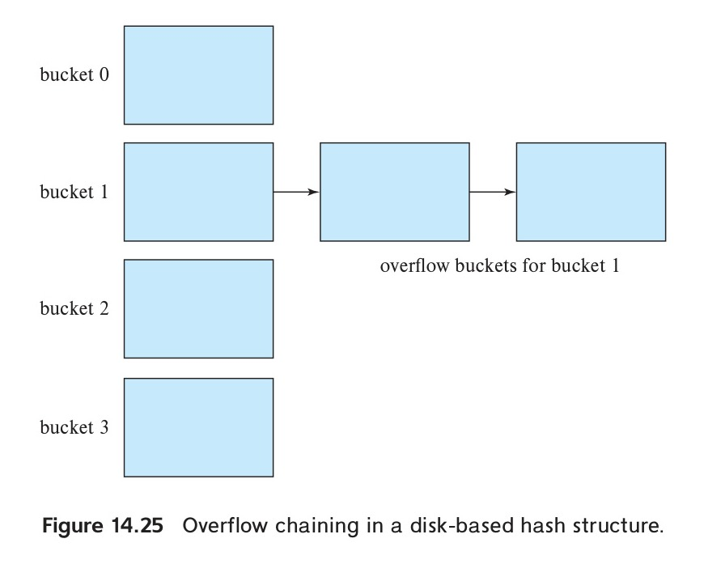

[← Previous: T13.3 Dense vs. Sparse Index](T13.03_Dense_vs_Sparse_Index.md) | [🏠 Index](00_Index.md) | [Next: Master Formula & Syntax Sheet →](99_Master_Formula_and_Syntax_Sheet.md)

---

# T13.4: Static vs. Dynamic Hashing

> **Topic:** T13 · Security, Indexing & Hashing | **Priority:** 🟢 Low | **Exam Frequency:** 1/7 finals · 3 marks
> **Sources:** Silberschatz 7e Ch. 14 (§14.5), Ch. 24 (§24.5)

---

## Fundamentals of Hashing in Database Systems

**Bucket:** A bucket is a unit of storage in a hash structure that holds one or more records, typically corresponding to a single disk block.

**Hash Function:** A hash function $h(K)$ maps a search-key value $K$ directly to the address of the bucket storing the record:

$$
h: K \rightarrow B
$$

Hashing provides direct $O(1)$ average search time for equality queries without traversing tree pointers.

### Properties of an Ideal Hash Function

1. **Uniform Distribution:** Keys are distributed evenly across all buckets, ensuring each bucket receives approximately equal numbers of records.
2. **Random Distribution:** Values are scattered independently of any natural clustering in search keys (such as consecutive ID sequences).

---

## Static Hashing: Mechanics and Limitations

**Static Hashing:** A hashing scheme where the number of bucket addresses is fixed at file creation time. Bucket overflows require overflow chaining, and table expansion requires full file reorganization.

To reduce immediate overflows, designers allocate extra space above minimum capacity using fudge factor $d \approx 0.20$:

$$
n_B = \left\lceil \frac{n_r}{f_r} \cdot (1 + d) \right\rceil
$$

where $n_r$ is total records and $f_r$ is records per bucket.

### Bucket Overflow and Overflow Chaining

When a record hashes to a full bucket, the system uses **overflow chaining** (closed addressing):

*Figure 13.5: Overflow chaining in a disk-based hash structure (Source: Textbook Ch. 14, Fig. 14.25).*

The database allocates an overflow block on disk and links it to the primary bucket with a pointer.

### Drawbacks of Static Hashing

1. **Degrading Search Time:** As records accumulate, overflow chains lengthen. Search time degrades from $O(1)$ toward $O(N)$ sequential scans.
2. **Space Inefficiency:** Pre-allocating buckets for future growth leaves disk blocks empty.
3. **Expensive Reorganization:** Rebuilding the index requires choosing a new hash function, reading every row, and rewriting the entire file offline.

---

## Dynamic Hashing: Extendable Hashing

**Dynamic Hashing:** A hashing scheme where the number of buckets adjusts dynamically as records are inserted and deleted, avoiding full file reorganization.

The primary dynamic scheme is **extendable hashing**, which uses a directory of pointers indexed by binary prefix bits of the hash function output:

*Figure 13.6: General extendable hash structure with bucket address table and local depths (Source: Textbook Ch. 24, Fig. 24.8).*

### Key Components

- **Global Depth ($i$):** The number of prefix bits used by the directory. The directory contains $2^i$ pointer slots.
- **Local Depth ($i_j$):** Stored inside bucket $j$, indicating the number of prefix bits common to records in that bucket.
- **Directory Sharing:** The number of directory pointers pointing to bucket $j$ is:
  $$
  2^{i - i_j}
  $$
  When $i_j < i$, multiple directory slots point to bucket $j$. When $i_j = i$, exactly one slot points to it.

### Overflow Handling on Insert

When bucket $j$ overflows:

1. **Case 1 ($i_j < i$, No Directory Doubling):**
   - Allocate one new bucket $z$.
   - Set local depth of $j$ and $z$ to $i_j + 1$.
   - Split records using the $(i_j + 1)$-th bit.
   - Repoint existing directory slots between $j$ and $z$. The directory size does not change.
2. **Case 2 ($i_j = i$, Directory Doubles First):**
   - Increment global depth $i := i + 1$. The directory doubles in size from $2^i$ to $2^{i+1}$.
   - Split overflowing bucket $j$, bumping local depths to $i_j + 1$.
   - Only the overflowing bucket is split on disk. All other data blocks remain untouched.

---

## Side-by-Side Comparison: Static vs. Dynamic Hashing

| Feature | Static Hashing | Dynamic Hashing |
| :--- | :--- | :--- |
| **Number of Buckets** | Fixed at database creation time. | Adjusts dynamically as the database grows or shrinks. |
| **Overflow Handling** | Uses overflow bucket chains when a bucket fills up. | Buckets split or coalesce. Overflow chains are avoided or minimized. |
| **Lookup Performance** | Degrades over time. Long overflow chains require slow sequential scans. | Remains fast ($O(1)$ disk accesses) even after substantial growth. |
| **Reorganization** | Requires periodic offline rebuilding of the whole file with a new hash function. | Reorganizes incrementally, one bucket at a time, without stopping database access. |
| **Space Usage** | Poor. Allocating few buckets causes overflow; allocating many wastes space. | High. Storage capacity scales smoothly with the actual number of records. |
| **Common Examples** | Modulo hashing with overflow chaining. | Extendable hashing and linear hashing. |

---

## Hashing vs. Ordered Indexing (B+-Trees)

1. **Point Queries (`WHERE ID = 22222`):** Hashing computes $h(\text{ID})$ directly in $O(1)$ time, outperforming B+-tree traversal ($O(\log n)$).
2. **Range Queries (`WHERE salary BETWEEN 50000 AND 80000`):** B+-trees excel by traversing sorted leaf sibling pointers. Hashing cannot support range queries because good hash functions scatter consecutive keys across unrelated buckets. Hashing on range queries forces a full table scan.

---

## 🏆 Golden Questions (Past Exam Archive)

### 🎯 GQ1 · 2017 Q.7(c) · Definition of Hashing and Static vs. Dynamic Comparison · 03 Marks

> *Section B · Asked in: 2017 (03 marks)*

**Question (2017 Q.7(c)).** What is hashing? Differentiate between static and dynamic hashing.

**Answer.**

**1. What is Hashing?**  
**Hashing** is a search and data organization technique. It uses a mathematical function $h(K)$, called a **hash function**. The function maps a search key $K$ to the address of the **bucket** storing the record. A bucket is a storage unit, typically a disk block. Hashing provides direct $O(1)$ average search time for equality queries without traversing tree pointers.

**2. Differentiate between Static and Dynamic Hashing**  

| Feature | Static Hashing | Dynamic Hashing |
| :--- | :--- | :--- |
| **Number of Buckets** | Fixed at database creation time. | Adjusts dynamically as the database grows or shrinks. |
| **Overflow Handling** | Uses overflow bucket chains when a bucket fills up. | Buckets split or coalesce. Overflow chains are avoided or minimized. |
| **Lookup Performance** | Degrades over time. Long overflow chains require slow sequential scans. | Remains fast ($O(1)$ disk accesses) even after substantial growth. |
| **Reorganization** | Requires periodic offline rebuilding of the whole file with a new hash function. | Reorganizes incrementally, one bucket at a time, without stopping database access. |
| **Space Usage** | Poor. Allocating few buckets causes overflow; allocating many wastes space. | High. Storage capacity scales smoothly with the actual number of records. |
| **Common Examples** | Modulo hashing with overflow chaining. | Extendable hashing and linear hashing. |

*Figure: General extendable hash structure with bucket address table (Source: Textbook Ch. 24, Fig. 24.8).*

---

## ⚡ Exam Tips & Common Mistakes

- **State Mathematical Formula:** Write $h: K \rightarrow B$, identifying $K$ as the search key and $B$ as the bucket address.
- **Incremental vs. Full Reorganization:** Emphasize that extendable hashing reorganizes one bucket at a time, whereas static hashing requires full file rebuilding.
- **Range Query Incompatibility:** Always state that hashing does not support range queries (`BETWEEN`, `<`, `>`) due to deliberate randomization of keys.
- **Directory Doubling Condition:** Remember that the directory doubles only when the overflowing bucket has $i_j = i$. If $i_j < i$, only the bucket splits.

## 🔗 Related Topics

- [T13.03: Dense vs. Sparse Index](T13.03_Dense_vs_Sparse_Index.md) · [T13.01: Database Security Threats](T13.01_Security_and_Authorization.md) · [Master Formula & Syntax Sheet](99_Master_Formula_and_Syntax_Sheet.md)

---

[← Previous: T13.3 Dense vs. Sparse Index](T13.03_Dense_vs_Sparse_Index.md) | [🏠 Index](00_Index.md) | [Next: Master Formula & Syntax Sheet →](99_Master_Formula_and_Syntax_Sheet.md)
