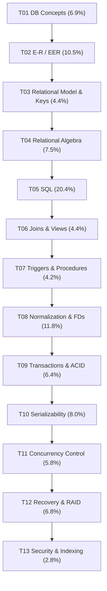

# ECE 2215: Database Systems: Subtopic-wise List (Weightage + Flow)

> **Source:** `ECE2215_PYQ_Analysis_Report.md` (7 finals, 637 printed marks, 148 sub-questions, plus CT-01 to CT-04). Every subtopic mark total below was added up from the report's per-question Appendix, and each topic's subtopics add up to that topic's §A2 total.
>
> **Use:**
> - **Question sorting:** tag each question with a primary subtopic ID (for example `T08.3`). Every past sub-question is counted once under its primary subtopic (matching its report tag), with one explicit 2 + 2 mark split on 2018 Q5c (`T12.1` failures + `T12.4` RAID, matching report §C5); multi-part questions that touch a second subtopic can carry a secondary cross-reference tag (see Sorting Rules).
> - **Boss notes:** write one section per topic in the order below. Within a topic, the subtopics are already in teaching order (definitions → mechanics → problem-solving).

## Legend

| Symbol | Meaning |
| :-- | :-- |
| **Marks** | Printed marks across the 7 finals (637 total) |
| **Share** | Marks ÷ 637 |
| **Papers** | How many of the 7 finals included it |
| 🔴 / 🟠 / 🟡 / 🟢 | Near-certain / Very likely / Likely / Wildcard (report §C8) |
| **S / P / T** | Slide coverage: in the slides / partly in the slides / textbook only |
| ♻️ | Recycled question (report §B10) |
| ⭐ | Never asked in a final but taught in the slides or tested in a CT, so a likely new question |

---

## Master Flow (topic order for notes)

| ID | Topic | Syllabus Unit | Marks | Share | Papers | Tier | Section | Main Source |
| :-- | :-- | :-: | :-: | :-: | :-: | :-: | :-: | :-- |
| T01 | DB Concepts & Architecture | 1 | 44 | 6.9% | 7/7 | 🔴 | A only | Deck 01 · Ch. 1 |
| T02 | E-R / EER Modeling | 2 | 67 | 10.5% | 7/7 | 🔴 | Mostly A | Deck 05 · Ch. 6 |
| T03 | Relational Model, Keys & Integrity | 3 | 28 | 4.4% | 5/7 | 🟡 | Mostly A | Deck 02 S6–8, Deck 06 S11–13 · Ch. 2 |
| T04 | Relational Algebra & Calculus | 3 | 48 | 7.5% | 6/7 | 🟠 | Mostly A | Deck 02 · Ch. 2 §2.6, Ch. 16 §16.1 |
| T05 | SQL (DDL, DML, Aggregates, Subqueries) | 4 | **130** | **20.4%** | 7/7 | 🔴 | **Both** | Deck 03 · Ch. 3–4 |
| T06 | Joins & Views | 4 | 28 | 4.4% | 4/7 | 🟠 | Both | Deck 04 · Ch. 4 §4.1–4.2 |
| T07 | Triggers & Stored Procedures | 4 | 27 | 4.2% | 5/7 | 🟠 | Mostly B | **T only:** Ch. 5 §5.2–5.3 |
| T08 | Normalization & FDs | 5 | 75 | 11.8% | 7/7 | 🔴 | **Both** | Deck 06 · Ch. 7 |
| T09 | Transactions, ACID & Anomalies | 6 | 41 | 6.4% | 7/7 | 🔴 | Both | Deck 07 S2–15, S28–33 · Ch. 17 |
| T10 | Serializability | 6 | 51 | 8.0% | 7/7 | 🔴 | Mostly B | Deck 07 S16–27 · Ch. 17 §17.6 |
| T11 | Concurrency Control Protocols | 6 | 37 | 5.8% | 6/7 | 🟠/🟡 | B only | Deck 08 · Ch. 18 |
| T12 | Recovery & RAID | 7 | 43 | 6.8% | 5/7 | 🟠 | Mostly B | **T only:** Ch. 19, Ch. 12 §12.5 |
| T13 | Security, Indexing & Hashing | 8 | 18 | 2.8% | 4/7 | 🟢 | Mostly B | **T only:** Ch. 9 §9.8, Ch. 14 |
| | **Total** | | **637** | 100% | | | | |

**Grouped by block:** Querying (T04–T07) 36.6% · Design (T02, T03, T08) 26.7% · Transactions (T09–T11) 20.3% · Systems (T12–T13) 9.6% · Foundations (T01) 6.9%.

---

## T01. DB Concepts & Architecture (44 marks · 6.9% · 7/7 · 🔴 · Section A, usually Q.1)

| ID | Subtopic | Marks | Occurrences | Cov. | Source |
| :-- | :-- | :-: | :-- | :-: | :-- |
| T01.1 | Data vs information; what a DB and a DBMS are; DBMS applications | — | (background for T01.2) | S | D01 S2–5 |
| T01.2 | **File system vs DBMS** (8 disadvantages of file systems) ♻️ | **21** | 2017 Q1a = 2021 Q1a; 2018 Q1a; 2019 Q1a; 2023 Q1b; 2024 Q1a (courier scenario) | S | D01 S6–7 |
| T01.3 | **Functions/roles of the DBA** ("five functions") ♻️; relation schema | 10 | 2017 Q1c, 2020 Q1a, 2021 Q1b | S | D01 S10, D02 S6 |
| T01.4 | **Data abstraction levels** (physical/logical/view), schemas & instances ♻️ *(physical data independence: Ch. 1 §1.3.1)* | 8 | 2017 Q2b, 2019 Q2a, CT-01 Q1 | S | D01 S13–15 · Ch. 1 §1.3 |
| T01.5 | DDL vs DML (procedural vs declarative) | 2 | 2023 Q1c | S | D01 S16–19 |
| T01.6 | DBMS engine components (storage manager, query processor) ⭐ | — | never asked | S | D01 S22–25 |
| T01.7 | 2-tier vs 3-tier architecture; DB application structure | 3 | 2020 Q1b, CT-01 Q3 | S | D01 S29–31 |

## T02. E-R / EER Modeling (67 marks · 10.5% · 7/7 · 🔴 · Mostly Section A)

| ID | Subtopic | Marks | Occurrences | Cov. | Source |
| :-- | :-- | :-: | :-- | :-: | :-- |
| T02.1 | Entity sets, relationship sets, **types of relationships** (unary/binary/ternary) | 4 | 2021 Q5a | S | D05 S7–16 |
| T02.2 | **Attribute types** (simple/composite, single/multivalued, derived) | 8 | 2020 Q5a, 2021 Q3b | S | D05 S17–19 |
| T02.3 | **Mapping cardinality** (1:1, 1:N, M:N) & participation constraints | 8 | 2018 Q3c, 2020 Q1c *(participation tested inside 2018 Q1c in T02.5)* | S | D05 S20–27 |
| T02.4 | **Weak vs strong entity sets** (discriminator, identifying relationship) ♻️ | 11 | 2018 Q1b, 2019 Q1b, 2020 Q2c, 2021 Q8c (= Ex. 6.17) | S | D05 S34–37 |
| T02.5 | **Design a full E-R diagram for a scenario** ♻️ | **24** | 2017 Q1b = **2024 Q1b** (RUET student DB); 2018 Q1c (with participation); 2019 Q1c (train e-ticketing); 2023 Q1a (RUET library); CT-02 Q2 | S | D05 S7–39 |
| T02.6 | Reduction of E-R to relational tables (M:N, ternary) | 5 | 2018 Q2c (= Practice Ex. 6.2) | S | D05 S40–48 |
| T02.7 | EER: specialization / generalization | 2 | 2017 Q6a | S | D05 S49–56 |
| T02.8 | EER: aggregation | 5 | 2018 Q2b, 2020 Q3a | S | D05 S57–60 |

## T03. Relational Model, Keys & Integrity (28 marks · 4.4% · 5/7 · 🟡)

| ID | Subtopic | Marks | Occurrences | Cov. | Source |
| :-- | :-- | :-: | :-- | :-: | :-- |
| T03.1 | Relation, tuple, attribute, domain; **domain vs data type** | 2 | 2018 Q3b | S | D02 S2–5, D03 S6 |
| T03.2 | **Keys: super / candidate / primary / alternate / composite / foreign** ♻️ | **21** | 2018 Q2a (= Ex. 6.14), 2019 Q6b, 2020 Q2b, 2021 Q2b, 2023 Q3b | S | D02 S7, D06 S11–13 |
| T03.3 | **Referential integrity** & FK syntax (MySQL) | 5 | 2021 Q1c | S | D03 S8–10 |
| T03.4 | Schema diagrams | — | CT-01 Q2 | S | D02 S8 |

## T04. Relational Algebra & Calculus (48 marks · 7.5% · 6/7, none in 2023 · 🟠 · Mostly Section A, Q.2)

| ID | Subtopic | Marks | Occurrences | Cov. | Source |
| :-- | :-- | :-: | :-- | :-: | :-- |
| T04.1 | Basic operators: $\sigma, \Pi, \times, \bowtie, \cup, \cap, -, \rho, \leftarrow$ | — | (foundation for T04.2–T04.3) | S | D02 S9–26 |
| T04.2 | **Write RA queries on a given schema** (incl. "only" queries → set difference, $\gamma$ count/max, RA modification/update) ♻️ | **41** | 2017 Q2a (employee DB, Fig. 2.17), 2018 Q3a (insurance), 2019 Q2b → 2024 Q5a (Covid), 2020 Q2a (vaccine, "1st dose only"), 2021 Q2a (customer/order), 2024 Q2b (projects), CT-01 Q4 | S/P | D02 S9–29; RA updates are 6e-only |
| T04.3 | **Explain an RA expression in words** | 4 | 2021 Q2c, CT-01 Q5 (iv = D02 S24) | S | D02 S15–24 |
| T04.4 | Extended RA: aggregation $_{G}\gamma_{F}$ (counted inside T04.2) | (in T04.2) | 2017 Q2a(iv), 2018 Q3a(i–ii), 2019 Q2b(ii), 2024 Q2b, CT-01 Q4(viii) | S | D02 S27–29 · Ch. 16 §16.1 |
| T04.5 | Domain relational calculus (and division $\div$) | 3 | 2020 Q4b | T | Not in 7e (online Ch. 27) |

## T05. SQL (130 marks · 20.4% · 7/7 · 🔴 · Both sections, the biggest topic)

| ID | Subtopic | Marks | Occurrences | Cov. | Source |
| :-- | :-- | :-: | :-- | :-: | :-- |
| T05.1 | What SQL is; SQL short note | 2 | 2019 Q5a | S | D03 S3–4 |
| T05.2 | **DDL + DML warm-up**: `CREATE`, `INSERT`, `ALTER ... ADD`, `UPDATE`, `DELETE`, rename, filter ♻️ | **33** | 2017 Q4a (+CGPA), 2018 Q7a = **2024 Q4b**, 2019 Q5c, 2021 Q3a, 2023 Q3a | S | D03 S5–11, S53–61 |
| T05.3 | Basic query clauses: `DISTINCT`, `ORDER BY`, `AS`, `LIKE` | (in T05.5/5.8) | 2019 Q7a(ii) (in T05.5), 2024 Q7b(iii–iv) (in T05.8), CT-02 Q1(b) | S | D03 S14, S17–24 |
| T05.4 | Aggregate functions (theory) ♻️ | 7 | 2019 Q8a → 2024 Q7a | S | D03 S30–31 |
| T05.5 | **Aggregation queries: `GROUP BY` + `HAVING`, CGPA = Σ(gpa·credit)/Σcredit, extremes without `LIMIT` (min/max/2nd-highest)** ♻️ | **24** | 2018 Q7b, 2019 Q7a (12 marks), 2024 Q1c, CT-02 Q1(d); CGPA: 2017 Q4a(iii), 2019 Q7a(iii) | S | D03 S30–43, S51 |
| T05.6 | Subqueries theory ("two examples"): `IN`, `SOME/ALL`, `EXISTS`, scalar, correlated, `WITH` ♻️ | 8 | 2019 Q8b → 2024 Q6a; correlated: 2023 Q3a(iii), CT-02 Q1(c) | S | D03 S35–52 |
| T05.7 | **Multi-table business-schema query sets** (MySQL): Covid, Company, Insurance, E-commerce ♻️ | **44** | 2019 Q5b (Covid), 2020 Q3b (Company), 2020 Q7b = **2024 Q5b** (Insurance, Ex. 3.4/3.14), 2021 Q4a (E-commerce, 12 marks) | S | D03 S12–61, D04 |
| T05.8 | Short notes: **`ON DELETE CASCADE`**, `GROUP BY`, `ORDER BY`, `AS` ♻️ | 10 | 2019 Q8c → 2023 Q6c → **2024 Q7b** | P | D03 S20–32 + Ch. 4 §4.4.5 |
| T05.9 | `TRUNCATE` vs `DELETE` | 2 | 2023 Q6a | P | Not in Silberschatz (answer from MySQL) |

## T06. Joins & Views (28 marks · 4.4% · 4/7 · 🟠 · Rising under OBE, 11.2% in 2023–24)

| ID | Subtopic | Marks | Occurrences | Cov. | Source |
| :-- | :-- | :-: | :-- | :-: | :-- |
| T06.1 | **Types of joins** (inner/natural/theta, left/right/full outer, cross); inner vs outer ♻️ | 11 | 2019 Q3c → 2023 Q5c → 2024 Q3c | S | D04 S3–23 |
| T06.2 | **Join outcome tables** (natural/left/right/full on given data; MySQL has no `FULL OUTER JOIN` → `LEFT ∪ RIGHT`) ♻️ | 11 | 2020 Q4c → **2024 Q4a** (Courses ⋈ Teacher) | S | D04 S5–19 |
| T06.3 | Outer-join algebra $\mathbin{⟕}, \mathbin{⟖}, \mathbin{⟗}$ | (with T06.2) | — | S | D04 S6, S8, S10, S20 · Ch. 4 §4.1, Ch. 16 §16.2 |
| T06.4 | **Views**: benefits, `CREATE VIEW` over several tables | 6 | 2023 Q5a, Q5b | S | D04 S24–28 |
| T06.5 | View expansion, updatable & materialized views ⭐ | — | never asked | S | D04 S29–34 |

## T07. Triggers & Stored Procedures (27 marks · 4.2% · 5/7 · 🟠 · Textbook only)

| ID | Subtopic | Marks | Occurrences | Cov. | Source |
| :-- | :-- | :-: | :-- | :-: | :-- |
| T07.1 | **What a trigger is, its purposes, its syntax** (ECA, `BEFORE/AFTER`, `FOR EACH ROW`) ♻️ | 9 | 2018 Q8a = 2020 Q8a | T | Ch. 5 §5.3 |
| T07.2 | **Triggers for security** (before/after a breach) ♻️ | 8 | 2017 Q8b → **2024 Q2a** | T | Ch. 5 §5.3 |
| T07.3 | **Implement a trigger / stored procedure** (place an order + audit log; order insert updates stock) | 10 | 2023 Q6b, 2024 Q6b | T | Ch. 5 §5.2–5.3 |

## T08. Normalization & Functional Dependencies (75 marks · 11.8% · 7/7 · 🔴 · Both sections)

| ID | Subtopic | Marks | Occurrences | Cov. | Source |
| :-- | :-- | :-: | :-- | :-: | :-- |
| T08.1 | **Why normalize: redundancy and insert/update/delete anomalies** | **18** | 2018 Q4a, 2019 Q6a, 2021 Q6c, 2023 Q2b, CT-03 Q2 | S | D06 S3–10 |
| T08.2 | FDs: trivial, full/partial, transitive; prime vs non-prime attributes | (in T08.4/8.6) | CT-03 Q1(b–c) | S | D06 S14–17 |
| T08.3 | Armstrong's axioms ⭐ | — | never asked directly | S | D06 S18–24 |
| T08.4 | **Attribute closure $X^+$, $F^+$, finding candidate keys** | 4 | 2021 Q5b (= Ex. 7.6), CT-03 Q1(a) | S | D06 S25–29 |
| T08.5 | Canonical cover $F_c$ (and how it differs from normalization) | 8 | 2021 Q6a, Q6b (= Ex. 7.7) | P | Ch. 7 §7.4.3 |
| T08.6 | **Define normalization (and its importance) & 1NF / 2NF / 3NF** | 14 | 2017 Q3a, Q8c; 2018 Q4c; 2019 Q3a; CT-03 Q3 | S | D06 S3–4, S30–40 |
| T08.7 | 2NF test from an FD set | 4 | 2021 Q5c (AB→CD, B→C) | S | D06 S31–36 |
| T08.8 | **Normalize an unnormalized table → 1NF → 2NF → 3NF** | **27** | 2017 Q3b (9), 2020 Q8b (8), 2023 Q2a (6), 2024 Q3a (4) | S | D06 S30–40 |
| T08.9 | BCNF; 3NF vs BCNF; highest normal form ⭐ | — | CT-03 Q1(d), CT-03 Q4 (never in a final) | S | D06 S41–46 |
| T08.10 | Pros/cons of normalization; **denormalization** ⭐ | — | importance asked in 2017 Q3a (in T08.6); cons & denormalization never asked | S | D06 S47–51 |
| T08.11 | Lossless-join decomposition & dependency preservation ⭐ | — | never asked | S | D06 S52–62 |

> **Likely next move:** a full FD-set problem (CK → prime/non-prime → partial/transitive → highest NF → decompose), modelled on D06 S46 / CT-03 Q1.

## T09. Transactions, ACID & Anomalies (41 marks · 6.4% · 7/7 · 🔴)

| ID | Subtopic | Marks | Occurrences | Cov. | Source |
| :-- | :-- | :-: | :-- | :-: | :-- |
| T09.1 | **ACID properties** (with the \$50 transfer example/diagram) ♻️ | **18** | 2017 Q5a, 2018 Q4b, 2021 Q7a, 2023 Q4b, 2024 Q6c, CT-04 Q1 | S | D07 S3–7 |
| T09.2 | **Consistency** property alone, with example ♻️ | 6 | 2019 Q3b = **2024 Q2c** | S | D07 S6 |
| T09.3 | **Transaction states / life-cycle diagram** | 6 | 2020 Q5b, 2023 Q4c | S | D07 S8–9 |
| T09.4 | Concurrent execution: advantages; serial vs concurrent vs serializable schedules | 4 | 2018 Q6a (= Ex. 17.14), CT-04 Q2 | S | D07 S10–15 |
| T09.5 | **Concurrency problems** (dirty read, lost update, unrepeatable read, phantom, incorrect summary) ♻️ | 7 | 2018 Q5a = **2024 Q8a**, CT-04 Q3 | S | D07 S28–33 |

## T10. Serializability (51 marks · 8.0% · 7/7 · 🔴 · Mostly Section B)

| ID | Subtopic | Marks | Occurrences | Cov. | Source |
| :-- | :-- | :-: | :-- | :-: | :-- |
| T10.1 | Define conflicting instructions & conflict serializability | 2 | 2017 Q5b | S | D07 S16–19 |
| T10.2 | Conflict equivalence by swapping (proof) | 4 | 2020 Q5c | S | D07 S19–20 |
| T10.3 | **Precedence-graph test** → cycle → serial order(s) ♻️ | **26** | 2018 Q6c = **2024 Q8c** (not serializable, D07 S15 layout); 2020 Q6a; 2021 Q7b (= D07 S20), Q7c; 2023 Q8b (4 txns, all serial orders); CT-04 Q4 | S | D07 S18–21, S25–26 |
| T10.4 | **Build serializable/non-serializable schedules** ($T_1,T_2$ with "if A = 0 then B := B+1") ♻️ | 13 | 2017 Q5c, 2019 Q4a (= Ex. 17.15; 2019 has a misprint) | S | D07 S10–21 |
| T10.5 | View serializability (3 conditions, blind writes) | 6 | 2020 Q6b (D07 S20 schedule) | S | D07 S22–23, S27 |
| T10.6 | Recoverable / cascadeless / strict schedules ⭐ | — | never asked | S | D08 S3–8 |

## T11. Concurrency Control Protocols (37 marks · 5.8% · 6/7 · 🟠/🟡 · Section B only)

| ID | Subtopic | Marks | Occurrences | Cov. | Source |
| :-- | :-- | :-: | :-- | :-: | :-- |
| T11.1 | Lock-based protocols: shared/exclusive locks, compatibility matrix, starvation | (in T11.2) | 2017 Q7a (starvation) | S | D08 S9–12 |
| T11.2 | **Two-phase locking**: growing/shrinking phases, lock point, inserting lock/unlock instructions | 9 | 2017 Q6b, 2017 Q7a (= Practice Ex. 18.2); *also 2nd half of 2020 Q7a ("time-shared" locking, counted in T11.4)* | S | D08 S13–18 |
| T11.3 | Strict / rigorous 2PL; drawbacks of 2PL ⭐ | — | never asked | S | D08 S16–19 |
| T11.4 | **Deadlock**: conditions, prevention vs detection, wait-for graph, victim selection | **17** | 2017 Q7b, 2018 Q5b (= Ex. 18.20), 2020 Q7a (deadlock + "time-shared" locking [misprint for 2PL, see T11.2]), 2021 Q8a (wait-for graph cycle) | S/P | D08 S20–25 |
| T11.5 | Wait-die vs wound-wait ⭐ | (in T11.4) | never asked by name | S | D08 S23 |
| T11.6 | **Timestamp ordering**: R-TS/W-TS rules, trace a schedule; ⚠️ **a transaction gets a NEW timestamp on rollback** ♻️ | 11 | 2018 Q6b = **2024 Q8b** (Ex. 18.26); 2023 Q8c (trace) | S/P | D08 S26–30 + Ch. 18 §18.5 |

## T12. Recovery System & RAID (43 marks · 6.8% · 5/7 · 🟠 · Textbook only)

| ID | Subtopic | Marks | Occurrences | Cov. | Source |
| :-- | :-- | :-: | :-- | :-: | :-- |
| T12.1 | **Failure classification**, precautions, recovery methods ♻️ | **17** | 2017 Q6c, 2018 Q5c (part), 2019 Q4b = **2024 Q3b**, 2023 Q7a | T | Ch. 19 §19.1 |
| T12.2 | Role of the recovery manager (could a never-failing DB skip it?) | 4 | 2018 Q8b (= Ex. 17.1) | T | Ch. 17 §17.1, Ch. 19 |
| T12.3 | **Log-based recovery**: WAL, undo/redo, checkpoints, crash example; shadow paging | 7 | 2017 Q6d, 2023 Q7b | T | Ch. 19 §19.3–19.4, Note 19.1 |
| T12.4 | **RAID levels**, comparing levels, RAID's role in recovery ♻️ | **15** | 2018 Q5c (part), Q8c; 2023 Q4a, Q7c; 2024 Q7c (multimedia archive) | T | Ch. 12 §12.5 |

## T13. Security, Indexing & Hashing (18 marks · 2.8% · 4/7 · 🟢 · Textbook only)

| ID | Subtopic | Marks | Occurrences | Cov. | Source |
| :-- | :-- | :-: | :-- | :-: | :-- |
| T13.1 | Database security threats; authorization | 4 | 2017 Q8a | T | Ch. 9 §9.8, Ch. 4 §4.7 |
| T13.2 | **SQL injection**: how it works + prevention ♻️ | 9 | 2020 Q4a (= Ex. 9.16), 2021 Q8b | T | Ch. 9 §9.8.1 |
| T13.3 | Indexing: dense vs sparse index (B+-tree as background) | 2 | 2023 Q8a | T | Ch. 14 §14.2–14.3 |
| T13.4 | Hashing: static vs dynamic | 3 | 2017 Q7c | T | Ch. 14 §14.5, Ch. 24 §24.5 |

---

## Top Subtopics by Marks (priority list)

| Rank | ID | Subtopic | Marks |
| :-: | :-- | :-- | :-: |
| 1 | T05.7 | Multi-table business-schema SQL | 44 |
| 2 | T04.2 | RA queries on a schema | 41 |
| 3 | T05.2 | SQL DDL + DML warm-up | 33 |
| 4 | T08.8 | Normalize a table to 3NF | 27 |
| 5 | T10.3 | Precedence-graph test | 26 |
| 6 | T05.5 | `GROUP BY`/`HAVING`/CGPA/no-`LIMIT` extremes | 24 |
| 6 | T02.5 | Full E-R diagram design | 24 |
| 8 | T01.2 | File system vs DBMS | 21 |
| 8 | T03.2 | Key types | 21 |
| 10 | T08.1 | Anomalies / why normalize | 18 |
| 10 | T09.1 | ACID | 18 |
| 12 | T11.4 | Deadlock | 17 |
| 12 | T12.1 | Failure classification | 17 |
| 14 | T12.4 | RAID | 15 |

## Sorting Rules (for tagging new or unseen questions)

1. Tag each sub-question with **one** primary subtopic ID. If it spans two (for example 2018 Q5c failures + RAID), tag the larger part and add the other as secondary (`T12.1 + T12.4`).
2. "Short note on X" goes to X's own subtopic (`ON DELETE CASCADE` → T05.8, not T03.3).
3. RA modification/update and $\gamma$ queries → T04.2; "explain this expression" → T04.3.
4. Serial vs serializable *definitions* → T09.4; *testing* a given schedule → T10.3.
5. "Concurrency problems if CC fails" → T09.5 (anomalies), not T11.
6. A question naming MySQL still goes to its SQL/Join subtopic. Write the answer in MySQL syntax.

