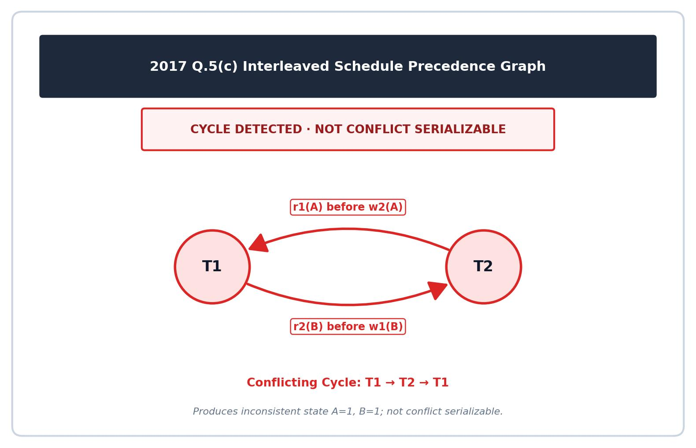

[← Directory Overview](README.md) | [Explanation Layer](../yearly_answers_explaination/2017.md) | [Original Question Paper](../PreviousYearQuestion/2017.md) | [Next: 2018 →](2018.md)

---

# ECE 2215: Database Systems · Semester Final 2017 · Exam-Style Answers

> [!info] Paper Metadata
> - **Examination:** B.Sc. Engineering 2nd Year Even Semester Examination, 2017
> - **Institution:** Rajshahi University of Engineering & Technology (RUET)
> - **Department:** Department of Electrical & Computer Engineering
> - **Curriculum Era:** Pre-OBE
> - **Full Marks:** 72 | **Time:** 3 Hours
> - **Instructions:** Answer any SIX questions taking THREE from each section.
> - **Question Count:** 21 sub-questions across Section A (8) and Section B (13)

---

## SECTION A

### Q.1(a) · 04 Marks

*Topic: [[Topicwise_answers_exam_style/T01_DB_Concepts_and_Architecture.md#T01.2 · File system vs DBMS|T01.2 · File system vs DBMS]] · Section A*

**Question.**
Write down four significant differences between a file processing system and a DBMS.

**Answer.**

| Feature | File Processing System | DBMS (Database Management System) |
| :--- | :--- | :--- |
| **Data Redundancy & Inconsistency** | Data is duplicated across multiple separate files. Different copies easily get out of sync. | Centralizes data storage. Normalization avoids duplication and keeps copies consistent. |
| **Data Access & Retrieval** | Programmers must write a new custom program in C or Java for each new query. | Users write declarative queries (like SQL) to retrieve ad-hoc data quickly without new code. |
| **Data Isolation & Independence** | Data structures and application code are tightly coupled. Changing a file structure breaks programs. | Provides data abstraction. Changes to physical storage structures do not affect application programs. |
| **Concurrent Access & Recovery** | Hard to coordinate simultaneous access. Multiple updates cause lost data. Crash recovery is manual. | Built-in concurrency control prevents conflicting updates. Automated logging and recovery preserve ACID properties. |

*Variant for 2021 Q.1(a) (4 marks):* The same four differences directly answer the question.

---

### Q.1(b) · 06 Marks

*Topic: [[Topicwise_answers_exam_style/T02_ER_and_EER_Modeling.md#T02.5 · Design a full E-R diagram for a scenario|T02.5 · Design a full E-R diagram for a scenario]] · Section A*

**Question.**
Draw an E-R diagram for RUET student database which can be used to store student's basic information, course advisor's information, subject registration, result information.

**Answer.**

**Design Specifications:**
1. **STUDENT:** Basic information entity with primary key `roll_no`. Attributes: `name`, `dept_name`, `series`.
2. **ADVISOR:** Faculty advisor entity with primary key `advisor_id`. Attributes: `name`, `designation`, `department`.
3. **COURSE (SUBJECT):** Academic course entity with primary key `course_code`. Attributes: `course_title`, `credits`.
4. **RESULT:** Semester examination outcome entity with primary key `result_id`. Attributes: `semester`, `gpa`, `cgpa`.

**Relationships:**
- `Advises` (1:N): An advisor guides multiple students. Each student has one advisor (total participation of student).
- `Registers` (M:N): Students register for multiple courses, and courses have many students. Descriptive attributes: `session`, `semester`.
- `Obtains` (1:N): Each student obtains multiple semester results (total participation of result).


*Figure: RUET Student Database Conceptual E-R Diagram*

*Short version for 2024 Q.1(b) (2 marks):*  
Draw the 4 entity rectangles (`STUDENT`, `ADVISOR`, `COURSE`, `RESULT`) and 3 relationship diamonds (`Advises`, `Registers`, `Obtains`) with primary keys underlined (`roll_no`, `advisor_id`, `course_code`, `result_id`) and cardinality labels (1:N, M:N, 1:N). Omit secondary descriptive attributes to complete within 2 marks.

---

### Q.1(c) · 02 Marks

*Topic: [[Topicwise_answers_exam_style/T01_DB_Concepts_and_Architecture.md#T01.3 · Functions of the DBA and relation schema|T01.3 · Functions of the DBA and relation schema]] · Section A*
*(Repeated question: Also asked in 2020 | Solved in T01)*

**Question.**
What are the main functions of a database administrator? Point out the name only.

**Answer.**

**Five Main Functions of a Database Administrator (DBA):**
1. **Schema definition:** The DBA creates the original database schema by executing DDL statements.
2. **Storage structure and access-method definition:** The DBA defines internal storage structures, indexing methods, and file organizations to optimize data access.
3. **Schema and physical-organization modification:** The DBA modifies database schemas and physical storage layouts to improve performance or adapt to changing business requirements.
4. **Granting of authorization for data access:** The DBA assigns access rights and user roles to regulate who can inspect or modify specific data items.
5. **Routine maintenance:** The DBA performs recurring operational tasks. These include periodically backing up the database, monitoring running jobs, and ensuring sufficient free disk space.

**Relation Schema:**  
A **relation schema** is the formal logical definition or blueprint of a relation (table). It specifies the name of the relation along with its set of attributes (columns) and their corresponding domains (data types).

- Format: $R(A_1, A_2, \dots, A_n)$
- Example: $\text{instructor}(\underline{\text{ID}}, \text{name}, \text{dept\_name}, \text{salary})$, where $\underline{\text{ID}}$ serves as the primary key.

*Variant for 2021 Q.1(b) (3 marks):* State and explain the five DBA functions above; omit the relation schema.  
*Variant for 2017 Q.1(c) (2 marks):* List only the names: (1) Schema definition, (2) Storage structure and access-method definition, (3) Schema and physical-organization modification, (4) Granting of authorization for data access, (5) Routine maintenance.

---

### Q.2(a) · 08 Marks

*Topic: [[Topicwise_answers_exam_style/T04_Relational_Algebra_and_Calculus.md#T04.2 · Write RA queries on a given schema|T04.2 · Write RA queries on a given schema]] · Section A*

**Question.**
Consider the following relational database.<br>&emsp;`employee(person_name, street, city)`<br>&emsp;`works(person_name, company_name, salary)`<br>&emsp;`company(company_name, city)`<br>&emsp;`manages(person_name, manager_name)`<br>Now write down the relational algebra(Not SQL) to express each of following queries:<br>(i) Find the names of all employees who live in the city same as their corresponding company location.<br>(ii) Give a 10% salary raise to all the managers only.<br>(iii) Update the city information of the employee named "James" to "Newtown".<br>(iv) Find the company with most employees.

**Answer.**

**(i) Employees living in the same city as their company:**

Natural join matches `person_name`, `company_name`, and ensures `employee.city = company.city`:

$$
T_1 \leftarrow \text{employee} \bowtie \text{works} \bowtie \text{company}
$$

$$
\Pi_{\text{person\_name}}(T_1)
$$

Equivalently, in a single expression:

$$
\boxed{\Pi_{\text{person\_name}}(\text{employee} \bowtie \text{works} \bowtie \text{company})}
$$

**(ii) Give a 10% salary raise to all managers only:**

Identify manager names, join with their work records, compute the raise, and union with untouched non-manager records:

$$
M \leftarrow \rho_{M(\text{person\_name})}(\Pi_{\text{manager\_name}}(\text{manages}))
$$

$$
T_{\text{mgr}} \leftarrow \text{works} \bowtie M
$$

$$
T_{\text{raised}} \leftarrow \Pi_{\text{person\_name}, \text{company\_name}, \text{salary} * 1.1}(T_{\text{mgr}})
$$

$$
T_{\text{untouched}} \leftarrow \text{works} - T_{\text{mgr}}
$$

$$
\boxed{\text{works} \leftarrow T_{\text{raised}} \cup T_{\text{untouched}}}
$$

**(iii) Update city of employee "James" to "Newtown":**

Replace the city attribute for James and keep all other employee records unchanged:

$$
T_{\text{james}} \leftarrow \sigma_{\text{person\_name} = \text{"James"}}(\text{employee})
$$

$$
T_{\text{updated}} \leftarrow \Pi_{\text{person\_name}, \text{street}, \text{"Newtown"}}(T_{\text{james}})
$$

$$
T_{\text{untouched}} \leftarrow \text{employee} - T_{\text{james}}
$$

$$
\boxed{\text{employee} \leftarrow T_{\text{updated}} \cup T_{\text{untouched}}}
$$

**(iv) Find the company with the most employees:**

Count employees per company, find the maximum count, and select the matching company name:

$$
T_{\text{counts}} \leftarrow {}_{\text{company\_name}}\gamma_{\text{count}(\text{person\_name}) \ \text{as} \ \text{num\_emp}}(\text{works})
$$

$$
T_{\text{max}} \leftarrow \gamma_{\text{max}(\text{num\_emp}) \ \text{as} \ \text{max\_emp}}(T_{\text{counts}})
$$

$$
\boxed{\Pi_{\text{company\_name}}(\sigma_{\text{num\_emp} = \text{max\_emp}}(T_{\text{counts}} \times T_{\text{max}}))}
$$

---

### Q.2(b) · 04 Marks

*Topic: [[Topicwise_answers_exam_style/T01_DB_Concepts_and_Architecture.md#T01.4 · Data abstraction levels, schemas and instances|T01.4 · Data abstraction levels, schemas and instances]] · Section A*

**Question.**
What is the purpose of data abstraction? Describe the different level of data abstraction.

**Answer.**

**Purpose of Data Abstraction:**  
A database contains complex data structures, storage blocks, and indexing schemes. Most end users and programmers are not trained in low-level storage details. Data abstraction hides this physical complexity. It simplifies user interactions, enforces security, and enables physical data independence.

**Levels of Data Abstraction:**
1. **Physical level:** The lowest abstraction level. It describes *how* records are stored on secondary storage media (such as byte offsets, data blocks, B+ trees, and hashing schemes).
2. **Logical level:** The intermediate level. It describes *what* data is stored in the database and the relationships among those data. Programmers and administrators work at this level using schemas.
   Example record:
   ```text
   type instructor = record
       ID : string;
       name : string;
       dept_name : string;
       salary : integer;
   end;
   ```
3. **View level:** The highest abstraction level. It describes only the subset of the database relevant to a specific user group. It hides other data and complex structures for ease of use and security (for example, hiding instructor salaries from students).


*Figure: Three levels of data abstraction (Deck 01, Slide 14)*

*Variant for 2019 Q.2(a) (4 marks):* Define data abstraction, describe the three levels, and include the diagram.  
*Variant for CT-01 Q.01 (5 marks):* State the definition, explain the three levels, show the record example, and draw the diagram.

---

### Q.3(a) · 03 Marks

*Topic: [[Topicwise_answers_exam_style/T08_Normalization_and_Functional_Dependencies.md#T08.6 · Define normalization (and its importance) & 1NF / 2NF / 3NF|T08.6 · Define normalization (and its importance) & 1NF / 2NF / 3NF]] · Section A*

**Question.**
What do you mean by normalization? Why normalization is important for database?

**Answer.**

#### 1. What is Normalization?

**Normalization** is a formal, systematic technique for designing relational database schemas. It decomposes relations with anomalies into smaller, well-structured relations to reduce data redundancy and ensure data integrity.

#### 2. Importance of Normalization (Main Objectives)

Normalization is essential for relational databases because it:

1. **Eliminates Unnecessary Data Redundancy:** Prevents storing the same facts repeatedly across multiple records, which conserves physical storage.
2. **Prevents Database Anomalies:** Completely removes insertion, deletion, and update anomalies that corrupt data during modifications.
3. **Ensures Data Consistency and Integrity:** Guarantees that an update applied to one record keeps all related facts accurate and consistent.
4. **Preserves Data Dependencies:** Ensures all real-world business constraints and functional dependencies can be enforced efficiently without complex cross-table joins.

*Short version for CT-03 Q.03 (3 marks):* Define normalization as the systematic decomposition of relations to minimize redundancy and eliminate anomalies. State the main objective: to produce well-structured tables free of insertion, update, and deletion anomalies while maintaining data consistency.

---

### Q.3(b) · 09 Marks

*Topic: [[Topicwise_answers_exam_style/T08_Normalization_and_Functional_Dependencies.md#T08.8 · Normalize an unnormalized table → 1NF → 2NF → 3NF|T08.8 · Normalize an unnormalized table → 1NF → 2NF → 3NF]] · Section A*

**Question.**
Consider the following data table com_employee. Is it already normalized? If not then normalize the table com_employee up to $3^{\text{rd}}$ normal form.<br><br><b>com_employee</b><br><table border="1" style="border-collapse: collapse;"><thead><tr><th>Pcode</th><th>Ptitle</th><th>EmpNo</th><th>EmName</th><th>EmCon</th><th>dNo</th><th>dName</th><th>HRate</th></tr></thead><tbody><tr><td>p1</td><td>Admission Test System</td><td>E1</td><td>Jones</td><td>501, 502</td><td>D1</td><td>IT</td><td>1000</td></tr><tr><td>p1</td><td>Admission Test System</td><td>E3</td><td>Smith</td><td>505</td><td>D2</td><td>Database</td><td>1100</td></tr><tr><td>p1</td><td>Admission Test System</td><td>E4</td><td>James</td><td>508, 509</td><td>D3</td><td>HR</td><td>800</td></tr><tr><td>p2</td><td>Salary System</td><td>E1</td><td>Jones</td><td>501, 502</td><td>D1</td><td>IT</td><td>900</td></tr><tr><td>p2</td><td>Salary System</td><td>E3</td><td>Smith</td><td>505</td><td>D2</td><td>Database</td><td>1000</td></tr></tbody></table>

**Answer.**

#### 1. Is the Table Already Normalized?

**No, the table is not normalized.**

It contains multi-valued entries in column `EmCon` (`501, 502` and `508, 509`). This directly violates the atomicity requirement of **First Normal Form (1NF)**. In addition, it mixes project, employee, contact, department, and assignment facts, causing partial and transitive dependencies.

#### 2. Functional Dependencies Identified from Data

- $\text{Pcode} \rightarrow \text{Ptitle}$
- $\text{EmpNo} \rightarrow \text{EmName}, \text{dNo}$
- $\text{dNo} \rightarrow \text{dName}$
- $(\text{Pcode}, \text{EmpNo}) \rightarrow \text{HRate}$ (an employee's hourly rate depends on the specific project)
- $\text{EmCon}$ is a multi-valued attribute of employee (`EmpNo`).

---

#### Step 1: Conversion to First Normal Form (1NF)

To achieve 1NF, we eliminate multi-valued fields by splitting them into separate atomic rows:

| Pcode | Ptitle | EmpNo | EmName | EmCon | dNo | dName | HRate |
| :--- | :--- | :--- | :--- | :--- | :--- | :--- | :--- |
| p1 | Admission Test System | E1 | Jones | 501 | D1 | IT | 1000 |
| p1 | Admission Test System | E1 | Jones | 502 | D1 | IT | 1000 |
| p1 | Admission Test System | E3 | Smith | 505 | D2 | Database | 1100 |
| p1 | Admission Test System | E4 | James | 508 | D3 | HR | 800 |
| p1 | Admission Test System | E4 | James | 509 | D3 | HR | 800 |
| p2 | Salary System | E1 | Jones | 501 | D1 | IT | 900 |
| p2 | Salary System | E1 | Jones | 502 | D1 | IT | 900 |
| p2 | Salary System | E3 | Smith | 505 | D2 | Database | 1000 |

PK: `(Pcode, EmpNo, EmCon)`

---

#### Step 2: Conversion to Second Normal Form (2NF)

We eliminate partial dependencies where non-prime attributes depend on proper subsets of the composite key:
- `Pcode -> Ptitle` depends only on `Pcode`.
- `EmpNo -> EmName, dNo, dName` depends only on `EmpNo`.
- `(EmpNo, EmCon)` represents employee phone numbers.
- `(Pcode, EmpNo) -> HRate` depends on the full project-employee assignment.

We decompose into four 2NF relations:

**PROJECT**

| Pcode | Ptitle |
| :--- | :--- |
| p1 | Admission Test System |
| p2 | Salary System |

PK: `Pcode`

**EMPLOYEE_2NF**

| EmpNo | EmName | dNo | dName |
| :--- | :--- | :--- | :--- |
| E1 | Jones | D1 | IT |
| E3 | Smith | D2 | Database |
| E4 | James | D3 | HR |

PK: `EmpNo`

**EMP_CONTACT**

| EmpNo | EmCon |
| :--- | :--- |
| E1 | 501 |
| E1 | 502 |
| E3 | 505 |
| E4 | 508 |
| E4 | 509 |

PK: `(EmpNo, EmCon)`

**PROJECT_ASSIGNMENT**

| Pcode | EmpNo | HRate |
| :--- | :--- | :--- |
| p1 | E1 | 1000 |
| p1 | E3 | 1100 |
| p1 | E4 | 800 |
| p2 | E1 | 900 |
| p2 | E3 | 1000 |

PK: `(Pcode, EmpNo)`

---

#### Step 3: Conversion to Third Normal Form (3NF)

In `EMPLOYEE_2NF`, a transitive dependency exists:
$$
\text{EmpNo} \rightarrow \text{dNo} \quad \text{and} \quad \text{dNo} \rightarrow \text{dName}
$$
Here, `dNo` is a non-prime attribute determining another non-prime attribute `dName`.

We decompose `EMPLOYEE_2NF` into:
1. `DEPARTMENT(dNo, dName)` with PK `dNo`.
2. `EMPLOYEE(EmpNo, EmName, dNo)` with PK `EmpNo` and foreign key `dNo` referencing `DEPARTMENT`.

#### Final 3NF Schema and Relations

1. **PROJECT**  
   `PROJECT(Pcode, Ptitle)`  
   PK: `Pcode`

2. **DEPARTMENT**  

   | dNo | dName |
   | :--- | :--- |
   | D1 | IT |
   | D2 | Database |
   | D3 | HR |
   
   PK: `dNo`

3. **EMPLOYEE**  

   | EmpNo | EmName | dNo |
   | :--- | :--- | :--- |
   | E1 | Jones | D1 |
   | E3 | Smith | D2 |
   | E4 | James | D3 |
   
   PK: `EmpNo` | FK: `dNo` references `DEPARTMENT(dNo)`

4. **EMP_CONTACT**  
   `EMP_CONTACT(EmpNo, EmCon)`  
   PK: `(EmpNo, EmCon)` | FK: `EmpNo` references `EMPLOYEE(EmpNo)`

5. **PROJECT_ASSIGNMENT**  
   `PROJECT_ASSIGNMENT(Pcode, EmpNo, HRate)`  
   PK: `(Pcode, EmpNo)` | FKs: `Pcode` references `PROJECT(Pcode)`, `EmpNo` references `EMPLOYEE(EmpNo)`

---

### Q.4(a) · 09 Marks

*Topic: [[Topicwise_answers_exam_style/T05_SQL_DDL_DML_Aggregates_Subqueries.md#T05.2 · DDL + DML warm-up: CREATE, INSERT, ALTER ... ADD, UPDATE, DELETE, rename, filter|T05.2 · DDL + DML warm-up: CREATE, INSERT, ALTER ... ADD, UPDATE, DELETE, rename, filter]] · Section A*

**Question.**
Considering following tables (INFO, MARKS, CREDIT) answer (i),(ii) & (iii).<br><br><table style="border: none; border-collapse: collapse;"><tr style="border: none; vertical-align: top;"><td style="border: none; padding-right: 15px;"><b>INFO</b><br><table border="1" style="border-collapse: collapse;"><thead><tr><th>roll</th><th>name</th></tr></thead><tbody><tr><td>1710001</td><td>Amelia</td></tr><tr><td>1710002</td><td>Oliver</td></tr><tr><td>1710003</td><td>James</td></tr><tr><td>1710004</td><td>Sansa</td></tr></tbody></table></td><td style="border: none; padding-right: 15px;"><b>MARKS</b><br><table border="1" style="border-collapse: collapse;"><thead><tr><th>roll</th><th>sub_code</th><th>gpa</th></tr></thead><tbody><tr><td>1710001</td><td>ECE 2205</td><td>3.50</td></tr><tr><td>1710001</td><td>ECE 2215</td><td>3.75</td></tr><tr><td>1710002</td><td>ECE 2205</td><td>3.75</td></tr><tr><td>1710002</td><td>ECE 2215</td><td>3.25</td></tr><tr><td>1710003</td><td>ECE 2205</td><td>4.00</td></tr><tr><td>1710003</td><td>ECE 2215</td><td>3.75</td></tr><tr><td>1710004</td><td>ECE 2205</td><td>3.50</td></tr><tr><td>1710004</td><td>ECE 2215</td><td>4.00</td></tr></tbody></table></td><td style="border: none; vertical-align: top;"><b>CREDIT</b><br><table border="1" style="border-collapse: collapse;"><thead><tr><th>sub_code</th><th>credit</th></tr></thead><tbody><tr><td>ECE 2205</td><td>3.00</td></tr><tr><td>ECE 2215</td><td>3.00</td></tr></tbody></table></td></tr></table><br><br>(i) Write down the SQL query to create the table MARKS.<br>(ii) Write down the SQL query to find out subject code and corresponding gpa of the student whose class serial 02.<br>(iii) Write the the SQL query to calculate the cgpa of each student using the formula, $cgpa = \frac{\Sigma gpa \cdot credit}{\Sigma credit}$

**Answer.**

*(i) Create table MARKS:*

```sql
CREATE TABLE MARKS (
    roll INT,
    sub_code VARCHAR(20),
    gpa DECIMAL(3, 2),
    PRIMARY KEY (roll, sub_code),
    FOREIGN KEY (roll) REFERENCES INFO(roll),
    FOREIGN KEY (sub_code) REFERENCES CREDIT(sub_code)
);
```

*(ii) Subject code and GPA for student with class serial 02:*

*Assumption: In the RUET roll format (e.g., 1710002), the final two digits represent the student's class serial. Class serial 02 identifies student roll 1710002 (Oliver).*

```sql
SELECT sub_code, gpa
FROM MARKS
WHERE roll = 1710002;
```

*(Alternative dynamic filter matching the last two digits:* `WHERE roll % 100 = 2;`*)*

*(iii) Calculate CGPA of each student:*

```sql
SELECT m.roll,
       SUM(m.gpa * c.credit) / SUM(c.credit) AS cgpa
FROM MARKS m
JOIN CREDIT c ON m.sub_code = c.sub_code
GROUP BY m.roll;
```

---

## SECTION B

### Q.5(a) · 04 Marks

*Topic: [[Topicwise_answers_exam_style/T09_Transactions_ACID_and_Anomalies.md#T09.1 · ACID properties|T09.1 · ACID properties]] · Section B*

**Question.**
Briefly discuss the ACID properties of transaction.

**Answer.**

A **transaction** is a logical unit of program execution that accesses and updates data items. To preserve data integrity during crashes and concurrent access, the DBMS must ensure the four **ACID** properties:

1. **Atomicity ("All-or-None"):**
   - Either all operations of the transaction are properly reflected in the database, or none are.
   - If a failure happens before the transaction completes, partial modifications are rolled back.
   - **Enforced by:** The **Recovery System** (using undo log records).

2. **Consistency (Preservation of Invariants):**
   - Executing a transaction in isolation preserves database consistency.
   - The database moves from one valid state to another valid state, satisfying all integrity constraints.
   - In a fund transfer, the total balance sum must remain unchanged.
   - **Enforced by:** The **Application Programmer** (correct business logic) and DBMS **Integrity Constraints**.

3. **Isolation (Shielding Concurrent Access):**
   - Each transaction executes as if it were running alone without interference from other concurrent transactions.
   - Intermediate results remain hidden from other concurrent transactions until commit.
   - **Enforced by:** The **Concurrency-Control System** (using locking or timestamp protocols).

4. **Durability (Persistence):**
   - After a transaction completes successfully and commits, its updates persist in the database permanently.
   - The committed data survives subsequent system crashes or power outages.
   - **Enforced by:** The **Recovery System** (using redo logs and non-volatile stable storage).

*Short version for 2024 Q.6(c) (2 marks):*
- **Atomicity:** All operations complete or none do. The recovery system undoes partial writes.
- **Consistency:** Execution in isolation preserves database validity and invariants.
- **Isolation:** Intermediate updates remain hidden from concurrent transactions.
- **Durability:** Committed changes persist permanently on disk despite crashes.

---

### Q.5(b) · 02 Marks

*Topic: [[Topicwise_answers_exam_style/T10_Serializability.md#T10.1 · Define conflicting instructions & conflict serializability|T10.1 · Define conflicting instructions & conflict serializability]] · Section B*

**Question.**
What do you know about conflict serializability?

**Answer.**

**Conflict serializability** is a property of a transaction schedule. A schedule $S$ is conflict serializable if it is **conflict equivalent** to a serial schedule. That is, we can transform $S$ into a serial schedule by swapping non-conflicting adjacent instructions.

1. **Conflicting instructions:** Two instructions $I_i$ and $I_j$ of distinct transactions $T_i$ and $T_j$ conflict if they access the same data item $Q$, and at least one of them is a write operation:
   - $\text{read}(Q)$ and $\text{write}(Q)$ conflict.
   - $\text{write}(Q)$ and $\text{write}(Q)$ conflict.
   - Two read operations ($\text{read}(Q)$ and $\text{read}(Q)$) do not conflict.
2. **Serializability test:** A schedule is conflict serializable if and only if its **precedence graph** has no directed cycles.
3. **Execution order:** When the graph is acyclic, a topological sort gives the equivalent serial execution order.

---

### Q.5(c) · 06 Marks

*Topic: [[Topicwise_answers_exam_style/T10_Serializability.md#T10.4 · Build serializable/non-serializable schedules ($T_1,T_2$ with "if A = 0 then B := B+1")|T10.4 · Build serializable/non-serializable schedules ($T_1,T_2$ with "if A = 0 then B := B+1")]] · Section B*

**Question.**
Consider the following two transactions.<br><br>**T1:**<br>&emsp;`read(A);`<br>&emsp;`read(B);`<br>&emsp;`if A = 0 then B:=B+1;`<br>&emsp;`write(B);`<br><br>**T2:**<br>&emsp;`read(B);`<br>&emsp;`read(A);`<br>&emsp;`if B = 0 then A:=A+1;`<br>&emsp;`write(A);`<br><br>Let the consistency requirement be $A = 0$ or $B = 0$ with $A=B=0$ the initial values.<br>(i) Show a concurrent execution of T1 and T2 that produces a nonserializable schedule.<br>(ii) Is there a concurrent execution of T1 and T2 that produces a serializable schedule?

**Answer.**

Initial state: $A = 0, B = 0$. Consistency requirement: $A = 0 \vee B = 0$.

In any serial execution, the database remains consistent:
- Serial order $\langle T_1, T_2 \rangle$: $T_1$ reads $A=0$, sets $B=1$, writes $B=1$. Then $T_2$ reads $B=1$. The condition $B=0$ fails, so $T_2$ does not change $A$. Final state: $A=0, B=1$ (consistent).
- Serial order $\langle T_2, T_1 \rangle$: $T_2$ reads $B=0$, sets $A=1$, writes $A=1$. Then $T_1$ reads $A=1$. The condition $A=0$ fails, so $T_1$ does not change $B$. Final state: $A=1, B=0$ (consistent).

---

#### (i) Concurrent Execution Producing a Nonserializable Schedule

Consider the following interleaved execution where both transactions read the initial values before either writes:

| Step | $T_1$ | $T_2$ | Local state |
| :--: | :-- | :-- | :-- |
| 1 | `read(A);` | | $T_1$ reads $A = 0$ |
| 2 | | `read(B);` | $T_2$ reads $B = 0$ |
| 3 | `read(B);` | | $T_1$ reads $B = 0$ |
| 4 | | `read(A);` | $T_2$ reads $A = 0$ |
| 5 | `if A = 0 then B:=B+1;`<br>`write(B);` | | $T_1$ evaluates $0 = 0$ (true), sets $B = 1$, writes $B = 1$ |
| 6 | | `if B = 0 then A:=A+1;`<br>`write(A);` | $T_2$ evaluates $0 = 0$ (true), sets $A = 1$, writes $A = 1$ |

**Final state:** $A = 1$ and $B = 1$.  
The consistency rule requires $A = 0$ or $B = 0$. Here both are 1. The database is in an **inconsistent state**.



**Proof of nonserializability:**
- $T_1$ reads $A$ (step 1) before $T_2$ writes $A$ (step 6) $\implies T_1 \to T_2$.
- $T_2$ reads $B$ (step 2) before $T_1$ writes $B$ (step 5) $\implies T_2 \to T_1$.
- The precedence graph has a cycle: $T_1 \longleftrightarrow T_2$.

Because it creates a cycle and ends in an inconsistent state that no serial schedule can produce, this schedule is **non-serializable**.

---

#### (ii) Can a Concurrent Execution Produce a Serializable Schedule?

**No.**

**Proof:**
For an execution to be genuinely concurrent (interleaved), both transactions must start before either finishes:
- $T_1$ must read $A$ before $T_2$ writes $A$. If $T_2$ wrote $A$ first, $T_2$ would have already completed its read and write, meaning $T_2$ ran serially before $T_1$. Therefore, in an interleaved run, $T_1$ reads $A$ first $\implies T_1 \to T_2$.
- Similarly, $T_2$ must read $B$ before $T_1$ writes $B$. Otherwise, $T_1$ ran serially before $T_2$. Therefore, $T_2$ reads $B$ first $\implies T_2 \to T_1$.

Any interleaved execution forces both edges $T_1 \to T_2$ and $T_2 \to T_1$. This always creates a directed cycle. Therefore, **no concurrent execution of $T_1$ and $T_2$ can produce a serializable schedule**. Only strictly serial executions ($\langle T_1, T_2 \rangle$ or $\langle T_2, T_1 \rangle$) are serializable.

---

### Q.6(a) · 02 Marks

*Topic: [[Topicwise_answers_exam_style/T02_ER_and_EER_Modeling.md#T02.7 · EER: specialization / generalization|T02.7 · EER: specialization / generalization]] · Section B*

**Question.**
Write short note on specialization and generalization in DBMS.

**Answer.**

- **Specialization (Top-down):**  
  A top-down design process. A higher-level entity set is divided into lower-level entity sets that have distinctive attributes or participate in specific relationships.
  - *Example:* `person` specialized into `employee` and `student`.

- **Generalization (Bottom-up):**  
  A bottom-up design process. Multiple lower-level entity sets sharing common properties are synthesized into a single higher-level entity set.
  - *Example:* Combining `instructor` and `secretary` into `employee`.

- **Key Properties:**
  1. **Attribute Inheritance:** Lower-level entity sets automatically inherit all attributes and relationship participations of the higher-level entity.
  2. **Representation:** Depicted in E-R diagrams by a triangle labeled **ISA** ("is a").


*Figure: Specialization Hierarchy Example (Deck 05, Slide 51)*

---

### Q.6(b) · 04 Marks

*Topic: [[Topicwise_answers_exam_style/T11_Concurrency_Control_Protocols.md#T11.2 · Two-phase locking: growing/shrinking phases, lock point, inserting lock/unlock instructions|T11.2 · Two-phase locking: growing/shrinking phases, lock point, inserting lock/unlock instructions]] · Section B*

**Question.**
How concurrent execution of transactions are controlled using two phase based locking protocol? Briefly discuss with an example.

**Answer.**

**Two-Phase Locking (2PL) Protocol:**  
The Two-Phase Locking protocol controls concurrent transactions by requiring each transaction to acquire and release locks in two separate, sequential phases:

1. **Growing Phase:**
   - A transaction may obtain new locks (shared or exclusive).
   - It can also convert a shared lock to an exclusive lock (upgrade).
   - A transaction cannot release any lock in this phase.
2. **Shrinking Phase:**
   - A transaction may release held locks.
   - It can convert an exclusive lock to a shared lock (downgrade).
   - A transaction cannot obtain any new locks in this phase.

**Lock Point:**  
The point in time where a transaction acquires its final lock is called its **lock point**. Once a transaction releases its first lock, the shrinking phase begins. The 2PL protocol guarantees conflict serializability. Transactions execute in the order of their lock points.

  
*Figure: Two-Phase Locking Protocol (Source: Deck 08, Slide 13)*

**Example:**  
Consider transaction $T_1$ transferring money between accounts $A$ and $B$:

```text
lock-S(A);         -- Growing phase begins
read(A);
lock-X(B);         -- Lock point (last lock acquired)
read(B);
B := B - 50;
write(B);
unlock(A);         -- Shrinking phase begins (no more locks allowed)
unlock(B);         -- Final unlock
```

Here, all locks are obtained before any lock is released. Therefore, $T_1$ follows 2PL and guarantees conflict serializability with concurrent transactions.

---

### Q.6(c) · 03 Marks

*Topic: [[Topicwise_answers_exam_style/T12_Recovery_System_and_RAID.md#T12.1 · Failure classification, precautions, recovery methods|T12.1 · Failure classification, precautions, recovery methods]] · Section B*

**Question.**
Classify and discuss the failures in DBMS.

**Answer.**

A database management system experiences three main classes of failure based on the affected storage component:

1. **Transaction Failure:** An individual transaction aborts before completing.
   - *Logical Error:* Caused by internal transaction logic or bad data (such as division by zero, arithmetic overflow, or data not found).
   - *System Error:* The system enters an undesirable state (such as a deadlock or timeout) and terminates the transaction.
2. **System Crash:** A hardware failure, power outage, or operating system bug halts the database server.
   - The contents of **volatile storage** (main memory buffers) are lost.
   - The contents of **non-volatile storage** (disk drives) remain uncorrupted (*fail-stop assumption*).
3. **Disk Failure:** Physical damage destroys data blocks on non-volatile media.
   - Causes include head crashes, magnetic surface defects, or transfer errors.
   - Recovery requires redundancy such as RAID arrays or archival backups.

*Variant for 2023 Q.7(a) (CLO2, 3 marks):* The same three-part classification directly answers the question.

---

### Q.6(d) · 03 Marks

*Topic: [[Topicwise_answers_exam_style/T12_Recovery_System_and_RAID.md#T12.3 · Log-based recovery and shadow paging|T12.3 · Log-based recovery and shadow paging]] · Section B*

**Question.**
Discuss shortly the log-based recovery approach to ensure atomicity despite of failures of DBMS.

**Answer.**

Log-based recovery ensures atomicity by recording every database update in an append-only log on stable storage before modifying the actual database on disk.

1. **Log Records:** The system writes structured records:
   - $\langle T_i\text{ start}\rangle$, $\langle T_i\text{ commit}\rangle$, and $\langle T_i\text{ abort}\rangle$ track transaction state.
   - Update records $\langle T_i, X, V_1, V_2\rangle$ store the transaction ID, data item $X$, old value $V_1$ (for undo), and new value $V_2$ (for redo).
2. **Write-Ahead Logging (WAL) Rule:**
   - The update log record must reach stable storage before the corresponding data item is written to disk.
   - All log records of a transaction must reach stable storage before the transaction commits.
3. **Ensuring Atomicity on Failure:**
   - If a transaction aborts or the system crashes while it is active (no commit record in log), the recovery manager executes $\text{undo}(T_i)$. It uses the old values $V_1$ to reverse all partial modifications.
   - If the transaction committed before the crash, $\text{redo}(T_i)$ applies new values $V_2$ to guarantee durability.
   - *Alternative:* Shadow paging ensures atomicity without logs by maintaining current and shadow page tables, but it causes disk fragmentation.

---

### Q.7(a) · 05 Marks

*Topic: [[Topicwise_answers_exam_style/T11_Concurrency_Control_Protocols.md#T11.2 · Two-phase locking: growing/shrinking phases, lock point, inserting lock/unlock instructions|T11.2 · Two-phase locking: growing/shrinking phases, lock point, inserting lock/unlock instructions]] · Section B*

**Question.**
What is starvation? Consider the following two transactions.<br><br>**T1:**<br>&emsp;`read(A);`<br>&emsp;`read(B);`<br>&emsp;`if A = 0 then B:=B+15% of B;`<br>&emsp;`write(B);`<br><br>**T2:**<br>&emsp;`read(B);`<br>&emsp;`read(A);`<br>&emsp;`if B = 0 then A:=A+20% of A;`<br>&emsp;`write(A);`<br><br>Add lock and unlock instructions to transaction T1 and T2, so that they observe the two phase locking protocol. Can the execution of these transactions result in a deadlock? Justify.

**Answer.**

**Starvation:**  
Starvation occurs when a transaction waits indefinitely for a lock on a data item. This happens when a continuous stream of other concurrent transactions keeps obtaining compatible locks on that item. The waiting transaction cannot make progress.

**Adding 2PL Instructions to T1 and T2:**  
Under Two-Phase Locking (2PL), all lock acquisitions must precede all unlock operations. $T_1$ reads $A$ (needs shared lock) and updates $B$ (needs exclusive lock). $T_2$ reads $B$ (needs shared lock) and updates $A$ (needs exclusive lock).

**Transaction T1:**
```text
lock-S(A);
read(A);
lock-X(B);
read(B);
if A = 0 then B := B + 15% of B;
write(B);
unlock(A);
unlock(B);
```

**Transaction T2:**
```text
lock-S(B);
read(B);
lock-X(A);
read(A);
if B = 0 then A := A + 20% of A;
write(A);
unlock(B);
unlock(A);
```

**Deadlock Analysis and Justification:**  
**Yes, the execution of these transactions can result in a deadlock.**

**Justification:**  
Consider the following interleaved execution sequence:

1. $T_1$ executes `lock-S(A)` and `read(A)`. $T_1$ holds a shared lock on $A$.
2. $T_2$ executes `lock-S(B)` and `read(B)`. $T_2$ holds a shared lock on $B$.
3. $T_1$ issues `lock-X(B)`. Because exclusive mode conflicts with shared mode (by the lock-compatibility matrix, S and X are incompatible), $T_1$ must wait for $T_2$ to release $B$.
4. $T_2$ issues `lock-X(A)`. Because exclusive mode conflicts with shared mode (by the lock-compatibility matrix, S and X are incompatible), $T_2$ must wait for $T_1$ to release $A$.

Now, $T_1$ waits for $T_2$, and $T_2$ waits for $T_1$. Under 2PL, neither transaction can unlock an item before acquiring all locks. A circular wait occurs:

$$
\text{Cycle: } T_1 \to T_2 \to T_1
$$

Neither transaction can make progress. Thus, a deadlock occurs.

  
*Figure: Interleaved execution and wait-for graph cycle producing deadlock between T1 and T2 under 2PL*

---

### Q.7(b) · 04 Marks

*Topic: [[Topicwise_answers_exam_style/T11_Concurrency_Control_Protocols.md#T11.4 · Deadlock: conditions, prevention vs detection, wait-for graph, victim selection|T11.4 · Deadlock: conditions, prevention vs detection, wait-for graph, victim selection]] · Section B*

**Question.**
Define deadlock. Explain how deadlock is prevented?

**Answer.**

**Deadlock:**  
A deadlock is a condition in which two or more transactions are waiting indefinitely for locks held by each other. None of the transactions can continue without external intervention.

**Deadlock Prevention Methods:**  
Deadlock prevention protocols ensure that the system never enters a deadlock state. Four standard schemes are:

1. **Pre-declaration (Pre-claiming All Locks):**  
   Each transaction must lock all required data items at once before execution begins. If any item is unavailable, no locks are granted and the transaction waits.  
   *Drawbacks:* Difficult to predict needed items beforehand. Data item usage is low.

2. **Lock Ordering:**  
   Impose a global ordering on all data items ($d_1 < d_2 < \dots < d_n$). A transaction can only request a lock on item $d_j$ if it already holds locks on items that precede $d_j$. Circular waits cannot form.

3. **Timestamp-Based Schemes (Preemption and Rollback):**  
   Each transaction $T_i$ is assigned a unique timestamp $\text{TS}(T_i)$ when it begins. The system compares timestamps to decide whether to wait or roll back:

   | Scheme | When $T_i$ requests item held by $T_j$ | Type |
   | :--- | :--- | :--- |
   | **Wait-Die** | If $T_i$ is older ($\text{TS}(T_i) < \text{TS}(T_j)$), $T_i$ **waits**.<br>If $T_i$ is younger ($\text{TS}(T_i) > \text{TS}(T_j)$), $T_i$ **dies** (rolls back). | Non-preemptive |
   | **Wound-Wait** | If $T_i$ is older ($\text{TS}(T_i) < \text{TS}(T_j)$), $T_i$ **wounds** $T_j$ ($T_j$ rolls back).<br>If $T_i$ is younger, $T_i$ **waits**. | Preemptive |

4. **Timeout-Based Scheme:**  
   A transaction waits for a lock for only a set amount of time. If the lock is not granted within the interval, the transaction times out and rolls back.

  
*Figure: Wait-for Graph with a cycle indicating deadlock (Source: Deck 08, Slide 24)*

---

### Q.7(c) · 03 Marks

*Topic: [[Topicwise_answers_exam_style/T13_Security_Indexing_and_Hashing.md#T13.4 · Hashing: static vs dynamic|T13.4 · Hashing: static vs dynamic]] · Section B*

**Question.**
What is hashing? Differentiate between static and dynamic hashing.

**Answer.**

**1. What is Hashing?**  
**Hashing** is a search and data organization technique. It uses a mathematical function $h(K)$, called a **hash function**. The function maps a search key $K$ to the address of the **bucket** storing the record. A bucket is a storage unit, typically a disk block. Hashing provides direct $O(1)$ average search time for equality queries without traversing tree pointers.

**2. Differentiate between Static and Dynamic Hashing**  

| Feature | Static Hashing | Dynamic Hashing |
| :--- | :--- | :--- |
| **Number of Buckets** | Fixed at database creation time. | Adjusts dynamically as the database grows or shrinks. |
| **Overflow Handling** | Uses overflow bucket chains when a bucket fills up. | Buckets split or coalesce. Overflow chains are avoided or minimized. |
| **Lookup Performance** | Degrades over time. Long overflow chains require slow sequential scans. | Remains fast ($O(1)$ disk accesses) even after substantial growth. |
| **Reorganization** | Requires periodic offline rebuilding of the whole file with a new hash function. | Reorganizes incrementally, one bucket at a time, without stopping database access. |
| **Space Usage** | Poor. Allocating few buckets causes overflow; allocating many wastes space. | High. Storage capacity scales smoothly with the actual number of records. |
| **Common Examples** | Modulo hashing with overflow chaining. | Extendable hashing and linear hashing. |


*Figure 13.3: General extendable hash structure with bucket address table (Source: Textbook Ch. 24, Fig. 24.8).*

---

### Q.8(a) · 04 Marks

*Topic: [[Topicwise_answers_exam_style/T13_Security_Indexing_and_Hashing.md#T13.1 · Database security threats and authorization|T13.1 · Database security threats and authorization]] · Section B*

**Question.**
Describe four of the main threats to database security.

**Answer.**

Four main threats to database security and their countermeasures are:

1. **SQL Injection:**
   - **Threat:** Attackers enter malicious SQL syntax into user input fields. The application concatenates this input into queries. The parser then executes unintended commands.
   - **Countermeasure:** Use prepared statements with parameterized queries. Validate all user inputs against strict type and format rules.

2. **Privilege Abuse and Unauthorized Access:**
   - **Threat:** Legitimate users or compromised accounts obtain excessive privileges. They access or modify sensitive data beyond their authorized duties.
   - **Countermeasure:** Enforce the principle of least privilege. Use Role-Based Access Control (`GRANT`/`REVOKE`) and restricted SQL views.

3. **Data Eavesdropping and Leakage:**
   - **Threat:** Attackers intercept unencrypted data in transit over the network. They can also steal plaintext database files and backup disks.
   - **Countermeasure:** Encrypt network traffic using TLS/SSL. Encrypt database storage and backup files using Transparent Data Encryption (TDE).

4. **Denial of Service (DoS):**
   - **Threat:** Attackers flood the database server with excessive requests or complex queries. This exhausts CPU, memory, and connection pools, making the database unavailable.
   - **Countermeasure:** Use connection pooling, enforce query execution timeouts, and apply rate limiting with database firewalls.

---

### Q.8(b) · 05 Marks

*Topic: [[Topicwise_answers_exam_style/T07_Triggers_and_Stored_Procedures.md#T07.2 · Triggers for security before and after a breach|T07.2 · Triggers for security before and after a breach]] · Section B*

**Question.**
Using examples, discuss how Trigger can contribute to the security of database, before and after a security breach.

**Answer.**

Triggers protect database security at two stages: proactive prevention before a breach and forensic auditing after a breach.

#### 1. Before a Security Breach: Prevention via BEFORE Triggers

`BEFORE` triggers act as real-time security gatekeepers. They evaluate incoming data modifications before changes reach the database.

- **Security Role:** They validate user identity, verify business timing, and inspect the values being written. If a policy violation appears, the trigger halts the transaction using `SIGNAL SQLSTATE '45000'`.
- **Key Contributions:**
  - Blocks unauthorized operations outside working hours.
  - Prevents illegal privilege escalation or unauthorized salary updates.
  - Validates and sanitizes input data to stop malicious updates.

**Example (Blocking salary changes outside working hours):**

```sql
DELIMITER //

CREATE TRIGGER trg_prevent_unauthorized_salary_update
BEFORE UPDATE ON employees
FOR EACH ROW
BEGIN
    IF NEW.salary <> OLD.salary THEN
        IF CURRENT_TIME() NOT BETWEEN '09:00:00' AND '17:00:00' THEN
            SIGNAL SQLSTATE '45000'
                SET MESSAGE_TEXT = 'Security Alert: Salary edits outside office hours are blocked';
        END IF;
    END IF;
END //

DELIMITER ;
```

#### 2. After a Security Breach: Auditing and Forensics via AFTER Triggers

`AFTER` triggers execute immediately after a modification succeeds on a table.

- **Security Role:** If an attacker bypasses application checks, `AFTER` triggers write the unauthorized changes into an independent audit log table.
- **Key Contributions:**
  - Creates a tamper-evident audit trail capturing `USER()`, `NOW()`, the modified table, and both `OLD` and `NEW` column values.
  - Supplies forensic evidence to pinpoint how and when the attacker breached the system.
  - Helps administrators trace unauthorized modifications and restore corrupted data to its original state.

**Example (Logging security role modifications):**

```sql
DELIMITER //

CREATE TRIGGER trg_audit_role_change
AFTER UPDATE ON user_roles
FOR EACH ROW
BEGIN
    IF OLD.role <> NEW.role THEN
        INSERT INTO security_audit_log (
            user_id, old_role, new_role, changed_by, changed_at
        ) VALUES (
            OLD.user_id, OLD.role, NEW.role, USER(), NOW()
        );
    END IF;
END //

DELIMITER ;
```

*Short version for 2024 Q.2(a) (3 marks):* State how `BEFORE` triggers block unauthorized actions with `SIGNAL` and how `AFTER` triggers record tamper-evident audit logs with `USER()` and timestamps. Provide one concise trigger example.

---

### Q.8(c) · 03 Marks

*Topic: [[Topicwise_answers_exam_style/T08_Normalization_and_Functional_Dependencies.md#T08.6 · Define normalization (and its importance) & 1NF / 2NF / 3NF|T08.6 · Define normalization (and its importance) & 1NF / 2NF / 3NF]] · Section B*

**Question.**
What is 1NF, 2NF and 3NF?

**Answer.**

1. **First Normal Form (1NF):**  
   A relation is in 1NF if and only if every attribute domain contains only **atomic (indivisible) values**, and each cell contains exactly one value. It strictly disallows multi-valued attributes, composite attributes, and repeating groups.

2. **Second Normal Form (2NF):**  
   A relation is in 2NF if and only if:
   - It is already in 1NF.
   - It contains **no partial functional dependencies**. Every non-prime attribute must be fully functionally dependent on the entire candidate key, rather than on a proper subset of it.

3. **Third Normal Form (3NF):**  
   A relation is in 3NF if and only if:
   - It is already in 2NF.
   - It contains **no transitive dependencies**. A non-prime attribute must not depend on another non-prime attribute. Formally, for every non-trivial functional dependency $X \rightarrow Y$, either $X$ is a superkey, or $Y$ consists entirely of prime attributes.

---

[← Directory Overview](README.md) | [Explanation Layer](../yearly_answers_explaination/2017.md) | [Original Question Paper](../PreviousYearQuestion/2017.md) | [Next: 2018 →](2018.md)
