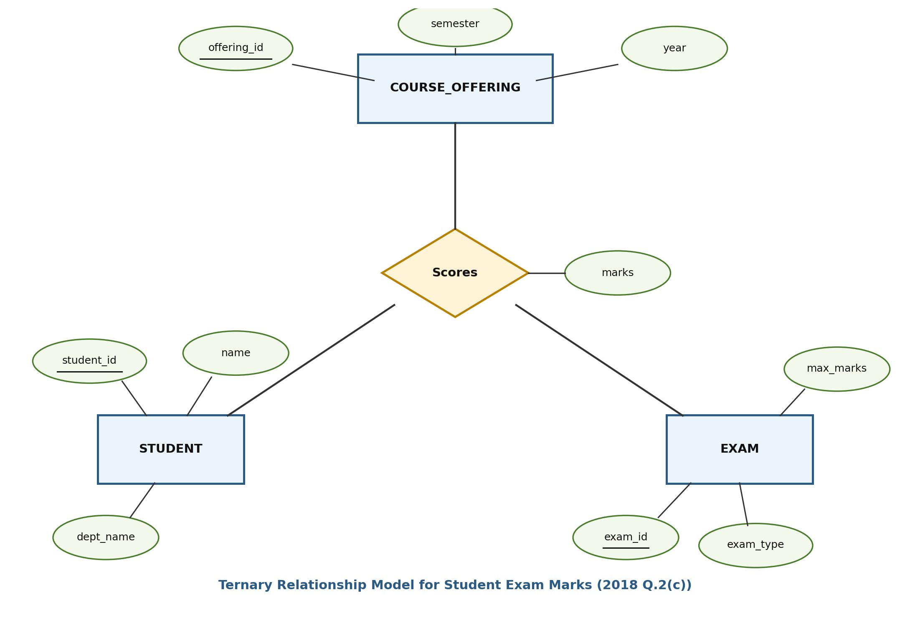

[← Prev: 2017](2017.md) | [Explanation Layer](../yearly_answers_explaination/2018.md) | [Original Question Paper](../PreviousYearQuestion/2018.md) | [Next: 2019 →](2019.md)

---

# ECE 2215: Database Systems · Semester Final 2018 · Exam-Style Answers

> [!info] Paper Metadata
> - **Examination:** B.Sc. Engineering 2nd Year Even Semester Examination, 2018
> - **Institution:** Rajshahi University of Engineering & Technology (RUET)
> - **Department:** Department of Electrical & Computer Engineering
> - **Curriculum Era:** Pre-OBE
> - **Full Marks:** 72 | **Time:** 3 Hours
> - **Instructions:** Answer any SIX questions taking THREE from each section.
> - **Question Count:** 23 sub-questions across Section A (12) and Section B (11)

---

## SECTION A

### Q.1(a) · 03 Marks

*Topic: [[Topicwise_answers_exam_style/T01_DB_Concepts_and_Architecture.md#T01.2 · File system vs DBMS|T01.2 · File system vs DBMS]] · Section A*

**Question.**
"A database is a tool for storing information efficiently"- Justify this statement.

**Answer.**

A database stores information efficiently by removing the major storage and access bottlenecks of traditional file systems:

1. **Storage Efficiency (Redundancy Control):** A database stores each fact in one place. It eliminates duplicate records across separate department files. This saves disk storage and prevents inconsistent copies.
2. **Retrieval Efficiency (Indexing and Query Optimization):** The DBMS uses tree or hash indexes. It also uses a cost-based query optimizer. This allows the system to find records in milliseconds without scanning whole files.
3. **Operational Efficiency (Concurrency and Data Independence):** Multiple users can query and update data at the same time without data corruption. Also, physical storage layouts can change without breaking existing application programs.

---

### Q.1(b) · 04 Marks

*Topic: [[Topicwise_answers_exam_style/T02_ER_and_EER_Modeling.md#T02.4 · Weak vs strong entity sets|T02.4 · Weak vs strong entity sets]] · Section A*

**Question.**
Define entity set. Explain the following with suitable example: (i) strong entity set and (ii) weak entity set.

**Answer.**

**Entity Set:**  
An entity set is a collection of entities of the same type that share the same properties or attributes (e.g., the set of all students in a university).

| Feature | Strong Entity Set | Weak Entity Set |
| :--- | :--- | :--- |
| **Primary Key** | Has sufficient attributes to form its own primary key. | Lacks a primary key of its own. Uses a partial key (discriminator). |
| **Existence Dependency** | Independent. Does not depend on another entity set. | Existence-dependent on an identifying (strong) entity set. |
| **E-R Notation** | Single rectangle. | Double rectangle. |
| **Relationship Set** | Connected via regular relationship (single diamond). | Connected via identifying relationship (double diamond). |
| **Discriminator Key** | None (uses full primary key underlined with solid line). | Has a discriminator underlined with a dashed line. |
| **Composite PK** | Its own primary key. | Formed by (Owner Primary Key + Discriminator). |
| **Example** | `course` with primary key `course_id`. | `section` with discriminator `sec_id`, `semester`, `year`. |


*Figure: Expressing Weak Entity Sets in ER Diagram (Deck 05, Slide 37)*

- **Strong Entity Set Example:** `course` has attributes `course_id` (PK), `title`, `credits`. It exists independently.
- **Weak Entity Set Example:** `section` has attributes `sec_id`, `semester`, `year`. A section number like `Sec 1` is meaningless without knowing the course. Its full primary key is `(course_id, sec_id, semester, year)`.

*Short version for 2020 Q.2(c) and 2021 Q.8(c) (2 marks):*  
State the comparison table rows (Primary Key, Dependency, Notation, Example) and omit the separate entity set definition.

---

### Q.1(c) · 05 Marks

*Topic: [[Topicwise_answers_exam_style/T02_ER_and_EER_Modeling.md#T02.5 · Design a full E-R diagram for a scenario|T02.5 · Design a full E-R diagram for a scenario]] · Section A*

**Question.**
What is E-R model? Draw an E-R diagram that includes teacher, student and course entities with following constraints: (i) Each teacher must take at least one course; (ii) A student can register one or more courses; (iii) A course may have teacher or not.

**Answer.**

**E-R Model:**  
The Entity-Relationship (E-R) model is a high-level conceptual data model. It views the real-world enterprise as a collection of basic objects called entities and relationships among these objects.

**Constraints Mapping in E-R Diagram:**
- *(i) Each teacher must take at least one course:*  
  **Total participation** of `TEACHER` in relationship `Teaches`, represented by a **double line** from `TEACHER` to `Teaches` (cardinality $1..\text{*}$).
- *(ii) A student can register one or more courses:*  
  **Total participation** of `STUDENT` in relationship `Registers`, represented by a **double line** from `STUDENT` to `Registers` (cardinality $1..\text{*}$, M:N relationship).
- *(iii) A course may have teacher or not:*  
  **Partial participation** of `COURSE` in relationship `Teaches`, represented by a **single line** from `COURSE` to `Teaches` (cardinality $0..1$ or $0..\text{*}$).


*Figure: E-R Diagram with Total and Partial Participation Constraints*

---

### Q.2(a) · 04 Marks

*Topic: [[Topicwise_answers_exam_style/T03_Relational_Model_Keys_and_Integrity.md#T03.2 · Keys: super / candidate / primary / alternate / composite / foreign|T03.2 · Keys: super / candidate / primary / alternate / composite / foreign]] · Section A*
*(Repeated question: Also asked in 2023 | Solved in T03)*

**Question.**
Explain the distinctions among the terms primary key, candidate key, and super key with proper example.

**Answer.**

A key is an attribute or set of attributes used to identify rows in a table.

**Distinctions Among Keys:**

| Key Type | Definition | Minimality | NULL Allowed |
| :--- | :--- | :--- | :--- |
| **(i) Primary Key** | The candidate key chosen by the database designer to identify tuples uniquely. | Yes (minimal) | No (never allowed) |
| **(ii) Candidate Key** | A minimal super key. Removing any attribute destroys uniqueness. | Yes (strictly minimal) | Yes (unless constrained `NOT NULL`) |
| **(iii) Super Key** | Any set of attributes that uniquely identifies a row. May contain extra attributes. | No (can have redundant attributes) | No for identifying columns |
| **(iv) Composite Key** | A key that consists of two or more attributes rather than a single attribute. | Can be minimal (candidate) or non-minimal | Depends on whether it is PK or unique |

**Relationship:**
$$
\text{Primary Key} \subseteq \text{Candidate Keys} \subseteq \text{Super Keys}
$$

**Running Example:**  
Consider relation $\text{Student}(\underline{\text{student\_id}}, \text{name}, \text{email}, \text{nid}, \text{dept\_name})$:

| student_id | name | email | nid | dept_name |
| :--- | :--- | :--- | :--- | :--- |
| 101 | Akib | akib@gmail.com | 1999123456 | ECE |
| 102 | Shuvo | shuvo@gmail.com | 2000654321 | ECE |
| 103 | Sakib | sakib@gmail.com | 2001987654 | ETE |

- **Super Key:** Any set containing a candidate key. Examples: $\{\text{student\_id}\}$, $\{\text{email}\}$, $\{\text{student\_id}, \text{name}\}$, $\{\text{email}, \text{dept\_name}\}$.
- **Candidate Key:** Minimal sets with no extra columns: $\{\text{student\_id}\}$, $\{\text{email}\}$, $\{\text{nid}\}$.
- **Primary Key:** The chosen identifier: $\{\text{student\_id}\}$.
- **Composite Key:** In table $\text{Takes}(\underline{\text{student\_id}}, \underline{\text{course\_id}}, \text{grade})$, the combination $\{\text{student\_id}, \text{course\_id}\}$ forms a composite candidate and primary key. Neither column alone identifies an enrollment record.

*Short version for 2018 Q.2(a) (4 marks):* Omit (iv) Composite key. Keep the definitions, distinctions table, and the Student running example for Super Key, Candidate Key, and Primary Key.  
*Short version for 2021 Q.2(b) (3 marks):* Same as 2018 Q.2(a). Present the 3-row distinction table and the Student relation key classification.

---

### Q.2(b) · 03 Marks

*Topic: [[Topicwise_answers_exam_style/T02_ER_and_EER_Modeling.md#T02.8 · EER: aggregation|T02.8 · EER: aggregation]] · Section A*

**Question.**
Define the concept of aggregation. Give two examples of where this concept is useful.

**Answer.**

**Definition:**  
Aggregation is an abstraction in E-R modeling through which a relationship set is treated as a higher-level abstract entity set. This allows the relationship itself to participate in further relationships with other entity sets without duplicating attributes.


*Figure: Aggregation Representation in E-R Diagram (Deck 05, Slide 59)*

**Two Examples Where Aggregation is Useful:**

1. **Student Project Evaluation:**  
   The ternary relationship `proj_guide` associates `student`, `instructor`, and `project`. To record an `evaluation` for that specific guidance assignment, treating `proj_guide` as an aggregate entity avoids creating an overlapping ternary relationship. `evaluation` links directly to the aggregate `proj_guide` through the relationship `eval_for`.

2. **Employee Project Monitoring:**  
   Employees work on projects via the relationship `Works_On`. A manager needs to monitor that specific work assignment. By aggregating `Works_On` into an entity, the `manager` can participate in a relationship `Monitors` directly with the aggregate entity `(Employee, Project)`.

*Short version for 2020 Q.3(a) (2 marks):*  
Give the definition of aggregation and describe Example 1 (`proj_guide` with `eval_for`) in 2 lines.

---

### Q.2(c) · 05 Marks

*Topic: [[Topicwise_answers_exam_style/T02_ER_and_EER_Modeling.md#T02.6 · Reduction of E-R to relational tables|T02.6 · Reduction of E-R to relational tables]] · Section A*

**Question.**
Consider a database used to record the marks that students get in different examinations of different course offerings. (i) Construct an E-R diagram that models examinations as entities, and uses a ternary relationship for the above database; (ii) Draw a relational data model for the above corresponding E-R diagram.

**Answer.**

**(i) E-R Diagram with Ternary Relationship:**
- Participating Entity Sets: `STUDENT`, `COURSE_OFFERING`, `EXAM`.
- Ternary Relationship: `Scores` connecting all three entity sets.
- Relationship Attribute: `marks` (descriptive attribute placed on `Scores`).


*Figure: Ternary Relationship Model for Student Exam Marks*

**(ii) Relational Data Model (Relational Schemas):**

**student**(**student_id**, name, dept_name)  
`PK: student_id`

**course_offering**(**offering_id**, semester, year)  
`PK: offering_id`

**exam**(**exam_id**, exam_type, max_marks)  
`PK: exam_id`

**scores**(**student_id**, **offering_id**, **exam_id**, marks)  
`PK: (student_id, offering_id, exam_id)`  
`FK: student_id references student(student_id), offering_id references course_offering(offering_id), exam_id references exam(exam_id)`

*See also:* [[#Q.3(c) · 04 Marks|Q.3(c) · 04 Marks]] (conversion of M:N relationships into relational tables).

---

### Q.3(a) · 06 Marks

*Topic: [[Topicwise_answers_exam_style/T04_Relational_Algebra_and_Calculus.md#T04.2 · Write RA queries on a given schema|T04.2 · Write RA queries on a given schema]] · Section A*

**Question.**
Consider the following insurance database, where primary keys are underlined.<br>`person (<u>driver_id</u>, name, address)`<br>`car (<u>license</u>, model, year)`<br>`accident (<u>report_number</u>, date, location)`<br>`owns (<u>driver_id</u>, license)`<br>`participated (<u>driver_id</u>, car, <u>report_number</u>, damage_amount)`<br><br>Write down the relational algebra statement for the following queries:<br>(i) Find the total number of people who owned cars that were involved in accidents in 1989.<br>(ii) Find the number of accidents in which the cars belonging to "John Smith" were involved.<br>(iii) Update the damage amounts for the car with license number "AABB2019" in the accident with report_number "AR201930" to \$3000.

**Answer.**

*Assumption: The calendar year is extracted from the `date` attribute using $\text{year}(\text{date}) = 1989$.*

**(i) Total number of people who owned cars involved in accidents in 1989:**

Join accident records from 1989 with participated cars and ownership data, then count distinct owners:

$$
T_1 \leftarrow \sigma_{\text{year}(\text{date}) = 1989}(\text{accident}) \bowtie \text{participated}
$$

$$
T_2 \leftarrow T_1 \bowtie_{\text{participated.car} = \text{owns.license}} \text{owns}
$$

$$
\boxed{\gamma_{\text{count-distinct}(\text{owns.driver\_id})}(T_2)}
$$

**(ii) Number of accidents involving cars belonging to "John Smith":**

Find cars owned by John Smith, join with accident participation records, and count distinct accidents:

$$
T_{\text{john\_cars}} \leftarrow \sigma_{\text{name} = \text{"John Smith"}}(\text{person}) \bowtie \text{owns}
$$

$$
T_{\text{accidents}} \leftarrow T_{\text{john\_cars}} \bowtie_{\text{owns.license} = \text{participated.car}} \text{participated}
$$

$$
\boxed{\gamma_{\text{count-distinct}(\text{report\_number})}(T_{\text{accidents}})}
$$

**(iii) Update damage amounts for car "AABB2019" in accident "AR201930" to \$3000:**

Define the predicate for the specific accident record and update the `damage_amount` attribute:

$$
P \equiv (\text{car} = \text{"AABB2019"} \land \text{report\_number} = \text{"AR201930"})
$$

$$
T_{\text{target}} \leftarrow \sigma_P(\text{participated})
$$

$$
T_{\text{updated}} \leftarrow \Pi_{\text{driver\_id}, \text{car}, \text{report\_number}, 3000}(T_{\text{target}})
$$

$$
T_{\text{untouched}} \leftarrow \text{participated} - T_{\text{target}}
$$

$$
\boxed{\text{participated} \leftarrow T_{\text{updated}} \cup T_{\text{untouched}}}
$$

---

### Q.3(b) · 02 Marks

*Topic: [[Topicwise_answers_exam_style/T03_Relational_Model_Keys_and_Integrity.md#T03.1 · Relation, tuple, attribute, domain; domain vs data type|T03.1 · Relation, tuple, attribute, domain; domain vs data type]] · Section A*

**Question.**
Differentiate between domain and data type.

**Answer.**

A **domain** is the logical set of all valid values that an attribute can take. It defines real-world meaning and business constraints.  
A **data type** is a physical storage format recognized by the computer hardware and DBMS. It defines memory layout and low-level bit representation.

| Comparison Point | Domain | Data Type |
| :--- | :--- | :--- |
| **Concept Level** | Conceptual and semantic level. It reflects business meaning. | Physical implementation level. It specifies storage layout. |
| **Values Allowed** | Strict set of valid real-world values (for example, letter grades `{'A', 'B', 'C', 'F'}`). | Broad machine-level value range (for example, `CHAR(2)` accepts any two characters). |
| **Constraints** | Carries logical rules and business checks (such as `age >= 18`). | Only restricts memory size and storage category (such as `INT`). |
| **Equivalence** | Two attributes with the same data type can have different domains. | Two attributes share the same data type if their storage format matches. |

*Example:* `student_age` and `monthly_salary` can both use the `INT` data type. But they belong to different domains. Adding an age to a salary makes no logical sense.

---

### Q.3(c) · 04 Marks

*Topic: [[Topicwise_answers_exam_style/T02_ER_and_EER_Modeling.md#T02.3 · Mapping cardinality and participation constraints|T02.3 · Mapping cardinality and participation constraints]] · Section A*

**Question.**
What is mapping cardinality? How a many to many relationship can be converted into table. Explain with example.

**Answer.**

**Mapping Cardinality:**  
Mapping cardinality (or cardinality ratio) expresses the number of entities to which another entity can be associated via a relationship set. For binary relationships, it must be 1:1, 1:N, N:1, or M:N.

**Conversion of a Many-to-Many (M:N) Relationship into a Table:**
1. Create a dedicated relation schema for the relationship set.
2. Include the primary key of each participating entity set as foreign keys in this new table.
3. Include any descriptive attributes associated with the relationship set.
4. The composite primary key of the new table is formed by the union of the primary keys of both participating entity sets.


*Figure: Many-to-Many Relationship Model and Reduction to Relational Table*

**Example:**
- Entity `STUDENT` with attributes `student_id` (PK), `name`.
- Entity `COURSE` with attributes `course_id` (PK), `title`.
- Relationship `Takes` (M:N) with descriptive attribute `grade`.

**Relational Schemas:**

**student**(**student_id**, name)  
`PK: student_id`

**course**(**course_id**, title)  
`PK: course_id`

**takes**(**student_id**, **course_id**, grade)  
`PK: (student_id, course_id)`  
`FK: student_id references student(student_id), course_id references course(course_id)`

---

### Q.4(a) · 04 Marks

*Topic: [[Topicwise_answers_exam_style/T08_Normalization_and_Functional_Dependencies.md#T08.1 · Why normalize: redundancy and insert/update/delete anomalies|T08.1 · Why normalize: redundancy and insert/update/delete anomalies]] · Section A*

**Question.**
What problem may occur if databases are used without normalization? Discuss with proper example.

**Answer.**

Using databases without normalization causes four major problems:

1. **Data Redundancy:** The same facts are stored repeatedly in multiple rows. This wastes disk storage and slows down query processing.
2. **Update Anomaly:** If a piece of data is stored in multiple records, modifying it requires updating all those records. If any row is missed, the database enters an inconsistent state.
3. **Insertion Anomaly:** New data cannot be recorded unless unrelated data is also present. For instance, a new course cannot be inserted without enrolling a student if the primary key includes the student ID.
4. **Deletion Anomaly:** Deleting one fact unintentionally erases another valid fact. For example, deleting the only student enrolled in a course deletes the course itself.

#### Example

Consider an unnormalized table storing student enrollment and instructor data:

| Student_ID | Student_Name | Course | Instructor | Instructor_Phone |
| :--- | :--- | :--- | :--- | :--- |
| S01 | Riad | DBMS | Dr. Hasan | 01711... |
| S01 | Riad | AI | Dr. Abdullah | 01811... |
| S02 | Zoha | DBMS | Dr. Hasan | 01711... |

- **Redundancy:** The instructor name and phone for "DBMS" are stored twice.
- **Update Anomaly:** If Dr. Hasan changes his phone number, we must update both rows. If we update row 1 but miss row 3, Dr. Hasan has two different phone numbers.
- **Insertion Anomaly:** Suppose the university introduces a new course "ML" taught by Dr. Kamal. If no student has enrolled yet, we cannot insert this course because `Student_ID` is part of the primary key and cannot be `NULL`.
- **Deletion Anomaly:** If student S01 drops the "AI" course and row 2 is deleted, all information about Dr. Abdullah and the AI course is completely lost.

*Short version for CT-03 Q.02 (3 marks):* State the four problems (data redundancy, update anomaly, insertion anomaly, deletion anomaly). Give a brief two-line explanation and one table row example showing an inconsistent update.

---

### Q.4(b) · 04 Marks

*Topic: [[Topicwise_answers_exam_style/T09_Transactions_ACID_and_Anomalies.md#T09.1 · ACID properties|T09.1 · ACID properties]] · Section A*

**Question.**
Describe the ACID-properties of database system with appropriate diagram.

**Answer.**

To maintain database integrity against failures and concurrent updates, every transaction must satisfy four **ACID** properties:

- **Atomicity:** All operations of the transaction take effect or none do.
- **Consistency:** Execution in isolation preserves all explicit constraints and implicit invariants.
- **Isolation:** Intermediate uncommitted states remain invisible to other concurrent transactions.
- **Durability:** Committed updates survive crashes permanently on stable storage.

**Illustration with \$50 Fund Transfer ($T_1$):**  
Let account $A$ have \$1000 and account $B$ have \$2000. $T_1$ moves \$50 from $A$ to $B$.

$$
\begin{aligned}
1.&\quad \text{read}(A) \\
2.&\quad A := A - 50 \\
3.&\quad \text{write}(A) \quad [A \text{ becomes } 950] \\
4.&\quad \text{read}(B) \\
5.&\quad B := B + 50 \\
6.&\quad \text{write}(B) \quad [B \text{ becomes } 2050] \\
7.&\quad \text{commit}
\end{aligned}
$$


*Figure: ACID properties in fund transfer transaction (Generated)*

**Mapping to the Diagram:**
1. **Atomicity:** If a crash occurs after step 3, account $A$ is 950 while account $B$ remains 2000. The recovery system uses log records to roll back $A$ to 1000 (\$1000).
2. **Consistency:** The invariant $A + B = 3000$ holds in the initial state and in the final state. Money is neither created nor lost.
3. **Isolation:** Between steps 3 and 6, the sum is temporarily 2950 (\$2950). Concurrency control blocks concurrent transaction $T_2$ from reading this intermediate state.
4. **Durability:** After step 7 commits, balances $A = 950$ and $B = 2050$ survive power loss.

---

### Q.4(c) · 04 Marks

*Topic: [[Topicwise_answers_exam_style/T08_Normalization_and_Functional_Dependencies.md#T08.6 · Define normalization (and its importance) & 1NF / 2NF / 3NF|T08.6 · Define normalization (and its importance) & 1NF / 2NF / 3NF]] · Section A*
*(Repeated question: Also asked in 2019 | Solved in T08)*

**Question.**
Explain the rules of 1NF and 2NF with a proper example.

**Answer.**

#### 1. What is Normalization?

**Normalization** is the process of decomposing a relation schema into smaller schemas to minimize data redundancy and prevent insertion, deletion, and update anomalies.

#### 2. First Normal Form (1NF)

**Rules:**
- Every attribute must hold only atomic (single, indivisible) values.
- No multi-valued attributes or repeating groups are permitted.
- Each column must contain values of the same domain, and each row must be uniquely identifiable.

**Example:**

*Violating 1NF:*

| Student_ID | Name | Phone |
| :--- | :--- | :--- |
| S01 | Fahim | 01711, 01822 |
| S02 | Noor | 01933 |

*Converted to 1NF (atomic rows):*

| Student_ID | Name | Phone |
| :--- | :--- | :--- |
| S01 | Fahim | 01711 |
| S01 | Fahim | 01822 |
| S02 | Noor | 01933 |

PK: `(Student_ID, Phone)`

#### 3. Second Normal Form (2NF)

**Rules:**
- The relation must be in 1NF.
- There must be **no partial dependency**. No non-prime attribute can depend on a proper subset of any candidate key.

**Example:**

Consider relation `ENROLL(StudentID, CourseID, StudentName, Grade)`:
- Candidate Key: `(StudentID, CourseID)`
- Dependencies:
  - `(StudentID, CourseID) -> Grade` (Full dependency)
  - `StudentID -> StudentName` (Partial dependency on proper subset `StudentID`)

*Converted to 2NF (decompose to remove partial dependency):*
1. `STUDENT(StudentID, StudentName)` with PK `StudentID`
2. `ENROLLMENT(StudentID, CourseID, Grade)` with PK `(StudentID, CourseID)`

*Short version for 2018 Q.4(c) (4 marks):* State the rules for 1NF (atomicity, no multi-valued attributes) with the phone number example. State the rules for 2NF (in 1NF, no partial dependencies) with the student course example.

---

## SECTION B

### Q.5(a) · 04 Marks

*Topic: [[Topicwise_answers_exam_style/T09_Transactions_ACID_and_Anomalies.md#T09.5 · Concurrency problems|T09.5 · Concurrency problems]] · Section B*

**Question.**
If concurrency-control management is not implemented properly what problem may occur? Explain with example.

**Answer.**

If concurrency-control management is not implemented properly, uncoordinated interleaving violates transaction isolation. This causes five major anomalies:

1. **Lost Update Problem:**
   - **Concept:** An update done by one transaction is overwritten and lost because another concurrent transaction writes to the same item without incorporating the first update.
   - **Schedule ($A = 500$ initially):**

| Time | Transaction $T_1$ | Transaction $T_2$ | Database State / Note |
| :--- | :--- | :--- | :--- |
| $t_1$ | $\text{read}(A)$ | | $T_1$ reads $A = 500$ |
| $t_2$ | $A := A - 50$ | | $T_1$ computes local $A = 450$ |
| $t_3$ | $\text{write}(A)$ | | Database updated to $A = 450$ |
| $t_4$ | | $\text{write}(A)$ | $T_2$ performs blind write: $A = 25$ |
| $t_5$ | $\text{commit}$ | | $T_1$ commits |
| $t_6$ | | $\text{commit}$ | Final $A = 25$ ($T_1$'s $-50$ update is lost!) |

2. **Dirty Read Problem (Temporary Update Problem):**
   - **Concept:** Occurs when a transaction reads a data item updated by another transaction that has not yet committed and later fails and rolls back.
   - **Schedule ($A = 100$ initially):**

| Time | Transaction $T_1$ | Transaction $T_2$ | Database State / Note |
| :--- | :--- | :--- | :--- |
| $t_1$ | $\text{read}(A)$ | | $T_1$ reads $A = 100$ |
| $t_2$ | $A := A + 100$ | | $T_1$ computes local $A = 200$ |
| $t_3$ | $\text{write}(A)$ | | Database $A = 200$ (uncommitted) |
| $t_4$ | | $\text{read}(A)$ | $T_2$ reads dirty value $A = 200$ |
| $t_5$ | | $A := A - 50$ | $T_2$ computes $A = 150$ |
| $t_6$ | | $\text{write}(A)$ | Database $A = 150$ |
| $t_7$ | | $\text{commit}$ | $T_2$ commits with invalid data |
| $t_8$ | $\text{abort}$ (Rollback) | | $T_1$ fails; log restores $A = 100$ |

$T_2$ based its computation on a temporary value that never officially existed, leaving the database inconsistent.

3. **Unrepeatable Read Problem:**
   - **Concept:** A transaction reads the same data item twice but obtains different values because another transaction modified and committed the item in between.
   - **Schedule ($A = 500$ initially):**

| Time | Transaction $T_1$ | Transaction $T_2$ | Database State / Note |
| :--- | :--- | :--- | :--- |
| $t_1$ | $\text{read}(A)$ | | $T_1$ reads $A = 500$ |
| $t_2$ | | $\text{read}(A)$ | $T_2$ reads $A = 500$ |
| $t_3$ | | $A := A + 100$ | $T_2$ computes local $A = 600$ |
| $t_4$ | | $\text{write}(A)$ | Database $A = 600$ |
| $t_5$ | | $\text{commit}$ | $T_2$ commits |
| $t_6$ | $\text{read}(A)$ | | $T_1$ reads $A = 600$ (reads different value!) |

4. **Phantom Read Problem:**
   - **Concept:** A transaction accesses a variable, but when it attempts to access that variable again, an error occurs because another transaction has deleted it.
   - **Schedule:**

| Time | Transaction $T_1$ | Transaction $T_2$ | Note |
| :--- | :--- | :--- | :--- |
| $t_1$ | $\text{read}(A)$ | | $T_1$ reads data item $A$ |
| $t_2$ | | $\text{read}(A)$ | $T_2$ reads data item $A$ |
| $t_3$ | $\text{delete}(A)$<br>$\text{commit}$ | | $T_1$ deletes data item $A$ and commits |
| $t_4$ | | $\text{read}(A)$ | $T_2$ attempts to read $A$ again, but item does not exist |

5. **Incorrect Summary Problem (Inconsistent Analysis):**
   - **Concept:** An aggregate transaction calculates a summary across items while another transaction updates them. The aggregate reads some items before the update and others after, yielding an inaccurate summary.
   - **Schedule ($A = 1000, B = 1000, C = 1000$ initially; $T_1$ transfers 50 from $A$ to $B$ while $T_2$ calculates average):**

| Time | Transaction $T_1$ | Transaction $T_2$ | Database / Summary State |
| :--- | :--- | :--- | :--- |
| $t_1$ | $\text{read}(A)$<br>$A := A - 50$<br>$\text{write}(A)$ | | $T_1$ updates $A$ to $950$ on disk |
| $t_2$ | | $\text{sum} := 0$<br>$\text{read}(C)$<br>$\text{sum} := \text{sum} + C$ | $T_2$ reads $C = 1000 \implies \text{sum} = 1000$ |
| $t_3$ | | $\text{read}(A)$<br>$\text{sum} := \text{sum} + A$ | $T_2$ reads updated $A = 950 \implies \text{sum} = 1950$ |
| $t_4$ | | $\text{read}(B)$<br>$\text{sum} := \text{sum} + B$ | $T_2$ reads old $B = 1000 \implies \text{sum} = 2950$ |
| $t_5$ | | $\text{avg} := \text{sum} / 3$<br>$\text{commit}$ | $T_2$ reports $\text{avg} = 2950 / 3 \approx 983.33$ |
| $t_6$ | $\text{read}(B)$<br>$B := B + 50$<br>$\text{write}(B)$<br>$\text{commit}$ | | $T_1$ adds 50 to $B$ ($B = 1050$ on disk) |

   - **Result:** True average should be $(950 + 1050 + 1000)/3 = 3000/3 = 1000$. Because $T_2$ read $A$ after the deduction but $B$ before the deposit, the calculated average is $983.33$ (an inconsistent summary).

*Variant for 2024 Q.8(a) (3 marks):*  
List the five anomalies, then provide the full schedule tables for Lost Update and Dirty Read.

*Short version for CT-04 Q.03 (4 marks):*  
Select **Lost Update** and **Dirty Read** with their definitions and schedule tables above.

---

### Q.5(b) · 04 Marks

*Topic: [[Topicwise_answers_exam_style/T11_Concurrency_Control_Protocols.md#T11.4 · Deadlock: conditions, prevention vs detection, wait-for graph, victim selection|T11.4 · Deadlock: conditions, prevention vs detection, wait-for graph, victim selection]] · Section B*

**Question.**
What do you know about deadlock in transaction management? Under what conditions it is less expensive to avoid deadlock than to allow deadlocks to occur and then to detect them?

**Answer.**

**Deadlock in Transaction Management:**  
A deadlock is an execution state where a set of transactions $\{T_1, T_2, \dots, T_n\}$ cannot proceed because each transaction waits for a lock held by another transaction in the set. A circular wait forms in the wait-for graph. The DBMS must intervene, select a victim transaction, and roll it back to break the cycle.

**When Avoidance / Prevention is Less Expensive Than Detection:**  
Deadlock avoidance or prevention is less expensive than detection and recovery under the following conditions:

1. **High Lock Contention (High Conflict Probability):**  
   When many concurrent transactions compete for the same data items, deadlocks occur frequently. Deadlock detection would repeatedly discover cycles, causing frequent, costly rollbacks. Prevention stops deadlocks before they happen.
2. **Long-Running or Resource-Intensive Transactions:**  
   Rolling back a transaction that has performed extensive computation or heavy disk writes wastes substantial system work. Prevention avoids deep rollbacks.
3. **High Overhead of Cycle Detection:**  
   Continuously maintaining wait-for graphs and running cycle-detection searches under heavy workloads adds CPU overhead. Prevention avoids this monitoring burden.

**When Detection is Less Expensive:**  
When deadlocks are **rare** (short transactions, low concurrency, mostly disjoint data items), detection is cheaper. Prevention mechanisms reduce concurrency or cause false-positive aborts. Detection allows transactions to run freely and resolves only the rare deadlock that occurs.

---

### Q.5(c) · 04 Marks

*Topic: [[Topicwise_answers_exam_style/T12_Recovery_System_and_RAID.md#T12.1 · Failure classification, precautions, recovery methods|T12.1 · Failure classification, precautions, recovery methods]] · Section B*
*(Special 2+2 Mark Question: Failures in DBMS & RAID Recovery)*

**Question.**
Discuss each type of failure that can happen in DBMS. How does RAID model help to recover a system?

**Answer.**

#### Part 1: Failure Classification in DBMS (2 Marks)

A DBMS is subject to three primary failure types:

1. **Transaction Failure:** A transaction cannot continue due to internal logical errors (invalid inputs, overflow) or system-induced conditions (deadlocks).
2. **System Crash:** Hardware faults or power cuts wipe volatile RAM. Disk storage remains intact under the fail-stop assumption.
3. **Disk Failure:** Head crashes or unreadable physical sectors destroy non-volatile disk blocks.

#### Part 2: RAID Recovery Mechanisms (2 Marks)

The RAID (Redundant Array of Independent Disks) model protects the database system from disk and media failures in three ways:

1. **Immediate Failover via Mirroring (RAID 1):** If a primary disk fails, the system instantly directs read and write requests to the mirror drive. The database continues running with zero downtime and zero data loss.
2. **On-the-Fly Parity Reconstruction (RAID 5 / RAID 6):** When a disk fails, the RAID controller reconstructs lost data blocks on the fly using a bitwise XOR of the surviving data and parity blocks.
3. **Online Rebuild with Hot Spares:** The controller copies reconstructed data onto a standby spare disk in the background. The repair completes without taking the database offline.

---

### Q.6(a) · 04 Marks

*Topic: [[Topicwise_answers_exam_style/T09_Transactions_ACID_and_Anomalies.md#T09.4 · Concurrent execution advantages and schedules|T09.4 · Concurrent execution advantages and schedules]] · Section B*

**Question.**
Define transaction and schedule. What is the difference between serial schedule and serializable schedule?

**Answer.**

**Definitions:**
- **Transaction:** A logical unit of program execution that accesses and possibly updates various data items in a database.
- **Schedule:** A sequence of instructions that specifies the chronological order in which instructions of concurrent transactions are executed. A schedule must contain all operations of its constituent transactions and preserve the internal operation order within each transaction.

**Difference Between Serial Schedule and Serializable Schedule:**

| Feature | Serial Schedule | Serializable Schedule |
| :--- | :-- | :-- |
| **Instruction Interleaving** | No interleaving. Transactions run strictly one after another; each finishes before the next begins. | Instructions of multiple transactions are interleaved concurrently. |
| **System Concurrency** | Zero concurrency. Hardware sits idle during disk I/O waits. | High concurrency. CPU and disk operate in parallel across transactions. |
| **Throughput & Latency** | Low throughput. Short transactions suffer long queue delays. | High throughput. Short transactions complete with low average response time. |
| **Correctness** | Always correct and consistent by default. | Correct only if it produces the same final state as some serial execution. |
| **Verification** | No verification needed. | Requires testing (e.g., precedence graph cycle check for conflict serializability). |

---

### Q.6(b) · 04 Marks

*Topic: [[Topicwise_answers_exam_style/T11_Concurrency_Control_Protocols.md#T11.6 · Timestamp ordering: R-TS/W-TS rules, trace a schedule; rolled-back transaction gets a NEW timestamp|T11.6 · Timestamp ordering: R-TS/W-TS rules, trace a schedule; rolled-back transaction gets a NEW timestamp]] · Section B*

**Question.**
When a transaction is rolled back under timestamp ordering and it is assigned a new timestamp? Why can it not simply keep its old timestamp?

**Answer.**

**When a Transaction is Rolled Back Under Timestamp Ordering:**  
Under the Timestamp Ordering (TSO) protocol, a transaction $T_i$ is rolled back whenever it attempts an operation that conflicts with a younger transaction:

1. **On Read:** $T_i$ issues $\text{read}(Q)$, but $\text{TS}(T_i) < \text{W-timestamp}(Q)$.  
   $T_i$ is attempting to read an older value of $Q$ that has already been overwritten by a younger transaction. The read is rejected and $T_i$ is rolled back.
2. **On Write:**
   - $T_i$ issues $\text{write}(Q)$, but $\text{TS}(T_i) < \text{R-timestamp}(Q)$.  
     The value of $Q$ that $T_i$ is producing was needed previously by a younger transaction, which already read an older value. The write is rejected and $T_i$ is rolled back.
   - $T_i$ issues $\text{write}(Q)$, but $\text{TS}(T_i) < \text{W-timestamp}(Q)$.  
     $T_i$ is attempting to overwrite $Q$ with an obsolete value after a younger transaction has already written it. The write is rejected and $T_i$ is rolled back.

**Assigning a New Timestamp:**  
When $T_i$ is rolled back, the system aborts it and restarts it. Upon restarting, the system assigns $T_i$ a **new, larger timestamp** using the current system clock or logical counter.

**Why It Cannot Keep Its Old Timestamp:**

1. **Avoids Immediate Re-abort:**  
   If $T_i$ kept its old timestamp, $\text{TS}(T_i)$ would remain smaller than the $\text{R-timestamp}$ or $\text{W-timestamp}$ values already written by the younger transactions. On restarting, when $T_i$ reaches the same step, the exact same timestamp check would fail again.
2. **Prevents Starvation (Livelock):**  
   Keeping the old timestamp traps the transaction in an endless abort and restart loop. It would never finish. A new timestamp breaks this cycle.
3. **Correct Serial Order:**  
   A new timestamp assigns the transaction a fresh position in the logical serialization order, placing it after the conflicting transactions and allowing its operations to execute successfully.

*Short version for 2024 Q.8(b) (3 marks):* Give the read and write rollback conditions concisely. Then explain in 2 points why the old timestamp causes repeated aborts and starvation.

---

### Q.6(c) · 04 Marks

*Topic: [[Topicwise_answers_exam_style/T10_Serializability.md#T10.3 · Precedence-graph test → cycle → serial order(s)|T10.3 · Precedence-graph test → cycle → serial order(s)]] · Section B*

**Question.**
Consider the following schedule.<br><br><table border="1" cellpadding="4" style="border-collapse: collapse; margin-top: 6px; margin-bottom: 6px;"><thead><tr><th style="padding: 4px 20px; text-align: center;">T<sub>1</sub></th><th style="padding: 4px 20px; text-align: center;">T<sub>2</sub></th></tr></thead><tbody><tr><td style="padding: 3px 12px;">read(A);</td><td></td></tr><tr><td style="padding: 3px 12px;">A:=A+10;</td><td></td></tr><tr><td></td><td style="padding: 3px 12px;">read(A);</td></tr><tr><td></td><td style="padding: 3px 12px;">A:=A-100;</td></tr><tr><td></td><td style="padding: 3px 12px;">write(A);</td></tr><tr><td></td><td style="padding: 3px 12px;">read(B);</td></tr><tr><td style="padding: 3px 12px;">write(A);</td><td></td></tr><tr><td style="padding: 3px 12px;">read(B);</td><td></td></tr><tr><td style="padding: 3px 12px;">B:=B-10;</td><td></td></tr><tr><td style="padding: 3px 12px;">write(B)</td><td></td></tr><tr><td></td><td style="padding: 3px 12px;">B:=B+100;</td></tr><tr><td></td><td style="padding: 3px 12px;">write(B);</td></tr></tbody></table><br>Determine whether the schedule is conflict serializable or not?

**Answer.**

We extract the sequence of database operations in chronological order:
1. $T_1: \text{read}(A)$
2. $T_2: \text{read}(A)$
3. $T_2: \text{write}(A)$
4. $T_2: \text{read}(B)$
5. $T_1: \text{write}(A)$
6. $T_1: \text{read}(B)$
7. $T_1: \text{write}(B)$
8. $T_2: \text{write}(B)$

#### Conflicting Pairs Analysis

A conflict occurs when two instructions from different transactions access the same item and at least one is a write:
- **On item $A$:**
  - $T_1: \text{read}(A)$ (step 1) occurs before $T_2: \text{write}(A)$ (step 3) $\implies$ directed edge $T_1 \to T_2$.
  - $T_2: \text{read}(A)$ (step 2) occurs before $T_1: \text{write}(A)$ (step 5) $\implies$ directed edge $T_2 \to T_1$.
  - $T_2: \text{write}(A)$ (step 3) occurs before $T_1: \text{write}(A)$ (step 5) $\implies$ directed edge $T_2 \to T_1$.
- **On item $B$:**
  - $T_2: \text{read}(B)$ (step 4) occurs before $T_1: \text{write}(B)$ (step 7) $\implies$ directed edge $T_2 \to T_1$.
  - $T_1: \text{read}(B)$ (step 6) occurs before $T_2: \text{write}(B)$ (step 8) $\implies$ directed edge $T_1 \to T_2$.
  - $T_1: \text{write}(B)$ (step 7) occurs before $T_2: \text{write}(B)$ (step 8) $\implies$ directed edge $T_1 \to T_2$.

#### Precedence Graph


The graph contains directed edges $T_1 \to T_2$ and $T_2 \to T_1$. This creates a cycle:
$$
T_1 \longleftrightarrow T_2
$$

**Result:** Because the precedence graph contains a cycle, the schedule is **NOT conflict serializable**.

---

### Q.7(a) · 04 Marks

*Topic: [[Topicwise_answers_exam_style/T05_SQL_DDL_DML_Aggregates_Subqueries.md#T05.2 · DDL + DML warm-up: CREATE, INSERT, ALTER ... ADD, UPDATE, DELETE, rename, filter|T05.2 · DDL + DML warm-up: CREATE, INSERT, ALTER ... ADD, UPDATE, DELETE, rename, filter]] · Section B*

**Question.**
Write down the SQL queries for following operations.<br>(i) Create table for student (<u>roll</u>, Name, <u>Dept</u>)<br>(ii) Insert one example entry for student table<br>(iii) Modify the student table to student(<u>roll</u>, Name, dept, session)<br>(iv) Show the roll and name of the students of ECE department only.

**Answer.**

*(i) Create student table:*

```sql
CREATE TABLE student (
    roll INT,
    name VARCHAR(50),
    dept VARCHAR(20),
    PRIMARY KEY (roll, dept)
);
```

*(ii) Insert one example entry:*

```sql
INSERT INTO student (roll, name, dept)
VALUES (1810001, 'Rahim', 'ECE');
```

*(iii) Modify student table to add session:*

```sql
ALTER TABLE student
ADD session VARCHAR(10);
```

*(iv) Show roll and name of students from ECE:*

```sql
SELECT roll, name
FROM student
WHERE dept = 'ECE';
```

*Variant for 2024 Q.4(b) (4 marks):* The identical queries answer parts (i) through (iv).

---

### Q.7(b) · 08 Marks

*Topic: [[Topicwise_answers_exam_style/T05_SQL_DDL_DML_Aggregates_Subqueries.md#T05.5 · Aggregation queries: GROUP BY + HAVING, CGPA, extremes without LIMIT|T05.5 · Aggregation queries: GROUP BY + HAVING, CGPA, extremes without LIMIT]] · Section B*

**Question.**
Consider the following data tables:<br><br>`Product (p_id, p_name, quantity, unit_price)`<br>`Customer (c_id, c_name, contact)`<br>`Sales (c_id, p_id, quantity)`<br><br>Write down SQL expressions for following queries.<br>(i) Show the information of those customers who have bought more than five different products.<br>(ii) Show the information of those products that were sold more than ten pieces.<br>(iii) Show the information of the product with maximum sale (maximum sold amount of money or bought by the maximum customer).<br>(iv) Show the product id and corresponding remaining quantity of that product.

**Answer.**

*(i) Customers who bought more than five different products:*

```sql
SELECT c.c_id, c.c_name, c.contact
FROM Customer c
JOIN Sales s ON c.c_id = s.c_id
GROUP BY c.c_id, c.c_name, c.contact
HAVING COUNT(DISTINCT s.p_id) > 5;
```

*(ii) Products sold more than ten pieces:*

```sql
SELECT p.p_id, p.p_name, p.quantity, p.unit_price
FROM Product p
JOIN Sales s ON p.p_id = s.p_id
GROUP BY p.p_id, p.p_name, p.quantity, p.unit_price
HAVING SUM(s.quantity) > 10;
```

*(iii) Product with maximum sale:*

*Primary interpretation: Maximum sold amount of money ($\sum (\text{quantity} \times \text{unit\_price})$):*

```sql
SELECT p.p_id, p.p_name, p.quantity, p.unit_price,
       SUM(s.quantity * p.unit_price) AS total_sales_value
FROM Product p
JOIN Sales s ON p.p_id = s.p_id
GROUP BY p.p_id, p.p_name, p.quantity, p.unit_price
ORDER BY total_sales_value DESC
LIMIT 1;
```

*(Alternative subquery without `LIMIT` to return all tied products on top revenue):*

```sql
SELECT p.p_id, p.p_name, p.quantity, p.unit_price
FROM Product p
JOIN Sales s ON p.p_id = s.p_id
GROUP BY p.p_id, p.p_name, p.quantity, p.unit_price
HAVING SUM(s.quantity * p.unit_price) = (
    SELECT MAX(prod_rev)
    FROM (
        SELECT SUM(s2.quantity * p2.unit_price) AS prod_rev
        FROM Sales s2
        JOIN Product p2 ON s2.p_id = p2.p_id
        GROUP BY s2.p_id
    ) AS sub
);
```

*Alternative interpretation: Bought by the maximum number of distinct customers:*

```sql
SELECT p.p_id, p.p_name, p.quantity, p.unit_price,
       COUNT(DISTINCT s.c_id) AS customer_count
FROM Product p
JOIN Sales s ON p.p_id = s.p_id
GROUP BY p.p_id, p.p_name, p.quantity, p.unit_price
ORDER BY customer_count DESC
LIMIT 1;
```

*(iv) Product ID and corresponding remaining quantity:*

```sql
SELECT p.p_id,
       p.quantity - COALESCE(SUM(s.quantity), 0) AS remaining_quantity
FROM Product p
LEFT JOIN Sales s ON p.p_id = s.p_id
GROUP BY p.p_id, p.quantity;
```

---

### Q.8(a) · 05 Marks

*Topic: [[Topicwise_answers_exam_style/T07_Triggers_and_Stored_Procedures.md#T07.1 · What a trigger is, its purposes, and its syntax|T07.1 · What a trigger is, its purposes, and its syntax]] · Section B*

**Question.**
What is triggering? What are the purposes of using trigger? Write the syntax for creating trigger?

**Answer.**

#### 1. What is Triggering?

A **trigger** is a stored SQL block. The DBMS executes it automatically when a modification occurs on a table or view.

The automatic detection of the event and execution of the trigger action is called **triggering**.

Triggers follow the **ECA (Event-Condition-Action) model**:
- **Event:** A database modification (`INSERT`, `UPDATE`, or `DELETE`) that activates the trigger.
- **Condition:** An optional boolean test checked when the event occurs.
- **Action:** The SQL statements that run automatically if the condition is satisfied.

#### 2. Purposes of Using Triggers

1. **Enforcing Complex Integrity Constraints:** Triggers enforce business rules across multiple tables that standard table constraints (`CHECK`, `FOREIGN KEY`) cannot express.
2. **Auditing and Security:** Triggers automatically log sensitive operations into audit tables with user identity, timestamp, and before-and-after values.
3. **Maintaining Derived and Summary Data:** Triggers keep summary values synchronized across tables. For example, they update a student credit total or warehouse stock automatically.
4. **Automating Workflows and Alerts:** Triggers generate reorders when inventory falls below minimum levels, create notifications, or clean up related dependent records.

#### 3. Syntax for Creating a Trigger (MySQL 8)

**General Template:**

```sql
DELIMITER //

CREATE TRIGGER trigger_name
{BEFORE | AFTER} {INSERT | UPDATE | DELETE}
ON table_name
FOR EACH ROW
BEGIN
    -- Trigger body statements
    -- Access row values via OLD.column_name and NEW.column_name
    -- Terminate and rollback on error using SIGNAL
END //

DELIMITER ;
```

- `BEFORE | AFTER`: Specifies whether the action executes before modifying table data or after the modification completes.
- `INSERT | UPDATE | DELETE`: Identifies the DML event that activates the trigger.
- `ON table_name`: Specifies the target table.
- `FOR EACH ROW`: Defines a row-level trigger that runs once for each affected row.
- `OLD` and `NEW`: Transition qualifiers that refer to column values before and after the change.

**Example (Enforcing non-negative stock before insert):**

```sql
DELIMITER //

CREATE TRIGGER trg_check_product_stock
BEFORE INSERT ON Products
FOR EACH ROW
BEGIN
    IF NEW.stock < 0 THEN
        SIGNAL SQLSTATE '45000'
            SET MESSAGE_TEXT = 'Error: Stock level cannot be negative';
    END IF;
END //

DELIMITER ;
```

*Variant for 2020 Q.8(a) (4 marks):* The same definition, purposes, syntax template, and example answer the question directly.

---

### Q.8(b) · 04 Marks

*Topic: [[Topicwise_answers_exam_style/T12_Recovery_System_and_RAID.md#T12.2 · Role of the recovery manager|T12.2 · Role of the recovery manager]] · Section B*

**Question.**
Suppose that there is a database system that never failed, is a recovery manager required for this system? Justify your answer.

**Answer.**

**Yes, a recovery manager is still required.**

Even in a hypothetical system where the hardware and operating system never crash, a recovery manager is essential for the following reasons:

1. **Transactions Still Abort:** A failure-free hardware platform prevents system crashes and disk failures. But individual transactions still fail and must be rolled back.
2. **Causes of Transaction Abort:**
   - *Logical Errors:* A transaction may encounter bad user input, division by zero, arithmetic overflow, or missing data.
   - *Explicit User Aborts:* An application or user may voluntarily cancel an operation (such as issuing a `ROLLBACK` when funds are insufficient).
   - *Integrity Violations:* A transaction may violate primary key, foreign key, or check constraints, forcing an abort.
   - *Deadlock Resolution:* The concurrency controller may select a transaction as a deadlock victim and abort it to break the cycle.
3. **Preserving Atomicity:** The ACID property of **Atomicity** requires that all changes of an aborted transaction be undone. The database must return to its pre-transaction state.
4. **Execution of Rollback:** The recovery manager reads undo log records, restores old data values in the buffer and disk, and releases locks. Without a recovery manager, aborted transactions would leave partial, corrupted updates in the database.

---

### Q.8(c) · 03 Marks

*Topic: [[Topicwise_answers_exam_style/T12_Recovery_System_and_RAID.md#T12.4 · RAID levels, comparison, and recovery role|T12.4 · RAID levels, comparison, and recovery role]] · Section B*

**Question.**
Describe the different RAID levels.

**Answer.**


*Figure 12.4: RAID levels (Textbook Ch. 12, Figure 12.4)*

RAID organizes multiple physical disks to provide performance and fault tolerance. The primary levels are:

- **RAID 0 (Block Striping, No Redundancy):** Blocks are striped across multiple disks. It offers high read and write throughput, but any single drive failure causes complete data loss.
- **RAID 1 (Mirrored Disks):** Every disk has an identical duplicate disk. It provides 100% data redundancy and fast recovery, but requires double the storage capacity.
- **RAID 5 (Block-Interleaved Distributed Parity):** Data and parity blocks are distributed across all $N + 1$ disks. It survives any single disk failure with low storage overhead ($1 / (N+1)$).
- **RAID 6 (P + Q Redundancy):** Uses two independent error-correcting blocks (P and Q) across all disks. It tolerates up to two simultaneous disk failures.

*Summary of Other Levels:*
- **RAID 2:** Bit-level striping with Hamming error-correcting codes (obsolete).
- **RAID 3:** Byte-level striping with a single dedicated parity disk (obsolete).
- **RAID 4:** Block-level striping with a single dedicated parity disk (suffers from parity disk write bottlenecks).
- **RAID 1+0 (RAID 10):** Combines mirroring and striping to deliver high fault tolerance and fast I/O.

---

[← Prev: 2017](2017.md) | [Explanation Layer](../yearly_answers_explaination/2018.md) | [Original Question Paper](../PreviousYearQuestion/2018.md) | [Next: 2019 →](2019.md)
