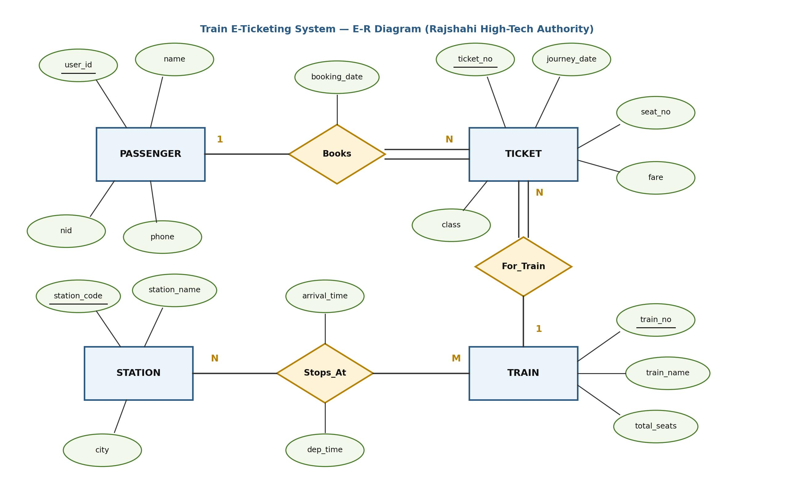

[← Prev: 2018](2018.md) | [Explanation Layer](../yearly_answers_explaination/2019.md) | [Original Question Paper](../PreviousYearQuestion/2019.md) | [Next: 2020 →](2020.md)

---

# ECE 2215: Database Systems · Semester Final 2019 · Exam-Style Answers

> [!info] Paper Metadata
> - **Examination:** B.Sc. Engineering 2nd Year Even Semester Examination, 2019
> - **Institution:** Rajshahi University of Engineering & Technology (RUET)
> - **Department:** Department of Electrical & Computer Engineering
> - **Curriculum Era:** Pre-OBE
> - **Full Marks:** 72 | **Time:** 3 Hours
> - **Instructions:** Answer any SIX questions taking THREE from each section.
> - **Question Count:** 19 sub-questions across Section A (10) and Section B (9)

---

## SECTION A

### Q.1(a) · 03 Marks

*Topic: [[Topicwise_answers_exam_style/T01_DB_Concepts_and_Architecture.md#T01.2 · File system vs DBMS|T01.2 · File system vs DBMS]] · Section A*

**Question.**
Why DBMS is important? What are its advantages?

**Answer.**

**Importance of DBMS:**  
A DBMS provides centralized, secure, and coordinated control over an organization's data. It replaces scattered operating system files and ensures that data remains reliable, shared, and recoverable during hardware or software crashes.

**Advantages of DBMS over File Processing Systems:**
1. **Control of Data Redundancy and Inconsistency:** Centralized data storage minimizes duplicate entries and prevents conflicting records.
2. **Data Independence:** Physical storage structures can change without requiring updates to application programs.
3. **Fast and Convenient Data Access:** Declarative query languages (like SQL) retrieve data without custom low-level programming.
4. **Transaction Management (ACID Properties):** Guarantees atomicity during crashes and protects data integrity during concurrent multi-user access.
5. **Data Security and Integrity Constraints:** Restricts unauthorized access through user privileges and enforces business rules automatically.

*Variant for 2023 Q.1(b) (3 marks):* Focus directly on the 5 advantages over file processing systems; omit the general importance statement.

---

### Q.1(b) · 03 Marks

*Topic: [[Topicwise_answers_exam_style/T02_ER_and_EER_Modeling.md#T02.4 · Weak vs strong entity sets|T02.4 · Weak vs strong entity sets]] · Section A*

**Question.**
What are entity and entity set? How is a weak entity set handled in DBMS? Explain.

**Answer.**

- **Entity:** An object that exists in the real world and is distinguishable from other objects.
- **Entity Set:** A collection of entities of the same type sharing the same attributes.

**Handling a Weak Entity Set in DBMS:**
1. **Primary Key Formation:** The DBMS cannot identify weak entity tuples by local attributes alone. It combines the primary key of the identifying strong entity with the weak entity's discriminator (partial key).
   $$
   \text{PK}(\text{Weak}) = \text{PK}(\text{Identifying Entity}) \cup \text{Discriminator}
   $$
2. **Table Schema Reduction:** A dedicated table is created for the weak entity. It includes the identifying entity's primary key as a foreign key along with all weak entity attributes. The identifying relationship does not need a separate table.
3. **Foreign Key Integrity with Cascade:** The identifying foreign key is declared with `ON DELETE CASCADE`. If the owner entity tuple is deleted, all dependent weak entity tuples are automatically removed.

---

### Q.1(c) · 06 Marks

*Topic: [[Topicwise_answers_exam_style/T02_ER_and_EER_Modeling.md#T02.5 · Design a full E-R diagram for a scenario|T02.5 · Design a full E-R diagram for a scenario]] · Section A*

**Question.**
Suppose you are recruited as a database specialist by the Rajshahi High-Tech authority to help them design a database for train e-ticketing system efficiently. Now think the regular features and draw an E-R diagram accordingly.

**Answer.**

**System Requirements & Entities:**
1. **PASSENGER:** Stores account details. Attributes: `user_id` (PK), `name`, `nid`, `phone`.
2. **TICKET:** Represents booked travel tickets. Attributes: `ticket_no` (PK), `journey_date`, `seat_no`, `fare`, `class`.
3. **TRAIN:** Represents trains. Attributes: `train_no` (PK), `train_name`, `total_seats`.
4. **STATION:** Represents railway stops. Attributes: `station_code` (PK), `station_name`, `city`.

**Relationships:**
- `Books` (1:N): A passenger books one or more tickets. Each ticket is booked by one passenger (descriptive attribute: `booking_date`).
- `For_Train` (N:1): Many tickets belong to a specific train. Each ticket is assigned to exactly one train.
- `Stops_At` (M:N): Trains stop at multiple stations, and stations service multiple trains. Descriptive attributes: `arrival_time`, `dep_time`.


*Figure: Train E-Ticketing System E-R Diagram*

---

### Q.2(a) · 04 Marks

*Topic: [[Topicwise_answers_exam_style/T01_DB_Concepts_and_Architecture.md#T01.4 · Data abstraction levels, schemas and instances|T01.4 · Data abstraction levels, schemas and instances]] · Section A*
*(Repeated question: Also asked in 2017 | Solved in T01)*

**Question.**
What is data abstraction? Describe the different level of data abstraction.

**Answer.**

**Purpose of Data Abstraction:**  
A database contains complex data structures, storage blocks, and indexing schemes. Most end users and programmers are not trained in low-level storage details. Data abstraction hides this physical complexity. It simplifies user interactions, enforces security, and enables physical data independence.

**Levels of Data Abstraction:**
1. **Physical level:** The lowest abstraction level. It describes *how* records are stored on secondary storage media (such as byte offsets, data blocks, B+ trees, and hashing schemes).
2. **Logical level:** The intermediate level. It describes *what* data is stored in the database and the relationships among those data. Programmers and administrators work at this level using schemas.
   Example record:
   ```text
   type instructor = record
       ID : string;
       name : string;
       dept_name : string;
       salary : integer;
   end;
   ```
3. **View level:** The highest abstraction level. It describes only the subset of the database relevant to a specific user group. It hides other data and complex structures for ease of use and security (for example, hiding instructor salaries from students).


*Figure: Three levels of data abstraction (Deck 01, Slide 14)*

*Variant for 2019 Q.2(a) (4 marks):* Define data abstraction, describe the three levels, and include the diagram.  
*Variant for CT-01 Q.01 (5 marks):* State the definition, explain the three levels, show the record example, and draw the diagram.

---

### Q.2(b) · 08 Marks

*Topic: [[Topicwise_answers_exam_style/T04_Relational_Algebra_and_Calculus.md#T04.2 · Write RA queries on a given schema|T04.2 · Write RA queries on a given schema]] · Section A*

**Question.**
Consider the following relational database.<br>`Patient (Patient_ID, Patient_name, Mobile)`<br>`History (Patient_ID, Symptom, Date)`<br>`Report (Parient_ID, Corona_center, Test_result)`<br><br>Now write down the relational algebra (Not SQL) to find out the following queries.<br>(i) Find the names of those patients who have fever symptom.<br>(ii) Consider that if any patient has high-fever symptom he/she will be suspected as corona patient. Find out such maximum number of patients in a date.<br>(iii) Find out the mobile numbers of those patients who have provided samples in Rajshahi corona center and their results have become positive.<br>(iv) Find out the name of those patients who have high fever symptom but test result have become negative.<br><br>*(Note: Printed as "Parient_ID" in Report schema in original question paper; refers to "Patient_ID")*

**Answer.**

*Assumption: In relation `Report`, `Parient_ID` is a typographical misprint for `Patient_ID`.*

**(i) Names of patients who have fever symptom:**

Join patients with their history records filtered for fever, then project the patient names:

$$
\boxed{\Pi_{\text{Patient\_name}}(\text{Patient} \bowtie \sigma_{\text{Symptom} = \text{"fever"}}(\text{History}))}
$$

**(ii) Maximum number of suspected patients (high-fever symptom) on a date:**

Filter records for "high-fever", count patients per date, and take the maximum:

$$
T_1 \leftarrow \sigma_{\text{Symptom} = \text{"high-fever"}}(\text{History})
$$

$$
T_{\text{daily}} \leftarrow {}_{\text{Date}}\gamma_{\text{count}(\text{Patient\_ID}) \ \text{as} \ \text{patient\_count}}(T_1)
$$

$$
\boxed{\gamma_{\text{max}(\text{patient\_count})}(T_{\text{daily}})}
$$

**(iii) Mobile numbers of patients tested in Rajshahi corona center with positive results:**

Filter reports for Rajshahi center and positive results, join with Patient, and project mobile numbers:

$$
\boxed{\Pi_{\text{Mobile}}(\text{Patient} \bowtie \sigma_{\text{Corona\_center} = \text{"Rajshahi"} \land \text{Test\_result} = \text{"positive"}}(\text{Report}))}
$$

**(iv) Names of patients who have high fever symptom but negative test result:**

Find patients who have high fever and whose test result is negative:

$$
T_{\text{high}} \leftarrow \Pi_{\text{Patient\_ID}}(\sigma_{\text{Symptom} = \text{"high-fever"}}(\text{History}))
$$

$$
T_{\text{neg}} \leftarrow \Pi_{\text{Patient\_ID}}(\sigma_{\text{Test\_result} = \text{"negative"}}(\text{Report}))
$$

$$
\boxed{\Pi_{\text{Patient\_name}}(\text{Patient} \bowtie (T_{\text{high}} \cap T_{\text{neg}}))}
$$

*Short version for 2024 Q.5(a) (Sec B, 4 marks, CO2):*  
Answer parts (i) and (ii) only. Part (i) matches part (i) above. Part (ii) targets Rangpur instead of Rajshahi:

$$
\Pi_{\text{Mobile}}(\text{Patient} \bowtie \sigma_{\text{Corona\_center} = \text{"Rangpur"} \land \text{Test\_result} = \text{"positive"}}(\text{Report}))
$$

---

### Q.3(a) · 04 Marks

*Topic: [[Topicwise_answers_exam_style/T08_Normalization_and_Functional_Dependencies.md#T08.6 · Define normalization (and its importance) & 1NF / 2NF / 3NF|T08.6 · Define normalization (and its importance) & 1NF / 2NF / 3NF]] · Section A*

**Question.**
What is normalization? Discuss 1NF and 2NF.

**Answer.**

#### 1. What is Normalization?

**Normalization** is the process of decomposing a relation schema into smaller schemas to minimize data redundancy and prevent insertion, deletion, and update anomalies.

#### 2. First Normal Form (1NF)

**Rules:**
- Every attribute must hold only atomic (single, indivisible) values.
- No multi-valued attributes or repeating groups are permitted.
- Each column must contain values of the same domain, and each row must be uniquely identifiable.

**Example:**

*Violating 1NF:*

| Student_ID | Name | Phone |
| :--- | :--- | :--- |
| S01 | Fahim | 01711, 01822 |
| S02 | Noor | 01933 |

*Converted to 1NF (atomic rows):*

| Student_ID | Name | Phone |
| :--- | :--- | :--- |
| S01 | Fahim | 01711 |
| S01 | Fahim | 01822 |
| S02 | Noor | 01933 |

PK: `(Student_ID, Phone)`

#### 3. Second Normal Form (2NF)

**Rules:**
- The relation must be in 1NF.
- There must be **no partial dependency**. No non-prime attribute can depend on a proper subset of any candidate key.

**Example:**

Consider relation `ENROLL(StudentID, CourseID, StudentName, Grade)`:
- Candidate Key: `(StudentID, CourseID)`
- Dependencies:
  - `(StudentID, CourseID) -> Grade` (Full dependency)
  - `StudentID -> StudentName` (Partial dependency on proper subset `StudentID`)

*Converted to 2NF (decompose to remove partial dependency):*
1. `STUDENT(StudentID, StudentName)` with PK `StudentID`
2. `ENROLLMENT(StudentID, CourseID, Grade)` with PK `(StudentID, CourseID)`

*Short version for 2018 Q.4(c) (4 marks):* State the rules for 1NF (atomicity, no multi-valued attributes) with the phone number example. State the rules for 2NF (in 1NF, no partial dependencies) with the student course example.

---

### Q.3(b) · 03 Marks

*Topic: [[Topicwise_answers_exam_style/T09_Transactions_ACID_and_Anomalies.md#T09.2 · Consistency property alone, with example|T09.2 · Consistency property alone, with example]] · Section A*

**Question.**
Explain the consistency property of a database system with a proper example.

**Answer.**

**Definition:**  
The **consistency** property requires that executing a transaction in isolation preserves the consistency of the database. If the database starts in a valid state that satisfies all integrity rules, it must end in a valid state after the transaction completes.

**Categories of Consistency Constraints:**
1. **Explicit Constraints:** Rules enforced automatically by the DBMS, including primary keys, foreign keys, data types, and `CHECK` constraints (such as `balance >= 0`).
2. **Implicit Invariants:** Business rules that cannot easily be expressed in DDL, such as preserving total assets across account transfers.

**Example (Bank Transfer):**  
Let account $A$ have \$1000 and account $B$ have \$2000. The consistency invariant requires total funds to remain constant:

$$
A + B = \$1000 + \$2000 = \$3000
$$

Transaction $T_1$ transfers \$50 from $A$ to $B$:
1. $\text{read}(A)$
2. $A := A - 50$
3. $\text{write}(A) \quad [A = \$950]$
4. $\text{read}(B)$
5. $B := B + 50$
6. $\text{write}(B) \quad [B = \$2050]$

- **Temporary Inconsistency During Execution:** After step 3, $A = \$950$ and $B = \$2000$. The sum is $\$950 + \$2000 = \$2950$. The database enters a temporarily inconsistent state.
- **Restored Consistency at End:** After step 6 completes, $A = \$950$ and $B = \$2050$. The sum is $\$950 + \$2050 = \$3000$. Database consistency is restored.
- **Responsibility:** Ensuring transaction logic is correct is primarily the responsibility of the **application programmer**.

---

### Q.3(c) · 05 Marks

*Topic: [[Topicwise_answers_exam_style/T06_Joins_and_Views.md#T06.1 · Types of joins|T06.1 · Types of joins]] · Section A*

**Question.**
What is joining? Discuss each type of joining between two data tables with example.

**Answer.**

**Definition of Joining:**  
A join operation takes two relations and combines them into one relation based on a matching condition. It acts as a Cartesian product followed by a selection predicate and projection.


*Figure: Join types and join conditions (Deck 04, Slide 4)*

**Example Base Tables:**

Table `course`:

| course_id | title | dept_name | credits |
| :--- | :--- | :--- | :--- |
| BIO-301 | Genetics | Biology | 4 |
| CS-190 | Game Design | Comp. Sci. | 4 |
| CS-315 | Robotics | Comp. Sci. | 3 |

Table `prereq`:

| course_id | prereq_id |
| :--- | :--- |
| BIO-301 | BIO-101 |
| CS-190 | CS-101 |
| CS-347 | CS-101 |

---

#### 1. Inner Join (and Natural Join)
Retains only tuples that satisfy the join condition in both tables. Unmatched rows are dropped.

```sql
SELECT course.course_id, title, dept_name, prereq_id
FROM course
INNER JOIN prereq ON course.course_id = prereq.course_id;
```

Relational algebra:
$$
\text{course} \bowtie \text{prereq}
$$

**Result:**

| course_id | title | dept_name | prereq_id |
| :--- | :--- | :--- | :--- |
| BIO-301 | Genetics | Biology | BIO-101 |
| CS-190 | Game Design | Comp. Sci. | CS-101 |

---

#### 2. Left Outer Join
Preserves every row from the left table (`course`). Fills right-table attributes with `NULL` when no match exists.

```sql
SELECT course.course_id, title, dept_name, prereq_id
FROM course
LEFT JOIN prereq ON course.course_id = prereq.course_id;
```

Relational algebra:
$$
\text{course} \mathbin{⟕} \text{prereq}
$$

**Result:**

| course_id | title | dept_name | prereq_id |
| :--- | :--- | :--- | :--- |
| BIO-301 | Genetics | Biology | BIO-101 |
| CS-190 | Game Design | Comp. Sci. | CS-101 |
| CS-315 | Robotics | Comp. Sci. | `NULL` |

---

#### 3. Right Outer Join
Preserves every row from the right table (`prereq`). Fills left-table attributes with `NULL` when no match exists.

```sql
SELECT prereq.course_id, title, dept_name, prereq_id
FROM course
RIGHT JOIN prereq ON course.course_id = prereq.course_id;
```

Relational algebra:
$$
\text{course} \mathbin{⟖} \text{prereq}
$$

**Result:**

| course_id | title | dept_name | prereq_id |
| :--- | :--- | :--- | :--- |
| BIO-301 | Genetics | Biology | BIO-101 |
| CS-190 | Game Design | Comp. Sci. | CS-101 |
| CS-347 | `NULL` | `NULL` | CS-101 |

---

#### 4. Full Outer Join
Retains all rows from both tables. It pairs matching rows and fills missing values with `NULL`. MySQL emulates it using `UNION`.

```sql
SELECT course.course_id, title, dept_name, prereq_id
FROM course
LEFT JOIN prereq ON course.course_id = prereq.course_id
UNION
SELECT prereq.course_id, title, dept_name, prereq_id
FROM course
RIGHT JOIN prereq ON course.course_id = prereq.course_id;
```

Relational algebra:
$$
\text{course} \mathbin{⟗} \text{prereq}
$$

**Result:**

| course_id | title | dept_name | prereq_id |
| :--- | :--- | :--- | :--- |
| BIO-301 | Genetics | Biology | BIO-101 |
| CS-190 | Game Design | Comp. Sci. | CS-101 |
| CS-315 | Robotics | Comp. Sci. | `NULL` |
| CS-347 | `NULL` | `NULL` | CS-101 |

---

#### 5. Cross Join (Cartesian Product)
Combines each row of the first table with every row of the second table without any condition.

```sql
SELECT *
FROM course
CROSS JOIN prereq;
```

Relational algebra:
$$
\text{course} \times \text{prereq}
$$

It returns $3 \times 3 = 9$ rows.

*Variant for 2023 Q.5(c) (4 marks):* The same definition and four outer and inner join examples answer the question.

---

### Q.4(a) · 07 Marks

*Topic: [[Topicwise_answers_exam_style/T10_Serializability.md#T10.4 · Build serializable/non-serializable schedules ($T_1,T_2$ with "if A = 0 then B := B+1")|T10.4 · Build serializable/non-serializable schedules ($T_1,T_2$ with "if A = 0 then B := B+1")]] · Section A*

**Question.**
What is concurrency control? Consider the following two transactions.<br><br>**T1:**<br>`read (P);`<br>`read (Q);`<br>`if P=10 then Q:=Q-5;`<br>`write (Q);`<br><br>**T2:**<br>`read (Q);`<br>`read (P);`<br>`if Q=10 then P:=P+5;`<br>`write (P);`<br><br>Let the consistency requirement be P=5 or Q=5 with P=Q=5 the initial values.<br>(i) Show a concurrent execution of T1 and T2 that produces a serializable schedule.<br>(ii) Is there a concurrent execution of T1 and T2 that produces a serializable schedule?<br><br>*(Note: In the printed question paper, sub-question (ii) is printed identically to (i) as "Is there a concurrent execution of T1 and T2 that produces a serializable schedule?")*

**Answer.**

*Assumption: Sub-question (ii) repeats (i) due to a printing error, and the IF conditions test P = 10 / Q = 10 while initial values are P = Q = 5; we answer as printed, and also show the intended reading modeled on the Silberschatz consistency exercise.*

#### 1. What is Concurrency Control?

**Concurrency control** is the DBMS mechanism that coordinates the simultaneous execution of transactions. It prevents anomalies like lost updates, dirty reads, and unrepeatable reads. It ensures transactions maintain the **Isolation** and **Consistency** ACID properties while maximizing transaction throughput.

---

#### 2. Analysis of the Given Transactions

Initial values: $P = 5, Q = 5$. Consistency condition: $P = 5 \vee Q = 5$.

##### (a) As Printed Analysis (with $P = Q = 5$)

Because initial values are 5:
- In $T_1$, $P$ is read as 5. The condition `P = 10` evaluates to **false**. $Q$ is not changed, so $T_1$ writes $Q = 5$.
- In $T_2$, $Q$ is read as 5. The condition `Q = 10` evaluates to **false**. $P$ is not changed, so $T_2$ writes $P = 5$.

The values of $P$ and $Q$ remain 5 in all executions. Consistency ($P = 5 \vee Q = 5$) is always maintained.

##### (b) Part (i): Concurrent Execution Producing a Serializable Schedule

To make a concurrent execution serializable, one transaction must complete its accesses on the shared item before the other transaction accesses it:

| Step | $T_1$ | $T_2$ |
| :--: | :-- | :-- |
| 1 | `read(P);` | |
| 2 | `read(Q);` | |
| 3 | `if P=10 then Q:=Q-5;`<br>`write(Q);` | |
| 4 | | `read(Q);` |
| 5 | | `read(P);` |
| 6 | | `if Q=10 then P:=P+5;`<br>`write(P);` |

- Conflicts: $T_1: \text{write}(Q)$ precedes $T_2: \text{read}(Q) \implies T_1 \to T_2$.
- $T_1: \text{read}(P)$ precedes $T_2: \text{write}(P) \implies T_1 \to T_2$.
- Precedence graph: $T_1 \to T_2$. The graph is **acyclic**.
- The schedule is **serializable**, with equivalent serial execution order:
$$
\boxed{\langle T_1, T_2 \rangle}
$$

##### (c) Part (ii): Non-Serializable Interleaving and General Concurrent Behavior

If sub-question (ii) intended to ask whether an interleaved concurrent execution can be non-serializable (or if condition matches initial state as in the textbook):

Consider an interleaved schedule where both read before writing:

| Step | $T_1$ | $T_2$ |
| :--: | :-- | :-- |
| 1 | `read(P);` | |
| 2 | | `read(Q);` |
| 3 | `read(Q);` | |
| 4 | | `read(P);` |
| 5 | `write(Q);` | |
| 6 | | `write(P);` |


- $T_1$ reads $P$ before $T_2$ writes $P \implies T_1 \to T_2$.
- $T_2$ reads $Q$ before $T_1$ writes $Q \implies T_2 \to T_1$.
- Cycle: $T_1 \longleftrightarrow T_2$.
- This schedule is **NOT conflict serializable**.

**Conclusion:** Genuinely interleaved executions where both transactions read before either writes always create a cycle $T_1 \longleftrightarrow T_2$. Therefore, interleaved concurrent executions are non-serializable.

---

### Q.4(b) · 05 Marks

*Topic: [[Topicwise_answers_exam_style/T12_Recovery_System_and_RAID.md#T12.1 · Failure classification, precautions, recovery methods|T12.1 · Failure classification, precautions, recovery methods]] · Section A*

**Question.**
How many ways a DBMS could be failed? What precautions should be taken considering the failure of DBMS and point out the recovery methods.

**Answer.**

#### 1. Ways a DBMS Can Fail
A DBMS can fail in three primary ways:
- **Transaction Failure:** Caused by logical errors (overflow, invalid input) or system errors (deadlock aborts).
- **System Crash:** Loss of volatile main memory from power loss, CPU faults, or operating system crashes.
- **Disk Failure:** Loss of non-volatile disk storage caused by head crashes or bad sectors.
- *(Site / Disaster Failure):* Physical destruction of an entire data center caused by fire, flood, or earthquake.

#### 2. Precautions Against DBMS Failures
- **Write-Ahead Logging (WAL):** Force log records to stable storage before writing modified data pages to disk.
- **Uninterruptible Power Supply (UPS) & NVRAM:** Use battery-backed caches to prevent incomplete writes during sudden power loss.
- **Disk Redundancy (RAID):** Use mirroring (RAID 1) or parity (RAID 5/6) to survive single or double disk failures.
- **Archival Off-Site Backups:** Periodically copy full database dumps and log files to remote tape or cloud storage.

#### 3. Recovery Methods
- **Log-Based Recovery:**
  - *Undo:* Reverses uncommitted updates using old values from the log.
  - *Redo:* Re-applies committed updates using new values from the log.
- **Checkpoints:** Periodically flushes dirty buffer blocks and logs active transactions, bounding the restart log scan.
- **Shadow Paging:** Writes updates to a separate page copy and switches pointers atomically, avoiding undo/redo logs.
- **Archival Restore and Roll-Forward:** Restores the last offline backup and replays subsequent archived log records.

*Short version for 2024 Q.3(b) (CO1, 4 marks):* Provide the same three sections in concise bullet points to fit the 4-mark time limit.

---

## SECTION B

### Q.5(a) · 02 Marks

*Topic: [[Topicwise_answers_exam_style/T05_SQL_DDL_DML_Aggregates_Subqueries.md#T05.1 · What SQL is; SQL short note|T05.1 · What SQL is; SQL short note]] · Section B*

**Question.**
Write a short note on SQL.

**Answer.**

**SQL (Structured Query Language)** is the standard declarative computer language used to define, query, and manipulate data in relational database management systems (RDBMS). It was originally developed at IBM in the 1970s for System R.

Key parts of SQL include:
1. **Data Definition Language (DDL):** Defines relation schemas, integrity constraints, and indexes (`CREATE`, `ALTER`, `DROP`).
2. **Data Manipulation Language (DML):** Queries and modifies table tuples (`SELECT`, `INSERT`, `UPDATE`, `DELETE`).
3. **Data Control & Transaction Control (DCL/TCL):** Manages user permissions (`GRANT`, `REVOKE`) and transaction boundaries (`COMMIT`, `ROLLBACK`).

SQL is declarative. The user specifies what result is wanted rather than how to calculate it.

---

### Q.5(b) · 08 Marks

*Topic: [[Topicwise_answers_exam_style/T05_SQL_DDL_DML_Aggregates_Subqueries.md#T05.7 · Multi-table business-schema query sets (MySQL): Covid, Company, Insurance, E-commerce|T05.7 · Multi-table business-schema query sets (MySQL): Covid, Company, Insurance, E-commerce]] · Section B*

**Question.**
Consider the following relational database.<br>`Patient (Patient_ID, Patient_name, Mobile)`<br>`History (Patient_ID, Symptom, Date)`<br>`Report (Parient_ID, Corona_center, Test_result)`<br><br>Now write down the SQL (Not Algebra) to find out the following queries.<br>(i) Find the names of those patients who have-fever symptom.<br>(ii) Consider that if any patient has high fever symptom he/she will be suspected as corona patient. Find out such maximum number of patients in a date.<br>(iii) Find out the mobile numbers of those patients who have provided samples in Rajshahi corona center and their results have become positive.<br>(iv) Find out the name of those patients who have high fever symptom but test result have become negative.<br><br>*(Note: In the physical question paper, SECTION-B heading and Q.5(a)–(b) appear at the bottom of Page 1; Q.5(c) continues at the top of Page 2)*<br>*(Note: Printed as "Parient_ID" in Report schema in original question paper; refers to "Patient_ID")*

**Answer.**

*Assumption: "Parient_ID" in the Report table is a typographical misprint for Patient_ID and joins with Patient.Patient_ID.*

*(i) Names of patients who have fever symptom:*

```sql
SELECT DISTINCT p.Patient_name
FROM Patient p
JOIN History h ON p.Patient_ID = h.Patient_ID
WHERE h.Symptom LIKE '%fever%';
```

*(ii) Maximum number of high-fever patients recorded on a single date:*

```sql
SELECT MAX(daily_count) AS max_patients
FROM (
    SELECT Date, COUNT(DISTINCT Patient_ID) AS daily_count
    FROM History
    WHERE Symptom = 'high fever'
    GROUP BY Date
) AS daily_summary;
```

*(Alternative returning the specific date with the peak count:* `SELECT Date, COUNT(DISTINCT Patient_ID) AS patient_count FROM History WHERE Symptom = 'high fever' GROUP BY Date ORDER BY patient_count DESC LIMIT 1;`*)*

*(iii) Mobile numbers of patients tested in Rajshahi corona center with positive result:*

```sql
SELECT DISTINCT p.Mobile
FROM Patient p
JOIN Report r ON p.Patient_ID = r.Parient_ID
WHERE r.Corona_center = 'Rajshahi'
  AND r.Test_result = 'positive';
```

*(iv) Names of patients with high fever symptom whose test result is negative:*

```sql
SELECT DISTINCT p.Patient_name
FROM Patient p
JOIN History h ON p.Patient_ID = h.Patient_ID
JOIN Report r ON p.Patient_ID = r.Parient_ID
WHERE h.Symptom = 'high fever'
  AND r.Test_result = 'negative';
```

---

### Q.5(c) · 02 Marks

*Topic: [[Topicwise_answers_exam_style/T05_SQL_DDL_DML_Aggregates_Subqueries.md#T05.2 · DDL + DML warm-up: CREATE, INSERT, ALTER ... ADD, UPDATE, DELETE, rename, filter|T05.2 · DDL + DML warm-up: CREATE, INSERT, ALTER ... ADD, UPDATE, DELETE, rename, filter]] · Section B*

**Question.**
<!-- Page 2 begins here in printed paper -->Write down the SQL queries to create the following tables.<br>`Patient (Patient_ID, Patient_name, Mobile)`<br>`History (Patient_ID, Symptom, Date)`<br>`Report (Parient_ID, Corona_center, Test_result)`<br><br>*(Note: Printed as "SQI." and "Parient_ID" in original question paper)*

**Answer.**

*Assumption: "Parient_ID" in the Report table is a typographical misprint for Patient_ID and serves as a foreign key referencing the Patient table.*

```sql
CREATE TABLE Patient (
    Patient_ID INT PRIMARY KEY,
    Patient_name VARCHAR(50),
    Mobile VARCHAR(15)
);

CREATE TABLE History (
    Patient_ID INT,
    Symptom VARCHAR(50),
    Date DATE,
    PRIMARY KEY (Patient_ID, Symptom, Date),
    FOREIGN KEY (Patient_ID) REFERENCES Patient(Patient_ID)
);

CREATE TABLE Report (
    Patient_ID INT PRIMARY KEY,
    Corona_center VARCHAR(50),
    Test_result VARCHAR(20),
    FOREIGN KEY (Patient_ID) REFERENCES Patient(Patient_ID)
);
```

---

### Q.6(a) · 06 Marks

*Topic: [[Topicwise_answers_exam_style/T08_Normalization_and_Functional_Dependencies.md#T08.1 · Why normalize: redundancy and insert/update/delete anomalies|T08.1 · Why normalize: redundancy and insert/update/delete anomalies]] · Section B*

**Question.**
Consider the following data tables.<br><br><b>Student</b><br><table border="1" cellpadding="4" style="border-collapse: collapse; text-align: center; margin-top: 6px; margin-bottom: 6px;"><thead><tr><th>Roll</th><th>Name</th><th>Dept</th><th>Sub Code</th><th>Sub Grade</th><th>Reg Sub Code</th></tr></thead><tbody><tr><td>1710001</td><td>Mr. A</td><td>ECE</td><td>ECE-2103</td><td>A+</td><td>ECE-2103<br>ECE-2107</td></tr><tr><td>1710002</td><td>Mr. B</td><td>ECE</td><td>ECE-2107</td><td>A</td><td>ECE-2103<br>ECE-2107</td></tr><tr><td>1710003</td><td>Mr. C</td><td>ECE</td><td>ECE-2103</td><td>A-</td><td>ECE-2103</td></tr><tr><td>1710004</td><td>Mr. D</td><td>ECE</td><td>ECE-2107</td><td>A+</td><td>ECE-2107</td></tr><tr><td>1710001</td><td>Mr. A</td><td>ECE</td><td>ECE-2107</td><td>A-</td><td>ECE-2103<br>ECE-2107</td></tr><tr><td>1710002</td><td>Mr. B</td><td>ECE</td><td>ECE-2103</td><td>A+</td><td>ECE-2103<br>ECE-2107</td></tr></tbody></table><br>Now,<br>(i) Carefully notice the entries and point out your opinion regarding space efficiency.<br>(ii) What will happen if you update any particular information?<br>(iii) What will happen if you are asked to delete 'ECE-2107' from the registered course list preserving all other information?

**Answer.**

#### (i) Space Efficiency

The table is highly space-inefficient for three reasons:

1. **Repetitive Student Attributes:** The attributes `Name` ("Mr. A", "Mr. B") and `Dept` ("ECE") are repeated across multiple rows for the same `Roll`.
2. **Multi-valued and Redundant List:** The attribute `Reg Sub Code` contains multi-valued lists (e.g., `ECE-2103, ECE-2107`). Storing this composite list in every row for a student wastes substantial storage.
3. **Violation of First Normal Form:** Storing multiple course codes in a single cell violates 1NF atomicity. This requires extra variable-length string storage and complex string parsing during queries.

#### (ii) Consequences of Updating Information

Updating any student-level or course-level attribute causes an **update anomaly**:

- If student 1710001 changes his name or transfers to another department, all rows with Roll `1710001` must be updated.
- If a student registers for a new course, the multi-valued field `Reg Sub Code` must be modified across every row for that student.
- If any row is updated while another is missed, the database becomes inconsistent. For example, Roll `1710001` could end up with different department names or conflicting registered course lists in different rows.

#### (iii) Deleting 'ECE-2107' from Registered Course List

If asked to delete 'ECE-2107' from the registered course list while preserving all other data:

1. **For students with multiple registered courses (1710001, 1710002):** The database cannot simply delete rows. It must parse the multi-valued text in `Reg Sub Code` across all their records and strip 'ECE-2107'. This is slow and error-prone.
2. **For student 1710004 (Mr. D):** His only registered course is 'ECE-2107'. If 'ECE-2107' is removed:
   - Setting `Reg Sub Code` to `NULL` leaves an incomplete record.
   - If the business rule or primary key requires a valid course, deleting the row causes a **deletion anomaly**. It deletes Mr. D's roll number, name, department, and his grade for that course.

---

### Q.6(b) · 06 Marks

*Topic: [[Topicwise_answers_exam_style/T03_Relational_Model_Keys_and_Integrity.md#T03.2 · Keys: super / candidate / primary / alternate / composite / foreign|T03.2 · Keys: super / candidate / primary / alternate / composite / foreign]] · Section B*

**Question.**
Discuss the different keys in DBMS. Write down the importance and use of foreign key with example.

**Answer.**

**1. Different Keys in DBMS:**
- **Super Key:** An attribute or group of attributes that uniquely identifies each tuple in a table. It can include redundant attributes. Example: $\{\text{student\_id}, \text{name}\}$.
- **Candidate Key:** A minimal super key with no redundant attributes. Removing any attribute breaks uniqueness. Example: $\{\text{student\_id}\}$, $\{\text{email}\}$.
- **Primary Key:** The candidate key selected by the designer to uniquely identify records. It cannot be NULL. Example: $\{\text{student\_id}\}$.
- **Alternate Key (Secondary Key):** Any candidate key that was not chosen as the primary key. Example: $\{\text{email}\}$, $\{\text{nid}\}$.
- **Composite Key:** A key that consists of two or more attributes. Example: $\{\text{student\_id}, \text{course\_id}\}$ in table $\text{Takes}$.
- **Foreign Key:** An attribute in a table that references the primary key of another table.

**2. Importance and Use of Foreign Key:**
- **Referential Integrity:** It guarantees that child rows point to valid parent rows. It prevents orphan or dangling records.
- **Table Relationships:** It links independent tables together without duplicating non-key data. This avoids update anomalies.
- **Automated Consistency:** It supports cascading actions (`CASCADE`, `SET NULL`, `RESTRICT`). When parent records change, child records update or delete automatically.

**Example:**  
Consider two relations:
- Parent table: $\text{Department}(\underline{\text{dept\_name}}, \text{building}, \text{budget})$
- Child table: $\text{Student}(\underline{\text{student\_id}}, \text{name}, \text{email}, \text{dept\_name})$

Here, `dept_name` in $\text{Student}$ is a foreign key referencing `dept_name` in $\text{Department}$.
- **Use:** If student 101 enrolls in `'ECE'`, `'ECE'` must exist in $\text{Department}$.
- **Protection:** If a user tries to insert a student with `dept_name = 'Civil'`, and `'Civil'` is not in $\text{Department}$, the DBMS rejects the insert. This protects database integrity.

---

### Q.7(a) · 12 Marks

*Topic: [[Topicwise_answers_exam_style/T05_SQL_DDL_DML_Aggregates_Subqueries.md#T05.5 · Aggregation queries: GROUP BY + HAVING, CGPA, extremes without LIMIT|T05.5 · Aggregation queries: GROUP BY + HAVING, CGPA, extremes without LIMIT]] · Section B*

**Question.**
Considering the following data tables (Student, GPA, Credits) answer (i), (ii), (iii), & (iv).<br><br><b>Student</b><br><table border="1" cellpadding="4" style="border-collapse: collapse; text-align: center; margin-top: 6px; margin-bottom: 6px;"><thead><tr><th>St_ID</th><th>St Name</th></tr></thead><tbody><tr><td>2010001</td><td>Abdullah</td></tr><tr><td>2010002</td><td>Ahmad</td></tr><tr><td>2010003</td><td>Mohammad</td></tr><tr><td>2010004</td><td>Muaz</td></tr><tr><td>2010005</td><td>Minhaz</td></tr></tbody></table><br><b>GPA</b><br><table border="1" cellpadding="4" style="border-collapse: collapse; text-align: center; margin-top: 6px; margin-bottom: 6px;"><thead><tr><th>St_ID</th><th>Sub_Code</th><th>gpa</th></tr></thead><tbody><tr><td>2010001</td><td>ECE-1103</td><td>3.00</td></tr><tr><td>2010002</td><td>ECE-1107</td><td>3.25</td></tr><tr><td>2010004</td><td>ECE-1103</td><td>4.00</td></tr><tr><td>2010005</td><td>ECE-1103</td><td>4.00</td></tr><tr><td>2010003</td><td>ECE-1107</td><td>3.75</td></tr></tbody></table><br><b>Credit</b><br><table border="1" cellpadding="4" style="border-collapse: collapse; text-align: center; margin-top: 6px; margin-bottom: 6px;"><thead><tr><th>Sub_Code</th><th>Credit</th></tr></thead><tbody><tr><td>ECE-1103</td><td>3.00</td></tr><tr><td>ECE-1107</td><td>3.00</td></tr></tbody></table><br>(i) Write down the SQL query to show the list of students who got the lowest gpa.<br>(ii) Write down the SQL query to find out the registered subjects of those students whose name started with "A".<br>(iii) Write the SQL query to calculate the cgpa of each student using the formula,<br><br>$\displaystyle cgpa = \frac{\sum gpa \cdot Credit}{\sum Credit}$<br><br>(iv) Generate a list showing each subject code and corresponding highest gpa.<br><br>*(Note: In sub-question (i), printed as "SQI." in original question paper)*

**Answer.**

*(i) List of students who got the lowest GPA:*

```sql
SELECT s.St_ID, s.`St Name`, g.Sub_Code, g.gpa
FROM Student s
JOIN GPA g ON s.St_ID = g.St_ID
WHERE g.gpa = (
    SELECT MIN(gpa)
    FROM GPA
);
```

*(ii) Registered subjects of students whose name starts with "A":*

```sql
SELECT DISTINCT s.St_ID, s.`St Name`, g.Sub_Code
FROM Student s
JOIN GPA g ON s.St_ID = g.St_ID
WHERE s.`St Name` LIKE 'A%';
```

*(iii) Calculate CGPA of each student:*

```sql
SELECT s.St_ID, s.`St Name`,
       SUM(g.gpa * c.Credit) / SUM(c.Credit) AS cgpa
FROM Student s
JOIN GPA g ON s.St_ID = g.St_ID
JOIN Credit c ON g.Sub_Code = c.Sub_Code
GROUP BY s.St_ID, s.`St Name`;
```

*(iv) Each subject code and corresponding highest GPA:*

```sql
SELECT Sub_Code,
       MAX(gpa) AS highest_gpa
FROM GPA
GROUP BY Sub_Code;
```

---

### Q.8(a) · 04 Marks

*Topic: [[Topicwise_answers_exam_style/T05_SQL_DDL_DML_Aggregates_Subqueries.md#T05.4 · Aggregate functions (theory)|T05.4 · Aggregate functions (theory)]] · Section B*

**Question.**
Discuss about four aggregate functions.

**Answer.**

An **aggregate function** takes a collection (multiset) of values from a specified attribute and computes a single summarizing scalar value. SQL ignores null values during aggregation (except for `COUNT(*)`).

Four standard aggregate functions:

1. **`COUNT()`:**  
   Computes the number of tuples or non-null attribute values.
   - `COUNT(*)` counts all rows in the relation, including duplicates and nulls.
   - `COUNT(A)` counts non-null values of attribute $A$.
   - *Example:* Count total instructors:
     ```sql
     SELECT COUNT(*) FROM instructor;
     ```

2. **`SUM()`:**  
   Computes the arithmetic sum of all non-null values in a numeric column.
   - *Example:* Total salary paid to all instructors:
     ```sql
     SELECT SUM(salary) FROM instructor;
     ```

3. **`AVG()`:**  
   Computes the arithmetic mean of all non-null values in a numeric column.
   - *Example:* Average salary of instructors in the ECE department:
     ```sql
     SELECT AVG(salary) FROM instructor WHERE dept_name = 'ECE';
     ```

4. **`MIN()` and `MAX()`:**  
   Finds the minimum and maximum values in a column respectively. They operate on numbers, text strings, and dates.
   - *Example:* Lowest and highest salary in the institution:
     ```sql
     SELECT MIN(salary) AS min_sal, MAX(salary) AS max_sal FROM instructor;
     ```

---

### Q.8(b) · 04 Marks

*Topic: [[Topicwise_answers_exam_style/T05_SQL_DDL_DML_Aggregates_Subqueries.md#T05.6 · Subqueries theory ("two examples"): IN, SOME/ALL, EXISTS, scalar, correlated, WITH|T05.6 · Subqueries theory ("two examples"): IN, SOME/ALL, EXISTS, scalar, correlated, WITH]] · Section B*
*(Repeated question: Also asked in 2024 | Solved in T05)*

**Question.**
Write down two examples of using sub-queries.

**Answer.**

**Explanation:** A **subquery** (or nested query) is a `SELECT` statement embedded inside another SQL statement (the outer query). It can appear in the `WHERE` clause to filter tuples, in the `FROM` clause as a temporary derived relation, or in the `SELECT` clause as a scalar expression. Subqueries allow multi-step data retrieval in a single query.

**Example 1: Set Membership Subquery (`IN`)**  
Find all courses offered in Fall 2017 that were also offered in Spring 2018:

```sql
SELECT DISTINCT course_id
FROM section
WHERE semester = 'Fall' AND year = 2017
  AND course_id IN (
      SELECT course_id
      FROM section
      WHERE semester = 'Spring' AND year = 2018
  );
```

The inner subquery generates the set of courses running in Spring 2018. The outer query checks whether Fall 2017 courses belong to that generated set.

**Example 2: Scalar Comparison Subquery (`AVG`)**  
Find instructors whose salary is higher than the average salary of all instructors:

```sql
SELECT name, salary
FROM instructor
WHERE salary > (
    SELECT AVG(salary)
    FROM instructor
);
```

The inner query computes a single numeric value (the overall average salary). The outer query evaluates the `>` predicate against this scalar value for each instructor.

*Variant for 2019 Q.8(b) (4 marks):* Presenting the two SQL examples with their purpose answers the question.

---

### Q.8(c) · 04 Marks

*Topic: [[Topicwise_answers_exam_style/T05_SQL_DDL_DML_Aggregates_Subqueries.md#T05.8 · Short notes: ON DELETE CASCADE, GROUP BY, ORDER BY, AS|T05.8 · Short notes: ON DELETE CASCADE, GROUP BY, ORDER BY, AS]] · Section B*
*(Repeated question: Also asked in 2024 | Solved in T05)*

**Question.**
Write short note on the following statements.<br>(i) ON CASCADE DELETE.<br>(ii) Group By.

**Answer.**

**i) ON DELETE CASCADE (printed as "ON CASCADE DELETE"):**  
A foreign key referential integrity action. When a tuple in the parent table is deleted, the DBMS automatically deletes all corresponding referencing tuples in the child table. This maintains referential integrity and prevents orphaned records.

```sql
CREATE TABLE section (
    course_id VARCHAR(8),
    sec_id VARCHAR(8),
    semester VARCHAR(6),
    year NUMERIC(4, 0),
    PRIMARY KEY (course_id, sec_id, semester, year),
    FOREIGN KEY (course_id) REFERENCES course(course_id)
        ON DELETE CASCADE
);
```

**ii) GROUP BY:**  
An SQL clause used to partition table rows into distinct groups having identical values in specified columns. Aggregate functions (`COUNT`, `SUM`, `AVG`, `MIN`, `MAX`) then compute summary statistics for each individual group.

```sql
SELECT dept_name, AVG(salary) AS avg_sal
FROM instructor
GROUP BY dept_name;
```

**iii) ORDER BY:**  
An SQL clause that sorts query result rows in ascending (`ASC`, default) or descending (`DESC`) order based on one or more attributes. Multiple sort keys break ties sequentially.

```sql
SELECT name, salary
FROM instructor
ORDER BY salary DESC, name ASC;
```

**iv) AS:**  
An SQL keyword used to define an alias (an alternative temporary name). It can rename an attribute or computed expression in the `SELECT` clause for readability, or rename a table in the `FROM` clause to shorten table references and enable self-joins.

```sql
SELECT salary * 1.15 AS revised_salary
FROM employee AS e;
```

*Short version for 2019 Q.8(c) (4 marks):* Provide parts (i) and (ii).  
*Short version for 2023 Q.6(c) (2 marks):* Provide part (i) with definition, syntax, and effect.

---

[← Prev: 2018](2018.md) | [Explanation Layer](../yearly_answers_explaination/2019.md) | [Original Question Paper](../PreviousYearQuestion/2019.md) | [Next: 2020 →](2020.md)
