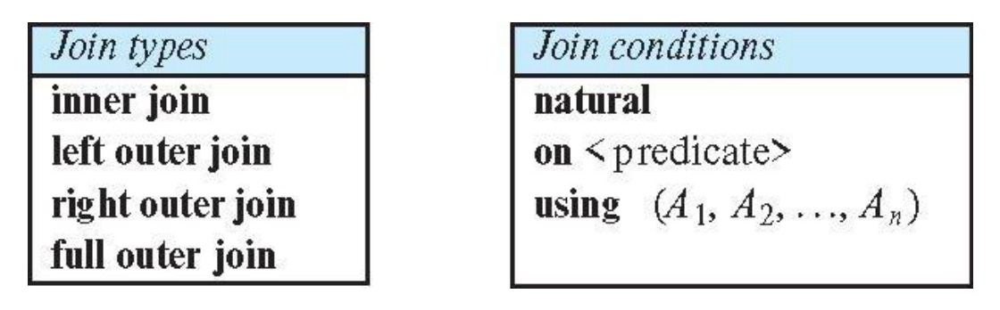
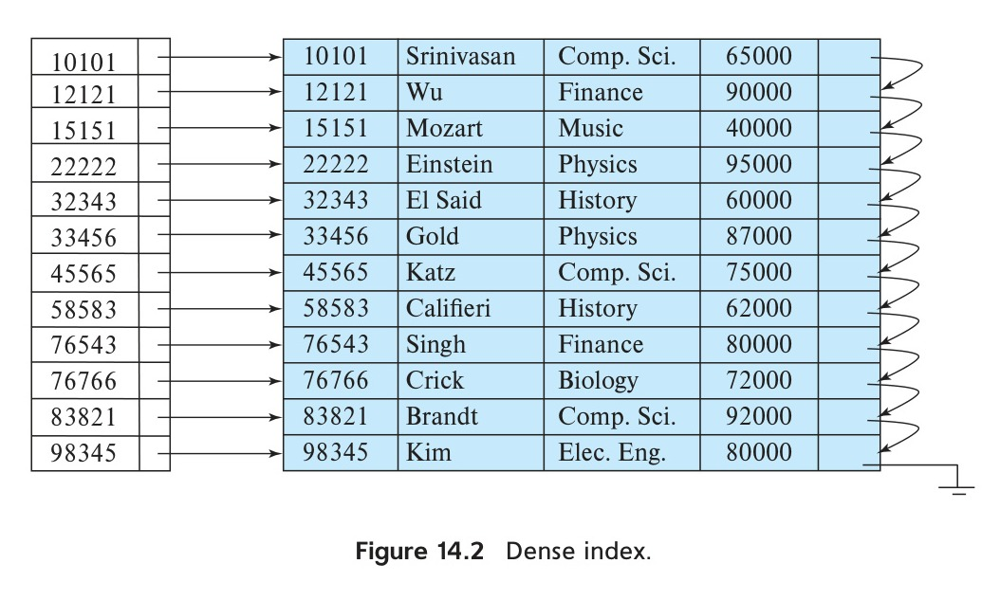
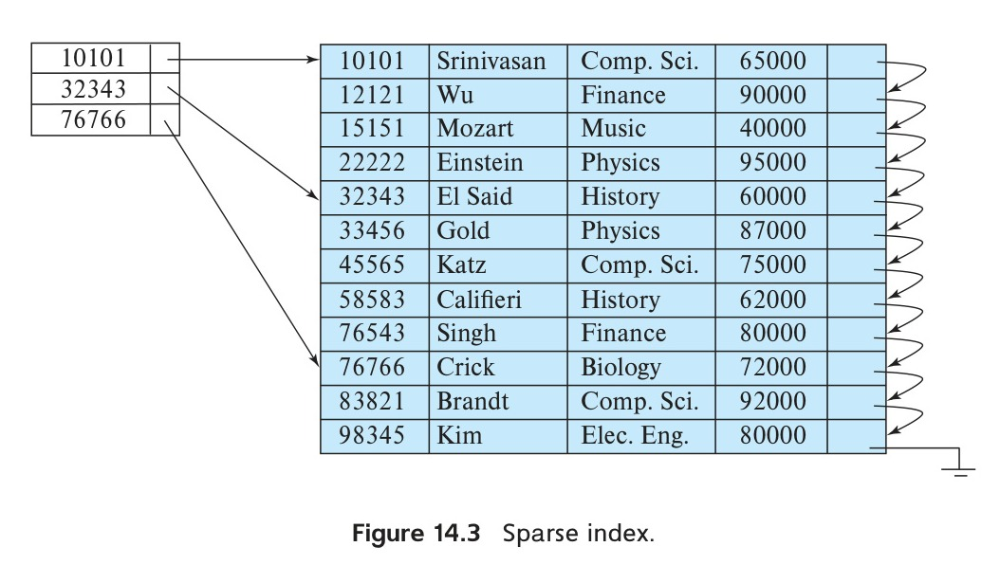

[← Prev: 2021](2021.md) | [Explanation Layer](../yearly_answers_explaination/2023.md) | [Original Question Paper](../PreviousYearQuestion/2023.md) | [Next: 2024 →](2024.md)

---

# ECE 2215: Database Systems · Semester Final 2023 · Exam-Style Answers

> [!info] Paper Metadata
> - **Examination:** B.Sc. Engineering 2nd Year Even Semester Examination, 2023
> - **Institution:** Rajshahi University of Engineering & Technology (RUET)
> - **Department:** Department of Electrical & Computer Engineering
> - **Curriculum Era:** Modern OBE (CLO Mapped)
> - **Full Marks:** 60 | **Time:** 3 Hours
> - **Instructions:** Answer any SIX questions taking THREE from each section.
> - **Question Count:** 22 sub-questions across Section A (10) and Section B (12)

---

## SECTION A

### Q.1(a) · 05 Marks · CLO4

*Topic: [[Topicwise_answers_exam_style/T02_ER_and_EER_Modeling.md#T02.5 · Design a full E-R diagram for a scenario|T02.5 · Design a full E-R diagram for a scenario]] · Section A* · CLO4

**Question.**
Draw an ER diagram for RUET Central Library Management System. You have to consider the entities mentioned below:<br>(i) Books (ii) Members (iii) Staff (iv) Borrowing (v) Reservations

**Answer.**

*Design Note: Borrowing and Reservations are explicitly specified as entity sets in the prompt; each is modeled with its own unique identifier and transaction attributes.*

**Entity Sets & Attributes:**
1. **BOOKS:** `book_id` (PK), `isbn`, `title`, `author`, `edition`.
2. **MEMBERS:** `member_id` (PK), `name`, `type`, `department`.
3. **STAFF:** `staff_id` (PK), `name`, `designation`.
4. **BORROWING:** `borrow_id` (PK), `borrow_date`, `due_date`, `return_date`.
5. **RESERVATIONS:** `res_id` (PK), `res_date`, `status`.

**Relationships:**
- `Issues` (1:N): A staff member processes multiple borrowings.
- `Borrows` (1:N): A member initiates multiple borrowings.
- `Includes` (N:1): A borrowing record links to the specific book borrowed.
- `Reserves` (1:N): A member makes multiple book reservations.
- `For_Book` (N:1): A reservation is placed for a specific book.


*Figure: RUET Central Library Management System E-R Diagram*

---

### Q.1(b) · 03 Marks · CLO1

*Topic: [[Topicwise_answers_exam_style/T01_DB_Concepts_and_Architecture.md#T01.2 · File system vs DBMS|T01.2 · File system vs DBMS]] · Section A* · CLO1
*(Repeated question: Also asked in 2019 | Solved in T01)*

**Question.**
What are the advantages of DBMS over file processing system?

**Answer.**

**Importance of DBMS:**  
A DBMS provides centralized, secure, and coordinated control over an organization's data. It replaces scattered operating system files and ensures that data remains reliable, shared, and recoverable during hardware or software crashes.

**Advantages of DBMS over File Processing Systems:**
1. **Control of Data Redundancy and Inconsistency:** Centralized data storage minimizes duplicate entries and prevents conflicting records.
2. **Data Independence:** Physical storage structures can change without requiring updates to application programs.
3. **Fast and Convenient Data Access:** Declarative query languages (like SQL) retrieve data without custom low-level programming.
4. **Transaction Management (ACID Properties):** Guarantees atomicity during crashes and protects data integrity during concurrent multi-user access.
5. **Data Security and Integrity Constraints:** Restricts unauthorized access through user privileges and enforces business rules automatically.

*Variant for 2023 Q.1(b) (3 marks):* Focus directly on the 5 advantages over file processing systems; omit the general importance statement.

---

### Q.1(c) · 02 Marks · CLO1

*Topic: [[Topicwise_answers_exam_style/T01_DB_Concepts_and_Architecture.md#T01.5 · DDL vs DML|T01.5 · DDL vs DML]] · Section A* · CLO1

**Question.**
Explain DDL and DML with example.

**Answer.**

- **DDL (Data Definition Language):** A specialized set of commands used to define, alter, and delete the database schema and storage structures.
  Example:
  ```sql
  CREATE TABLE instructor (
      ID CHAR(5),
      name VARCHAR(20),
      dept_name VARCHAR(20),
      salary NUMERIC(8,2)
  );
  ```
- **DML (Data Manipulation Language):** A language used to query, insert, update, or delete data stored in the database.
  Example:
  ```sql
  SELECT name FROM instructor WHERE dept_name = 'Comp. Sci.';
  ```

---

### Q.2(a) · 06 Marks · CLO4

*Topic: [[Topicwise_answers_exam_style/T08_Normalization_and_Functional_Dependencies.md#T08.8 · Normalize an unnormalized table → 1NF → 2NF → 3NF|T08.8 · Normalize an unnormalized table → 1NF → 2NF → 3NF]] · Section A* · CLO4

**Question.**
Consider a university tracking students, their courses and exam scores. A sample table is given below. Step by step convert this to 3NF.<br><br><table border="1" style="border-collapse: collapse; text-align: center;"><thead><tr><th style="padding: 4px 10px;">S_ID</th><th style="padding: 4px 10px;">S-Name</th><th style="padding: 4px 10px;">Courses</th><th style="padding: 4px 10px;">Instructors</th><th style="padding: 4px 10px;">Grades</th></tr></thead><tbody><tr><td style="padding: 4px 10px;">1</td><td style="padding: 4px 10px;">Alice</td><td style="padding: 4px 10px;">Math, Physics</td><td style="padding: 4px 10px;">Dr. Smith, Dr. Brown</td><td style="padding: 4px 10px;">A, B+</td></tr><tr><td style="padding: 4px 10px;">2</td><td style="padding: 4px 10px;">Bob</td><td style="padding: 4px 10px;">Chemistry</td><td style="padding: 4px 10px;">Dr. White</td><td style="padding: 4px 10px;">A-</td></tr><tr><td style="padding: 4px 10px;">3</td><td style="padding: 4px 10px;">Charlie</td><td style="padding: 4px 10px;">Math, Biology, Chemistry</td><td style="padding: 4px 10px;">Dr. Smith, Dr. Gray, Dr. White</td><td style="padding: 4px 10px;">B+, A-, A</td></tr></tbody></table>

**Answer.**

#### Step 1: Convert to First Normal Form (1NF)

The sample table violates 1NF because the attributes `Courses`, `Instructors`, and `Grades` contain multi-valued entries.

To achieve 1NF, we flatten each multi-valued row into individual atomic records:

| S_ID | S-Name | Course | Instructor | Grade |
| :---: | :--- | :--- | :--- | :---: |
| 1 | Alice | Math | Dr. Smith | A |
| 1 | Alice | Physics | Dr. Brown | B+ |
| 2 | Bob | Chemistry | Dr. White | A- |
| 3 | Charlie | Math | Dr. Smith | B+ |
| 3 | Charlie | Biology | Dr. Gray | A- |
| 3 | Charlie | Chemistry | Dr. White | A |

**Primary Key for 1NF:** `(S_ID, Course)`

#### Functional Dependencies Identified:
1. `S_ID -> S-Name` (partial dependency on `S_ID`)
2. `Course -> Instructor` (partial dependency on `Course`)
3. `(S_ID, Course) -> Grade` (full dependency on the composite key)

---

#### Step 2: Convert to Second Normal Form (2NF)

In 1NF, `S-Name` and `Instructor` depend on parts of the composite primary key `(S_ID, Course)`.

To eliminate these partial dependencies, we decompose the table into three relations:

1. **STUDENT**

   | S_ID | S-Name |
   | :---: | :--- |
   | 1 | Alice |
   | 2 | Bob |
   | 3 | Charlie |

   PK: `S_ID`

2. **COURSE**

   | Course | Instructor |
   | :--- | :--- |
   | Math | Dr. Smith |
   | Physics | Dr. Brown |
   | Chemistry | Dr. White |
   | Biology | Dr. Gray |

   PK: `Course`

3. **ENROLLMENT**

   | S_ID | Course | Grade |
   | :---: | :--- | :---: |
   | 1 | Math | A |
   | 1 | Physics | B+ |
   | 2 | Chemistry | A- |
   | 3 | Math | B+ |
   | 3 | Biology | A- |
   | 3 | Chemistry | A |

   PK: `(S_ID, Course)`

All non-prime attributes in these three relations depend fully on their entire candidate keys. Thus, the schema is in 2NF.

---

#### Step 3: Check for Third Normal Form (3NF)

A relation in 2NF is in 3NF if no non-prime attribute transitively depends on a candidate key.

- In `STUDENT(S_ID, S-Name)`, `S_ID` is the candidate key and determines `S-Name`. No transitive dependency exists.
- In `COURSE(Course, Instructor)`, `Course` is the candidate key and determines `Instructor`. No transitive dependency exists.
- In `ENROLLMENT(S_ID, Course, Grade)`, `(S_ID, Course)` is the candidate key and determines `Grade`. No transitive dependency exists.

Since there are no transitive dependencies, the 2NF schema is already in **3NF**.

$$
\boxed{\text{Final 3NF Schema: } \text{STUDENT}(\underline{\text{S\_ID}}, \text{S-Name}), \; \text{COURSE}(\underline{\text{Course}}, \text{Instructor}), \; \text{ENROLLMENT}(\underline{\text{S\_ID}, \text{Course}}, \text{Grade})}
$$

---

### Q.2(b) · 04 Marks · CLO4

*Topic: [[Topicwise_answers_exam_style/T08_Normalization_and_Functional_Dependencies.md#T08.1 · Why normalize: redundancy and insert/update/delete anomalies|T08.1 · Why normalize: redundancy and insert/update/delete anomalies]] · Section A* · CLO4

**Question.**
What are the anomalies that normalization aims to eliminate? Provide examples of insertion, deletion and update anomalies.

**Answer.**

Normalization aims to eliminate three modification anomalies caused by data redundancy and undesirable functional dependencies:

1. **Insertion Anomaly**
2. **Deletion Anomaly**
3. **Update Anomaly**

#### Example Table: `EMP_DEPT`

Consider an unnormalized table where employee and department facts share one relation:

| Emp_ID | Emp_Name | Dept_ID | Dept_Name | Location |
| :--- | :--- | :--- | :--- | :--- |
| E01 | Alice | D10 | IT | Building A |
| E02 | Bob | D20 | HR | Building B |
| E03 | Charlie | D10 | IT | Building A |

**Primary Key:** `Emp_ID`

#### 1. Insertion Anomaly
- **Problem:** We cannot insert information about a new department unless at least one employee is assigned to it.
- **Example:** The company opens a new department `D30` (Finance, Building C). Because `Emp_ID` is the primary key, it cannot be `NULL`. We cannot record department `D30` until an employee is hired.

#### 2. Deletion Anomaly
- **Problem:** Deleting an entity record accidentally deletes an unrelated entity.
- **Example:** Employee `E02` is the only person working in department `D20` (HR). If Bob resigns and we delete his row (`E02`), the fact that department `D20` is HR located in Building B is permanently erased.

#### 3. Update Anomaly
- **Problem:** Changing a single real-world fact requires modifying multiple records.
- **Example:** If the IT department (`D10`) moves to "Building D", we must update both rows E01 and E03. If the system updates E01 but fails on E03, department D10 has two conflicting locations.

---

### Q.3(a) · 06 Marks · CLO2

*Topic: [[Topicwise_answers_exam_style/T05_SQL_DDL_DML_Aggregates_Subqueries.md#T05.2 · DDL + DML warm-up: CREATE, INSERT, ALTER ... ADD, UPDATE, DELETE, rename, filter|T05.2 · DDL + DML warm-up: CREATE, INSERT, ALTER ... ADD, UPDATE, DELETE, rename, filter]] · Section A* · CLO2

**Question.**
Write SQL queries for the following:<br>(i) Create a table "Employee" with attributes: EmpID (primary key), Name, Age and Department.<br>(ii) Insert a record into this table: EmpID=1, Name='Nafisa', Age=21, department='HR'.<br>(iii) Find employees whose salary is greater than the average salary of their department.

**Answer.**

*(i) Create table Employee:*

```sql
CREATE TABLE Employee (
    EmpID INT PRIMARY KEY,
    Name VARCHAR(50),
    Age INT,
    Department VARCHAR(30)
);
```

*(ii) Insert record into Employee:*

```sql
INSERT INTO Employee (EmpID, Name, Age, Department)
VALUES (1, 'Nafisa', 21, 'HR');
```

*(iii) Find employees earning more than their department's average salary:*

*Assumption: The Employee relation includes an attribute `Salary DECIMAL(10,2)`.*

```sql
SELECT *
FROM Employee e1
WHERE e1.Salary > (
    SELECT AVG(e2.Salary)
    FROM Employee e2
    WHERE e2.Department = e1.Department
);
```

---

### Q.3(b) · 04 Marks · CLO2

*Topic: [[Topicwise_answers_exam_style/T03_Relational_Model_Keys_and_Integrity.md#T03.2 · Keys: super / candidate / primary / alternate / composite / foreign|T03.2 · Keys: super / candidate / primary / alternate / composite / foreign]] · Section A* · CLO2

**Question.**
Explain the distinctions among the terms-<br>(i) Primary key<br>(ii) Candidate key<br>(iii) Super key<br>(iv) Composite key

**Answer.**

A key is an attribute or set of attributes used to identify rows in a table.

**Distinctions Among Keys:**

| Key Type | Definition | Minimality | NULL Allowed |
| :--- | :--- | :--- | :--- |
| **(i) Primary Key** | The candidate key chosen by the database designer to identify tuples uniquely. | Yes (minimal) | No (never allowed) |
| **(ii) Candidate Key** | A minimal super key. Removing any attribute destroys uniqueness. | Yes (strictly minimal) | Yes (unless constrained `NOT NULL`) |
| **(iii) Super Key** | Any set of attributes that uniquely identifies a row. May contain extra attributes. | No (can have redundant attributes) | No for identifying columns |
| **(iv) Composite Key** | A key that consists of two or more attributes rather than a single attribute. | Can be minimal (candidate) or non-minimal | Depends on whether it is PK or unique |

**Relationship:**
$$
\text{Primary Key} \subseteq \text{Candidate Keys} \subseteq \text{Super Keys}
$$

**Running Example:**  
Consider relation $\text{Student}(\underline{\text{student\_id}}, \text{name}, \text{email}, \text{nid}, \text{dept\_name})$:

| student_id | name | email | nid | dept_name |
| :--- | :--- | :--- | :--- | :--- |
| 101 | Akib | akib@gmail.com | 1999123456 | ECE |
| 102 | Shuvo | shuvo@gmail.com | 2000654321 | ECE |
| 103 | Sakib | sakib@gmail.com | 2001987654 | ETE |

- **Super Key:** Any set containing a candidate key. Examples: $\{\text{student\_id}\}$, $\{\text{email}\}$, $\{\text{student\_id}, \text{name}\}$, $\{\text{email}, \text{dept\_name}\}$.
- **Candidate Key:** Minimal sets with no extra columns: $\{\text{student\_id}\}$, $\{\text{email}\}$, $\{\text{nid}\}$.
- **Primary Key:** The chosen identifier: $\{\text{student\_id}\}$.
- **Composite Key:** In table $\text{Takes}(\underline{\text{student\_id}}, \underline{\text{course\_id}}, \text{grade})$, the combination $\{\text{student\_id}, \text{course\_id}\}$ forms a composite candidate and primary key. Neither column alone identifies an enrollment record.

*Short version for 2018 Q.2(a) (4 marks):* Omit (iv) Composite key. Keep the definitions, distinctions table, and the Student running example for Super Key, Candidate Key, and Primary Key.  
*Short version for 2021 Q.2(b) (3 marks):* Same as 2018 Q.2(a). Present the 3-row distinction table and the Student relation key classification.

---

### Q.4(a) · 04 Marks · CLO1

*Topic: [[Topicwise_answers_exam_style/T12_Recovery_System_and_RAID.md#T12.4 · RAID levels, comparison, and recovery role|T12.4 · RAID levels, comparison, and recovery role]] · Section A* · CLO1

**Question.**
Discuss the features of RAID models.

**Answer.**

A Redundant Array of Independent Disks (RAID) provides four major architectural features:

1. **Data Striping (Performance Enhancement):** Data is segmented into blocks or bytes and distributed across multiple physical drives. This enables parallel disk I/O, which boosts transfer rates for large accesses and balances access loads.
2. **Data Redundancy (Fault Tolerance):** Redundancy is achieved through mirroring (duplicate blocks in RAID 1) or parity codes (XOR parity in RAID 5; Reed-Solomon P+Q codes in RAID 6). If a disk fails, data is restored without data loss.
3. **Storage Virtualization:** An array of physical drives appears to the operating system and DBMS as a single, large logical volume.
4. **Online Rebuild and Hot Swapping:** Failed drives can be replaced while the system remains powered on. The controller automatically rebuilds data onto hot-spare disks in the background.
5. **Background Data Scrubbing:** The controller continuously reads idle sectors to detect and repair latent sector corruption (bit rot) before additional drive failures occur.

---

### Q.4(b) · 04 Marks · CLO3

*Topic: [[Topicwise_answers_exam_style/T09_Transactions_ACID_and_Anomalies.md#T09.1 · ACID properties|T09.1 · ACID properties]] · Section A* · CLO3

**Question.**
Briefly explain the importance of ACID properties of transactions with suitable example.

**Answer.**

Databases must handle two critical challenges: system failures (crashes, power loss) and concurrent user execution. The ACID properties are essential because without them, database data becomes corrupt and untrustworthy.

**Example:** Transaction $T_1$ transfers \$50 from account $A$ (\$1000) to account $B$ (\$2000). The invariant is $A + B = 3000$.

**Importance of Each Property:**

1. **Importance of Atomicity:**
   - *Failure case without atomicity:* The system crashes after deducting \$50 from $A$, before adding \$50 to $B$. The bank loses \$50 of customer money.
   - *Protection:* Atomicity forces the recovery manager to undo the deduction, restoring $A = 1000$ (\$1000).

2. **Importance of Consistency:**
   - *Failure case without consistency:* A flawed program deducts \$50 from $A$ but adds \$100 to $B$.
   - *Protection:* Consistency ensures transaction logic preserves all domain rules. The total sum $A + B = 3000$ remains balanced.

3. **Importance of Isolation:**
   - *Failure case without isolation:* An audit transaction $T_2$ reads balances right after $T_1$ writes $A = 950$, before $T_1$ writes $B$. $T_2$ calculates total assets as $950 + 2000 = 2950$. It issues a false financial warning.
   - *Protection:* Isolation ensures $T_2$ sees either pre-transfer data (\$3000) or post-transfer data (\$3000).

4. **Importance of Durability:**
   - *Failure case without durability:* $T_1$ completes and confirms the transfer. Then a power outage occurs before updates reach disk. The transfer is lost upon reboot.
   - *Protection:* Durability guarantees that committed transactions are logged to stable storage and survive power loss.

---

### Q.4(c) · 02 Marks · CLO3

*Topic: [[Topicwise_answers_exam_style/T09_Transactions_ACID_and_Anomalies.md#T09.3 · Transaction states / life-cycle diagram|T09.3 · Transaction states / life-cycle diagram]] · Section A* · CLO3

**Question.**
Draw state diagram of a transaction.

**Answer.**


*Figure: Transaction State Diagram (Source: Deck 07, Slide 8)*

**State Transitions:**
- **Active $\to$ Partially Committed:** When the transaction executes its final statement.
- **Partially Committed $\to$ Committed:** When updates are safely flushed to stable storage.
- **Active $\to$ Failed:** When a system error or logical fault occurs during execution.
- **Partially Committed $\to$ Failed:** When a failure occurs before updates are written to disk.
- **Failed $\to$ Aborted:** When rollback restores the database to its pre-transaction state.

---

## SECTION B

### Q.5(a) · 03 Marks · CLO2

*Topic: [[Topicwise_answers_exam_style/T06_Joins_and_Views.md#T06.4 · Views and CREATE VIEW|T06.4 · Views and CREATE VIEW]] · Section B* · CLO2

**Question.**
What are the benefits of VIEW?

**Answer.**

A view is a virtual relation defined by an SQL query. The database does not store the view data on disk. Instead, it stores the query definition and executes it when referenced.

**Key Benefits of Views:**
1. **Security and Access Control:** Views hide sensitive columns and rows from unauthorized users. For example, a view can display employee names and departments while hiding salary data.
2. **Query Simplicity:** Views hide complex joins, unions, and aggregate calculations behind a single virtual table name. Users run simple `SELECT` queries on the view.
3. **Logical Data Independence:** If base tables are restructured, split, or renamed, the administrator updates only the view query. Applications using the view continue running without changes.
4. **Consistent and Standardized Data Representation:** Views provide uniform business calculations across multiple users and departments. This avoids duplicate and conflicting query logic.

---

### Q.5(b) · 03 Marks · CLO2

*Topic: [[Topicwise_answers_exam_style/T06_Joins_and_Views.md#T06.4 · Views and CREATE VIEW|T06.4 · Views and CREATE VIEW]] · Section B* · CLO2

**Question.**
Create a VIEW using SQL query that shows the EmployeeName, DepartmentName and salary for employees who earn a salary of more than 55,000.<br><br>**E.**<br><table border="1" style="border-collapse: collapse; text-align: center;"><thead><tr><th style="padding: 4px 10px;">EmployeeID</th><th style="padding: 4px 10px;">EmployeeName</th><th style="padding: 4px 10px;">Department ID</th></tr></thead><tbody><tr><td style="padding: 4px 10px;">101</td><td style="padding: 4px 10px;">Jhon</td><td style="padding: 4px 10px;">D01</td></tr><tr><td style="padding: 4px 10px;">102</td><td style="padding: 4px 10px;">Jane</td><td style="padding: 4px 10px;">D02</td></tr><tr><td style="padding: 4px 10px;">103</td><td style="padding: 4px 10px;">Alice</td><td style="padding: 4px 10px;">D01</td></tr><tr><td style="padding: 4px 10px;">104</td><td style="padding: 4px 10px;">Bob</td><td style="padding: 4px 10px;">D03</td></tr></tbody></table><br>**D.**<br><table border="1" style="border-collapse: collapse; text-align: center;"><thead><tr><th style="padding: 4px 10px;">DepartmentID</th><th style="padding: 4px 10px;">DepartmentName</th></tr></thead><tbody><tr><td style="padding: 4px 10px;">D01</td><td style="padding: 4px 10px;">Sales</td></tr><tr><td style="padding: 4px 10px;">D02</td><td style="padding: 4px 10px;">HR</td></tr><tr><td style="padding: 4px 10px;">D03</td><td style="padding: 4px 10px;">IT</td></tr></tbody></table><br>**S.**<br><table border="1" style="border-collapse: collapse; text-align: center;"><thead><tr><th style="padding: 4px 10px;">EmployeeID</th><th style="padding: 4px 10px;">Salary</th></tr></thead><tbody><tr><td style="padding: 4px 10px;">101</td><td style="padding: 4px 10px;">50,000</td></tr><tr><td style="padding: 4px 10px;">102</td><td style="padding: 4px 10px;">60,000</td></tr><tr><td style="padding: 4px 10px;">103</td><td style="padding: 4px 10px;">55,000</td></tr><tr><td style="padding: 4px 10px;">104</td><td style="padding: 4px 10px;">70,000</td></tr></tbody></table>

**Answer.**

*Assumption: Schema consists of Employee(EmpID, EmployeeName, Salary, DeptID) and Department(DeptID, DepartmentName).*

**SQL Query (Standard 2-Table Schema):**
```sql
CREATE VIEW High_Salary_Employees AS
SELECT Employee.EmployeeName, Department.DepartmentName, Employee.Salary
FROM Employee
JOIN Department ON Employee.DeptID = Department.DeptID
WHERE Employee.Salary > 55000;
```

**Alternative SQL Query (Using Printed Tables E, D, and S):**
Joining table **E**, table **D**, and table **S**:
```sql
CREATE VIEW High_Salary_Employees AS
SELECT E.EmployeeName, D.DepartmentName, S.Salary
FROM E
JOIN D ON E.`Department ID` = D.DepartmentID
JOIN S ON E.EmployeeID = S.EmployeeID
WHERE S.Salary > 55000;
```

**View Output:**

| EmployeeName | DepartmentName | Salary |
| :--- | :--- | :--- |
| Jane | HR | 60,000 |
| Bob | IT | 70,000 |

*(Note: Employees Jhon with 50,000 and Alice with 55,000 are excluded because their salaries do not exceed 55,000).*

---

### Q.5(c) · 04 Marks · CLO2

*Topic: [[Topicwise_answers_exam_style/T06_Joins_and_Views.md#T06.1 · Types of joins|T06.1 · Types of joins]] · Section B* · CLO2
*(Repeated question: Also asked in 2019 | Solved in T06)*

**Question.**
Define joining. Discuss different types of joining with suitable example.

**Answer.**

**Definition of Joining:**  
A join operation takes two relations and combines them into one relation based on a matching condition. It acts as a Cartesian product followed by a selection predicate and projection.


*Figure: Join types and join conditions (Deck 04, Slide 4)*

**Example Base Tables:**

Table `course`:

| course_id | title | dept_name | credits |
| :--- | :--- | :--- | :--- |
| BIO-301 | Genetics | Biology | 4 |
| CS-190 | Game Design | Comp. Sci. | 4 |
| CS-315 | Robotics | Comp. Sci. | 3 |

Table `prereq`:

| course_id | prereq_id |
| :--- | :--- |
| BIO-301 | BIO-101 |
| CS-190 | CS-101 |
| CS-347 | CS-101 |

---

#### 1. Inner Join (and Natural Join)
Retains only tuples that satisfy the join condition in both tables. Unmatched rows are dropped.

```sql
SELECT course.course_id, title, dept_name, prereq_id
FROM course
INNER JOIN prereq ON course.course_id = prereq.course_id;
```

Relational algebra:
$$
\text{course} \bowtie \text{prereq}
$$

**Result:**

| course_id | title | dept_name | prereq_id |
| :--- | :--- | :--- | :--- |
| BIO-301 | Genetics | Biology | BIO-101 |
| CS-190 | Game Design | Comp. Sci. | CS-101 |

---

#### 2. Left Outer Join
Preserves every row from the left table (`course`). Fills right-table attributes with `NULL` when no match exists.

```sql
SELECT course.course_id, title, dept_name, prereq_id
FROM course
LEFT JOIN prereq ON course.course_id = prereq.course_id;
```

Relational algebra:
$$
\text{course} \mathbin{⟕} \text{prereq}
$$

**Result:**

| course_id | title | dept_name | prereq_id |
| :--- | :--- | :--- | :--- |
| BIO-301 | Genetics | Biology | BIO-101 |
| CS-190 | Game Design | Comp. Sci. | CS-101 |
| CS-315 | Robotics | Comp. Sci. | `NULL` |

---

#### 3. Right Outer Join
Preserves every row from the right table (`prereq`). Fills left-table attributes with `NULL` when no match exists.

```sql
SELECT prereq.course_id, title, dept_name, prereq_id
FROM course
RIGHT JOIN prereq ON course.course_id = prereq.course_id;
```

Relational algebra:
$$
\text{course} \mathbin{⟖} \text{prereq}
$$

**Result:**

| course_id | title | dept_name | prereq_id |
| :--- | :--- | :--- | :--- |
| BIO-301 | Genetics | Biology | BIO-101 |
| CS-190 | Game Design | Comp. Sci. | CS-101 |
| CS-347 | `NULL` | `NULL` | CS-101 |

---

#### 4. Full Outer Join
Retains all rows from both tables. It pairs matching rows and fills missing values with `NULL`. MySQL emulates it using `UNION`.

```sql
SELECT course.course_id, title, dept_name, prereq_id
FROM course
LEFT JOIN prereq ON course.course_id = prereq.course_id
UNION
SELECT prereq.course_id, title, dept_name, prereq_id
FROM course
RIGHT JOIN prereq ON course.course_id = prereq.course_id;
```

Relational algebra:
$$
\text{course} \mathbin{⟗} \text{prereq}
$$

**Result:**

| course_id | title | dept_name | prereq_id |
| :--- | :--- | :--- | :--- |
| BIO-301 | Genetics | Biology | BIO-101 |
| CS-190 | Game Design | Comp. Sci. | CS-101 |
| CS-315 | Robotics | Comp. Sci. | `NULL` |
| CS-347 | `NULL` | `NULL` | CS-101 |

---

#### 5. Cross Join (Cartesian Product)
Combines each row of the first table with every row of the second table without any condition.

```sql
SELECT *
FROM course
CROSS JOIN prereq;
```

Relational algebra:
$$
\text{course} \times \text{prereq}
$$

It returns $3 \times 3 = 9$ rows.

*Variant for 2023 Q.5(c) (4 marks):* The same definition and four outer and inner join examples answer the question.

---

### Q.6(a) · 02 Marks · CLO2

*Topic: [[Topicwise_answers_exam_style/T05_SQL_DDL_DML_Aggregates_Subqueries.md#T05.9 · TRUNCATE vs DELETE|T05.9 · TRUNCATE vs DELETE]] · Section B* · CLO2

**Question.**
What is the difference between 'Truncate' and 'Delete' in SQL?

**Answer.**

Both `TRUNCATE` and `DELETE` remove rows from a relation, but they operate at different architectural levels:

| Feature | `TRUNCATE TABLE` | `DELETE FROM` |
| :--- | :--- | :--- |
| **Command Category** | **DDL** (Data Definition Language) | **DML** (Data Manipulation Language) |
| **Row Filtering (`WHERE`)** | Not supported; always empties the entire table | Supported; deletes specific filtered rows or all rows |
| **Transaction & Rollback** | Executes an implicit `COMMIT` in MySQL; cannot be rolled back | Logged row-by-row; can be rolled back inside a transaction |
| **Triggers** | Does not fire `DELETE` triggers | Fires `BEFORE DELETE` and `AFTER DELETE` triggers for each row |
| **`AUTO_INCREMENT` Counter** | Resets the auto-increment counter back to its starting value (1) | Preserves the current auto-increment counter sequence |
| **Execution Speed** | Extremely fast; deallocates data pages directly | Slower; scans rows and records individual undo/redo logs |

---

### Q.6(b) · 06 Marks · CLO2

*Topic: [[Topicwise_answers_exam_style/T07_Triggers_and_Stored_Procedures.md#T07.3 · Implement a trigger or stored procedure|T07.3 · Implement a trigger or stored procedure]] · Section B* · CLO2

**Question.**
Considering the tables (Products, Orders, and Auditlog) answer (i) and (ii).<br>(i) Create a stored procedure to place an order consider stock availability, updates the stock.<br>(ii) Create a trigger to log every stock update in the Auditlog table automatically.

**Answer.**

*Assumption: The table schemas are `Products(product_id, name, stock, price)`, `Orders(order_id, product_id, quantity, order_date)`, and `Auditlog(log_id, product_id, old_stock, new_stock, changed_at)`.*

#### (i) Stored Procedure to Place an Order

The stored procedure verifies available stock using row-level locking (`FOR UPDATE`), places the order, and reduces the inventory within a transaction:

```sql
DELIMITER //

CREATE PROCEDURE PlaceOrder (
    IN p_product_id INT,
    IN p_quantity INT
)
BEGIN
    DECLARE v_stock INT;

    START TRANSACTION;

    -- Lock the target product row to prevent concurrent race conditions
    SELECT stock INTO v_stock
    FROM Products
    WHERE product_id = p_product_id
    FOR UPDATE;

    -- Validate product existence and stock sufficiency
    IF v_stock IS NULL THEN
        ROLLBACK;
        SIGNAL SQLSTATE '45000'
            SET MESSAGE_TEXT = 'Error: Product does not exist';
    ELSEIF v_stock < p_quantity THEN
        ROLLBACK;
        SIGNAL SQLSTATE '45000'
            SET MESSAGE_TEXT = 'Error: Insufficient stock available';
    ELSE
        -- Record the new order
        INSERT INTO Orders (product_id, quantity, order_date)
        VALUES (p_product_id, p_quantity, NOW());

        -- Deduct ordered quantity from stock
        UPDATE Products
        SET stock = stock - p_quantity
        WHERE product_id = p_product_id;

        COMMIT;
    END IF;
END //

DELIMITER ;
```

#### (ii) Trigger to Log Stock Updates Automatically

An `AFTER UPDATE` trigger detects when the `stock` column changes and writes an audit record to `Auditlog`:

```sql
DELIMITER //

CREATE TRIGGER trg_log_stock_update
AFTER UPDATE ON Products
FOR EACH ROW
BEGIN
    -- Log only when the stock quantity actually changes
    IF OLD.stock <> NEW.stock THEN
        INSERT INTO Auditlog (product_id, old_stock, new_stock, changed_at)
        VALUES (OLD.product_id, OLD.stock, NEW.stock, NOW());
    END IF;
END //

DELIMITER ;
```

---

### Q.6(c) · 02 Marks · CLO2

*Topic: [[Topicwise_answers_exam_style/T05_SQL_DDL_DML_Aggregates_Subqueries.md#T05.8 · Short notes: ON DELETE CASCADE, GROUP BY, ORDER BY, AS|T05.8 · Short notes: ON DELETE CASCADE, GROUP BY, ORDER BY, AS]] · Section B* · CLO2
*(Repeated question: Also asked in 2024 | Solved in T05)*

**Question.**
Write short note on " ON CASCADE DELETE".

**Answer.**

**i) ON DELETE CASCADE (printed as "ON CASCADE DELETE"):**  
A foreign key referential integrity action. When a tuple in the parent table is deleted, the DBMS automatically deletes all corresponding referencing tuples in the child table. This maintains referential integrity and prevents orphaned records.

```sql
CREATE TABLE section (
    course_id VARCHAR(8),
    sec_id VARCHAR(8),
    semester VARCHAR(6),
    year NUMERIC(4, 0),
    PRIMARY KEY (course_id, sec_id, semester, year),
    FOREIGN KEY (course_id) REFERENCES course(course_id)
        ON DELETE CASCADE
);
```

**ii) GROUP BY:**  
An SQL clause used to partition table rows into distinct groups having identical values in specified columns. Aggregate functions (`COUNT`, `SUM`, `AVG`, `MIN`, `MAX`) then compute summary statistics for each individual group.

```sql
SELECT dept_name, AVG(salary) AS avg_sal
FROM instructor
GROUP BY dept_name;
```

**iii) ORDER BY:**  
An SQL clause that sorts query result rows in ascending (`ASC`, default) or descending (`DESC`) order based on one or more attributes. Multiple sort keys break ties sequentially.

```sql
SELECT name, salary
FROM instructor
ORDER BY salary DESC, name ASC;
```

**iv) AS:**  
An SQL keyword used to define an alias (an alternative temporary name). It can rename an attribute or computed expression in the `SELECT` clause for readability, or rename a table in the `FROM` clause to shorten table references and enable self-joins.

```sql
SELECT salary * 1.15 AS revised_salary
FROM employee AS e;
```

*Short version for 2019 Q.8(c) (4 marks):* Provide parts (i) and (ii).  
*Short version for 2023 Q.6(c) (2 marks):* Provide part (i) with definition, syntax, and effect.

---

### Q.7(a) · 03 Marks · CLO2

*Topic: [[Topicwise_answers_exam_style/T12_Recovery_System_and_RAID.md#T12.1 · Failure classification, precautions, recovery methods|T12.1 · Failure classification, precautions, recovery methods]] · Section B* · CLO2
*(Repeated question: Also asked in 2017 | Solved in T12)*

**Question.**
Explain the different types of failures that can occur in a database system.

**Answer.**

A database management system experiences three main classes of failure based on the affected storage component:

1. **Transaction Failure:** An individual transaction aborts before completing.
   - *Logical Error:* Caused by internal transaction logic or bad data (such as division by zero, arithmetic overflow, or data not found).
   - *System Error:* The system enters an undesirable state (such as a deadlock or timeout) and terminates the transaction.
2. **System Crash:** A hardware failure, power outage, or operating system bug halts the database server.
   - The contents of **volatile storage** (main memory buffers) are lost.
   - The contents of **non-volatile storage** (disk drives) remain uncorrupted (*fail-stop assumption*).
3. **Disk Failure:** Physical damage destroys data blocks on non-volatile media.
   - Causes include head crashes, magnetic surface defects, or transfer errors.
   - Recovery requires redundancy such as RAID arrays or archival backups.

*Variant for 2023 Q.7(a) (CLO2, 3 marks):* The same three-part classification directly answers the question.

---

### Q.7(b) · 04 Marks · CLO2

*Topic: [[Topicwise_answers_exam_style/T12_Recovery_System_and_RAID.md#T12.3 · Log-based recovery and shadow paging|T12.3 · Log-based recovery and shadow paging]] · Section B* · CLO2

**Question.**
What is log based recovery? Illustrate with an example of a system crash and recovery process.

**Answer.**

#### Definition
**Log-based recovery** is a crash recovery technique that records all database update actions on stable storage in a sequential log prior to updating the database on disk. By maintaining both old and new values, the recovery manager can undo incomplete transactions and redo committed transactions after a failure.

#### System Crash Example
Consider three transactions running on data items $A$, $B$, and $C$ with initial values $A = 1000$, $B = 2000$, and $C = 500$:
- $T_1$ transfers \$100 from $A$ to $B$ (commits).
- $T_2$ adds \$200 to $C$ (commits).
- $T_3$ subtracts \$50 from $B$ (active during crash).

**State of Log on Stable Storage at Crash:**
```text
1. <T1 start>
2. <T1, A, 1000, 900>
3. <T1, B, 2000, 2100>
4. <T1 commit>
5. <T2 start>
6. <T2, C, 500, 700>
7. <T3 start>
8. <T2 commit>
9. <T3, B, 2100, 2050>
---- CRASH OCCURS HERE ----
```

#### Recovery Process
1. **Analysis:** The recovery manager scans the log to classify transactions:
   - **Redo-list** = $\{T_1, T_2\}$ (both contain `<start>` and `<commit>` records).
   - **Undo-list** = $\{T_3\}$ (contains `<start>` but no `<commit>` or `<abort>` record).
2. **Redo Phase:** Scans the log forward to re-apply updates for committed transactions:
   - Redo $T_1$: set $A \leftarrow 900$, $B \leftarrow 2100$.
   - Redo $T_2$: set $C \leftarrow 700$.
3. **Undo Phase:** Scans the log backward to rollback uncommitted transactions:
   - Undo $T_3$: restores $B$ to its old value $2100$ using record 9.
   - Writes $\langle T_3\text{ abort}\rangle$ to the log.

**Final Database State:**
$A = 900$, $B = 2100$, $C = 700$. Both atomicity for $T_3$ and durability for $T_1$ and $T_2$ are satisfied.

---

### Q.7(c) · 03 Marks · CLO2

*Topic: [[Topicwise_answers_exam_style/T12_Recovery_System_and_RAID.md#T12.4 · RAID levels, comparison, and recovery role|T12.4 · RAID levels, comparison, and recovery role]] · Section B* · CLO2

**Question.**
Briefly describe the RAID model and its significance in database recovery.

**Answer.**

#### Description of RAID Model
The RAID (Redundant Array of Independent Disks) model combines multiple physical disk drives into a single logical unit. It uses data striping for parallel speed and data redundancy (mirroring or parity) for reliability.

#### Significance in Database Recovery
1. **Physical Realization of Stable Storage:** Standard database recovery algorithms (such as Write-Ahead Logging) assume the existence of **stable storage** that survives system crashes and media failures. RAID 1, 5, and 6 provide this physical foundation.
2. **Prevents Costly Offline Restores:** A single physical drive failure does not force the database offline. The system avoids hours of downtime spent restoring tape archives and replaying redo logs.
3. **High Availability During Rebuild:** Transactions continue processing queries normally while the controller reconstructs failed data blocks in the background.
4. **Guarantees Transaction Log Durability:** Database transaction logs are typically placed on RAID 1 volumes, ensuring sequential write speed and protection against log loss.

---

### Q.8(a) · 02 Marks · CLO1

*Topic: [[Topicwise_answers_exam_style/T13_Security_Indexing_and_Hashing.md#T13.3 · Indexing: dense vs sparse index|T13.3 · Indexing: dense vs sparse index]] · Section B* · CLO1

**Question.**
Write short note on dense and sparse index.

**Answer.**

**1. Definitions**  
- **Dense Index:** An index that contains an index record for **every** search-key value in the data file. To find a record, the system looks up the search key directly in the index and follows its pointer.
- **Sparse Index:** An index that contains index records for only **some** search-key values (typically one entry per disk block). The data file **must be sorted** on the search key. To find a record, the system finds the largest index key less than or equal to the target value, then scans the data block sequentially.


*Figure 13.1: Dense index on instructor file with search key ID (Source: Textbook Ch. 14, Fig. 14.2).*


*Figure 13.2: Sparse index on instructor file with search key ID (Source: Textbook Ch. 14, Fig. 14.3).*

**2. Comparison**  

| Feature | Dense Index | Sparse Index |
| :--- | :--- | :--- |
| **Index Entries** | One entry for every search-key value in the file. | One entry for only some search-key values (usually one per disk block). |
| **Lookup Speed** | Faster. Locates the exact record or its list of duplicates directly. | Slower. Requires an index lookup followed by a sequential block scan. |
| **Space Overhead** | Large. The index file consumes significant disk or memory space. | Small. The index file is much smaller and often fits in main memory. |
| **File Ordering** | Can be built on sorted (clustering) or unsorted (non-clustering) files. | Requires the data file to be ordered on the search key (clustering only). |
| **Maintenance Cost** | High. Insertions and deletions often require adding or removing index entries. | Low. Records can often be inserted or deleted inside a block without updating the index. |

**Practical Trade-off:** A sparse index with one entry per disk block offers a good compromise between lookup speed and index size.

---

### Q.8(b) · 04 Marks · CLO3

*Topic: [[Topicwise_answers_exam_style/T10_Serializability.md#T10.3 · Precedence-graph test → cycle → serial order(s)|T10.3 · Precedence-graph test → cycle → serial order(s)]] · Section B* · CLO3

**Question.**
Check whether the given schedules S is conflict serializeable or not. If yes, then determine all the possible serialized schedules.<br><br><table border="1" style="border-collapse: collapse; text-align: center;"><thead><tr><th style="padding: 4px 20px;">$T_1$</th><th style="padding: 4px 20px;">$T_2$</th><th style="padding: 4px 20px;">$T_3$</th><th style="padding: 4px 20px;">$T_4$</th></tr></thead><tbody><tr><td style="padding: 4px 20px;"></td><td style="padding: 4px 20px;"></td><td style="padding: 4px 20px;"></td><td style="padding: 4px 20px;">$R(A)$</td></tr><tr><td style="padding: 4px 20px;"></td><td style="padding: 4px 20px;">$R(A)$</td><td style="padding: 4px 20px;"></td><td style="padding: 4px 20px;"></td></tr><tr><td style="padding: 4px 20px;">$W(B)$</td><td style="padding: 4px 20px;"></td><td style="padding: 4px 20px;"></td><td style="padding: 4px 20px;"></td></tr><tr><td style="padding: 4px 20px;"></td><td style="padding: 4px 20px;"></td><td style="padding: 4px 20px;">$R(A)$</td><td style="padding: 4px 20px;"></td></tr><tr><td style="padding: 4px 20px;"></td><td style="padding: 4px 20px;">$W(A)$</td><td style="padding: 4px 20px;"></td><td style="padding: 4px 20px;"></td></tr><tr><td style="padding: 4px 20px;"></td><td style="padding: 4px 20px;"></td><td style="padding: 4px 20px;">$R(B)$</td><td style="padding: 4px 20px;"></td></tr><tr><td style="padding: 4px 20px;"></td><td style="padding: 4px 20px;">$W(B)$</td><td style="padding: 4px 20px;"></td><td style="padding: 4px 20px;"></td></tr></tbody></table><br>*(Note: "schedules S is conflict serializeable" printed verbatim from original question paper)*

**Answer.**

We list the operations of schedule $S$ in chronological order:
1. $T_4: R(A)$
2. $T_2: R(A)$
3. $T_1: W(B)$
4. $T_3: R(A)$
5. $T_2: W(A)$
6. $T_3: R(B)$
7. $T_2: W(B)$

#### Conflicting Pairs Analysis

- Step 1 ($T_4: R(A)$) precedes Step 5 ($T_2: W(A)$) $\implies T_4 \to T_2$
- Step 3 ($T_1: W(B)$) precedes Step 6 ($T_3: R(B)$) $\implies T_1 \to T_3$
- Step 3 ($T_1: W(B)$) precedes Step 7 ($T_2: W(B)$) $\implies T_1 \to T_2$
- Step 4 ($T_3: R(A)$) precedes Step 5 ($T_2: W(A)$) $\implies T_3 \to T_2$
- Step 6 ($T_3: R(B)$) precedes Step 7 ($T_2: W(B)$) $\implies T_3 \to T_2$

#### Precedence Graph


The edges of the graph are:
$$
T_1 \longrightarrow T_3, \quad T_3 \longrightarrow T_2, \quad T_4 \longrightarrow T_2, \quad T_1 \longrightarrow T_2
$$

The precedence graph is **acyclic** (it is a Directed Acyclic Graph). Therefore, schedule $S$ is **conflict serializable**.

#### All Possible Serialized Schedules

From the graph dependencies:
- $T_1$ must appear before $T_3$, and $T_3$ must appear before $T_2$: order is $T_1 \to T_3 \to T_2$.
- $T_4$ must appear before $T_2$.
- $T_4$ has no dependency with $T_1$ or $T_3$.

We interleave $T_4$ anywhere before $T_2$. This yields exactly 3 valid topological sorts:
1. $\boxed{\langle T_4, T_1, T_3, T_2 \rangle}$
2. $\boxed{\langle T_1, T_4, T_3, T_2 \rangle}$
3. $\boxed{\langle T_1, T_3, T_4, T_2 \rangle}$

---

### Q.8(c) · 04 Marks · CLO3

*Topic: [[Topicwise_answers_exam_style/T11_Concurrency_Control_Protocols.md#T11.6 · Timestamp ordering: R-TS/W-TS rules, trace a schedule; rolled-back transaction gets a NEW timestamp|T11.6 · Timestamp ordering: R-TS/W-TS rules, trace a schedule; rolled-back transaction gets a NEW timestamp]] · Section B* · CLO3

**Question.**
Discuss the given schedule based on Timestamp ordering protocol.<br><br><table border="1" style="border-collapse: collapse; text-align: center;"><thead><tr><th style="padding: 4px 20px;">$T_1(100)$</th><th style="padding: 4px 20px;">$T_2(200)$</th><th style="padding: 4px 20px;">$T_3(300)$</th></tr></thead><tbody><tr><td style="padding: 4px 20px;">$R(A)$</td><td style="padding: 4px 20px;"></td><td style="padding: 4px 20px;"></td></tr><tr><td style="padding: 4px 20px;"></td><td style="padding: 4px 20px;">$R(B)$</td><td style="padding: 4px 20px;"></td></tr><tr><td style="padding: 4px 20px;">$W(C)$</td><td style="padding: 4px 20px;"></td><td style="padding: 4px 20px;"></td></tr><tr><td style="padding: 4px 20px;"></td><td style="padding: 4px 20px;"></td><td style="padding: 4px 20px;">$R(B)$</td></tr><tr><td style="padding: 4px 20px;">$R(C)$</td><td style="padding: 4px 20px;"></td><td style="padding: 4px 20px;"></td></tr><tr><td style="padding: 4px 20px;"></td><td style="padding: 4px 20px;">$W(B)$</td><td style="padding: 4px 20px;"></td></tr><tr><td style="padding: 4px 20px;"></td><td style="padding: 4px 20px;"></td><td style="padding: 4px 20px;">$W(A)$</td></tr></tbody></table><br>*(Note: In the original paper schedule, $W(C)$ of $T_1$ and $R(B)$ of $T_3$ occupy essentially the same vertical tier. Since $C$ and $B$ are disjoint data items, the concurrency protocol evaluation remains unaffected).*

**Answer.**

**Initial Setup:**  
- Transaction timestamps: $\text{TS}(T_1) = 100$, $\text{TS}(T_2) = 200$, $\text{TS}(T_3) = 300$.
- Initial data item timestamps:
  $$
  \text{R-TS}(A) = \text{W-TS}(A) = 0
  $$
  $$
  \text{R-TS}(B) = \text{W-TS}(B) = 0
  $$
  $$
  \text{R-TS}(C) = \text{W-TS}(C) = 0
  $$

**Step-by-Step Execution Trace:**

| Step | Txn | Op | Protocol Condition Check | Decision | Updated Timestamp State |
| :---: | :---: | :---: | :--- | :--- | :--- |
| **1** | $T_1$ | $R(A)$ | $\text{TS}(T_1) \ge \text{W-TS}(A) \implies 100 \ge 0$ (Valid) | **Execute** | $\text{R-TS}(A) = \max(0, 100) = 100$ |
| **2** | $T_2$ | $R(B)$ | $\text{TS}(T_2) \ge \text{W-TS}(B) \implies 200 \ge 0$ (Valid) | **Execute** | $\text{R-TS}(B) = \max(0, 200) = 200$ |
| **3** | $T_1$ | $W(C)$ | $\text{TS}(T_1) \ge \text{R-TS}(C)$ and $\text{W-TS}(C) \implies 100 \ge 0$ (Valid) | **Execute** | $\text{W-TS}(C) = 100$ |
| **4** | $T_3$ | $R(B)$ | $\text{TS}(T_3) \ge \text{W-TS}(B) \implies 300 \ge 0$ (Valid) | **Execute** | $\text{R-TS}(B) = \max(200, 300) = 300$ |
| **5** | $T_1$ | $R(C)$ | $\text{TS}(T_1) \ge \text{W-TS}(C) \implies 100 \ge 100$ (Valid) | **Execute** | $\text{R-TS}(C) = \max(0, 100) = 100$ |
| **6** | $T_2$ | $W(B)$ | $\text{TS}(T_2) < \text{R-TS}(B) \implies 200 < 300$ (**Violated!**) | **REJECTED** | **$T_2$ is rolled back** |
| **7** | $T_3$ | $W(A)$ | $\text{TS}(T_3) \ge \text{R-TS}(A)$ and $\text{W-TS}(A) \implies 300 \ge 100$ (Valid) | **Execute** | $\text{W-TS}(A) = 300$ |

**Evaluation and Discussion:**

1. **Steps 1 through 5:** Each read and write operation satisfies the timestamp ordering rules. Operations execute in valid order.
2. **Conflict at Step 6:** Transaction $T_2$ ($\text{TS}=200$) attempts to write item $B$. But at Step 4, transaction $T_3$ ($\text{TS}=300$) has already read $B$, setting $\text{R-TS}(B) = 300$. Because $\text{TS}(T_2) < \text{R-TS}(B)$ ($200 < 300$), $T_2$ is producing a value of $B$ that $T_3$ needed to read. The system assumed that value would never be produced.
3. **Rollback Action:** The write operation $W(B)$ by $T_2$ is **rejected**. The system **rolls back transaction $T_2$**.
4. **Step 7:** $T_3$ executes $W(A)$ successfully because $\text{TS}(T_3) = 300 \ge \text{R-TS}(A) = 100$.

**Conclusion:**  
**The schedule is not accepted without rollback.** Transaction $\mathbf{T_2}$ is aborted and rolled back at Step 6. When restarted, $T_2$ must be assigned a new timestamp greater than 300.

---

[← Prev: 2021](2021.md) | [Explanation Layer](../yearly_answers_explaination/2023.md) | [Original Question Paper](../PreviousYearQuestion/2023.md) | [Next: 2024 →](2024.md)
