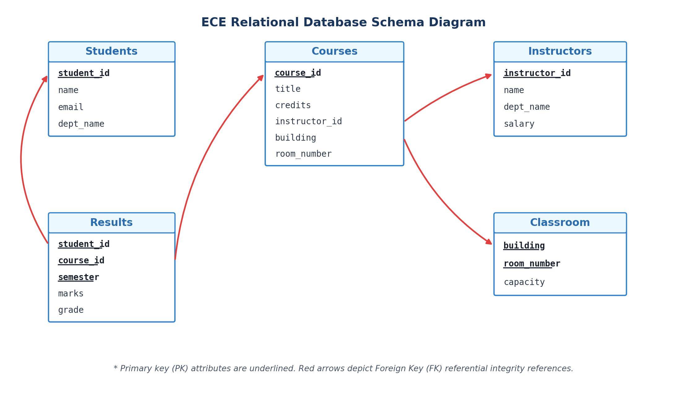
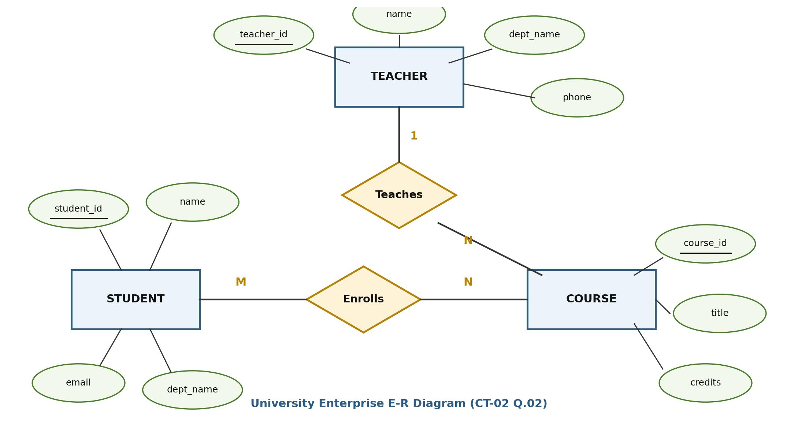

[← Prev: 2024](2024.md) | [Explanation Layer](../yearly_answers_explaination/ClassTestQuestions.md) | [Original CT Questions](../PreviousYearQuestion/ClassTestQuestions.md) | [Directory Overview →](README.md)

---

# ECE 2215: Database Systems · Class Test Collection · Exam-Style Answers

> [!info] Document Metadata
> - **Institution:** Rajshahi University of Engineering & Technology (RUET)
> - **Department:** Department of Electrical & Computer Engineering
> - **Document:** Solved Class Test Collection (CT-01 to CT-04)
> - **Total Marks:** 80 (20 Marks per test) | **Format:** CO Mapped
> - **Coverage:** Relational Algebra, SQL Queries, ER Modeling, Normalization, Transactions & Concurrency

## Navigation & Overview

- [[#Class Test 01 (Data Abstraction, Schema & Relational Algebra)|Class Test 01 (Data Abstraction, Schema & Relational Algebra)]] — *Data Abstraction, Schema Diagram, Application Structure, Relational Algebra*
- [[#Class Test 02 (SQL Queries & ER Modeling)|Class Test 02 (SQL Queries & ER Modeling)]] — *SQL Data Retrieval, Aggregates, Subqueries without LIMIT, University ER Model*
- [[#Class Test 03 (Functional Dependencies, Normalization & BCNF)|Class Test 03 (Functional Dependencies, Normalization & BCNF)]] — *Candidate Keys, Prime Attributes, Normalization (1NF–BCNF), Anomalies*
- [[#Class Test 04 (Transactions, ACID & Conflict Serializability)|Class Test 04 (Transactions, ACID & Conflict Serializability)]] — *ACID Properties, Serial vs Concurrent Execution, Concurrency Anomalies, Precedence Graph*

---

## Class Test 01 (Data Abstraction, Schema & Relational Algebra)

| Parameter | Details |
| :--- | :--- |
| **Institution** | Rajshahi University of Engineering & Technology (RUET) |
| **Department** | Electrical & Computer Engineering |
| **Test Title** | CT-01 |
| **Marks** | 20 |
| **Time** | 30 minutes |
| **Curriculum Standard** | With CO Mapping |

### CT-01 Question 01 · 05 Marks · CO1

*Topic: [[Topicwise_answers_exam_style/T01_DB_Concepts_and_Architecture.md#T01.4 · Data abstraction levels, schemas and instances|T01.4 · Data abstraction levels, schemas and instances]] · CT-01 · CO1*

**Question.**
Define data abstraction. Describe different types of data abstractions.

**Answer.**

**Purpose of Data Abstraction:**  
A database contains complex data structures, storage blocks, and indexing schemes. Most end users and programmers are not trained in low-level storage details. Data abstraction hides this physical complexity. It simplifies user interactions, enforces security, and enables physical data independence.

**Levels of Data Abstraction:**
1. **Physical level:** The lowest abstraction level. It describes *how* records are stored on secondary storage media (such as byte offsets, data blocks, B+ trees, and hashing schemes).
2. **Logical level:** The intermediate level. It describes *what* data is stored in the database and the relationships among those data. Programmers and administrators work at this level using schemas.
   Example record:
   ```text
   type instructor = record
       ID : string;
       name : string;
       dept_name : string;
       salary : integer;
   end;
   ```
3. **View level:** The highest abstraction level. It describes only the subset of the database relevant to a specific user group. It hides other data and complex structures for ease of use and security (for example, hiding instructor salaries from students).


*Figure: Three levels of data abstraction (Deck 01, Slide 14)*

*Variant for 2019 Q.2(a) (4 marks):* Define data abstraction, describe the three levels, and include the diagram.  
*Variant for CT-01 Q.01 (5 marks):* State the definition, explain the three levels, show the record example, and draw the diagram.

---

### CT-01 Question 02 · 05 Marks · CO1

*Topic: [[Topicwise_answers_exam_style/T03_Relational_Model_Keys_and_Integrity.md#T03.3 · Referential integrity & FK syntax (MySQL)|T03.3 · Referential integrity & FK syntax (MySQL)]] · CT-01 · CO1*

**Question.**
Draw a schema diagram for ECE, including 5 tables (Students, Courses, Instructors, Classroom, Results).

**Answer.**

**1. Relational Schemas and Keys:**
- $\text{Students}(\underline{\text{student\_id}}, \text{name}, \text{email}, \text{dept\_name})$
- $\text{Instructors}(\underline{\text{instructor\_id}}, \text{name}, \text{dept\_name}, \text{salary})$
- $\text{Classroom}(\underline{\text{building}}, \underline{\text{room\_number}}, \text{capacity})$
- $\text{Courses}(\underline{\text{course\_id}}, \text{title}, \text{credits}, \text{instructor\_id}, \text{building}, \text{room\_number})$
  - $\text{instructor\_id} \rightarrow \text{Instructors}(\text{instructor\_id})$
  - $(\text{building}, \text{room\_number}) \rightarrow \text{Classroom}(\text{building}, \text{room\_number})$
- $\text{Results}(\underline{\text{student\_id}}, \underline{\text{course\_id}}, \underline{\text{semester}}, \text{marks}, \text{grade})$
  - $\text{student\_id} \rightarrow \text{Students}(\text{student\_id})$
  - $\text{course\_id} \rightarrow \text{Courses}(\text{course\_id})$

**2. Relational Schema Diagram:**  
In Silberschatz style, each table is shown as a box with its attributes. Primary keys are underlined. Directed arrows point from foreign key attributes to the referenced primary keys.


*Figure: Relational schema diagram for ECE with 5 tables and foreign key references.*

---

### CT-01 Question 03 · 02 Marks · CO1

*Topic: [[Topicwise_answers_exam_style/T01_DB_Concepts_and_Architecture.md#T01.7 · Two-tier vs three-tier architecture|T01.7 · Two-tier vs three-tier architecture]] · CT-01 · CO1*

**Question.**
Describe the structure of a database application.

**Answer.**

A database application connects user interfaces to the database engine through three functional layers:

1. **Presentation Layer (Client Front End):** The client interface (web browser, mobile app, or desktop form) through which users enter input and view results.
2. **Business Logic Layer (Application Server):** Programs written in host languages (like Python, Java, or C++) that implement business rules, validate input, and issue database queries.
3. **Data Access Layer (Database Server / DBMS Engine):** The database system that uses APIs (such as JDBC or ODBC) to execute SQL queries, manage transactions, and persist data.

---

### CT-01 Question 04 · 04 Marks · CO1

*Topic: [[Topicwise_answers_exam_style/T04_Relational_Algebra_and_Calculus.md#T04.3 · Explain an RA expression in words|T04.3 · Explain an RA expression in words]] · CT-01 · CO1*

**Question.**
Relations:
- $\text{STUDENT}(\text{Student\_ID}, \text{Name}, \text{Dept\_Name}, \text{CGPA})$
- $\text{COURSE}(\text{Course\_ID}, \text{Course\_Name}, \text{Student\_ID}, \text{Semester}, \text{Marks})$
- $\text{ALUMNI}(\text{Student\_ID}, \text{Name}, \text{Dept\_Name})$

Write the relational algebra expressions for the following conditions using the relations above.

- **v.** Write the relational algebra expression to rename the relation $\text{STUDENT}$ as $\text{S}$ and display the $\text{Student\_ID}$ and $\text{Name}$ of all students.
- **vi.** Retrieve the $\text{Student\_ID}$, $\text{Name}$, and $\text{Course\_Name}$ of all students who belong to the CSE department and scored 80 or more marks in any course.
- **vii.** Write the relational algebra expression to retrieve the $\text{Student\_ID}$ and $\text{Name}$ of all students who are either in the $\text{STUDENT}$ relation or the $\text{ALUMNI}$ relation.
- **viii.** Write the relational algebra expression to determine the number of students in each department.

*(Note: Sub-parts are numbered v, vi, vii, viii on the original question script).*

**Answer.**

**(v) Rename relation STUDENT as S and display Student_ID and Name:**

$$
\boxed{\Pi_{\text{Student\_ID}, \text{Name}}(\rho_S(\text{STUDENT}))}
$$

**(vi) Student_ID, Name, and Course_Name for CSE students with Marks $\ge 80$:**

Filter students in CSE and courses with marks 80 or higher, join on `Student_ID`, and project:

$$
T_1 \leftarrow \sigma_{\text{Dept\_Name} = \text{"CSE"}}(\text{STUDENT})
$$

$$
T_2 \leftarrow \sigma_{\text{Marks} \ge 80}(\text{COURSE})
$$

$$
\boxed{\Pi_{\text{Student\_ID}, \text{Name}, \text{Course\_Name}}(T_1 \bowtie T_2)}
$$

**(vii) Student_ID and Name of students in either STUDENT or ALUMNI:**

Project both relations to the same attributes to satisfy union compatibility, then take the union:

$$
\boxed{\Pi_{\text{Student\_ID}, \text{Name}}(\text{STUDENT}) \cup \Pi_{\text{Student\_ID}, \text{Name}}(\text{ALUMNI})}
$$

**(viii) Number of students in each department:**

Group `STUDENT` by department name and count the student identifiers:

$$
\boxed{{}_{\text{Dept\_Name}}\gamma_{\text{count}(\text{Student\_ID})}(\text{STUDENT})}
$$

---

### CT-01 Question 05 · 04 Marks · CO1

*Topic: [[Topicwise_answers_exam_style/T04_Relational_Algebra_and_Calculus.md#T04.4 · Extended RA: aggregation|T04.4 · Extended RA: aggregation]] · CT-01 · CO1*

**Question.**
Describe the following relational algebra expression:

- **iii.**
  $$
  \Pi_{\text{Name}} \left(\sigma_{\text{Marks} < 50} \left(\text{STUDENT} \bowtie_{\text{STUDENT.Student\_ID} = \text{COURSE.Student\_ID}} \text{COURSE}\right)\right)
  $$

- **iv.**
  $$
  \Pi_{\text{course\_id}} \left(\sigma_{\text{semester} = \text{"Fall"} \land \text{year} = 2017} (\text{section})\right) - \Pi_{\text{course\_id}} \left(\sigma_{\text{semester} = \text{"Spring"} \land \text{year} = 2018} (\text{section})\right)
  $$

*(Note: Sub-parts are numbered iii, iv on the original question script).*

**Answer.**

**(iii) Expression:** $\Pi_{\text{Name}} \left(\sigma_{\text{Marks} < 50} \left(\text{STUDENT} \bowtie_{\text{STUDENT.Student\_ID} = \text{COURSE.Student\_ID}} \text{COURSE}\right)\right)$

1. **Theta Join:** Joins `STUDENT` and `COURSE` where `STUDENT.Student_ID = COURSE.Student_ID` to pair students with their course marks.
2. **Selection:** Filters the joined tuples to retain only records where `Marks < 50`.
3. **Projection:** Extracts the `Name` attribute and removes duplicates.
4. **Meaning in words:** Retrieves the names of all students who scored strictly less than 50 marks in at least one course.

**(iv) Expression:** $\Pi_{\text{course\_id}} \left(\sigma_{\text{semester} = \text{"Fall"} \land \text{year} = 2017} (\text{section})\right) - \Pi_{\text{course\_id}} \left(\sigma_{\text{semester} = \text{"Spring"} \land \text{year} = 2018} (\text{section})\right)$

1. **First Term:** Selects sections offered in Fall 2017 and projects their `course_id`.
2. **Second Term:** Selects sections offered in Spring 2018 and projects their `course_id`.
3. **Set Difference ($-$) :** Subtracts the second set of courses from the first set.
4. **Meaning in words:** Finds all courses taught in the Fall 2017 semester that were not taught in the Spring 2018 semester.

---

## Class Test 02 (SQL Queries & ER Modeling)

| Parameter | Details |
| :--- | :--- |
| **Institution** | Rajshahi University of Engineering & Technology (RUET) |
| **Department** | Electrical & Computer Engineering |
| **Test Title** | CT-02 |
| **Marks** | 20 |
| **Time** | 20 minutes |
| **Curriculum Standard** | With CO Mapping |

### CT-02 Question 01 · 10 Marks · CO2

*Topic: [[Topicwise_answers_exam_style/T05_SQL_DDL_DML_Aggregates_Subqueries.md#T05.2 · DDL + DML warm-up: CREATE, INSERT, ALTER ... ADD, UPDATE, DELETE, rename, filter|T05.2 · DDL + DML warm-up: CREATE, INSERT, ALTER ... ADD, UPDATE, DELETE, rename, filter]] · CT-02 · CO2*

**Question.**
Consider the table and write SQL queries for the following queries:

$$
\text{STUDENT}(\text{StudentID}, \text{Name}, \text{Department}, \text{Semester}, \text{CGPA})
$$

- **(a)** Display all students from the ECE department. `[Marks: 02 | CO: CO2]`
- **(b)** Display students from the ECE department whose CGPA is greater than 3.50, arranged by CGPA in descending order. `[Marks: 02 | CO: CO2]`
- **(c)** Find students whose CGPA is greater than the overall average CGPA. `[Marks: 03 | CO: CO2]`
- **(d)** Display the students having the second-highest CGPA without using LIMIT. `[Marks: 03 | CO: CO2]`

**Answer.**

#### Part (a): Display ECE students (2 Marks)

```sql
SELECT *
FROM STUDENT
WHERE Department = 'ECE';
```

#### Part (b): ECE students with CGPA > 3.50 descending (2 Marks)

```sql
SELECT *
FROM STUDENT
WHERE Department = 'ECE' AND CGPA > 3.50
ORDER BY CGPA DESC;
```

#### Part (c): Students with CGPA > overall average CGPA (3 Marks)

```sql
SELECT *
FROM STUDENT
WHERE CGPA > (
    SELECT AVG(CGPA)
    FROM STUDENT
);
```

#### Part (d): Second-highest CGPA without LIMIT (3 Marks)

```sql
SELECT *
FROM STUDENT
WHERE CGPA = (
    SELECT MAX(CGPA)
    FROM STUDENT
    WHERE CGPA < (
        SELECT MAX(CGPA)
        FROM STUDENT
    )
);
```

*Note on ties:* This query identifies the unique second-highest distinct CGPA value. If multiple students share this exact second-highest CGPA, all tied students are displayed in the result.

---

### CT-02 Question 02 · 10 Marks · CO3

*Topic: [[Topicwise_answers_exam_style/T02_ER_and_EER_Modeling.md#T02.5 · Design a full E-R diagram for a scenario|T02.5 · Design a full E-R diagram for a scenario]] · CT-02 · CO3*

**Question.**
A university maintains information about Students, Courses, and Teachers. A student can enroll in several courses and each course can have many students. Each course is taught by one teacher, though a teacher may teach several courses.

- **(a)** Identify the entities, attributes, primary keys, relationships, and cardinalities. `[Marks: 04 | CO: CO3]`
- **(b)** Draw the complete ER diagram. `[Marks: 06 | CO: CO3]`

**Answer.**

**(a) Identification of Components:**

| Component | Type | Details | Primary Key |
| :--- | :--- | :--- | :--- |
| **STUDENT** | Entity Set | Attributes: `student_id`, `name`, `email`, `dept_name` | `student_id` |
| **COURSE** | Entity Set | Attributes: `course_id`, `title`, `credits` | `course_id` |
| **TEACHER** | Entity Set | Attributes: `teacher_id`, `name`, `dept_name`, `phone` | `teacher_id` |
| **Enrolls** | Relationship Set | Connects `STUDENT` and `COURSE` | `(student_id, course_id)` |
| **Teaches** | Relationship Set | Connects `TEACHER` and `COURSE` | `course_id` |

**Cardinalities:**
- **Student to Course (`Enrolls`):** Many-to-Many (**M:N**). A student enrolls in several courses; each course has many students.
- **Teacher to Course (`Teaches`):** One-to-Many (**1:N**). A teacher teaches several courses; each course is taught by exactly one teacher.

**(b) Complete E-R Diagram:**


*Figure: University Enterprise Complete E-R Diagram*

---

## Class Test 03 (Functional Dependencies, Normalization & BCNF)

| Parameter | Details |
| :--- | :--- |
| **Institution** | Rajshahi University of Engineering & Technology (RUET) |
| **Department** | Electrical & Computer Engineering |
| **Test Title** | CT-03 |
| **Marks** | 20 |
| **Time** | 25 minutes |
| **Curriculum Standard** | With CO Mapping |

### CT-03 Question 01 · 10 Marks · CO3

*Topic: [[Topicwise_answers_exam_style/T08_Normalization_and_Functional_Dependencies.md#T08.4 · Attribute closure X+, F+, finding candidate keys|T08.4 · Attribute closure X+, F+, finding candidate keys]] · CT-03 · CO3*

**Question.**
Consider the relation:

$$
\text{ENROLLMENT}(\text{StudentID}, \text{StudentName}, \text{CourseID}, \text{CourseName}, \text{InstructorID}, \text{InstructorName}, \text{Grade})
$$

Assume the following functional dependencies:

$$
\begin{aligned}
\text{StudentID} &\rightarrow \text{StudentName} \\
\text{CourseID} &\rightarrow \text{CourseName}, \text{InstructorID} \\
\text{InstructorID} &\rightarrow \text{InstructorName} \\
(\text{StudentID}, \text{CourseID}) &\rightarrow \text{Grade}
\end{aligned}
$$

- **a)** Identify all the possible candidate key of the relation. `[Marks: 04]`
- **b)** Identify the prime and non-prime attributes. `[Marks: 02]`
- **c)** Identify the partial and transitive dependencies. `[Marks: 02]`
- **d)** Determine the highest normal form satisfied by the given relation. Give a proper justification. `[Marks: 02]`

**Answer.**

#### Part (a): Find Candidate Keys (4 Marks)

To find all candidate keys, we analyze the attributes that must appear in every key.

1. **Attributes not on any RHS:**
   Examining the right-hand sides of the given functional dependencies:
   - $\text{RHS} = \{\text{StudentName}, \text{CourseName}, \text{InstructorID}, \text{InstructorName}, \text{Grade}\}$
   - Attributes $\text{StudentID}$ and $\text{CourseID}$ never appear on any right-hand side.
   - Therefore, $\{\text{StudentID}, \text{CourseID}\}$ must be present in every candidate key.

2. **Compute the Attribute Closure of $\{\text{StudentID}, \text{CourseID}\}$:**
   - **Step 1 (Initial):**  
     $X^+ = \{\text{StudentID}, \text{CourseID}\}$
   - **Step 2 (Apply $\text{StudentID} \rightarrow \text{StudentName}$):**  
     $X^+ = \{\text{StudentID}, \text{CourseID}, \text{StudentName}\}$
   - **Step 3 (Apply $\text{CourseID} \rightarrow \text{CourseName}, \text{InstructorID}$):**  
     $X^+ = \{\text{StudentID}, \text{CourseID}, \text{StudentName}, \text{CourseName}, \text{InstructorID}\}$
   - **Step 4 (Apply $\text{InstructorID} \rightarrow \text{InstructorName}$):**  
     $X^+ = \{\text{StudentID}, \text{CourseID}, \text{StudentName}, \text{CourseName}, \text{InstructorID}, \text{InstructorName}\}$
   - **Step 5 (Apply $(\text{StudentID}, \text{CourseID}) \rightarrow \text{Grade}$):**  
     $X^+ = \{\text{StudentID}, \text{CourseID}, \text{StudentName}, \text{CourseName}, \text{InstructorID}, \text{InstructorName}, \text{Grade}\}$

3. **Check for Minimality:**
   We check proper subsets of $\{\text{StudentID}, \text{CourseID}\}$:
   - $\{\text{StudentID}\}^+ = \{\text{StudentID}, \text{StudentName}\} \neq R$
   - $\{\text{CourseID}\}^+ = \{\text{CourseID}, \text{CourseName}, \text{InstructorID}, \text{InstructorName}\} \neq R$

Neither proper subset determines all attributes. Therefore, $\{\text{StudentID}, \text{CourseID}\}$ is minimal.

$$
\boxed{\text{Candidate Key} = \{\text{StudentID}, \text{CourseID}\}}
$$

This is the only candidate key for the relation.

#### Parts (b–c): Functional Dependencies & Prime Attributes (4 Marks)

First, we determine the Candidate Key.

Attributes $\text{StudentID}$ and $\text{CourseID}$ never appear on the right-hand side of any functional dependency. Therefore, every candidate key must contain both attributes.

Computing the closure:
$$
\begin{aligned}
\{\text{StudentID}, \text{CourseID}\}^+ &= \{\text{StudentID}, \text{CourseID}, \text{StudentName}, \text{CourseName}, \text{InstructorID}, \text{InstructorName}, \text{Grade}\}
\end{aligned}
$$

Because no proper subset is a superkey, the unique Candidate Key is:
$$
\text{Candidate Key} = \{\text{StudentID}, \text{CourseID}\}
$$

#### (b) Prime and Non-Prime Attributes

- **Prime Attributes:** Attributes that belong to at least one Candidate Key.
$$
\text{Prime Attributes} = \{\text{StudentID}, \text{CourseID}\}
$$
- **Non-Prime Attributes:** Attributes that do not belong to any Candidate Key.
$$
\text{Non-Prime Attributes} = \{\text{StudentName}, \text{CourseName}, \text{InstructorID}, \text{InstructorName}, \text{Grade}\}
$$

#### (c) Partial and Transitive Dependencies

- **Partial Dependencies:** Occur when a non-prime attribute depends on a proper subset of a composite candidate key:
  1. $\text{StudentID} \rightarrow \text{StudentName}$ (the non-prime attribute $\text{StudentName}$ depends only on $\text{StudentID}$).
  2. $\text{CourseID} \rightarrow \text{CourseName}$ (the non-prime attribute $\text{CourseName}$ depends only on $\text{CourseID}$).
  3. $\text{CourseID} \rightarrow \text{InstructorID}$ (the non-prime attribute $\text{InstructorID}$ depends only on $\text{CourseID}$).

- **Transitive Dependencies:** Occur when a non-prime attribute depends on another non-prime attribute:
$$
\text{InstructorID} \rightarrow \text{InstructorName}
$$
  Here, $\text{InstructorID}$ is a non-prime attribute that determines the non-prime attribute $\text{InstructorName}$. From the primary key, we have $(\text{StudentID}, \text{CourseID}) \rightarrow \text{InstructorID} \rightarrow \text{InstructorName}$.

#### Part (d): BCNF Verification (2 Marks)

1. **First Normal Form (1NF) Check:**  
   All attributes hold atomic, single values. Therefore, the relation satisfies **1NF**.

2. **Second Normal Form (2NF) Check:**  
   The candidate key is composite: $\{\text{StudentID}, \text{CourseID}\}$.  
   Prime attributes: $\{\text{StudentID}, \text{CourseID}\}$.  
   Non-prime attributes: $\{\text{StudentName}, \text{CourseName}, \text{InstructorID}, \text{InstructorName}, \text{Grade}\}$.

   Examining the functional dependencies:
   - $\text{StudentID} \rightarrow \text{StudentName}$: The non-prime attribute $\text{StudentName}$ depends only on $\text{StudentID}$, which is a proper subset of the candidate key.
   - $\text{CourseID} \rightarrow \text{CourseName}, \text{InstructorID}$: The non-prime attributes depend only on $\text{CourseID}$, which is a proper subset of the candidate key.

   Both dependencies are **partial functional dependencies**. Because non-prime attributes depend on proper subsets of the candidate key, the relation violates 2NF.

$$
\boxed{\text{Highest Normal Form Satisfied: First Normal Form (1NF)}}
$$

---

### CT-03 Question 02 · 03 Marks · CO3

*Topic: [[Topicwise_answers_exam_style/T08_Normalization_and_Functional_Dependencies.md#T08.1 · Why normalize: redundancy and insert/update/delete anomalies|T08.1 · Why normalize: redundancy and insert/update/delete anomalies]] · CT-03 · CO3*

**Question.**
Mention the problems caused by an unnormalized relation.

**Answer.**

Using databases without normalization causes four major problems:

1. **Data Redundancy:** The same facts are stored repeatedly in multiple rows. This wastes disk storage and slows down query processing.
2. **Update Anomaly:** If a piece of data is stored in multiple records, modifying it requires updating all those records. If any row is missed, the database enters an inconsistent state.
3. **Insertion Anomaly:** New data cannot be recorded unless unrelated data is also present. For instance, a new course cannot be inserted without enrolling a student if the primary key includes the student ID.
4. **Deletion Anomaly:** Deleting one fact unintentionally erases another valid fact. For example, deleting the only student enrolled in a course deletes the course itself.

#### Example

Consider an unnormalized table storing student enrollment and instructor data:

| Student_ID | Student_Name | Course | Instructor | Instructor_Phone |
| :--- | :--- | :--- | :--- | :--- |
| S01 | Riad | DBMS | Dr. Hasan | 01711... |
| S01 | Riad | AI | Dr. Abdullah | 01811... |
| S02 | Zoha | DBMS | Dr. Hasan | 01711... |

- **Redundancy:** The instructor name and phone for "DBMS" are stored twice.
- **Update Anomaly:** If Dr. Hasan changes his phone number, we must update both rows. If we update row 1 but miss row 3, Dr. Hasan has two different phone numbers.
- **Insertion Anomaly:** Suppose the university introduces a new course "ML" taught by Dr. Kamal. If no student has enrolled yet, we cannot insert this course because `Student_ID` is part of the primary key and cannot be `NULL`.
- **Deletion Anomaly:** If student S01 drops the "AI" course and row 2 is deleted, all information about Dr. Abdullah and the AI course is completely lost.

*Short version for CT-03 Q.02 (3 marks):* State the four problems (data redundancy, update anomaly, insertion anomaly, deletion anomaly). Give a brief two-line explanation and one table row example showing an inconsistent update.

---

### CT-03 Question 03 · 03 Marks · CO3

*Topic: [[Topicwise_answers_exam_style/T08_Normalization_and_Functional_Dependencies.md#T08.6 · Define normalization (and its importance) & 1NF / 2NF / 3NF|T08.6 · Define normalization (and its importance) & 1NF / 2NF / 3NF]] · CT-03 · CO3*

**Question.**
Define normalization and state its main objective.

**Answer.**

#### 1. What is Normalization?

**Normalization** is a formal, systematic technique for designing relational database schemas. It decomposes relations with anomalies into smaller, well-structured relations to reduce data redundancy and ensure data integrity.

#### 2. Importance of Normalization (Main Objectives)

Normalization is essential for relational databases because it:

1. **Eliminates Unnecessary Data Redundancy:** Prevents storing the same facts repeatedly across multiple records, which conserves physical storage.
2. **Prevents Database Anomalies:** Completely removes insertion, deletion, and update anomalies that corrupt data during modifications.
3. **Ensures Data Consistency and Integrity:** Guarantees that an update applied to one record keeps all related facts accurate and consistent.
4. **Preserves Data Dependencies:** Ensures all real-world business constraints and functional dependencies can be enforced efficiently without complex cross-table joins.

*Short version for CT-03 Q.03 (3 marks):* Define normalization as the systematic decomposition of relations to minimize redundancy and eliminate anomalies. State the main objective: to produce well-structured tables free of insertion, update, and deletion anomalies while maintaining data consistency.

---

### CT-03 Question 04 · 04 Marks · CO3

*Topic: [[Topicwise_answers_exam_style/T08_Normalization_and_Functional_Dependencies.md#T08.9 · BCNF; 3NF vs BCNF; highest normal form|T08.9 · BCNF; 3NF vs BCNF; highest normal form]] · CT-03 · CO3*

**Question.**
Justify the statement: "Every BCNF relation is in 3NF, but every 3NF relation is not necessarily in BCNF."

**Answer.**

#### 1. Definitions of 3NF and BCNF

- **Boyce-Codd Normal Form (BCNF):**  
  A relation schema $R$ is in BCNF if for every non-trivial functional dependency $\alpha \rightarrow \beta$, $\alpha$ is a **superkey** of $R$.
- **Third Normal Form (3NF):**  
  A relation schema $R$ is in 3NF if for every non-trivial functional dependency $\alpha \rightarrow \beta$, at least one of the following conditions holds:
  1. $\alpha$ is a superkey of $R$, **OR**
  2. Each attribute $A \in (\beta - \alpha)$ is a **prime attribute** (member of some candidate key).

#### 2. Why Every BCNF Relation is in 3NF

If a relation is in BCNF, every non-trivial FD $\alpha \rightarrow \beta$ satisfies condition 1 ($\alpha$ is a superkey). Since condition 1 of 3NF is identical to the only condition of BCNF, every dependency that satisfies BCNF automatically satisfies 3NF. Thus, BCNF is a stricter subset of 3NF:
$$
\text{BCNF} \subset \text{3NF}
$$

#### 3. Why Every 3NF Relation is Not Necessarily in BCNF (Counterexample)

Consider relation $R(A, B, C, D)$ with functional dependencies:
$$
F = \{AB \rightarrow CD, \; D \rightarrow A\}
$$

1. **Find Candidate Keys:**
   - $AB^+ = \{A, B, C, D\} \implies AB$ is a candidate key.
   - $DB^+ = \{D, B, A, C\} \implies BD$ is a candidate key.
   - Prime attributes: $\{A, B, D\}$.
   - Non-prime attribute: $\{C\}$.

2. **Check 3NF:**
   - $AB \rightarrow CD$: $AB$ is a superkey (satisfies condition 1).
   - $D \rightarrow A$: $D$ is not a superkey. But attribute $A$ is a **prime attribute** because it is part of candidate key $AB$ (satisfies condition 2).
   - Therefore, the relation $R$ is in **3NF**.

3. **Check BCNF:**
   - In dependency $D \rightarrow A$, the determinant $D$ is not a superkey. BCNF does not allow the prime attribute relaxation (condition 2).
   - Therefore, the relation $R$ is **NOT in BCNF**.

Because relation $R$ is in 3NF but not in BCNF, the statement is justified.

---

## Class Test 04 (Transactions, ACID & Conflict Serializability)

| Parameter | Details |
| :--- | :--- |
| **Institution** | Rajshahi University of Engineering & Technology (RUET) |
| **Department** | Electrical & Computer Engineering |
| **Test Title** | CT-04 |
| **Marks** | 20 |
| **Time** | 25 minutes |
| **Curriculum Standard** | With CO Mapping |

### CT-04 Question 01 · 06 Marks · CO3

*Topic: [[Topicwise_answers_exam_style/T09_Transactions_ACID_and_Anomalies.md#T09.1 · ACID properties|T09.1 · ACID properties]] · CT-04 · CO3*

**Question.**
Define a transaction? Explain the four ACID properties of a transaction with suitable examples.

**Answer.**

**Definition:**  
A **transaction** is a logical unit of program execution that accesses and possibly updates various data items in a database. It consists of all operations executed between a `begin transaction` and an `end transaction` (`commit` or `abort`).

**The Four ACID Properties with Examples:**  
Consider transaction $T_1$ transferring \$50 from account $A$ (initially \$1000) to account $B$ (initially \$2000):

$$
T_1: \text{read}(A) \to A := A - 50 \to \text{write}(A) \to \text{read}(B) \to B := B + 50 \to \text{write}(B) \to \text{commit}
$$

1. **Atomicity ("All-or-None"):**
   - **Explanation:** Either all operations of the transaction take effect in the database or none do.
   - **Example:** If a crash happens after $\text{write}(A)$ has executed, $A$ is \$950 but $B$ is still \$2000. Atomicity requires the recovery system to undo the update on $A$ so that $A$ returns to \$1000.
   - **Enforcement:** Recovery system using log-based rollback.

2. **Consistency (Invariant Preservation):**
   - **Explanation:** A transaction running in isolation must preserve database consistency. It moves the database from one valid state to another valid state.
   - **Example:** The invariant is that total money $A + B = \$3000$. Before $T_1$, $A + B = \$1000 + \$2000 = \$3000$. After $T_1$, $A + B = \$950 + \$2050 = \$3000$. Consistency preserves the total money in the bank.
   - **Enforcement:** Application programmer logic and DBMS integrity constraints.

3. **Isolation (Shielding Concurrent Execution):**
   - **Explanation:** Even though multiple transactions execute concurrently, the system guarantees that each transaction is unaware of other concurrently running transactions. Intermediate results remain hidden.
   - **Example:** During $T_1$'s execution, after step 3, $A = \$950$ and $B = \$2000$. If transaction $T_2$ runs concurrently to print $A + B$, isolation prevents $T_2$ from reading the intermediate sum \$2950. $T_2$ sees either \$3000 before $T_1$ or \$3000 after $T_1$.
   - **Enforcement:** Concurrency-control manager (two-phase locking or timestamps).

4. **Durability (Permanence across Failures):**
   - **Explanation:** Once a transaction completes successfully and commits, its changes persist in the database, even if system crashes occur.
   - **Example:** Once $T_1$ executes `commit`, updates $A = \$950$ and $B = \$2050$ are recorded to stable storage. If power fails a second later, the values remain intact upon reboot.
   - **Enforcement:** Recovery system using write-ahead redo logging.

---

### CT-04 Question 02 · 04 Marks · CO3

*Topic: [[Topicwise_answers_exam_style/T09_Transactions_ACID_and_Anomalies.md#T09.3 · Transaction states / life-cycle diagram|T09.3 · Transaction states / life-cycle diagram]] · CT-04 · CO3*

**Question.**
Differentiate between a serial schedule and a concurrent schedule. Mention two advantages of concurrent execution of transactions.

**Answer.**

**Difference Between Serial Schedule and Concurrent Schedule:**

| Feature | Serial Schedule | Concurrent Schedule |
| :--- | :-- | :-- |
| **Execution Pattern** | Non-interleaved. One transaction runs to completion before another begins. | Interleaved. Operations from different transactions overlap in time. |
| **Resource Use** | Low. CPU remains idle while a transaction waits for disk I/O. | High. CPU processes one transaction while disk serves another. |
| **Response Time** | High average response time; short transactions wait behind long ones. | Low average response time; short transactions finish quickly. |
| **Need for Concurrency Control** | None. Execution is safe without concurrency control protocols. | Essential. Needs protocols (locks/timestamps) to avoid anomalies. |

**Two Advantages of Concurrent Execution of Transactions:**
1. **Increased Processor and Disk Use (Better Throughput):**  
   A transaction consists of both CPU and disk I/O operations. The CPU and disk subsystems can operate in parallel. While one transaction performs disk reads or writes, the CPU can execute calculations for another transaction. This parallel operation keeps hardware busy and increases transaction throughput.
2. **Reduced Average Response Time (Lower Waiting Time):**  
   In a serial schedule, a short transaction must wait for preceding long-running transactions to finish. Concurrent execution allows transactions to share CPU cycles and disk accesses. Short transactions complete without unpredictable delays, reducing average response time.

---

### CT-04 Question 03 · 04 Marks · CO3

*Topic: [[Topicwise_answers_exam_style/T09_Transactions_ACID_and_Anomalies.md#T09.4 · Concurrent execution advantages and schedules|T09.4 · Concurrent execution advantages and schedules]] · CT-04 · CO3*

**Question.**
Explains any two problems caused by concurrent execution.

*(Note: Printed as "Explains any two problems caused by concurrent execution." in the original question script).*

**Answer.**

If concurrency-control management is not implemented properly, uncoordinated interleaving violates transaction isolation. This causes five major anomalies:

1. **Lost Update Problem:**
   - **Concept:** An update done by one transaction is overwritten and lost because another concurrent transaction writes to the same item without incorporating the first update.
   - **Schedule ($A = 500$ initially):**

| Time | Transaction $T_1$ | Transaction $T_2$ | Database State / Note |
| :--- | :--- | :--- | :--- |
| $t_1$ | $\text{read}(A)$ | | $T_1$ reads $A = 500$ |
| $t_2$ | $A := A - 50$ | | $T_1$ computes local $A = 450$ |
| $t_3$ | $\text{write}(A)$ | | Database updated to $A = 450$ |
| $t_4$ | | $\text{write}(A)$ | $T_2$ performs blind write: $A = 25$ |
| $t_5$ | $\text{commit}$ | | $T_1$ commits |
| $t_6$ | | $\text{commit}$ | Final $A = 25$ ($T_1$'s $-\$50$ update is lost!) |

2. **Dirty Read Problem (Temporary Update Problem):**
   - **Concept:** Occurs when a transaction reads a data item updated by another transaction that has not yet committed and later fails and rolls back.
   - **Schedule ($A = 100$ initially):**

| Time | Transaction $T_1$ | Transaction $T_2$ | Database State / Note |
| :--- | :--- | :--- | :--- |
| $t_1$ | $\text{read}(A)$ | | $T_1$ reads $A = 100$ |
| $t_2$ | $A := A + 100$ | | $T_1$ computes local $A = 200$ |
| $t_3$ | $\text{write}(A)$ | | Database $A = 200$ (uncommitted) |
| $t_4$ | | $\text{read}(A)$ | $T_2$ reads dirty value $A = 200$ |
| $t_5$ | | $A := A - 50$ | $T_2$ computes $A = 150$ |
| $t_6$ | | $\text{write}(A)$ | Database $A = 150$ |
| $t_7$ | | $\text{commit}$ | $T_2$ commits with invalid data |
| $t_8$ | **Failure / Rollback** | | $T_1$ fails; log restores $A = 100$ |

$T_2$ based its computation on a temporary value that never officially existed, leaving the database inconsistent.

3. **Unrepeatable Read Problem:**
   - **Concept:** A transaction reads the same data item twice but obtains different values because another transaction modified and committed the item in between.
   - **Schedule ($A = 500$ initially):**

| Time | Transaction $T_1$ | Transaction $T_2$ | Database State / Note |
| :--- | :--- | :--- | :--- |
| $t_1$ | $\text{read}(A)$ | | $T_1$ reads $A = 500$ |
| $t_2$ | | $\text{read}(A)$ | $T_2$ reads $A = 500$ |
| $t_3$ | | $A := A + 100$ | $T_2$ computes local $A = 600$ |
| $t_4$ | | $\text{write}(A)$ | Database $A = 600$ |
| $t_5$ | | $\text{commit}$ | $T_2$ commits |
| $t_6$ | $\text{read}(A)$ | | $T_1$ reads $A = 600$ (reads different value!) |

4. **Phantom Read Problem:**
   - **Concept:** A transaction accesses a variable, but when it attempts to access that variable again, an error occurs because another transaction has deleted it.
   - **Schedule:**

| Time | Transaction $T_1$ | Transaction $T_2$ | Note |
| :--- | :--- | :--- | :--- |
| $t_1$ | $\text{read}(A)$ | $\text{read}(A)$ | Both transactions read data item $A$ |
| $t_2$ | $\text{delete}(A)$ | | $T_1$ deletes data item $A$ and commits |
| $t_3$ | | $\text{read}(A)$ | $T_2$ attempts to read $A$ again, but item does not exist |

5. **Incorrect Summary Problem:**
   - **Concept:** An aggregate transaction calculates a summary across items while another transaction updates them. The aggregate reads some items before the update and others after, yielding an inaccurate summary.
   - **Example:** $T_1$ transfers \$50 from $A$ to $B$. If $T_2$ reads $A$ after the deduction ($A = \$950$) but reads $B$ before the addition ($B = \$1000$), its computed sum is \$1950 instead of \$2000.

*Variant for 2024 Q.8(a) (3 marks):*  
List the five anomalies, then provide the full schedule tables for Lost Update and Dirty Read.

*Short version for CT-04 Q.03 (4 marks):*  
Select **Lost Update** and **Dirty Read** with their definitions and schedule tables above.

---

### CT-04 Question 04 · 06 Marks · CO3

*Topic: [[Topicwise_answers_exam_style/T10_Serializability.md#T10.2 · Conflict equivalence by swapping (proof)|T10.2 · Conflict equivalence by swapping (proof)]] · CT-04 · CO3*

**Question.**
Determine whether the schedule is conflict serializable or not. If it is serializable, give the equivalent serial order.

| $T_1$ | $T_2$ | $T_3$ |
| :---: | :---: | :---: |
| $\text{Write}(A)$ | | |
| | $\text{Read}(A)$ | |
| | | $\text{Write}(B)$ |
| $\text{Write}(B)$ | | |
| | | $\text{Write}(B)$ |
| | $\text{Write}(A)$ | |
| | | $\text{Read}(B)$ |
| | $\text{Read}(B)$ | |

**Answer.**

We number the instructions of the schedule chronologically from 1 to 8:
- Step 1: $T_1: \text{Write}(A)$
- Step 2: $T_2: \text{Read}(A)$
- Step 3: $T_3: \text{Write}(B)$
- Step 4: $T_1: \text{Write}(B)$
- Step 5: $T_3: \text{Write}(B)$
- Step 6: $T_2: \text{Write}(A)$
- Step 7: $T_3: \text{Read}(B)$
- Step 8: $T_2: \text{Read}(B)$

#### Conflicting Pairs Analysis

- **On item $A$:**
  - Step 1 ($T_1: \text{Write}(A)$) precedes Step 2 ($T_2: \text{Read}(A)$) $\implies T_1 \to T_2$
  - Step 1 ($T_1: \text{Write}(A)$) precedes Step 6 ($T_2: \text{Write}(A)$) $\implies T_1 \to T_2$
- **On item $B$:**
  - Step 3 ($T_3: \text{Write}(B)$) precedes Step 4 ($T_1: \text{Write}(B)$) $\implies T_3 \to T_1$
  - Step 3 ($T_3: \text{Write}(B)$) precedes Step 8 ($T_2: \text{Read}(B)$) $\implies T_3 \to T_2$
  - Step 4 ($T_1: \text{Write}(B)$) precedes Step 5 ($T_3: \text{Write}(B)$) $\implies T_1 \to T_3$
  - Step 4 ($T_1: \text{Write}(B)$) precedes Step 7 ($T_3: \text{Read}(B)$) $\implies T_1 \to T_3$
  - Step 4 ($T_1: \text{Write}(B)$) precedes Step 8 ($T_2: \text{Read}(B)$) $\implies T_1 \to T_2$
  - Step 5 ($T_3: \text{Write}(B)$) precedes Step 8 ($T_2: \text{Read}(B)$) $\implies T_3 \to T_2$

#### Precedence Graph


The edges of the graph are:
- $T_1 \to T_2$
- $T_3 \to T_2$
- $T_3 \to T_1$ (from Step 3 to Step 4)
- $T_1 \to T_3$ (from Step 4 to Steps 5 and 7)

A directed cycle exists between $T_1$ and $T_3$:
$$
T_1 \longleftrightarrow T_3
$$

**Result:** The precedence graph contains a cycle. The schedule is **NOT conflict serializable**. No equivalent serial order exists.

---

[← Prev: 2024](2024.md) | [Explanation Layer](../yearly_answers_explaination/ClassTestQuestions.md) | [Original CT Questions](../PreviousYearQuestion/ClassTestQuestions.md) | [Directory Overview →](README.md)
