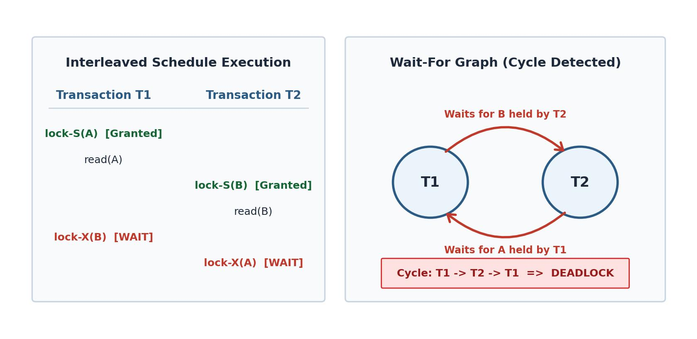

[← Directory Overview](README.md) | [Exam-Style Layer](../yearly_answers_exam_style/2017.md) | [Original Question Paper](../PreviousYearQuestion/2017.md) | [Next: 2018 →](2018.md)

---

# ECE 2215: Database Systems · Semester Final 2017 · Explanations

> [!info] Paper Metadata
> - **Examination:** B.Sc. Engineering 2nd Year Even Semester Examination, 2017
> - **Institution:** Rajshahi University of Engineering & Technology (RUET)
> - **Department:** Department of Electrical & Computer Engineering
> - **Curriculum Era:** Pre-OBE
> - **Full Marks:** 72 | **Time:** 3 Hours
> - **Instructions:** Answer any SIX questions taking THREE from each section.
> - **Question Count:** 21 sub-questions across Section A (8) and Section B (13)

---

## SECTION A

### Q.1(a) · 04 Marks

*Topic: [[Topicwise_answers_explaination/T01_DB_Concepts_and_Architecture.md#T01.2 · File system vs DBMS|T01.2 · File system vs DBMS]] · Section A*

**Question.**
Write down four significant differences between a file processing system and a DBMS.

**Answer.**

**What the examiner wants.**  
Four distinct architectural differences between an operating system file processing system and a DBMS. The mark split is 1 mark per difference. Examiners expect key technical concepts: redundancy, ad-hoc access, data independence, and concurrency or crash recovery.

**Key idea.**  
An operating system file stores a sequence of bytes. The OS does not understand the internal structure of the data inside the file. In contrast, a DBMS understands data structures, enforces relations and constraints, coordinates concurrent users, and guarantees recovery after system crashes.

**Step-by-step solution.**  

| Feature | File Processing System | DBMS (Database Management System) |
| :--- | :--- | :--- |
| **Data Redundancy & Inconsistency** | Data is duplicated across multiple separate files. Different copies easily get out of sync. | Centralizes data storage. Normalization avoids duplication and keeps copies consistent. |
| **Data Access & Retrieval** | Programmers must write a new custom program in C or Java for each new query. | Users write declarative queries (like SQL) to retrieve ad-hoc data quickly without new code. |
| **Data Isolation & Independence** | Data structures and application code are tightly coupled. Changing a file structure breaks programs. | Provides data abstraction. Changes to physical storage structures do not affect application programs. |
| **Concurrent Access & Recovery** | Hard to coordinate simultaneous access. Multiple updates cause lost data. Crash recovery is manual. | Built-in concurrency control prevents conflicting updates. Automated logging and recovery preserve ACID properties. |

*Variant for 2021 Q.1(a) (4 marks):* The same four differences directly answer the question.

**Check.**  
*Quick self-test:*
- Q: Why does a file system struggle with ad-hoc reporting?  
  A: Because each report requires a programmer to write and compile a new program from scratch.
- Q: How does a DBMS prevent data inconsistency when multiple copies exist?  
  A: It centralizes data and applies normalization so each fact is stored only once.

> [!warning] Common mistakes
> - Writing vague generalities like "file systems are old, DBMS is modern" instead of specific technical differences.
> - Omitting concurrent access anomalies and transaction crash recovery.
> - Writing a long essay instead of a structured comparison table.

**Exam tip.**  
Use a comparison table with clear feature titles. This layout allows the examiner to check off 1 mark per row in seconds.

**Sources.**  
- [Deck 01 · Slides 6–7](../LectureSlides/01_Intro_to_Database_and_DBMS.md)  
- [Textbook Ch. 1 §1.2](../Textbook/Chapter_01_Introduction/Chapter%2001%20-%20Introduction.md)

---

### Q.1(b) · 06 Marks

*Topic: [[Topicwise_answers_explaination/T02_ER_and_EER_Modeling.md#T02.5 · Design a full E-R diagram for a scenario|T02.5 · Design a full E-R diagram for a scenario]] · Section A*

**Question.**
Draw an E-R diagram for RUET student database which can be used to store student's basic information, course advisor's information, subject registration, result information.

**Answer.**

**What the examiner wants.**  
A complete E-R diagram in Chen notation covering all 4 specified functional areas: student basic info, course advisor, subject registration, and examination results. The diagram must show entities, primary keys underlined, relationships, descriptive attributes, and cardinalities.

**Key idea.**  
Map each requirement to an entity set or relationship. `STUDENT` connects to `ADVISOR` through a 1:N relationship, to `COURSE` through an M:N registration relationship, and to `RESULT` through a 1:N result relationship.

**Step-by-step solution.**  
**Design Specifications:**
1. **STUDENT:** Basic information entity with primary key `roll_no`. Attributes: `name`, `dept_name`, `series`.
2. **ADVISOR:** Faculty advisor entity with primary key `advisor_id`. Attributes: `name`, `designation`, `department`.
3. **COURSE (SUBJECT):** Academic course entity with primary key `course_code`. Attributes: `course_title`, `credits`.
4. **RESULT:** Semester examination outcome entity with primary key `result_id`. Attributes: `semester`, `gpa`, `cgpa`.

**Relationships:**
- `Advises` (1:N): An advisor guides multiple students. Each student has one advisor (total participation of student).
- `Registers` (M:N): Students register for multiple courses, and courses have many students. Descriptive attributes: `session`, `semester`.
- `Obtains` (1:N): Each student obtains multiple semester results (total participation of result).


*Figure: RUET Student Database Conceptual E-R Diagram*

*Short version for 2024 Q.1(b) (2 marks):*  
Draw the 4 entity rectangles (`STUDENT`, `ADVISOR`, `COURSE`, `RESULT`) and 3 relationship diamonds (`Advises`, `Registers`, `Obtains`) with primary keys underlined (`roll_no`, `advisor_id`, `course_code`, `result_id`) and cardinality labels (1:N, M:N, 1:N). Omit secondary descriptive attributes to complete within 2 marks.

**Check.**  
*Coverage check against requirements:*
- Student basic info: `STUDENT` entity with `roll_no`, `name`, `dept_name`, `series`.
- Course advisor info: `ADVISOR` entity and `Advises` relationship.
- Subject registration: `COURSE` entity and `Registers` M:N relationship with `semester` and `session`.
- Result info: `RESULT` entity and `Obtains` 1:N relationship.

> [!warning] Common mistakes
> - Putting `advisor_id` directly as an attribute inside `STUDENT`. In E-R modeling, relationships must be represented by diamonds, not redundant foreign key attributes.
> - Forgetting descriptive attributes on the `Registers` relationship (like `session` or `semester`).

**Exam tip.**  
Start by drawing the 4 main entity rectangles in a clean layout. Add the relationship diamonds, then attach the attribute ellipses with keys underlined.

**Sources.**  
- [Deck 05 · Slides 7–39](../LectureSlides/05_ER_Model.md)  
- [Textbook Ch. 6 §6.2–§6.4](../Textbook/Chapter_06_ER_Model/Chapter%2006%20-%20Database%20Design%20Using%20the%20E-R%20Model.md)

---

### Q.1(c) · 02 Marks

*Topic: [[Topicwise_answers_explaination/T01_DB_Concepts_and_Architecture.md#T01.3 · Functions of the DBA and relation schema|T01.3 · Functions of the DBA and relation schema]] · Section A*
*(Repeated question: Also asked in 2020 | Solved in T01)*

**Question.**
What are the main functions of a database administrator? Point out the name only.

**Answer.**

**What the examiner wants.**  
The five official functions of a DBA (3 marks, following the exact terminology from Deck 01 Slide 10) and the definition of a relation schema with a formal example (2 marks).

**Key idea.**  
The Database Administrator (DBA) is the person with centralized control over the database system. The DBA handles both physical storage decisions and user authorization. A relation schema is the logical structural definition of a table (its blueprint).

**Step-by-step solution.**  
**Five Main Functions of a Database Administrator (DBA):**
1. **Schema definition:** The DBA creates the original database schema by executing DDL statements.
2. **Storage structure and access-method definition:** The DBA defines internal storage structures, indexing methods, and file organizations to optimize data access.
3. **Schema and physical-organization modification:** The DBA modifies database schemas and physical storage layouts to improve performance or adapt to changing business requirements.
4. **Granting of authorization for data access:** The DBA assigns access rights and user roles to regulate who can inspect or modify specific data items.
5. **Routine maintenance:** The DBA performs recurring operational tasks. These include periodically backing up the database, monitoring running jobs, and ensuring sufficient free disk space.

**Relation Schema:**  
A **relation schema** is the formal logical definition or blueprint of a relation (table). It specifies the name of the relation along with its set of attributes (columns) and their corresponding domains (data types).

- Format: $R(A_1, A_2, \dots, A_n)$
- Example: $\text{instructor}(\underline{\text{ID}}, \text{name}, \text{dept\_name}, \text{salary})$, where $\underline{\text{ID}}$ serves as the primary key.

*Variant for 2021 Q.1(b) (3 marks):* State and explain the five DBA functions above; omit the relation schema.  
*Variant for 2017 Q.1(c) (2 marks):* List only the names: (1) Schema definition, (2) Storage structure and access-method definition, (3) Schema and physical-organization modification, (4) Granting of authorization for data access, (5) Routine maintenance.

**Check.**  
*Quick self-test:*
- Q: What is the difference between a relation schema and a relation instance?  
  A: The schema is the logical definition (table design), while an instance is the actual data populated at a given moment.
- Q: Which DBA function ensures that the system does not run out of storage during operations?  
  A: Routine maintenance (monitoring disk space and upgrading storage).

> [!warning] Common mistakes
> - Inventing informal duties (like "writes SQL queries" or "enters user records") instead of using the five official functions from Deck 01 Slide 10.
> - Forgetting to provide a concrete schema example for the relation schema part.

**Exam tip.**  
Examiners check off the exact 5 headings from Slide 10. Write the exact headings and underline them.

**Sources.**  
- [Deck 01 · Slide 10](../LectureSlides/01_Intro_to_Database_and_DBMS.md)  
- [Deck 02 · Slide 6](../LectureSlides/02_Relational_Model.md)  
- [Textbook Ch. 1 §1.3.2, §1.8.2](../Textbook/Chapter_01_Introduction/Chapter%2001%20-%20Introduction.md)

---

### Q.2(a) · 08 Marks

*Topic: [[Topicwise_answers_explaination/T04_Relational_Algebra_and_Calculus.md#T04.2 · Write RA queries on a given schema|T04.2 · Write RA queries on a given schema]] · Section A*

**Question.**
Consider the following relational database.<br>&emsp;`employee(person_name, street, city)`<br>&emsp;`works(person_name, company_name, salary)`<br>&emsp;`company(company_name, city)`<br>&emsp;`manages(person_name, manager_name)`<br>Now write down the relational algebra(Not SQL) to express each of following queries:<br>(i) Find the names of all employees who live in the city same as their corresponding company location.<br>(ii) Give a 10% salary raise to all the managers only.<br>(iii) Update the city information of the employee named "James" to "Newtown".<br>(iv) Find the company with most employees.

**Answer.**

**What the examiner wants.**  
Four distinct relational algebra expressions worth 2 marks each. The question tests natural joins across three tables. It also tests tuple updates using generalized projection and set union, attribute assignment, and aggregation with max filtering.

**Key idea.**  
Relational algebra expressions manipulate relation instances as mathematical sets. For updates, standard relational algebra has no in-place mutation. We express updates by computing the modified tuples and taking their union with the untouched tuples. For aggregation, group by company and find the peak count.

**Step-by-step solution.**

**(i) Employees living in the same city as their company:**

1. Join `employee` with `works` on `person_name`. This matches each person with their employer.
2. Join the result with `company`. Both `employee` and `company` share the attribute `city`, while `works` and `company` share `company_name`. The natural join $\bowtie$ automatically enforces `employee.city = company.city` and `works.company_name = company.company_name`.
3. Project `person_name`:

$$
T_1 \leftarrow \text{employee} \bowtie \text{works} \bowtie \text{company}
$$

$$
\Pi_{\text{person\_name}}(T_1)
$$

Equivalently, written as a single expression:

$$
\boxed{\Pi_{\text{person\_name}}(\text{employee} \bowtie \text{works} \bowtie \text{company})}
$$

**(ii) Give a 10% salary raise to all managers only:**

1. The `manages` relation pairs `(person_name, manager_name)`. Extract all distinct manager names and rename the attribute to `person_name` to join with `works`:

$$
M \leftarrow \rho_{M(\text{person\_name})}(\Pi_{\text{manager\_name}}(\text{manages}))
$$

2. Match managers with their work records:

$$
T_{\text{mgr}} \leftarrow \text{works} \bowtie M
$$

3. Construct the updated tuples with a 10% raise using generalized projection:

$$
T_{\text{raised}} \leftarrow \Pi_{\text{person\_name}, \text{company\_name}, \text{salary} * 1.1}(T_{\text{mgr}})
$$

4. Identify all non-manager tuples that must remain untouched:

$$
T_{\text{untouched}} \leftarrow \text{works} - T_{\text{mgr}}
$$

5. Reassign the relation `works` as the union of raised and untouched records:

$$
\boxed{\text{works} \leftarrow T_{\text{raised}} \cup T_{\text{untouched}}}
$$

**(iii) Update city of employee "James" to "Newtown":**

1. Select the employee tuple for "James":

$$
T_{\text{james}} \leftarrow \sigma_{\text{person\_name} = \text{"James"}}(\text{employee})
$$

2. Project the updated attributes, replacing the city value with the constant string `"Newtown"`:

$$
T_{\text{updated}} \leftarrow \Pi_{\text{person\_name}, \text{street}, \text{"Newtown"}}(T_{\text{james}})
$$

3. Subtract James from the original relation to retain all untouched employee records:

$$
T_{\text{untouched}} \leftarrow \text{employee} - T_{\text{james}}
$$

4. Union the updated tuple with the untouched tuples:

$$
\boxed{\text{employee} \leftarrow T_{\text{updated}} \cup T_{\text{untouched}}}
$$

**(iv) Find the company with the most employees:**

1. Group the `works` relation by `company_name` and count the employees:

$$
T_{\text{counts}} \leftarrow {}_{\text{company\_name}}\gamma_{\text{count}(\text{person\_name}) \ \text{as} \ \text{num\_emp}}(\text{works})
$$

2. Find the highest employee count across all companies:

$$
T_{\text{max}} \leftarrow \gamma_{\text{max}(\text{num\_emp}) \ \text{as} \ \text{max\_emp}}(T_{\text{counts}})
$$

3. Take the Cartesian product of $T_{\text{counts}}$ and $T_{\text{max}}$, select the tuples where the company count equals the maximum count, and project the company name:

$$
\boxed{\Pi_{\text{company\_name}}(\sigma_{\text{num\_emp} = \text{max\_emp}}(T_{\text{counts}} \times T_{\text{max}}))}
$$

**Check.**  
Consider sample data:
- `employee`: `("Alice", "Road 1", "Dhaka")`, `("Bob", "Road 2", "Rajshahi")`.
- `works`: `("Alice", "Apex", 50000)`, `("Bob", "Apex", 45000)`.
- `company`: `("Apex", "Dhaka")`.
- `manages`: `("Bob", "Alice")`.

- Part (i): Alice lives in Dhaka and Apex is in Dhaka. Bob lives in Rajshahi. Natural join returns `("Alice")`.
- Part (ii): Alice is in `manages.manager_name`. Alice gets $50000 \times 1.1 = 55000$. Bob is untouched at $45000$. The union restores both employees.
- Part (iv): Apex has count 2. Max count is 2. The selection matches Apex.

> [!warning] Common mistakes
> - Writing only the selection or projection for updates. Omitting the union with untouched tuples silently deletes all other employees from the database.
> - Using SQL keywords like `UPDATE` or `SET`. The question explicitly says "relational algebra (Not SQL)".
> - Writing $\Pi_{\text{company\_name}}(\gamma_{\text{max}(\dots)})$ directly. A scalar aggregation returns only the maximum number, not the company name. You must join or multiply back to get the name.

**Exam tip.**  
Break long relational algebra queries into named temporary relations using $\leftarrow$. It prevents syntax errors and earns partial marks even if an index is misnamed.

**Sources.**  
`[Lecture Deck 02 · Slides 15–29](../LectureSlides/02_Relational_Model.md)`  
`[Textbook Ch. 2 §2.6](../Textbook/Chapter_02_Relational_Model/Chapter%2002%20-%20Introduction%20to%20the%20Relational%20Model.md)`  
`[Textbook Ch. 16 §16.1](../Textbook/Chapter_16_Query_Optimization/Chapter%2016%20-%20Query%20Optimization.md)`

---

### Q.2(b) · 04 Marks

*Topic: [[Topicwise_answers_explaination/T01_DB_Concepts_and_Architecture.md#T01.4 · Data abstraction levels, schemas and instances|T01.4 · Data abstraction levels, schemas and instances]] · Section A*

**Question.**
What is the purpose of data abstraction? Describe the different level of data abstraction.

**Answer.**

**What the examiner wants.**  
The definition and purpose of data abstraction (~1 mark), clear descriptions of all three abstraction levels (physical, logical, view) (~2 marks), and the architecture diagram (~1 mark).

**Key idea.**  
Database systems use complex data structures to store information efficiently. Most users and application programmers do not understand storage pointers or disk block layouts. Data abstraction hides low-level complexity to provide a clean and intuitive interface.

**Step-by-step solution.**  
**Purpose of Data Abstraction:**  
A database contains complex data structures, storage blocks, and indexing schemes. Most end users and programmers are not trained in low-level storage details. Data abstraction hides this physical complexity. It simplifies user interactions, enforces security, and enables physical data independence.

**Levels of Data Abstraction:**
1. **Physical level:** The lowest abstraction level. It describes *how* records are stored on secondary storage media (such as byte offsets, data blocks, B+ trees, and hashing schemes).
2. **Logical level:** The intermediate level. It describes *what* data is stored in the database and the relationships among those data. Programmers and administrators work at this level using schemas.
   Example record:
   ```text
   type instructor = record
       ID : string;
       name : string;
       dept_name : string;
       salary : integer;
   end;
   ```
3. **View level:** The highest abstraction level. It describes only the subset of the database relevant to a specific user group. It hides other data and complex structures for ease of use and security (for example, hiding instructor salaries from students).


*Figure: Three levels of data abstraction (Deck 01, Slide 14)*

*Variant for 2019 Q.2(a) (4 marks):* Define data abstraction, describe the three levels, and include the diagram.  
*Variant for CT-01 Q.01 (5 marks):* State the definition, explain the three levels, show the record example, and draw the diagram.

**Check.**  
*Quick level-matching test:*
- Record block allocation on disk blocks $\rightarrow$ Physical level.
- Entity definition with column names and data types $\rightarrow$ Logical level.
- Form displaying student grades without instructor salaries $\rightarrow$ View level.

> [!warning] Common mistakes
> - Mixing up the logical level and view level. Remember that the logical level describes the *entire* database, while each view describes a *subset*.
> - Leaving out the architecture diagram.

**Exam tip.**  
Draw the three-tiered box diagram with multiple view boxes on top, the logical box in the middle, and the physical box at the bottom.

**Sources.**  
- [Deck 01 · Slides 13–14](../LectureSlides/01_Intro_to_Database_and_DBMS.md)  
- [Textbook Ch. 1 §1.3](../Textbook/Chapter_01_Introduction/Chapter%2001%20-%20Introduction.md)

---

### Q.3(a) · 03 Marks

*Topic: [[Topicwise_answers_explaination/T08_Normalization_and_Functional_Dependencies.md#T08.6 · Define normalization (and its importance) & 1NF / 2NF / 3NF|T08.6 · Define normalization (and its importance) & 1NF / 2NF / 3NF]] · Section A*

**Question.**
What do you mean by normalization? Why normalization is important for database?

**Answer.**

**What the examiner wants.**  
A concise definition of normalization (1.5 marks) and four clear points on why it is important for relational database design (1.5 marks).

**Key idea.**  
Normalization is systematic database cleanup. It takes messy, bloated tables and divides them into well-behaved tables where every non-key column depends strictly on the primary key.

**Step-by-step solution.**

#### 1. What is Normalization?

**Normalization** is a formal, systematic technique for designing relational database schemas. It decomposes relations with anomalies into smaller, well-structured relations to reduce data redundancy and ensure data integrity.

#### 2. Importance of Normalization (Main Objectives)

Normalization is essential for relational databases because it:

1. **Eliminates Unnecessary Data Redundancy:** Prevents storing the same facts repeatedly across multiple records, which conserves physical storage.
2. **Prevents Database Anomalies:** Completely removes insertion, deletion, and update anomalies that corrupt data during modifications.
3. **Ensures Data Consistency and Integrity:** Guarantees that an update applied to one record keeps all related facts accurate and consistent.
4. **Preserves Data Dependencies:** Ensures all real-world business constraints and functional dependencies can be enforced efficiently without complex cross-table joins.

*Short version for CT-03 Q.03 (3 marks):* Define normalization as the systematic decomposition of relations to minimize redundancy and eliminate anomalies. State the main objective: to produce well-structured tables free of insertion, update, and deletion anomalies while maintaining data consistency.

**Check.**  
*Quick self-test:*
- Q: What does normalization decompose?  
  A: It decomposes a relation schema $R$ into a set of smaller schemas $\{R_1, R_2, \dots, R_k\}$.
- Q: What two properties must a good decomposition guarantee?  
  A: Lossless-join decomposition and dependency preservation.

> [!warning] Common mistakes
> - Giving an overly casual definition like "making databases normal" without mentioning decomposition and anomaly elimination.
> - Forgetting to list data consistency and anomaly prevention as core objectives.

**Exam tip.**  
Provide the formal definition in 2 to 3 lines, followed by a numbered list of four distinct benefits.

**Sources.**  
- [Deck 06 · Slide 4](../LectureSlides/06_DBMS_Normalization.md)
- [Textbook Ch. 7 §7.1](../Textbook/Chapter_07_Normalization/Chapter%2007%20-%20Relational%20Database%20Design.md)

---

### Q.3(b) · 09 Marks

*Topic: [[Topicwise_answers_explaination/T08_Normalization_and_Functional_Dependencies.md#T08.8 · Normalize an unnormalized table → 1NF → 2NF → 3NF|T08.8 · Normalize an unnormalized table → 1NF → 2NF → 3NF]] · Section A*

**Question.**
Consider the following data table com_employee. Is it already normalized? If not then normalize the table com_employee up to $3^{\text{rd}}$ normal form.<br><br><b>com_employee</b><br><table border="1" style="border-collapse: collapse;"><thead><tr><th>Pcode</th><th>Ptitle</th><th>EmpNo</th><th>EmName</th><th>EmCon</th><th>dNo</th><th>dName</th><th>HRate</th></tr></thead><tbody><tr><td>p1</td><td>Admission Test System</td><td>E1</td><td>Jones</td><td>501, 502</td><td>D1</td><td>IT</td><td>1000</td></tr><tr><td>p1</td><td>Admission Test System</td><td>E3</td><td>Smith</td><td>505</td><td>D2</td><td>Database</td><td>1100</td></tr><tr><td>p1</td><td>Admission Test System</td><td>E4</td><td>James</td><td>508, 509</td><td>D3</td><td>HR</td><td>800</td></tr><tr><td>p2</td><td>Salary System</td><td>E1</td><td>Jones</td><td>501, 502</td><td>D1</td><td>IT</td><td>900</td></tr><tr><td>p2</td><td>Salary System</td><td>E3</td><td>Smith</td><td>505</td><td>D2</td><td>Database</td><td>1000</td></tr></tbody></table>

**Answer.**

**What the examiner wants.**  
Direct answer on normalization status with justification (1 mark), followed by a clear, progressive three-step transformation: 1NF with atomic rows and primary key (2.5 marks), 2NF eliminating partial dependencies (2.5 marks), and 3NF eliminating transitive dependencies with sample tables and keys (3 marks).

**Key idea.**  
Notice that `EmCon` has comma-separated contact numbers (violates 1NF). Next, project titles depend only on `Pcode`, and employee names depend only on `EmpNo` (violates 2NF). Finally, department name depends on `dNo`, which depends on `EmpNo` (violates 3NF).

**Step-by-step solution.**

#### 1. Is the Table Already Normalized?

**No, the table is not normalized.**

It contains multi-valued entries in column `EmCon` (`501, 502` and `508, 509`). This directly violates the atomicity requirement of **First Normal Form (1NF)**. In addition, it mixes project, employee, contact, department, and assignment facts, causing partial and transitive dependencies.

#### 2. Functional Dependencies Identified from Data

- $\text{Pcode} \rightarrow \text{Ptitle}$
- $\text{EmpNo} \rightarrow \text{EmName}, \text{dNo}$
- $\text{dNo} \rightarrow \text{dName}$
- $(\text{Pcode}, \text{EmpNo}) \rightarrow \text{HRate}$ (an employee's hourly rate depends on the specific project)
- $\text{EmCon}$ is a multi-valued attribute of employee (`EmpNo`).

---

#### Step 1: Conversion to First Normal Form (1NF)

To achieve 1NF, we eliminate multi-valued fields by splitting them into separate atomic rows:

| Pcode | Ptitle | EmpNo | EmName | EmCon | dNo | dName | HRate |
| :--- | :--- | :--- | :--- | :--- | :--- | :--- | :--- |
| p1 | Admission Test System | E1 | Jones | 501 | D1 | IT | 1000 |
| p1 | Admission Test System | E1 | Jones | 502 | D1 | IT | 1000 |
| p1 | Admission Test System | E3 | Smith | 505 | D2 | Database | 1100 |
| p1 | Admission Test System | E4 | James | 508 | D3 | HR | 800 |
| p1 | Admission Test System | E4 | James | 509 | D3 | HR | 800 |
| p2 | Salary System | E1 | Jones | 501 | D1 | IT | 900 |
| p2 | Salary System | E1 | Jones | 502 | D1 | IT | 900 |
| p2 | Salary System | E3 | Smith | 505 | D2 | Database | 1000 |

PK: `(Pcode, EmpNo, EmCon)`

---

#### Step 2: Conversion to Second Normal Form (2NF)

We eliminate partial dependencies where non-prime attributes depend on proper subsets of the composite key:
- `Pcode -> Ptitle` depends only on `Pcode`.
- `EmpNo -> EmName, dNo, dName` depends only on `EmpNo`.
- `(EmpNo, EmCon)` represents employee phone numbers.
- `(Pcode, EmpNo) -> HRate` depends on the full project-employee assignment.

We decompose into four 2NF relations:

**PROJECT**

| Pcode | Ptitle |
| :--- | :--- |
| p1 | Admission Test System |
| p2 | Salary System |

PK: `Pcode`

**EMPLOYEE_2NF**

| EmpNo | EmName | dNo | dName |
| :--- | :--- | :--- | :--- |
| E1 | Jones | D1 | IT |
| E3 | Smith | D2 | Database |
| E4 | James | D3 | HR |

PK: `EmpNo`

**EMP_CONTACT**

| EmpNo | EmCon |
| :--- | :--- |
| E1 | 501 |
| E1 | 502 |
| E3 | 505 |
| E4 | 508 |
| E4 | 509 |

PK: `(EmpNo, EmCon)`

**PROJECT_ASSIGNMENT**

| Pcode | EmpNo | HRate |
| :--- | :--- | :--- |
| p1 | E1 | 1000 |
| p1 | E3 | 1100 |
| p1 | E4 | 800 |
| p2 | E1 | 900 |
| p2 | E3 | 1000 |

PK: `(Pcode, EmpNo)`

---

#### Step 3: Conversion to Third Normal Form (3NF)

In `EMPLOYEE_2NF`, a transitive dependency exists:
$$
\text{EmpNo} \rightarrow \text{dNo} \quad \text{and} \quad \text{dNo} \rightarrow \text{dName}
$$
Here, `dNo` is a non-prime attribute determining another non-prime attribute `dName`.

We decompose `EMPLOYEE_2NF` into:
1. `DEPARTMENT(dNo, dName)` with PK `dNo`.
2. `EMPLOYEE(EmpNo, EmName, dNo)` with PK `EmpNo` and foreign key `dNo` referencing `DEPARTMENT`.

#### Final 3NF Schema and Relations

1. **PROJECT**  
   `PROJECT(Pcode, Ptitle)`  
   PK: `Pcode`

2. **DEPARTMENT**  

   | dNo | dName |
   | :--- | :--- |
   | D1 | IT |
   | D2 | Database |
   | D3 | HR |
   
   PK: `dNo`

3. **EMPLOYEE**  

   | EmpNo | EmName | dNo |
   | :--- | :--- | :--- |
   | E1 | Jones | D1 |
   | E3 | Smith | D2 |
   | E4 | James | D3 |
   
   PK: `EmpNo` | FK: `dNo` references `DEPARTMENT(dNo)`

4. **EMP_CONTACT**  
   `EMP_CONTACT(EmpNo, EmCon)`  
   PK: `(EmpNo, EmCon)` | FK: `EmpNo` references `EMPLOYEE(EmpNo)`

5. **PROJECT_ASSIGNMENT**  
   `PROJECT_ASSIGNMENT(Pcode, EmpNo, HRate)`  
   PK: `(Pcode, EmpNo)` | FKs: `Pcode` references `PROJECT(Pcode)`, `EmpNo` references `EMPLOYEE(EmpNo)`

**Check.**  
*Trace check:*
- Can we reconstruct the hourly rate of Jones on Admission Test System?  
  Join `PROJECT_ASSIGNMENT` (`p1`, `E1`, `1000`) with `PROJECT` (`p1`, `Admission Test System`) and `EMPLOYEE` (`E1`, `Jones`, `D1`). The rate is 1000.
- Can we find Jones's department name?  
  Follow `E1 -> D1 -> IT`. It matches the original table perfectly.

> [!warning] Common mistakes
> - Missing `EMP_CONTACT` as its own separate table. If you leave `EmCon` inside `EMPLOYEE`, you re-introduce multi-valued non-atomic data.
> - Putting `HRate` in the `EMPLOYEE` table. Notice from the table that Jones has `HRate = 1000` on project `p1`, but `HRate = 900` on project `p2`. `HRate` depends on both `Pcode` and `EmpNo`!

**Exam tip.**  
State the functional dependencies at the top before writing any tables. This justifies every table split to the examiner.

**Sources.**  
- [Deck 06 · Slides 30–40](../LectureSlides/06_DBMS_Normalization.md)
- [Textbook Ch. 7 §7.3, §7.5](../Textbook/Chapter_07_Normalization/Chapter%2007%20-%20Relational%20Database%20Design.md)

---

### Q.4(a) · 09 Marks

*Topic: [[Topicwise_answers_explaination/T05_SQL_DDL_DML_Aggregates_Subqueries.md#T05.2 · DDL + DML warm-up: CREATE, INSERT, ALTER ... ADD, UPDATE, DELETE, rename, filter|T05.2 · DDL + DML warm-up: CREATE, INSERT, ALTER ... ADD, UPDATE, DELETE, rename, filter]] · Section A*

**Question.**
Considering following tables (INFO, MARKS, CREDIT) answer (i),(ii) & (iii).<br><br><table style="border: none; border-collapse: collapse;"><tr style="border: none; vertical-align: top;"><td style="border: none; padding-right: 15px;"><b>INFO</b><br><table border="1" style="border-collapse: collapse;"><thead><tr><th>roll</th><th>name</th></tr></thead><tbody><tr><td>1710001</td><td>Amelia</td></tr><tr><td>1710002</td><td>Oliver</td></tr><tr><td>1710003</td><td>James</td></tr><tr><td>1710004</td><td>Sansa</td></tr></tbody></table></td><td style="border: none; padding-right: 15px;"><b>MARKS</b><br><table border="1" style="border-collapse: collapse;"><thead><tr><th>roll</th><th>sub_code</th><th>gpa</th></tr></thead><tbody><tr><td>1710001</td><td>ECE 2205</td><td>3.50</td></tr><tr><td>1710001</td><td>ECE 2215</td><td>3.75</td></tr><tr><td>1710002</td><td>ECE 2205</td><td>3.75</td></tr><tr><td>1710002</td><td>ECE 2215</td><td>3.25</td></tr><tr><td>1710003</td><td>ECE 2205</td><td>4.00</td></tr><tr><td>1710003</td><td>ECE 2215</td><td>3.75</td></tr><tr><td>1710004</td><td>ECE 2205</td><td>3.50</td></tr><tr><td>1710004</td><td>ECE 2215</td><td>4.00</td></tr></tbody></table></td><td style="border: none; vertical-align: top;"><b>CREDIT</b><br><table border="1" style="border-collapse: collapse;"><thead><tr><th>sub_code</th><th>credit</th></tr></thead><tbody><tr><td>ECE 2205</td><td>3.00</td></tr><tr><td>ECE 2215</td><td>3.00</td></tr></tbody></table></td></tr></table><br><br>(i) Write down the SQL query to create the table MARKS.<br>(ii) Write down the SQL query to find out subject code and corresponding gpa of the student whose class serial 02.<br>(iii) Write the the SQL query to calculate the cgpa of each student using the formula, $cgpa = \frac{\Sigma gpa \cdot credit}{\Sigma credit}$

**Answer.**

**What the examiner wants.**  
Three distinct SQL capabilities (3 marks each):  
1. DDL relation definition with composite primary key and foreign keys.  
2. Selection query interpreting student class serial from student roll numbers.  
3. Multi-table aggregation calculating a weighted sum ratio grouped by student.

**Key idea.**  
In relational database design, bridge tables like `MARKS` contain foreign keys pointing to independent parent entities (`INFO` and `CREDIT`). Calculating CGPA requires joining grade points with course credits, taking their products, summing them per student, and dividing by total enrolled credit units.

**Step-by-step solution.**  
*(i) Create table MARKS:*

```sql
CREATE TABLE MARKS (
    roll INT,
    sub_code VARCHAR(20),
    gpa DECIMAL(3, 2),
    PRIMARY KEY (roll, sub_code),
    FOREIGN KEY (roll) REFERENCES INFO(roll),
    FOREIGN KEY (sub_code) REFERENCES CREDIT(sub_code)
);
```

*(ii) Subject code and GPA for student with class serial 02:*

*Assumption: In the RUET roll format (e.g., 1710002), the final two digits represent the student's class serial. Class serial 02 identifies student roll 1710002 (Oliver).*

```sql
SELECT sub_code, gpa
FROM MARKS
WHERE roll = 1710002;
```

*(Alternative dynamic filter matching the last two digits:* `WHERE roll % 100 = 2;`*)*

*(iii) Calculate CGPA of each student:*

```sql
SELECT m.roll,
       SUM(m.gpa * c.credit) / SUM(c.credit) AS cgpa
FROM MARKS m
JOIN CREDIT c ON m.sub_code = c.sub_code
GROUP BY m.roll;
```

**Check.**  
*Manual trace for student Oliver (`roll = 1710002`):*
- ECE 2205: $\text{gpa} = 3.75$, $\text{credit} = 3.0 \implies \text{grade points} = 11.25$
- ECE 2215: $\text{gpa} = 3.25$, $\text{credit} = 3.0 \implies \text{grade points} = 9.75$
- $\sum (\text{gpa} \times \text{credit}) = 11.25 + 9.75 = 21.00$
- $\sum \text{credit} = 3.0 + 3.0 = 6.0$
- $\text{CGPA} = 21.00 / 6.0 = 3.50$. The query formula produces exactly this scalar result.

> [!warning] Common mistakes
> - Making `roll` alone the primary key of `MARKS`. A student enrolls in multiple courses, so `(roll, sub_code)` must form a composite primary key.
> - Computing simple average `AVG(gpa)` instead of the weighted formula $\frac{\sum (\text{gpa} \cdot \text{credit})}{\sum \text{credit}}$. When course credits differ, simple average yields incorrect CGPA.

**Exam tip.**  
Explicitly state your interpretation of "class serial 02" in one short assumption line before writing the query.

**Sources.**  
[Deck 03 · Slides 7–10, 18, 30–33](../LectureSlides/03_Introduction_to_SQL.md), [Textbook Ch. 3 §3.2, §3.4, §3.7](../Textbook/Chapter_03_Intro_SQL/Chapter%2003%20-%20Introduction%20to%20SQL.md).

---

## SECTION B

### Q.5(a) · 04 Marks

*Topic: [[Topicwise_answers_explaination/T09_Transactions_ACID_and_Anomalies.md#T09.1 · ACID properties|T09.1 · ACID properties]] · Section B*

**Question.**
Briefly discuss the ACID properties of transaction.

**Answer.**

**What the examiner wants.**  
A concise definition of each of the four ACID properties. Examiners look for the specific database subsystem responsible for enforcing each property. The mark split is 1 mark per property (or 0.5 marks each in the 2-mark paper).

**Key idea.**  
A transaction is a logical unit of database work. To keep data safe during crashes and concurrent access, the DBMS treats every transaction as an atomic, isolated unit that leaves data consistent and permanently saved.

**Step-by-step solution.**  
A **transaction** is a logical unit of program execution that accesses and updates data items. To preserve data integrity during crashes and concurrent access, the DBMS must ensure the four **ACID** properties:

1. **Atomicity ("All-or-None"):**
   - Either all operations of the transaction are properly reflected in the database, or none are.
   - If a failure happens before the transaction completes, partial modifications are rolled back.
   - **Enforced by:** The **Recovery System** (using undo log records).

2. **Consistency (Preservation of Invariants):**
   - Executing a transaction in isolation preserves database consistency.
   - The database moves from one valid state to another valid state, satisfying all integrity constraints.
   - In a fund transfer, the total balance sum must remain unchanged.
   - **Enforced by:** The **Application Programmer** (correct business logic) and DBMS **Integrity Constraints**.

3. **Isolation (Shielding Concurrent Access):**
   - Each transaction executes as if it were running alone without interference from other concurrent transactions.
   - Intermediate results remain hidden from other concurrent transactions until commit.
   - **Enforced by:** The **Concurrency-Control System** (using locking or timestamp protocols).

4. **Durability (Persistence):**
   - After a transaction completes successfully and commits, its updates persist in the database permanently.
   - The committed data survives subsequent system crashes or power outages.
   - **Enforced by:** The **Recovery System** (using redo logs and non-volatile stable storage).

*Short version for 2024 Q.6(c) (2 marks):*
- **Atomicity:** All operations complete or none do. The recovery system undoes partial writes.
- **Consistency:** Execution in isolation preserves database validity and invariants.
- **Isolation:** Intermediate updates remain hidden from concurrent transactions.
- **Durability:** Committed changes persist permanently on disk despite crashes.

**Check.**  
*Quick self-test:*
- Q: Which DBMS subsystem enforces atomicity?  
  A: The recovery system, using write-ahead undo logs.
- Q: Who is primarily responsible for consistency?  
  A: The application programmer who codes correct business logic, assisted by DBMS integrity constraints.
- Q: Why is durability not handled by volatile main memory?  
  A: Main memory loses data on power failure. Durability requires writing to stable storage or non-volatile disk logs.

> [!warning] Common mistakes
> - Confusing Atomicity with Isolation. Atomicity handles failure and recovery. Isolation handles concurrent transactions.
> - Stating that the DBMS guarantees consistency automatically without programmer logic. Erroneous application code (like adding \$100 instead of \$50) produces valid SQL that still breaks business invariants.
> - Forgetting to name the enforcing subsystem for each property.

**Exam tip.**  
Start each bullet with the letter of the acronym, bold the property name, write a one-sentence definition, and end by naming the enforcing component.

**Sources.**  
- [Deck 07 · Slides 3–7](../LectureSlides/07_Transactions.md)  
- [Textbook Ch. 17 §17.1–17.2](../Textbook/Chapter_17_Transactions/Chapter%2017%20-%20Transactions.md)

---

### Q.5(b) · 02 Marks

*Topic: [[Topicwise_answers_explaination/T10_Serializability.md#T10.1 · Define conflicting instructions & conflict serializability|T10.1 · Define conflicting instructions & conflict serializability]] · Section B*

**Question.**
What do you know about conflict serializability?

**Answer.**

**What the examiner wants.** A crisp definition of conflict serializability (1 mark) and the rule identifying conflicting operations or graph testing (1 mark).

**Key idea.** A serial schedule executes transactions one after another with no overlap. It is inherently safe. A concurrent schedule interleaves operations from different transactions. If we can rearrange that concurrent schedule into a serial schedule by only swapping adjacent instructions that do not interfere with each other, the concurrent schedule is just as safe as the serial schedule. We call such a schedule conflict serializable.

**Step-by-step solution.**

1. **Definition of conflict equivalence:** Two schedules $S$ and $S'$ are **conflict equivalent** if schedule $S$ can be transformed into schedule $S'$ by a sequence of swaps of non-conflicting adjacent instructions.
2. **Definition of conflict serializability:** A schedule $S$ is **conflict serializable** if it is conflict equivalent to some serial schedule.
3. **When do instructions conflict?** Two instructions $I_i$ and $I_j$ belonging to different transactions $T_i$ and $T_j$ conflict if and only if both access the same data item $Q$, and at least one of them performs a write operation:
   - $\text{read}(Q)$ and $\text{read}(Q)$: No conflict (both only read).
   - $\text{read}(Q)$ and $\text{write}(Q)$: **Conflict** (changing order changes what is read).
   - $\text{write}(Q)$ and $\text{read}(Q)$: **Conflict** (changing order exposes an uncommitted write or old value).
   - $\text{write}(Q)$ and $\text{write}(Q)$: **Conflict** (changing order overwrites a different final value).
4. **Testing conflict serializability:** We build a directed graph called a **precedence graph** (or serialization graph). The transactions are vertices. We draw a directed edge $T_i \to T_j$ if an instruction of $T_i$ executes before a conflicting instruction of $T_j$.
5. **Serializability theorem:** A schedule is conflict serializable if and only if its precedence graph is **acyclic**. When acyclic, a topological sort gives the equivalent serial schedule order.

**Check.**
- *Quick check:* Can two operations on different data items ($A$ and $B$) conflict? No. Swapping them never changes any value.
- *Quick check:* Does an acyclic precedence graph guarantee serializability? Yes. Topological sorting produces a valid serial order without any conflicting dependency violations.

> [!warning] Common mistakes
> - Stating that two $\text{read}(Q)$ instructions conflict. Two reads on the same item do not conflict because reading never modifies data.
> - Confusing conflict serializability with view serializability. Conflict serializability requires non-conflicting adjacent instruction swaps. View serializability only requires matching read-from and final write states.
> - Forgetting that conflicting instructions must belong to different transactions.

**Exam tip.** For a 2-mark question, write the definition of conflict serializability and list the 4 read/write cases in 3 to 4 lines.

**Sources.**
- [Deck 07 · Slides 16–19](../LectureSlides/07_Transactions.md)
- [Textbook Ch. 17 §17.6](../Textbook/Chapter_17_Transactions/Chapter%2017%20-%20Transactions.md)

---

### Q.5(c) · 06 Marks

*Topic: [[Topicwise_answers_explaination/T10_Serializability.md#T10.4 · Build serializable/non-serializable schedules ($T_1,T_2$ with "if A = 0 then B := B+1")|T10.4 · Build serializable/non-serializable schedules ($T_1,T_2$ with "if A = 0 then B := B+1")]] · Section B*

**Question.**
Consider the following two transactions.<br><br>**T1:**<br>&emsp;`read(A);`<br>&emsp;`read(B);`<br>&emsp;`if A = 0 then B:=B+1;`<br>&emsp;`write(B);`<br><br>**T2:**<br>&emsp;`read(B);`<br>&emsp;`read(A);`<br>&emsp;`if B = 0 then A:=A+1;`<br>&emsp;`write(A);`<br><br>Let the consistency requirement be $A = 0$ or $B = 0$ with $A=B=0$ the initial values.<br>(i) Show a concurrent execution of T1 and T2 that produces a nonserializable schedule.<br>(ii) Is there a concurrent execution of T1 and T2 that produces a serializable schedule?

**Answer.**

**What the examiner wants.** Baseline analysis of serial executions (1 mark), constructing an interleaved schedule and proving inconsistency and non-serializability (3 marks), and rigorous proof that no concurrent execution can be serializable (2 marks).

**Key idea.** $T_1$ increments $B$ only if $A = 0$. $T_2$ increments $A$ only if $B = 0$. If they run serially, whichever runs first changes its target variable from 0 to 1. The second transaction then sees a non-zero value and does not change its variable. One variable becomes 1 while the other remains 0, preserving consistency ($A=0 \vee B=0$). But if they interleave so that both read before either writes, both see 0. Both increment their variables, resulting in $A=1, B=1$. That violates consistency and forms a cycle.

**Step-by-step solution.**

#### 1. Baseline: Serial Executions Preserve Consistency

Initial state: $A = 0, B = 0$. Consistency requirement: $A = 0 \vee B = 0$.
- **Serial order $\langle T_1, T_2 \rangle$:**
  - $T_1$ reads $A=0, B=0$. Because $A=0$, it sets $B := 0 + 1 = 1$, and writes $B=1$.
  - $T_2$ then runs. It reads $B=1, A=0$. The condition `B = 0` is false ($1 \neq 0$). It does not increment $A$. It writes $A=0$.
  - Final database state: $A = 0, B = 1$. The condition $A = 0 \vee B = 0$ holds.
- **Serial order $\langle T_2, T_1 \rangle$:**
  - $T_2$ reads $B=0, A=0$. Because $B=0$, it sets $A := 0 + 1 = 1$, and writes $A=1$.
  - $T_1$ then runs. It reads $A=1, B=0$. The condition `A = 0` is false ($1 \neq 0$). It does not increment $B$. It writes $B=0$.
  - Final database state: $A = 1, B = 0$. The condition $A = 0 \vee B = 0$ holds.

---

#### 2. Part (i): Concurrent Execution Producing a Nonserializable Schedule

We construct a schedule where both transactions read both items before either performs its write:

| Step | Transaction | Instruction | Value Read / Action |
| :--: | :--: | :-- | :-- |
| 1 | $T_1$ | `read(A);` | Reads initial value $A = 0$ |
| 2 | $T_2$ | `read(B);` | Reads initial value $B = 0$ |
| 3 | $T_1$ | `read(B);` | Reads initial value $B = 0$ |
| 4 | $T_2$ | `read(A);` | Reads initial value $A = 0$ |
| 5 | $T_1$ | `if A = 0 then B:=B+1;`<br>`write(B);` | $A = 0$ is true $\implies B := 0 + 1 = 1$. Writes $B = 1$. |
| 6 | $T_2$ | `if B = 0 then A:=A+1;`<br>`write(A);` | $B = 0$ is true $\implies A := 0 + 1 = 1$. Writes $A = 1$. |

**Final Database State:**
$$
A = 1 \quad \text{and} \quad B = 1
$$

This violates the consistency requirement $A = 0 \vee B = 0$ because neither $A$ nor $B$ is 0.


**Proof of Non-serializability:**
- $T_1: \text{read}(A)$ (step 1) occurs before $T_2: \text{write}(A)$ (step 6) $\implies T_1 \to T_2$.
- $T_2: \text{read}(B)$ (step 2) occurs before $T_1: \text{write}(B)$ (step 5) $\implies T_2 \to T_1$.
- The precedence graph contains the cycle $T_1 \longleftrightarrow T_2$.
- Also, no serial schedule produces the final state $A = 1, B = 1$. Therefore, this schedule is **non-serializable**.

---

#### 3. Part (ii): Can Any Concurrent Execution Be Serializable?

**Answer:** **No.**

**Proof:**
In a genuinely concurrent (interleaved) execution, the instructions of $T_1$ and $T_2$ must overlap in time:
1. Consider data item $A$: $T_1$ reads $A$, and $T_2$ writes $A$.
   - If $T_1$ reads $A$ before $T_2$ writes $A$, this requires the edge $T_1 \to T_2$.
   - If $T_2$ writes $A$ before $T_1$ reads $A$, then $T_2$ must have already completed its execution (since `write(A)` is $T_2$'s final operation). But if $T_2$ finishes before $T_1$ starts reading $A$, $T_2$ executed serially before $T_1$.
2. Consider data item $B$: $T_2$ reads $B$, and $T_1$ writes $B$.
   - If $T_2$ reads $B$ before $T_1$ writes $B$, this requires the edge $T_2 \to T_1$.
   - If $T_1$ writes $B$ before $T_2$ reads $B$, then $T_1$ must have already finished its execution (since `write(B)` is $T_1$'s final operation). But if $T_1$ finishes before $T_2$ starts reading $B$, $T_1$ executed serially before $T_2$.

For any schedule that is truly interleaved (concurrent), $T_1$ must read $A$ before $T_2$ writes $A$, and $T_2$ must read $B$ before $T_1$ writes $B$. This forces both directed edges:
$$
T_1 \longrightarrow T_2 \quad \text{and} \quad T_2 \longrightarrow T_1
$$

This creates a cycle $T_1 \longleftrightarrow T_2$ in every concurrent execution. Therefore, **every concurrent execution is non-serializable**. Only strictly serial executions ($\langle T_1, T_2 \rangle$ and $\langle T_2, T_1 \rangle$) are serializable.

**Check.**
- Test serial outcome: $A=0, B=1$ or $A=1, B=0$. Both satisfy $A=0 \vee B=0$.
- Test interleaved outcome: $A=1, B=1$. Violates $A=0 \vee B=0$.
- Test cycle: $r_1(A)$ precedes $w_2(A)$ ($T_1 \to T_2$); $r_2(B)$ precedes $w_1(B)$ ($T_2 \to T_1$). Cycle confirmed.

> [!warning] Common mistakes
> - Answering "Yes" to part (ii) by giving a serial schedule. The question asks for a **concurrent** execution. A serial execution is not concurrent.
> - Failing to evaluate the IF condition. You must show the local evaluation of $A = 0$ and $B = 0$ using the values read from the database.
> - Confusing database consistency requirements with relational integrity constraints.

**Exam tip.** This is Silberschatz Exercise 17.15. Remembering the final result ($A=1, B=1$) and the cycle $T_1 \leftrightarrow T_2$ allows you to write the answer quickly.

**Sources.**
- [Textbook Ch. 17 §17.6 & Exercise 17.15 (pp. 832–833)](../Textbook/Chapter_17_Transactions/Chapter%2017%20-%20Transactions.md)
- [Deck 07 · Slides 10–21](../LectureSlides/07_Transactions.md)

---

### Q.6(a) · 02 Marks

*Topic: [[Topicwise_answers_explaination/T02_ER_and_EER_Modeling.md#T02.7 · EER: specialization / generalization|T02.7 · EER: specialization / generalization]] · Section B*

**Question.**
Write short note on specialization and generalization in DBMS.

**Answer.**

**What the examiner wants.**  
A concise conceptual note defining specialization (top-down) and generalization (bottom-up), noting attribute inheritance, and giving a quick example (2 marks).

**Key idea.**  
Specialization breaks a high-level entity into specialized sub-groups. Generalization combines multiple lower-level entities sharing traits into a broader category. Both use the **ISA** triangle in E-R diagrams.

**Step-by-step solution.**  
- **Specialization (Top-down):**  
  A top-down design process. A higher-level entity set is divided into lower-level entity sets that have distinctive attributes or participate in specific relationships.
  - *Example:* `person` specialized into `employee` and `student`.

- **Generalization (Bottom-up):**  
  A bottom-up design process. Multiple lower-level entity sets sharing common properties are synthesized into a single higher-level entity set.
  - *Example:* Combining `instructor` and `secretary` into `employee`.

- **Key Properties:**
  1. **Attribute Inheritance:** Lower-level entity sets automatically inherit all attributes and relationship participations of the higher-level entity.
  2. **Representation:** Depicted in E-R diagrams by a triangle labeled **ISA** ("is a").


*Figure: Specialization Hierarchy Example (Deck 05, Slide 51)*

**Check.**  
*Quick self-test:*
- Q: What are the two completeness constraints on generalization?  
  A: Total (every high-level entity must belong to a sub-entity) and Partial (an entity does not need to belong to any sub-entity).
- Q: What are disjointness constraints?  
  A: Disjoint (entity belongs to at most one sub-entity) and Overlapping (entity can belong to multiple sub-entities).

> [!warning] Common mistakes
> - Confusing top-down (specialization) with bottom-up (generalization).
> - Forgetting attribute inheritance, which is the core benefit of the EER model.

**Exam tip.**  
State "Top-down" for specialization and "Bottom-up" for generalization in your very first sentence.

**Sources.**  
- [Deck 05 · Slides 49–56](../LectureSlides/05_ER_Model.md)  
- [Textbook Ch. 6 §6.8](../Textbook/Chapter_06_ER_Model/Chapter%2006%20-%20Database%20Design%20Using%20the%20E-R%20Model.md)

---

### Q.6(b) · 04 Marks

*Topic: [[Topicwise_answers_explaination/T11_Concurrency_Control_Protocols.md#T11.2 · Two-phase locking: growing/shrinking phases, lock point, inserting lock/unlock instructions|T11.2 · Two-phase locking: growing/shrinking phases, lock point, inserting lock/unlock instructions]] · Section B*

**Question.**
How concurrent execution of transactions are controlled using two phase based locking protocol? Briefly discuss with an example.

**Answer.**

**What the examiner wants.**  
The examiner wants the definition of Two-Phase Locking (2PL), descriptions of the two phases, the definition of lock point, and a clean concrete example. The expected mark split is 1 mark for the phase definitions, 1 mark for lock point and serializability guarantee, and 2 marks for the worked example.

**Key idea.**  
Simple locking allows a transaction to acquire and release locks at any time. But simple locking can create non-serializable schedules. 2PL solves this. It divides lock handling into two separate phases. In phase one, a transaction only grabs locks. In phase two, it only lets them go. Once a transaction drops a lock, it can never grab another. This rule guarantees conflict serializability.

**Step-by-step solution.**  
The Two-Phase Locking (2PL) protocol controls concurrent transactions by enforcing two sequential phases:

1. **Growing Phase:**
   - The transaction acquires needed locks (`lock-S` or `lock-X`).
   - It may upgrade a shared lock to an exclusive lock.
   - It cannot release any lock.
2. **Shrinking Phase:**
   - The transaction releases locks (`unlock`).
   - It may downgrade an exclusive lock to a shared lock.
   - It cannot acquire any new lock.

**Lock Point:**  
The moment the transaction acquires its final lock is its **lock point**. Once this point passes, unlocking begins. The order of lock points determines the equivalent serial execution order.

  
*Figure: Two-Phase Locking Protocol (Source: Deck 08, Slide 13)*

**Example:**  
Consider transaction $T_1$ reading $A$ and updating $B$:

```text
lock-S(A);         -- Growing phase begins
read(A);
lock-X(B);         -- Lock point (last lock acquired)
read(B);
B := B - 50;
write(B);
unlock(A);         -- Shrinking phase begins (no more locks allowed)
unlock(B);         -- Final unlock
```

Because all locks are acquired before any lock is released, $T_1$ obeys 2PL.

**Check.**  
*Quick self-test:*
- Q: Can a transaction acquire a lock after releasing one under 2PL?  
  A: No. Releasing a lock begins the shrinking phase, which strictly forbids acquiring new locks.
- Q: What ensures the equivalent serial schedule order under 2PL?  
  A: The transaction lock points. If $T_1$ hits its lock point before $T_2$, $T_1$ precedes $T_2$ in serial order.

> [!warning] Common mistakes
> - Confusing simple locking with 2PL. Simple locking permits interleaved lock and unlock statements. 2PL does not.
> - Omitting the lock point definition. Examiners award a dedicated mark for naming and explaining the lock point.
> - Forgetting that 2PL does not prevent deadlocks or cascading rollbacks. 2PL only guarantees serializability.

**Exam tip.**  
Draw the trapezoidal locks vs time diagram from Deck 08 Slide 13. Label the growing phase, peak lock point, and shrinking phase clearly.

**Sources.**  
- [Deck 08 · Slides 13–15](../LectureSlides/08_Concurrency_Control_Mechanisms.md)  
- [Textbook Ch. 18 §18.1.1](../Textbook/Chapter_18_Concurrency_Control/Chapter%2018%20-%20Concurrency%20Control.md)

---

### Q.6(c) · 03 Marks

*Topic: [[Topicwise_answers_explaination/T12_Recovery_System_and_RAID.md#T12.1 · Failure classification, precautions, recovery methods|T12.1 · Failure classification, precautions, recovery methods]] · Section B*

**Question.**
Classify and discuss the failures in DBMS.

**Answer.**

**What the examiner wants.**  
The three fundamental failure classes in a DBMS: transaction failure, system crash, and disk failure. Examiners look for the affected storage medium and a 1-mark split per class.

**Key idea.**  
Different components fail differently. Main memory is volatile and loses data on power loss. Disk drives are non-volatile and survive power loss, but suffer physical media damage. Transactions can fail internally even when all hardware is operating normally.

**Step-by-step solution.**  
A database management system experiences three main classes of failure based on the affected storage component:

1. **Transaction Failure:** An individual transaction aborts before completing.
   - *Logical Error:* Caused by internal transaction logic or bad data (such as division by zero, arithmetic overflow, or data not found).
   - *System Error:* The system enters an undesirable state (such as a deadlock or timeout) and terminates the transaction.
2. **System Crash:** A hardware failure, power outage, or operating system bug halts the database server.
   - The contents of **volatile storage** (main memory buffers) are lost.
   - The contents of **non-volatile storage** (disk drives) remain uncorrupted (*fail-stop assumption*).
3. **Disk Failure:** Physical damage destroys data blocks on non-volatile media.
   - Causes include head crashes, magnetic surface defects, or transfer errors.
   - Recovery requires redundancy such as RAID arrays or archival backups.

*Variant for 2023 Q.7(a) (CLO2, 3 marks):* The same three-part classification directly answers the question.

**Check.**  
*Quick self-test:*
- Q: What storage contents are lost during a system crash under the fail-stop assumption?  
  A: Volatile storage (main memory and buffer cache) is lost, while non-volatile disk storage survives uncorrupted.
- Q: What is the difference between a logical transaction error and a system error?  
  A: A logical error occurs from invalid data or code (like division by zero). A system error occurs from external database conditions (like deadlock victim selection).

> [!warning] Common mistakes
> - Confusing a system crash (RAM loss) with a disk failure (physical drive damage).
> - Forgetting that logical transaction errors are distinct from concurrency deadlocks.
> - Omitting the fail-stop assumption when defining system crashes.

**Exam tip.**  
Structure the answer clearly into three numbered tiers: transaction logic, volatile memory (system crash), and non-volatile disk media.

**Sources.**  
- [Textbook Ch. 19 §19.1](../Textbook/Chapter_19_Recovery_System/Chapter%2019%20-%20Recovery%20System.md)  
- [Deck 01 · Slide 23](../LectureSlides/01_Intro_to_Database_and_DBMS.md)

---

### Q.6(d) · 03 Marks

*Topic: [[Topicwise_answers_explaination/T12_Recovery_System_and_RAID.md#T12.3 · Log-based recovery and shadow paging|T12.3 · Log-based recovery and shadow paging]] · Section B*

**Question.**
Discuss shortly the log-based recovery approach to ensure atomicity despite of failures of DBMS.

**Answer.**

**What the examiner wants.**  
An explanation of how log-based recovery enforces atomicity. Key concepts include structured log records on stable storage, the Write-Ahead Logging (WAL) protocol, and undo processing.

**Key idea.**  
To guarantee that an incomplete transaction leaves no trace, the DBMS must record old data values on stable storage before modifying data pages. If a failure occurs, the recovery manager reads these old values to undo partial updates.

**Step-by-step solution.**  
Log-based recovery ensures atomicity by recording every database update in an append-only log on stable storage before modifying the actual database on disk.

1. **Log Records:** The system writes structured records:
   - $\langle T_i\text{ start}\rangle$, $\langle T_i\text{ commit}\rangle$, and $\langle T_i\text{ abort}\rangle$ track transaction state.
   - Update records $\langle T_i, X, V_1, V_2\rangle$ store the transaction ID, data item $X$, old value $V_1$ (for undo), and new value $V_2$ (for redo).
2. **Write-Ahead Logging (WAL) Rule:**
   - The update log record must reach stable storage before the corresponding data item is written to disk.
   - All log records of a transaction must reach stable storage before the transaction commits.
3. **Ensuring Atomicity on Failure:**
   - If a transaction aborts or the system crashes while it is active (no commit record in log), the recovery manager executes $\text{undo}(T_i)$. It uses the old values $V_1$ to reverse all partial modifications.
   - If the transaction committed before the crash, $\text{redo}(T_i)$ applies new values $V_2$ to guarantee durability.
   - *Alternative:* Shadow paging ensures atomicity without logs by maintaining current and shadow page tables, but it causes disk fragmentation.

**Check.**  
*Quick self-test:*
- Q: What is the core rule of Write-Ahead Logging (WAL)?  
  A: An update log record must reach stable storage before the modified database buffer block is written to disk.
- Q: Why is the old value $V_1$ necessary in an update log record?  
  A: It allows the recovery manager to restore the data item to its prior value during undo.

> [!warning] Common mistakes
> - Explaining redo without explaining how undo guarantees atomicity.
> - Claiming that modified data blocks must be forced to disk on every commit (only log records must be forced).
> - Omitting the fields of an update log record ($\langle T_i, X, V_1, V_2\rangle$).

**Exam tip.**  
Highlight the WAL rule clearly and explicitly state that atomicity is achieved by using the old value ($V_1$) during transaction rollback.

**Sources.**  
- [Textbook Ch. 19 §19.3–19.4](../Textbook/Chapter_19_Recovery_System/Chapter%2019%20-%20Recovery%20System.md)  
- [Textbook Ch. 19 Note 19.1](../Textbook/Chapter_19_Recovery_System/Chapter%2019%20-%20Recovery%20System.md)

---

### Q.7(a) · 05 Marks

*Topic: [[Topicwise_answers_explaination/T11_Concurrency_Control_Protocols.md#T11.2 · Two-phase locking: growing/shrinking phases, lock point, inserting lock/unlock instructions|T11.2 · Two-phase locking: growing/shrinking phases, lock point, inserting lock/unlock instructions]] · Section B*

**Question.**
What is starvation? Consider the following two transactions.<br><br>**T1:**<br>&emsp;`read(A);`<br>&emsp;`read(B);`<br>&emsp;`if A = 0 then B:=B+15% of B;`<br>&emsp;`write(B);`<br><br>**T2:**<br>&emsp;`read(B);`<br>&emsp;`read(A);`<br>&emsp;`if B = 0 then A:=A+20% of A;`<br>&emsp;`write(A);`<br><br>Add lock and unlock instructions to transaction T1 and T2, so that they observe the two phase locking protocol. Can the execution of these transactions result in a deadlock? Justify.

**Answer.**

**What the examiner wants.**  
This 5-mark question has three distinct components:
1. Definition of starvation in concurrency control (1 mark).
2. Inserting valid `lock-S`, `lock-X`, and `unlock` instructions into both transactions following 2PL rules (2 marks).
3. Stating clearly whether deadlock can occur and giving an interleaved execution sequence with a wait-for cycle to justify the answer (2 marks).

**Key idea.**  
Starvation happens when a transaction waits forever because other transactions keep jumping ahead with compatible locks. Under 2PL, a transaction must grab all locks before releasing any. $T_1$ accesses $A$ then $B$, while $T_2$ accesses $B$ then $A$. If $T_1$ locks $A$ and $T_2$ locks $B$, each transaction holds what the other wants next. Both wait forever. So 2PL does not prevent deadlock.

**Step-by-step solution.**  
**1. Starvation:**  
Starvation occurs when a transaction waits indefinitely for a lock on a data item. This happens when other transactions keep requesting and receiving compatible locks on that same item. The waiting transaction cannot proceed.

**2. Inserting 2PL Lock and Unlock Instructions:**  
- $T_1$ reads $A$ (needs `lock-S(A)`), reads $B$, and conditionally writes $B$ (needs `lock-X(B)`).
- $T_2$ reads $B$ (needs `lock-S(B)`), reads $A$, and conditionally writes $A$ (needs `lock-X(A)`).
- Under 2PL, all locks must be acquired before any unlock instruction is executed.

**Transaction T1 with 2PL instructions:**
```text
lock-S(A);
read(A);
lock-X(B);
read(B);
if A = 0 then B := B + 15% of B;
write(B);
unlock(A);
unlock(B);
```

**Transaction T2 with 2PL instructions:**
```text
lock-S(B);
read(B);
lock-X(A);
read(A);
if B = 0 then A := A + 20% of A;
write(A);
unlock(B);
unlock(A);
```

**3. Deadlock Analysis and Justification:**  
**Yes, the execution of these transactions can result in a deadlock.**

**Justification:**  
Consider the following concurrent interleaving:
1. $T_1$ executes `lock-S(A)` and `read(A)`. $T_1$ holds a shared lock on $A$.
2. $T_2$ executes `lock-S(B)` and `read(B)`. $T_2$ holds a shared lock on $B$.
3. $T_1$ issues `lock-X(B)`. Because exclusive mode conflicts with shared mode (by the lock-compatibility matrix, S and X are incompatible), $T_1$ must wait for $T_2$ to release $B$.
4. $T_2$ issues `lock-X(A)`. Because exclusive mode conflicts with shared mode (by the lock-compatibility matrix, S and X are incompatible), $T_2$ must wait for $T_1$ to release $A$.

At this point, $T_1$ is waiting for $T_2$, and $T_2$ is waiting for $T_1$. Under 2PL, neither transaction can unlock a data item during its growing phase. A circular wait forms:

$$
\text{Cycle: } T_1 \to T_2 \to T_1
$$

Neither transaction can make progress. Thus, the system is deadlocked.

  
*Figure: Interleaved execution and wait-for graph cycle producing deadlock between T1 and T2 under 2PL*

**Check.**  
*Trace check:*
- In $T_1$, locks are acquired at lines 1 and 3; unlocks occur at lines 7 and 8. No lock occurs after an unlock. 2PL is verified.
- In $T_2$, locks are acquired at lines 1 and 3; unlocks occur at lines 7 and 8. No lock occurs after an unlock. 2PL is verified.
- Cross-locking conflict: $T_1$ holds $A$, requests $B$. $T_2$ holds $B$, requests $A$. Cycle exists $\implies$ deadlock confirmed.
- **Lock-Compatibility Matrix:**

  | | S | X |
  | :---: | :---: | :---: |
  | **S** | Compatible (True) | Incompatible (False) |
  | **X** | Incompatible (False) | Incompatible (False) |
  Shared locks are mutually compatible ($S-S$). Any request involving an exclusive lock ($S-X, X-S, X-X$) conflicts, forcing the requesting transaction to wait.
- *Lock upgrade alternative:* If $T_1$ initially acquired `lock-S(B)` and upgraded to `lock-X(B)` before writing, the upgrade must occur within the growing phase. But because $T_2$ concurrently holds `lock-S(B)`, $T_1$'s upgrade request is blocked, leading to the same deadlock.

> [!warning] Common mistakes
> - Putting an unlock before the second lock. For example, unlocking $A$ before locking $B$ violates 2PL.
> - Requesting `lock-S(B)` for $T_1$ instead of `lock-X(B)`. Because $T_1$ writes $B$, it requires exclusive mode.
> - Answering that 2PL prevents deadlocks. 2PL guarantees serializability, not deadlock freedom.

**Exam tip.**  
Always list the 4-step interleaving in your answer. Showing $T_1$ holding $A$ while waiting for $B$, and $T_2$ holding $B$ while waiting for $A$, gives the examiner complete proof.

**Sources.**  
- [Deck 08 · Slides 11–13, 20–21](../LectureSlides/08_Concurrency_Control_Mechanisms.md)  
- [Textbook Ch. 18 §18.1.1, §18.2](../Textbook/Chapter_18_Concurrency_Control/Chapter%2018%20-%20Concurrency%20Control.md)

---

### Q.7(b) · 04 Marks

*Topic: [[Topicwise_answers_explaination/T11_Concurrency_Control_Protocols.md#T11.4 · Deadlock: conditions, prevention vs detection, wait-for graph, victim selection|T11.4 · Deadlock: conditions, prevention vs detection, wait-for graph, victim selection]] · Section B*

**Question.**
Define deadlock. Explain how deadlock is prevented?

**Answer.**

**What the examiner wants.**  
The definition of deadlock in database systems (1 mark), followed by a clear explanation of the main deadlock prevention approaches: lock pre-declaration, lock ordering, timestamp-based schemes (wait-die and wound-wait), and timeout mechanisms (3 marks).

**Key idea.**  
A deadlock is a traffic jam of transactions. Transaction $A$ holds item 1 and waits for item 2. Transaction $B$ holds item 2 and waits for item 1. Neither can move. Deadlock prevention stops this before it can happen. The system either forces transactions to lock everything upfront, locks items in strict numerical order, or uses timestamps to abort transactions that might cause a cycle.

**Step-by-step solution.**  
**1. Deadlock Definition:**  
A deadlock is an execution state where two or more transactions wait indefinitely for data locks held by one another. None can proceed without external intervention.

**2. Deadlock Prevention Methods:**  
Deadlock prevention protocols guarantee that the system will never enter a deadlock state. Four primary methods are used:

- **Pre-declaration (Pre-claiming All Locks):**  
  Each transaction must request and receive all its locks at once before execution begins. If even one data item is unavailable, no locks are granted and the transaction waits.  
  *Drawbacks:* It is hard to know all required data items in advance. Resource usage is low because data items remain locked while idle.

- **Lock Ordering:**  
  The system establishes a global ordering on all data items ($d_1 < d_2 < \dots < d_n$). Transactions must request locks strictly in ascending order. Since all transactions request items in the same sequence, circular waits cannot form.

- **Timestamp-Based Preemption Schemes:**  
  Each transaction receives a unique timestamp $\text{TS}$ on arrival. When transaction $T_i$ requests an item held by $T_j$:
  - **Wait-Die (Non-preemptive):** If $T_i$ is older than $T_j$ ($\text{TS}(T_i) < \text{TS}(T_j)$), $T_i$ is allowed to wait. If $T_i$ is younger, $T_i$ dies (rolls back and restarts).
  - **Wound-Wait (Preemptive):** If $T_i$ is older than $T_j$, $T_i$ wounds $T_j$, preempting the lock and rolling $T_j$ back. If $T_i$ is younger, $T_i$ is allowed to wait.

  | Scheme | Older requests item from Younger | Younger requests item from Older | Type |
  | :--- | :--- | :--- | :--- |
  | **Wait-Die** | Older waits | Younger dies (rolls back) | Non-preemptive |
  | **Wound-Wait** | Older wounds younger (rolls back younger) | Younger waits | Preemptive |

- **Timeout-Based Scheme:**  
  A transaction waits for a requested lock only for a predefined timeout duration. If the lock is not granted in time, the transaction times out and rolls back. This prevents permanent deadlocks.

  
*Figure: Wait-for Graph with a cycle indicating deadlock (Source: Deck 08, Slide 24)*

**Check.**  
*Quick self-test:*
- Q: In wait-die, what happens when a young transaction requests a lock held by an old transaction?  
  A: The young transaction dies (rolls back).
- Q: In wound-wait, what happens when an old transaction requests a lock held by a young transaction?  
  A: The old transaction wounds the young transaction, forcing the young transaction to roll back.
- Q: Do wait-die and wound-wait allow circular waiting?  
  A: No. Edges in wait-die only go from old to young, and in wound-wait only from young to old. A cycle is impossible.

> [!warning] Common mistakes
> - Mixing up wait-die and wound-wait rules. Remember: in wait-die, only the older transaction ever waits. In wound-wait, only the younger transaction ever waits.
> - Omitting lock ordering. Lock ordering is the cleanest non-preemptive prevention scheme.
> - Confusing deadlock prevention with deadlock detection. Prevention avoids cycles; detection finds existing cycles.

**Exam tip.**  
Include the comparison table for wait-die vs wound-wait. Examiners frequently look for these exact conditions when grading deadlock prevention.

**Sources.**  
- [Deck 08 · Slides 20–24](../LectureSlides/08_Concurrency_Control_Mechanisms.md)  
- [Textbook Ch. 18 §18.2.1](../Textbook/Chapter_18_Concurrency_Control/Chapter%2018%20-%20Concurrency%20Control.md)

---

### Q.7(c) · 03 Marks

*Topic: [[Topicwise_answers_explaination/T13_Security_Indexing_and_Hashing.md#T13.4 · Hashing: static vs dynamic|T13.4 · Hashing: static vs dynamic]] · Section B*

**Question.**
What is hashing? Differentiate between static and dynamic hashing.

**Answer.**

**What the examiner wants.**  
A precise definition of hashing (1 mark) and at least four distinct differences between static and dynamic hashing (2 marks).

**Key idea.**  
Static hashing fixes the number of buckets up front. If the database outgrows that estimate, overflow buckets chain together like linked lists, slowing down lookups. Dynamic hashing (such as extendable hashing) uses a directory of bucket pointers. When a bucket fills up, only that single bucket splits, and the directory doubles in size if needed.

**Step-by-step solution.**  

**1. What is Hashing?**  
**Hashing** is a search and data organization technique. It uses a mathematical function $h(K)$, called a **hash function**. The function maps a search key $K$ to the address of the **bucket** storing the record. A bucket is a storage unit, typically a disk block. Hashing provides direct $O(1)$ average search time for equality queries without traversing tree pointers.

**2. Differentiate between Static and Dynamic Hashing**  

| Feature | Static Hashing | Dynamic Hashing |
| :--- | :--- | :--- |
| **Number of Buckets** | Fixed at database creation time. | Adjusts dynamically as the database grows or shrinks. |
| **Overflow Handling** | Uses overflow bucket chains when a bucket fills up. | Buckets split or coalesce. Overflow chains are avoided or minimized. |
| **Lookup Performance** | Degrades over time. Long overflow chains require slow sequential scans. | Remains fast ($O(1)$ disk accesses) even after substantial growth. |
| **Reorganization** | Requires periodic offline rebuilding of the whole file with a new hash function. | Reorganizes incrementally, one bucket at a time, without stopping database access. |
| **Space Usage** | Poor. Allocating few buckets causes overflow; allocating many wastes space. | High. Storage capacity scales smoothly with the actual number of records. |
| **Common Examples** | Modulo hashing with overflow chaining. | Extendable hashing and linear hashing. |


*Figure 13.3: General extendable hash structure with bucket address table (Source: Textbook Ch. 24, Fig. 24.8).*

**Check.**  
*How Extendable Hashing handles overflow:*
- A hash function generates 32-bit hashes. The directory uses the first $i$ bits (global depth) to index bucket pointers.
- Each bucket has a local depth $i_j \le i$.
- When bucket $j$ overflows:
  - If $i_j < i$: Only bucket $j$ splits. Its local depth increments to $i_j + 1$. The directory pointers are adjusted without doubling the directory.
  - If $i_j = i$: The directory doubles in size ($i$ becomes $i + 1$). The overflowing bucket splits and local depth increments to $i_j + 1$.

*Quick self-test:*
- Q: What query type is efficient in B+-trees but inefficient in hashing?  
  A: Range queries (e.g. `salary BETWEEN 50000 AND 80000`). Hash functions scatter adjacent keys randomly across buckets.
- Q: What causes performance degradation in static hashing?  
  A: Overflow chains. Traversing a chain of overflow blocks requires multiple random disk I/O operations.

> [!warning] Common mistakes
> - Confusing static hashing with static indexing (B-trees). Hashing uses a mathematical mapping function, not comparison trees.
> - Forgetting to mention that dynamic hashing reorganizes one bucket at a time, avoiding full database shutdown.
> - Claiming that hash indices support range queries.

**Exam tip.**  
Define hashing first with the formula $h(K) \rightarrow B$, then present the comparison table with bucket count, overflow handling, performance, and reorganization.

**Sources.**  
`[Textbook Ch. 14 §14.5](../Textbook/Chapter_14_Indexing/Chapter%2014%20-%20Indexing.md)`  
`[Textbook Ch. 24 §24.5](../Textbook/Chapter_24_Advanced_Indexing/Chapter%2024%20-%20Advanced%20Indexing%20Techniques.md)`

---

### Q.8(a) · 04 Marks

*Topic: [[Topicwise_answers_explaination/T13_Security_Indexing_and_Hashing.md#T13.1 · Database security threats and authorization|T13.1 · Database security threats and authorization]] · Section B*

**Question.**
Describe four of the main threats to database security.

**Answer.**

**What the examiner wants.**  
Four distinct threats to database security with 1 mark allocated per threat. The examiner looks for the core threat mechanism and a concrete technical countermeasure for each.

**Key idea.**  
Database security protects data confidentiality, integrity, and availability. Threats can target application inputs, user privileges, network transit, or system availability. A good defense uses defense-in-depth across the application, DBMS, and network.

**Step-by-step solution.**  
Four main threats to database security and their countermeasures are:

1. **SQL Injection:**
   - **Threat:** Attackers enter malicious SQL syntax into user input fields. The application concatenates this input into queries. The parser then executes unintended commands.
   - **Countermeasure:** Use prepared statements with parameterized queries. Validate all user inputs against strict type and format rules.

2. **Privilege Abuse and Unauthorized Access:**
   - **Threat:** Legitimate users or compromised accounts obtain excessive privileges. They access or modify sensitive data beyond their authorized duties.
   - **Countermeasure:** Enforce the principle of least privilege. Use Role-Based Access Control (`GRANT`/`REVOKE`) and restricted SQL views.

3. **Data Eavesdropping and Leakage:**
   - **Threat:** Attackers intercept unencrypted data in transit over the network. They can also steal plaintext database files and backup disks.
   - **Countermeasure:** Encrypt network traffic using TLS/SSL. Encrypt database storage and backup files using Transparent Data Encryption (TDE).

4. **Denial of Service (DoS):**
   - **Threat:** Attackers flood the database server with excessive requests or complex queries. This exhausts CPU, memory, and connection pools, making the database unavailable.
   - **Countermeasure:** Use connection pooling, enforce query execution timeouts, and apply rate limiting with database firewalls.

**Check.**  
*Quick self-test:*
- Q: How does privilege abuse differ from SQL injection?  
  A: Privilege abuse misuses legitimate rights. SQL injection tricks the database into running unauthorized SQL commands via input fields.
- Q: Which security property does a DoS attack compromise?  
  A: It compromises availability by exhausting database resources.
- Q: How does TLS protect against database eavesdropping?  
  A: It encrypts query traffic between the client and the database server over the network.

> [!warning] Common mistakes
> - Listing general cyber threats like "viruses" or "bad passwords" without explaining the database mechanism.
> - Stating a threat without providing a matching countermeasure.
> - Forgetting to mention least privilege and SQL authorization commands (`GRANT`/`REVOKE`).

**Exam tip.**  
Write exactly four points. Give one clear line explaining the threat and one line giving the countermeasure to score the full 4 marks quickly.

**Sources.**  
`[Textbook Ch. 9 §9.8](../Textbook/Chapter_09_App_Development/Chapter%2009%20-%20Application%20Development.md)`  
`[Textbook Ch. 4 §4.7](../Textbook/Chapter_04_Intermediate_SQL/Chapter%2004%20-%20Intermediate%20SQL.md)`  
`[LectureSlides Deck 01 · Slide 22–23](../LectureSlides/01_Intro_to_Database_and_DBMS.md)`

---

### Q.8(b) · 05 Marks

*Topic: [[Topicwise_answers_explaination/T07_Triggers_and_Stored_Procedures.md#T07.2 · Triggers for security before and after a breach|T07.2 · Triggers for security before and after a breach]] · Section B*

**Question.**
Using examples, discuss how Trigger can contribute to the security of database, before and after a security breach.

**Answer.**

**What the examiner wants.**  
A structured analysis of database security in two distinct operational phases: prevention before a breach (2.5 marks) and auditing or forensics after a breach (2.5 marks). Both parts must provide practical SQL trigger examples.

**Key idea.**  
Think of `BEFORE` triggers as security guards stationed at the door. They check identity and inspect the request before letting changes touch the table. If anything looks wrong, they block the action on the spot. Think of `AFTER` triggers as security cameras. Once an action takes place, they record an unalterable log of who did what and when. This allows investigators to analyze the damage later.

**Step-by-step solution.**  

Triggers protect database security at two stages: proactive prevention before a breach and forensic auditing after a breach.

#### 1. Before a Security Breach: Prevention via BEFORE Triggers

`BEFORE` triggers act as real-time security gatekeepers. They evaluate incoming data modifications before changes reach the database.

- **Security Role:** They validate user identity, verify business timing, and inspect the values being written. If a policy violation appears, the trigger halts the transaction using `SIGNAL SQLSTATE '45000'`.
- **Key Contributions:**
  - Blocks unauthorized operations outside working hours.
  - Prevents illegal privilege escalation or unauthorized salary updates.
  - Validates and sanitizes input data to stop malicious updates.

**Example (Blocking salary changes outside working hours):**

```sql
DELIMITER //

CREATE TRIGGER trg_prevent_unauthorized_salary_update
BEFORE UPDATE ON employees
FOR EACH ROW
BEGIN
    IF NEW.salary <> OLD.salary THEN
        IF CURRENT_TIME() NOT BETWEEN '09:00:00' AND '17:00:00' THEN
            SIGNAL SQLSTATE '45000'
                SET MESSAGE_TEXT = 'Security Alert: Salary edits outside office hours are blocked';
        END IF;
    END IF;
END //

DELIMITER ;
```

#### 2. After a Security Breach: Auditing and Forensics via AFTER Triggers

`AFTER` triggers execute immediately after a modification succeeds on a table.

- **Security Role:** If an attacker bypasses application checks, `AFTER` triggers write the unauthorized changes into an independent audit log table.
- **Key Contributions:**
  - Creates a tamper-evident audit trail capturing `USER()`, `NOW()`, the modified table, and both `OLD` and `NEW` column values.
  - Supplies forensic evidence to pinpoint how and when the attacker breached the system.
  - Helps administrators trace unauthorized modifications and restore corrupted data to its original state.

**Example (Logging security role modifications):**

```sql
DELIMITER //

CREATE TRIGGER trg_audit_role_change
AFTER UPDATE ON user_roles
FOR EACH ROW
BEGIN
    IF OLD.role <> NEW.role THEN
        INSERT INTO security_audit_log (
            user_id, old_role, new_role, changed_by, changed_at
        ) VALUES (
            OLD.user_id, OLD.role, NEW.role, USER(), NOW()
        );
    END IF;
END //

DELIMITER ;
```

*Short version for 2024 Q.2(a) (3 marks):* State how `BEFORE` triggers block unauthorized actions with `SIGNAL` and how `AFTER` triggers record tamper-evident audit logs with `USER()` and timestamps. Provide one concise trigger example.

**Check.**  
*Execution trace comparison:*
1. **Trace 1 (Before breach test):**  
   An unauthorized script executes `UPDATE employees SET salary = salary + 5000 WHERE employee_id = 101;` at 20:30.  
   The `BEFORE UPDATE` trigger checks `CURRENT_TIME()`. The time falls outside the 09:00 to 17:00 window. The trigger raises `SIGNAL SQLSTATE '45000'`. The database rolls back the transaction. The database table remains completely untouched.
2. **Trace 2 (After breach test):**  
   An attacker compromises credentials and runs `UPDATE user_roles SET role = 'admin' WHERE user_id = 42;`.  
   The update succeeds. The `AFTER UPDATE` trigger immediately fires and inserts `(42, 'user', 'admin', 'attacker_session', '2026-10-30 14:15:00')` into `security_audit_log`. The administrator queries this log to detect the breach, identify the compromised account, and revert the unauthorized role change.

> [!warning] Common mistakes
> - Writing general database security points (like firewalls or user passwords) instead of explaining trigger mechanisms.
> - Attempting to use an `AFTER` trigger to block an unauthorized update. By the time an `AFTER` trigger executes, the row modification has already taken place.
> - Forgetting to capture both `OLD` and `NEW` values in the audit table. Without `OLD` values, security administrators cannot revert corrupted data.

**Exam tip.**  
Split your answer cleanly into two bold sections: "Before a Breach (Prevention via BEFORE Triggers)" and "After a Breach (Auditing and Forensics via AFTER Triggers)". Provide one short SQL example for each section.

**Sources.**  
- [Textbook Ch. 5 §5.3](../Textbook/Chapter_05_Advanced_SQL/Chapter%2005%20-%20Advanced%20SQL.md)

---

### Q.8(c) · 03 Marks

*Topic: [[Topicwise_answers_explaination/T08_Normalization_and_Functional_Dependencies.md#T08.6 · Define normalization (and its importance) & 1NF / 2NF / 3NF|T08.6 · Define normalization (and its importance) & 1NF / 2NF / 3NF]] · Section B*

**Question.**
What is 1NF, 2NF and 3NF?

**Answer.**

**What the examiner wants.**  
Accurate, concise definitions for 1NF, 2NF, and 3NF, highlighting the primary defect each normal form eliminates (1 mark per normal form).

**Key idea.**  
- 1NF removes multi-valued/composite attributes (enforces atomicity).
- 2NF removes partial dependencies (non-key attributes depending on part of a composite key).
- 3NF removes transitive dependencies (non-key attributes depending on other non-key attributes).

**Step-by-step solution.**

1. **First Normal Form (1NF):**  
   A relation is in 1NF if and only if every attribute domain contains only **atomic (indivisible) values**, and each cell contains exactly one value. It strictly disallows multi-valued attributes, composite attributes, and repeating groups.

2. **Second Normal Form (2NF):**  
   A relation is in 2NF if and only if:
   - It is already in 1NF.
   - It contains **no partial functional dependencies**. Every non-prime attribute must be fully functionally dependent on the entire candidate key, rather than on a proper subset of it.

3. **Third Normal Form (3NF):**  
   A relation is in 3NF if and only if:
   - It is already in 2NF.
   - It contains **no transitive dependencies**. A non-prime attribute must not depend on another non-prime attribute. Formally, for every non-trivial functional dependency $X \rightarrow Y$, either $X$ is a superkey, or $Y$ consists entirely of prime attributes.

**Check.**  
*Quick self-test:*
- Q: If a table has a single-attribute primary key and is in 1NF, is it automatically in 2NF?  
  A: Yes! Partial dependencies can only exist when the primary key is composite.
- Q: Can a relation have transitive dependencies and still be in 2NF?  
  A: Yes. 2NF only forbids partial dependencies; 3NF is required to eliminate transitive dependencies.

> [!warning] Common mistakes
> - Forgetting to state "It is already in 1NF" when defining 2NF, or "It is already in 2NF" when defining 3NF. Normal forms are strictly cumulative.
> - Confusing partial dependency (part of key determines non-prime) with transitive dependency (non-prime determines non-prime).

**Exam tip.**  
For a 3-mark question, spend exactly one concise paragraph on each normal form. Highlight the key terms: **atomic values**, **no partial dependencies**, and **no transitive dependencies**.

**Sources.**  
- [Deck 06 · Slides 30, 31, 37](../LectureSlides/06_DBMS_Normalization.md)
- [Textbook Ch. 7 §7.3.4, §7.5.1](../Textbook/Chapter_07_Normalization/Chapter%2007%20-%20Relational%20Database%20Design.md)

---

[← Directory Overview](README.md) | [Exam-Style Layer](../yearly_answers_exam_style/2017.md) | [Original Question Paper](../PreviousYearQuestion/2017.md) | [Next: 2018 →](2018.md)
